Memphis design, the 1980s style of the Milan Memphis Group, is all
tilted triangles, squiggles, black-and-white grids and loud colour
clashes. An embroidered patch is a good home for it. The shapes are flat, the
colours are few, and every edge gets a crisp black outline.

In this tutorial you'll make **Unicycle Juggler**, a 1600 × 1600 px design for
a round iron-on patch. A cartoon juggler on a unicycle keeps five Memphis
shapes in the air, in front of a big printed sun, with a ribbon banner across
the bottom. You'll draw everything flat first, then turn it into embroidery
with satin-stitch texture layers made from Add Noise, Motion Blur and Emboss.
Each area gets its own stitch direction.

Positions are given in canvas pixels, and they're a guide rather than a
rule: within 10 px or so is fine. The status bar at the bottom shows the
cursor position as you move. Two habits help:

- **The Shape tool draws from the centre out.** Press on the centre of the shape and drag out to a corner. Hold [[Cmd]] for a perfect circle.
- **Straight-sided selections come from the Pen.** Pick the **Pen** (P), click each corner, and click the first corner again to close the path. Then, in the Paths panel, click **Path to Selection**, followed by **Delete Path** to clear the outline away.

Along the way you'll use:

- **Define Pattern** and **Fill with Pattern** with Row Stagger
- the **Elliptical** and **Rectangular Marquee**, with [[Alt]] to subtract, and **Select → Grow** and **Inverse**
- the **Pen** for straight-sided selections, open strokes and curves
- [[Cmd]]-clicking thumbnails to load a layer as a selection, plus [[Shift]] to add and [[Alt]] to subtract
- **Sunburst** for stitched edges, and the **Shape** tool's ellipse, rectangle and polygon
- the **Brush** with wide Spacing, and the **Pencil** with [[Shift]]-click lines snapped to the grid
- **Image → Flip Vertical**, the rotate handles, copy and paste, and **Merge Down**
- **Stroke**, **Drop Shadow** and **Inner Glow**
- **Add Noise**, **Motion Blur**, **Radial Blur**, **Brightness/Contrast** and **Emboss**
- **Overlay** and **Multiply** blending
- groups, dragging a layer in the Layers panel, and the Righteous font

The palette:

- Backdrop `#E6DDF2`, backdrop print `#D9CEEE`
- Merrow `#1D2470`, stitches `#34409E` / `#4B58B4`, rope highlight `#A9B4FF`, patch shadow `#2A2050`
- Twill `#2C47D9`, thread white `#FBF8F1`
- Sun `#FFCB30`, sun print `#F5AE1E`
- Coral `#FF6A55`, mint `#3CCDB5`, dark mint `#0A5C4D`
- Lilac `#B79AF0`, pink `#FFB3D1`, skin `#F5AE8A`
- Outline black `#17151C`

## Draw the backdrop tile

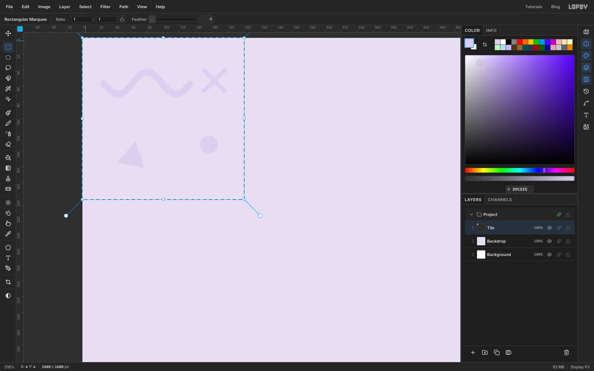

Choose **File → New** and make a **1600 × 1600** px document. Click the top
ruler at 800 and the left ruler at 800 to drop a guide through the centre
each way.

Set the foreground to `#E6DDF2`, press [[Cmd+A]] and choose **Edit → Fill**.
Press [[Cmd+D]] and rename the layer *Backdrop*.

Now draw one tile of the background print. Add a new layer called *Tile*,
marquee the top-left **200 × 200** px corner and fill it with `#E6DDF2`
again. Then switch the foreground to `#D9CEEE` and draw four little motifs
in the square:

- With the **Brush** (B) at **Size 9**, drag a wave across the top left, about 100 px long.
- With the **Pen**, click three corners of a small triangle under it, close it, make it a selection and fill it.
- With the **Elliptical Marquee**, draw a dot about 22 px across at the right and fill it.
- With the Brush at **Size 6**, draw a small X in the top right: click one corner, then [[Shift]]-click the opposite corner, twice.

Marquee the tile again, from the very corner of the canvas to 200, 200, and
choose **Edit → Define Pattern**.

## Draw a Bacterio tile for the sun

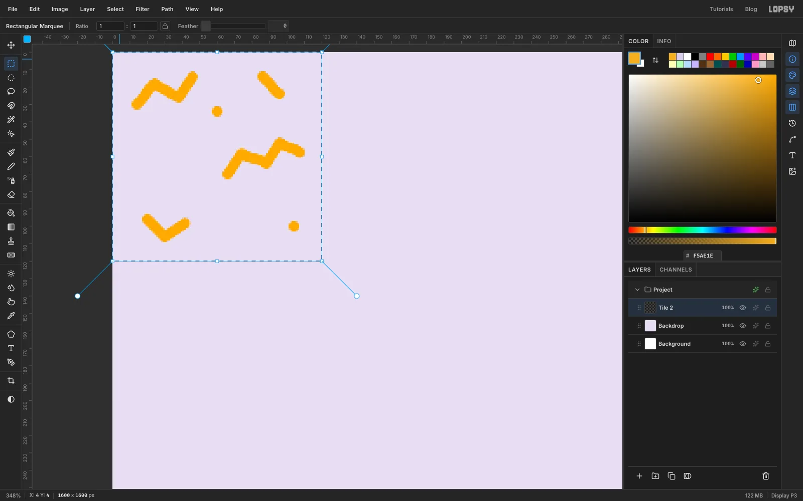

Delete the *Tile* layer with the trash button under the Layers panel. Add a
new layer called *Tile 2*. This tile stays transparent, because it will be
printed on top of the sun.

Set the foreground to `#F5AE1E` and the Brush to **Size 7**. In the
top-left **120 × 120** px corner, drag four short worms: two zigzags, a V and
a dash. Click two dots between them. It's a nod to Ettore Sottsass's
*Bacterio* print.

Marquee the corner out to 120, 120 and choose **Edit → Define Pattern**
again. Then delete *Tile 2*.

## Print the backdrop

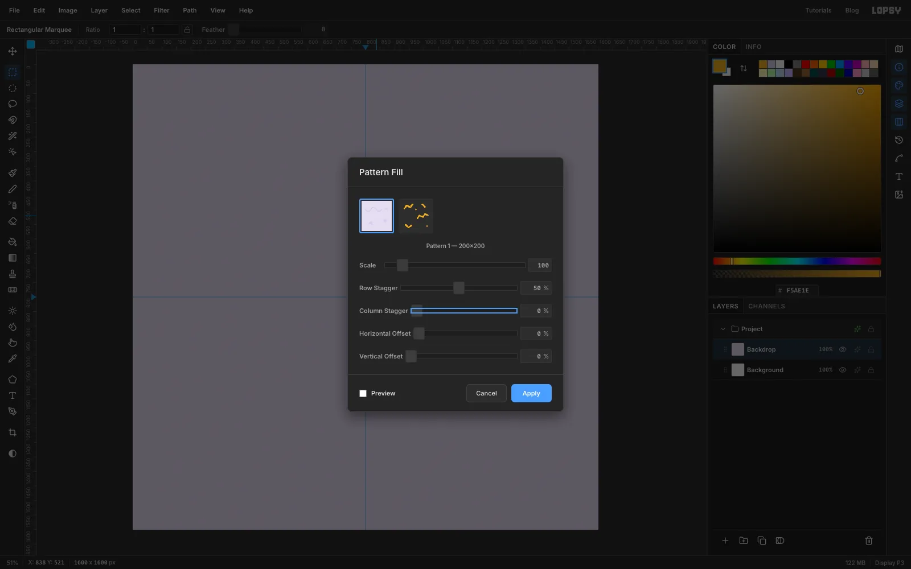

Click *Backdrop* and choose **Edit → Fill with Pattern…**. Pick
**Pattern 1**, set **Row Stagger** to **50** so that every other row shifts
half a tile, and click **Apply**. The canvas fills with a soft lilac print of
waves, crosses, triangles and dots.

## Select a ring for the merrow

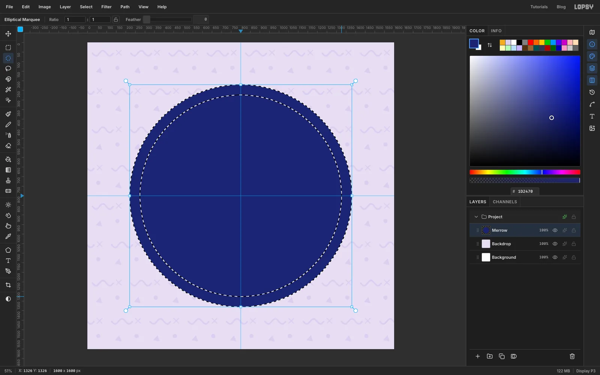

The merrow is the thick, rolled edge stitched around a patch. Add a layer
called *Merrow*. With the **Elliptical Marquee**, hold [[Cmd]] and drag a
circle from about 220, 220 to 1380, 1380. That's a radius of 580 around the
centre guides. Fill it with `#1D2470`.

Leave the selection active. Hold [[Alt]] and drag a second circle from about
274, 274 to 1326, 1326. The selection is now a ring about 54 px wide; the
navy disc itself stays whole.

## Wrap the edge in stitches

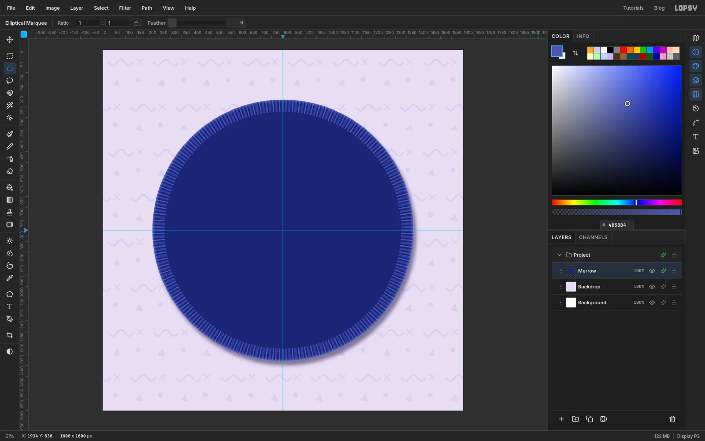

Set the foreground to `#34409E` and choose **Filter → Sunburst…**. Set
**Rays** to **120**, **Width** to **34** and **Length** to **100**. Leave
the centre at 50, 50, the middle of the patch, and click **Apply**. The rays
only land inside the ring, so they become stitches.

Run it again in `#4B58B4` with **Width 18** and **Rotation 1.5**. That puts
a thinner, lighter thread between each pair. Press [[Cmd+D]].

Open the effects for *Merrow* (the sparkle button on its row):

- **Inner Glow**: colour `#A9B4FF`, **Size 20**, **Opacity 80**. It lights the outer edge so the cord looks rounded.
- **Drop Shadow**: colour `#2A2050`, **Offset X 12**, **Offset Y 20**, **Blur 24**, **Opacity 55**.

## Lay the twill and a running stitch

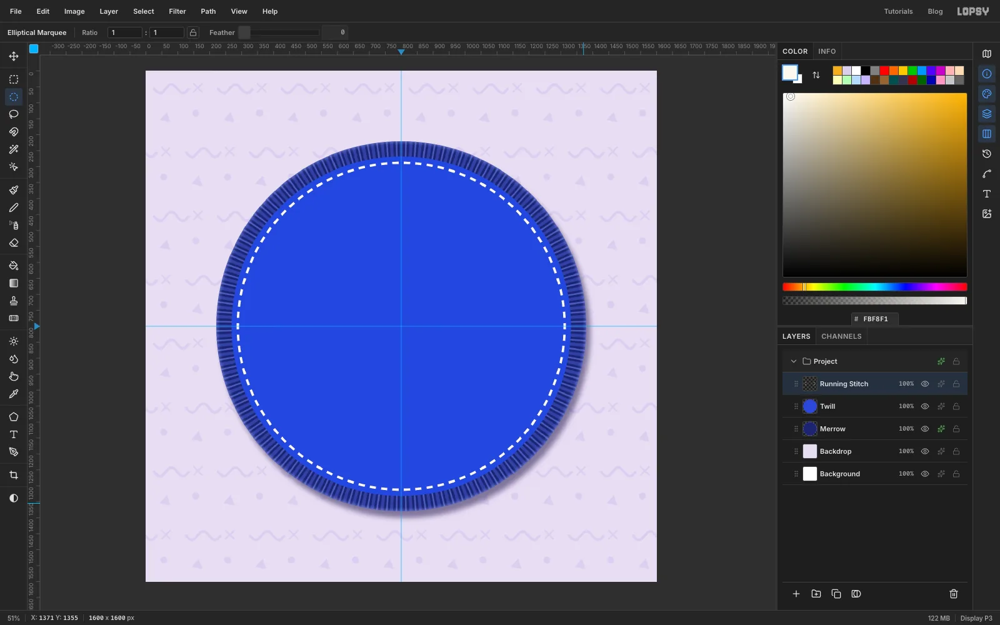

Add a layer called *Twill*. [[Cmd]]-drag a circle from about 268, 268 to
1332, 1332 and fill it with `#2C47D9`.

Add a layer called *Running Stitch*. Drag a circle from about 284, 284 to
1316, 1316, then [[Alt]]-drag another just 8 px inside it, which leaves a
thin ring. Set the foreground to `#FBF8F1` and run **Sunburst** with
**Rays 90** and **Width 55**. The rays become a ring of white dashes. Press
[[Cmd+D]].

## Add a printed sun

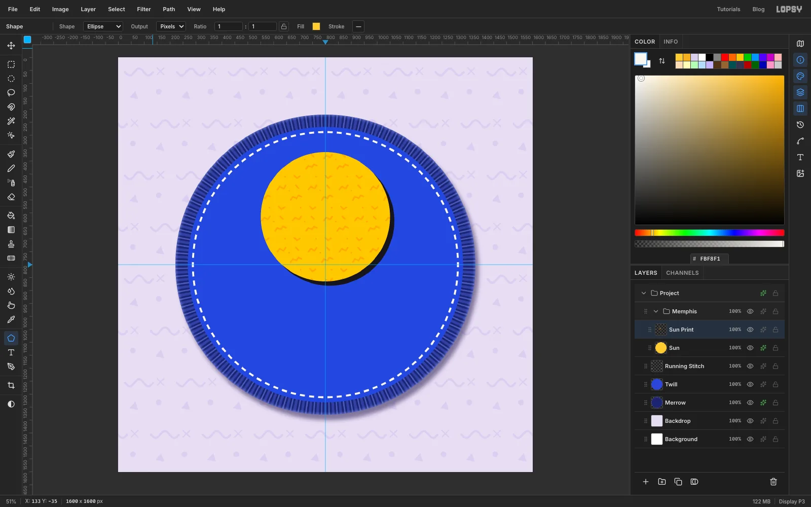

Click **New Group** under the Layers panel and name it *Memphis*. Add a
layer called *Sun* inside it.

Pick the **Shape** tool (U), set **Shape** to **Ellipse**, set the **Fill**
swatch to `#FFCB30` and remove the stroke. Press at about 800, 615 and drag
out 250 px each way. Give the layer a **Drop Shadow** in `#17151C` with
**Offset X 16**, **Offset Y 16**, **Blur 0** and **Opacity 100**. A hard,
offset shadow is a Memphis signature.

Add a layer called *Sun Print*. Choose **Edit → Fill with Pattern…**, pick
**Pattern 2** with **Row Stagger 50** and apply it. The worms now cover the
whole canvas. [[Cmd]]-click the *Sun* thumbnail to load the circle as a
selection. Click *Sun Print*, choose **Select → Inverse** and press
[[Delete]], then [[Cmd+D]].

## Draw a grid on the grid

Add a layer called *Grid Panel*. Marquee a square from about 384, 800 to
576, 992 and fill it with `#B79AF0`.

Press [[Cmd+']] to show the grid, and set the grid size in the options bar
to **32**. With **Snap** ticked, your clicks land on grid lines. Choose the
**Pencil** (N) at **Size 5** with `#17151C`. Draw a line on every grid line
of the square, the four edges included: click at one end and [[Shift]]-click
at the other. That's seven lines down and seven across. Press [[Cmd+']] to
hide the grid again.

## Tilt the grid panel

With the **Rectangular Marquee**, draw a box around the panel with about
25 px to spare on every side. Keep its edges away from the centre guide: a
marquee edge near a guide snaps onto it and would cut off the panel's top
line.

Switch to **Move** (V), take the round rotate handle just outside a corner
and turn the panel about **12°** anticlockwise. Press [[Cmd+D]] to drop it.

## Cut a half-dome

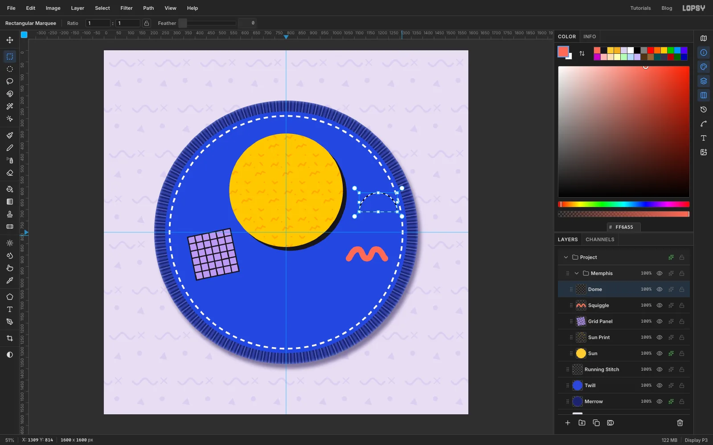

First, the squiggle. Add a layer called *Squiggle*, set the foreground to
`#FF6A55`, pick the **Pen** and set **Stroke** to **26**. Drag out five
smooth points, about 40 px apart, from 1075, 915 to 1235, 915. The second
and fourth rise to about 875, so the line waves up and down. Press [[Enter]]
to stroke it, then delete the path in the Paths panel.

Add a layer called *Dome*. With the **Elliptical Marquee**, [[Cmd]]-drag a
circle about 170 px across, centred at about 1205, 710. Switch to the
**Rectangular Marquee**, hold [[Alt]] and drag from just left of the circle,
level with its middle, down past its bottom-right corner. That cuts away the
lower half.

## Stripe and tilt the dome

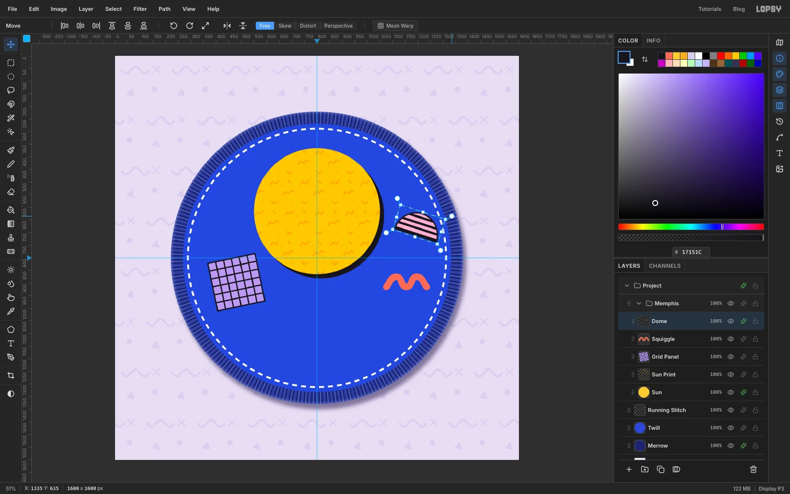

Fill the half-disc with `#FFB3D1`. While the selection is still active,
take the **Pencil** at **Size 9** in black and [[Shift]]-click lines straight
across the dome, about 22 px apart. The selection keeps the stripes inside
the dome. Press [[Cmd+D]] and add a black **Stroke** effect, **Width 5**.

Marquee around the dome with some space to spare, switch to **Move** and
rotate it about **18°** clockwise. Press [[Cmd+D]].

## Copy a confetti triangle

Add a layer called *Confetti*. With the **Shape** tool, set **Shape** to
**Polygon**, **Sides** to **3**, the fill to `#3CCDB5` and no stroke. Press
at about 565, 1105 and drag out about 36 px to draw a small triangle.

Marquee around it, press [[Cmd+C]] and then [[Cmd+V]]. The copy is pasted
on a new layer and the **Move** tool is picked for you. Drag it to about
1170, 1040, then use a rotate handle to turn it about **28°**. Press
[[Cmd+D]] and choose **Layer → Merge Down** to put both triangles on one
layer.

## Build the wheel

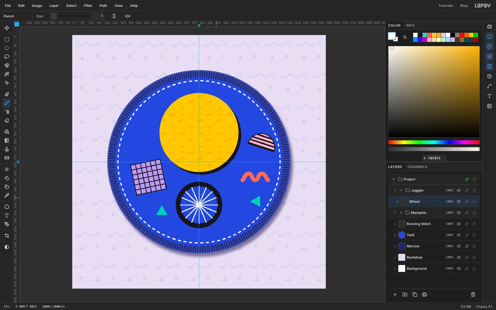

Collapse the *Memphis* group, click its row, and click **New Group**. Name
it *Juggler*. Add a layer called *Wheel*.

With the **Shape** tool on **Ellipse**, remove the fill and set the
**Stroke** to `#17151C` at **Width 30**. Press at about 800, 1072 and drag
out about 130 px each way for the tyre.

Pick the **Pencil** at **Size 5** in `#FBF8F1` for the spokes. Click on the
tyre's inner edge, then [[Shift]]-click directly opposite, straight through
the hub. Do this eight times, spaced evenly around the wheel, for sixteen
spokes.

## Add the fork and saddle

Add a layer called *Seat*. With the **Brush** at **Size 9** in black, draw
two fork prongs about 20 px apart. Click just under where the saddle will
be, around y 875, and [[Shift]]-click straight down at the hub.

With the **Shape** tool, draw a black **Ellipse** with no stroke for the
saddle, about 110 × 30, centred at about 800, 866.

## Stripe the legs

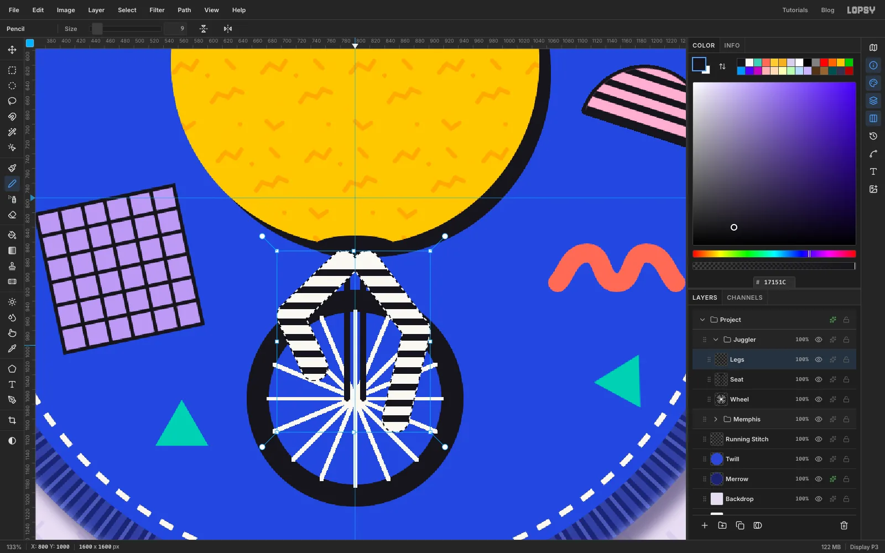

Add a layer called *Legs*. Pick the **Pen**, set **Stroke** to **36** and
the foreground to `#FBF8F1`. Each leg is three corner clicks, from hip to
knee to foot, then [[Enter]]:

- Left leg: about 784, 890 → knee at 712, 960 → foot at 745, 1030
- Right leg: about 816, 890 → knee at 884, 980 → foot at 855, 1100

The legs bow out to each side, so they never cross.

[[Cmd]]-click the *Legs* thumbnail. With the **Pencil** at **Size 9** in
black, [[Shift]]-click horizontal lines right across both legs, about 22 px
apart. The selection turns them into striped tights. Press [[Cmd+D]] and add
a black **Stroke** effect, **Width 6**.

## Add the crank, pedals and shoes

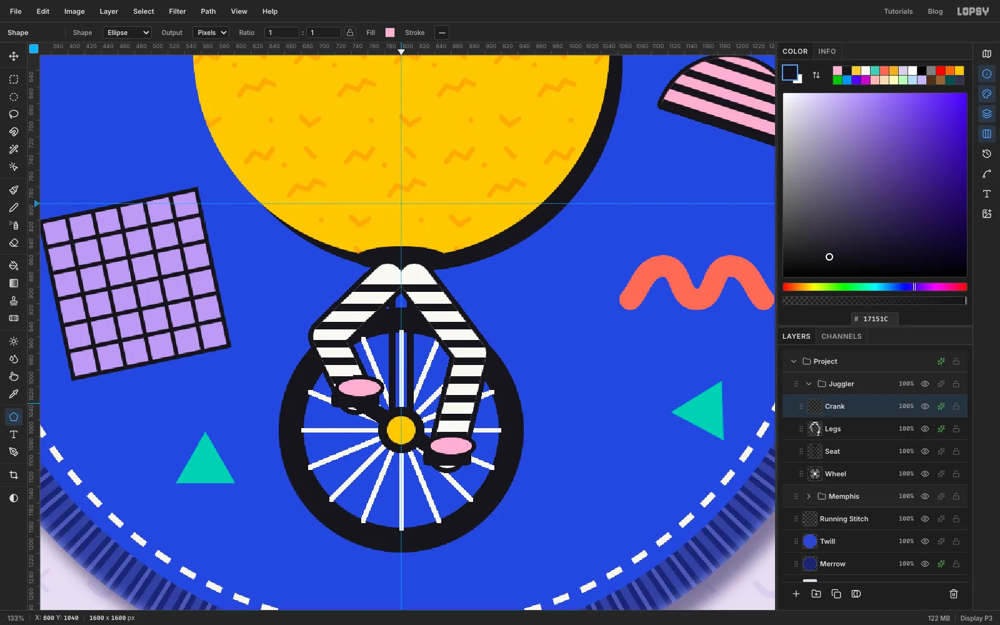

Add a layer called *Crank*. With the **Brush** at **Size 10** in black,
click on the left foot and [[Shift]]-click on the right foot. The line runs
straight through the hub.

Then, with the **Shape** tool:

- Draw an **Ellipse** with fill `#FFCB30` and a black stroke at **Width 6**, centred on the hub, about 40 px across.
- Draw a black **Rectangle** with no stroke, about 48 × 10, on each end of the crank for the pedals.
- Draw a `#FFB3D1` **Ellipse**, also with no stroke, about 50 × 20, sitting on each pedal for the shoes.

Give the layer a black **Stroke**, **Width 5**.

## Flip a triangle into a torso

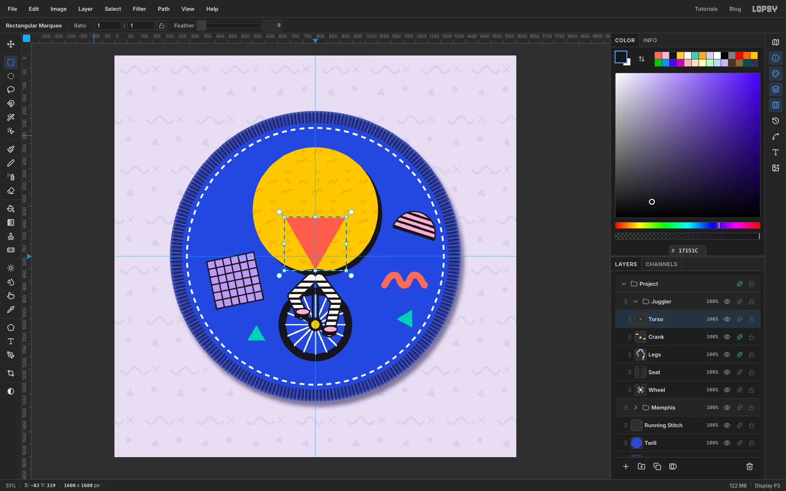

Add a layer called *Torso*. Draw a **Polygon** with **3** sides, fill
`#FF6A55` and no stroke, pressing at about 800, 750 and dragging out about
120 px. It points up. Marquee around it and choose **Image → Flip
Vertical**. Now it points down, and its tip touches the saddle. Press
[[Cmd+D]].

With the **Brush** at **Size 16** in black, click six polka dots inside the
triangle. Keep them at least 25 px away from the neck and the top corners,
where the arms will join. Add a black **Stroke**, **Width 6**.

## Raise the arms

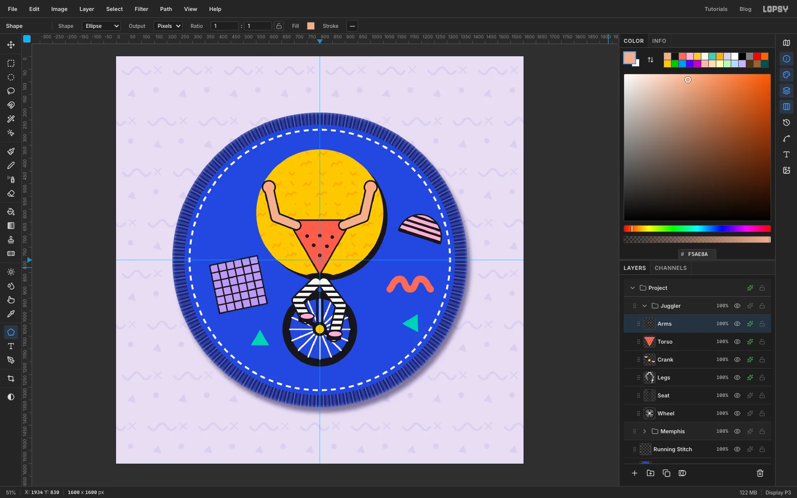

Add a layer called *Arms*. With the **Pen** at **Stroke 30** and the
foreground `#F5AE8A`, click three corners for each arm, from shoulder to
elbow to hand, then press [[Enter]]:

- Left arm: about 708, 664 → elbow at 626, 632 → hand at 602, 526
- Right arm: about 892, 664 → elbow at 974, 632 → hand at 998, 526

Straight bars with a sharp elbow look more Memphis than bendy noodle arms.
With the **Shape** tool, draw a `#F5AE8A` circle about 44 px across on the
end of each arm for the hands. Add a black **Stroke**, **Width 6**.

## Draw the head and face

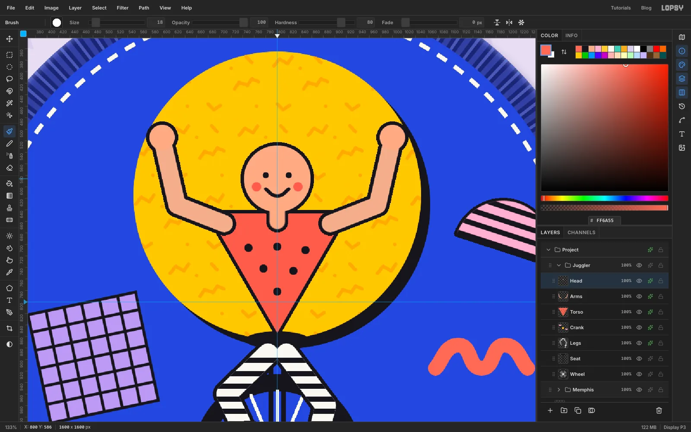

Add a layer called *Head*. With the **Brush** at **Size 30** in `#F5AE8A`,
click at about 800, 630 and [[Shift]]-click at 800, 660 for the neck. With
the **Shape** tool, draw a circle in the same colour, about 116 px across,
centred at about 800, 586.

Now the face:

- **Eyes**: the Brush at **Size 12** in black. Click once on each side, about 20 px from the middle.
- **Smile**: the **Pen** at **Stroke 6**. Click the left corner of the mouth, press and drag sideways at the bottom middle to bend it, click the right corner and press [[Enter]].
- **Cheeks**: the Brush at **Size 18** in `#FF6A55`. Click once beside each end of the smile.

Add a black **Stroke**, **Width 6**.

## Add a striped party hat

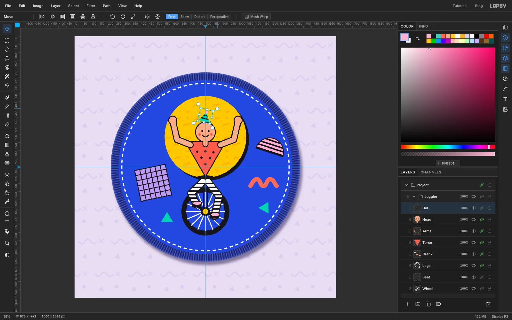

Add a layer called *Hat*. Draw a `#3CCDB5` **Polygon** with **3** sides
sitting on top of the head, centred at about 800, 490 and about 64 px
across. [[Cmd]]-click its thumbnail, then [[Shift]]-click two black Pencil
stripes across it at **Size 7**. Press [[Cmd+D]].

Click a pink pom-pom on the tip with the Brush at **Size 22** in
`#FFB3D1`. Marquee the hat, rotate it about **14°** clockwise and press
[[Cmd+D]]. Add a black **Stroke**, **Width 6**.

## Throw a dotted arc

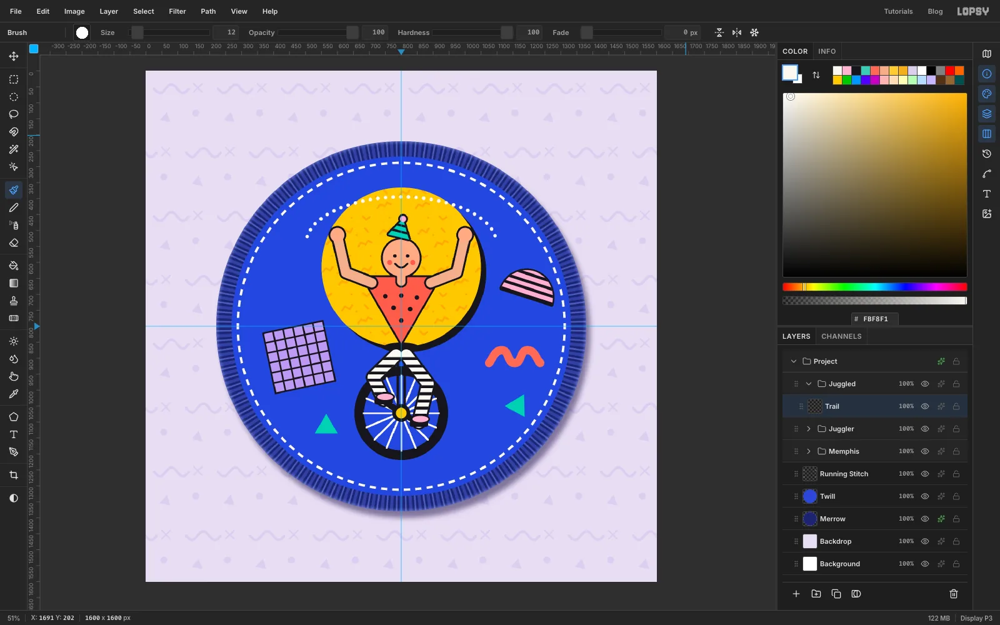

Collapse *Juggler*, click its row and add a new group called *Juggled*. Add
a layer called *Trail*.

Pick the **Brush** at **Size 12** in `#FBF8F1`. Click the brush thumbnail at
the left of the options bar to open the presets. On the **Shape** tab, drag
**Spacing** to its maximum, **200**, and set **Hardness** to **100**. With
that much spacing, a stroke turns into a row of separate dots. Drag one
smooth arc from just left of the left hand, up over the hat at about y 395,
and down to just right of the right hand. Set **Spacing** back to its
default, **25**, when you're done.

## Juggle a ball and a cone

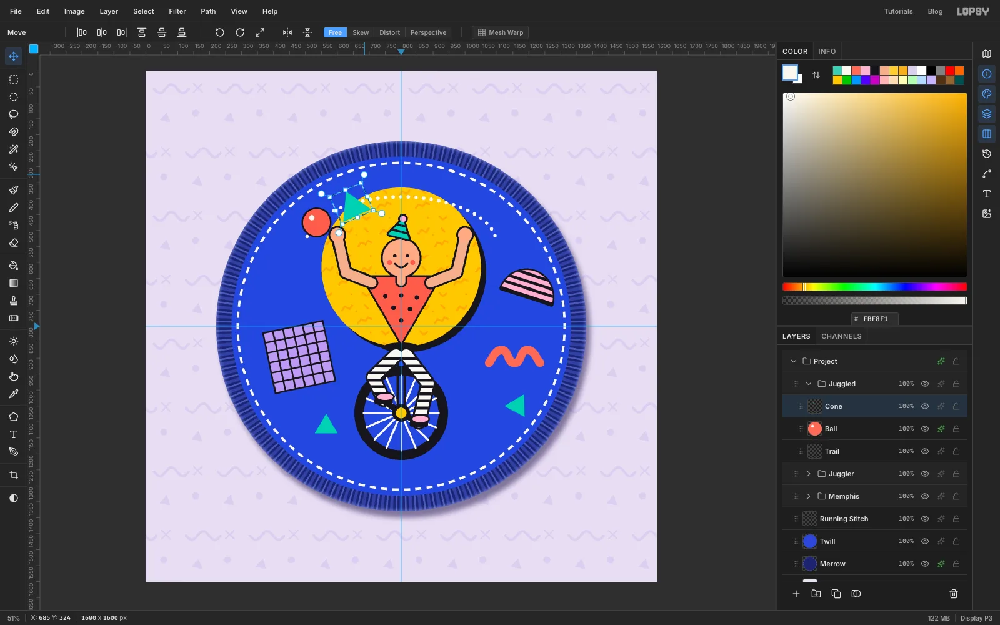

Each juggled shape gets its own layer and a black **Stroke** of **5**.

- **Ball**: on a *Ball* layer, a `#FF6A55` circle about 84 px across, centred at about 535, 475. Click a white highlight on its upper left with the Brush at **Size 18**.
- **Cone**: on a *Cone* layer, a `#3CCDB5` triangle centred at about 645, 416, dragged out about 48 px. Marquee it and rotate it about **24°** anticlockwise.

## Add a cube, a ring and a moon

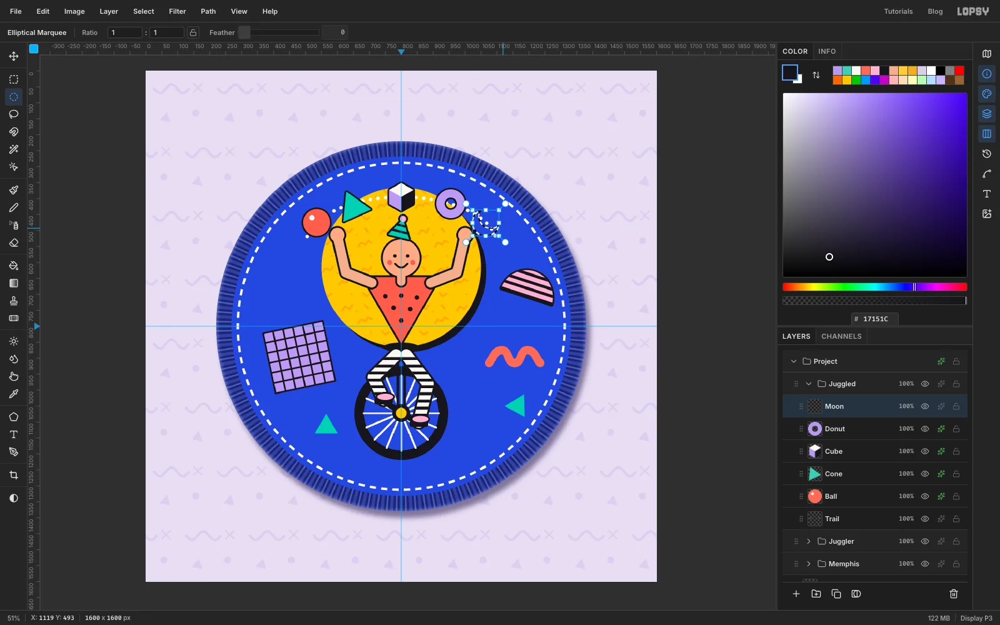

Give each of these a black **Stroke** of **5** as well.

- **Cube**: on a *Cube* layer around 800, 395, make three diamond-shaped faces with the **Pen**, each about 44 px on a side. For each face, click its four corners, close the path, click **Path to Selection** and fill it. Make the top `#FBF8F1`, the left `#B79AF0` and the right `#17151C`.
- **Donut**: on a *Donut* layer, a **Shape** ellipse with no fill and a `#B79AF0` stroke at **Width 26**, about 64 px across, centred at about 955, 416.
- **Moon**: on a *Moon* layer, [[Cmd]]-drag a circle about 84 px across, centred at about 1065, 475. Then [[Alt]]-drag a circle of about the same size, shifted about 20 px up and to the right, to bite out a crescent. Fill it with `#FBF8F1` and press [[Cmd+D]].

Finally, click the *Juggled* group's row so the whole set is active. With
**Move**, drag it up about **10 px** to give the hat a little more air.

## Cut the ribbon tails

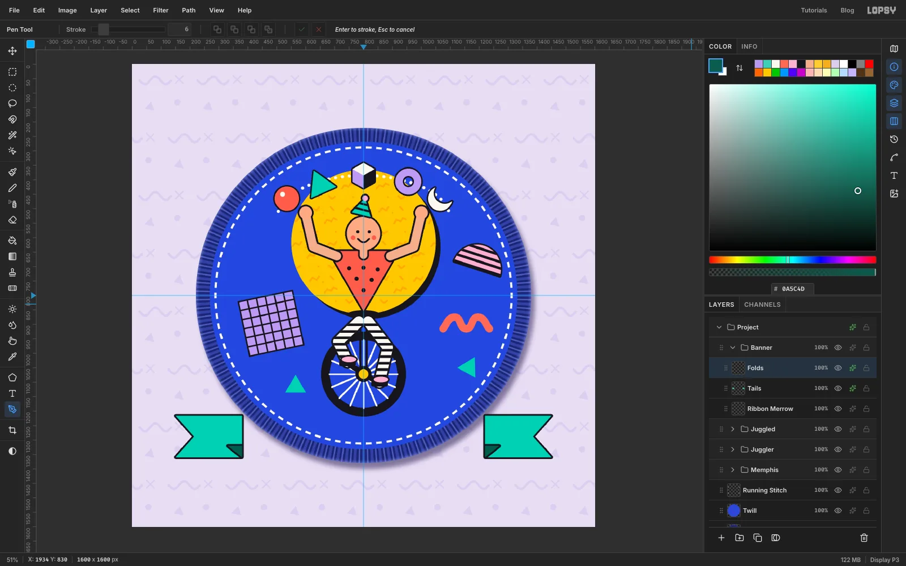

Collapse *Juggled*, click its row and add a group called *Banner*. Inside
it, add an empty layer called *Ribbon Merrow* first. You'll fill it later.
Then add a layer called *Tails*.

With the **Pen**, click the left tail's five corners: about 150, 1216 →
380, 1216 → 380, 1360 → 150, 1360 → in to a notch at 214, 1288. Close the
path, click **Path to Selection** and fill it with `#3CCDB5`. Make the
right tail as its mirror image, from 1450 in to 1220, and fill that too. Add
a black **Stroke**, **Width 6**.

Add a layer called *Folds*. With the Pen, make a small triangle at the inner
bottom corner of each tail, from about 330, 1320 to 380, 1320 to 380, 1360
on the left and mirrored on the right. Fill both with `#0A5C4D`, much darker
than the tails, so they read as the back of the ribbon folding under. Add a
black **Stroke**, **Width 6**.

## Lay and stitch the ribbon panel

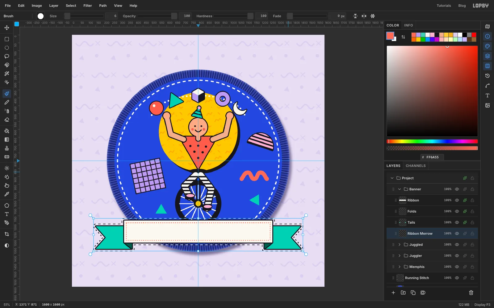

Add a layer called *Ribbon*. Marquee from about 330, 1180 to 1270, 1320,
fill it with `#FBF8F1` and press [[Cmd+D]].

For a running stitch, pick the Brush at **Size 6** in `#FF6A55` and set
**Spacing** to **200** again. Click about 14 px inside one corner of the
panel, then [[Shift]]-click each of the other corners in turn and back to
the first. Set **Spacing** back to **25** and add a black **Stroke**,
**Width 6**.

Now [[Cmd]]-click the *Tails* thumbnail, then [[Cmd+Shift]]-click *Folds*
and *Ribbon* to add them. Choose **Select → Grow…** and grow the selection
by **14** px.

## Give the ribbon its own merrow

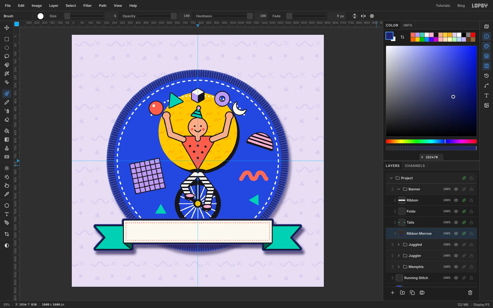

Click *Ribbon Merrow* and fill the grown selection with `#1D2470`. Press
[[Cmd+D]]. The navy edge now wraps all the way around the tails and the
panel, so the ribbon reads as part of the same stitched patch.

Give *Ribbon Merrow* an **Inner Glow** in `#A9B4FF` (**Size 8**,
**Opacity 80**). Add a **Drop Shadow** in `#2A2050` (**Offset X 14**,
**Offset Y 22**, **Blur 22**, **Opacity 70**).

## Set the title

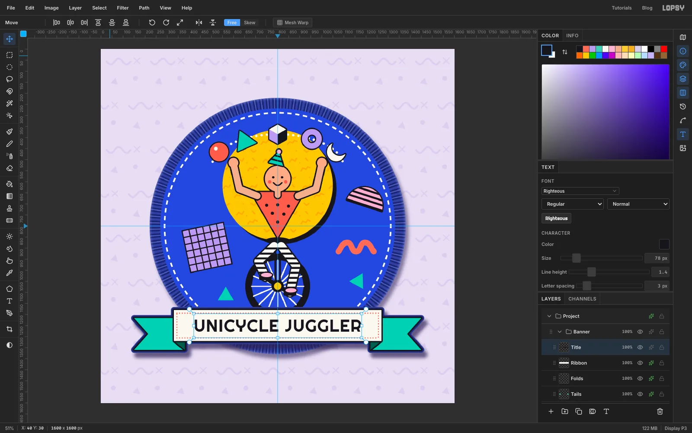

Click *Ribbon* so the type lands in the *Banner* group. Pick the **Text**
tool (T) and choose **Righteous** at **Size 78** in `#17151C`. Click in an
empty area at the top of the canvas and type `UNICYCLE JUGGLER`. Press
[[Tab]] to finish, set **Letter spacing** to **3** in the Text panel, and
rename the layer *Title*.

Switch to **Move** and drag the type onto the ribbon. Nudge it with the
arrow keys until it sits in the middle of the panel by eye, with equal space
at both ends and above and below. All the letters are capitals, so there are
no descenders to worry about.

## Add the EST. 1981 badge

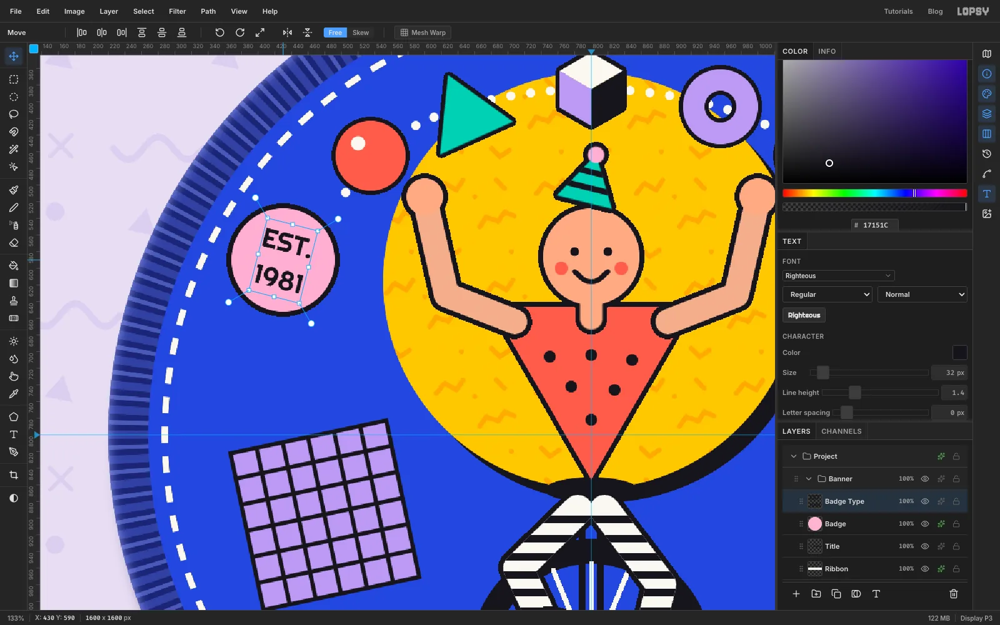

Add a layer called *Badge*. Draw a `#FFB3D1` circle about 124 px across,
centred at about 430, 590, and give it a black **Stroke** of **6**. It sits
clear of the sun, the ball and the running stitch.

With the **Text** tool, still on **Righteous**, set **Size 32**, set
**Letter spacing** back to **0** and change **Align** to **Center**. Click
in empty space and type `EST.`, press [[Enter]], and type `1981`. Press
[[Tab]] and rename the layer *Badge Type*.

Switch to **Move** and nudge the type into the middle of the disc. Then
drag the round rotate handle at its top-right corner to turn it about
**14°** clockwise. The type stays live. Nudge it again if it drifts off
centre.

## Move a texture layer to the top

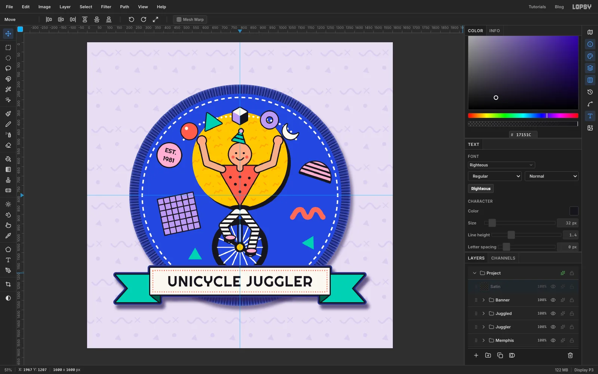

Now for the embroidery. Collapse *Banner*, click its row and add a layer
called *Satin*. It lands inside the group, but it needs to sit above
everything. Drag it by the grip on the left of its row and drop it on the
*Project* row at the top. It goes straight to the top of the stack.

## Make satin stitches

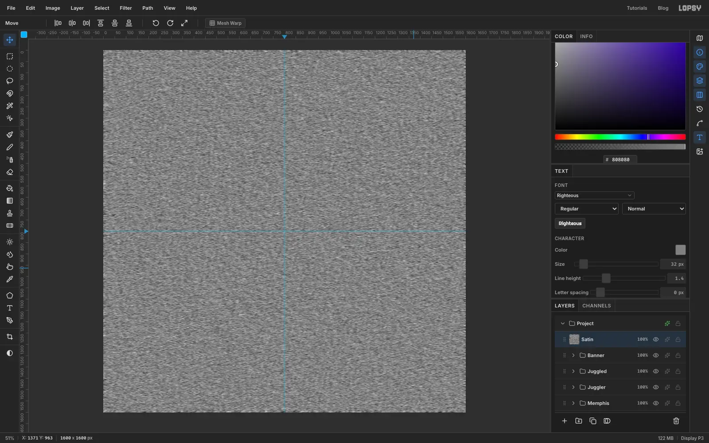

Fill *Satin* with `#808080`. Then run these filters in order:

1. **Filter → Add Noise…**: **Amount 100**, **Mono**, **Gaussian**.
2. **Filter → Motion Blur…**: **Angle 0**, **Distance 10**. The specks stretch into short threads.
3. **Filter → Brightness/Contrast…**: **Contrast 100**. Run it twice, because the blur flattens the noise.
4. **Filter → Emboss…**: **Angle 135**, **Strength 60**. Each thread now catches light on one side.

## Trim the stitches to the field

On a real patch every area of colour is stitched in its own direction. This
first layer covers the blue field, so trim it to that:

1. [[Cmd]]-click *Merrow* and [[Cmd+Shift]]-click *Ribbon Merrow*. Choose **Select → Inverse** and press [[Delete]]. Everything outside the patch is gone.
2. Load the sun, the figure and the ribbon. [[Cmd]]-click *Sun*, then [[Cmd+Shift]]-click *Legs*, *Torso*, *Arms*, *Head*, *Hat*, *Tails*, *Folds* and *Ribbon*. Press [[Delete]] and then [[Cmd+D]].
3. Set the layer to **Overlay** at **70%** opacity.

## Stitch the sun, the figure and the ribbon

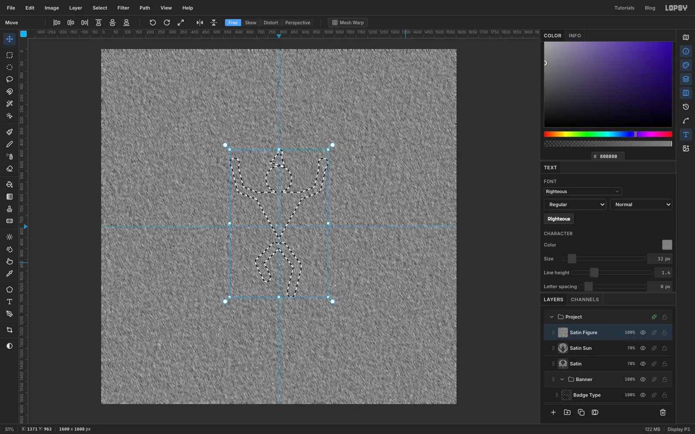

Each remaining area gets its own layer. For each one, add the layer above
the last, fill it with `#808080` and run the same four filters, changing only
the blur:

- **Satin Sun**: use **Filter → Radial Blur…** at **Amount 14** in place of Motion Blur, so the stitches radiate from the middle of the patch. [[Cmd]]-click *Sun*, then [[Cmd+Alt]]-click *Legs*, *Torso*, *Arms*, *Head* and *Hat* to take the figure out. Choose **Inverse**, press [[Delete]], and set it to **Overlay**, **70%**.
- **Satin Figure**: **Motion Blur Angle 60**. Load the five figure layers with [[Cmd]] and [[Cmd+Shift]], choose **Inverse**, press [[Delete]], and set it to **Overlay**, **70%**.
- **Satin Ribbon**: **Motion Blur Angle 90**, so the stitches run across the ribbon. Keep only *Tails*, *Folds* and *Ribbon*. Set it to **Multiply** at **22%**, because Overlay barely shows on the cream panel.

## Export the patch

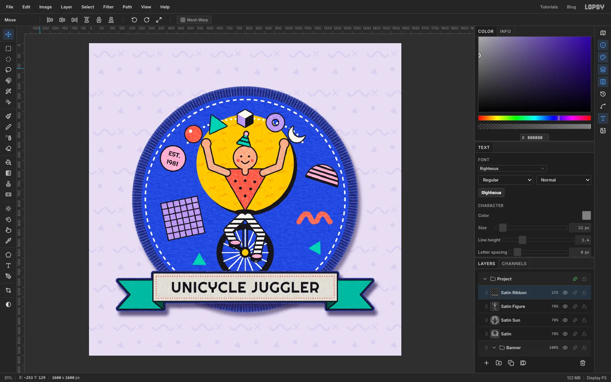

Press [[Cmd+;]] to hide the guides. Then choose **File → Quick Export PNG**
for the artwork and **File → Save Project** to keep the layers. At full
size, every colour has a fine thread texture, the sun's stitches radiate,
and the ribbon's run across it.
