Henri Rousseau never travelled to a jungle. He painted his tigers and
monkeys from visits to the Paris botanical gardens and the natural history
museum. The result is a style people now call *naive art*. Every leaf is a flat,
cut-out shape with neat pale veins. The plants are stacked in layers like
stage scenery, and there is very little perspective. It suits a digital
editor perfectly, because every one of those layers can be a real layer.

In this tutorial you'll paint **Jaguar Bossa**, a 1500 × 1500 px album
cover for an imaginary bossa nova record by the *Lua Verde Trio*. A jaguar
sleeps in a moonlit clearing, framed by banana leaves, a palm, an orange
tree, snake plants and red hibiscus.

The jaguar's head is traced from
[a photo of a sleeping jaguar](https://commons.wikimedia.org/wiki/File:Jaguar_at_Louisville_Zoo.jpg)
taken at the Louisville Zoo and released into the public domain on
Wikimedia Commons. Download the 960 px wide version to follow along. Any
side-on photo of a big cat resting its chin on the ground works just as well.

Along the way you'll use:

- linear and radial **gradients** inside selections, and **Fill**
- the **Elliptical Marquee** and **Lasso** with [[Shift]] to add and [[Alt]] to subtract
- **Select → Shrink…** and **Grow…** for rims and an outline around the whole animal
- **Clouds**, **Gaussian Blur** and **Add Noise**
- **Outer Glow**, **Inner Glow** and **Drop Shadow**, plus the **Multiply** and **Overlay** blend modes
- pasting a reference photo, scaling it with the **Move** tool and tracing over it
- a custom tip made with **Edit → Define Color Brush…**, and brush **Size Jitter** and **Angle Jitter**
- **Radial Symmetry** on the Brush for five-petal flowers, and a tapered brush for grass
- copy, paste, scale and rotate with the **Move** tool, and move a group and its shadow together
- ruler **guides**, the **grid**, and live text in **Caprasimo** and **Kalam**

The palette:

- Night sky `#16324A` → `#3D7A82` → `#C9DFC1`, moon `#F6EACB`, stars `#F7EED6`
- Distant trees `#4F7C6B` / `#365F52`, tree glow `#8FB89A`
- Palm `#24493A` / `#2F5A45`, trunks `#4A3A2C`, trunk rings `#2C2219`, vines `#1D382A`
- Leaves `#3F7A45` / `#2F5E36` / `#1F3D2B`, bright leaf `#4F8A3E`, pale olive `#6E9A50`, veins `#A9CF7E`
- Orange tree `#3C6B3A` → `#1F3D2B` → `#15291D`
- Oranges `#E08A3C`, orange glow `#B8481A`, highlights `#FFD9A0`
- Ground `#4C6B30` → `#2E4520`, grass `#3F7A36` / `#79A852` / `#22401F`, shadow `#16220F`
- Jaguar fur `#A9733A` → `#CE9B57` → `#E9CB98`, muzzle `#F2E2BF`, nose `#B9776A`
- Rosette centre `#8E5524`, spots `#1E130B`, outline `#4A2A12`
- Hibiscus `#D8432E` / `#9E2A22`, stamens `#F2C14E`
- Snake plants `#24502F` / `#3B7344` / `#2F6238`, rims `#B4C062`, stripes `#4E8A47`
- Title `#F4E3B5` and `#E9A15A`, title shadow `#0D2232`

## Paint the night sky

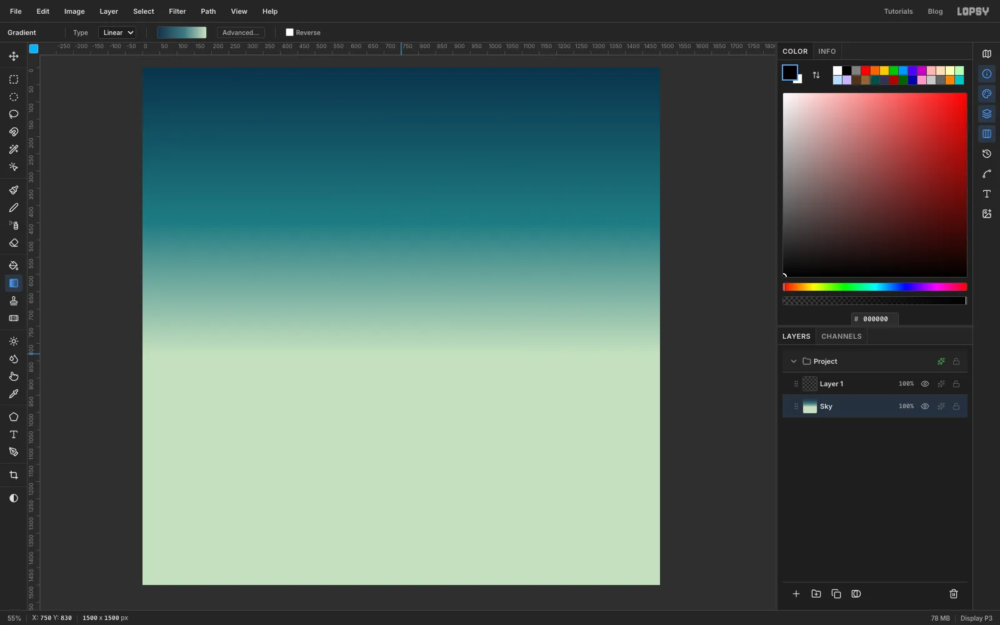

Choose **File → New**, keep the unit on **Pixels**, and create a
**1500 × 1500** document. Rename *Background* to *Sky*.

Pick the **Gradient** tool, set **Type** to **Linear** and open
**Advanced…**. Click the row under the bar to add a stop, and type a colour
into the **Hex** field for each stop: `#16324A` at the left, `#3D7A82`
just past the middle (the editor shows **Position: 55%** under the bar)
and `#C9DFC1` at the right. Click **Done**. Drag from the top edge
straight down to just past the middle of the canvas. The sky only needs to
be pale where the tree line will be. Everything below gets covered.

The new document also comes with an empty *Layer 1* at the top of the
Layers panel. Ignore it for now. You'll delete it near the end.

## Scatter some stars

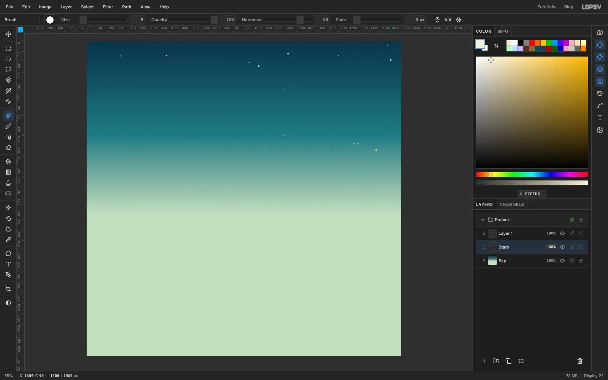

Add a layer called *Stars*. Pick the **Brush**, set **Size** to **5** and
the foreground to `#F7EED6`. Click about twenty times across the top half
of the sky. Keep the top-left block clear for the title, and leave a gap at
the upper right for the moon. Add four larger stars at **Size 9**, then
drop the layer's opacity to **80%**.

## Draw the moon

Add a layer called *Moon*. Pick the **Elliptical Marquee**, hold [[Cmd]]
and drag a circle about 265 px across in the upper right, leaving roughly a
hundred pixels to the top and right edges. [[Cmd]] keeps it perfectly round.
Set the foreground to `#F6EACB` and choose **Edit → Fill**, then
press [[Cmd+D]].

## Give the moon a glow

Click the effects button on the *Moon* row to open the effects drawer.
Turn on **Outer Glow** and set **Size** to **70** and **Opacity** to
**45**. Close the drawer.

## Mottle the moon with Clouds

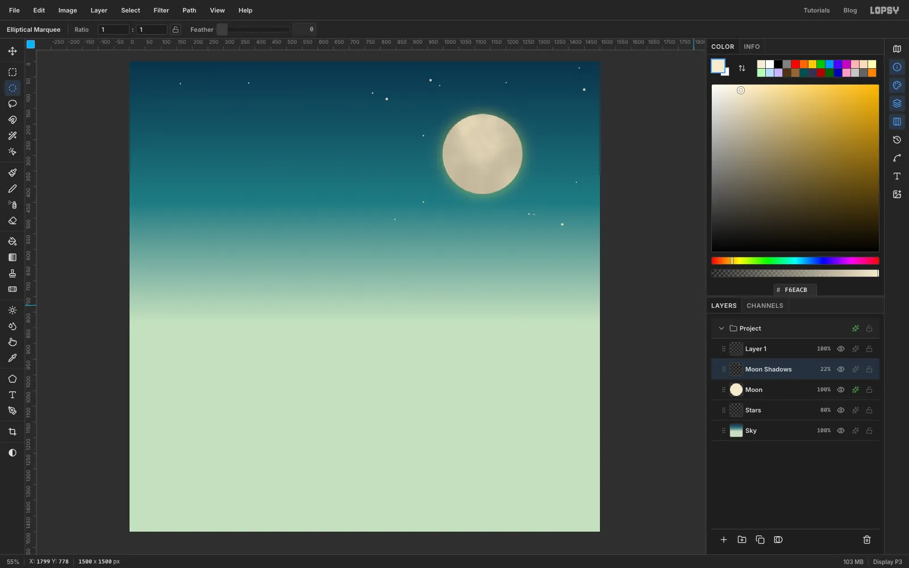

Add a layer called *Moon Shadows*. [[Cmd]]-click the *Moon* thumbnail in
the Layers panel to load the moon as a selection. Choose
**Filter → Clouds…** with **Scale 6** and click **Apply**, then
[[Cmd+D]]. Set the layer's blend mode to **Multiply** and its opacity to
**22%**. Only a whisper of the grey shows through.

## Build the far tree line

Add a layer called *Far Trees*. With the **Elliptical Marquee**, drag a
rounded crown about 200 px wide whose bottom sits a little below the middle
of the canvas. Then hold [[Shift]] and drag more crowns of different sizes
side by side, all the way across, so they overlap. [[Shift]] adds each one to
the selection. Finish with a [[Shift]]-dragged **Rectangular Marquee** from
under the crowns to the bottom of the canvas. Start and end it just outside
the left and right edges so no sliver is left uncovered.

Set the foreground to `#4F7C6B` and choose **Edit → Fill**, then
[[Cmd+D]].

## Add a nearer tree line

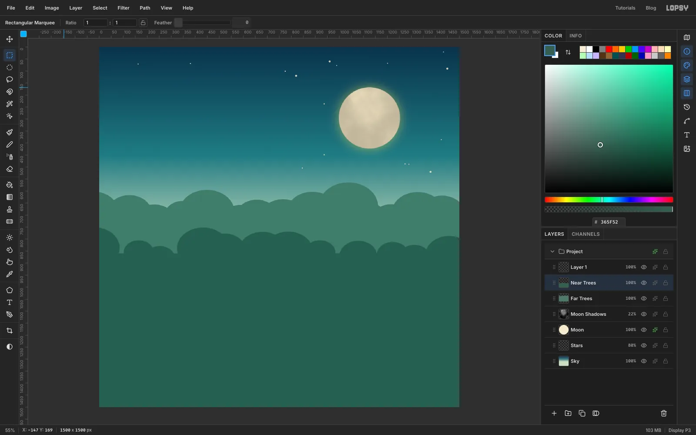

Add a layer called *Near Trees* and repeat the same steps a little lower
down, with slightly smaller crowns, filled with `#365F52`. Two flat bands
of rounded trees are all the depth a naive painting needs.

## Light the tops of the far trees

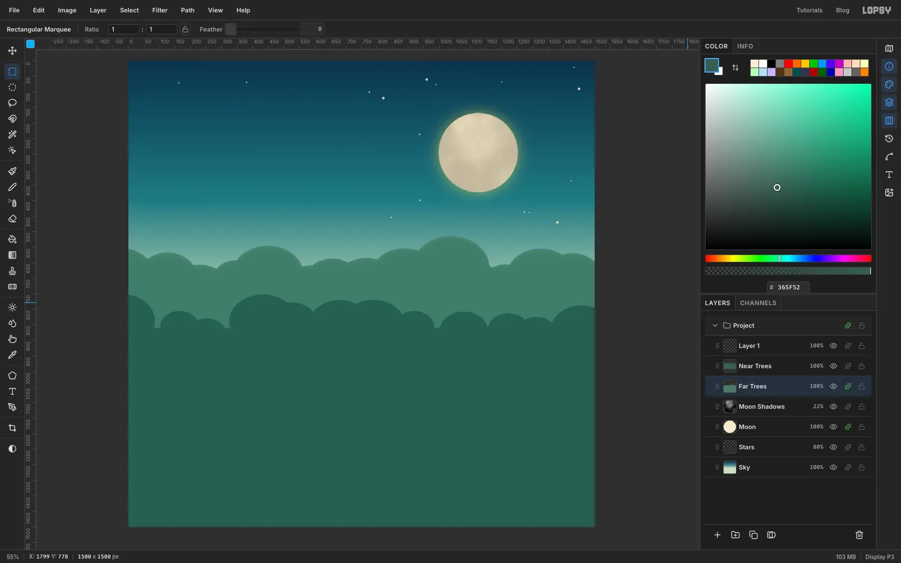

Click *Far Trees* and open its effects drawer. Turn on **Inner Glow** with
the colour `#8FB89A`, **Size 26** and **Opacity 35**. The moonlight now
catches the edge of every crown.

## Paint the palm trunk

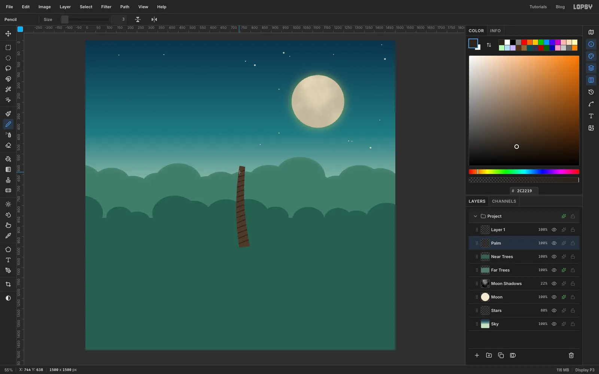

Add a layer called *Palm*. With the **Lasso**, draw a slim trunk that
leans a little as it rises from about two-thirds of the way down the canvas
up to just above the tree line. Make it about 50 px wide at the bottom and
30 px at the top. Fill it with `#4A3A2C`.

Pick the **Pencil**, set **Size** to **3** and the foreground to `#2C2219`.
For each ring, click one side of the trunk and [[Shift]]-click the other.
Add about fifteen rings up the trunk.

## Fan out the palm fronds

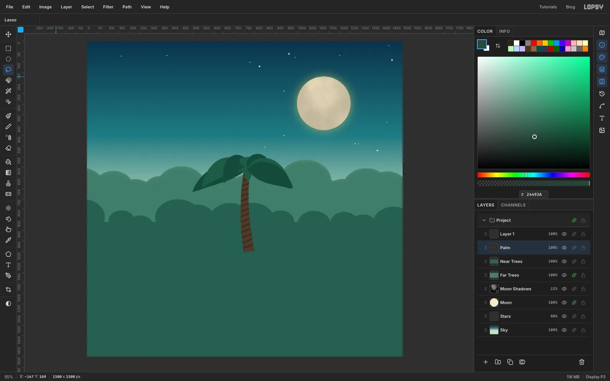

Still on *Palm*, lasso seven long, pointed fronds that start at the top of
the trunk. Spread them in a fan from left to right, and let each one arch
up and then droop at the tip. Fill them one at a time, alternating
`#24493A` and `#2F5A45` so neighbouring fronds separate. Keep the tops of
the fronds well below where the title will go.

## Hang vines from the top corners

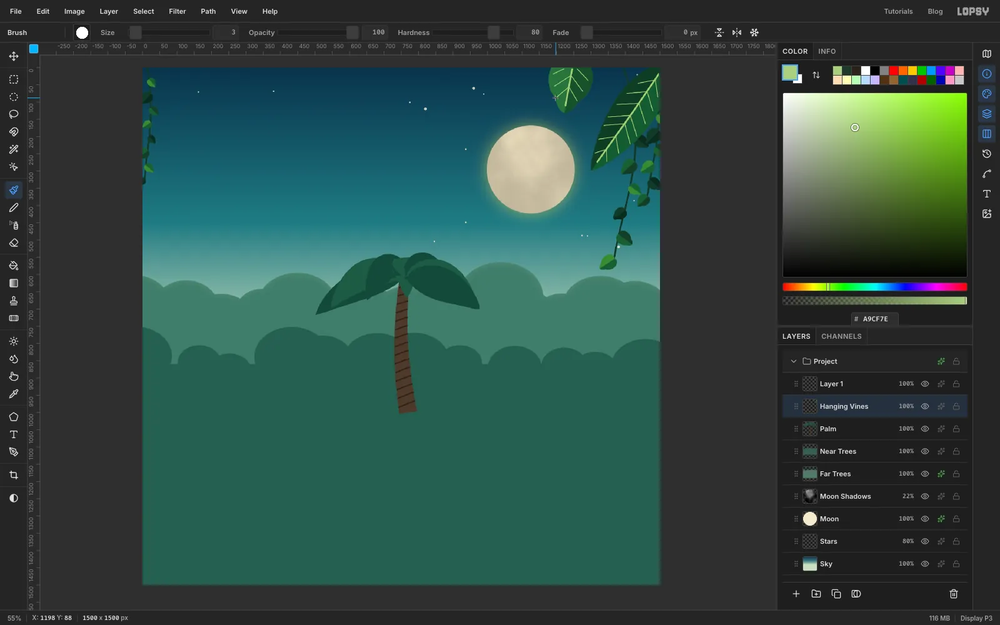

Add a layer called *Hanging Vines*. Pick the **Brush** at **Size 6** with
`#1D382A` and drag two swaying vines down from the top edge near the right
side, one long and one short. Drag a third one down close to the left edge.
Lasso small heart-shaped leaves on alternate sides of each vine, and fill
each one with a light colour and then its left half with a darker one. Use
`#2F5E36`/`#1F3D2B`, `#4F8A3E`/`#2F5E36` and `#1D3A2A`/`#132A1E` in turn.

Then lasso a big banana leaf dropping in from the top-right corner and a
heart leaf hanging from the top edge. Fill them in two greens the same
way, and give them pale veins as described in *Paint the banana leaves*
below. These frame the sky the way Rousseau's foliage always presses in from
the edges.

## Shade the orange tree's crown

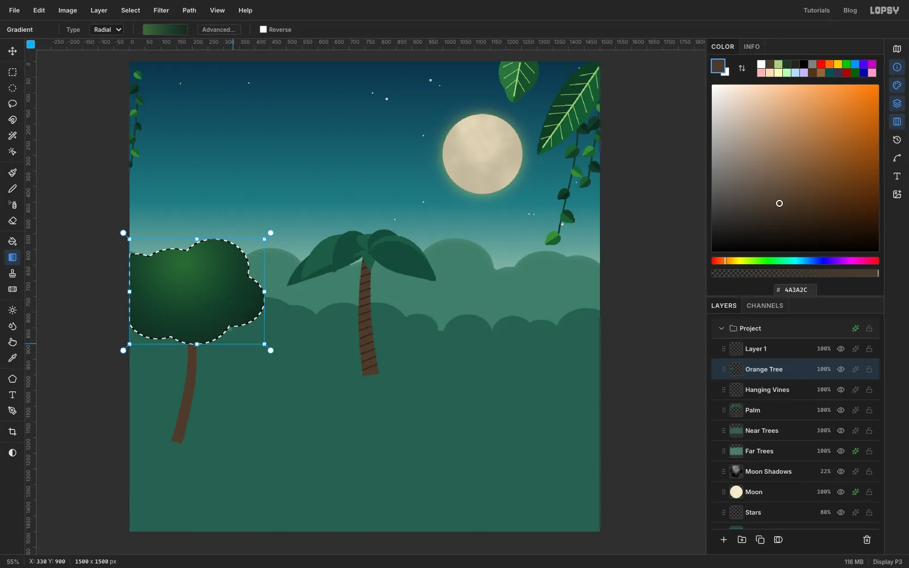

Add a layer called *Orange Tree*. Lasso a thin trunk on the left side,
from the ground line up into where the crown will be, and fill it with
`#4A3A2C`.

With the **Elliptical Marquee**, drag six overlapping round shapes into a
cloud-like crown, holding [[Shift]] for all but the first. Pick the
**Gradient** tool, set **Type** to **Radial**, and give it the stops
`#3C6B3A`, `#1F3D2B` at 60% and `#15291D`. Drag from the upper left of the
crown to its lower right. The gradient stays inside the selection.
Press [[Cmd+D]].

## Hang the oranges

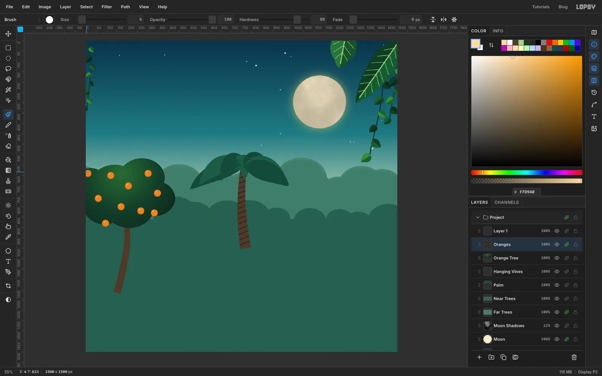

Add a layer called *Oranges*. With the **Elliptical Marquee**, [[Shift]]-drag
ten small circles, about 34 px across, scattered over the crown. Fill them
with `#E08A3C` and deselect.

Open the *Oranges* effects drawer and turn on **Inner Glow** with colour
`#B8481A`, **Size 9** and
**Opacity 70**. This darkens each orange towards its rim, so it looks round.
Then use the **Brush** at **Size 6** with `#FFD9A0` to click one highlight
on the upper left of every fruit.

## Paint the banana leaves

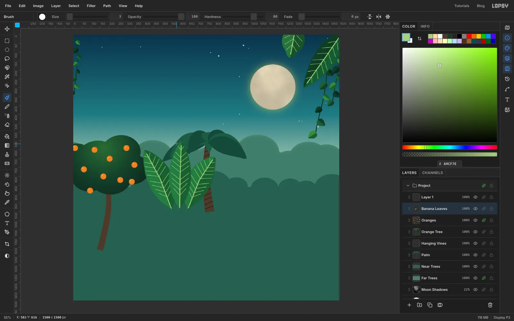

Add a layer called *Banana Leaves*. Lasso three long, pointed leaves that
rise from the same point, about two-thirds of the way down the canvas just
left of the palm. Fan them out to the
left, straight up and to the right.

For each leaf:

1. Fill the whole leaf with `#3F7A45`.
2. Lasso the left half up to the midrib and fill it with `#2F5E36`.
3. Pick the **Magic Wand**, click the light half and [[Shift]]-click the
   dark half to select the whole leaf, then choose **Select → Shrink…**
   with **4** px. Now the veins can't run past the edge.
4. With the **Brush** and `#A9CF7E`, draw the midrib at **Size 6** by
   clicking the base and [[Shift]]-clicking the tip.
5. At **Size 3**, click on the midrib and [[Shift]]-click towards the edge
   for each vein. Angle every vein towards the tip.

## Tear the banana leaves

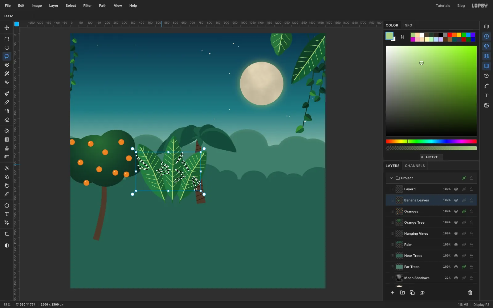

Real banana leaves split in the wind, and Rousseau painted those splits.
With the **Lasso**, draw a thin wedge from the edge of a leaf most of
the way to the midrib. Hold [[Shift]] and add three or four more wedges to
every leaf, then press [[Delete]] and [[Cmd+D]]. The trees behind
show through the cuts.

## Add heart-shaped leaves on the right

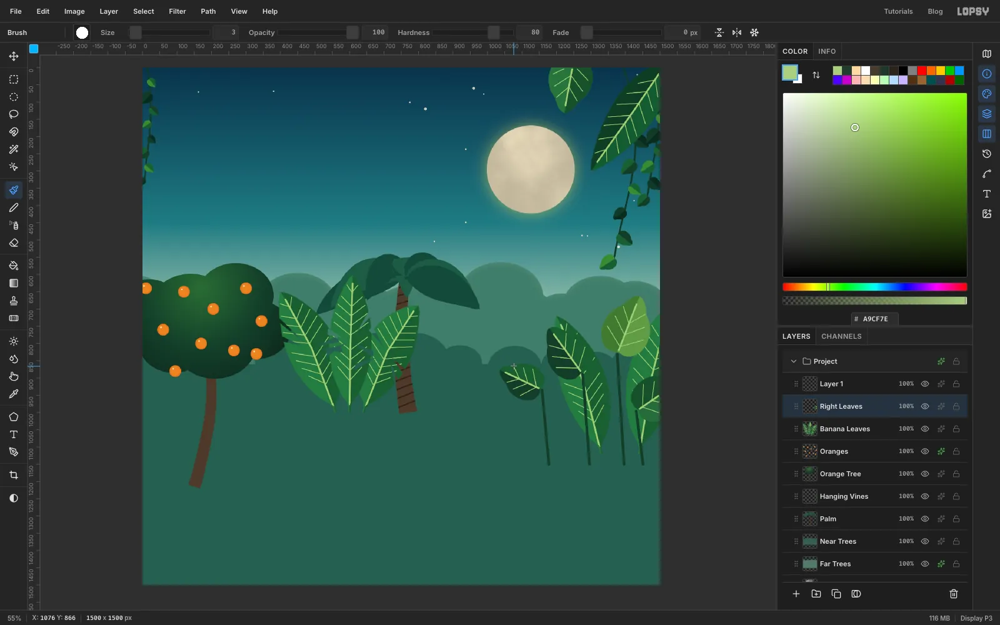

Add a layer called *Right Leaves*. Paint two more tall banana leaves on the
right side, the same way as before. Open the Brushes modal from the brush
tip thumbnail and make sure **Taper** is **0**, otherwise long strokes
fade away to nothing. Then draw four stalks at **Size 9** in `#1F3D2B`.

At the top of each stalk, lasso a large heart-shaped leaf and paint it
with a half-tone and veins as before. Give the leaves three different
greens: `#2F5E36`/`#1F3D2B`, a pale olive `#6E9A50`/`#4F7A3A` and
`#3A6B40`/`#28502F`. Mixing light and dark leaves is what makes a naive
jungle feel dense.

## Lay down the ground

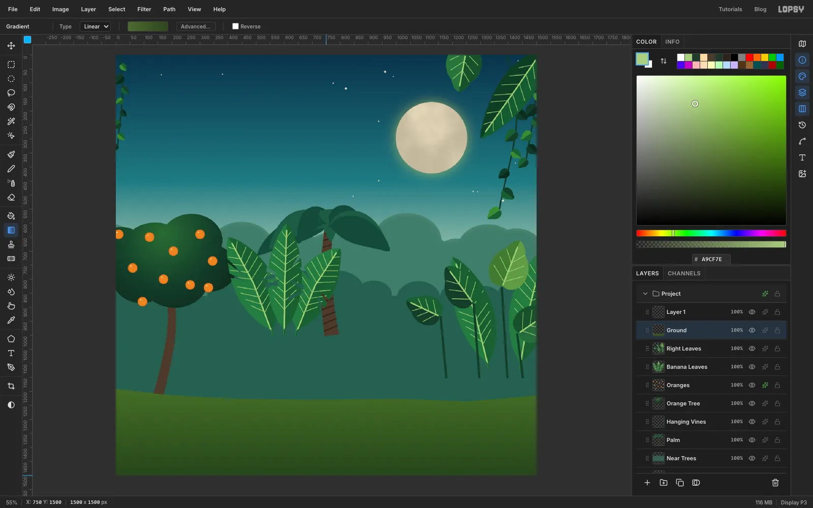

Add a layer called *Ground*. Lasso a band from a gently curving line about
four-fifths of the way down the canvas to the bottom, running past both
edges. Fill it with a linear gradient from `#4C6B30` at the top to
`#2E4520` at the bottom, then deselect.

## Paste the reference photo

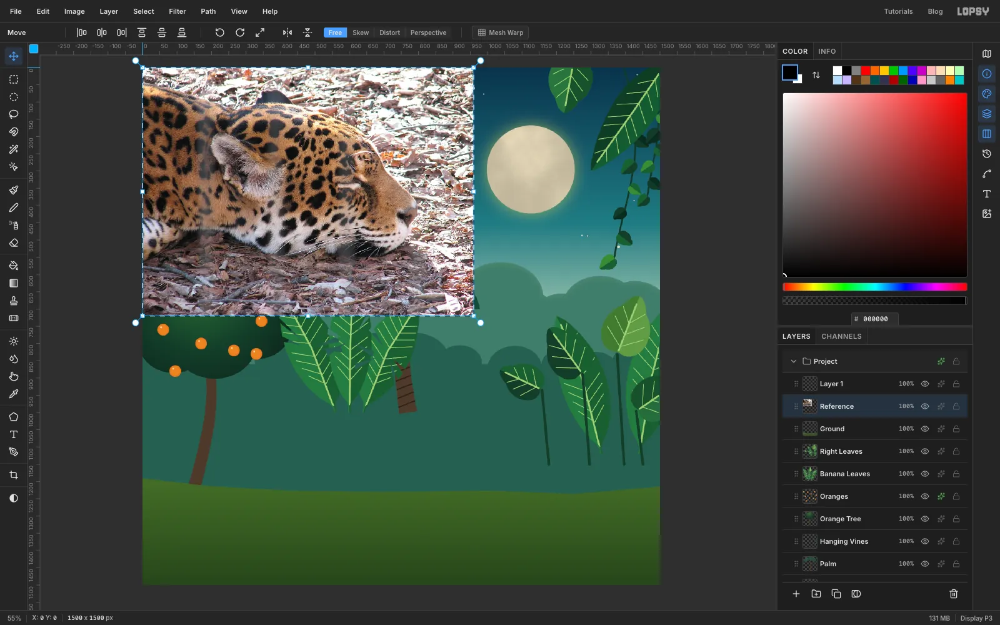

Open the jaguar photo in another app, copy it, and press [[Cmd+V]] in
Lopsy. With *Ground* active, the photo lands on a new layer just above it,
in the top-left corner, and the **Move** tool is selected. Rename the layer
*Reference*.

## Scale the photo down

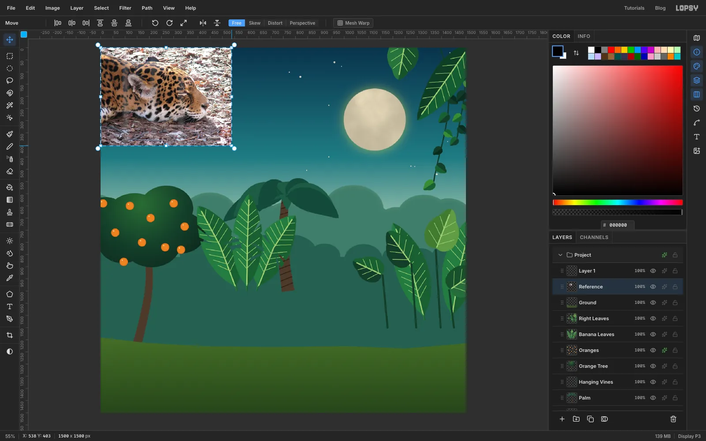

Hold [[Cmd]] and drag the bottom-right corner handle up and to the left
until the photo is a little over half its size, about 540 px wide.
[[Cmd]] keeps the proportions. Press [[Cmd+D]] to commit.

## Place it where the jaguar will sleep

With nothing selected, drag the photo with the **Move** tool until the
cat's nose sits in the clearing about three-quarters of the way across. Fine-tune with
the arrow keys. Lower the layer's opacity to **60%** so you can see
your drawing against it.

## Lasso the body

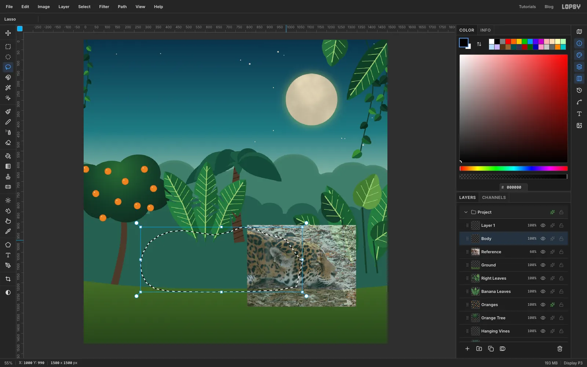

The photo only shows the head and shoulder, so the body is up to you. Add a
layer called *Body*. With the **Lasso**, draw a long lying body. Start
behind the cat's head, rise over a shoulder hump, dip along the back, then
rise again over a round haunch at the left. Run the outline along the
ground back to the chest.

## Shade the body and the haunch

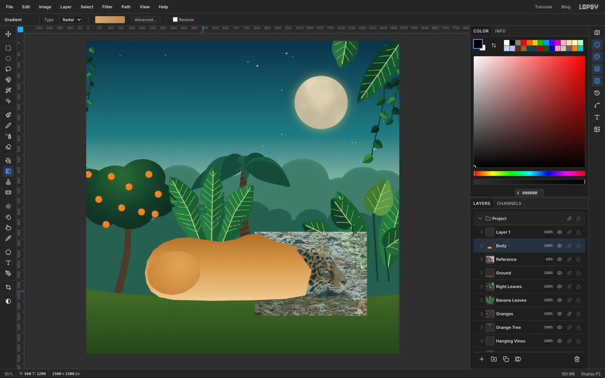

Set the **Gradient** tool to **Linear** with the stops `#A9733A`,
`#CE9B57` at 45% and `#E9CB98`. Drag from the top of the back straight down
to the belly. The back goes dark and the belly pale, all in one move.

Then lasso a big oval over the haunch. Switch the gradient to **Radial**
with `#D9A866` to `#C08848` and drag from the middle of the oval to its
lower right, then press [[Cmd+D]]. The haunch now reads as round without
any hard edge.

## Draw the foreleg

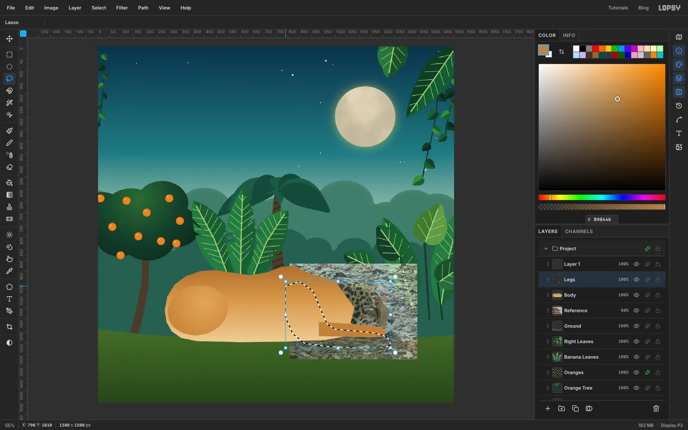

Add a layer called *Legs*. First lasso the far front paw, just peeping out
under the chin, and fill it with `#B98446`. Then lasso the near foreleg.
Start at the shoulder, come down the chest, and stretch the paw forward along the
ground until it is just under the nose. Fill it with a linear gradient from
`#C08A48` to `#DDB77E`, top to bottom. With the **Brush** at **Size 4** in
`#6E3F16`, add two short toe lines at the front of the paw.

## Curl the tail forward

Add a layer called *Tail* above *Legs*. Lasso a tail that starts at the
bottom of the haunch, curves down to the ground, and runs forward along
the bottom of the body. Let it taper from about 45 px to 20 px, and lift the
round tip just in front of the foreleg. Fill it with a gradient from
`#B98446` to `#E2BC80`, top to bottom.

## Trace the head

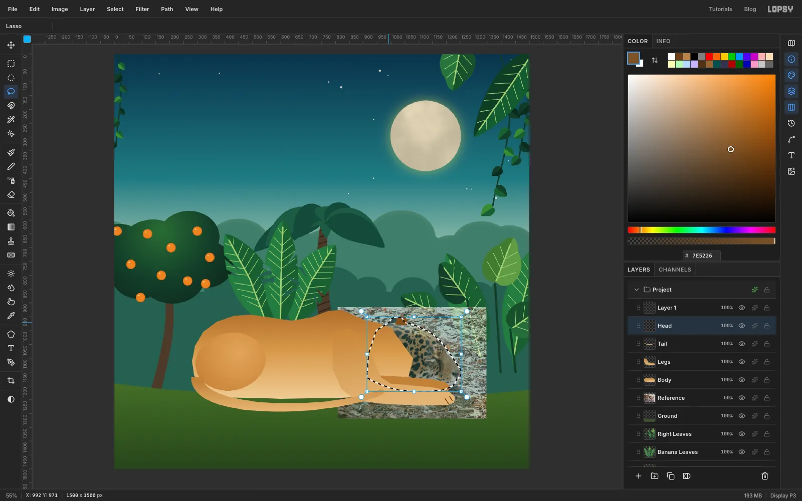

Add a layer called *Head*. First lasso the far ear, a small bump sticking
up just in front of the near ear, and fill it with `#7E5226`.

Then trace the head with the **Lasso**. Follow the photo over the
forehead, down the bridge of the nose, around the nose tip, under the chin
and back along the throat. Close it behind the cheek.

## Fill the head and muzzle

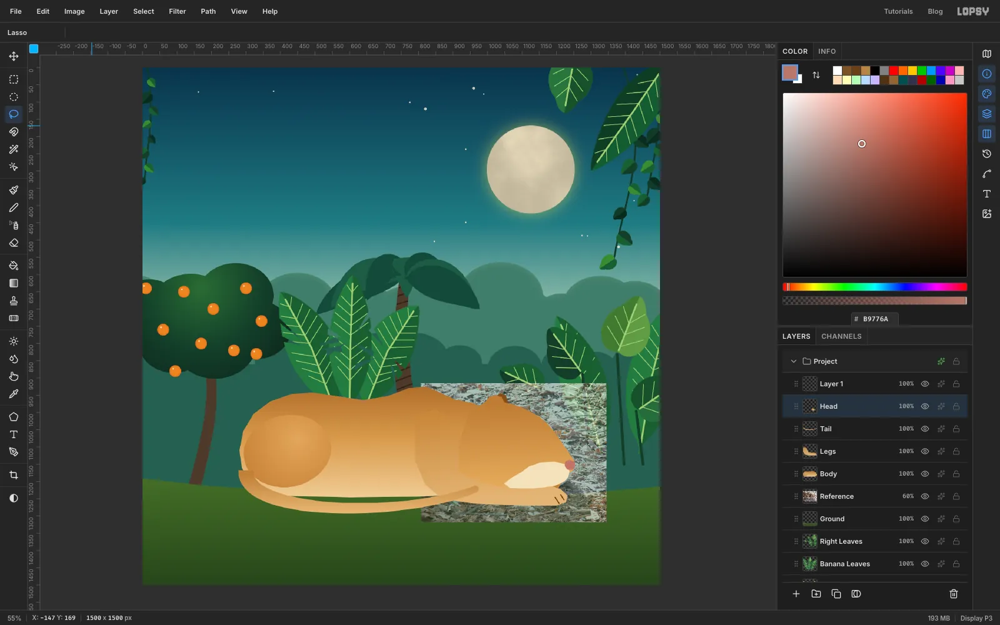

Fill the head with a linear gradient from `#B57F42` at the brow to
`#DDAE68` at the chin. Lasso the muzzle, the pale area from the nose back
under the eye and down to the chin, and fill it with `#F2E2BF`. Lasso the
nose and fill it with `#B9776A`, then deselect.

## Give the ear a dark rim

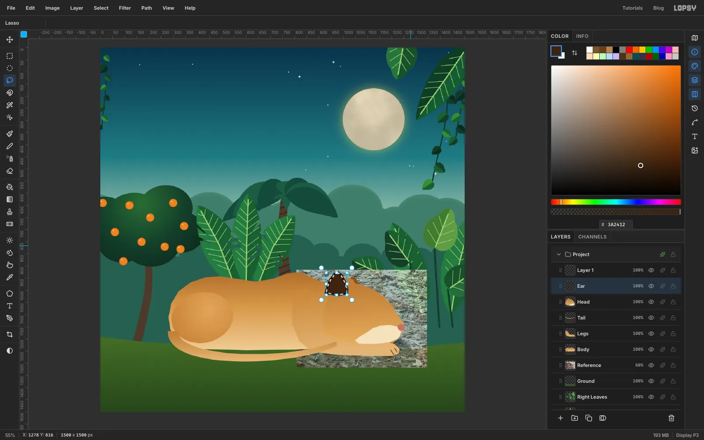

Add a layer called *Ear*. Lasso a rounded triangle at the back of the
head, sticking up above the outline, and fill it with `#3A2412`. Choose
**Select → Shrink…** with **6** px and fill the smaller selection with
`#C08A4E`. That leaves a dark rim all the way round. Lasso the inside of the
ear and fill it with `#E9D6B4`.

## Hide the photo

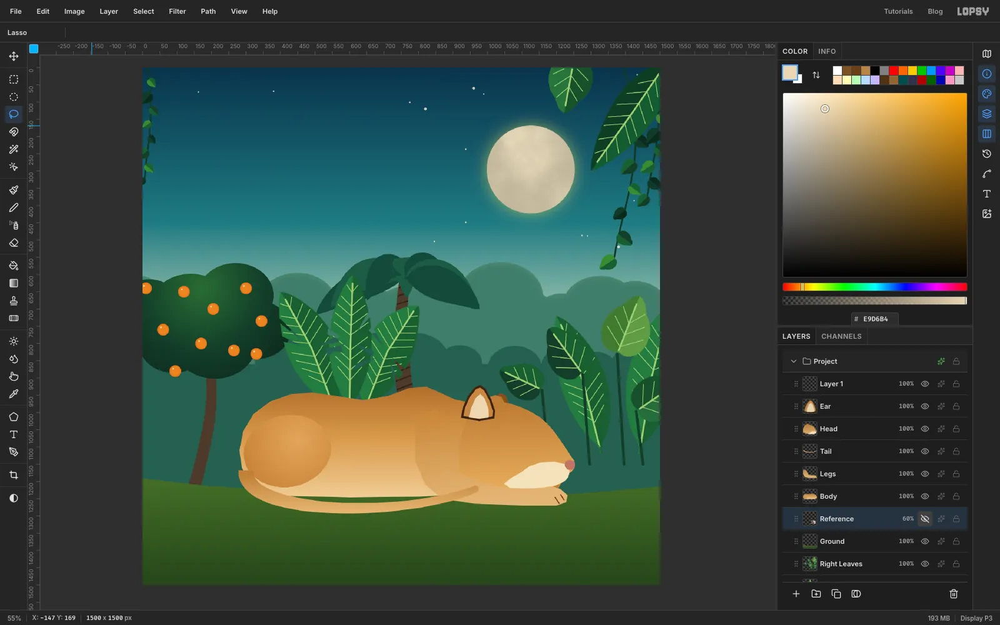

Click the eye on the *Reference* row to hide it. You now have a flat, naive
cat shape lying in the clearing. Check that the body, foreleg, tail and
head read as one animal before adding any pattern.

## Paint one rosette

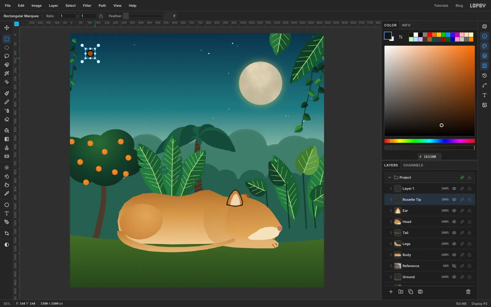

Jaguar rosettes are broken rings with a darker centre, so make one and turn
it into a brush. Click *Ear* and add a scratch layer called
*Rosette Tip*. In an empty corner, drag a small
oval with the **Elliptical Marquee**, about 30 × 26 px, and fill it with
`#8E5524`. Deselect.

Open the brush tip thumbnail, choose the **Hard Round** preset and close
the panel. At **Size 9** in `#1E130B`, drag three short arcs around the
oval, leaving gaps between them. Drag a **Rectangular Marquee** around the
rosette, choose **Edit → Define Color Brush…** and name it *Rosette*. The
new tip becomes the active brush. Press [[Cmd+D]], then delete the
*Rosette Tip* layer. A colour brush keeps both colours, so the centre
stays brown whatever the foreground colour is.

## Keep the rosettes off the head

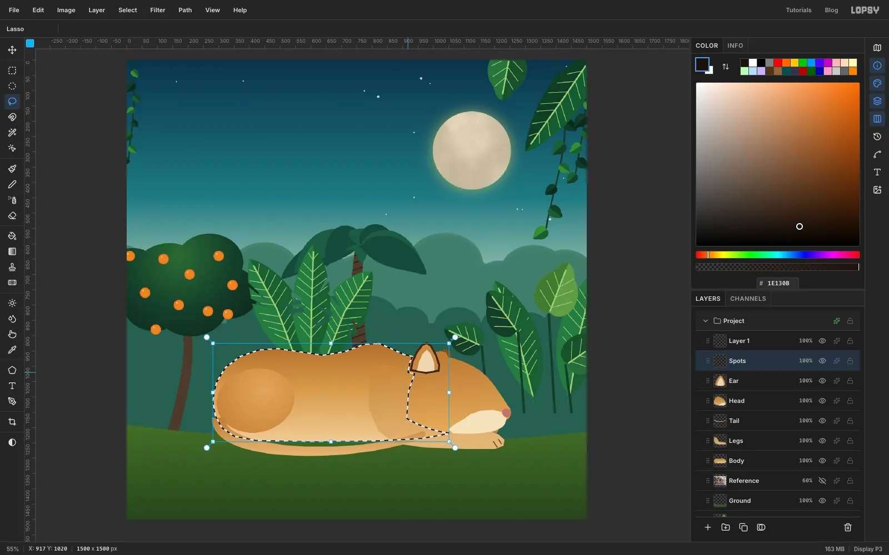

Click *Ear* and add a layer called *Spots*, so it sits at the top of the
jaguar's layers. [[Cmd]]-click
the *Body* thumbnail to load the body as a selection. Then hold [[Alt]] and
lasso around the head, and again around the ear, to subtract them. Any
rosettes you paint now stop at the neck.

## Set up the rosette brush

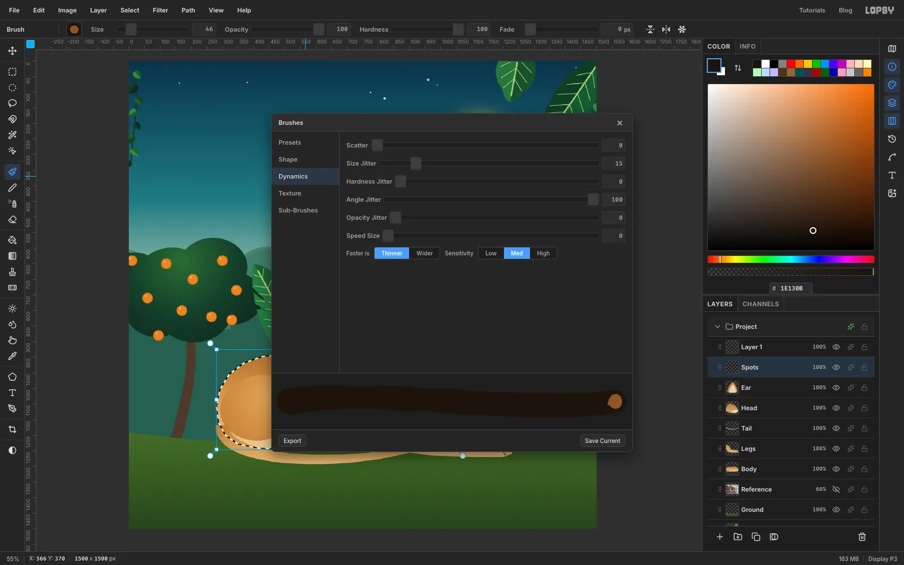

Open the brush tip thumbnail again. The *Rosette* tip is selected. Go to
**Dynamics**. Set
**Size Jitter** to **15** and **Angle Jitter** to **100**, so no two
rosettes are identical. Close the panel.

## Stamp the rosettes

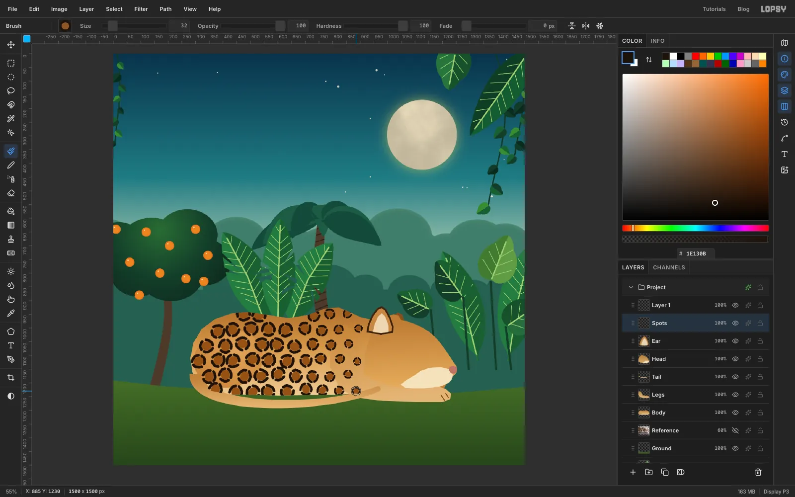

Set **Size** to **56** and stamp the rosettes one click at a time in
staggered rows about 64 px apart, like bricks. Don't let them touch. As you
move forward over the shoulder, lower the size step by step to about 30.
This grades them into the smaller spots of the head. Deselect when the
body is covered.

## Dot the head and foreleg

Choose the **Hard Round** preset again and set the foreground to
`#1E130B`. [[Cmd]]-click the *Head* thumbnail. Click solid spots across the
head, about 34 px apart, at sizes **9–14** on the brow and smaller towards
the nose. Leave the eye, the muzzle and the ear clear, and keep the cheek
sparse. Then [[Cmd]]-click *Legs* and dot the foreleg at sizes **7–14**.

## Ring the tail

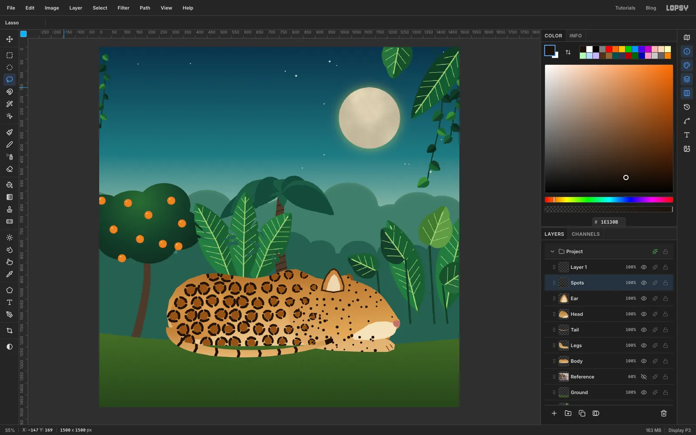

[[Cmd]]-click the *Tail* thumbnail. With the brush at **Size 12**, drag
seven short, slightly curved rings across the tail, closer together towards
the tip. Lasso the last 30 px or so of the tip, fill it with `#1E130B`
and deselect.

## Paint the sleeping face

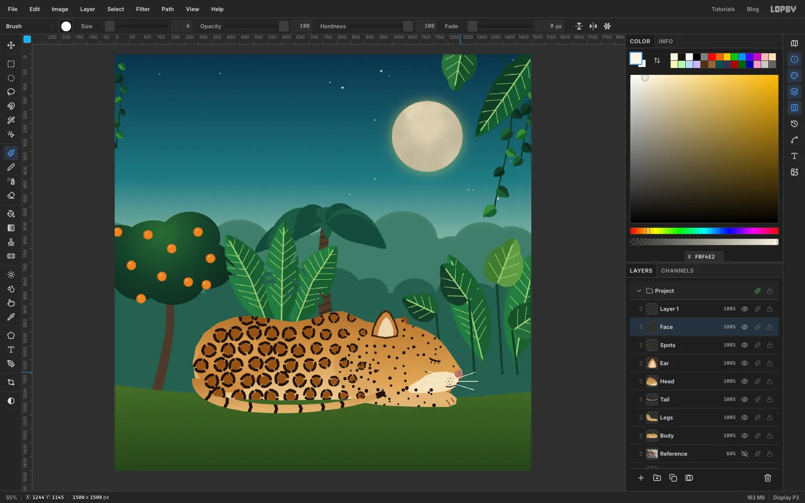

Click the eye on the *Reference* row again so you can see the photo's
features, then add a layer called *Face*. With the **Brush** in `#1E130B`:

1. At **Size 7**, drag a gentle downward curve where the photo's closed eye is.
2. At **Size 4**, add three short lashes under it with click and [[Shift]]-click.
3. Drag the mouth line from under the nose back along the jaw.
4. Click two rows of small whisker-pad dots on the muzzle.

Switch to `#FBF4E2` at **Size 3** and draw six whiskers out from the dots,
three each way, with click and [[Shift]]-click. Add one **Size 6**
highlight on the nose.

## Outline the whole animal

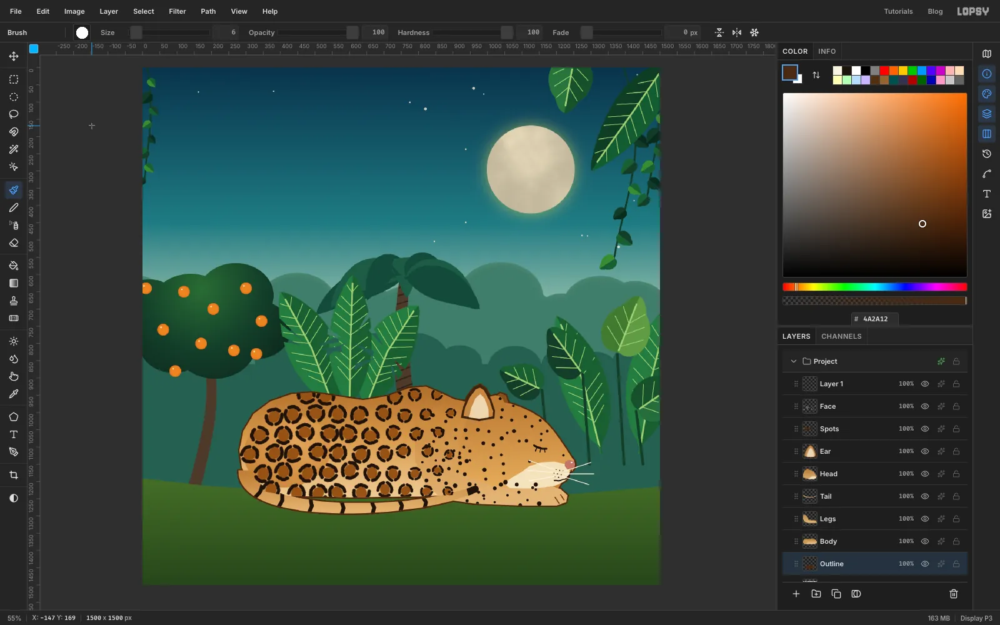

Click *Reference* and add a layer called *Outline*, so it sits under all
the jaguar's parts. For each of *Body*, *Tail*, *Legs*, *Head* and *Ear*:

1. [[Cmd]]-click its thumbnail.
2. Choose **Select → Grow…** with **4** px.
3. Fill the selection with `#4A2A12`.

Because the outline sits underneath, only a 4 px rim shows around the
outside. There are no lines between the parts. Deselect.

Now click *Reference* and delete it with the **Delete Layer** button. The
tracing is done.

## Group the jaguar and add its shadow

Click *Outline*, [[Shift]]-click *Face*, and choose
**Layer → Group Layers**. Name the group *Jaguar* and collapse it.

Click *Ground* and add a layer called *Jaguar Shadow*. With the
**Elliptical Marquee**, drag a long, flat ellipse under the cat, about 1000 × 40 px, and fill it with `#16220F`.
Deselect, run **Filter → Gaussian Blur…** with **Radius 22**, and set the
layer to **Multiply** at **55%**. The cat now rests on the grass instead
of floating over it.

## Grow the grass

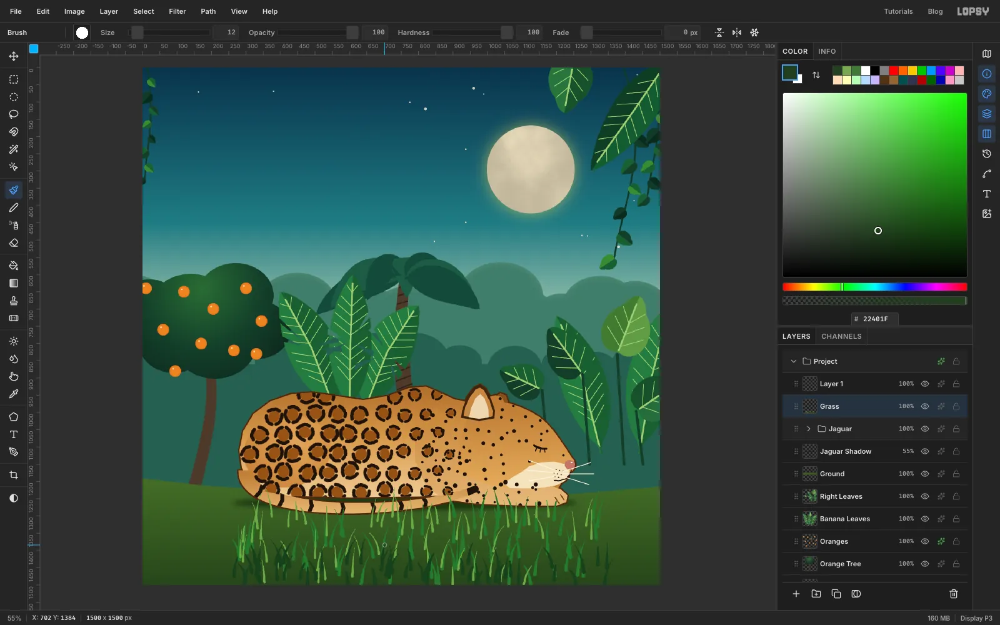

Click the *Jaguar* group and add a layer called *Grass*. In the Brushes
modal set **Hardness** to **100** and **Taper** to **85**, so every stroke
ends in a point. Drag about eighty quick upward blades from the bottom of the
canvas at **Size 11** in `#3F7A36`. Keep them short where the tail lies.
Then add a second set at **Size 8** in `#79A852`. If a blade lands
somewhere you don't like, [[Cmd+Z]] takes back just that stroke. Finish
with a row of short, dark tufts along the bottom edge at **Size 12** in
`#22401F`.

## Paint hibiscus with radial symmetry

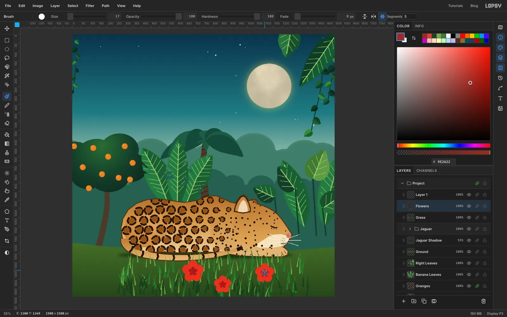

Add a layer called *Flowers*. Set the Brush's **Taper** back to **0**. In
the options bar, click **Radial Symmetry** and set **Segments** to **5**.

For each flower, [[Cmd]]-click where its centre should go to move the
symmetry centre there. Set **Size** to about **55** with `#D8432E` and drag
a short stroke upward from the centre. That one stroke paints all five
petals. At about **Size 18** in `#9E2A22`, drag a shorter stroke for the
dark throat. Paint three flowers across the bottom.

## Add the stamens

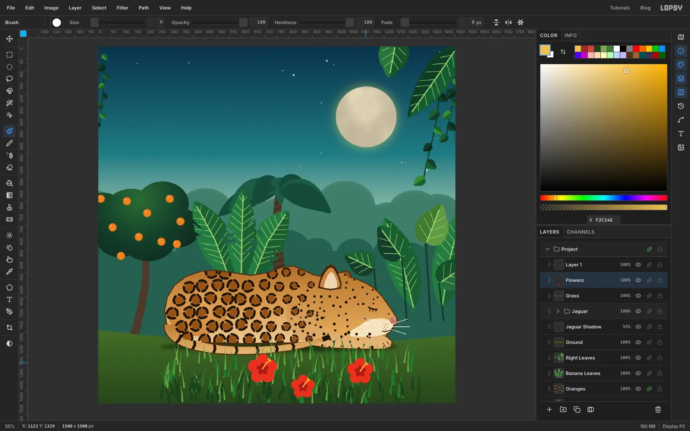

Click **Radial Symmetry** again to turn it off. With `#F2C14E`, drag a
curved stalk at **Size 6** from each flower's centre up and to the right,
and click two **Size 9** dots at its end.

## Rim a snake plant blade

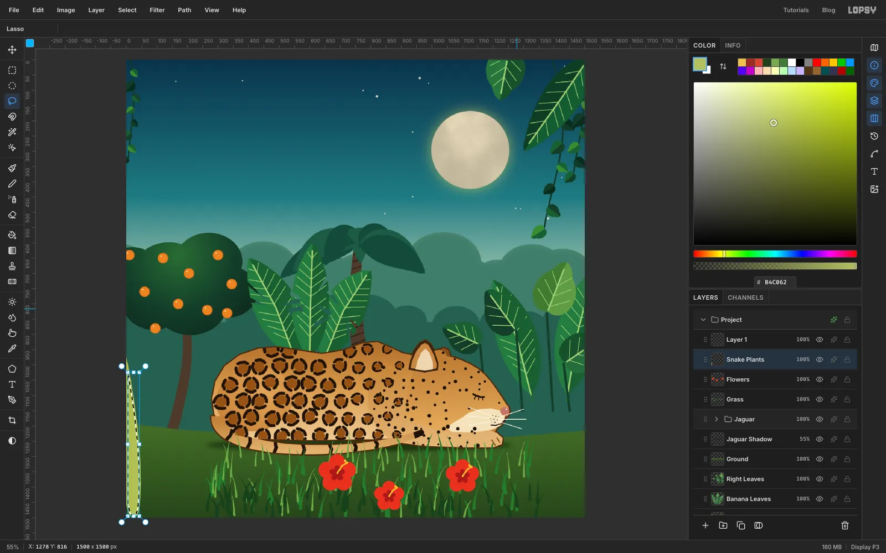

Add a layer called *Snake Plants*. Snake plants have yellow-edged, striped
blades. Paint them one at a time, back to front:

1. Lasso a tall, pointed blade rising from the bottom left.
2. Fill it with `#B4C062`.
3. Choose **Select → Shrink…** with **5** px.
4. Fill the smaller selection with a green: `#24502F` for the first
   blade, then `#3B7344` and `#2F6238` for the next ones in turn.

The pale rim stays all the way round.

## Stripe the snake plants

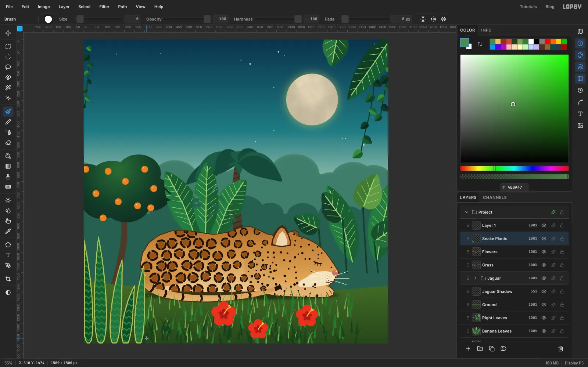

While each blade's shrunk selection is still active, switch to the
**Brush** and drag zigzag stripes across it at **Size 6** in `#4E8A47`.
The selection keeps them inside the blade. Then deselect, go back to the
**Lasso** and draw the next blade.

Make five blades of clearly different heights: tall, short, medium,
shortest and medium. Let the front ones overlap the jaguar's haunch.

## Add a big foreground leaf

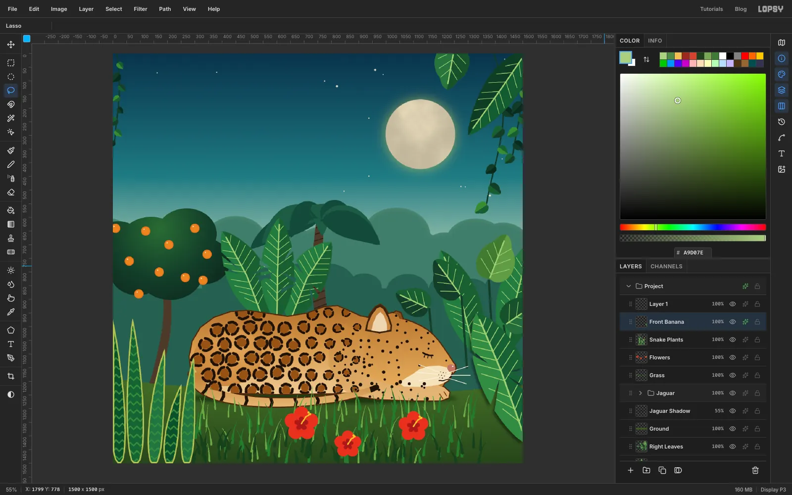

Add a layer called *Front Banana*. Paint one more banana leaf, larger
and lighter than the others: `#4C8A4A` with a `#2F6038` half and veins in
`#A9D07E` at **Size 4**. Have it rise from the bottom-right corner,
and keep it clear of the jaguar's nose. Cut five tears into it as before.
Give it a **Drop Shadow** with **Offset X −6**, **Offset Y 8**, **Blur 14**
and **Opacity 45**, so it stands in front of everything.

## Copy and shrink a fourth flower

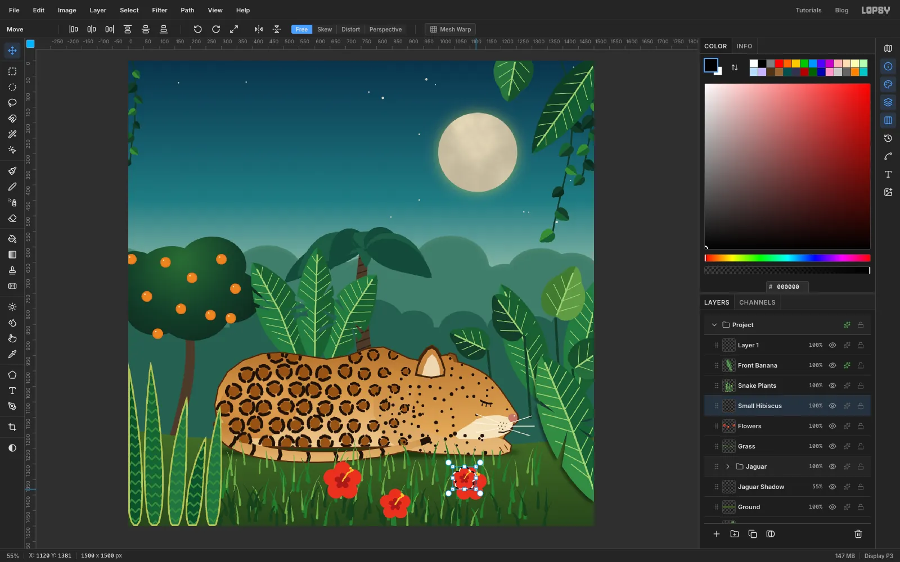

Click *Flowers*, drag a **Rectangular Marquee** around the right-hand
hibiscus, and press [[Cmd+C]] then [[Cmd+V]]. The copy lands in place on a
new layer, selected, with the **Move** tool active. Rename it
*Small Hibiscus*. [[Cmd]]-drag the bottom-right handle in by about a
third, press [[Cmd+D]], then drag the small flower down to the bottom right
so it tucks under the banana leaf.

## Tilt the front leaf

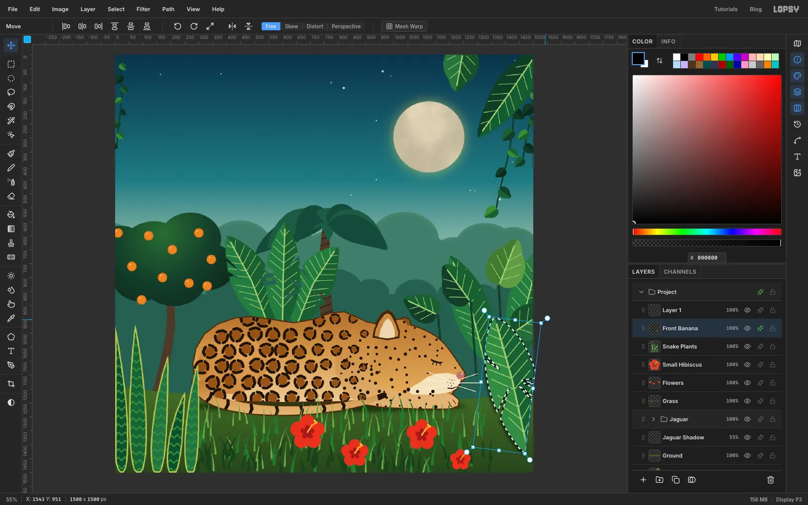

Click *Front Banana* and [[Cmd]]-click its thumbnail. With the **Move**
tool, drag the round rotation handle just outside the top-right corner a
few degrees clockwise, about 7°, so the leaf leans in towards the cat.
Press [[Cmd+D]] to commit.

## Move the jaguar and its shadow together

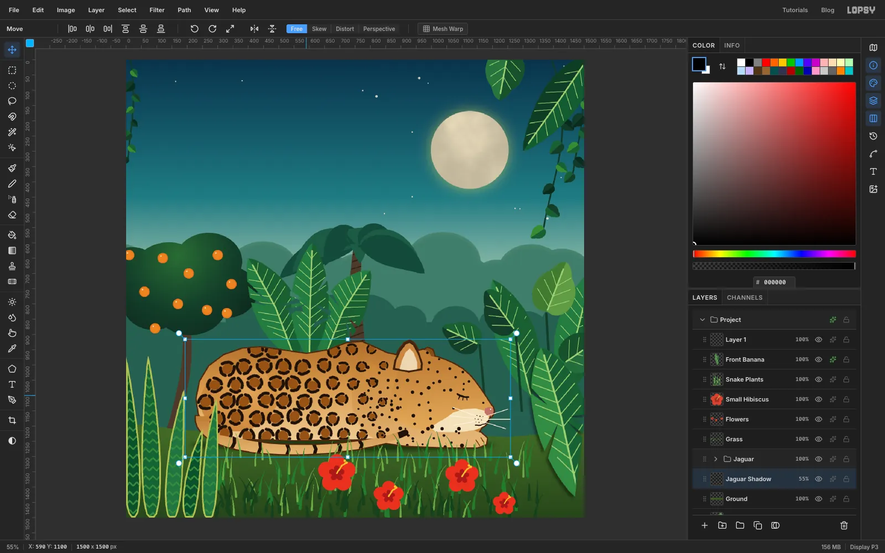

The cat's nose sits a little too close to the leaves on the right. Click
*Jaguar Shadow*, [[Shift]]-click the *Jaguar* group, and drag on the canvas
with the **Move** tool about 50 px to the left. Every layer in the group
moves with the shadow by the same amount.

Then click the empty *Layer 1* at the top of the panel and delete it with
the **Delete Layer** button.

## Add canvas grain

Click *Front Banana* and add a layer called *Canvas Grain*. Fill it with
`#808080`. Run **Filter → Add Noise…** with **Amount 40** and **Mono**, then
**Filter → Gaussian Blur…** with **Radius 1** to soften the specks. Set the
layer to **Overlay** at **30%**. Every flat shape now has a little texture,
like paint on canvas.

## Set the margins

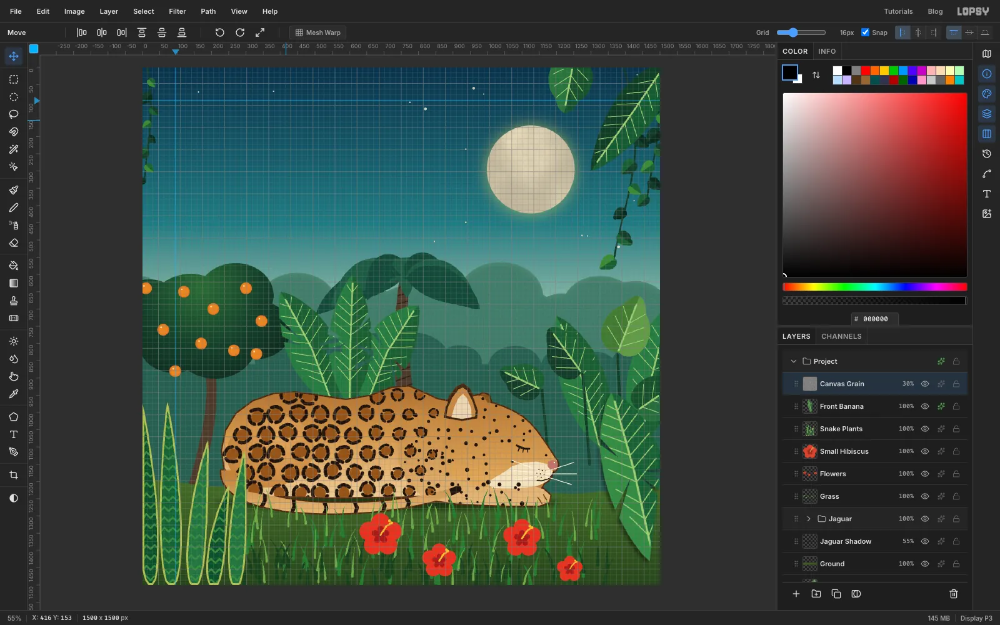

Click the top ruler at **96** to drop a vertical guide, and the left ruler
at **96** for a horizontal one. They mark the safe margin. The title's
left edge sits on the vertical guide, and its top starts a little lower,
about 130 px down, so the letters don't crowd the top edge. Choose
**View → Show Grid** to check that the moon and the title block balance,
then choose it again to hide the grid.

## Type the first title line

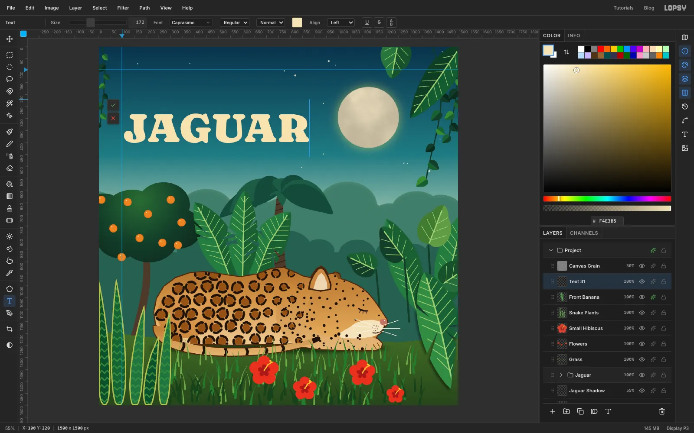

Click the *Front Banana* row first, so the title lands above the leaves
but below *Canvas Grain*. Pick the **Text** tool and choose the **Caprasimo**
font at **Size 172** with the foreground `#F4E3B5`. Click near the top left
and type `JAGUAR`, then press [[Tab]] to commit. Rename the layer
*Jaguar Title* and set **Letter spacing** to **4** in the Text panel. Use
the arrow keys with the **Move** tool to sit its left edge on the vertical
guide and its top about 130 px from the top.

## Type BOSSA in orange

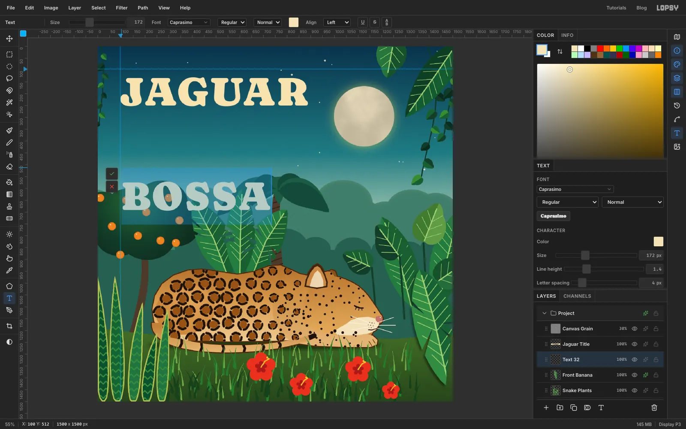

Click *Front Banana* again. Click with the **Text** tool well below
JAGUAR and type `BOSSA`. Press [[Cmd+A]] to select all of the text, open
the **Text color** swatch in the options bar, and type `#E9A15A` into its
**Hex** field. Click the swatch again to close it, then press [[Tab]].
Rename the layer *Bossa Title*.

## Match the line widths

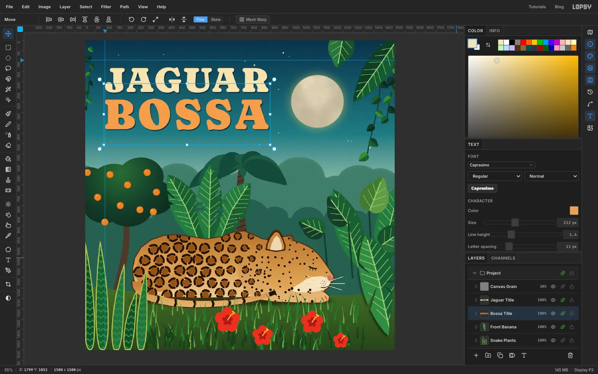

BOSSA is shorter than JAGUAR, which leaves a ragged right edge. With
*Bossa Title* active and the **Text** tool selected, raise **Size** to
about **212** and nudge **Letter spacing** to about **11**, until both
words end at the same point. Move it so it sits 30 px under JAGUAR on the
same left guide.

Give both title layers a **Drop Shadow** in `#0D2232` with **Offset X 4**,
**Offset Y 5**, **Blur 0** and **Opacity 70**. A hard shadow looks like
a sign painter's shading.

## Tilt the artist line

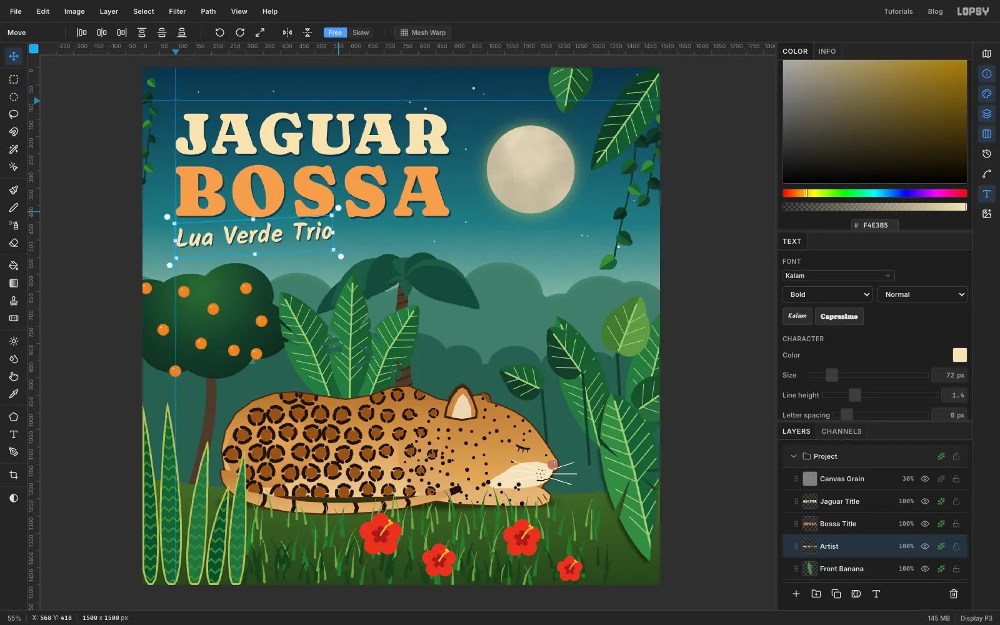

Click *Front Banana*. In the Text panel, set **Letter spacing** back to
**0**, because new text picks up the last setting. Choose **Kalam** with the
**Bold** weight at **Size 72**, set the foreground back to the cream
`#F4E3B5`, click below BOSSA and type
`Lua Verde Trio`. Press [[Tab]] and rename it *Artist*. Nudge it to about
18 px under BOSSA on the margin.

Give it the same drop shadow, but with **Offset X 3** and **Offset Y 3**. Then, with the **Move**
tool, drag its top-right rotation handle about 3° anticlockwise. The
little hand-lettered tilt makes it feel painted rather than typeset.

## Group the title block

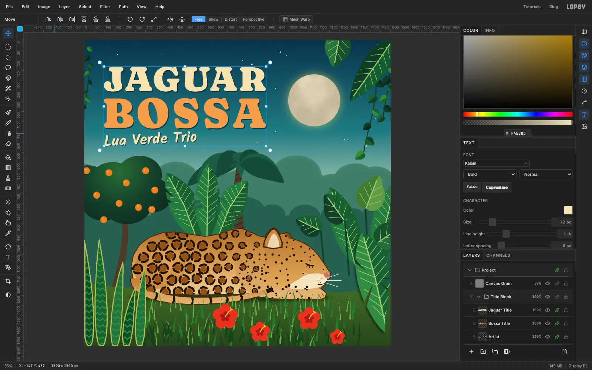

Click *Artist*, [[Shift]]-click *Jaguar Title*, and choose
**Layer → Group Layers**. Name the group *Title Block*. Choose
**Edit → Clear Guides**.

Save with **File → Save Project** and export the cover with
**File → Quick Export PNG**.
