Early-80s New York neo-expressionism, from Jean-Michel Basquiat, Julian
Schnabel and their circle, looks fast and unplanned. Slabs of house paint
leave bare canvas between them. Words are written out and then crossed
out. Crowns, teeth and copyright signs sit on top of everything else. In
reality it's carefully built. Each layer of paint partly covers the one
under it, and the crossed-out word is the one you end up reading.

In this tutorial you'll use that approach for a party invitation: the
**Bayou Alligator Ball**, an imaginary art-club benefit in Louisiana.
The word *Crawfish* gets written into the title and then crossed out. You'll paint the colour fields with textured brushes and repaint
a public-domain alligator photo until it looks painted. Then you'll crown
the alligator and letter the invitation in marker. The card is
**1400 × 1960 px**, a 5 × 7 portrait.

Along the way you'll use:

- **Add Noise** and **Fibers** to make a raw-canvas ground
- the **Brush** with the **Grain** texture, plus the **Chalk** preset, the
  **Taper** setting and **Scatter** for flicks
- the **Smudge** and **Eraser** tools
- guides, a **Rectangular Marquee** snapped to a guide, the **Lasso**,
  **Select → Inverse** and **Select → Feather**
- the Move tool's **Flip Horizontal**, rotation and scale handles, and
  copy and paste
- **Desaturate**, **Oil Paint**, **Brightness/Contrast**, **Posterize** and
  **Emboss**
- **Multiply** and **Overlay** blend modes, layer opacity and a hard
  **Drop Shadow**
- text in **Permanent Marker** and **Gochi Hand**

The palette:

- Raw canvas `#D9C69C`, grain grey `#808080`
- Cadmium yellow `#F2C12E` / `#FBE7A1` / `#E5841C` (base, light and orange)
- Cobalt `#1E4BB4` / `#5C8FEA` / `#0F2466` (base, light and dark)
- Vermilion `#D8321E` / `#F0603A`, bright red `#D6150F`
- Ink black `#17130F` / `#2A2420` (fill and slab edge)
- Dirty white `#EFE6D2` / `#E2D7BE`, bone white `#F1EADB`, cream `#F3E9D2`
- Crown yellow `#F6C21C`, white `#FFFFFF`
- Gator green `#58B03C`, shadow green `#0E2E16`, lime `#B6E85A`
- Drip greens `#2E6B22` / `#3F8A2C`
- Pink `#F07AA0`, belly `#E9D36C`, mouth `#1C0A0C`

> **Tip:** Positions are in document pixels, written `x, y`. The status bar
> at the bottom shows where the pointer is. **Edit → Fill** fills the
> selection with the foreground colour, and [[Cmd+D]] deselects. New layers
> appear above the selected layer. If the selected row is an *expanded*
> group, the new layer or group goes inside it; if the group is
> *collapsed*, it goes next to it. So before each section, collapse the
> group you just finished and click it.

> **Tip:** Two brushes do most of the painting. The **textured brush** is
> the **Hard Round** preset with a texture: open the Brushes panel (click
> the brush-tip thumbnail at the left of the Brush options bar), pick
> **Hard Round** on the **Presets** tab, then on the **Texture** tab choose
> **Grain** with **Multiply** and **Scale** `250`. The **chalk brush** is
> just the **Chalk** preset. Choosing a preset resets the size, the
> texture and the taper, so pick the preset first, then set **Size** and
> **Hardness** in the options bar, and set the texture again each time you
> come back to the textured brush.

> **Tip:** Text always follows the same routine: choose the **Text** tool,
> set the font, size and colour, click in empty space, type, and press
> [[Tab]] to commit. Then switch to the **Move** tool and use the arrow
> keys to nudge the word into place. To tilt it, drag the round rotation
> handle just outside a corner of its box.

## Prime a raw canvas

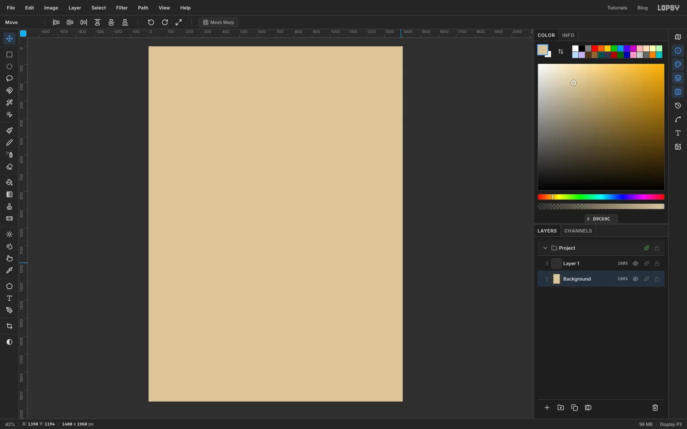

Choose **File → New**, enter **1400 × 1960** and click **Create**. Click
the *Background* row, set the foreground to raw canvas `#D9C69C`, choose
**Select → All** and **Edit → Fill**, then deselect.

Choose **Filter → Add Noise…**, set **Amount** to `9`, and click **Mono**
and **Gaussian**. Click **Apply**. The fine speckle stops the beige from
looking like a flat digital fill.

## Weave it with Fibers

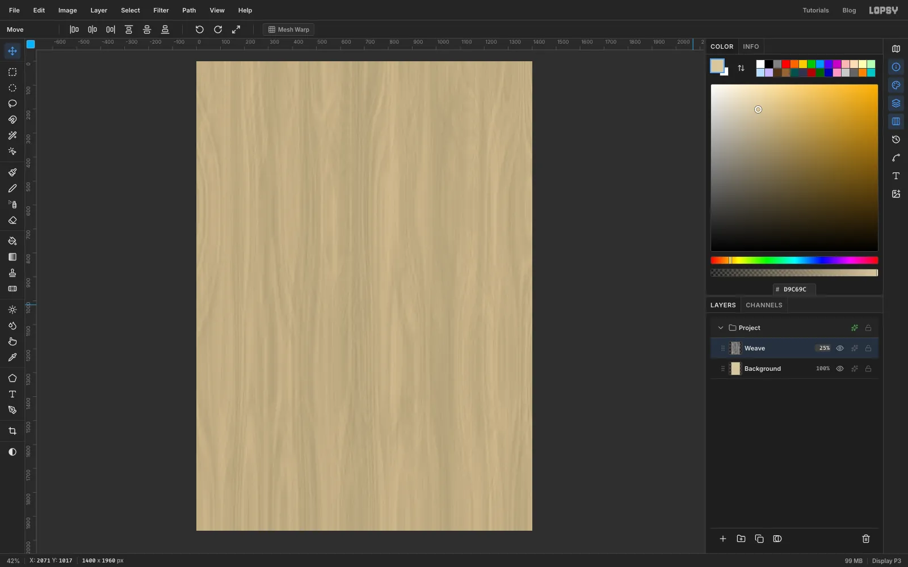

A new document comes with an empty *Layer 1* above *Background*. Click
it, rename it *Weave* (double-click the name), and choose **Filter → Fibers…** with
**Variance** `24` and **Strength** `10`. Click **Apply**. In the layer's
effects drawer (the sparkle icon on its row), set **Blend** to
**Multiply**, then click the opacity on its row and set it to `25%`.

Most of the canvas will be painted over. The weave shows only where the
paint leaves gaps, which is what you want.

## Block in the blue field

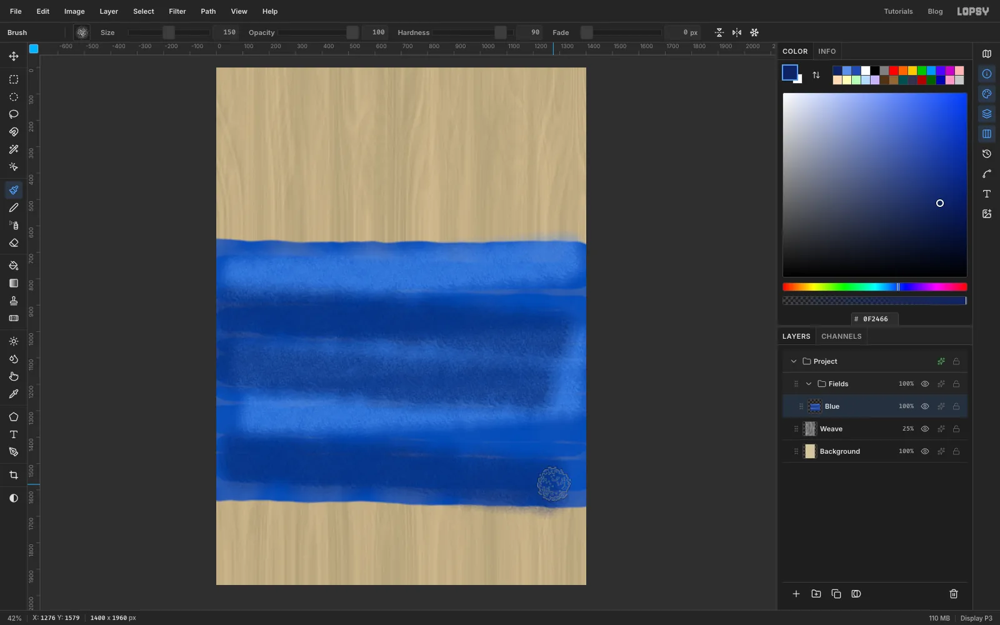

Click the **New Group** button, name the group *Fields*, and add a layer
named *Blue* inside it. Set up the textured brush with **Size** `190` and
**Hardness** `90`, in cobalt `#1E4BB4`.

Paint back-and-forth horizontal strokes from about `y 730` down to about
`y 1650`. The black band will cover everything below `1590`. Let each stroke overlap the last by about half its
width. Wobble the ends so the edges stay ragged. The Grain texture leaves
the paint slightly uneven, like a dry roller.

Switch to the chalk brush at **Size** `130` in light blue `#5C8FEA` and
drag a few long strokes across the band. Then add two or three at **Size**
`150` in dark blue `#0F2466`. The dry chalk marks give the field visible
brushwork.

## Paint the yellow field

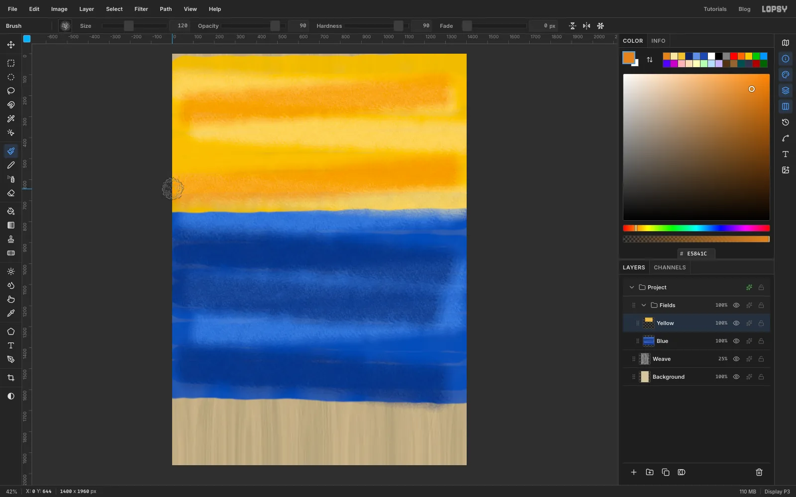

Add a layer named *Yellow* above *Blue*. With the textured brush at
**Size** `190` in yellow `#F2C12E`, scrub horizontal strokes from just
below the top edge down to about `y 750`. Leave a thin strip of raw canvas
along the top. Let the bottom edge overlap the blue.

Add movement with the chalk brush at **Size** `120`, **Opacity** `90`.
Use two or three strokes of pale yellow `#FBE7A1`, then two of orange
`#E5841C`.

## Let the yellow drip

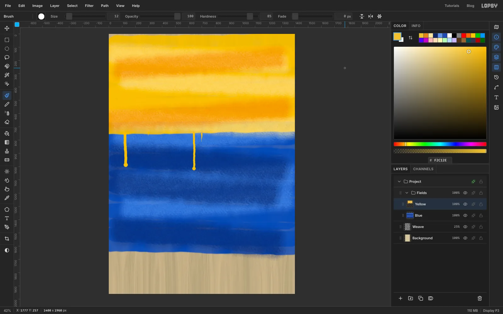

Choose the **Hard Round** preset. Paint four drips straight down from the
bottom edge of the yellow, at about `x 120`, `300`, `640` and `700`. Make
each one a different length and width, and let them wobble a little:

- For the long ones (about 240 and 270 px), use **Size** `22` and `16`.
  At the end of each, bump the size up to about `34` and `28` and click
  once for a bead of paint.
- For the short ones (40 and 90 px), use **Size** `10` and `12`. In the
  Brushes panel's **Shape** tab, set **Taper** to about two thirds of the
  drip's length, so the drip thins to a point.

Set **Taper** back to `0` when you're done.

## Paint a red patch

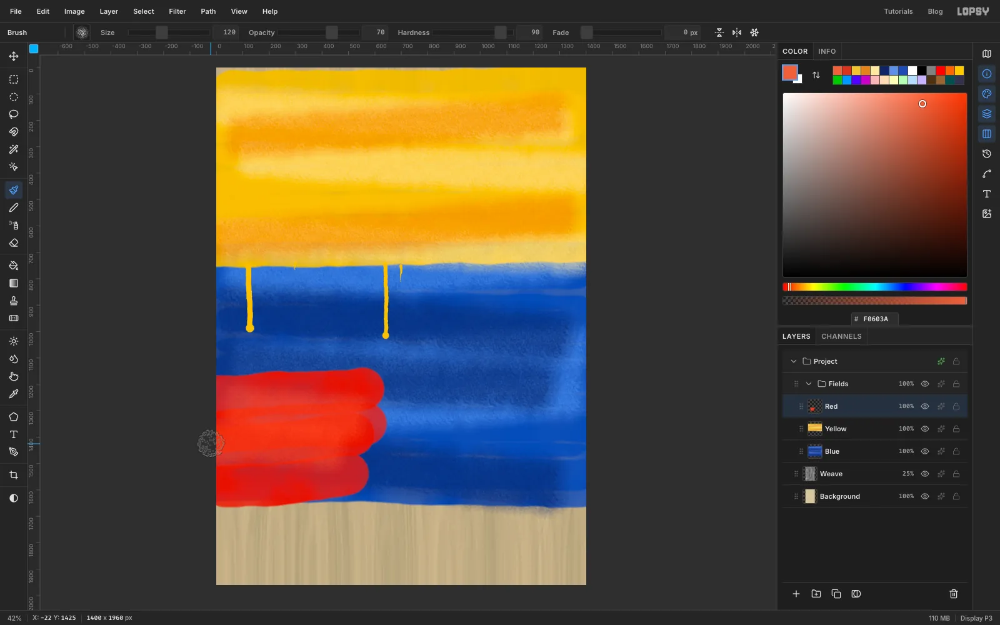

Add a layer named *Red*. With the textured brush at **Size** `170` in
vermilion `#D8321E`, scrub a patch about 600 px wide at the lower left,
from about `y 1150` to the bottom of the blue. Add a few lighter strokes
with the chalk brush at **Size** `120` in `#F0603A`, **Opacity** `70`. You'll move this patch in a moment.

## Lay the black band on a guide

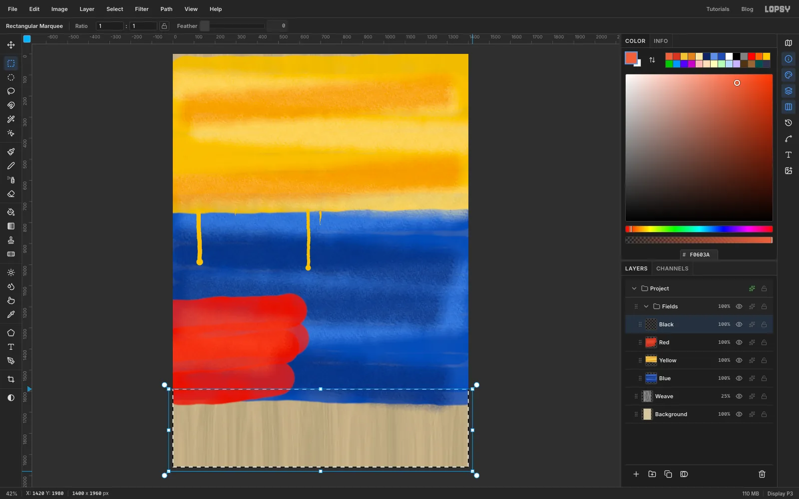

Click the left ruler at `1590` to drop a horizontal guide. Add a layer
named *Black*. With the **Rectangular Marquee**, drag from just left of the
canvas at the guide down past the bottom-right corner. The marquee snaps
to the guide. Fill it with ink black `#17130F` and deselect.

## Rough up the band edge

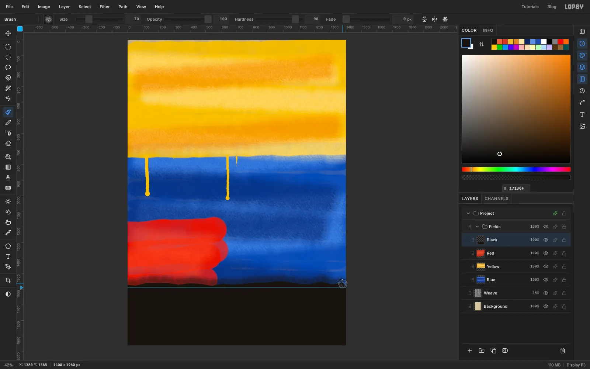

A ruler-straight edge looks digital. With the **Lasso**, draw a wavy line
along the top of the band, rising and falling by about 20 px. Close the
selection below the guide and fill it with black.

Then drag the chalk brush at **Size** `70` along the new edge so it breaks
up into dry bristle marks.

## Flip the red patch

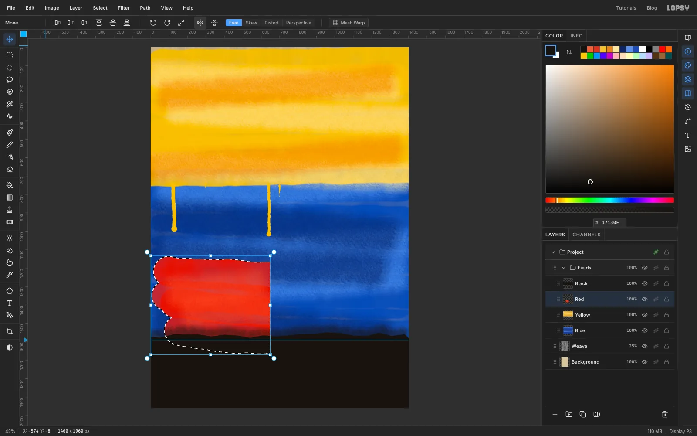

The alligator will cover the lower left, so the red needs to move to the
right. Click the *Red* row and [[Cmd]]-click its thumbnail to select its
pixels. Choose the **Move** tool and click **Flip Horizontal** in the
options bar, so the rounded brush ends face left. Press [[Cmd+D]].

Then drag the patch about 860 px to the right, so it sits against the
right edge.

## Push the red up on a slant

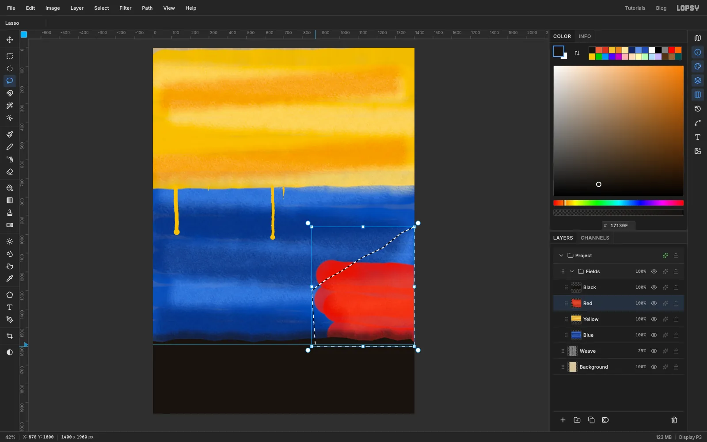

Horizontal yellow, blue and red bands read like a flag. Break them up.
With *Red* still selected, use the **Lasso** to draw a shape that starts
on the patch's left edge at about `y 1280`, climbs diagonally to the right
edge at about `y 950`, runs down the right side and comes back along the
bottom. Fill it with vermilion
and deselect.

## Smudge the red into the blue

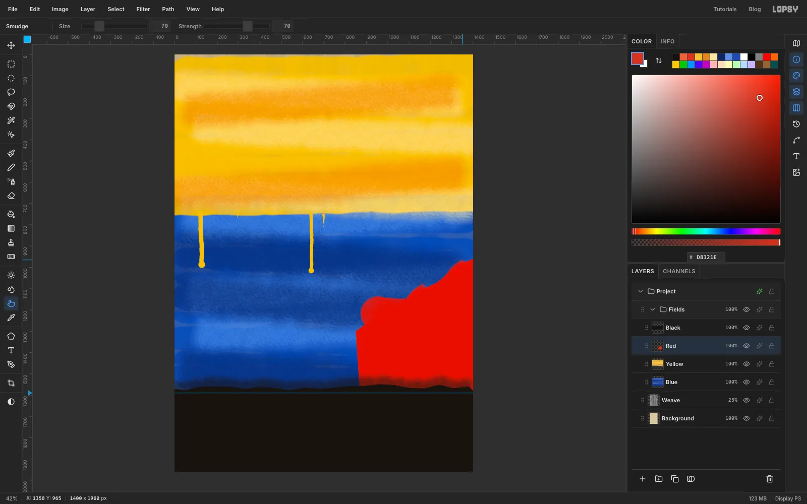

Choose the **Smudge** tool with **Size** `70` and **Strength** `70`. Drag
three short strokes up and to the right across the diagonal edge. Each
one pulls a tongue of red into the blue.

## Paint over the stripes with slabs

Click *Red* and add a layer named *Overpaint*. Each slab works the same
way: lasso a rough four- or five-sided shape, fill it, deselect, then drag
the chalk brush (**Size** `44`) along each edge in a slightly darker shade
so the edge looks brushed, not cut.

Start with dirty white `#EFE6D2`, edged in `#E2D7BE`, slanting from
about `700, 740` across to `1200, 740` and down to about `y 1045`. This is
where the word BALL will sit.

## Finish the slabs

Add three more slabs the same way:

- a **blue** block about 200 px wide against the right edge, from about
  `y 585` to `y 1070`, in `#1E4BB4` with dark blue edges
- a **black** block on the left, about 236 px wide from `y 742` to
  `y 1010`, with `#2A2420` edges
- a **bone white** block about 180 px wide against the right edge, from
  about `y 340` to `y 640`, in `#F1EADB`

The slabs overlap the yellow, the blue and the red, and the stripes stop
reading as stripes. Finally, with the chalk brush at **Size** `46` in raw
canvas `#D9C69C`, drag three short strokes inside the fields. They look
like bare canvas showing through the paint.

## Add a copyright mark and scrape back

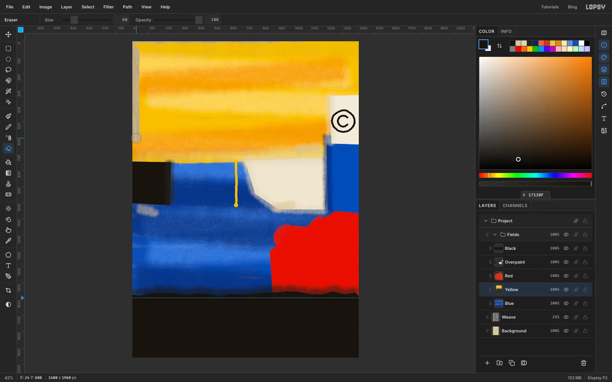

Basquiat stamped © and ™ all over his paintings. Choose the **Hard Round**
preset at **Size** `12` in black. On *Overpaint*, draw a circle about
140 px across in the white block, then a smaller C inside it.

Click the *Yellow* row and choose the **Eraser** at **Size** `60`. Drag it
down the left edge from the top to about `y 600`. The *Weave* layer shows
through as a strip of bare linen.

## Paste in the alligator photo

This tutorial uses
[American Alligator Mouth Open](https://commons.wikimedia.org/wiki/File:American_Alligator_Mouth_Open_(32821201787).jpg),
a public-domain Everglades National Park photo on Wikimedia Commons. In
any image viewer, crop it to the head and jaws, trimming the sky above the
snout, and scale it to **1400 px wide**. Then copy it.

Collapse *Fields*, click it, and click the **New Group** button. Name the
group *Gator*. Press [[Cmd+V]]. The photo lands as a new layer across the
top of the canvas. Rename the layer *Gator Photo* and deselect.

## Trace the head with the Lasso

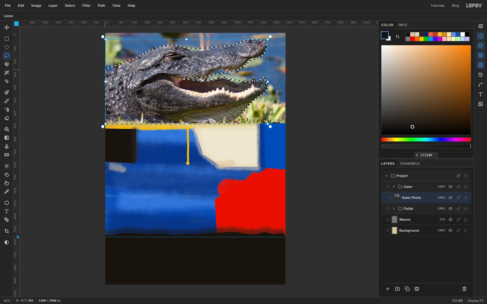

Choose the **Lasso** and trace slowly around the head:

1. Start where the neck leaves the left edge.
2. Go along the top of the skull and the snout.
3. Go into the open mouth, along the underside of the upper jaw and back
   along the top of the lower jaw.
4. Go out round the chin.
5. Finish with a straight run along the bottom of the photo.

You don't need to follow every scale. The outline will be painted over.

## Cut out the head

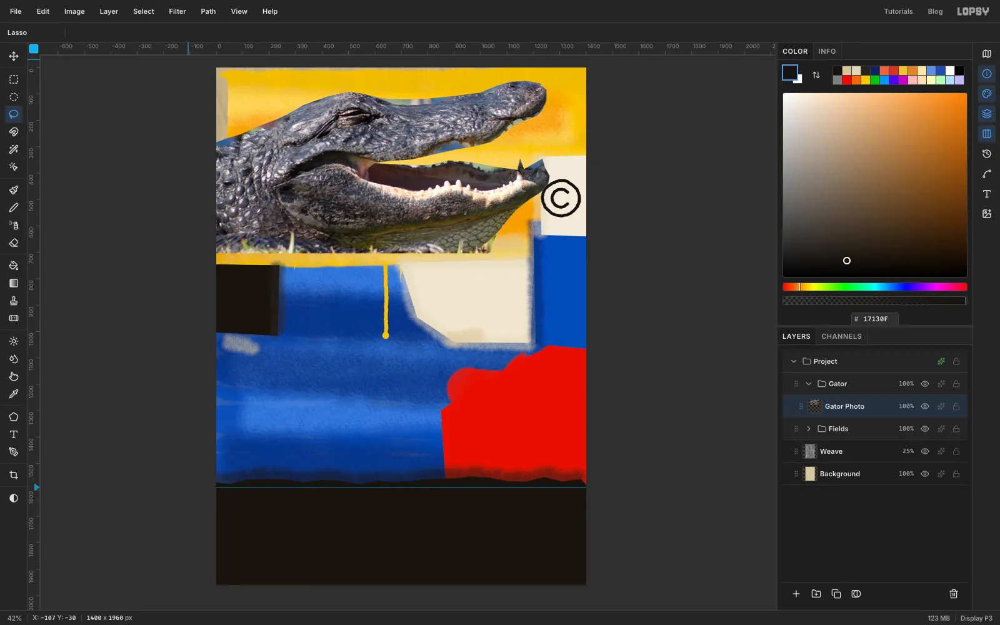

Choose **Select → Inverse** and press [[Delete]] to clear the
background. Deselect.

## Move and rotate the alligator

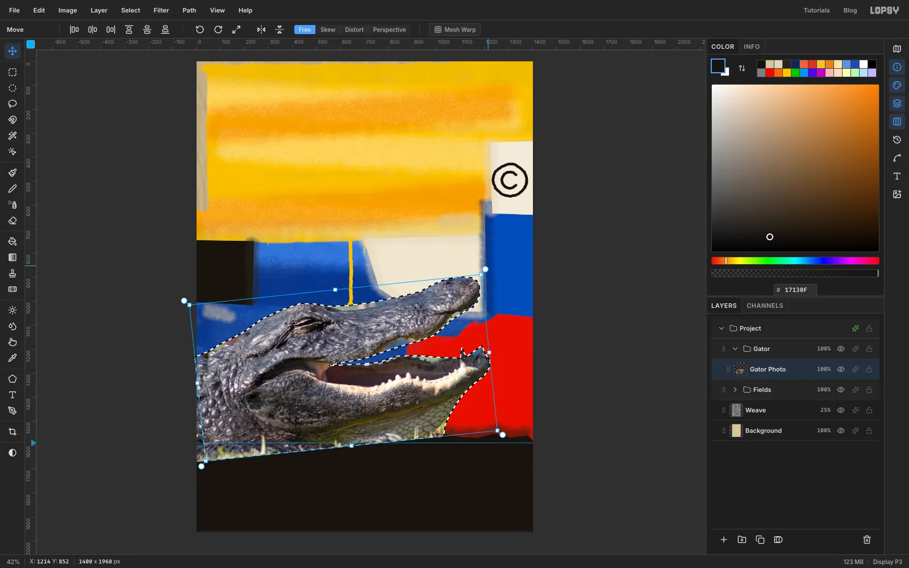

With the **Move** tool, drag the head down and a little left, so the neck
hangs about 40 px off the left edge and the bottom of the photo sits on
the band.

[[Cmd]]-click the *Gator Photo* thumbnail to show the transform handles.
Drag the round rotation handle outside the top-right corner upward, about
6°, so the snout rises. Press [[Cmd+D]] to commit.

## Trim the bottom edge

The rotation tilted the photo's straight bottom edge into the band. With
the **Rectangular Marquee**, select from about `y 1578` down past the
bottom of the canvas, press [[Delete]] and deselect.

## Turn the photo into an underpainting

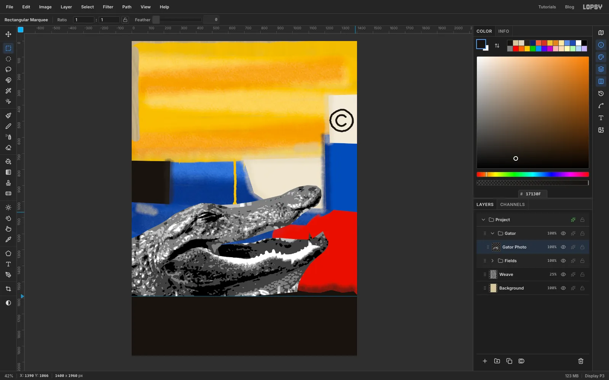

With *Gator Photo* selected, run these in order:

1. **Filter → Desaturate**
2. **Filter → Oil Paint…**: **Radius** `4`, **Sharpness** `1.0`
3. **Filter → Brightness/Contrast…**: **Brightness** `10`, **Contrast**
   `50`
4. **Filter → Posterize…**: **Levels** `5`

Running Oil Paint before Posterize matters. Oil Paint smooths the scales
into rounded blotches, and Posterize then turns them into a few flat
tones. The other way round, Oil Paint smears the flat posterized tones
into small square blocks.

## Wash in colour with Multiply

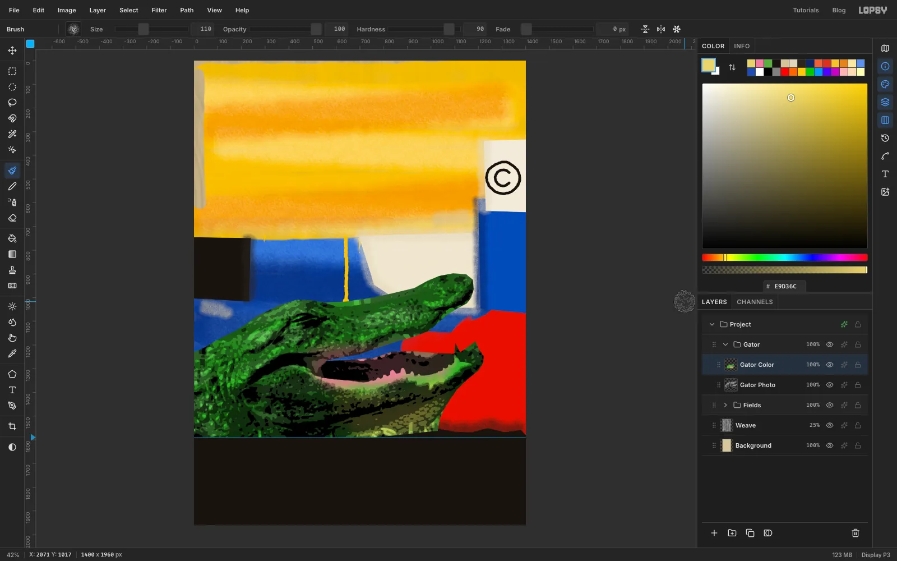

[[Cmd]]-click the *Gator Photo* thumbnail and add a layer named *Gator
Color*. The selection keeps the paint on the head. Paint with the textured
brush at **Size** `160` in green `#58B03C`, in long strokes across the
whole head. Then:

- with the chalk brush at **Size** `120`, two strokes of pink `#F07AA0`
  along the inside of the mouth
- at **Size** `110`, two strokes of belly yellow `#E9D36C` along the lower
  jaw

Deselect and set the layer's **Blend** to **Multiply**. The grey tones
underneath turn the flat colours into shaded greens.

## Overpaint shadows and ridges

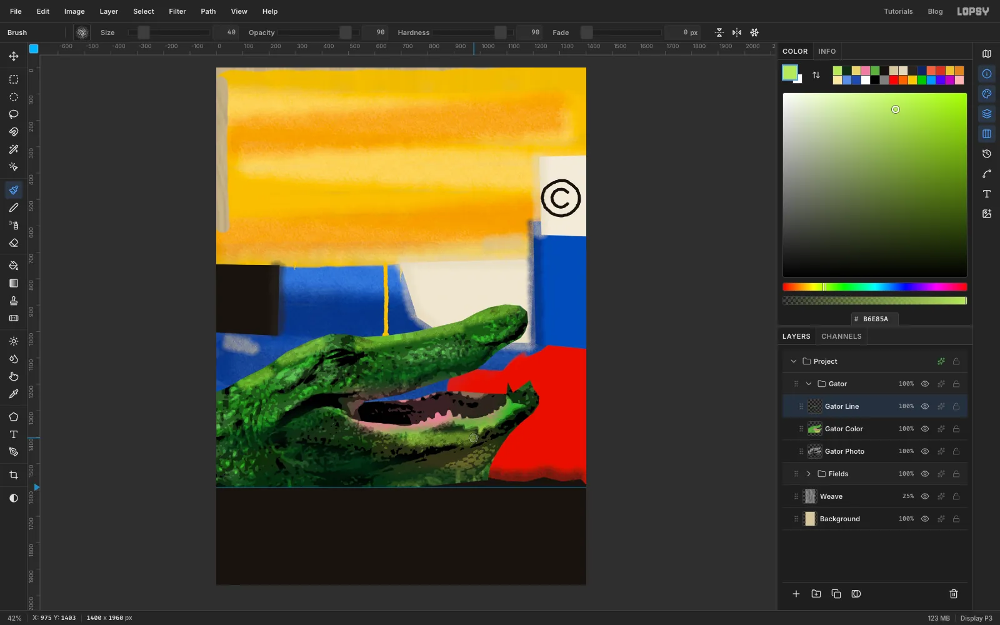

[[Cmd]]-click the *Gator Photo* thumbnail again and add a layer named
*Gator Line*.

- With the chalk brush at **Size** `70` and **Opacity** `85` in shadow
  green `#0E2E16`, drag a few strokes through the shadows: under the jaw,
  along the neck and along the bottom of the belly.
- At **Size** `40` and **Opacity** `90` in lime `#B6E85A`, add short
  streaks along the top of the snout and the skull.

Deselect.

## Fill the mouth and draw the outline

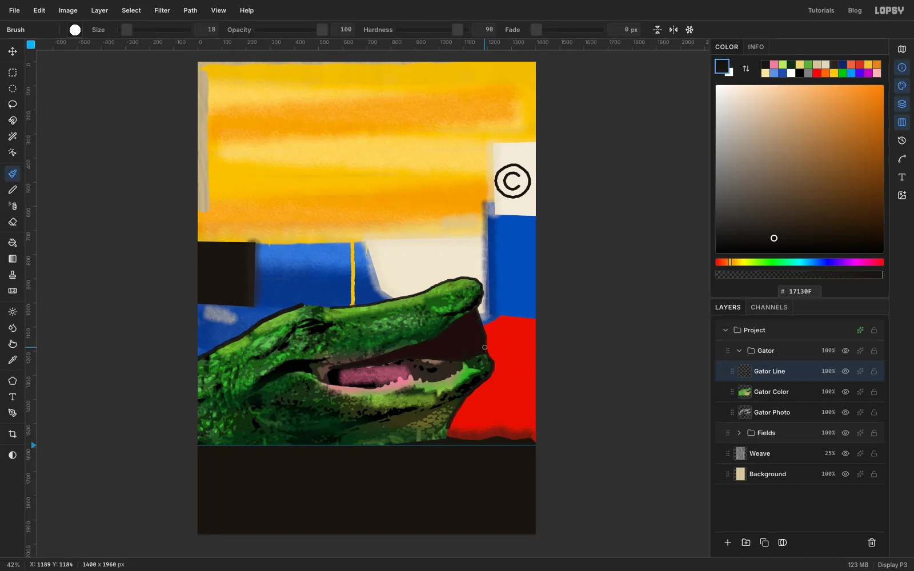

With the **Lasso**, select the gap between the jaws and close it with a
straight edge at the snout. Choose **Select → Feather…** `3` so the edge
isn't razor sharp, and fill it with `#1C0A0C`. Deselect and add a short
pink chalk stroke (**Size** `50`) inside for a tongue.

Now draw the outline with the textured brush in black, in five separate
strokes so the line changes weight as it goes. Use a heavy **Size** `20`
along the neck, thin it to `12` over the skull and snout and `9` under the
upper jaw, then thicken it again to `14` along the lower jaw and `18`
round the chin. Leave small gaps between the strokes.

## Paint the teeth

With the textured brush at **Size** `11` in white, click where the upper
jaw meets the mouth corner. Then [[Shift]]-click a zigzag along the
underside of the jaw toward the snout. Make the points uneven, 18 to
38 px deep, and end on a point.

For the lower teeth, switch to **Size** `15` and paint a short upward
stroke over each tooth in the photo, about 25 to 30 px tall.

## Add scale marks and an eye

Paint about nine crosses on the neck with the textured brush in white.
For each one, click one end of a stroke and [[Shift]]-click the other.
Vary the size (roughly 20 to 60 px across), the brush size (4 to 10) and
the angle, so they don't look stamped.

For the eye, click once with the textured brush at **Size** `40` in crown
yellow `#F6C21C`. Click again at `26` slightly to the upper right so the
eye isn't a perfect circle. Draw a short black slit through it with the
**Hard Round** brush at **Size** `9`.

## Crown the king of the bayou

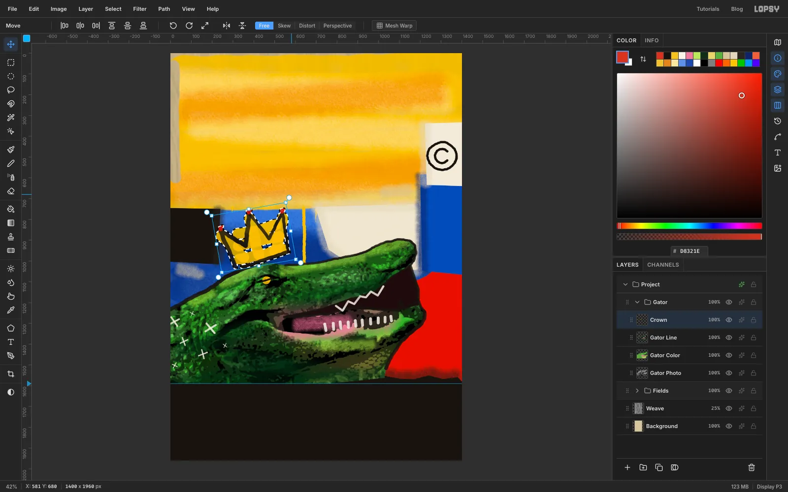

Add a layer named *Crown*. On top of the head, scrub three horizontal
strokes of crown yellow with the textured brush at **Size** `56`, about
260 px wide. Then pull a short stroke up into each of three points. The
fill should miss the outline in places.

Draw the outline over it with the textured brush in black, in three
strokes:

- **Size** `22` up the left side and the first point
- **Size** `16` over the other two points
- **Size** `20` back along the base

Put a red blob on each point with the **Hard Round** brush in vermilion:
click at **Size** `26`, then again at `16`, slightly off-centre.

Choose the **Move** tool, [[Cmd]]-click the *Crown* thumbnail, drag the
rotation handle to tilt the crown about 10° to the left, and press
[[Cmd+D]].

## Rough edge and drips into the band

The trimmed photo still ends in a straight line. Add a layer named *Band
Edge* at the top of *Gator*. Lasso a ragged strip that wavers between
about `y 1556` and `y 1590` and runs across the full width. Fill it with
black, then drag the chalk brush at **Size** `50` along it.

With the **Hard Round** brush, paint four drips down into the band, all
starting at about `y 1546`:

- dark green `#2E6B22` at `x 180`, about 110 px long, **Size** `16`
- lighter green `#3F8A2C` at `x 430`, about 50 px, **Size** `9`
- dark green at `x 770`, about 130 px, **Size** `18`, ending in a bead
  clicked at **Size** `28`
- vermilion at `x 1370`, about 90 px, **Size** `14`, from the red field

For the three without a bead, set **Taper** to about two thirds of the
drip's length first. Set it back to `0` afterwards.

## Set the title

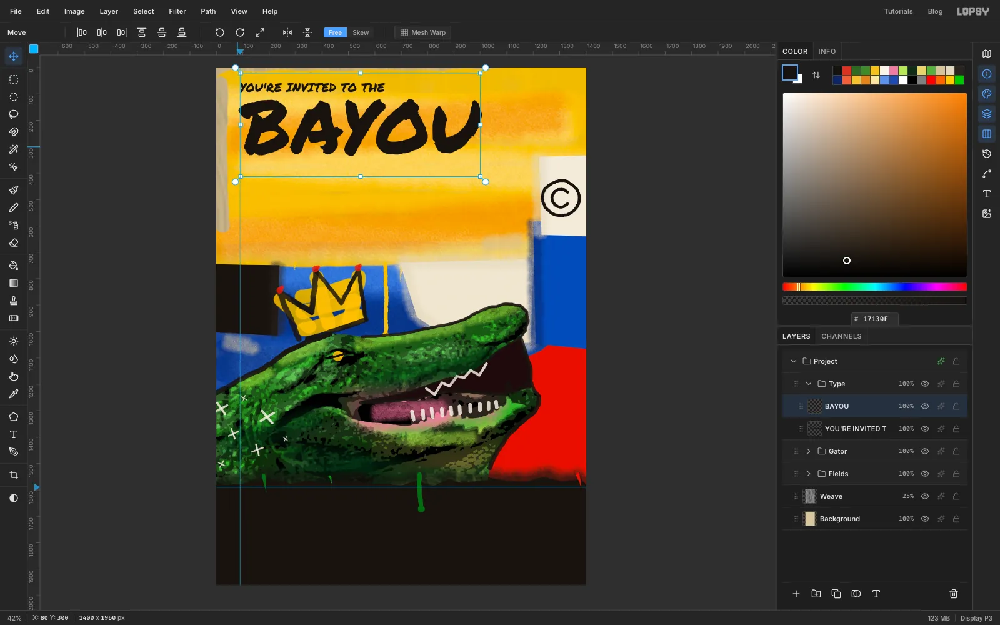

Collapse *Gator*, click it, and click the **New Group** button. Name it
*Type*. Click the top ruler at `90` to drop a vertical guide for the left
margin.

Choose the **Text** tool, pick **Permanent Marker**, set **Size** to `46`,
and set the foreground to ink black. Click in the yellow and type
`YOU'RE INVITED TO THE`. Press [[Tab]] to commit. With the **Move** tool,
use the arrow keys to line its left edge up with the guide, about 60 px
from the top.

Click the *Type* group row before each new piece of type, so the options
don't restyle the last layer. Then make `BAYOU` at **Size** `280` and
nudge it to sit just under the first line.

## Tilt the title

With the **Move** tool and *BAYOU* selected, drag the rotation handle at
its top-right corner to tilt the word about 3° counter-clockwise. Small,
different tilts on each line make the lettering look hand-placed.

## Cross out one word

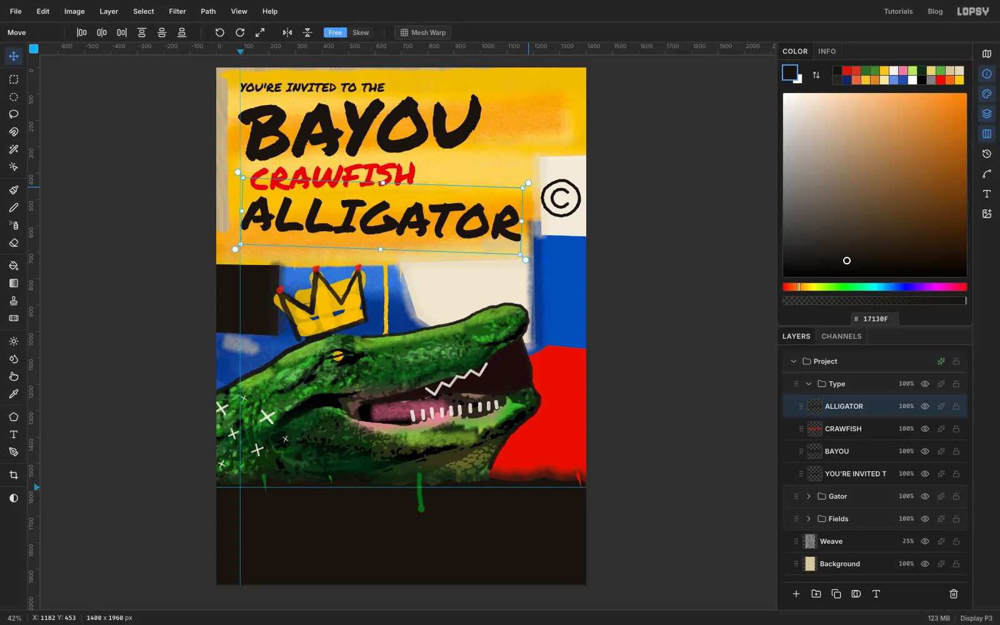

Make `CRAWFISH` at **Size** `118` in bright red `#D6150F`. Place it under
BAYOU, indented about 40 px from the guide, and tilt it about 2°
counter-clockwise. Then make
`ALLIGATOR` at **Size** `180` in black. Place it under CRAWFISH with about
40 px of air between them, and tilt it about 2° clockwise.

You'll strike out CRAWFISH in a moment. The joke only works if the word
stays big enough to read through the strike.

## Put BALL on the white slab

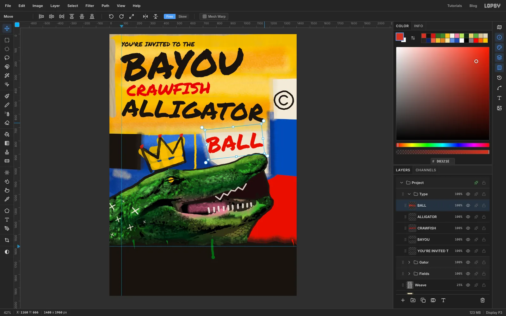

Make `BALL` at **Size** `160` in vermilion and place it on the dirty-white
slab, just above the snout. Tilt it about 6° counter-clockwise so it rises
with the alligator. Red on dirty white is the strongest contrast on the
page, so give it no outline or effect.

## Set the details in the band

Set each of these lines on the guide in the black band:

1. `SATURDAY, NOVEMBER 21 · 8 PM TIL LATE` in Permanent Marker `50`,
   cream `#F3E9D2`, about 50 px below the band's edge
2. `THE OLD ICEHOUSE · BREAUX BRIDGE, LA` in **Gochi Hand** `46`, cream
3. `ZYDECO · CRAWFISH BOIL · BAD PAINTINGS` in Gochi Hand `46`, yellow
   `#F2C12E`
4. `A BENEFIT FOR THE ATCHAFALAYA ART CLUB` in Gochi Hand `42`, cream

Leave about 20 px between lines. Keep lines 2–4 ending before about
`x 950` so the RSVP card fits at the right.

## Strike out CRAWFISH

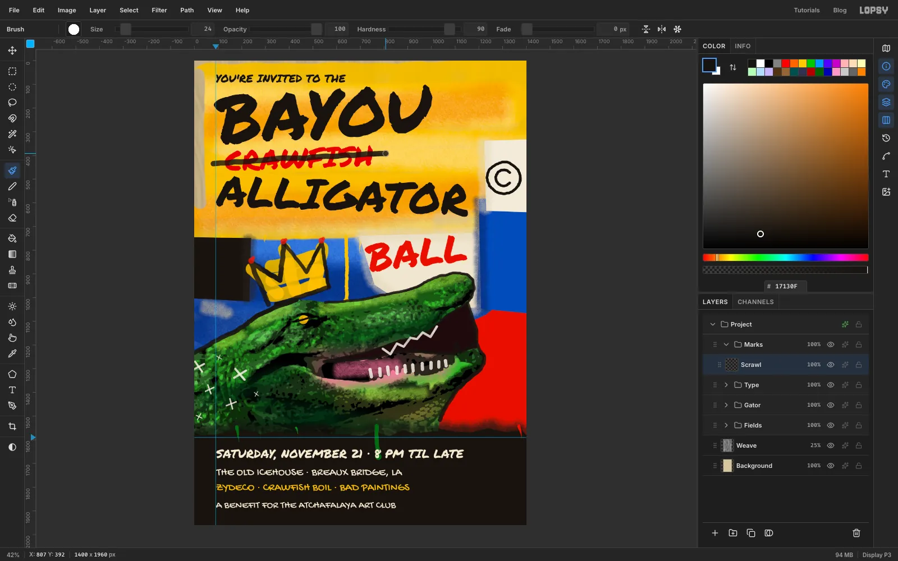

Collapse *Type*, click it, and click the **New Group** button again. Name
the group *Marks* and add a layer named *Scrawl*.

With the textured brush at **Size** `24` in black, make one fast stroke
through the middle of CRAWFISH. Start a little left of the C and finish
past the H, rising slightly. One bar keeps the word readable. Two
parallel bars look like they were drawn with a ruler.

## Underline BALL and count the days

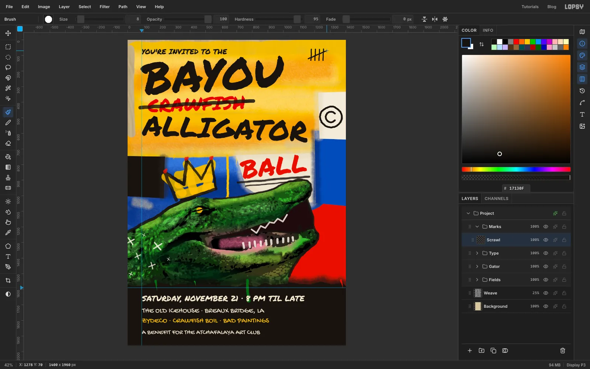

Under BALL, draw a slanting line with the textured brush at **Size** `14`.
Then add a shorter one at `9` that isn't parallel to it.

For the tally, choose the **Hard Round** brush at **Size** `8`. Make four
tally marks in the top-right corner and one slash across them, using a
click and a [[Shift]]-click for each.

## Label the teeth

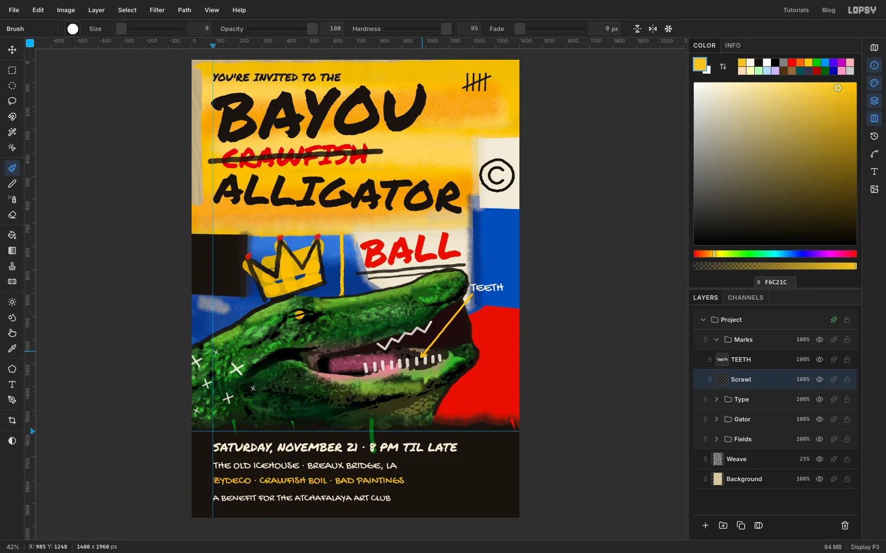

Click *Marks* and set `TEETH` in Gochi Hand `54`, white, on the blue
block, at least 70 px in from the right edge. Click *Scrawl*. With the
**Hard Round** brush at **Size** `9` in crown yellow, click just below the
label and [[Shift]]-click on the lower teeth. Add two short strokes at the
tip for an arrowhead. Yellow shows up on the blue and on the dark mouth.

## Tape on a price patch

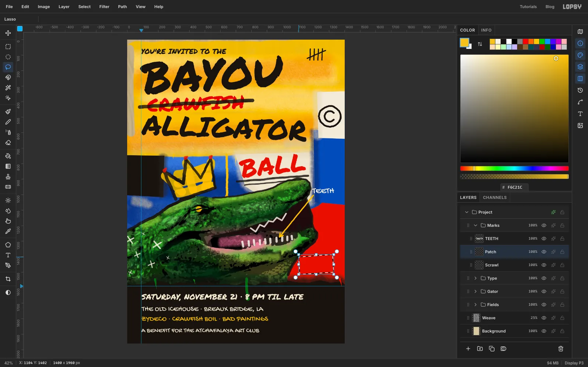

Add a layer named *Patch*. Lasso a slightly tilted quadrilateral over the
red field, about 220 × 115 px, keeping it at least 70 px from the right
edge. Fill it with cream and deselect.

In its effects drawer, turn on **Drop Shadow** with **Offset X** `6`,
**Offset Y** `7`, **Blur** `1` and **Opacity** `60`. That gives a hard,
cut-paper shadow.

Click *Marks* and set `BEER $2` in Gochi Hand `50`, black. Tilt it about
4° to match the patch and nudge it to the centre, with even space on
every side.

## Make the RSVP card

Click *Patch* and add a layer named *RSVP Card*. Lasso a card about
270 × 165 px in the bottom-right of the band, tilted about 2.5°
counter-clockwise. Fill it with cream and give it the same hard drop
shadow.

Set `RSVP` in Permanent Marker `66` and `BY NOV. 7` in Gochi Hand `42`,
both black. Tilt both 2.5° to match the card. Centre them on the card
with about 18 px between the two lines, and leave equal space above and
below the pair.

## Copy the crown for the card

Expand *Gator*, click *Crown*, [[Cmd]]-click its thumbnail and choose
**Edit → Copy**. Collapse *Gator*, click *Marks* and choose
**Edit → Paste**. The copy lands exactly on top of the original, already
selected, with the Move tool active. Rename it *Little Crown*.

Drag a corner handle toward the opposite corner until the copy is about
a third of the size, then press [[Cmd+D]].

## Crown the card

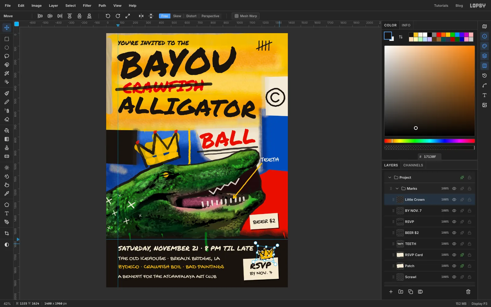

Drag the little crown so it sits centred on the top edge of the RSVP
card, clear of the date line. [[Cmd]]-click its thumbnail, tilt it about
6° clockwise and press [[Cmd+D]].

## Tape the card and the patch down

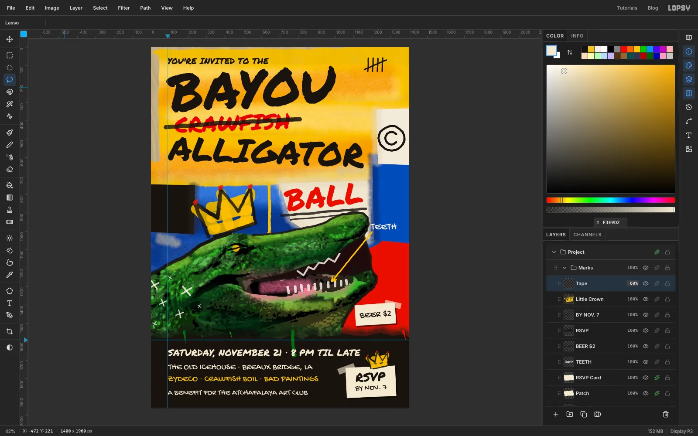

Add a layer named *Tape*. Lasso a small tilted strip, about 90 × 30 px,
across the card's top-left corner and fill it with cream. Then lasso a
second strip across the beer patch's top-right corner and fill that too.
Deselect, and set the layer's opacity to `60%` so the strips look like
masking tape.

## Flick a little paint

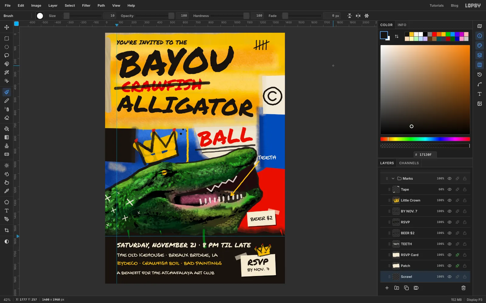

Click *Scrawl* and pick the **Hard Round** preset at **Size** `18` in
black. In the Brushes panel, set **Spacing** to `200` on the **Shape**
tab, and **Scatter** to `100` and **Size Jitter** to `90` on the
**Dynamics** tab. Flick one short stroke near the crown so it leaves a few
scattered dots of different sizes. Pick **Hard Round** again to put the
settings back.

## Raise the paint with Emboss

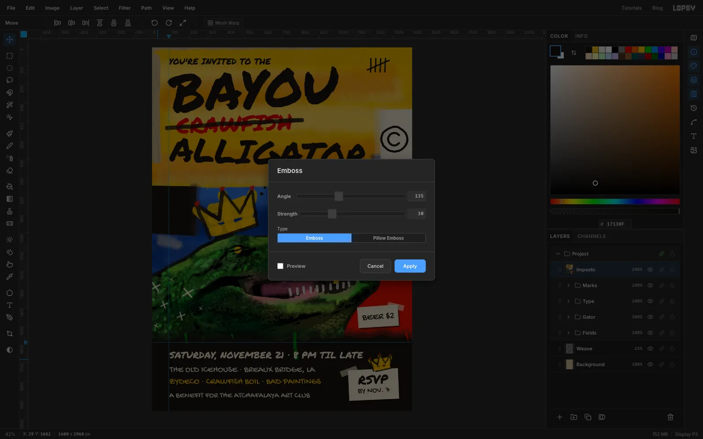

Collapse *Marks* and click it. Choose **Select → All**, then
**Edit → Copy Merged**, deselect and choose **Edit → Paste**. Name the new
layer *Impasto*.

Choose **Filter → Emboss…** with **Angle** `135` and **Strength** `30`.
Click **Apply**, then **Filter → Desaturate**. Set its **Blend** to
**Overlay** and opacity to `45%`. Lopsy's Emboss adds its light and shadow
on top of the picture, so this layer is a grey copy of the artwork with
raised edges. In Overlay it deepens the contrast a little and catches
every brush edge, drip and letter like thick paint.

## Finish with grain

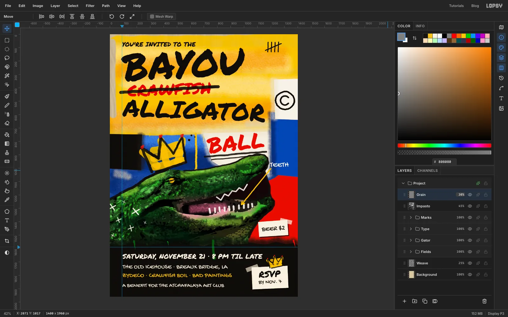

Add a layer named *Grain*. Choose **Select → All**, fill it with grey
`#808080`, deselect, and choose
**Filter → Add Noise…** with **Amount** `22`, **Mono** and **Gaussian**.
Set its **Blend** to **Overlay** and its opacity to `30%`.

Export with **File → Quick Export PNG**, and save the project with
**File → Save Project** so you can change the date for next year's ball.
