Neo-expressionism was painting's loud comeback around 1980. Painters like Georg Baselitz, Anselm Kiefer and Jean-Michel Basquiat went back to big figures, crude drawing and thick, fast paint. Baselitz added a famous trick: from 1969 on he painted his subjects upside down, so that the viewer has to look at the paint before the picture.

In this tutorial you'll borrow that trick for **Water Tower**, an invented poetry zine on a 1400 × 1960 px page. A New York rooftop water tower hangs upside down from the skyline. Its paint runs rise instead of falling. A taped xerox of a real tower is the only thing on the page that's the right way up, and the word GRAVITY has been crossed out.

The main idea to take away is the brush. Lopsy's **Define Color Brush** captures a tip with several colours in it, so a single stroke drags dark, mid and light bristles side by side, with dry gaps between them. It looks far more like a loaded house-painter's brush than a stroke of one colour does.

Along the way you'll use:

- **Edit → Define Color Brush…**, the Brushes modal's angle dial, **Size Jitter** and **Angle Jitter**
- the **Lasso** and **Rectangular Marquee** to keep paint inside a shape, or let it escape
- **Oil Paint**, **Gaussian Blur**, **Add Noise**, **Invert**, **Desaturate**, **Brightness/Contrast**, **Halftone** and **Emboss**
- a **layer mask** painted with a soft brush
- **New Group**, **Duplicate Layer**, and rotating and scaling a whole group with the **Move** tool
- **Copy**, **Copy Merged**, **Paste**, **Merge Down** and [[Cmd]]-clicking thumbnails to select a layer's pixels
- **guides**, **Drop Shadow**, the **Overlay** blend mode and layer opacity
- live **Text** in Special Elite, rotated with its handle

You'll also need a photo of a water tower for the collage. I used [this public domain Carol M. Highsmith photograph](https://commons.wikimedia.org/wiki/File:Rooftop_view_of_a_Manhattan_block,_showing_an_old_water_tower,_New_York,_New_York_LCCN2011632998.tif) from the Library of Congress, cropped in an image viewer to the wooden tank at its lower left, legs included.

The palette:

- Raw canvas `#E7DCC4`
- Sky underpaint `#121C44`
- Deep brush `#0E1C4E` / `#142A6E` / `#1F3B8E` / `#0A1438` / `#1A2A3A` / `#2B2340`
- Cobalt brush `#1C46A8` / `#2A5CC8` / `#16348A` / `#3F78DC` / `#3A5A8C` / `#6FA0E6`
- Cadmium brush `#C9281A` / `#E2491A` / `#8A2A12` / `#B81C14` / `#E88A1E` / `#5E2410` / `#D32A18`
- Ochre brush `#E0A21C` / `#F2C640` / `#A9761E` / `#7A5618` / `#C8741C` / `#F6D874`
- Bone brush `#EFE7D2` / `#F8F1E0` / `#E2D7BF` / `#F3EAD6` / `#CFC3A8` / `#FFFAEC`
- Tar brush `#141210` / `#1A1512` / `#0C0B0A` / `#201815` / `#101420` / `#1E1A18`
- Tank umber `#3A1A10`, cone umber `#6E4A12`, roof black `#14100E`
- Rising paint `#BCD6EE` / `#EFE7D2` / `#8FB8E6`
- Lettering `#F06A16` / `#F8F1E0` / `#FFD24A` / `#F2C640`
- Xerox paper `#EFEADB`, tape `#E9D99A`, caption `#1C1A17`

## Prime a raw canvas

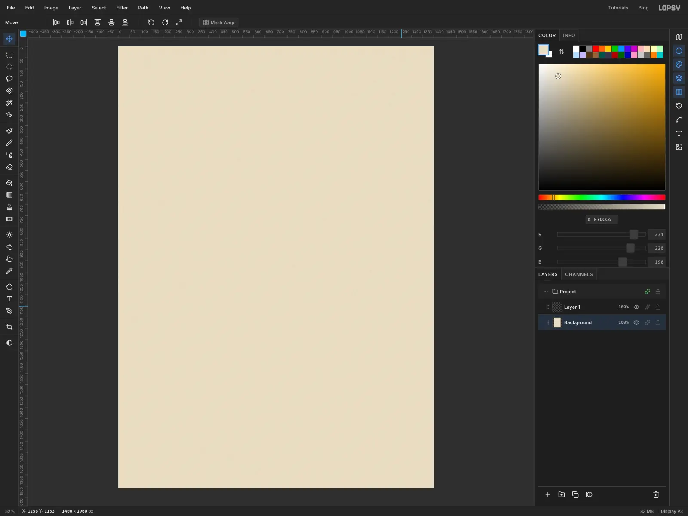

Create a new document, 1400 × 1960 px. Select the **Background** layer, set the foreground colour to raw canvas `#E7DCC4`, and choose **Edit → Fill**.

Open **Filter → Add Noise…**, choose **Mono**, set the **Amount** to 14 and apply it. It's a small touch, but the grain stops the page looking like an empty screen.

## Make six loaded brushes

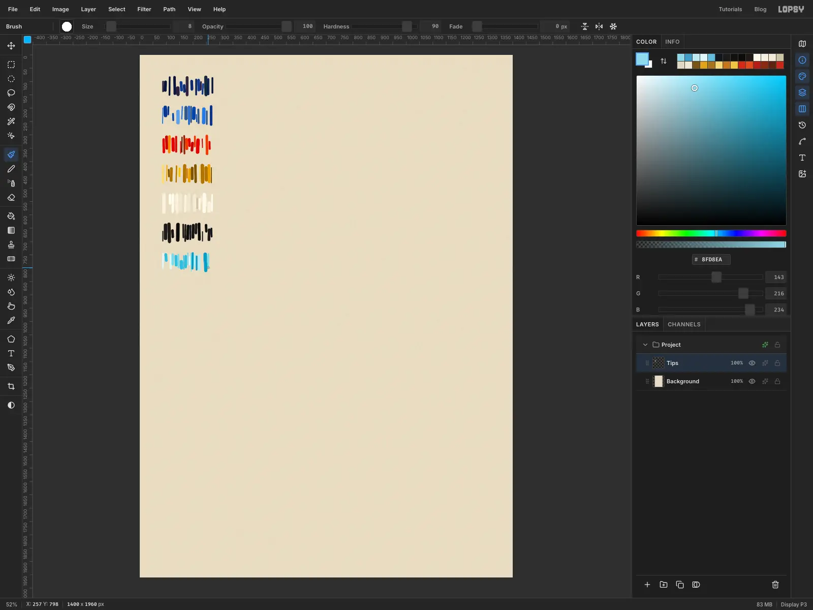

Click **Layer 1**, the empty layer your new document came with, and rename it **Tips** (double-click a layer's name to rename it). Paint only on this layer: the transparent gaps are what make the dry streaks. Pick the **Brush**, open the Brushes modal from the tip thumbnail in the options bar, click the **Hard Round** preset, and set **Hardness** to 90 and **Spacing** to 10. Close the modal.

Near the top left of the canvas, paint a row of 15 to 18 short vertical strokes, side by side, in a strip about 200 px wide and 70 px tall. Change the brush **Size** between 5 and 14 as you go, and the colour too, using the first brush in the palette list. Make some strokes only a third of the strip's height and let their ends stagger. Leave a few gaps of 5 to 10 px: they're what will make the dry streaks.

Paint five more rows below it, one for each of the other brushes. The screenshot also shows a seventh row in pale blue, which I made for the water and ended up not using, so you can skip it.

Now draw a marquee around the first row and choose **Edit → Define Color Brush…**. Name it **Deep**. Repeat for **Cobalt**, **Cadmium**, **Ochre**, **Bone** and **Tar**. Deselect, then click the eye on the **Tips** layer to hide it. Keep the layer: custom brushes don't live in the project file, so this is how you'd get them back after a reload.

Throughout this tutorial, "add a layer" means clicking **+** under the Layers panel and renaming the new layer. Each layer's opacity is the percentage in its row, and its effects are the sparkle icon next to its eye.

## Underpaint the sky

Add a layer called **Sky Deep**. Set the foreground to `#121C44`, marquee everything below the top seventh of the page, fill it, and deselect with [[Cmd+D]].

This dark ground is what shows through the brush's gaps. Later you'll cover the bare strip at the top with rooftops.

## Cross the sky with big strokes

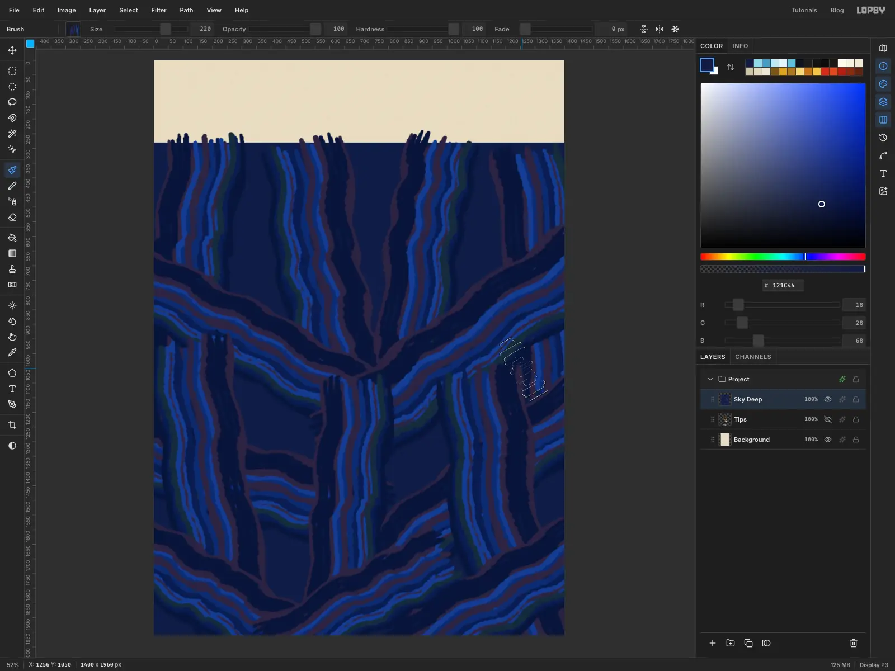

Pick the **Brush**, open the Brushes modal, and click your **Deep** brush on the **Presets** tab. On the **Dynamics** tab set **Angle Jitter** to 3, and on the **Shape** tab set **Spacing** to 2. Clicking a preset overwrites all these settings, including the size and the dial below. So from here on, "load **Cobalt**" means: pick the Brush, click that preset, reapply Angle Jitter 3 and Spacing 2, set the dial and size, and close the modal, because it covers the canvas. Colour brushes ignore the foreground colour.

The tip is a row of bristles, so it's widest when the row lies across the stroke. The **angle dial** on the Shape tab sets this: leave it at 0° for up-and-down strokes, 90° for side-to-side strokes, 45° for strokes that lean like /, and 135° for strokes that lean like \. Get in the habit of turning it before each change of direction.

With **Size** between 200 and 290, paint about a dozen long strokes across the sky. Go down from the top, across from both sides, and diagonally up and down from the bottom corners, and run them right off the bottom edge so the paint bleeds. Don't let them all run the same way, or the sky turns into wallpaper.

Apply **Filter → Oil Paint…** at **Radius** 4, then **Filter → Gaussian Blur…** at **Radius** 2. Together they melt the stepped edges into something closer to wet paint.

## Sweep cobalt across the top

Add a layer called **Sky Cobalt** and load the **Cobalt** brush. Paint two long sweeps side to side across the upper part of the sky at **Size** 240 or so. Add four or five shorter ones at **Size** 120 to 230, around the middle of the left and right edges, as in the screenshot. Finish with one more sweep right across the foot of the page at **Size** 230.

The light paint high up is there for a reason: the black rooftops and tower legs you'll add next need something pale to stand against. Apply **Oil Paint** at **Radius** 4 and **Gaussian Blur** at **Radius** 2 again.

## Fade the cobalt with a mask

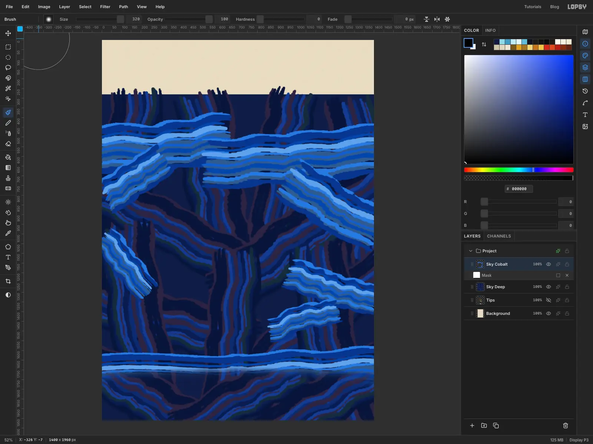

The word TOWER is going across the bottom of the page and it needs a dark ground, so that last sweep should fade away. With **Sky Cobalt** selected, click **Add Mask** at the bottom of the Layers panel, then click the mask row's **Edit mask** button so that you're painting on the mask.

Click the **Soft Round** preset, set **Size** to 320, set the foreground to black, and drag one stroke across the page near the bottom. Click the **Sky Cobalt** layer's name to go back to painting pixels.

## Paint the legs, the right way up

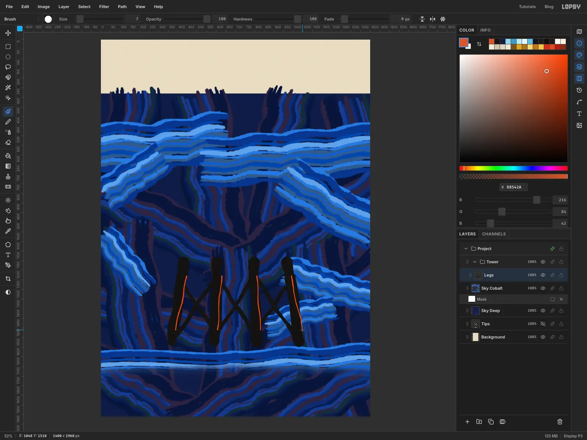

Baselitz turned his subject upside down before painting it, but you can make things easier for yourself. You'll paint the tower upright, in a group, and flip the group afterwards.

Click **New Group** in the Layers panel and name it **Tower**. Layers you add while it's selected go inside it. Add a layer inside it called **Legs**.

You need a second kind of brush for lines, because at small sizes the colour brushes' gaps turn into thin wires. I'll call this one the **oil stick**: in the Brushes modal click **Hard Round**, set **Size Jitter** to 30 on the Dynamics tab and **Spacing** to 4 on the Shape tab. Its width wanders as you draw, a bit like a greasy crayon. Whenever a step asks for the oil stick, go back to these settings.

With the oil stick at **Size** 62 and colour `#141210`, paint four legs splaying out from about 60% of the way down the page to about 80%. Drop the size to 24 and draw an X between each pair of legs. Then pick orange-red `#D8542A` at size 7 and draw a thin line down one side of each leg.

## Lasso the tank and underpaint it

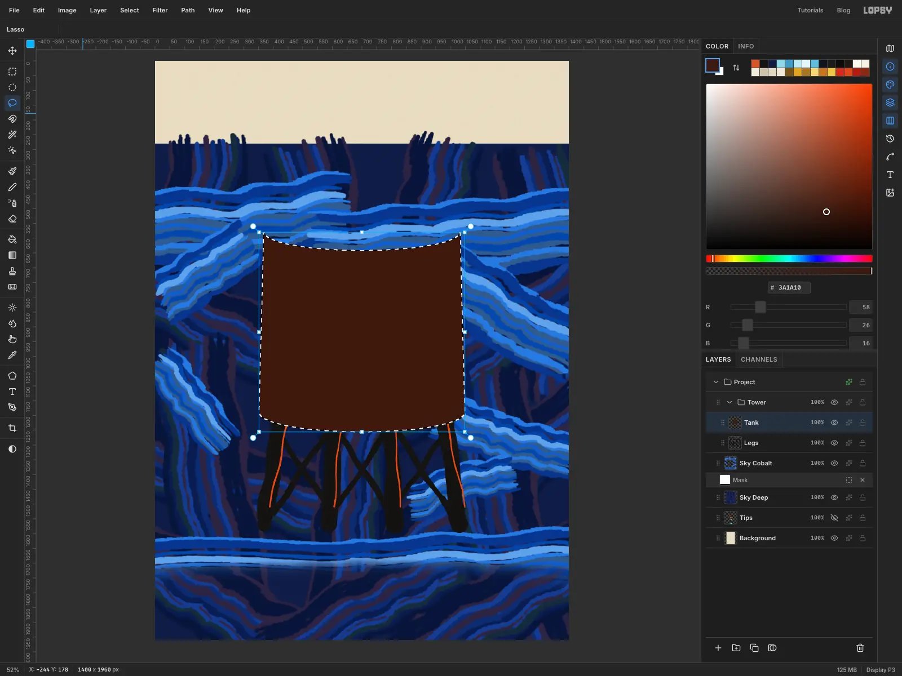

Add a layer called **Tank**. With the **Lasso**, draw a barrel above the legs, about half the page wide and nearly as tall as it is wide, its top and bottom edges curving gently downward in the middle. Fill it with dark umber `#3A1A10` and keep the selection active.

## Pull down the staves

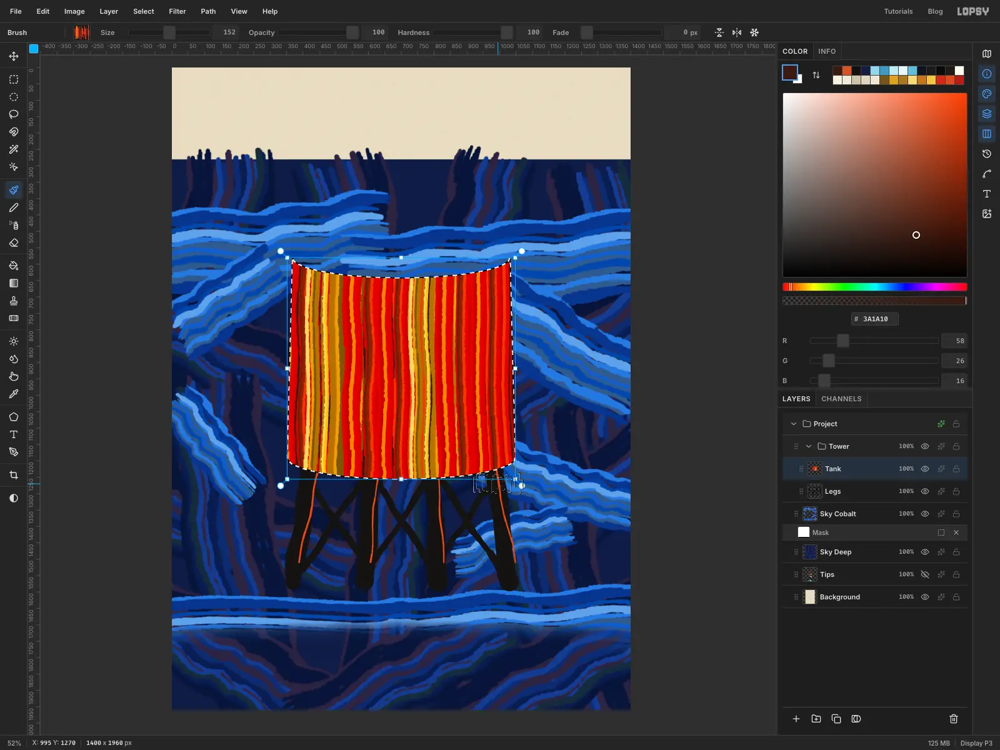

Load the **Cadmium** brush with the dial at 0°. Paint seven vertical pulls across the barrel, from above its top to below its bottom, at **Size** 130 to 190. Swap in **Ochre** for a couple of the pulls. The lasso keeps the paint inside, and the umber shows through the dry gaps.

At this stage it'll look like a deck chair. The next step fixes that.

## Scrub across the stripes

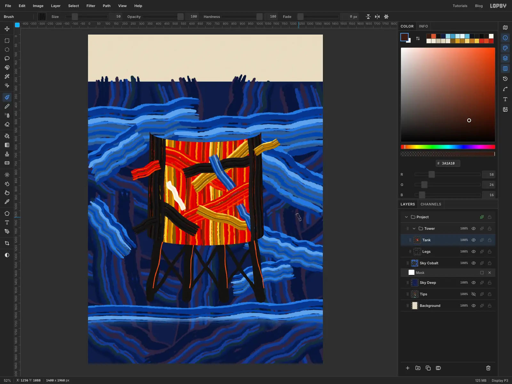

Still inside the selection, scrub across the stripes in every direction, turning the dial as you go. Use nine strokes or so: big red diagonals at **Size** 90 to 110, ochre at 54 to 70, black **Tar** at 60 to 70, two slashes of **Cobalt** at about 50, and one short slash of **Bone** at 30. No stripe should survive the full height of the tank.

Paint a dry **Tar** stroke down each side, **Size** 110 on the left and 90 on the right, to round the barrel.

Now deselect with [[Cmd+D]] and paint three short strokes that begin on the tank and run past its outline into the sky: **Cadmium** at **Size** 58 to the left, **Ochre** at 44 to the upper right, and **Tar** at 50 to the lower left. Neo-expressionist paint doesn't stay inside the lines. Finish with **Oil Paint** at **Radius** 3.

## Add hoops and seams

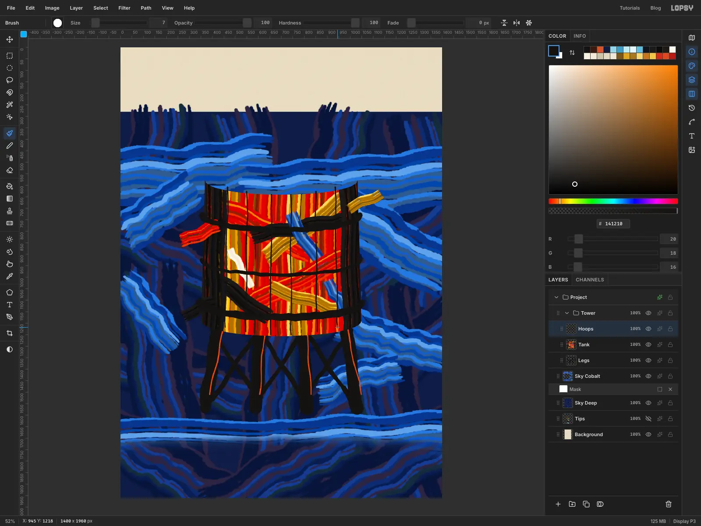

Add a layer called **Hoops**. With the oil stick in `#141210`, draw three hoops across the tank, curving the same way as its edges. Vary the weights: **Size** 30, 18 and 38.

Then draw six thin seams from top to bottom at **Size** 7, following the staves. They hold the shape together under all that scrubbing.

## Build the cone

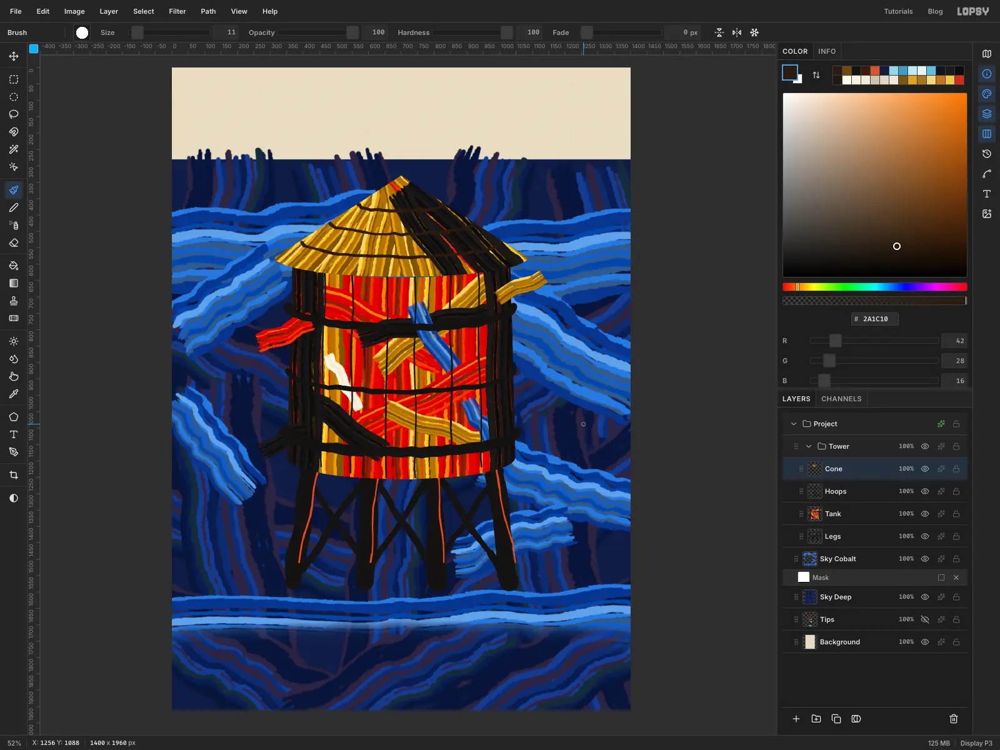

Add a layer called **Cone**. Lasso a wide triangle on top of the tank, with a curved bottom edge and a little overhang at each side. Fill it with `#6E4A12` and keep the selection.

Load **Ochre** and paint eight strokes from the point of the cone out to the rim, at **Size** 90 to 130, turning the dial for each ray. Make one of them **Cadmium**. Next drag **Tar** down one side, once at **Size** 120 and once at 70, to put that side in shadow.

Pick the oil stick at **Size** 11 in `#2A1C10` and draw three arcs across the cone, a third, a half and three quarters of the way down. Without them the bright rays read as a beam of light; with them it's a shingled roof. Deselect and apply **Oil Paint** at **Radius** 2.

## Draw a black contour

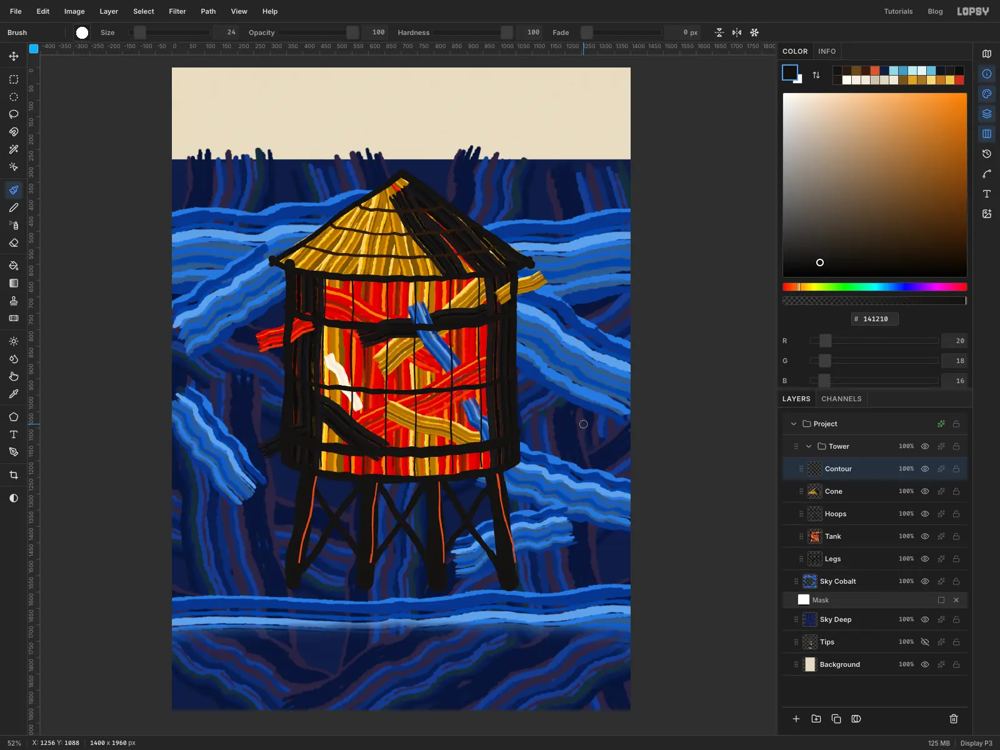

Add a layer called **Contour**. With the oil stick in `#141210`, draw around everything by hand: the tank's sides and bottom edge, the two slopes of the cone and its rim. Use sizes from 22 to 34, heavier on the left of the tank and the right slope of the cone.

Different weights on each side make it look drawn rather than stroked. Apply **Oil Paint** at **Radius** 1 to take the shine off the lines.

## Select the whole group

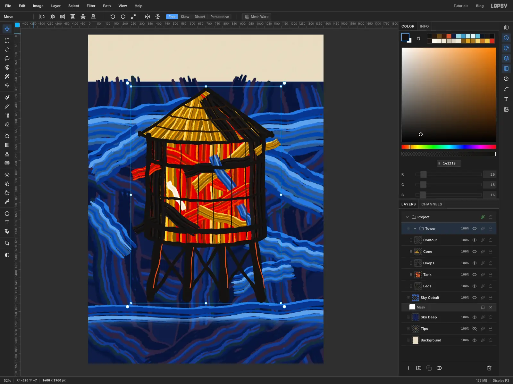

Click the **Tower** group's row in the Layers panel, press [[Cmd+D]] to make sure nothing is selected, and switch to the **Move** tool ([[V]]). The handles now frame all the group's layers, and anything you do transforms them together.

## Turn the world over

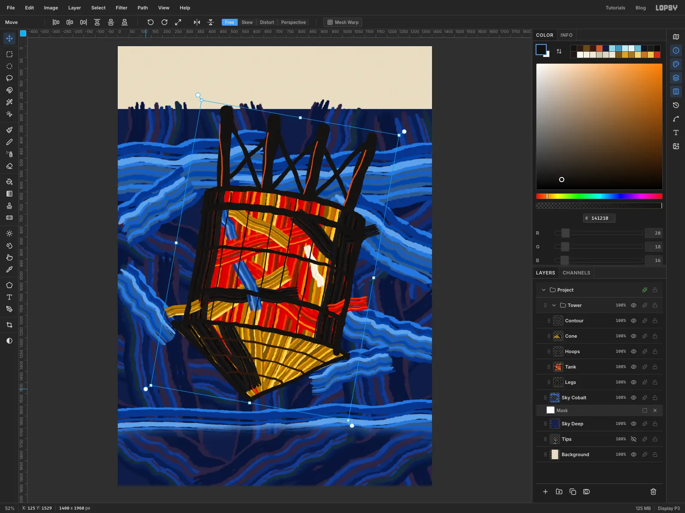

Grab the round rotation handle just outside the top-right corner of the box. Drag it clockwise, all the way past the half-turn, and stop about 10° beyond it. The legs should end up at the top, leaning a little to the right, and the cone's point at the bottom, a little to the left.

Don't stop at exactly 180°. That tilt makes the tower feel as if it's actually falling.

## Place the tower

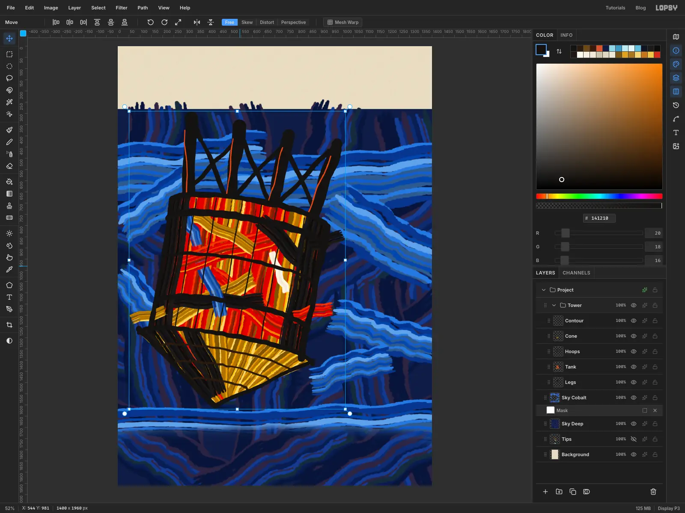

Drag from inside the box to slide the tower down and left. Put the tip about four-fifths of the way down the page and about a third of the way across, because that's where the O of TOWER will go. Press [[Esc]] to finish. In Lopsy, Esc keeps a transform rather than cancelling it.

## Duplicate and shrink a second tower

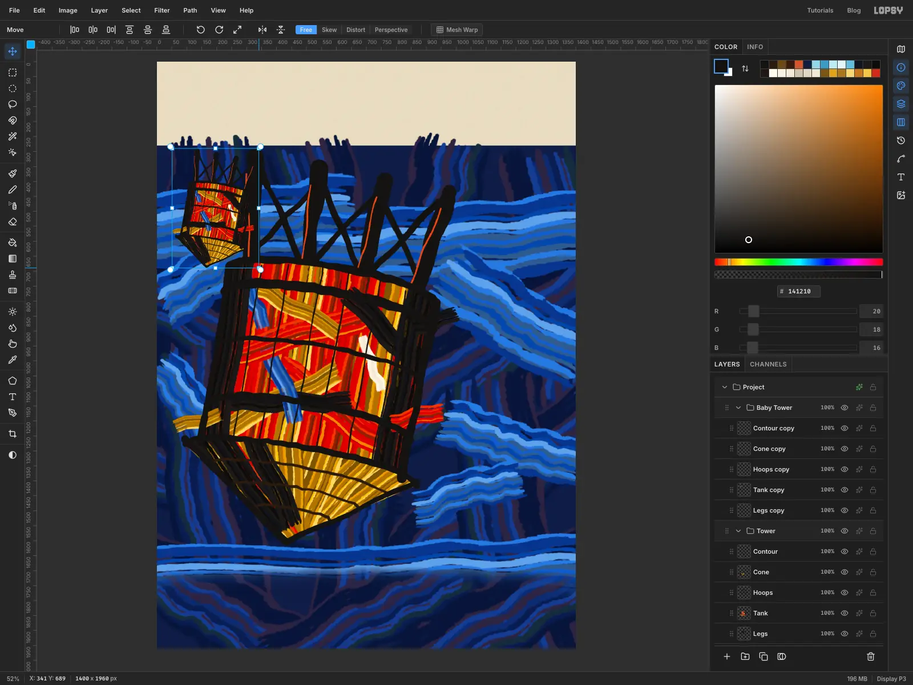

With the **Tower** group still selected, click **Duplicate Layer** and rename the copy **Baby Tower**. Press [[Cmd+D]]. Then, with the **Move** tool, hold [[Cmd]], so it keeps its proportions, and drag the bottom-right corner handle inward until the copy is about 30% of its size.

## Repaint it paler

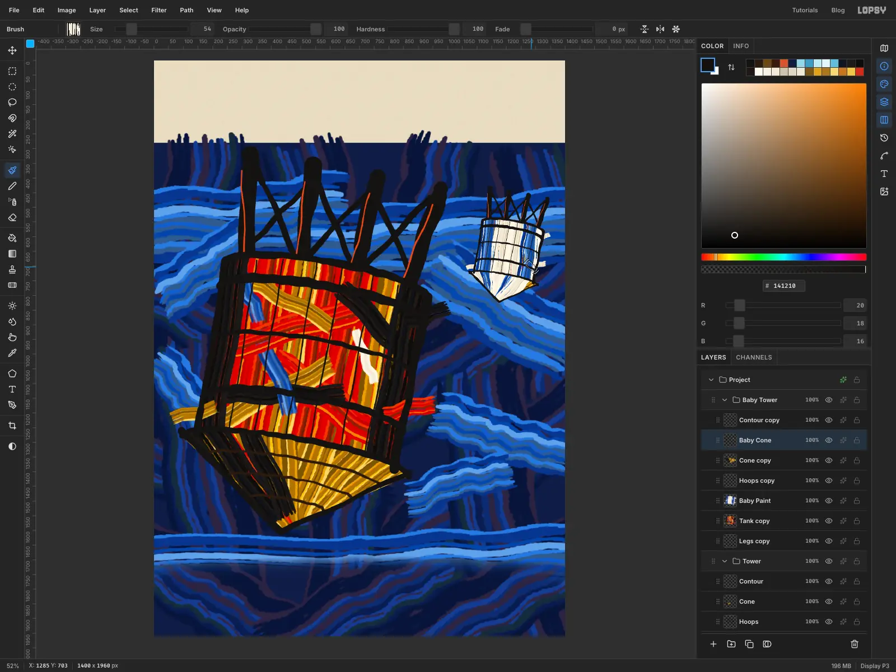

Drag the small tower to the upper right and press [[Esc]].

An exact small copy looks like clip art, and distant things are paler anyway. Click the **Tank copy** layer inside the group and add a layer above it called **Baby Paint**. [[Cmd]]-click the **Tank copy** thumbnail to select its pixels, then load **Bone** and paint six strokes down the tank at **Size** 60, with a couple in **Cobalt**. Press [[Cmd+D]].

Do the same for the roof: click **Cone copy**, add a layer called **Baby Cone**, [[Cmd]]-click **Cone copy**, and fan six strokes of **Bone** and **Cobalt** from the tip to the rim at **Size** 54. Deselect.

## Cut out the skyline

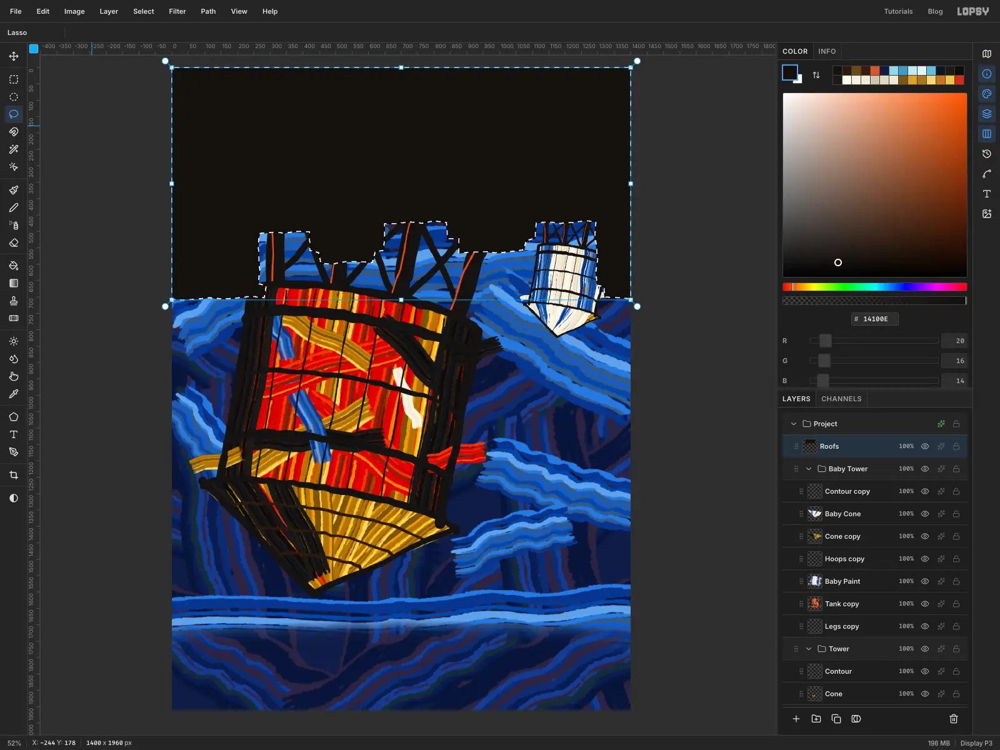

Click the **Project** row at the very top of the Layers panel and add a layer called **Roofs**, so that it sits above both towers.

Set the foreground to `#14100E`. With the **Lasso**, draw the skyline upside down: start off-canvas at the top, and let four buildings of different depths hang down across the page. Give them stepped cornices at their lower ends. The tallest should drop a third of the way down the page at the far left and far right. Keep the ones over the big tower's legs shallow, but the tips of the legs must disappear into the black, or the tower floats. Leave a notch for the small tower to hang from. Fill it and keep the selection.

## Paint the roofs

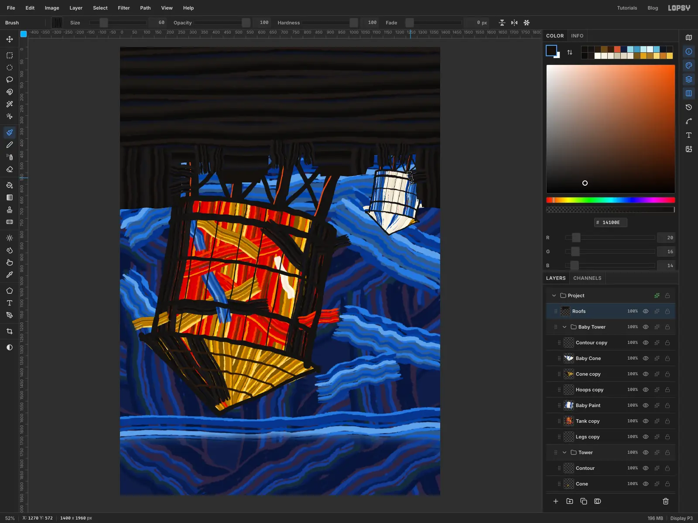

Load **Tar** with the dial at 90°, and paint five strokes from side to side at **Size** 200, top to bottom through the selection. Turn the dial to 0° and paint a few strokes down through the hanging buildings at **Size** 120. Deselect and apply **Oil Paint** at **Radius** 6.

The lasso left the edges too clean. Paint a handful of short **Tar** strokes across them, at **Size** 50 to 75, running 20 or 30 px past the line, with the dial turned to suit each one.

## Scatter small windows

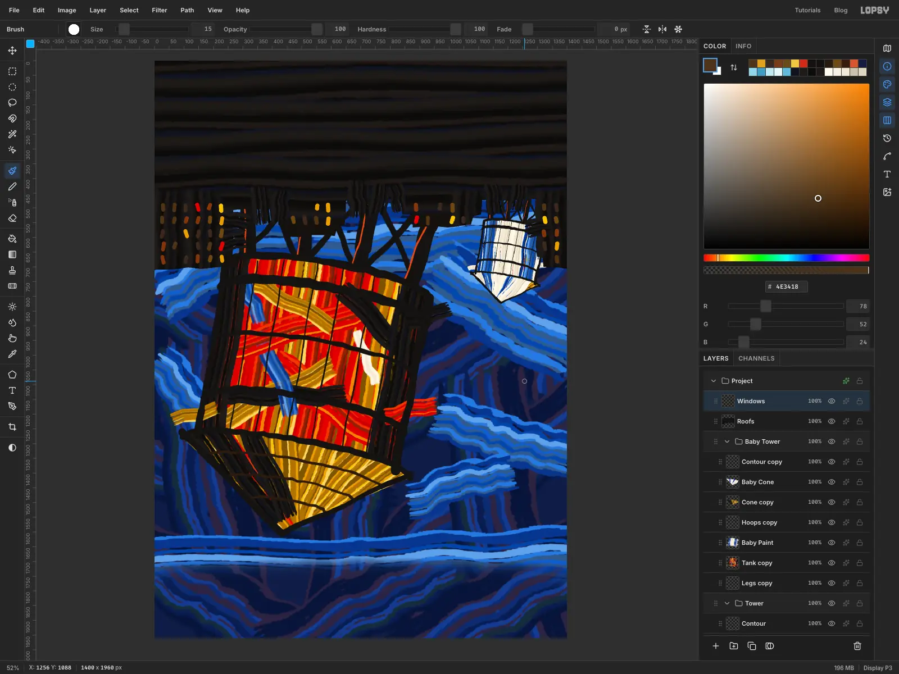

Add a layer called **Windows** and pick the oil stick at **Size** 15. On each building paint rows of short vertical dashes, about 15 px tall. Skip one here and there, and don't line them up too well.

Most should be dim (`#6A4A1C`, `#4E3418`, `#7A3A18`, `#3A2A20`), with only about one in six lit (`#E0A21C`, `#D32A18`, `#F2C640`). Apply **Oil Paint** at **Radius** 2.

## Let the paint run upward

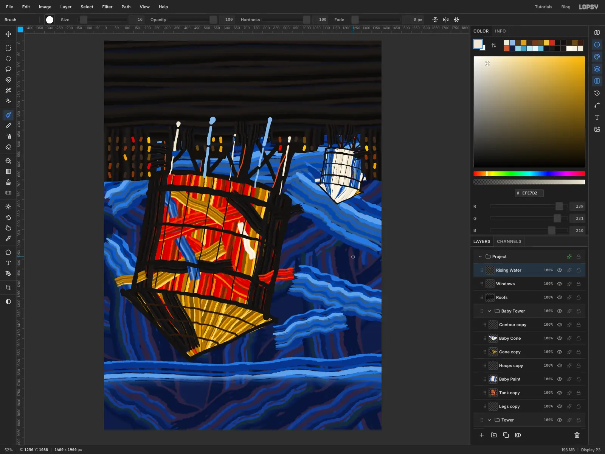

Add a layer called **Rising Water**. Here's the joke of the cover: the tower's upside down, so its paint runs up.

With the oil stick, pick pale blue `#BCD6EE`, cream `#EFE7D2` or blue `#8FB8E6` for each run, and paint five of them from the tank's rim up along the lean of the legs, over the rooftops. Paint each run in broken lengths, leaving small gaps, and make each length a little fatter than the last: **Size** 5 or so at the tank, up to 22 at the top of the widest. Then turn the size up by a third or so and click once at the top to add a bead, the blob of paint a real run carries at its leading end.

Stop them all about a fifth of the way down the page, then apply **Oil Paint** at **Radius** 2.

## Paste the photo

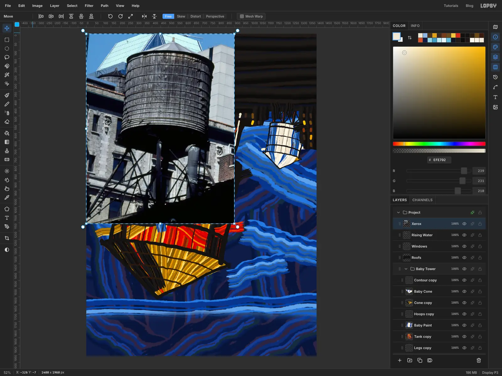

Copy your cropped photo, then press [[Cmd+V]] to paste it as a new layer, and rename it **Xerox**. Mine was 900 × 1155 px.

## Scale it down

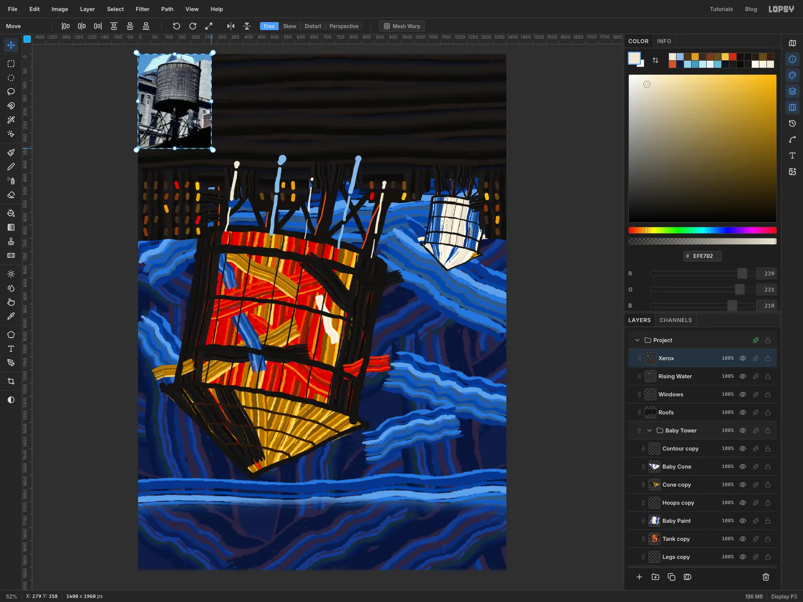

The paste left the photo selected, with handles around it. Pick the **Move** tool, hold [[Cmd]] and drag the bottom-right corner handle inward until the photo is about 280 px wide. Press [[Esc]] and deselect.

Scale it first and add the halftone second, or the dots will shrink into mush.

## Run it through the copier

Apply these to the **Xerox** layer, in order:

1. **Filter → Desaturate**
2. **Filter → Brightness/Contrast…**, with **Brightness** 12 and **Contrast** 45
3. **Filter → Halftone…**, with **Dot Size** 5, **Density** 1.1, **Angle** 45 and **Softness** 0.5

## Put it on torn paper

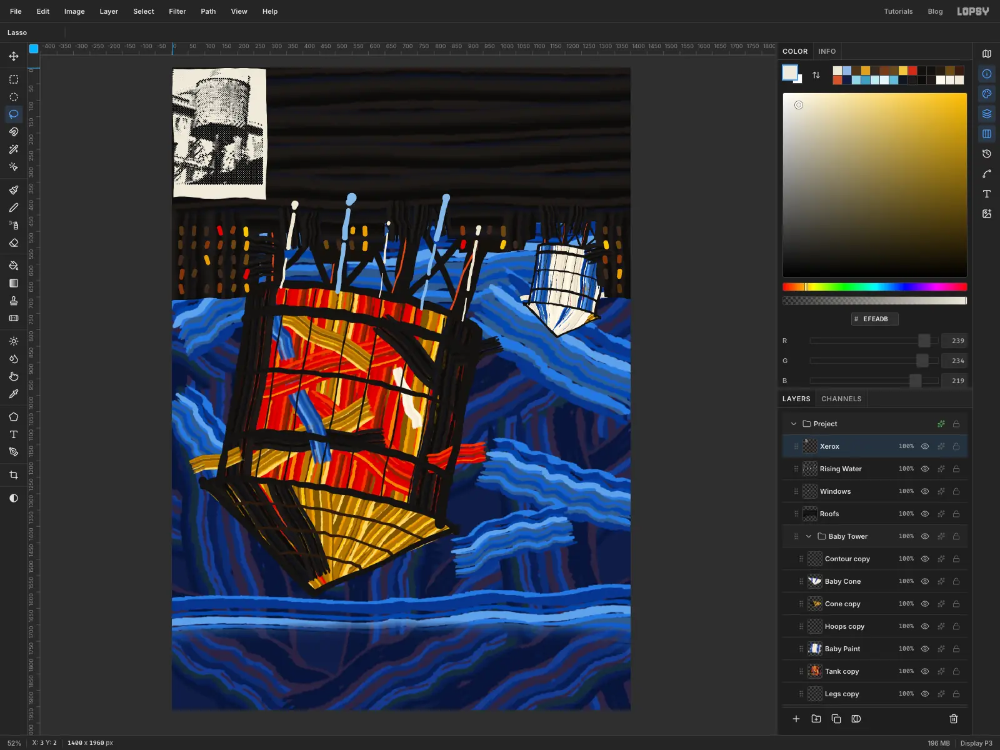

Halftone leaves transparent gaps, so it needs paper. Click **Rising Water** and add a layer called **Xerox Paper**, which lands just under the photo. Drag a marquee from the page's top-left corner to a little past the photo's right edge, with an extra-deep margin of about 45 px at the bottom for a caption. Fill it with `#EFEADB` and deselect.

Click the **Xerox** layer and choose **Layer → Merge Down**, then name the result **Xerox**. Draw a slightly shaky **Lasso** just inside the paper's edge, press [[Cmd+Shift+I]] to invert the selection, press [[Delete]], and deselect.

## Tilt the xerox into place

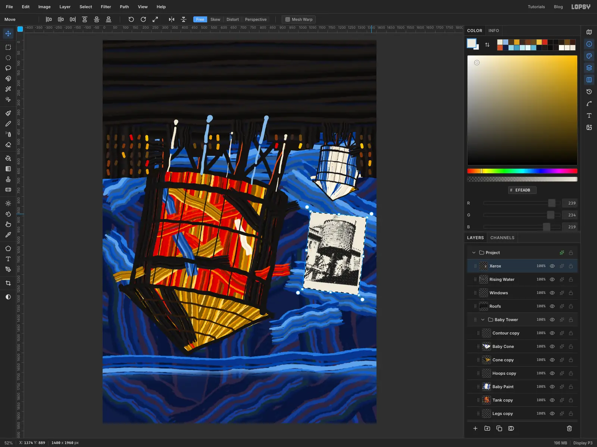

[[Cmd]]-click the **Xerox** thumbnail. With the **Move** tool, drag the sheet to the right of the tank, under the small tower. Then drag the rotation handle a few degrees clockwise, to about 6°. Press [[Esc]] and deselect.

Open the layer's effects and turn on **Drop Shadow**, with **Offset X** 7, **Offset Y** 10, **Blur** 8, **Opacity** 65 and a shadow colour of `#05060E`. Close the effects drawer, because it sits over the canvas and swallows clicks.

## Tape it down

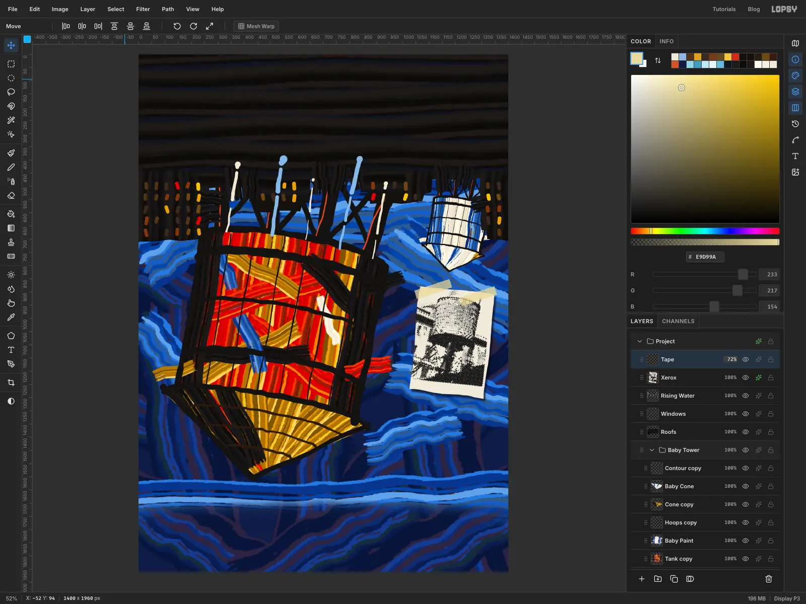

Add a layer called **Tape** and set the foreground to `#E9D99A`. **Lasso** a strip about 140 px long, tilted up to the right, across the sheet's top-left corner, and fill it. Its edges don't need to be perfect.

Press [[Cmd+C]], then [[Cmd+D]], then [[Cmd+V]] to paste a copy on its own layer. Drag the copy across to the top-right corner with the **Move** tool and press [[Esc]]. Choose **Layer → Merge Down** to put both strips on one layer, then press [[Cmd+D]] to clear the selection, or it will clip everything you paint next. Rename it **Tape** and set the layer's opacity to 72%.

## Mark out the masthead

Add a layer called **Title Shadow**. Click the left ruler to drop four guides: a pair near the top of the page, about 290 px apart, and a pair near the bottom, about 230 px apart, leaving a similar margin. They mark the top and bottom of WATER and TOWER.

## Underpaint the letters in red

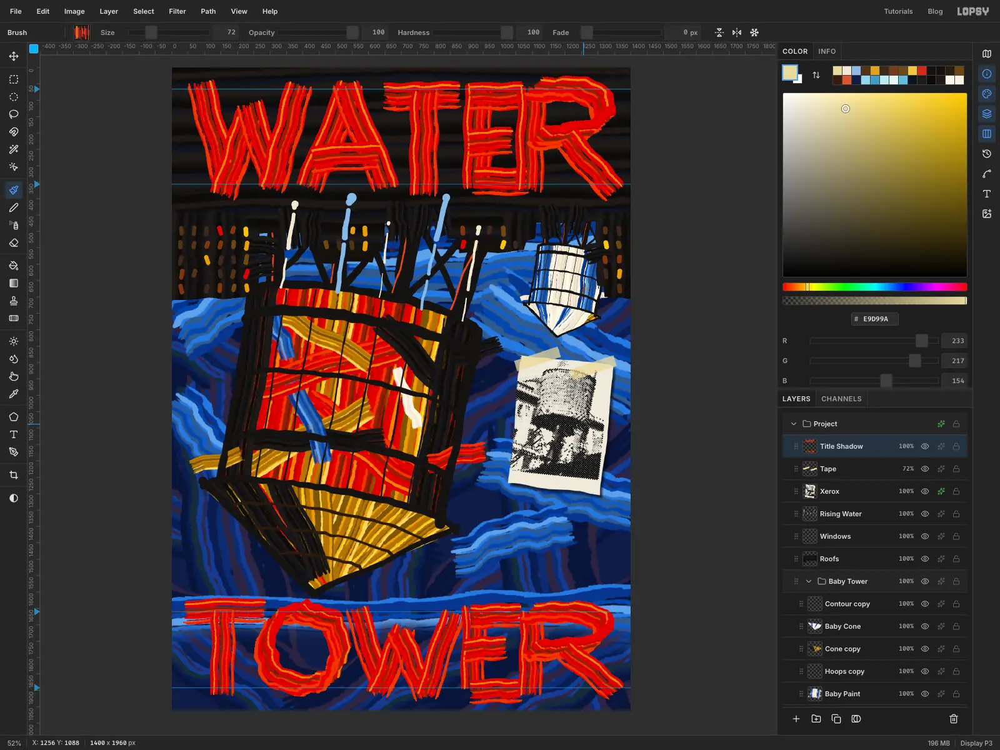

Now for the fun part: you'll paint the title. Load **Cadmium** and write WATER at **Size** 84, between the top guides, filling the page's width. Write TOWER at **Size** 72 between the bottom guides.

Use one quick stroke for each straight part of a letter, turning the dial so that the row of bristles lies across the stroke: W takes four strokes, A three, T two and E four. For the curves of R and O, set the dial to 135° and draw the whole curve in one go.

Don't worry about neatness. Do leave clear gaps between T and E in WATER and between W and E in TOWER, or they'll fuse. Apply **Oil Paint** at **Radius** 3.

## Paint the letters again in bone

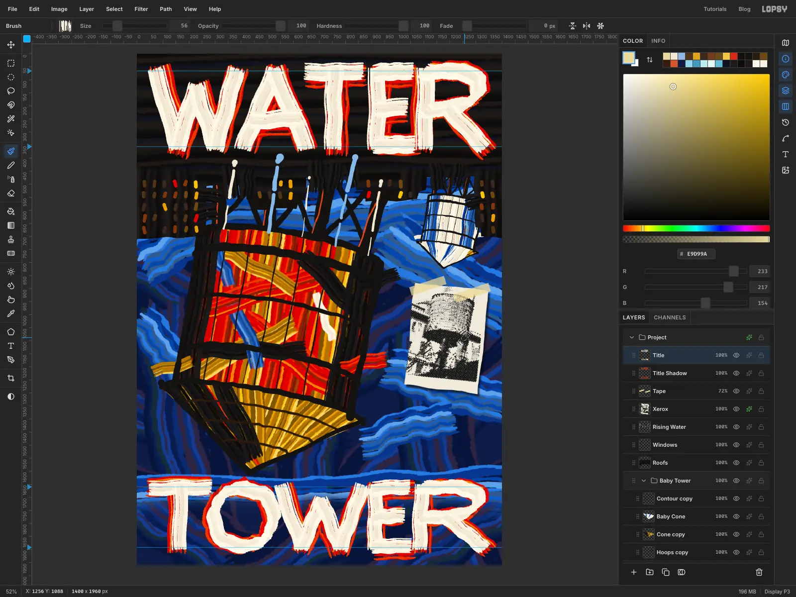

Add a layer called **Title** and load **Bone**. Paint both words again over the red, a little narrower: **Size** 66 for WATER and 56 for TOWER.

Because you're repainting by hand, the two passes won't line up, and that's the point. Red shows on different sides of each stroke and through the dry streaks, which a drop shadow can't do. Apply **Oil Paint** at **Radius** 3.

## Scrawl GRAVITY and tilt it

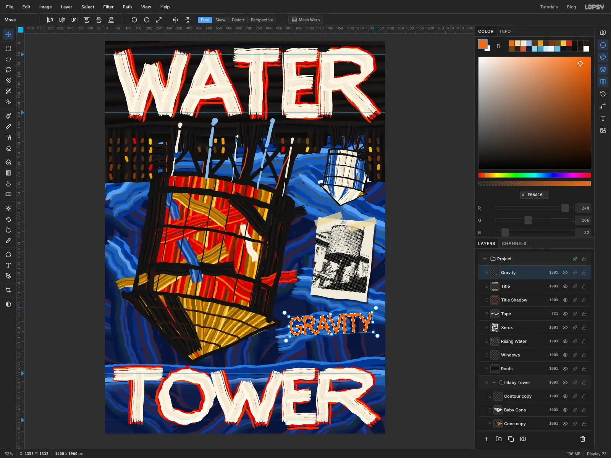

Add a layer called **Gravity**. With the oil stick at **Size** 17 in orange `#F06A16`, hand-letter GRAVITY in capitals about 85 px tall in the space under the xerox. Leave some air below the paper. Apply **Oil Paint** at **Radius** 1.

[[Cmd]]-click the layer's thumbnail and use the **Move** tool's rotation handle to tip the word about 3° anticlockwise. Press [[Esc]] and deselect.

## Cross it out

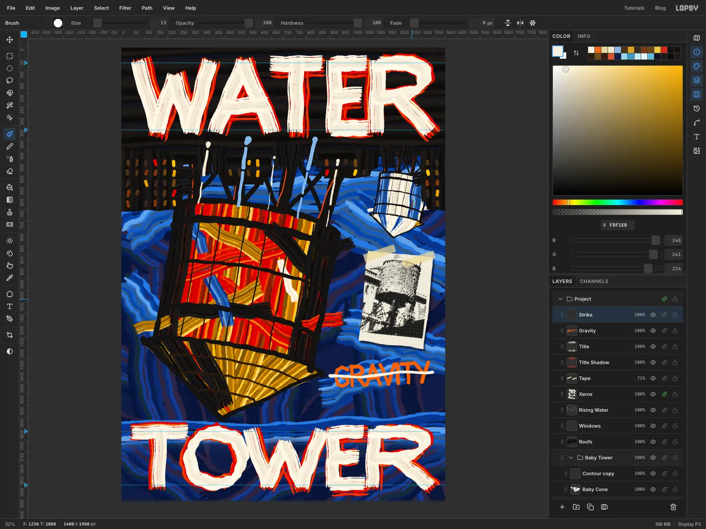

Add a layer called **Strike**. With the oil stick at **Size** 15 in cream `#F8F1E0`, drag one rough line through the word, starting and ending well past it. Keep it to one stroke, and let your hand wobble. Apply **Oil Paint** at **Radius** 1.

## Hand-letter the small type

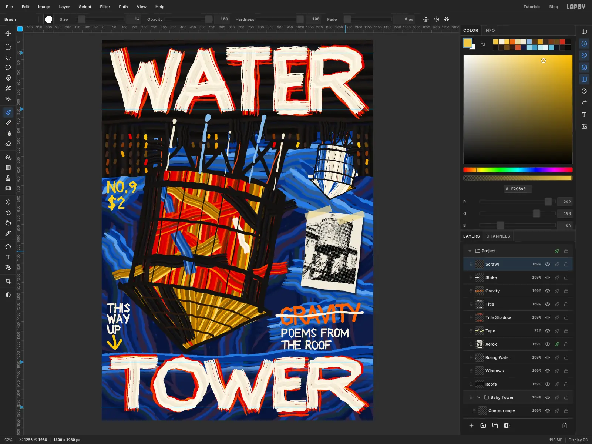

A tidy font would look out of place next to all that paint, so letter the rest by hand too. Add a layer called **Scrawl**. With the oil stick:

- **POEMS FROM** and **THE ROOF** on two lines under GRAVITY, in cream `#F8F1E0`, letters about 40 px tall, at **Size** 9
- **NO.9** and **$2** on the left, under the hanging building, in yellow `#FFD24A`, letters about 54 px tall, at **Size** 12
- **THIS**, **WAY**, **UP** stacked in the space below the cone's left corner, in cream, letters about 42 px tall, at **Size** 10

Under THIS WAY UP, paint a down-pointing arrow in `#F2C640` at **Size** 15, stopping well clear of the T of TOWER. It's the other half of the joke. Apply **Oil Paint** at **Radius** 1.

## Type the caption

The xerox is the one mechanical thing on the page, so its caption should be typed. Click the **Tape** layer first, so the caption lands just above the xerox in the stack.

Pick the **Text** tool. Set **Size** to 24, choose **Special Elite** from the font list, set the colour to `#1C1A17`, and click in the deep margin at the bottom of the xerox. Type `FIG. 1. RIGHT WAY UP` and press [[Tab]] to commit. Name the layer **Caption**.

## Tilt and seat the caption

Switch to the **Move** tool, which frames the text with its own handles. Drag the rotation handle about 6° clockwise, to match the paper's tilt, and press [[Esc]].

Use the arrow keys to fine-tune it, with an even gap above and below. It stays live text, so you can still fix a typo.

## Flick some paint

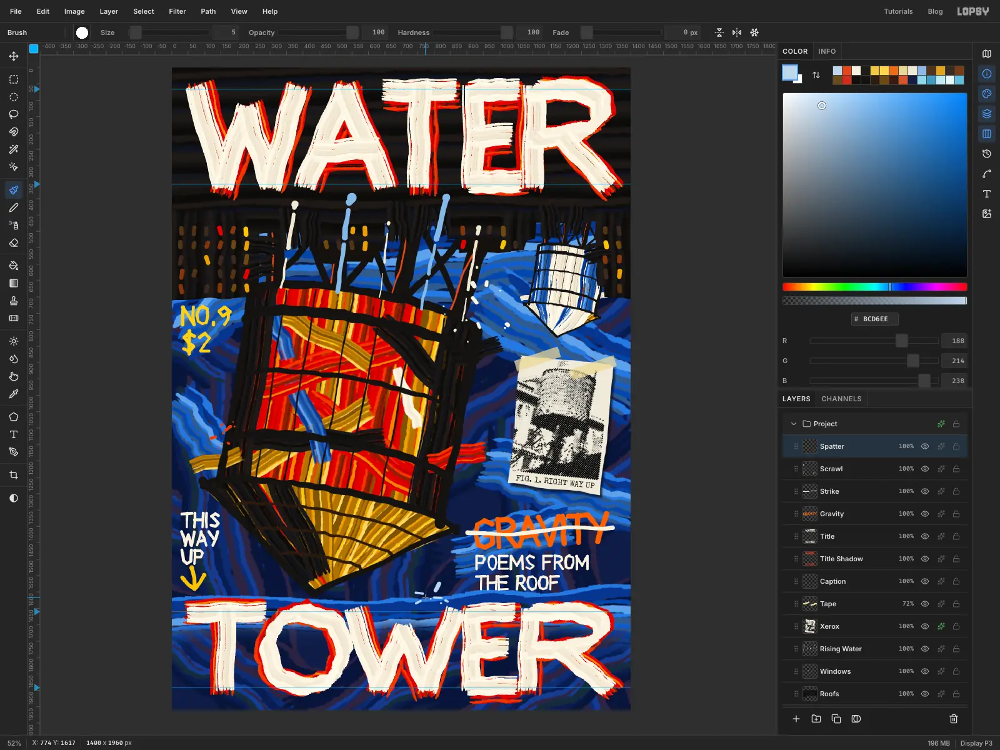

Click the **Scrawl** layer and add a layer called **Spatter**, so it sits at the top of the stack. With the oil stick, make quick dots and very short flicks in three places: a dozen or so in cream by the upper right of the tank, fewer in `#E2491A` on its left, and a handful in `#BCD6EE` under the cone. Use **Size** 5 for most, and go up to 16 for a few. Don't overdo it, because long, thin marks read as stray lines.

## Build a high-pass layer

The picture is finished, but the paint is flat. This last trick gives it thickness.

With **Spatter** selected, press [[Cmd+A]], then [[Cmd+Shift+C]] for **Copy Merged**, then [[Cmd+D]], then [[Cmd+V]], then [[Cmd+D]] again. Name the new top layer **Impasto** and apply **Filter → Desaturate**.

Click **Duplicate Layer**, apply **Filter → Invert** to the copy, apply **Gaussian Blur** at **Radius** 4, and set that layer's opacity to 50%. The picture collapses into flat grey with faint edges, which is the classic high-pass trick. Choose **Layer → Merge Down** and name the result **Impasto**.

Keep that radius small. A big one puts a soft halo around every letter.

## Emboss the brushstrokes

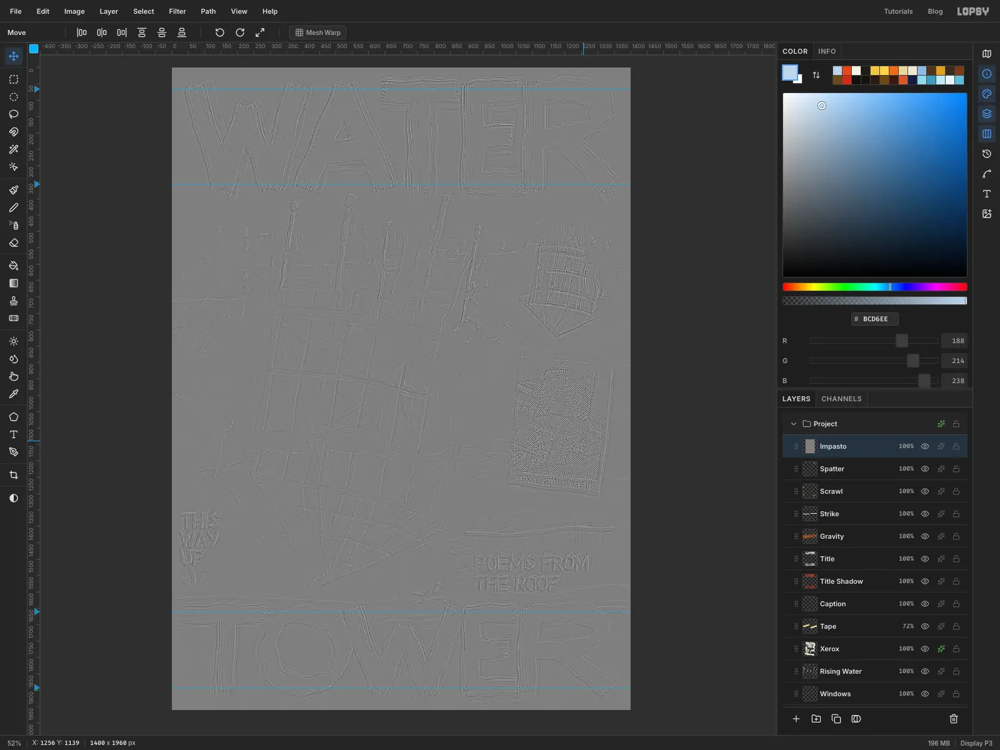

Apply **Filter → Emboss…** with **Strength** 60 and **Angle** 135. The bristle streaks and the edges of the letters now stand up like ridges of paint, lit from one side.

## Blend it in and export

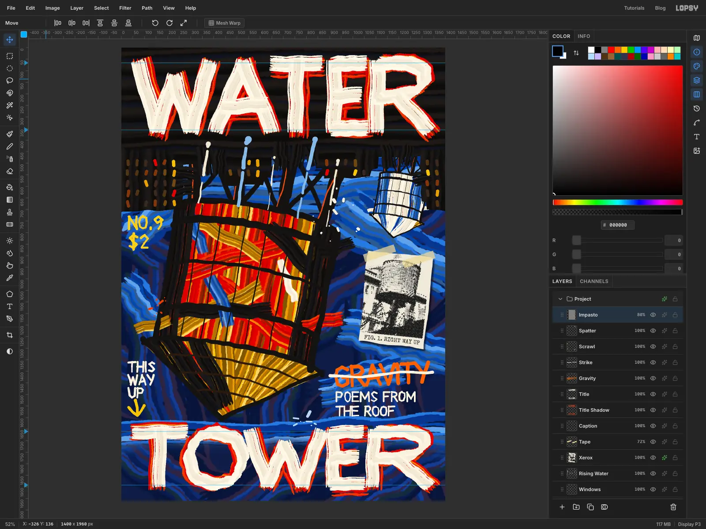

Open the **Impasto** layer's effects, set its blend mode to **Overlay**, and set its opacity to 80%. Overlay ignores flat mid grey, so the colours stay put and only the ridges catch the light.

Save the project with **File → Save Project** and export the cover with **File → Quick Export PNG**.

Try it on your own subject: paint something ordinary, in a group, then turn the group over before you decide it's finished. You may be surprised at what you notice.
