Neo-pop took the bright, flat, commercial look of 1960s pop art and gave it
a 1990s spin. Takashi Murakami's *superflat* smiling flowers, Jeff Koons'
mirror-glossy balloon animals and the Ben-Day dots borrowed from Roy
Lichtenstein's comic panels all belong to it. It's cheerful on the surface
and a bit unsettling underneath: Murakami's flowers grin with too many teeth.

In this tutorial you'll use that look for the cover of *Dandelion Anarchy*,
an imaginary guerrilla-gardening zine that sides with the weeds. The hero is
a cartoon dandelion with a glossy face and a grin full of lion's teeth
(*dent de lion*, where the name comes from), set in a halo made from a real
photo of a dandelion seed head. The cover is **1200 × 1700 px**.

Along the way you'll use:

- the **Gradient** tool and **Halftone** filter for Ben-Day dots, on the page and on the flower
- a dropped-in photo with **Desaturate**, **Brightness/Contrast**, a corner scale and the **Screen** blend mode
- the **Shape** tool's click-to-size dialog for rings
- the **Pen** tool with **Path to Selection** for florets, teeth, cracks and leaves, and Pen + [[Enter]] to stroke a curved stem
- **Duplicate Layer**, **Rotate 90° CW**, snapped rotation handles and **Merge Down** to multiply one floret into a full flower head
- marquee add, subtract and intersect for the eyes, the glossy highlight and the grin
- **Group Layers**, scaling a whole group, **Flip Horizontal**, and **Cut** and **Paste** to make copies
- text in **Bagel Fat One**, **Rubik Mono One** and **Space Mono**, including a rotated group with live text and recolouring one line of a text layer
- **Stroke**, **Drop Shadow**, **Inner Glow** and **Color Overlay** effects, guides and the grid

The palette:

- Hot pink `#FF4FA0`, dot magenta `#C8005A`, seed shadow `#D81B72`
- Sky cyan `#36C9F2`, ring cyan `#8FE3FA`
- Dandelion yellow `#FFE01A`, marigold `#FF9A1A`, dot orange `#C85A00`
- Leaf green `#3CD070`, vein green `#178A3E`, cheek pink `#FF7FB8`
- Pavement `#B9AFA8`, joints `#8E847E`, dot grey `#9A9A9A`
- Ink `#17131C`, white `#FFFFFF`, grain grey `#808080`

You'll also need a photo of a dandelion seed head on a dark background. This
cover uses
[Dandelion seed head before count](https://commons.wikimedia.org/wiki/File:Dandelion_seed_head_before_count.jpg)
by Jdparker on Wikimedia Commons, which is in the public domain. Download
the 1280 px version.

> **Tip:** Positions are in document pixels, written `x, y`. The status bar
> at the bottom shows where the pointer is. **Edit → Fill** fills the
> selection with the foreground colour, and [[Cmd+D]] deselects. New layers
> appear above the selected layer. If the selected row is an *expanded*
> group, the new layer goes inside it; if the group is *collapsed*, it goes
> next to it.

> **Tip:** For an exact rectangle or circle, pick the **Rectangular** or
> **Elliptical Marquee**, make sure nothing is selected, and click the canvas
> once without dragging. A dialog asks for the **From X / Y** and **To X / Y**
> corners. Effects live in each layer's effects drawer (the sparkle icon on
> its row), together with the **Blend** dropdown.

## Set up the canvas and centre guides

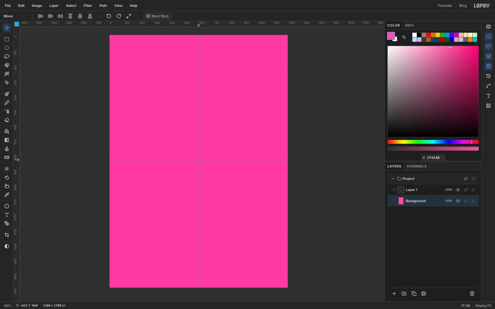

Choose **File → New**, enter **1200 × 1700** and click **Create**. Click the
*Background* row, set the foreground to hot pink `#FF4FA0` and choose
**Edit → Fill**.

Click the top ruler at `600` to drop a vertical guide, then the left ruler
at `840` for a horizontal one. The flower will sit where they cross.

## Add a Ben-Day dot vignette

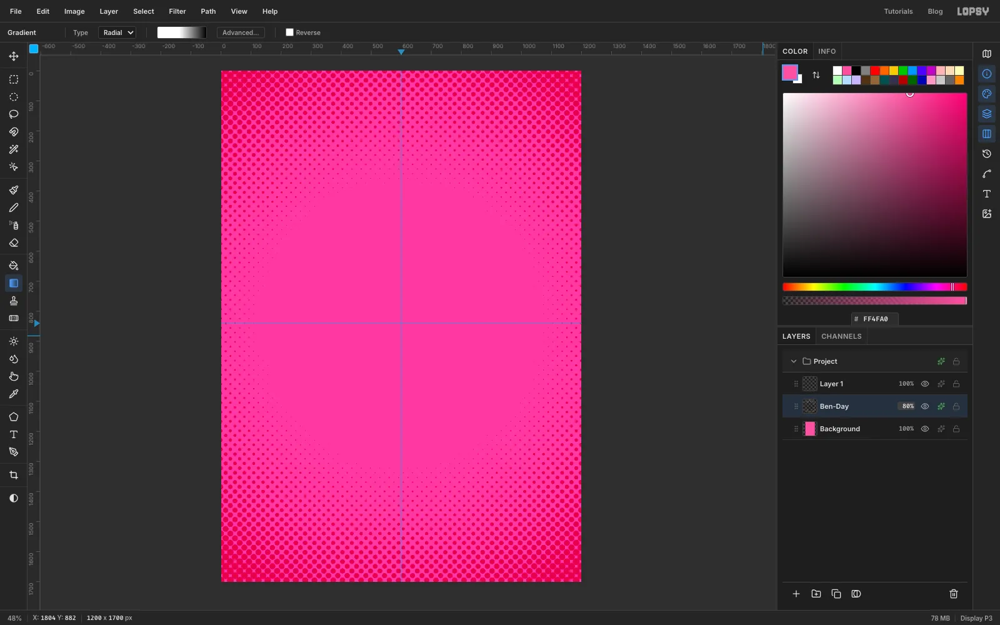

With *Background* selected, add a layer named *Ben-Day*. Pick the
**Gradient** tool, set **Type** to **Radial** and click **Advanced…**. Make
three stops: white at the left end, white again at about 45%, and black at
the right end. Click **Done**.

Drag from the guide crossing at `600, 840` straight out to the right, past
the edge of the canvas. Then choose **Filter → Halftone…** with **Dot Size**
`22`, **Angle** `45`, **Density** `1` and **Softness** `0.4`. The dark
corners turn into big dots, and the white middle stays clear.

Give the layer a **Color Overlay** in dot magenta `#C8005A`, set its
**Blend** to **Multiply** and its opacity to **80%**.

## Draw the sky disc

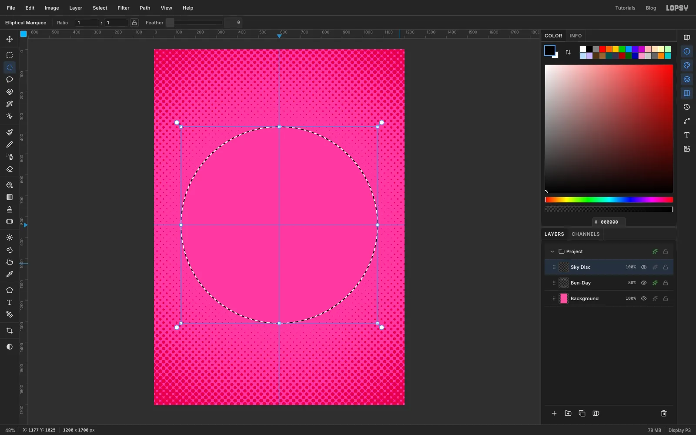

Click *Layer 1* and rename it *Sky Disc*. With the exact-corners dialog,
select a circle from `130, 370` to `1070, 1310`. Fill it with sky cyan
`#36C9F2` and deselect.

## Add the faint rings

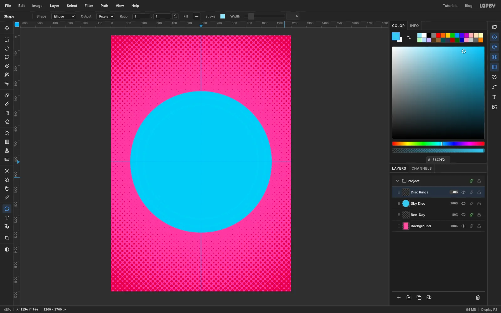

Add a layer named *Disc Rings*. Pick the **Shape** tool, set **Shape** to
**Ellipse** and **Output** to **Pixels**. Click the **Fill** swatch and
choose **Remove fill**, then set the **Stroke** to ring cyan `#8FE3FA` with a
**Width** of `6`.

Click once on the guide crossing. In the **Shape Size** dialog enter
`860 × 860` and click **Create**. Click the crossing again and make a
`760 × 760` ring. Drop the layer's opacity to **30%**. The rings should be
felt, not seen.

## Bring in the seed-head photo

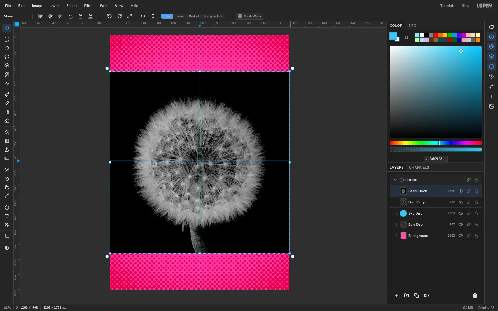

Drag the photo file from your computer onto the canvas. It arrives as a new
layer called *Pasted Layer*, scaled to fit the page width. Rename it
*Seed Clock*.

Choose **Filter → Desaturate**, then **Filter → Brightness/Contrast…** with
**Brightness** `-10` and **Contrast** `45`. That leaves white fluff on a
solid black background.

## Scale the seed head to make a halo

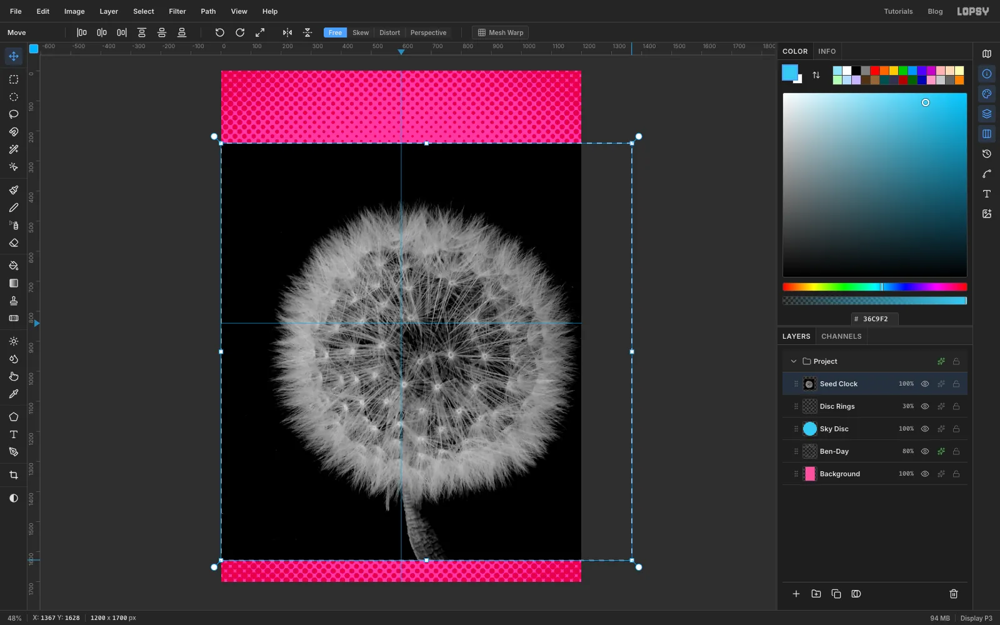

The photo is still selected after the drop. Pick the **Move** tool, hold
[[Cmd]] and drag the bottom-right corner handle down and to the right until
the fluffy ball is about 960 px across, a little wider than the cyan disc.
That's about 114%. [[Cmd]] keeps the proportions. Press [[Cmd+D]] to
commit.

Scaling from a corner pins the opposite corner, so the ball has drifted down
and to the right. Use the arrow keys to nudge it back until the ball is
centred on the guide crossing ([[Shift]] + arrow moves 10 px at a time).

## Screen it and clear the background

Set the *Seed Clock* layer's **Blend** to **Screen**. Black disappears in
Screen mode, so only the fluff shows. It lights up the cyan disc and spills
a soft fringe onto the pink.

The rest of the photo is still there, including the bottom of the stem.
Select a circle from `55, 295` to `1145, 1385`, choose
**Select → Inverse**, press [[Delete]] and deselect.

## Erase the stem stub and add an ink rim

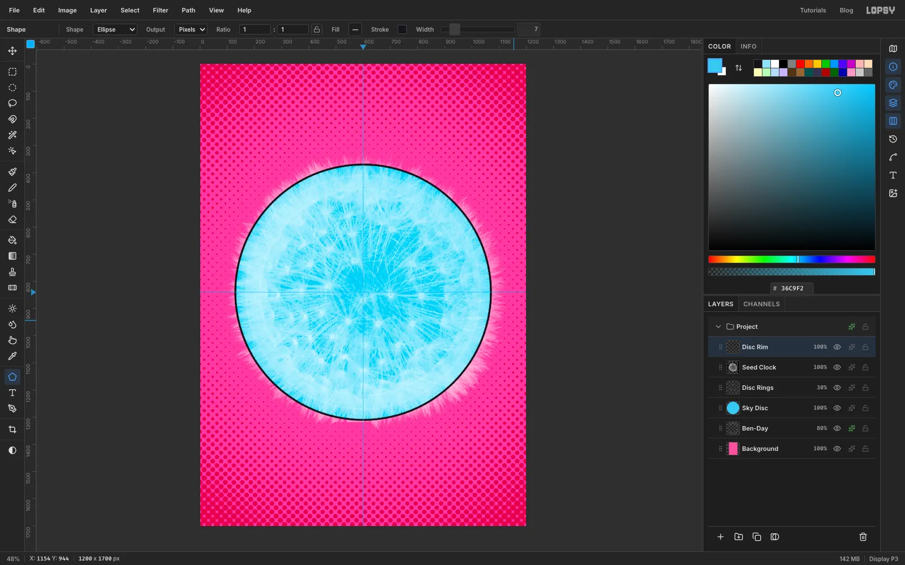

A stub of the photo's stem still pokes out under the disc. Pick the
**Eraser** at size `40` and paint a few short strokes across it, between
about `500, 1336` and `625, 1396`.

Add a layer named *Disc Rim*. With the **Shape** tool, keep the fill
removed, set the **Stroke** to ink `#17131C` with **Width** `7`, click the
guide crossing and make a `940 × 940` circle. Every shape on this cover gets
a dark outline, so the disc needs one too.

## Draw one pair of florets with the Pen

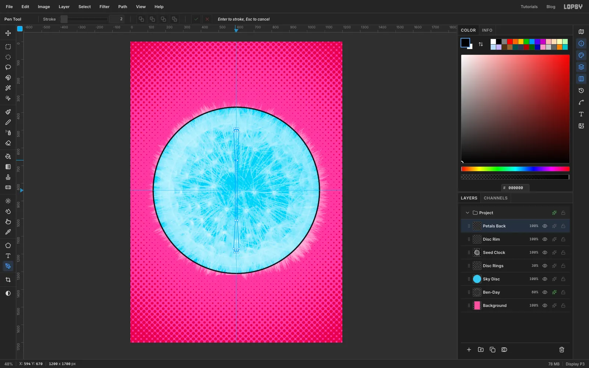

A dandelion's "petals" are really tiny strap-shaped florets with notched
tips, so you'll draw two of them as one long strap through the centre.

With *Disc Rim* selected, add a layer named *Petals Back*. Pick the **Pen**
tool and click these points in order (no dragging), then click the first
point again to close the path:

- `594, 670`, `585, 510`, `590, 490`, `595, 503`, `600, 490`, `605, 503`, `610, 490`, `615, 510`, `606, 670`
- `606, 1010`, `615, 1170`, `610, 1190`, `605, 1177`, `600, 1190`, `595, 1177`, `590, 1190`, `585, 1170`, `594, 1010`

The strap is 12 px wide near the middle and flares to 30 px at each end,
where three small points make the notched tip. The middle will hide behind
the face later.

## Fill the florets

Open the **Paths** panel and click **Path to Selection**. Set the
foreground to marigold `#FF9A1A`, choose **Edit → Fill** and deselect.
Delete the path with the trash button in the Paths panel, so it doesn't get
in the way later.

## Turn one pair into twelve

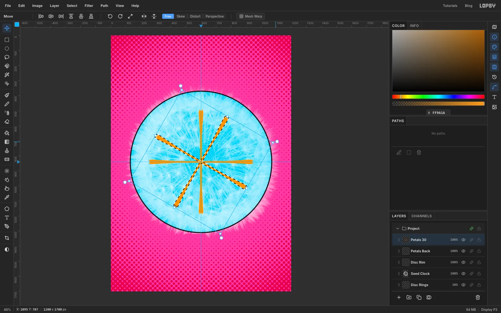

Choose **Layer → Duplicate Layer** and rename the copy *Petals 90*.
[[Cmd]]-click its thumbnail in the Layers panel to select its pixels. Pick
the **Move** tool and click **Rotate 90° CW** in the options bar. Because
the strap is centred on the guides, it turns about the flower's centre. Press
[[Cmd+D]], then choose **Layer → Merge Down**. You now have a cross of
four florets.

Click *Petals Back*, duplicate it again and rename the copy *Petals 30*.
[[Cmd]]-click its thumbnail. Hold [[Cmd]] and drag the round rotation
handle just outside a corner of the box clockwise. With [[Cmd]] held it
snaps in 15° steps. Stop at 30° and press [[Cmd+D]].

## Finish the twelve

Click *Petals Back* once more, duplicate it as *Petals 60*, and rotate that
copy 60° the same way. Click *Petals 30* and choose **Layer → Merge Down**
twice. The florets now sit every 30°.

## Double it to twenty-four

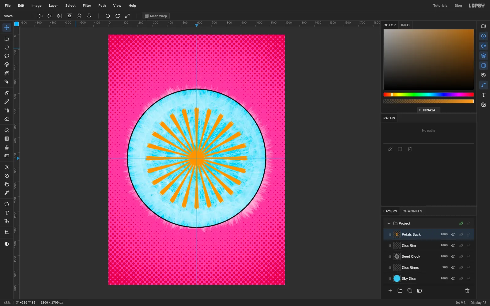

Duplicate *Petals Back* as *Petals 15*, select its pixels and rotate it 15°
with [[Cmd]] held. Press [[Cmd+D]] and merge it down. That's twenty-four
florets in the back ring, and a lot quicker than drawing them one by one.

## Make the front ring

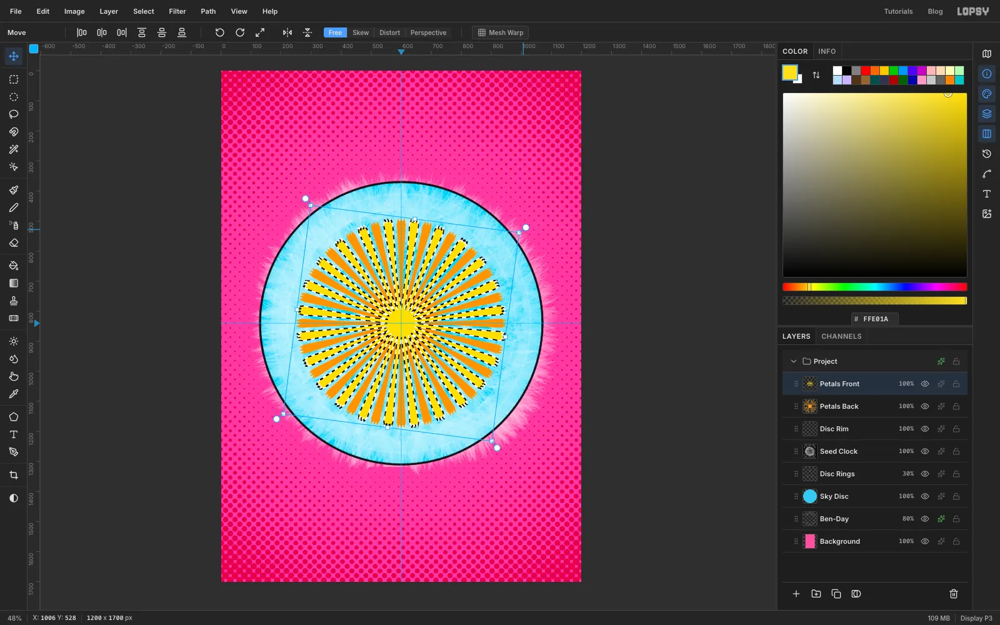

Duplicate *Petals Back* and rename it *Petals Front*. [[Cmd]]-click its
thumbnail, set the foreground to dandelion yellow `#FFE01A` and choose
**Edit → Fill**. Only the florets turn yellow, because the selection is
their shape.

Now drag the rotation handle **without** [[Cmd]] about 7.5°, half of one
step, so each yellow floret lands between two orange ones. Press
[[Cmd+D]].

## Shrink the front ring

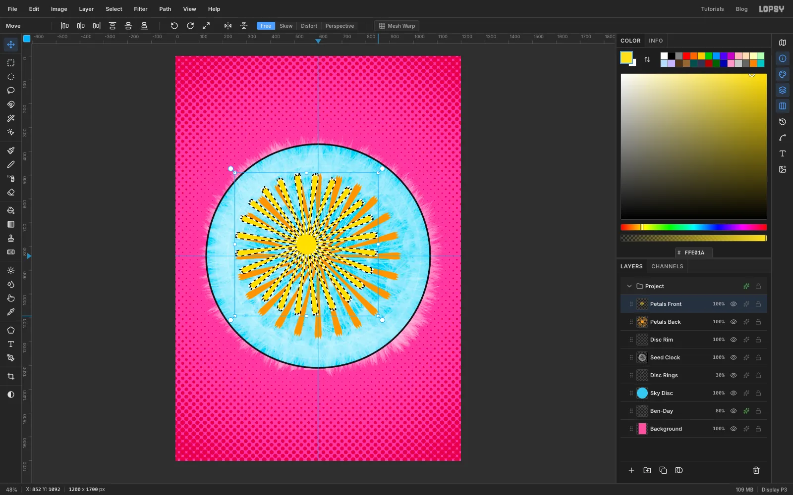

[[Cmd]]-click the *Petals Front* thumbnail again. Hold [[Cmd]] and drag
the bottom-right corner handle inwards until the ring is about 86% of its
size. Press [[Cmd+D]], then nudge the ring with the arrow keys until it's
centred on the guides again. The orange tips now peek out past the yellow
ones, the way real dandelion heads have several rows of florets.

## Outline both rings

Give *Petals Back* a **Stroke** effect in ink `#17131C`, **Width** `6`.
Give *Petals Front* the same stroke. A single heavy outline weight on every
shape is what makes the cover read as pop art rather than illustration.

## Add Lichtenstein dots to the back florets

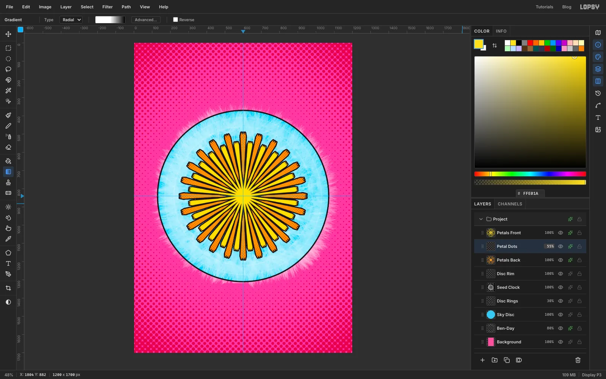

Click *Petals Back* and add a layer named *Petal Dots* above it.
[[Cmd]]-click the *Petals Back* thumbnail to load its shape. On the
**Gradient** tool, open **Advanced…** again and move the middle white stop
from 45% to 50%. Drag from the centre to `1000, 840`, then apply
**Filter → Halftone…** with **Dot Size** `10` and the other settings as
before.

[[Cmd]]-click the *Petals Back* thumbnail again, choose
**Select → Inverse**, press [[Delete]] and deselect, so the dots stay on
the florets. Give the layer a **Color Overlay** in dot orange `#C85A00`,
set it to **Multiply** and **55%**. It's the comic-book way of shading:
dots instead of a smooth gradient.

## Draw the face

Click *Petals Front* so the face goes above both rings, and add a layer
named *Face*. Select a circle from `430, 670` to `770, 1010` and fill it
with dandelion yellow. Deselect.

Add a **Stroke** in ink, **Width** `7`, and an **Inner Glow** in marigold
with **Size** `46` and **Opacity** `85`. The glow rounds the face like a
balloon.

## Shade the face with dots

Add a layer named *Face Dots*. [[Cmd]]-click the *Face* thumbnail. On the
**Gradient** tool, set **Type** to **Linear** and drag from `450, 690` to
`750, 990`, top left to bottom right. Apply **Filter → Halftone…** with
**Dot Size** `8`.

Clip it like before: [[Cmd]]-click the *Face* thumbnail, **Select →
Inverse**, [[Delete]], deselect. Add a **Color Overlay** in dot orange,
set it to **Multiply** and **35%**. The dots only appear on the shadow side
of the face.

## Cut a glossy crescent

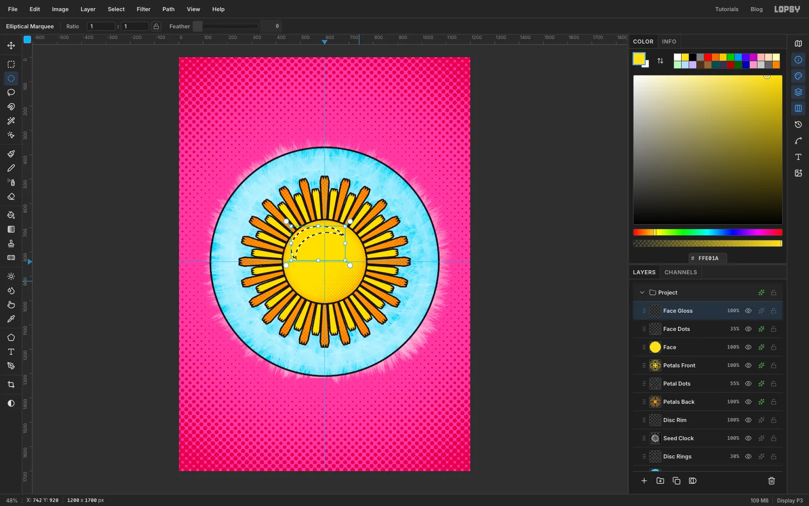

Add a layer named *Face Gloss*. With the **Elliptical Marquee**, select an ellipse from `462, 694` to
`702, 874`. Then hold [[Alt]] and drag a second ellipse from `482, 720` to
`742, 920` to take a bite out of the first. What's left is a crescent
along the top left of the face.

Fill it with white, deselect and set the layer's opacity to **70%**. This
is the Koons part: one hard, bright reflection makes the face look like
polished plastic.

## Give it eyes

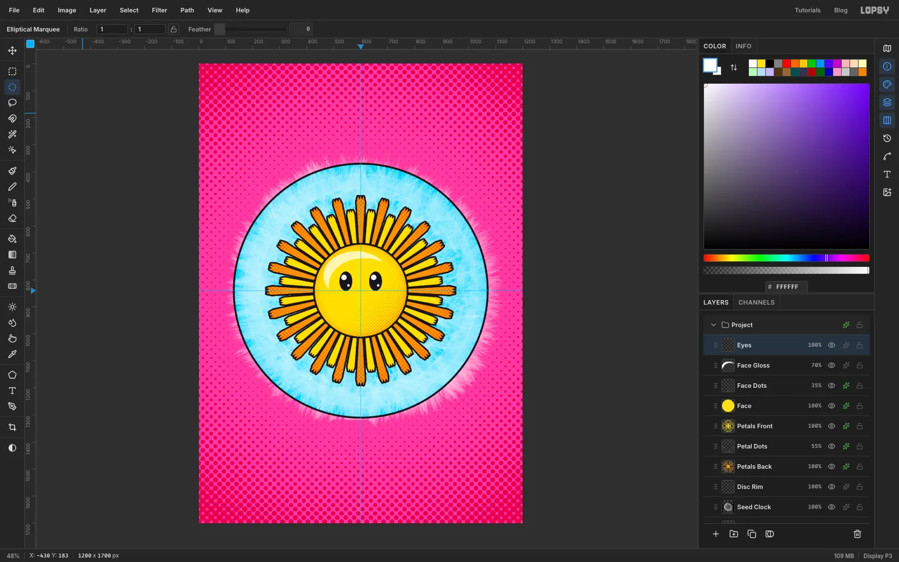

Small selections near a guide snap onto it, so choose
**View → Snap to Guides** to turn guide snapping off for the face details.

Add a layer named *Eyes*. Select an ellipse from `521, 769` to `569, 841`,
then hold [[Shift]] and drag another from `631, 769` to `679, 841` to add
the second eye. Fill both with ink.

For the catch-lights, select `528, 781` to `548, 801` and [[Shift]]-drag
`638, 781` to `658, 801`, then fill with white. Add two tiny ones the same
way, `550, 816` to `559, 825` and `660, 816` to `669, 825`, and fill them
white too. Big round eyes with two highlights are the classic superflat
look.

## Cut the grin

Add a layer named *Mouth*. With the **Elliptical Marquee**, select an ellipse
from `515, 830` to `685, 960`. Switch to the **Rectangular Marquee**, hold
[[Shift]] and [[Alt]] together and drag a rectangle from `495, 872` to
`705, 975`. [[Shift]]+[[Alt]] keeps only the overlap, which is a wide, flat-topped
grin. Fill it with ink.

Without deselecting, switch back to the **Elliptical Marquee** and
[[Shift]]+[[Alt]]-drag a small ellipse from
`556, 922` to `644, 972`. That leaves the part of it that's inside the
mouth. Fill it with cheek pink `#FF7FB8` for the tongue, then deselect.

## Add a row of lion's teeth

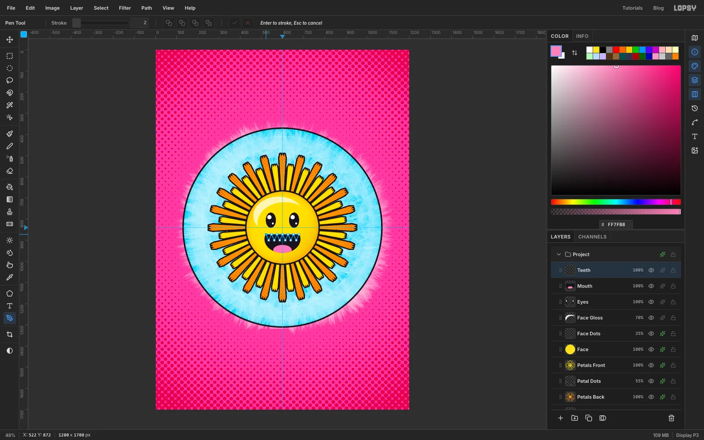

Add a layer named *Teeth*. With the **Pen**, start at `522, 872` and click
a zigzag along the top lip: every 13 px across, alternate between the lip
(`y 872`) and the tooth tips (`y 900`), ending at `678, 872`. That's 13
points and six teeth. Click the first point to close the path.

Click **Path to Selection** in the Paths panel, fill with white, deselect
and delete the path.

## Blush the cheeks

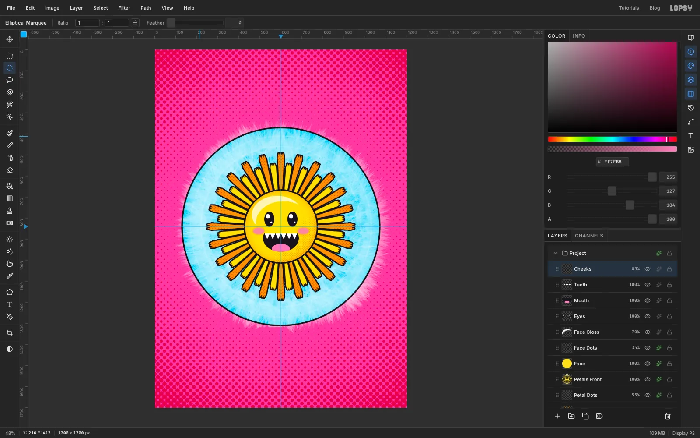

Add a layer named *Cheeks*. Select an ellipse from `466, 844` to `522, 878`
and [[Shift]]-drag a second from `678, 844` to `734, 878`. Choose
**Select → Feather…** `6`, fill with cheek pink and deselect. Set the
opacity to **85%**.

Turn **View → Snap to Guides** back on.

## Group the head

Click *Cheeks*, then [[Shift]]-click *Petals Back* to select every layer
from the cheeks down to the back ring. Choose **Layer → Group Layers** and
name the group *Dandelion Head*.

## Scale the whole head up

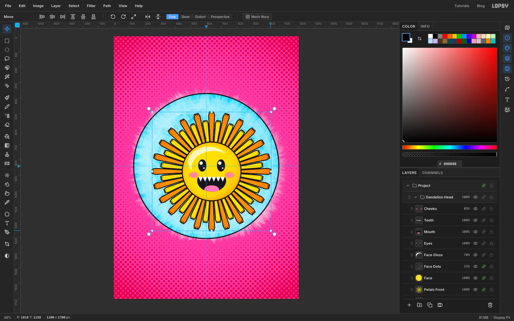

The head is a little small for the halo. With the group selected and
nothing else selected, pick the **Move** tool. The handles frame
everything in the group. [[Cmd]]-drag the bottom-right corner out to about
110%, press [[Cmd+D]], then nudge the group back onto the guide crossing
with the arrow keys.

> **Tip:** Every nudge is its own undo step. If you overshoot, [[Cmd+Z]]
> walks back one nudge at a time, and [[Cmd+Shift+Z]] steps forward again
> to exactly the same place.

## Draw the stem with the Pen

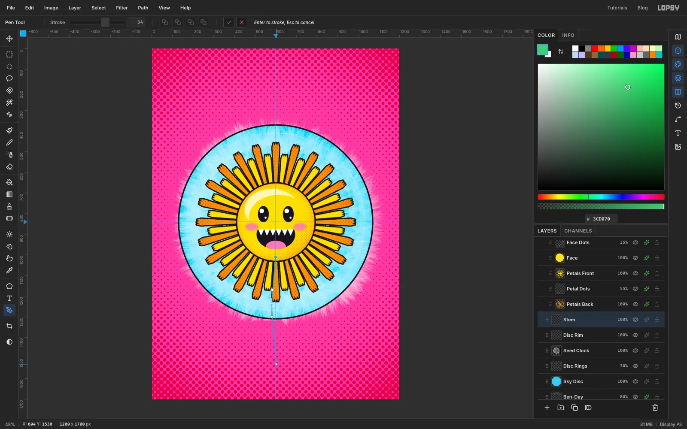

Click *Disc Rim* so the stem goes behind the head, and add a layer named
*Stem*. Set the foreground to leaf green `#3CD070`. Pick the **Pen** and
set its **Stroke** to `34` in the options bar.

Click at `600, 1010`. At `582, 1235` press and drag down to about
`580, 1300` to pull out a handle, which bends the line into a gentle S.
Click once more at `604, 1530`. Press [[Enter]] to stroke the path with
the foreground colour, then delete the path in the Paths panel. Add an ink
**Stroke** effect, **Width** `6`.

## Give the stem a highlight

Add a layer named *Stem Gloss* and set the foreground to white. With the
Pen's **Stroke** at `6`, click `591, 1040`, drag at `573, 1235` down to
`571, 1300`, and click `594, 1480`, about 9 px left of the stem's middle.
Press [[Enter]], delete the path and set the layer to **55%**. The thin
reflection ties the stem to the glossy face.

## Lay the sidewalk

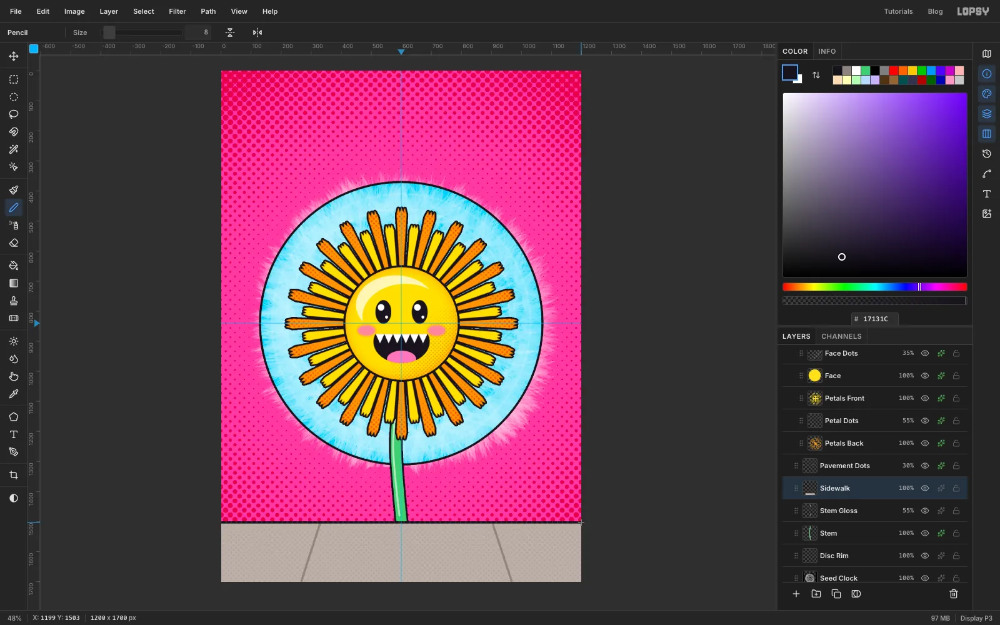

Add a layer named *Sidewalk*. Select from `0, 1500` to `1200, 1700`, fill
it with pavement `#B9AFA8` and apply **Filter → Add Noise…** with
**Amount** `22`, **Mode** **Mono** and **Distribution** **Gaussian**.

Keep the selection, add a layer named *Pavement Dots*, fill it with grey
`#9A9A9A` and apply **Halftone** with **Dot Size** `12`. Deselect, add a
**Color Overlay** in joint grey `#8E847E` and set the layer to **30%**.
The pavement gets its own quiet dot screen to match the rest of the page.

Click *Sidewalk* again. Pick the **Pencil** at size `6` with joint grey.
Click at `330, 1508` and [[Shift]]-click at `268, 1699` for a slab joint,
then do the same from `905, 1508` to `968, 1699`. Switch to ink at size `8`
and draw the curb from `0, 1503` to `1199, 1503`.

## Crack the pavement

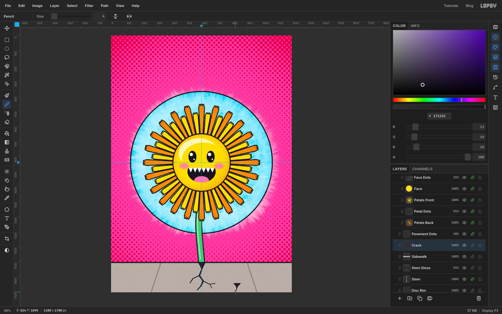

Add a layer named *Crack*. With the **Pen**, click `578, 1505`,
`626, 1505`, `612, 1534`, `600, 1560` and `594, 1532`, and close the path.
**Path to Selection**, fill with ink, deselect and delete the path. That's
the wedge the stem grows out of.

With the **Pencil** at size `7`, click `600, 1556` and [[Shift]]-click
`586, 1590`, `612, 1626` and `596, 1660` to zigzag the crack downward.
At size `4`, add a few short branches that wander off to each side.

Make a second, smaller wedge for another weed: Pen points `812, 1640`,
`862, 1640`, `842, 1662`, `834, 1682` and `828, 1660`, filled with ink,
plus a short pencil tail down to the bottom edge.

## Draw a dandelion leaf

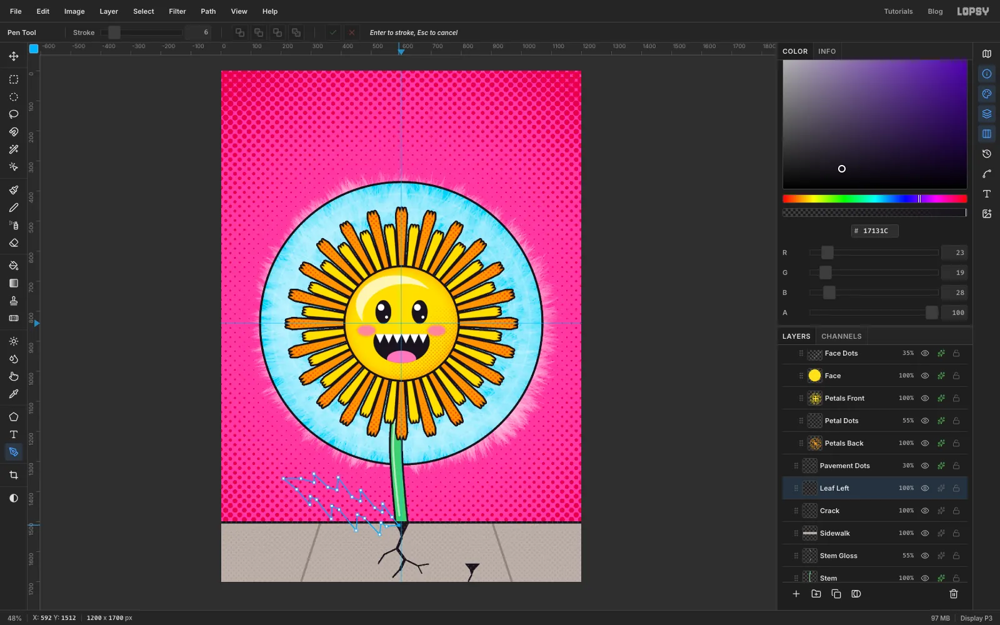

Dandelion leaves have deep, hooked teeth that point back towards the stem.
Add a layer named *Leaf Left* and draw one with the **Pen**:

- Start at the base, `592, 1512`, just left of the crack.
- The leaf runs up and to the left for about 415 px, ending in a point
  near `208, 1357`.
- Along the top edge, click four teeth. Each tooth is three clicks: a notch
  close to the midline, then a sharp tip 40–60 px out from the midline but
  a little *behind* the notch (closer to the base), then the next notch
  further along. That backward lean is what makes the teeth hook towards
  the stem.
- Round the tip and come back along the bottom edge with four more teeth,
  then click the first point to close the path.

## Fill and vein the leaf

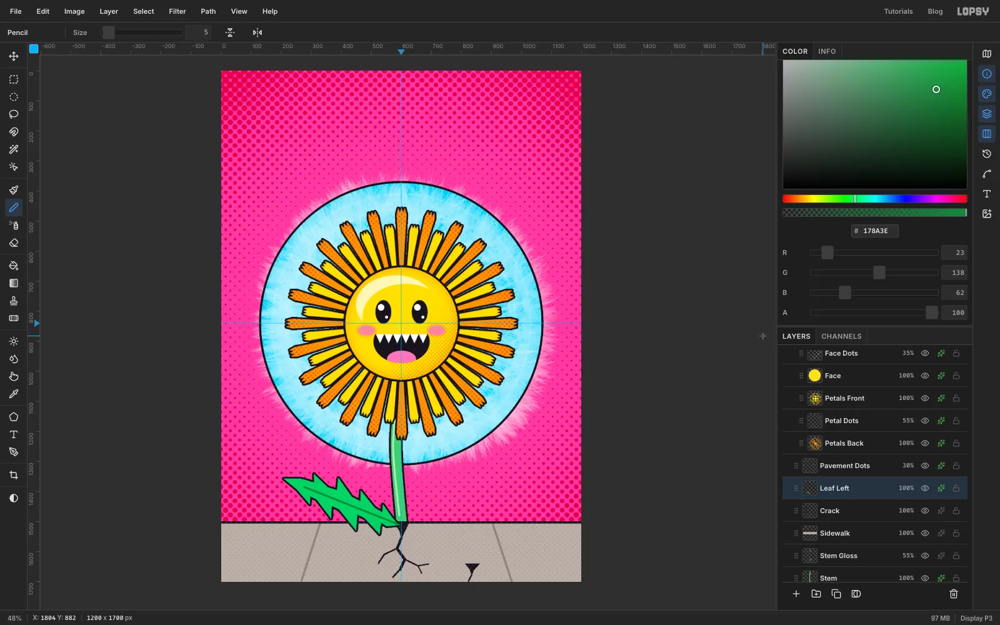

**Path to Selection**, fill with leaf green, deselect and delete the path.
Pick the **Pencil** at size `5` in vein green `#178A3E`, click the base of
the leaf and [[Shift]]-click about four-fifths of the way to the tip for the
midrib. Add an ink **Stroke** effect, **Width** `6`.

## Mirror it for the right leaf

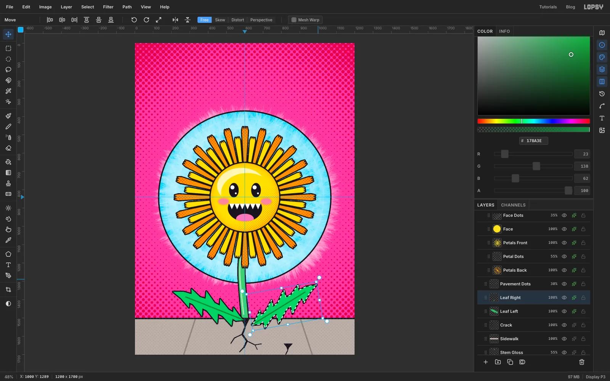

Duplicate *Leaf Left* and name the copy *Leaf Right*. [[Cmd]]-click its
thumbnail, pick the **Move** tool and click **Flip Horizontal** in the
options bar. Press [[Cmd+D]].

Drag it with the **Move** tool to the other side of the stem, then use the
arrow keys until its base touches the stem a little higher than the left
leaf's. Then
[[Cmd]]-click its thumbnail again and drag the rotation handle about 10°
anticlockwise, without [[Cmd]], so the two leaves aren't perfect mirrors.
Press [[Cmd+D]].

## Plant a second weed

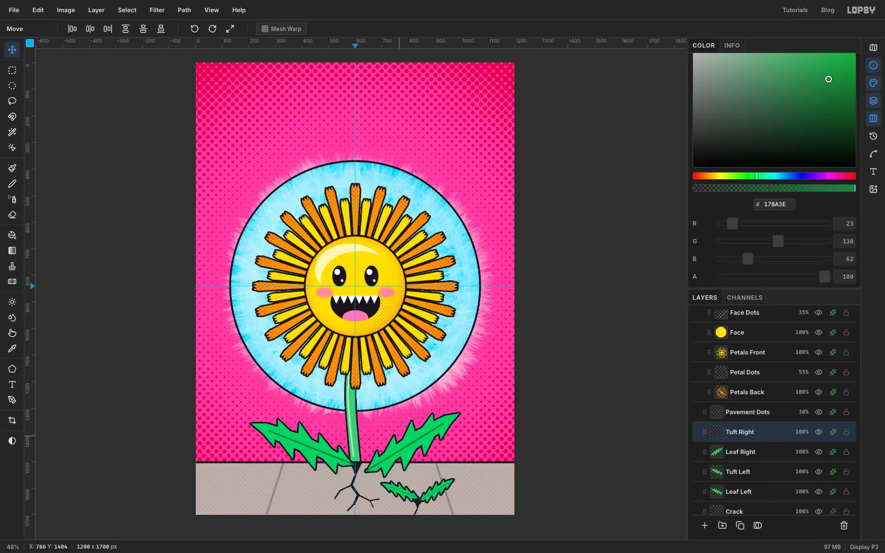

Duplicate *Leaf Left* again as *Tuft Left*, select its pixels and
[[Cmd]]-drag a corner handle inwards to about 36%. Press [[Cmd+D]], drag it
over with the **Move** tool and nudge it so its base sits on the small crack at about `835, 1640`. Do the
same with *Leaf Right* as *Tuft Right*. The little weed coming up in the
second crack fills the empty pavement and makes the point: they grow
everywhere.

## Draw one parachute seed

Click *Leaf Right* and add a layer named *Seed*. You'll draw it in the
empty top-left corner and move copies into place afterwards.

Select an ellipse from `143, 266` to `157, 302` and fill it with ink for
the seed. Pick the **Pencil** at size `3`, click `150, 268` and
[[Shift]]-click `150, 190` for the stalk.

For the parachute, pick the **Brush** at size `5` and set the foreground to
white. Click `150, 190`, then [[Shift]]-click a point 66 px away. Repeat
for 13 lines about 14° apart, fanning from just above the left horizontal
round to just above the right. Add an ink **Stroke** effect, **Width** `2`, then click
**Rasterize Layer Style** in the effects drawer. Pasted copies won't keep
effects, so the outline has to be baked into the pixels first.

## Cut the seed out

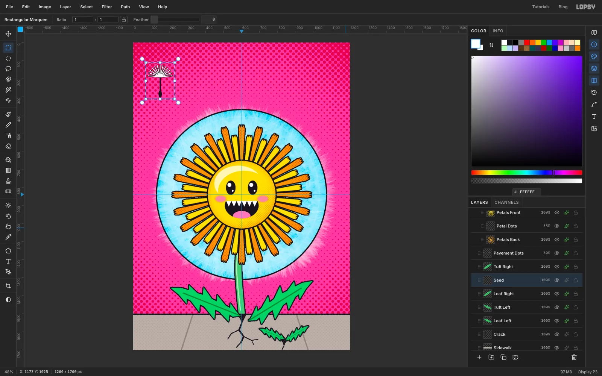

Select from `70, 110` to `230, 312`, around the whole seed, and choose
**Edit → Cut**.

## Paste, scale and turn five copies

Choose **Edit → Paste**. The copy lands where the seed was, on a new layer.
Rename it *Seed 1* and deselect. [[Cmd]]-click its thumbnail,
[[Cmd]]-drag a corner handle to scale it, press [[Cmd+D]], select it again,
drag the rotation handle to tilt it, and press [[Cmd+D]]. Then drag it with
the **Move** tool to roughly the right spot and fine-tune with the arrow
keys. The positions below are the centre of each seed's box.

Paste five copies like this, keeping each one at least a seed's width clear
of the disc rim so it reads as drifting:

- *Seed 1*: 85%, tilted 25° right, at `1105, 702`, right of the halo's upper half
- *Seed 2*: full size, 40° right, at `1090, 1228`
- *Seed 3*: 70%, 55° right, at `1110, 1405`
- *Seed 4*: 80%, 20° left, at `110, 640`
- *Seed 5*: 60%, 35° left, at `150, 1105`

## Merge the seeds and add a shadow

Delete the empty *Seed* layer. Click *Seed 5* and choose
**Layer → Merge Down** four times, then rename the result *Seeds*. Give it
a **Drop Shadow** in seed shadow `#D81B72` with **Offset X** `4`,
**Offset Y** `5`, **Blur** `0` and **Opacity** `55`. A hard, unblurred
shadow is the sticker-like pop-art version of depth.

## Add the issue strip

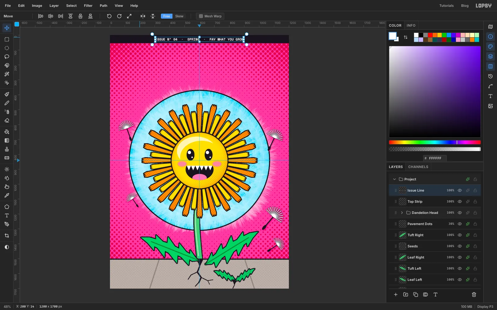

Collapse the *Dandelion Head* group with its arrow and click it, so new
layers go next to it. Add a layer named *Top Strip*, select from `0, 0` to
`1200, 54` and fill it with ink.

Pick the **Text** tool, choose **Space Mono**, weight **Bold**, size `22`,
and set the foreground to white. Click in the strip and type
`ISSUE Nº 04  ·  SPRING  ·  PAY WHAT YOU GROW`, with two spaces either side
of each dot. Press [[Tab]] to commit and rename the layer *Issue Line*. Nudge it with the **Move** tool until
it's centred in the strip, with equal space above and below.

## Set the masthead

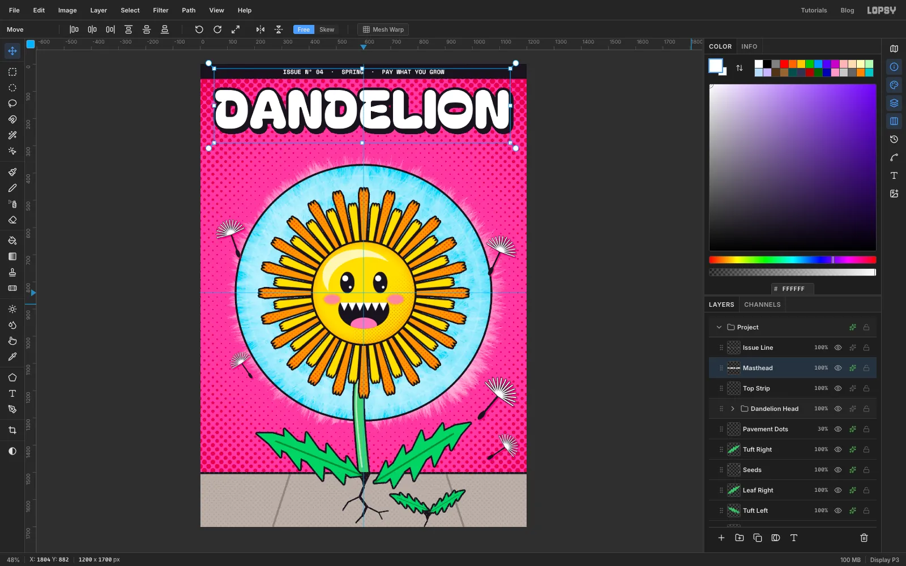

Click *Top Strip* so the text options don't restyle the issue line. On the
**Text** tool, pick **Bagel Fat One** at size `195`, white. Click near the
top left and type `DANDELION`, then press [[Tab]] and rename the layer
*Masthead*.

Move it so the letters run from about `55` to `1132` across and sit
centred around `y 165`. That keeps a 55 px margin on the left and leaves
room for the shadow on the right. Add a **Stroke** in ink, **Width** `9`,
**Position** **Outside**, and a **Drop Shadow** in ink with **Offset X**
`9`, **Offset Y** `11`, **Blur** `0` and **Opacity** `100`.

## Build the ANARCHY banner

Click *Masthead*, click the **New Group** button and name the group
*Anarchy Banner*. Inside it, add a layer named *Banner Slab*, select from
`250, 250` to `950, 360` and fill it with ink. Deselect and add a
**Stroke** in white, **Width** `5`, **Outside**.

Pick **Rubik Mono One** in dandelion yellow, type `ANARCHY` on the slab,
press [[Tab]] and rename the layer *Anarchy*. In the **Text** panel set **Letter spacing** to `8`, then set the
size to `92` so the word is about 600 px wide. Centre it on the slab at
`600, 305`. Rubik Mono One is all capitals, so there are no descenders and
the word sits exactly in the middle.

## Tilt the banner

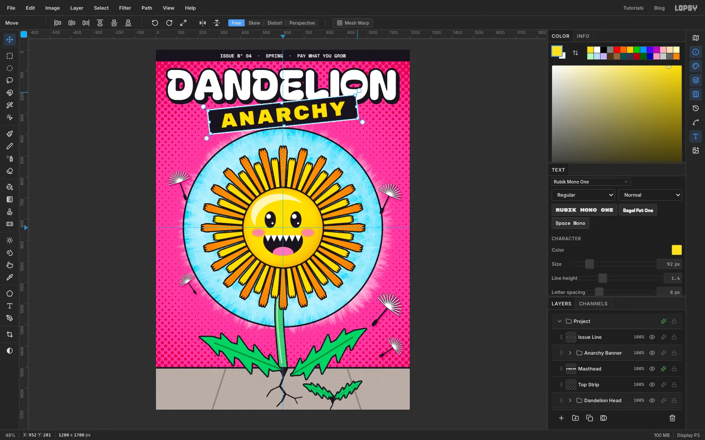

Collapse *Anarchy Banner* and click the group row. With the **Move** tool
and nothing selected, the handles frame the slab and the text together.
Drag the rotation handle about 6° anticlockwise and press [[Cmd+D]]. The
text turns with the slab and stays editable. The slab's raised end now
overlaps the bottom of the masthead's shadow, which looks deliberate.

## Draw the starburst badge

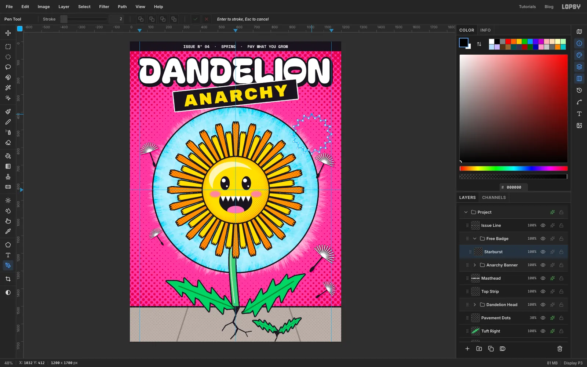

First add two margin guides: click the top ruler at `56` and at `1144`.
Everything on the cover keeps 56 px from the edges.

Click the collapsed *Anarchy Banner* group and make a **New Group** named
*Free Badge*. Inside it, add a layer named *Starburst*. With the **Pen**,
click your way round a 16-point star centred on `1032, 524`: start at the
top tip, `1032, 412`, then alternate between an inner notch about 92 px from
the centre and the next outer tip about 112 px out. The tips don't have to
be perfect, but the rightmost one, at `1144, 524`, should touch the right
margin guide. Click the first point to close the path.

**Path to Selection**, fill with dandelion yellow, deselect and delete the
path. Add an ink **Stroke**, **Width** `5`, **Outside**, and an ink
**Drop Shadow** with offsets `6` and `6` and **Blur** `0`.

## Letter and tilt the badge

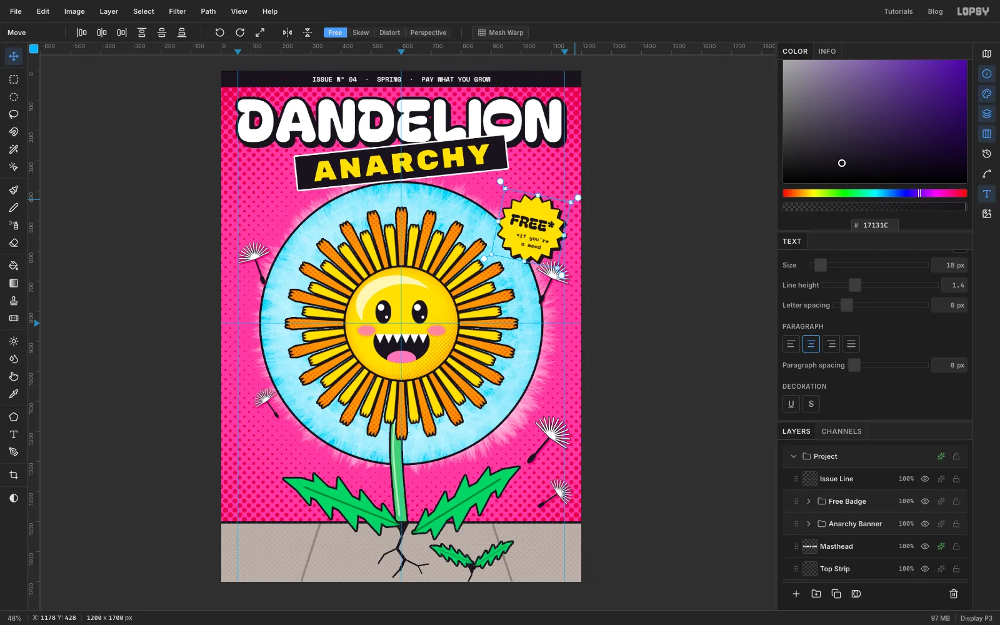

With **Bagel Fat One** at `50` in ink, type `FREE*`, press [[Tab]] and
rename the layer *Free*. The
letter spacing from ANARCHY carries over to new text, so set **Letter
spacing** back to `0` in the **Text** panel. Centre the word just above the
middle of the star, at about `1032, 506`. Click *Starburst*,
switch to **Space Mono** Bold at `18` and type `*if you're`, press
[[Enter]], type `a weed`, press [[Tab]] and name the layer *Fine Print*. In the **Text** panel click **Align center**
so the two lines centre on each other, then centre the block at about
`1044, 566`. That's 12 px right of the star's centre on purpose: when the
badge tilts clockwise in a moment, text below the centre swings to the
left, and this offset brings it back to the middle.

Collapse *Free Badge*, click it and rotate the whole group about 12°
clockwise with the rotation handle. Press [[Cmd+D]].

## Add the top cover line

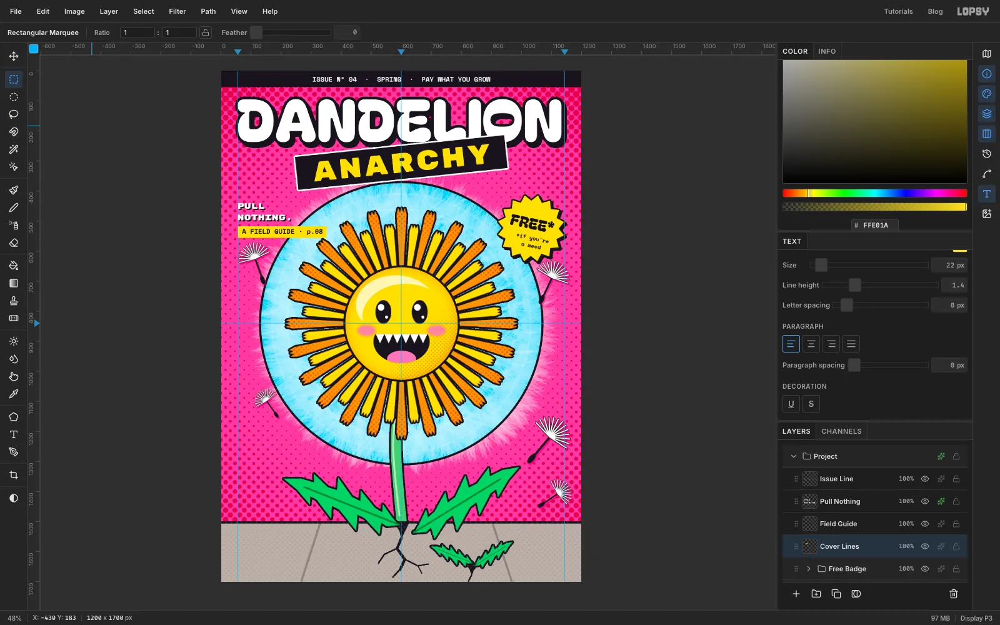

Click *Free Badge* and add a layer named *Cover Lines*. In the **Text**
panel click **Align left** again, since the last text was centred and the
setting carries over to new text.

With **Rubik Mono One** at `27` in white, type `PULL`, press [[Enter]] and
type `NOTHING.`, press [[Tab]] and rename the layer *Pull Nothing*. Move it so its left edge sits on the `56` guide and its top
at about `440`. Give it an ink **Drop Shadow**, offsets `4` and `4`,
**Blur** `0`.

Click *Cover Lines* and type `A FIELD GUIDE · p.08` in **Space Mono** Bold
`22` in ink (rename it *Field Guide*), 14 px in from the guide and about 30 px under NOTHING. Then
click *Cover Lines* again, select a rectangle 14 px wider than the text on
each side and 9 px taller above and below, and fill it with dandelion
yellow. The strip makes the small line readable against the dots and the
fluff.

## Recolour one line of a cover line

Click *Cover Lines*. With **Rubik Mono One** at `26` in white, click near
`90, 1190` and type `SEED-BOMB`, [[Enter]], `A PARKING LOT`, [[Enter]] and
`→ p.12`. Rubik Mono One has no lowercase, so the page number comes out
in capitals.

While you're still typing, press [[Shift+Home]] to select the last line.
Click the **Text color** swatch in the options bar, enter
dandelion yellow and click the swatch again to close it. Only the
selected line changes colour. Press [[Tab]] to commit and rename the
layer *Seed Bomb*.

## Put the label behind it

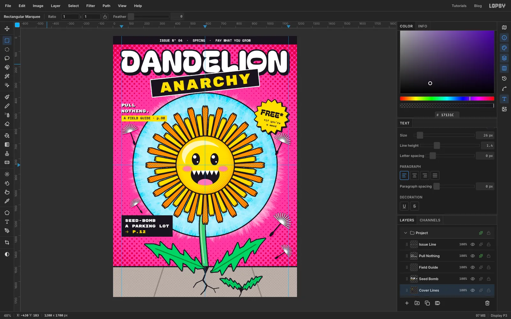

Move the text so it starts 24 px inside the margin, at `80`, with its top
at about `1192`. Click *Cover Lines*, select a rectangle that reaches
24 px beyond the text on every side, fill it with ink and deselect. The
label sits on the `56` guide and clears the nearest floret tip by about
50 px.

## Set the slogan and draw a barcode box

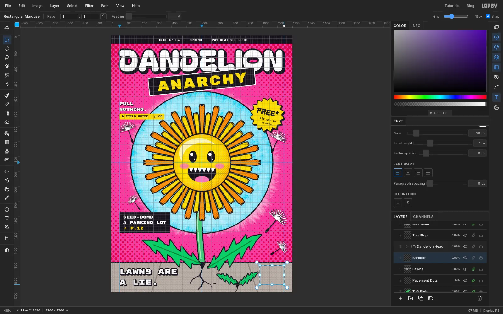

Click *Pavement Dots*. With **Rubik Mono One** at `50` in white, type
`LAWNS ARE`, [[Enter]], `A LIE.`, commit with [[Tab]] and rename the layer
*Lawns*. Move it onto the left guide
with its bottom about 50 px above the bottom edge. Add an ink **Stroke**,
**Width** `4`, **Outside**, and an ink **Drop Shadow** with offsets `5` and
**Blur** `0`.

Add a layer named *Barcode* and choose **View → Show Grid**. Drag a
rectangular marquee from about `985, 1523` to `1144, 1650`. With the grid
on, the edges snap to the 16 px lattice, giving a box from `984, 1522` to
`1144, 1650` whose right edge sits on the margin. Hide the grid again, fill
the box with white and give it an ink **Stroke** with **Width** `3`.

## Draw the bars

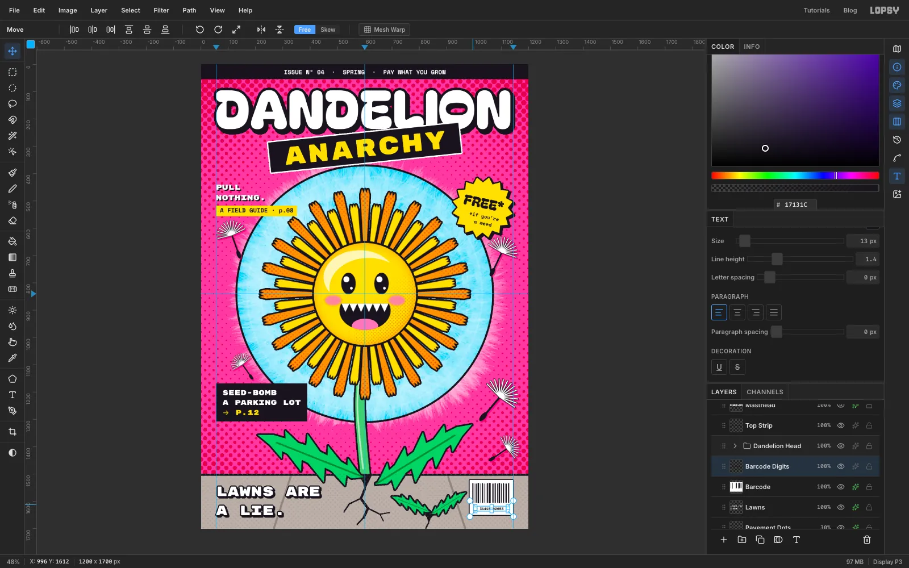

Pick the **Pencil** in ink. Starting at `x 994`, click at `y 1536` and
[[Shift]]-click at `y 1604` to draw a bar. Move right 3–5 px and draw the
next one, changing the pencil size between `2`, `4` and `6` as you go, until
the bars reach about `1134`.

With **Space Mono** Bold at `13` in ink, type `0 31415 92653 4`, name the
layer *Barcode Digits* and centre it under the bars at `1064, 1627`.

## Add print grain and export

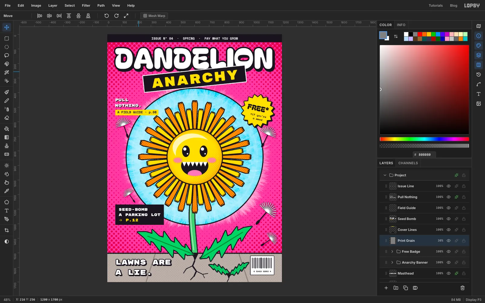

Click the collapsed *Free Badge* group and add a layer named *Print Grain*. Fill it
with grey `#808080` and apply **Filter → Add Noise…** with **Amount** `28`,
**Mono** and **Gaussian**. Set its **Blend** to **Overlay** and its
opacity to **30%**. Mid grey vanishes in Overlay, so only the speckle is
left, like ink on uncoated zine paper. The cover lines sit above the grain,
so the small type stays crisp.

Hide the guides with **View → Show Guides**, export with
**File → Quick Export PNG**, and save the project with
**File → Save Project** for issue 05.
