Neo-pop takes 1960s Pop Art and turns it up. Takashi Murakami's *superflat* paintings repeat flat, smiling flowers until they become a field. Jeff Koons makes balloon animals look like they're cast in mirror-polished steel. Both use the same visual language as toys, packaging and apps: flat saturated colour, thick black outlines and a shine that looks good enough to lick.

In this tutorial you'll use that language to present an imaginary app called **Disco Lobster**, for a roller rink with a lobster shack. The board has three parts on an 1800 × 1200 canvas:

- **The stage:** a wallpaper of smiling rainbow flowers made with **Define Pattern** and **Fill with Pattern**, behind concentric halo rings drawn with the **Shape** tool.
- **The mascot:** a glossy red lobster on roller skates, built from selections, fat brush lines and layer effects. It holds a mirror ball made with **Pixelate**, a Pencil grid and Liquify's **Bloat**, and it sits on a hard sticker shadow made with **Copy Merged**.
- **Two phone screens:** a home screen with a **Halftone** hero card, and a skate-rental screen with a size picker that's grouped and tilted with one rotation.

Along the way you'll use the Shape tool's click-to-size dialog for exact UI pieces, the **Magic Wand** to fill letter holes, **Select → Inverse** to clip a panel, **Merge Down**, copying and scaling pixels between layers, ruler guides and the grid. The fonts are **Bagel Fat One** for display type, **Fredoka** for UI text and **DM Sans** for small print.

The palette is candy-bright, held together by one dark ink:

- Bubblegum `#FF6FB5`, ink `#1A1024`, plum shadow `#3A0F4A`
- Petals `#FFD93B` / `#FF8A2B` / `#E8287D` / `#B79CFF` / `#4FB7FF` / `#5FE3B8` / `#FFFFFF` / `#FFF06A`
- Flower face `#FFF3C4`, blush `#FF8FB8`
- Lobster `#E8341F`, belly `#FF7A5C`, shell shade `#8E0F1E`, title red `#FF4A2E`
- Mirror ball `#FFFFFF` → `#D9D3F7` → `#7A6BB5` → `#2B2050`
- Cream `#FFF6E5`, muted text `#7A5C8C`, bun `#F2B562`

> **Tip:** Positions are in document pixels, written `x, y`, and the status bar at the bottom shows where the pointer is. When a step says to fill, that's **Edit → Fill**, which fills the selection with the foreground colour. [[Cmd+D]] deselects.

> **Tip:** When a step says "on a layer called `Name`", click **Add Layer** first and double-click the new layer's name to rename it. Every step is undoable, so experiment freely and press [[Cmd+Z]] when something looks wrong.

> **Tip:** Every outline in this piece is the **Stroke** layer effect, set to **Outside** and coloured ink `#1A1024`. Effects live in the drawer behind the sparkle icon on each layer's row. The same drawer has the **Blend** dropdown. To change opacity, click the `100%` readout on a layer's row.

## Draw a smiling superflat flower

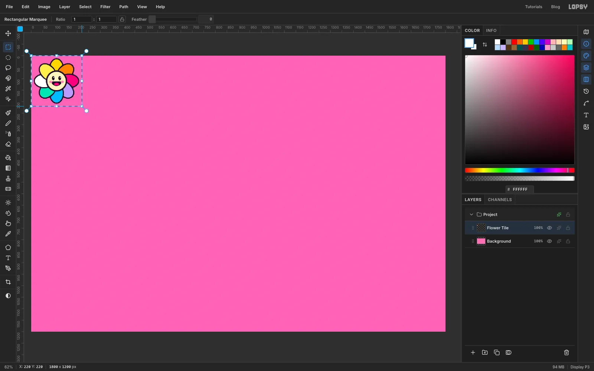

Create an **1800 × 1200** document. Select **Background**, set the foreground to bubblegum `#FF6FB5` and fill it.

Rename **Layer 1** to `Flower Tile`. You'll draw one flower in a 220 × 220 px square in the top-left corner, centred on `110, 110`.

1. **Petals.** Each petal is an oval about 80 px long and 54 px wide, with its middle 54 px out from the centre, pointing outwards. Start with the top petal. Use the **Lasso** to trace a slightly fatter oval and fill it with ink. Choose **Select → Shrink…** by **5** and fill again with the petal colour, which leaves a 5 px ink rim. Work round clockwise in 45° steps: yellow, orange, magenta, lilac, sky blue, mint, white and pale yellow (the petal colours in the palette). Each new petal overlaps the one before it, so the outlines stack like paper.
2. **Face.** Use the **Elliptical Marquee** with [[Shift]] to draw a 92 px circle on the centre and fill it with ink. Shrink by **6** and fill with `#FFF3C4`.
3. **Features.** The eyes are two small ink ovals about 12 × 18 px, either side of the centre and a little above it. For the grin, lasso a half circle about 44 px wide just below the centre and fill it with ink. Put a magenta oval in the bottom of it for a tongue. Add two pink `#FF8FB8` ovals for cheeks, and click once in each eye with a 5 px white **Brush** for a glint.

Drag a **Rectangular Marquee** from the top-left corner to `220, 220` and choose **Edit → Define Pattern**. Then deselect and delete the `Flower Tile` layer. The pattern stays defined.

> **Tip:** Patterns aren't saved in the project, so do the next step before you reload the page.

## Fill a layer with the pattern

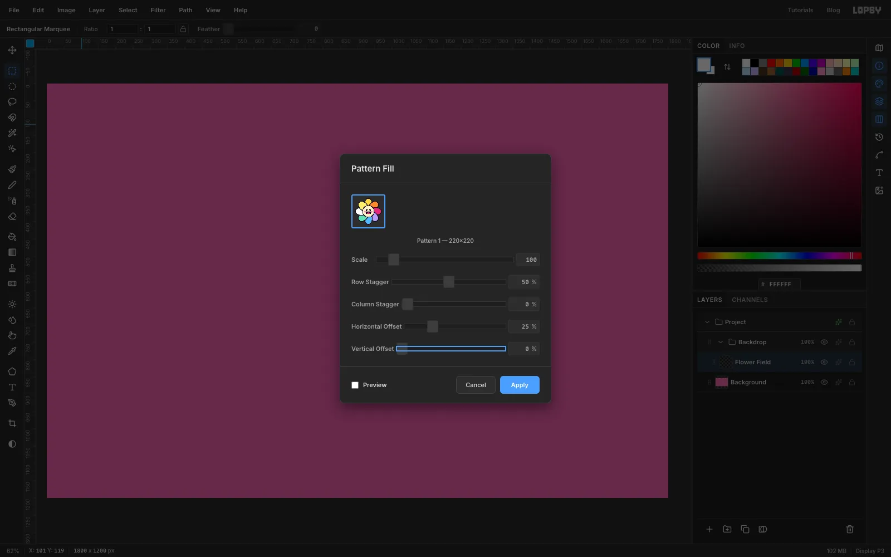

Click **New Group** in the Layers panel and name it `Backdrop`. Add a layer inside it called `Flower Field`, then choose **Edit → Fill with Pattern…**. Your flower is already selected. Set **Row Stagger** to **50%**, so each row shifts half a tile like bricks, and **Horizontal Offset** to **25%**. Click **Apply**.

## Knock the wallpaper back

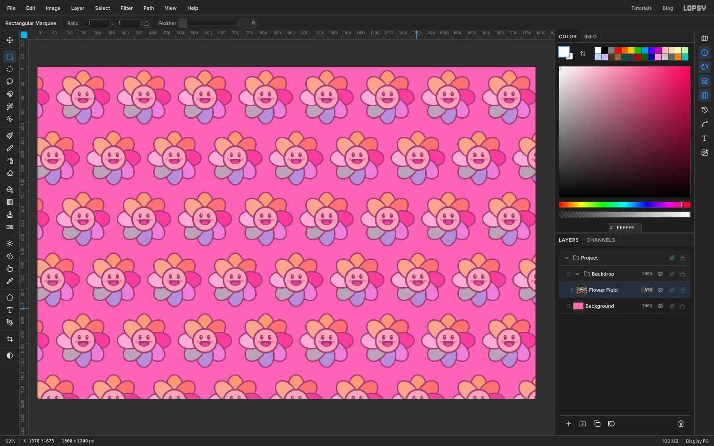

At full strength the flowers would shout over everything, so set `Flower Field` to **45%** opacity. The pink shows through and the field turns into wallpaper.

## Stack the halo rings

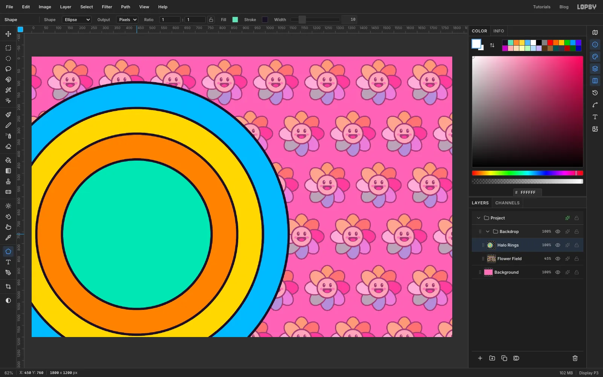

Add a layer called `Halo Rings` above the field. Pick the **Shape** tool, set **Shape** to **Ellipse**, and click the **Stroke** swatch to add an ink stroke with a **Width** of **10**.

A click without dragging opens the **Shape Size** dialog, which makes a shape of an exact size centred on the click. Click at `450, 760` four times, working from the largest circle to the smallest and changing the fill colour each time:

- **1300 × 1300** in sky blue `#4FB7FF`
- **1080 × 1080** in yellow `#FFD93B`
- **860 × 860** in orange `#FF8A2B`
- **640 × 640** in mint `#5FE3B8`

## Start the lobster with antennae

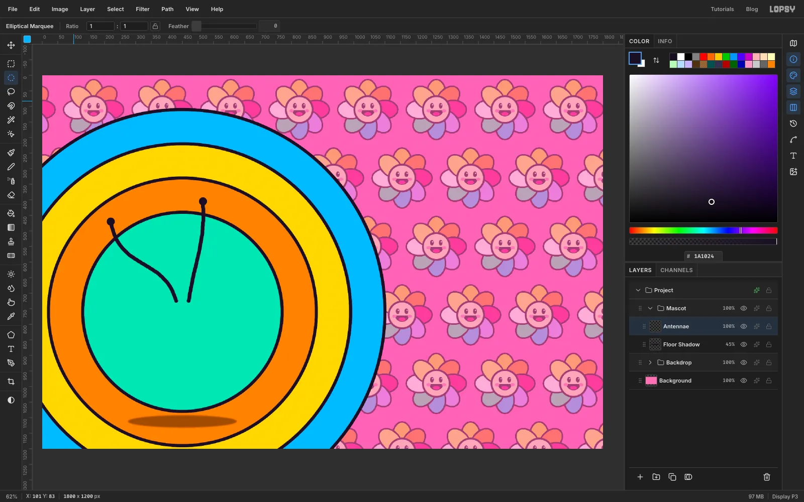

Collapse `Backdrop`, click its row, and click **New Group**. Name the new group `Mascot`. All of the character's layers go inside it, each one above the last. The lobster stands on the vertical line through `450`.

- **Floor Shadow.** On a layer called `Floor Shadow`, draw an elliptical marquee about 350 × 40 centred on `450, 1110` and fill it with ink. Deselect, run **Filter → Gaussian Blur…** at **6**, set the layer to **Multiply** and lower it to **45%**.
- **Antennae.** On a layer called `Antennae`, pick the **Brush** with ink, **Size 13** and **Hardness 100** in the options bar. Drag one long S-curve from `430, 725` up and out to `220, 470`, and another from `470, 725` to `515, 405`. Add a 26 px ink circle at each tip.

## Shade and pixelate a mirror ball

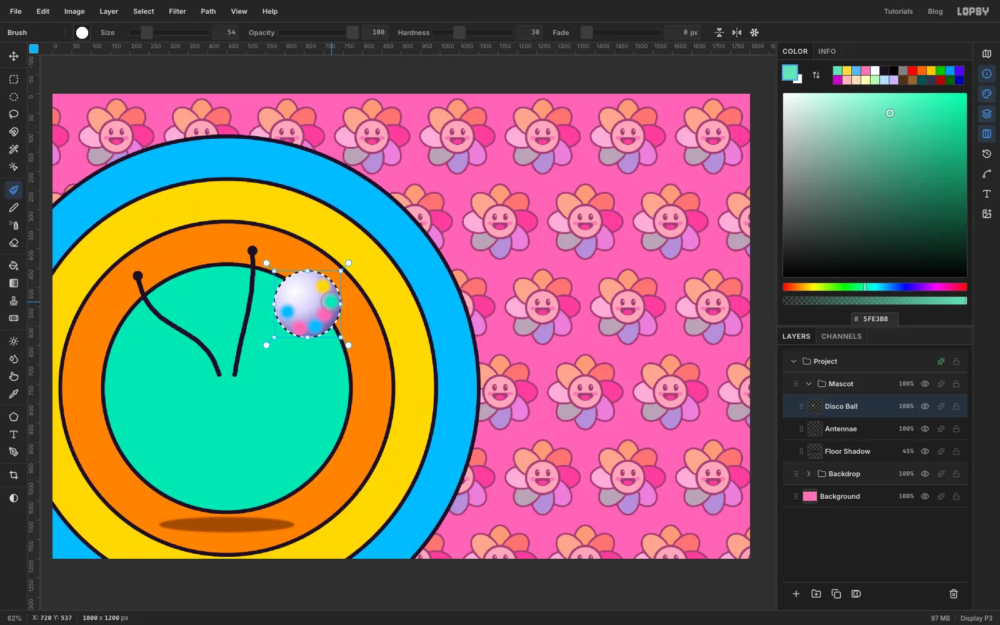

Add a layer called `Disco Ball` and draw a 172 px circle selection centred on `658, 543`. Keep it selected for the whole of this section.

1. **Shading.** Pick the **Gradient** tool, set it to **Radial**, and open **Advanced…** to set four stops: white `#FFFFFF`, lavender `#D9D3F7` at 35%, violet `#7A6BB5` at 75% and deep indigo `#2B2050` at the end. Drag from just above and left of the centre to past the lower-right edge.
2. **Reflections.** Switch to the **Brush** at **Size 54** and **Hardness 30**. Click a couple of soft dabs each of pink, sky blue, yellow and mint around the lower half and the right edge.
3. **Facets.** Run **Filter → Pixelate…** with a **Block Size** of **16**. The selection keeps the tiles inside the circle.

## Rule the grout

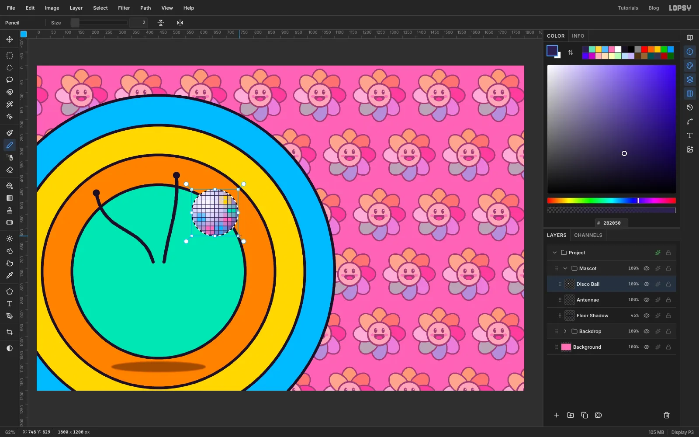

The ball is still selected. Pick the **Pencil**, **Size 2**, in deep indigo `#2B2050`. On each vertical seam between two columns of tiles, click just above the circle and [[Shift]]-click just below it to draw a straight line. Then do the same on each horizontal seam between rows. The selection clips the lines to the ball, so they can overshoot.

## Bulge the tiles with Liquify

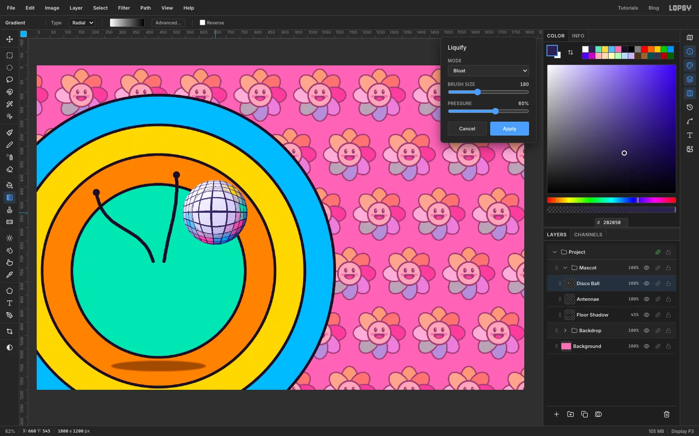

A flat grid still reads as a checked disc, so round the ball off in two moves:

1. **Shine.** With the ball still selected, add a layer called `Ball Shine`. Open the gradient's **Advanced…** editor and set three stops: white, mid grey `#808080` at 45% and black. Drag a radial gradient from the upper left of the ball to past its lower-right edge. Set the layer to **Overlay** at **80%**, then choose **Layer → Merge Down** to bake it into `Disco Ball`. Deselect.
2. **Curvature.** Open **Filter → Liquify…**. Set **Mode** to **Bloat**, **Brush Size** to **180** and **Pressure** to **60%**. Click four times in the middle of the ball. Each click magnifies the centre a little more, and the tiles curve like a globe. Click **Apply**, then give the layer an ink **Stroke** of **8**.

## Add arms, legs and notched claws

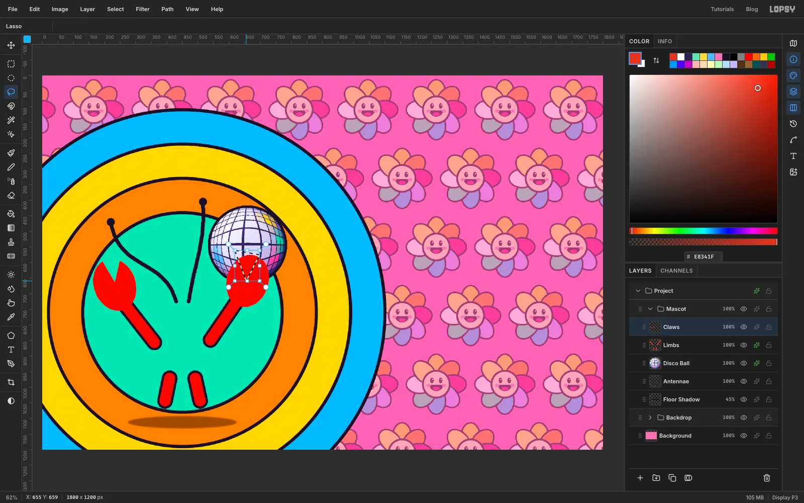

- **Limbs.** On a layer called `Limbs`, use the **Brush** in lobster red `#E8341F` at **Size 36**. Click and [[Shift]]-click a straight line for each limb: one arm from `365, 800` up to `275, 684`, the other from `540, 848` up to `647, 692`, and two short legs, from `409, 971` down to `394, 1044` and from `491, 971` down to `507, 1044`. The body will cover the inner ends. Add a **Stroke** of **8**.
- **Claws.** On a layer called `Claws`, lasso two big ovals about 134 × 170 px around `233, 671` and `659, 659`, each tilted about 20° outwards, and fill them red. Then lasso a narrow V from the middle of each claw up through its top edge and press [[Delete]]. That notch turns a mitten into a pincer.
- Give `Claws` a **Stroke** of **8** and an **Inner Glow** in shell shade `#8E0F1E`, **Size 28** and **Opacity 70**. The dark glow inside the edge makes the claws look inflated.

## Shape the body and belly

- **Body.** On a layer called `Body`, fill an ellipse about 230 × 295 centred on `450, 848` with red. Give it a **Stroke** of **8** and an **Inner Glow** of `#8E0F1E` at **Size 55**, **70%**.
- **Belly.** On a layer called `Belly`, fill a 161 × 134 ellipse centred on `450, 907` with coral `#FF7A5C`. With a 6 px ink brush, drag three gently smiling arcs across it for the shell segments.

## Give it eyes and a big grin

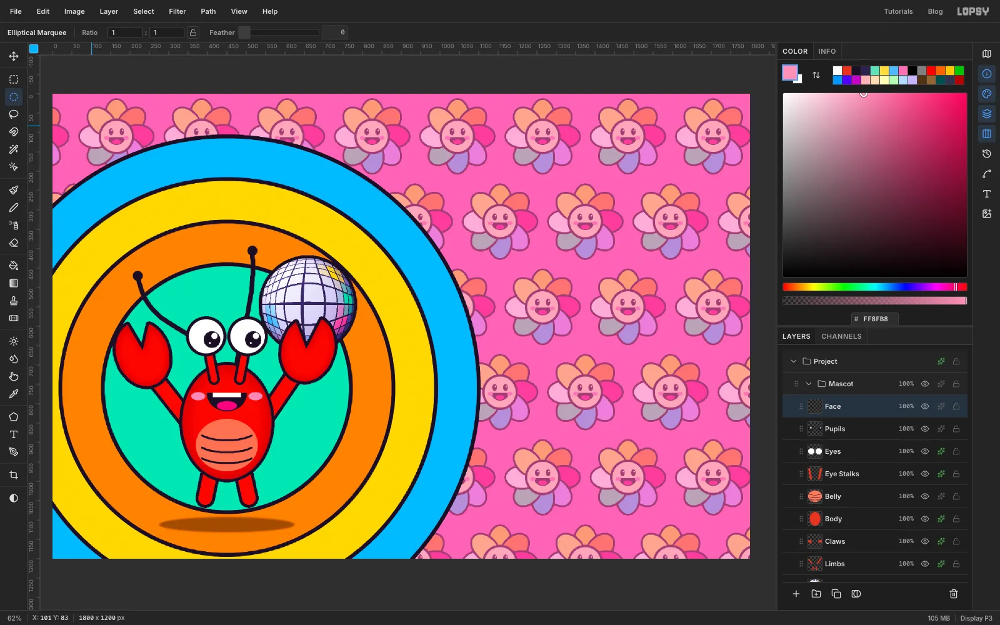

1. **Eye Stalks.** On a layer called `Eye Stalks`, draw two short red lines with a 17 px brush from the top of the body up to about `397, 626` and `503, 626`. Add a **Stroke** of **7**.
2. **Eyes.** On a layer called `Eyes`, fill an 89 px white circle centred on each stalk tip. Add a **Stroke** of **8**.
3. **Pupils.** On a layer called `Pupils`, fill a 43 px ink circle in each eye, shifted to the right and down, so the lobster looks across at the phones. Add a 16 px white glint at the top right of each pupil and a 6 px brush dot at the bottom left.
4. **Grin.** On a layer called `Face`, lasso a half circle about 105 px wide and 48 px deep just above the belly and fill it with ink. Add a 72 × 11 white strip along its top edge for teeth, and a magenta `#E8287D` tongue at the bottom. Add pink cheeks either side.

## Add balloon gloss

Koons-style gloss comes from a few sharp white reflections, not soft airbrushing. On a layer called `Gloss`, lasso a thin crescent along the left flank of the body, inside the outline, and fill it with white. Lasso a small white oval on each claw, away from the notch so the highlight stays inside the shape. Set the layer to **85%**.

## Put it on roller skates

On a layer called `Skates`, use the **Shape** tool's **Rectangle** with a white **Fill** and a 7 px ink **Stroke**. The Shape tool keeps its own fill and stroke colours, set with the two swatches in its options bar, not the foreground colour. Each skate is built from back to front:

1. **Cuff.** A 52 × 44 rectangle with **Corner Radius 16**, at the bottom of each leg, around `375, 1030` and `509, 1030`.
2. **Boot.** A 104 × 52 rectangle, radius 22, about 30 px lower, so it overlaps the bottom of the cuff.
3. **Stripe.** Marquee a 92 × 9 band across the middle of each boot and fill it with magenta.
4. **Wheels.** Switch to **Ellipse** with a yellow fill and a 6 px ink stroke. Click-create two 34 px wheels under each boot.
5. **Toe stop.** Add an 18 px pink `#FF6FB5` circle at the front of each boot.

Leave a clear gap between the two boots so they read as a pair, not one long six-wheeled skate.

## Scatter sparkles

Finish the character with a `Sparkles` layer. Lasso four-pointed stars with concave sides and fill them white. Put a large one at the top right of the ball, two small ones nearby, and one on the ball's upper-left facets as a specular glint. Add a **Stroke** of **4**.

## Copy the mascot merged

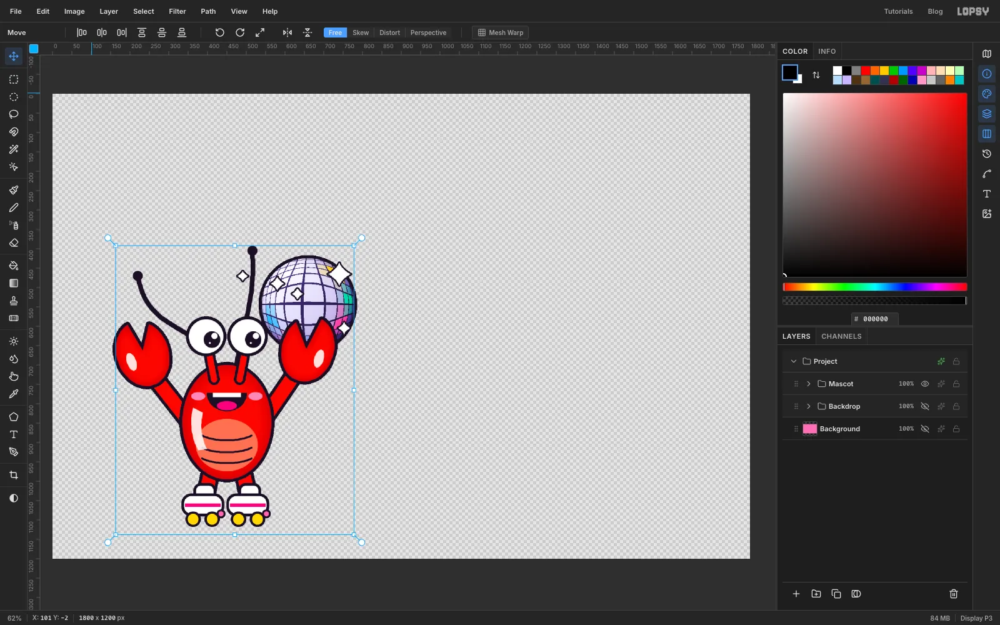

Layer effects don't work on groups, so make the shadow from pixels:

1. Hide `Backdrop` and `Background` with their eye icons. Expand `Mascot` and hide `Floor Shadow` too, then collapse it again. Only the lobster is visible.
2. Click the `Mascot` group, press [[Cmd+A]], and choose **Edit → Copy Merged**. Deselect, then show the three layers again.
3. Click the `Backdrop` row and press [[Cmd+V]]. The copy pastes in place as a new layer between `Backdrop` and `Mascot`. Lopsy also selects the shape of the pasted pixels, so a fill will colour just the silhouette.
4. Rename it `Mascot Shadow`, set the foreground to plum `#3A0F4A` and fill. Deselect.

## Offset the hard shadow

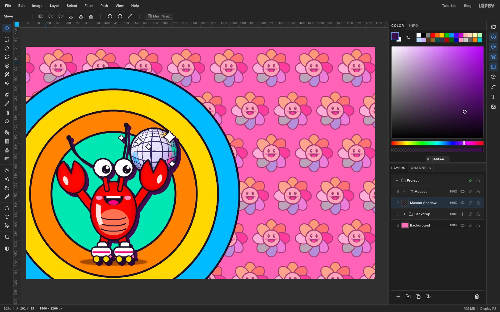

With the **Move** tool, press [[Shift+Right]] once and [[Right]] four times, then the same with [[Down]], to offset the silhouette 14 px down and to the right. A hard, unblurred shadow is the neo-pop way to lift a flat shape off the page.

## Set the DISCO LOBSTER title

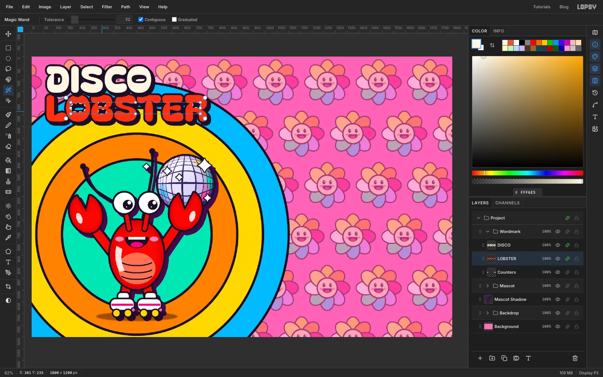

Collapse `Mascot`, click its row, and make a new group called `Wordmark`. Add a layer inside it called `Counters`. It sits under the type and will fill the holes in the letters.

Pick the **Text** tool and choose **Bagel Fat One** at **156** px. Type `LOBSTER` in title red `#FF4A2E`. Then click the `Wordmark` row (so the next settings don't restyle LOBSTER), click higher up the canvas and type `DISCO` in cream `#FFF6E5`. Give both an ink **Stroke** of **8** and a **Drop Shadow** in ink with **Offset X** and **Y** of **10**, **Blur 1**, **Spread 0** and **Opacity 100**. Move `DISCO` so its top-left corner sits at `64, 40`, and put `LOBSTER` 8 px below it, lined up on the left.

The wallpaper shows through the holes in the letters (the *counters*), so plug them:

1. Select the `DISCO` layer and pick the **Magic Wand** with **Contiguous** on. Click inside the D, then [[Shift]]-click inside the O.
2. Choose **Select → Grow…** by **4** so the fill will tuck under the letter edges.
3. Select the `Counters` layer, fill with cream and deselect.
4. Select the `LOBSTER` layer. With the wand, click inside the O, then [[Shift]]-click both holes of the B and the hole of the R.

## Plug the letter counters

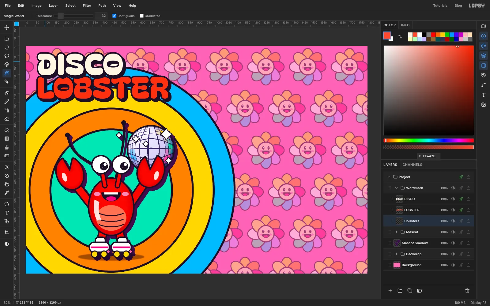

With LOBSTER's four counters selected, **Grow** the selection by **4**, select `Counters`, fill with title red and deselect. The letters now read as solid stickers, and nothing peeks through them.

## Build the home-screen phone

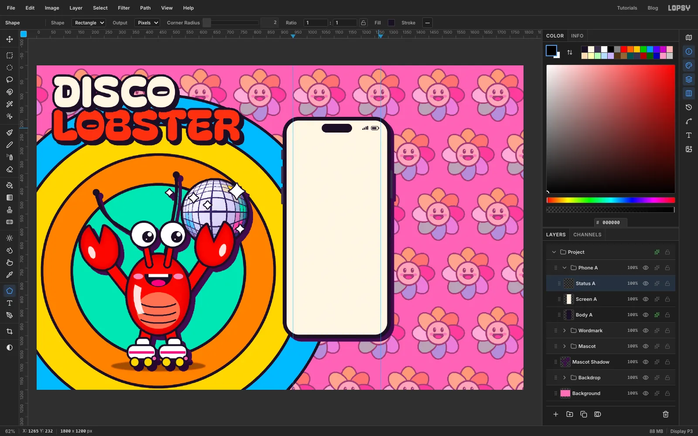

Collapse `Wordmark`, click its row, and make a group called `Phone A`. Click the top ruler at `948` and `1272` to drop two vertical guides. They mark the left and right content margins of the screen. Every piece below is a click-created **Rectangle** from the Shape tool, centred on the click. Click the **Stroke** swatch and choose **Remove stroke** for now, because the phone parts have no outline.

1. **Body A.** On a layer called `Body A`: ink, **Corner Radius 60**, **400 × 820**, at `1110, 600`. Add the side buttons as 8 px wide rectangles in `#3A2E4A` on both edges. Give the layer a **Drop Shadow** in plum `#3A0F4A` with offsets of **12**, **Blur 1** and **Opacity 100**.
2. **Screen A.** On a layer called `Screen A`: cream, **Corner Radius 46**, **372 × 792**, at the same centre.
3. **Status A.** On a layer called `Status A`: a 112 × 32 ink pill (radius 16) at `1110, 232` for the dynamic island, four tiny signal bars, and a battery made from an outline-only rectangle with a small filled one inside it.

## Print Ben-Day dots on the hero card

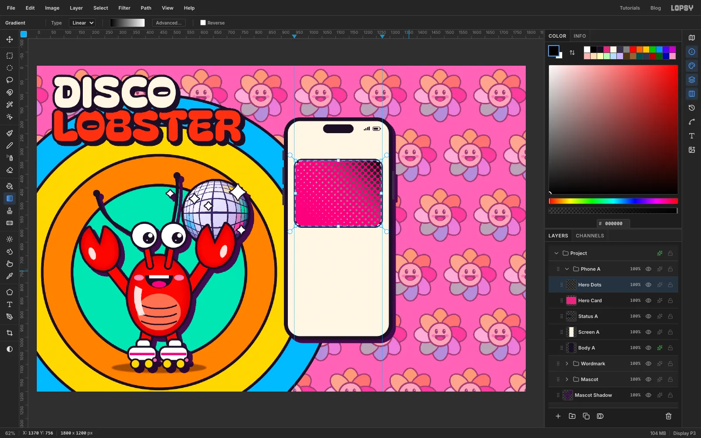

1. On a layer called `Hero Card`, click-create a **324 × 250** rectangle with **Corner Radius 28** at `1110, 470`, filled magenta `#E8287D` with a 4 px ink stroke.
2. Add a layer called `Hero Dots`. [[Cmd]]-click the `Hero Card` thumbnail to select the card, and **Shrink** the selection by **6** to keep the dots inside the outline.
3. Set the gradient to **Linear** and, in **Advanced…**, to a plain black-to-white ramp. Drag it from the card's top-right corner to its bottom-left corner.
4. Run **Filter → Halftone…** with **Dot Size 16**, **Angle 45** and **Softness 0.5**. Each dot takes the tone under it and grows with how dark that tone is, so the dots are big and black at the top right and shrink to small grey specks at the bottom left.
5. Deselect, add a yellow `#FFD93B` **Color Overlay** to turn the black dots yellow, and set the layer to **85%**.

## Reuse the mirror ball

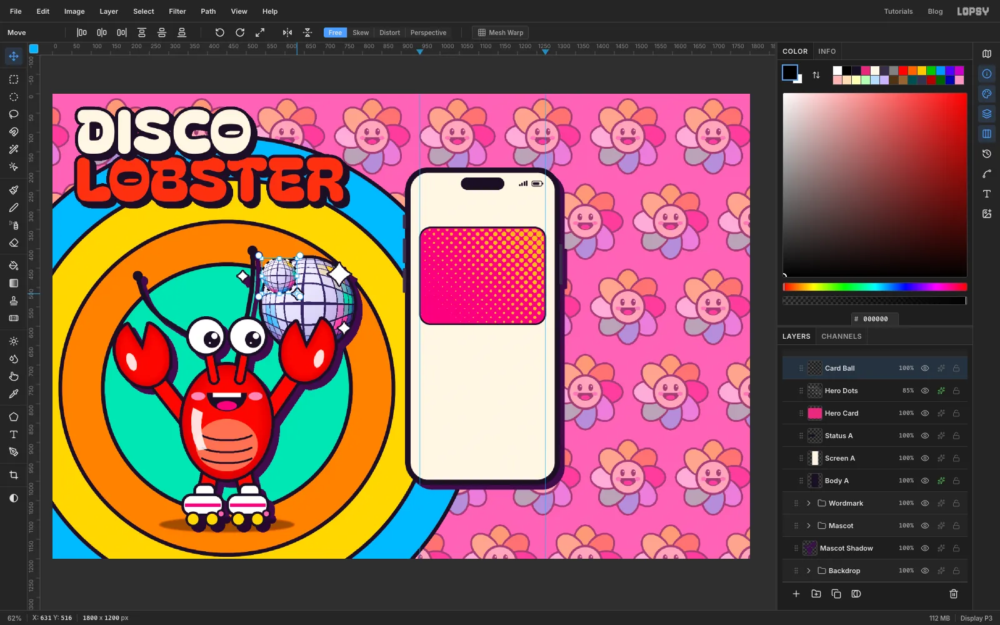

Expand `Mascot`, select `Disco Ball`, [[Cmd]]-click its thumbnail and press [[Cmd+C]]. Collapse `Mascot`, click `Hero Dots` and press [[Cmd+V]]. The copy lands on top of the original with the Move tool active. Rename it `Card Ball`. Hold [[Cmd]] and drag the bottom-right corner handle inwards until the ball is about 90 px across, then press [[Cmd+D]] to commit. Drag it into the card's top-right corner, about 16 px in from each edge, and give it a 4 px **Stroke**. The copy doesn't bring the original's effects with it, so you need to add the stroke again.

## Add chips, cards and a tab bar

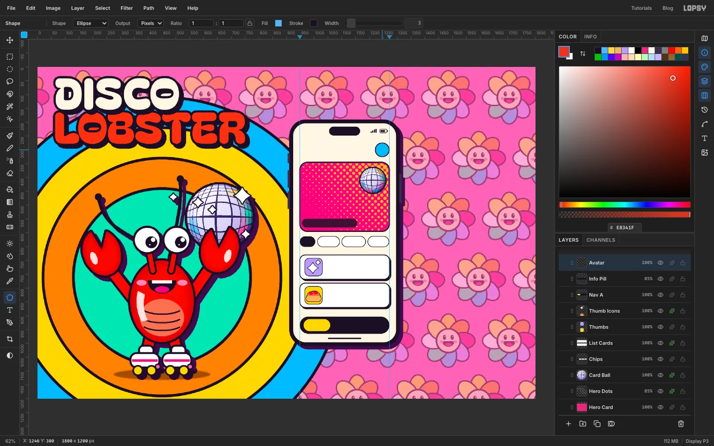

Keep to the guides for the left and right edges, and use the Shape tool for every piece:

- **Chips:** on a layer called `Chips`, a row of 38 px tall pills (radius 19) centred on y 632, starting at the left guide. The first is a 56 px wide ink pill with no stroke. Then add white pills 80, 86 and 76 px wide with a 2 px ink stroke, leaving 8 px gaps.
- **List Cards:** on a layer called `List Cards`, two white **324 × 88** rectangles, radius 20, with a 3 px stroke, centred at `y 724` and `y 826`. Give the layer an ink **Drop Shadow** with offsets of **5**, **Blur 1** and **Opacity 100**.
- **Thumbs:** on a layer called `Thumbs`, a 64 × 64 square with radius 16 and a 2 px stroke centred at x 998 on each card, in lilac `#B79CFF` and yellow.
- **Thumb Icons:** on a layer called `Thumb Icons`, lasso a white four-point sparkle for the skate party. For the lobster roll, stack a mint oval (lettuce), a coral `#FF6B5A` mound with two red chunks, and a 54 × 20 bun-coloured `#F2B562` rounded bar in front. Add a 2 px **Stroke**.
- **Nav A:** on a layer called `Nav A`, with no stroke, a **324 × 62** ink pill at `y 934`, a 96 × 44 yellow pill on its left end, and a 120 × 5 home indicator near the bottom of the screen.
- **Info Pill:** on a layer called `Info Pill`, a 200 × 32 ink pill with no stroke at `1056, 565`, at **85%** opacity. It gives the event line a calm plate on top of the dots.
- **Avatar:** on a layer called `Avatar`, switch to **Ellipse** and make a 50 px sky-blue circle with a 3 px stroke at `1246, 300`.

## Type the home screen

Click the `Phone A` group row before each new piece of text, so the Text options don't restyle the last text layer. Work from the bottom of the screen up, so each click lands in empty space rather than inside an existing line.

- **Tab bar:** `Home` in **Fredoka SemiBold 16**, ink, **Align Center** on the yellow pill. Then `♪`, `♥` and `★` in cream at 24 px, spaced along the bar.
- **Cards:** the title in **Fredoka SemiBold 21**, the time below it in **DM Sans Medium 15** in muted purple `#7A5C8C`, and the price in **Fredoka Bold 24** magenta with **Align Right**, lined up on the right guide. The cards read `Glitter Skate`, `7:00 PM · Rink A`, `$8` and `Lobster Rolls`, `8:30 PM · Patio`, `$14`.
- **Chips:** **Fredoka Medium 16**, centred: `All` in cream, then `Skate`, `Snacks` and `Music` in ink.
- **Hero card:** `Fri · 9 PM · DJ Clawdia` in **Fredoka SemiBold 18** cream, centred on the dark pill. Above it, `DISCO` in yellow and `ROLLER` in cream, both **Bagel Fat One 52** with a 5 px ink **Stroke**.
- **Header:** `Tonight` in **Fredoka Bold 44**, `Hey, skater!` above it in **Fredoka Medium 19** muted purple, `S` centred in the avatar, and `9:41` in **DM Sans Bold 17**.

Finally, collapse `Phone A`, select the group and, with the **Move** tool, press [[Shift+Left]] twice. The whole phone slides 20 px left as one piece, which opens up a gap for the second phone.

## Build the skate-rental phone

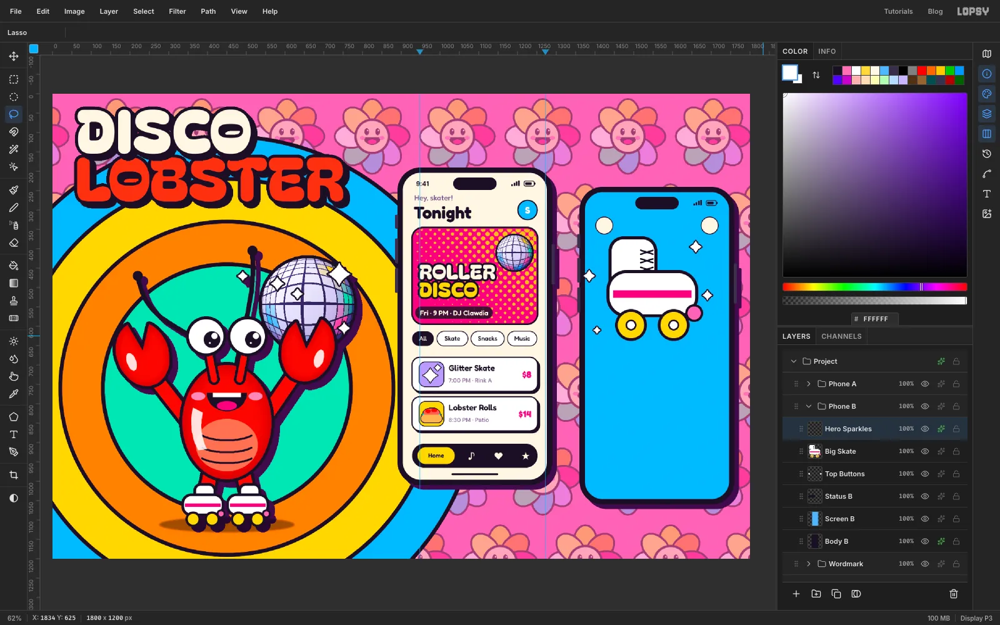

Collapse `Phone A`, click the `Wordmark` row and make a new group called `Phone B`. Because it sits below `Phone A` in the stack, the first phone overlaps it. Build it at `1560, 650` the same way as Phone A: a body with a 12 px plum drop shadow, a sky-blue `#4FB7FF` screen, the status bar, and two 44 px cream circles with 2 px strokes for the back and favourite buttons.

The hero is a big skate made from the same parts as the mascot's, at about twice the size, on a layer called `Big Skate`. It faces right, so the toe stop is on the right and the tall shaft is at the heel on the left. That shaft is what makes it read as a boot rather than a car:

- A **118 × 156** shaft with radius 34, centred on `1498, 450`.
- A **229 × 114** foot with radius 48, centred on `1548, 516`. Both are white with 8 px ink strokes.
- A **202 × 20** magenta stripe across the middle of the foot.
- Two **75 px** yellow wheels with 7 px strokes, at `1493, 597` and `1603, 597`, with 24 px white hubs.
- A **40 px** pink toe stop at `1656, 566`.

Draw the laces as small ink crosses with a 5 px brush. On a layer called `Hero Sparkles`, scatter a few white sparkles in the empty corners, clear of the skate, and give them a 3 px **Stroke**.

## Clip a bottom sheet to the screen

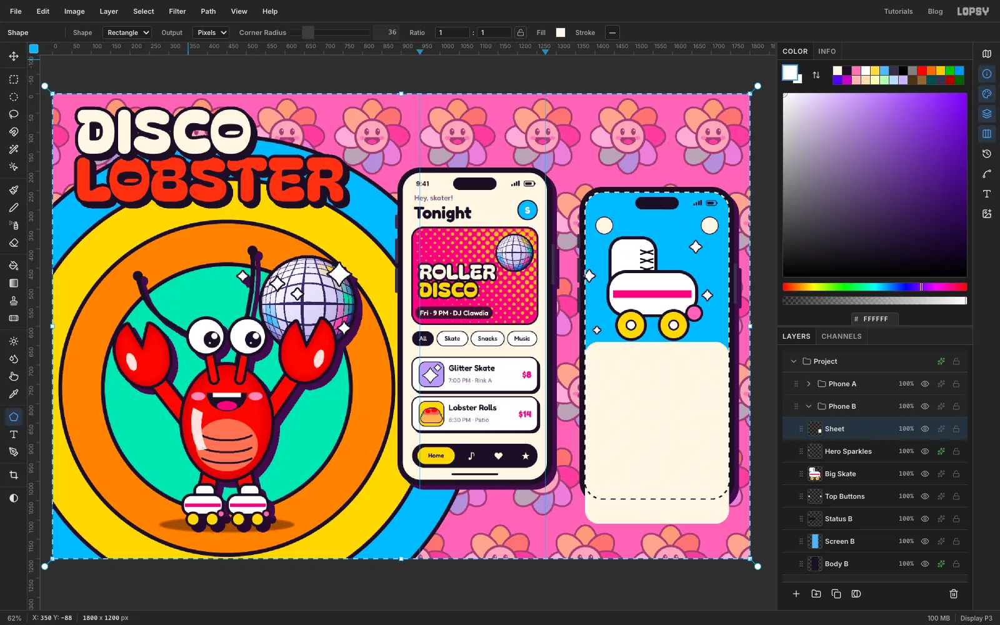

Next, add a bottom sheet, clipped to the screen:

1. On a layer called `Sheet`, click-create a **372 × 470** cream rectangle with radius 36, centred about 225 px below the middle of the phone. Its bottom hangs past the screen.
2. [[Cmd]]-click the `Screen B` thumbnail, select `Sheet`, and choose **Select → Inverse**. Now everything outside the screen is selected.
3. Press [[Delete]] to trim the sheet to the screen's rounded corners, then deselect. Add a small 48 × 5 grab handle in pale lilac `#C9B8D8` at the top of the sheet, on the same layer.

## Add the size picker and button

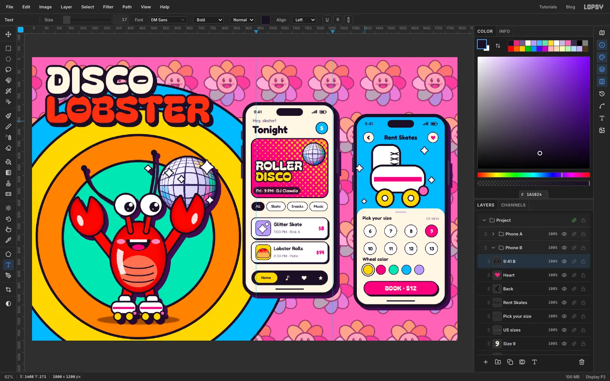

Fill the sheet with controls, leaving at least 20 px between rows:

- **Sizes:** on a layer called `Sizes`, eight 52 px white circles with 2 px strokes in two rows of four, 87 px apart, with 22 px between the rows. Fill size 9 with magenta.
- **Wheel Swatches:** on a layer called `Wheel Swatches`, five 40 px circles 54 px apart in yellow, magenta, mint, sky blue and lilac. Draw a 54 px outline-only ring around the yellow one to show it's selected.
- **CTA:** on a layer called `CTA`, a **312 × 58** magenta pill with a 3 px stroke and a 5 px hard ink shadow. It's the same width as the size grid, so the edges line up.

For the type, use **Fredoka SemiBold 20** for `Pick your size` and `Wheel color`, with `US sizes` in **DM Sans** muted purple on the right. Centre each size number in its circle in **Fredoka SemiBold 21**, cream on the selected one. Set `BOOK · $12` in **Bagel Fat One 26** in cream, centred on the button, and `Rent Skates` in **Fredoka Bold 26** at the top. Add a `‹` and a magenta `♥` in the two round buttons.

## Tilt the phone as one group

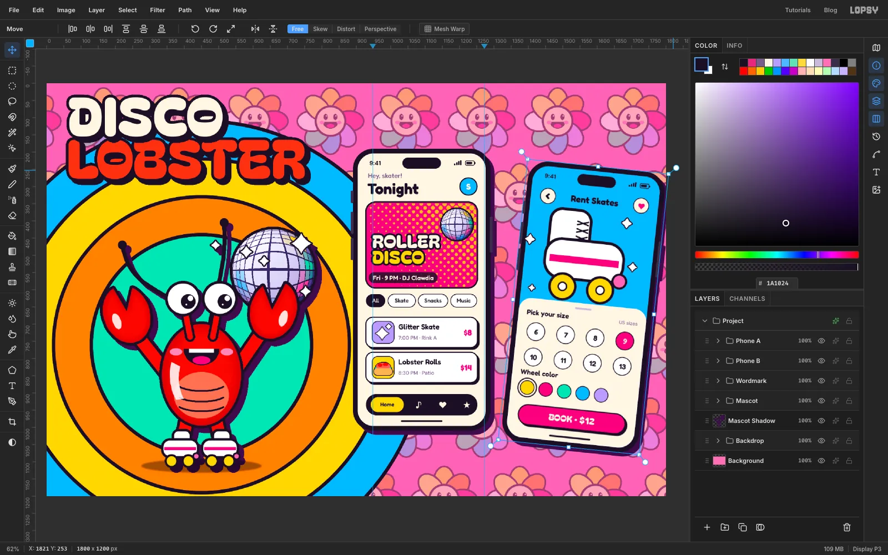

Collapse `Phone B` and click its row. With the **Move** tool, the transform box wraps the whole group. Hover just outside the top-right corner until the cursor turns into the rotate arrow, then drag clockwise about **6°**. Press [[Cmd+D]] to commit. The body, screen, shapes and live text all turn together, and the text stays editable.

## Draw a starburst badge

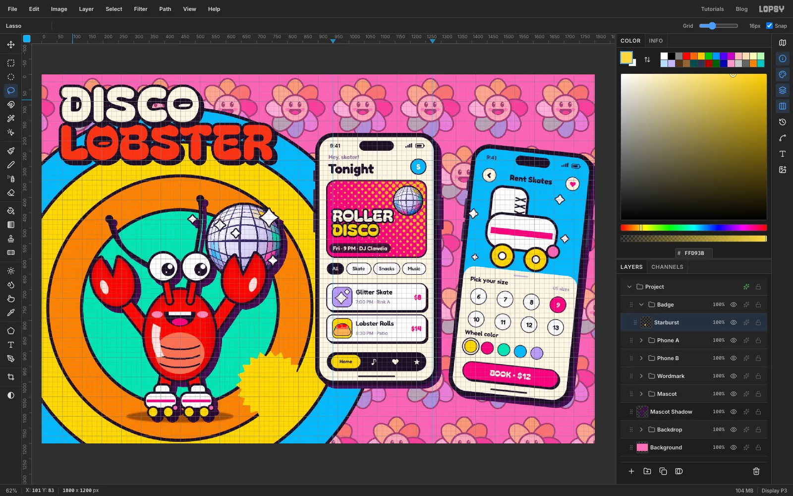

Collapse the phone groups, click `Phone A` and make a group called `Badge` on top. Turn on **View → Show Grid** to help you space the points evenly.

On a layer called `Starburst`, drag the **Lasso** round in a zig-zag centred on `745, 1010`. Go out to a point about 112 px from the centre and back in to about 94 px, twenty times, and close the loop. It doesn't have to be perfect, because the thick outline hides small wobbles. Fill it with yellow. Turn the grid off. Then give the layer an ink **Stroke** of **8** and a plum **Drop Shadow** with offsets of **9**, **Blur 1** and **Opacity 100**.

Set `TAPS!`, `IN 3` and `BOOK` in **Bagel Fat One 36** in ink, with **Align Center** on the star's centre line. Do the bottom line first so each new click lands in clear space, and click the `Badge` row before each one.

## Tilt the badge

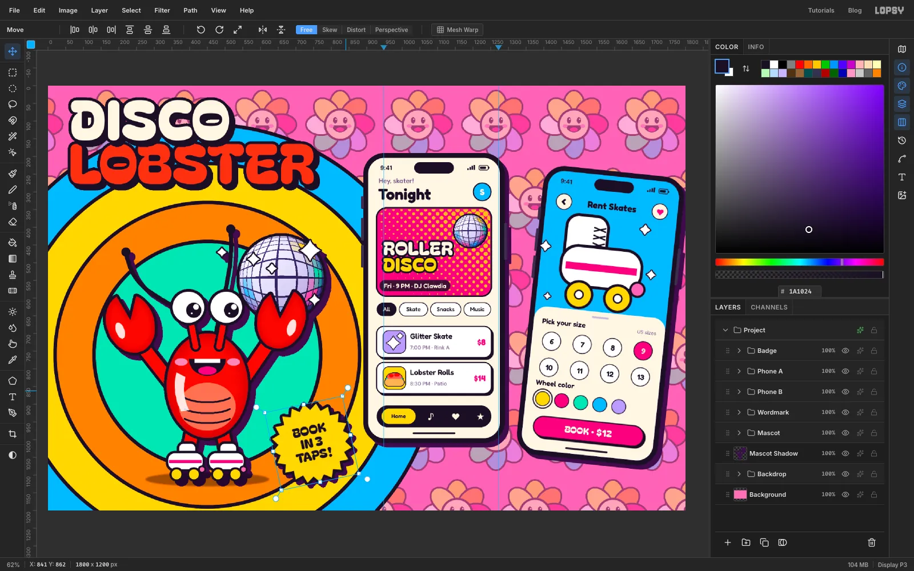

Collapse `Badge`, select the group, and rotate it about **12°** counter-clockwise with the corner handle, like you did with the phone. Press [[Cmd+D]] to commit. Keep the starburst at least 20 px clear of the phone's bezel. Near-misses look like mistakes.

## Finish and export

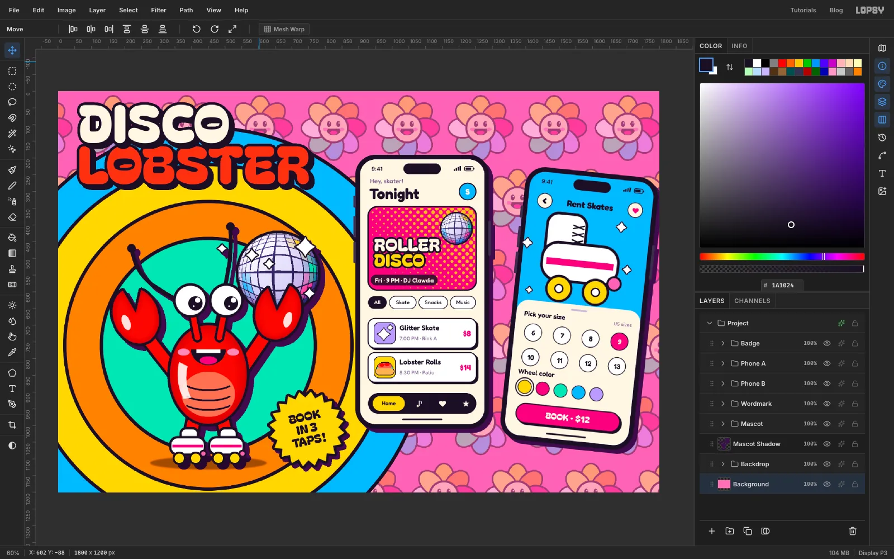

Turn off **View → Show Guides**, choose **View → Fit to Screen**, and look over the board as a whole. The hierarchy should run title, then mascot, then phones, with the softened wallpaper staying behind everything. Choose **File → Quick Export PNG** for the final image, and **File → Save Project** to keep the layered file.

For more UI mockups, try the [grunge record store app](/tutorials/grunge-record-store-app-mockup/) or the [technical illustration landing page](/tutorials/technical-illustration-website-landing-page/).
