Neo-pop is pop art after the 1980s: flat, loud colour, heavy black outlines, cartoon mascots, smiling flowers, and the glossy, blown-up shine of a balloon sculpture. It's sweet and a little unsettling at the same time, which makes it perfect for a restaurant that wants to be remembered. In this tutorial you'll design the landing page for **Ultra Uni**, a made-up twelve-seat sea-urchin bar, as a 1440 × 2160 px desktop comp.

The page has five parts, top to bottom: a cream **nav bar**, a pink **hero** with the mascot Uni-chan, a tilted **ticker band**, a **menu** of three cards and a cobalt **footer**. You'll build the mascot and the flowers by hand, then set the type on top.

Along the way you'll use:

- **guides**, the **exact-corners dialog** for marquees, **Edit → Fill** and **Select → Shrink**
- the **Brush** with **Radial Symmetry** and **Taper**, the **Pencil** with [[Shift]]-click lines, and the **Eraser**
- the **Lasso** and the marquees with add, subtract and intersect ([[Shift]], [[Alt]] and [[Shift+Alt]])
- **Filter → Sunburst**, **Edit → Define Pattern** and **Fill with Pattern**
- the **Shape** tool for discs, pill buttons and cards with rounded corners
- **Stroke**, **Drop Shadow** and **Inner Glow** effects
- **groups**, a **group move**, copy and paste, scaling with [[Cmd]]-drag and rotating with the **Move** tool
- text in **Titan One**, **Lilita One**, **Mochiy Pop One** and **Space Mono**, centred inside shapes and rotated

The palette:

- Hero pink `#FF5AA5`, ray pink `#FF84BF`, cream `#FFF4E2`
- Urchin violet `#7B3CC0`, dark spines `#4A1A86`, light spines `#A56BE6`, rim light `#C7A8FF`
- Sun yellow `#FFE14D`, uni orange `#FF9A1F`, grin red `#E8193C`
- Mint `#5BE3C4`, cobalt `#2B3BFF`, ink `#1B0B2E`
- Nori `#22382C`, crust `#C9782F`, brioche `#F7D38A`

> **Tip:** Positions are written as `x, y` in document pixels. The status bar at the bottom of the window shows where the cursor is, so you can hover to find a spot. Key names are Mac keys. On Windows and Linux, use Ctrl for Cmd. Every outline on this page is ink `#1B0B2E`, so set it once in your swatches and you'll reach for it constantly. Lopsy names a new text layer after its words. This tutorial renames each one (double-click the name) so the Layers panel stays readable, and later steps refer to those names.

## Set up the page and the hero band

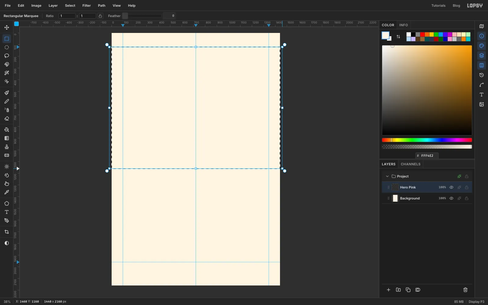

Choose **File → New**, set the size to **1440 × 2160** px and click **Create**. Click the `Background` row, set the foreground to `#FFF4E2` and choose **Edit → Fill**.

Drop the guides. Click the top ruler at **96**, **720** and **1344**: the two outer ones are the page margins and the middle one is the centre line. Then click the left ruler at **120** (bottom of the nav bar), **1160** (bottom of the hero) and **1960** (top of the footer).

Double-click `Layer 1`'s name and rename it `Hero Pink`. Pick the **Rectangular Marquee** (**M**) and drag from just off the left edge on the **120** guide to just off the right edge on the **1160** guide. Set the foreground to `#FF5AA5` and choose **Edit → Fill**. Keep the selection.

## Paint the sunburst

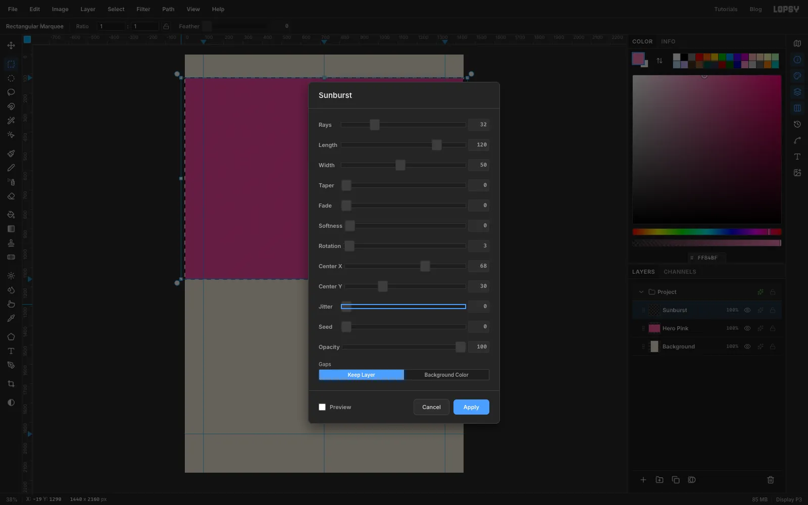

Click **Add Layer** at the bottom of the Layers panel and name the new layer `Sunburst`. Set the foreground to `#FF84BF`, a lighter pink. Sunburst paints in the foreground colour.

Choose **Filter → Sunburst…** and set:

- **Rays** `32`, **Length** `120`, **Width** `50`, **Taper** `0`, **Rotation** `3`
- **Center X** `68` and **Center Y** `30`, so the rays burst from about **980, 648**, where the mascot's face will go

Click **Apply** and press [[Cmd+D]]. The selection you kept confines the rays to the hero.

## Lay in the ticker band, footer and rules

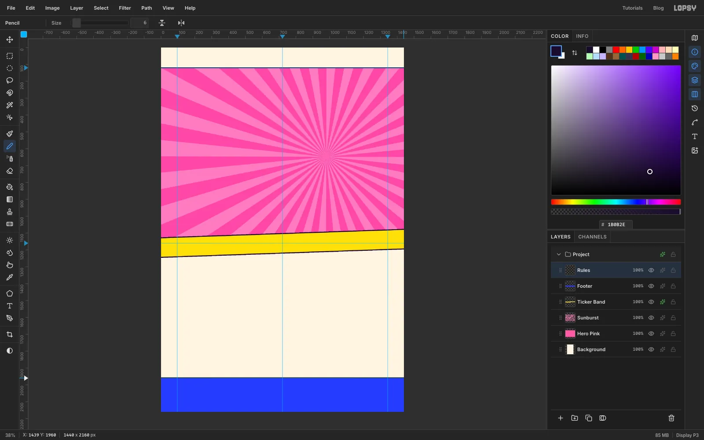

Click **Add Layer** and name it `Ticker Band`. Pick the **Lasso** (**L**) and drag around a long band about **110** px deep that runs off both sides of the page and rises gently to the right: its top edge goes from about **y 1132** at the left edge to **y 1080** at the right, and its bottom edge from **y 1242** to **y 1190**. It crosses the bottom of the hero. Lasso slowly along each edge and it'll come out nearly straight. Fill it with `#FFE14D` and press [[Cmd+D]].

Click the **✦** button on the `Ticker Band` row to open the effects drawer, tick **Stroke**, and set **Width** to `6` and the colour to ink `#1B0B2E`. Close the drawer.

Click **Add Layer** and name it `Footer`. Drag a marquee from the **1960** guide down past the bottom of the page and fill it with cobalt `#2B3BFF`.

Click **Add Layer** and name it `Rules`. Pick the **Pencil** (**N**) at **Size** `6`, set the foreground to ink, click the left edge on the **120** guide and [[Shift]]-click the right edge. Do the same along the **1960** guide.

## Start the mascot with a halo and dark spines

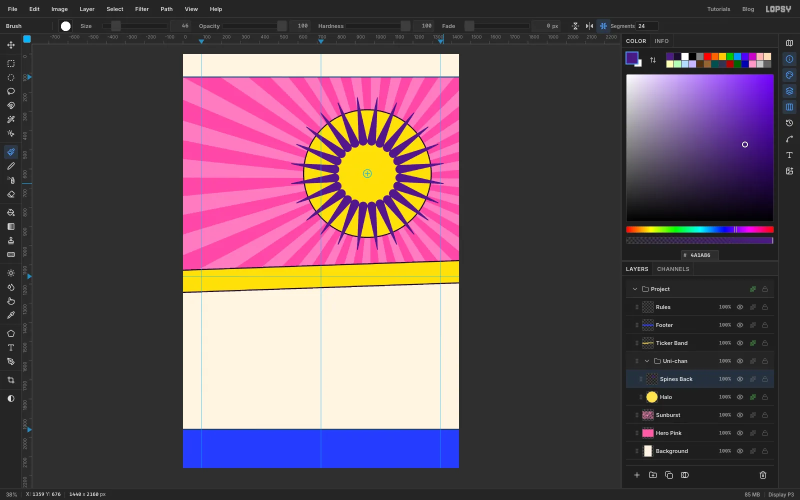

Uni-chan lives in a group. You'll draw him a little up and left of the ray centre, then nudge the whole group into place at the end.

Click the `Sunburst` row, then **New Group**, and name it `Uni-chan`. With the group selected, click **Add Layer** and name the layer `Halo`. New layers go inside the selected group.

Press [[Cmd+D]], pick the **Elliptical Marquee** and click once on the canvas without dragging. The **exact-corners dialog** opens. Type **From** `632, 294` **to** `1292, 954` and press [[Enter]]. Fill the circle with `#FFE14D`, press [[Cmd+D]] and give `Halo` a **Stroke** of **Width** `6` in ink.

Click **Add Layer** and name it `Spines Back`. Pick the **Brush** (**B**) and set **Size** `46` and **Hardness** `100`. Open the brush settings and on the **Shape** tab set **Taper** to `260` and **Spacing** to `2`. Taper shrinks the brush as the stroke goes on, so each spine starts thick and ends in a point.

Turn on **Radial Symmetry** in the options bar and set the segments to `24`. [[Cmd]]-click at **962, 624** to put the symmetry centre in the middle of the halo. Set the foreground to `#4A1A86`. Click at **1131, 646**, then [[Shift]]-click at **1359, 676**. That draws one spine from near the centre outwards, and symmetry repeats it 24 times around the circle.

## Add the light spines

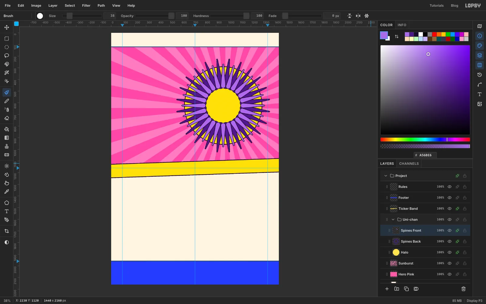

Click **Add Layer** and name it `Spines Front`. Set the brush **Size** to `38`, **Taper** to `230` and the foreground to `#A56BE6`. Click at **1132, 624** and [[Shift]]-click at **1314, 624**. These spines sit halfway between the dark ones and stop short of them, so you get two rows.

Turn **Radial Symmetry** off and set **Taper** back to `0`, or it will surprise you on the next stroke.

Give both spine layers a **Stroke** of **Width** `4` in ink. The thinner line keeps the spines spiky rather than chunky.

## Make the body a glossy ball

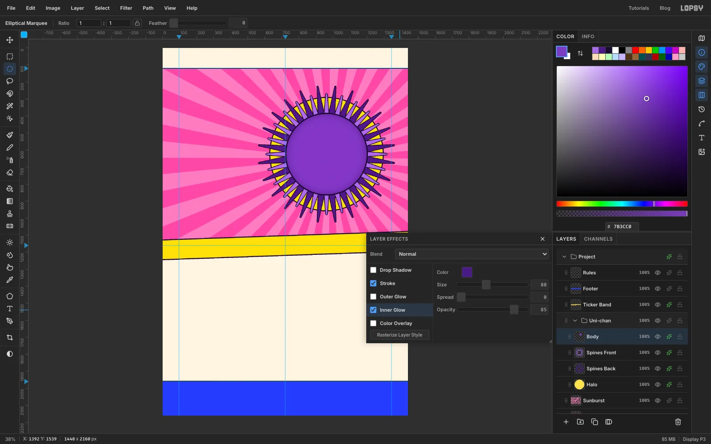

Click **Add Layer** and name it `Body`. In the exact-corners dialog make a circle **from** `726, 388` **to** `1198, 860`, fill it with `#7B3CC0` and press [[Cmd+D]].

Open the effects drawer. Add a **Stroke** of **Width** `7` in ink. Then tick **Inner Glow** and set **Size** `80`, **Spread** `0`, **Opacity** `85` and the colour to `#4A1A86`. A dark inner glow shades the edge of the disc, so it reads as a ball rather than a flat circle. Close the drawer.

## Add a rim light

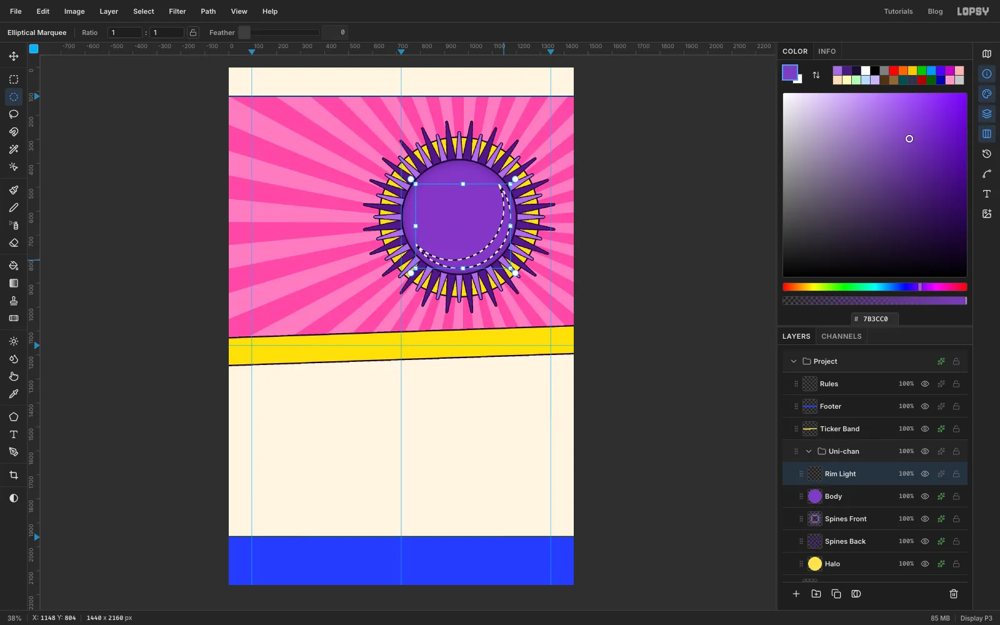

Click **Add Layer** and name it `Rim Light`. With the **Elliptical Marquee**, drag a circle about **428** px across centred on the middle of the body, from about **748, 410** to **1176, 838**. Then hold [[Alt]] and drag a slightly bigger circle shifted up and left, from about **708, 364** to **1148, 804**. Alt subtracts it, which leaves a crescent along the lower right.

Fill the crescent with `#C7A8FF`, press [[Cmd+D]] and set the layer's opacity to `70`%. Light bouncing up into the underside of a shiny ball is half of what makes it look glossy.

## Add the Koons shine

The other half is a hard, bright highlight. Click **Add Layer** and name it `Gloss`. With the **Lasso**, draw a tilted oval about **160 × 76** px at the top left of the ball, centred near **858, 502** and leaning about 35° the same way as the ball's curve. Switch to the **Elliptical Marquee**, hold [[Shift]] and drag two small circles: one from **923, 425** to **957, 459** and one from **784, 574** to **804, 594**.

Fill with white `#FFFFFF` and press [[Cmd+D]]. Keep the highlight crisp, without any blur. Neo-pop shine looks like a reflection on lacquer, not a soft glow.

## Draw the eyes

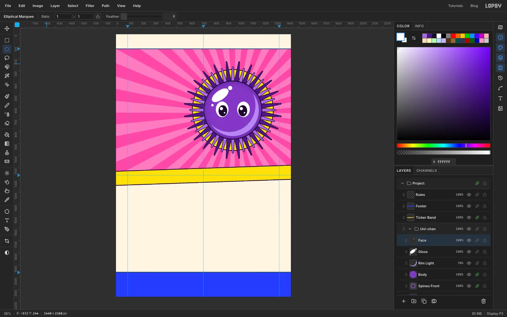

Click **Add Layer** and name it `Face`. With the **Elliptical Marquee**'s exact-corners dialog, fill each shape in turn, pressing [[Cmd+D]] and clicking once again between them:

1. White eyes: **From** `822, 554` **to** `926, 682`, and **from** `998, 554` **to** `1102, 682`
2. Ink pupils, a little lower and inwards: **from** `844, 584` **to** `916, 676`, and **from** `1008, 584` **to** `1080, 676`
3. White sparkles at the top left of each pupil: **from** `855, 599` **to** `881, 625`, and **from** `1019, 599` **to** `1045, 625`
4. Tiny white sparkles at the bottom right: **from** `888, 640` **to** `900, 652`, and **from** `1052, 640` **to** `1064, 652`

Two sparkles per eye, one big and one small, is the classic kawaii trick. It makes the eyes look wet and shiny.

## Cut a grin with an intersection

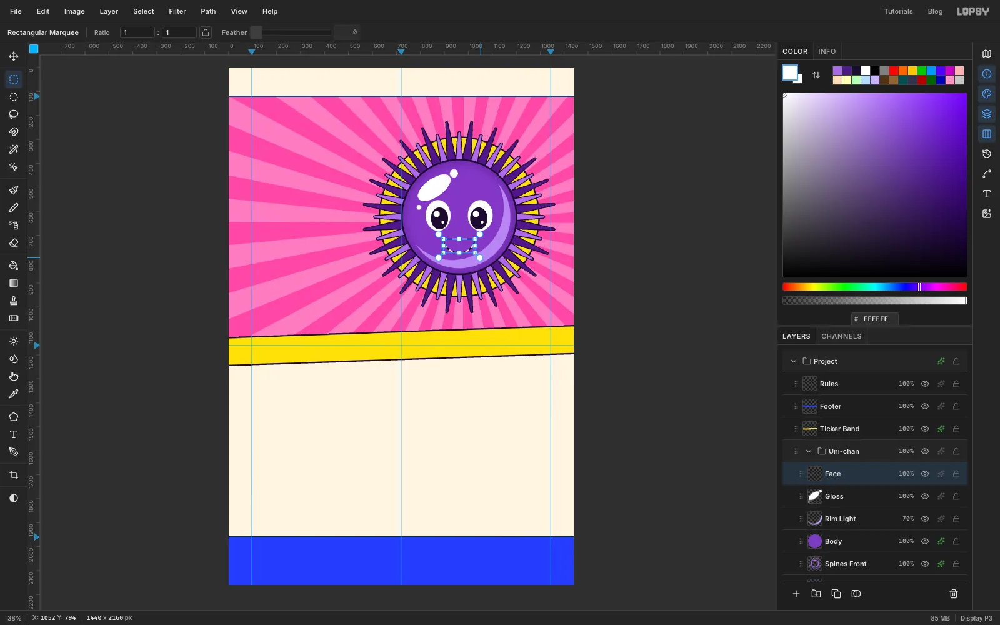

Still on `Face`, drag an elliptical marquee from **896, 658** to **1028, 774**. Switch to the **Rectangular Marquee** (**M**). The selection stays. Hold [[Shift]] and [[Alt]] together and drag a rectangle from **872, 716** down to **1052, 794**. Shift+Alt keeps only where the two overlap, which is the bottom half of the oval: a wide, open grin.

Fill it with ink. Choose **Select → Shrink…**, shrink by `7` and fill with red `#E8193C`, which leaves an ink lip all round. Switch back to the **Elliptical Marquee**, hold [[Shift]] and [[Alt]] again and drag a small oval from **922, 740** to **1002, 788**: that keeps only the part of the oval inside the mouth. Fill it with orange `#FF9A1F` for the tongue, and press [[Cmd+D]].

Give `Face` a **Stroke** of **Width** `5` in ink. It outlines the eyes and the mouth in one go.

## Add the blush

Click **Add Layer** and name it `Blush`. Fill two pink ovals in `#FF5AA5` just outside and below the eyes: **from** `760, 676` **to** `840, 720`, and **from** `1084, 676` **to** `1164, 720`. Press [[Cmd+D]].

Pick the **Pencil** at **Size** `5`, set the foreground to white and draw three short slashes across each cheek: click near the top right of a slash and [[Shift]]-click about 26 px down and to the left. Those manga-style hatch marks say "blushing" much louder than a soft pink blur would.

## Move the whole mascot into place

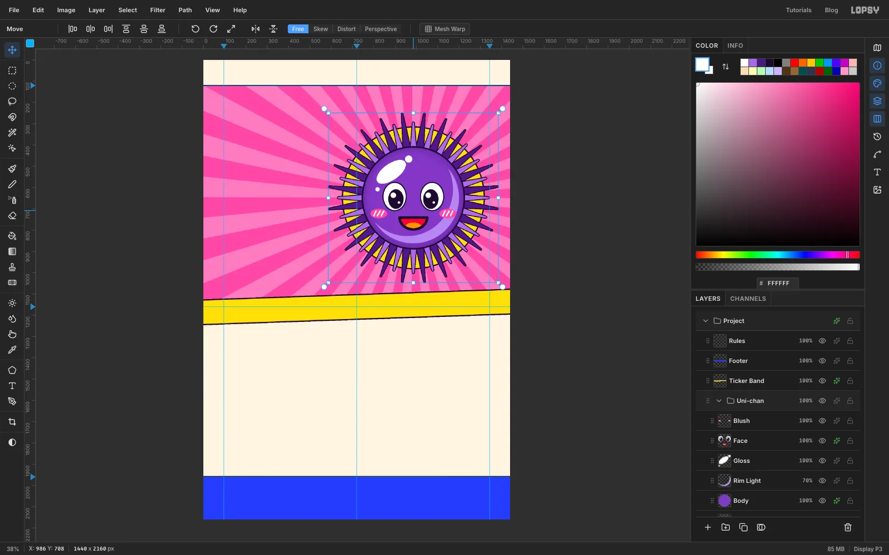

Click the `Uni-chan` **group** row in the Layers panel, so the group itself is selected rather than one of its layers. Pick the **Move** tool (**V**) and drag the mascot **24** px right and **24** px down. Every layer in the group moves together, so the body's centre now sits at **986, 648**, right where the sunburst rays meet.

Press [[Cmd+Z]] and [[Cmd+Shift+Z]] once each if you want to see it jump back and forth. Nothing inside the group shifts out of line.

## Paint the first smiling flower

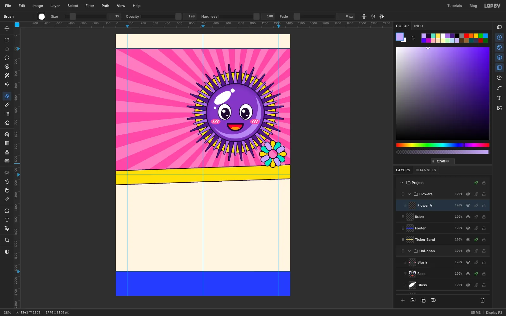

The flowers sit on top of everything, so click the `Rules` row, click **New Group** and name the group `Flowers`. Click **Add Layer** and name it `Flower A`.

Pick the **Brush** at **Hardness** `100`, turn on **Radial Symmetry** with `4` segments, and [[Cmd]]-click at **1296, 990** to set the centre. Each petal is two strokes on the same line, an ink one and then a slightly thinner coloured one on top, which leaves an outline:

1. At **Size** `50` in ink, click **1354, 990** and [[Shift]]-click **1386, 990**. Then at **Size** `39` in yellow `#FFE14D`, click and [[Shift]]-click the same two points.
2. Repeat on the line from **1346, 1019** to **1374, 1035** in mint `#5BE3C4`.
3. Repeat on the line from **1325, 1040** to **1341, 1068** in lilac `#C7A8FF`.

Each pass paints four petals 90° apart, so three passes give twelve. Each pass overlaps the previous one a little, so the petals look tucked under each other. Turn **Radial Symmetry** off when you're done.

## Give the flower a face

With the exact-corners dialog, fill an ink circle **from** `1246, 940` **to** `1346, 1040`. Choose **Select → Shrink…**, shrink by `6` and fill with white. Press [[Cmd+D]] and fill two tiny ink ovals for eyes, **from** `1275, 972` **to** `1287, 990` and **from** `1305, 972` **to** `1317, 990`.

The smile uses the same trick as Uni-chan's grin. Drag an elliptical marquee from **1274, 979** to **1318, 1017**. Switch to the **Rectangular Marquee**, hold [[Shift]] and [[Alt]] and drag from **1266, 998** to **1326, 1038**, which keeps the bottom half of the oval. Fill with ink, shrink by `3` and fill with red. Press [[Cmd+D]] and add a **Stroke** of **Width** `3` in ink to `Flower A`.

## Paste and shrink a copy

With `Flower A` selected, drag a marquee just around the flower and press [[Cmd+C]], then [[Cmd+V]]. The copy is pasted in place on a new layer. Rename it `Flower B`.

Pasting doesn't leave a selection, so draw the marquee around the flower again. Switch to the **Move** tool, hold [[Cmd]] and drag the bottom-right handle up and left until the box is a bit over half its size (about **58%**). Holding Cmd keeps the proportions. Press [[Enter]], then [[Cmd+D]].

## Move and tilt the copy

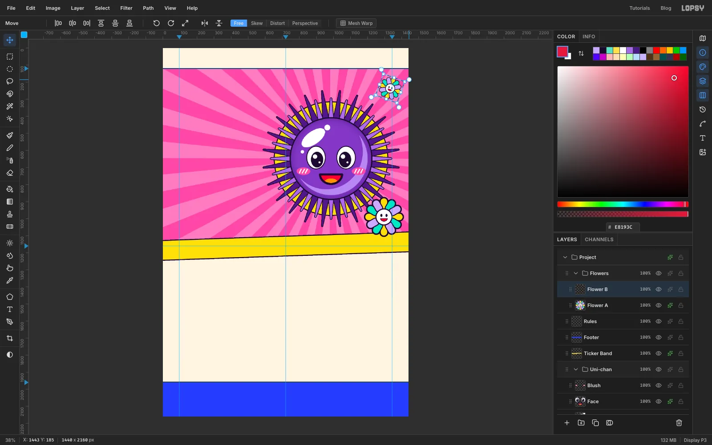

With the **Move** tool, drag the small flower to the top right of the hero, so it's centred near **1332, 236**. Draw a marquee around it again, then drag the round rotate handle just outside the top-right corner to turn it about **20°** clockwise. Press [[Enter]] and [[Cmd+D]]. Give `Flower B` its own **Stroke** of **Width** `3` in ink. Effects don't come across in a paste.

## Scatter four more flowers

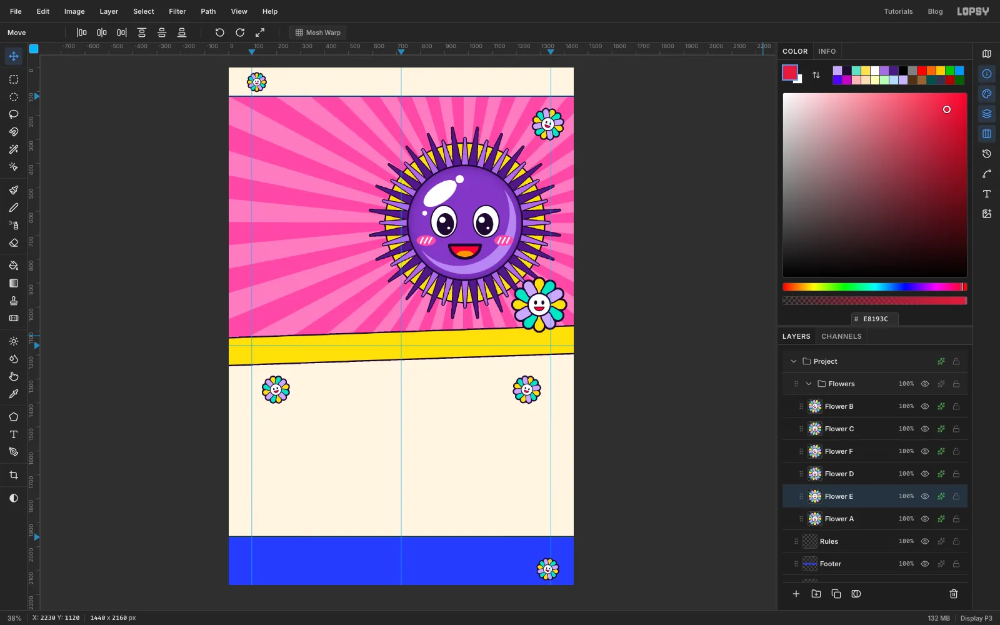

Repeat the copy, paste, scale, move and rotate steps four more times, always copying from `Flower A`, and give each copy its own **Stroke** of `3` in ink:

- `Flower C` at **50%**, turned about **−15°**, centred near **196, 1344** (left of where the menu heading will go)
- `Flower D` at **40%**, turned about **15°**, centred near **1330, 2094** in the footer
- `Flower E` at **34%**, not rotated, centred on **116, 60** in the nav bar, where it becomes the logo mark
- `Flower F` at **50%**, turned about **20°**, centred near **1244, 1344** (right of the menu heading)

Scale each copy *before* you move it towards the bottom or an edge. If a pasted copy hangs off the canvas when you press Enter, the part outside is cut off.

## Set the headline

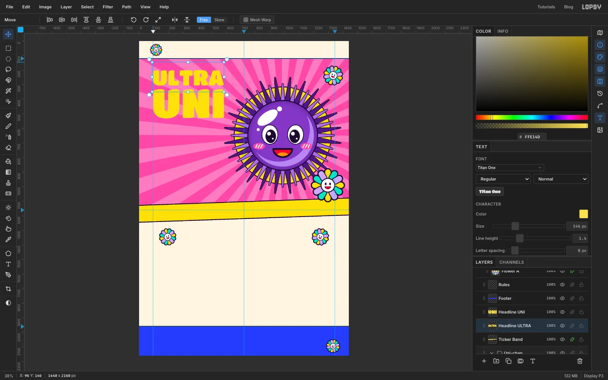

Click the `Ticker Band` row, a plain raster layer, before you make any type. If a text layer is selected, changing the font and size restyles that layer instead.

Pick the **Text** tool (**T**), choose **Titan One** at **Size** `280` and set the colour to `#FFE14D`. Click at about **96, 222** and type `UNI`, then press [[Tab]] to commit. Rename the layer `Headline UNI`. Click `Ticker Band` again, set the size to `146`, click at about **96, 146** and type `ULTRA`. Rename it `Headline ULTRA`. UNI goes first because the big word's text box is tall: ULTRA's click point sits above it, so it can't land inside UNI's box by accident.

Both words come out about **485** px wide, so they stack as a solid block. With the **Move** tool and the arrow keys ([[Shift]] moves 10 px), line up the left edge of both words with the **96** guide, put the top of `ULTRA`'s letters at **y 200** and the top of `UNI` at **y 330**.

## Outline the headline and drop a hard shadow

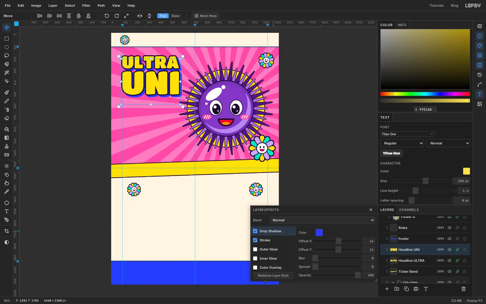

Click `Headline UNI` and open its effects drawer. Add a **Stroke** of **Width** `9` in ink. Then tick **Drop Shadow** and set **Offset X** `14`, **Offset Y** `14`, **Blur** `0`, **Spread** `0`, **Opacity** `100` and the colour to cobalt `#2B3BFF`. With zero blur the shadow becomes a solid offset block, like a sticker sitting on the page. Give `Headline ULTRA` the same two effects.

## Make the ウニ sticker

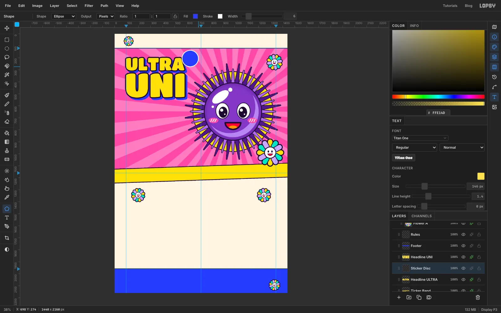

Click `Headline ULTRA`, then **Add Layer**, and name it `Sticker Disc`. Pick the **Shape** tool (**U**) and set **Shape** to **Ellipse** and **Output** to **Pixels**. Set the fill swatch to cobalt `#2B3BFF`, the stroke swatch to white with **Width** `6`. Shapes draw from the centre, so press at **630, 206** and drag to about **698, 274** for a circle **136** px across that overlaps the top corner of the **A**.

Give `Sticker Disc` a **Stroke** effect of **Width** `6` in ink, so it gets an ink ring outside the white one, like every other outline on the page.

## Rotate the katakana

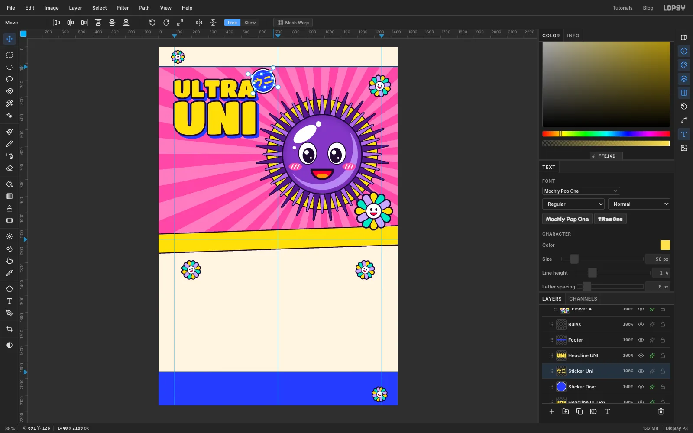

With `Sticker Disc` selected, pick the **Text** tool, choose **Mochiy Pop One** at **Size** `58`, **Align** centre, colour `#FFE14D`, click in the disc and type `ウニ` ("uni" in katakana). If you don't have a Japanese keyboard set up, copy it from this page and paste it with [[Cmd+V]]. Press [[Tab]] and rename the layer `Sticker Uni`.

Switch to the **Move** tool and nudge the letters with the arrow keys until they're centred in the disc, with equal space above and below. Then drag the rotate handle outside the text box's top-right corner about **14°** anticlockwise and press [[Enter]]. The text stays editable after rotating.

## Calm the rays behind the copy

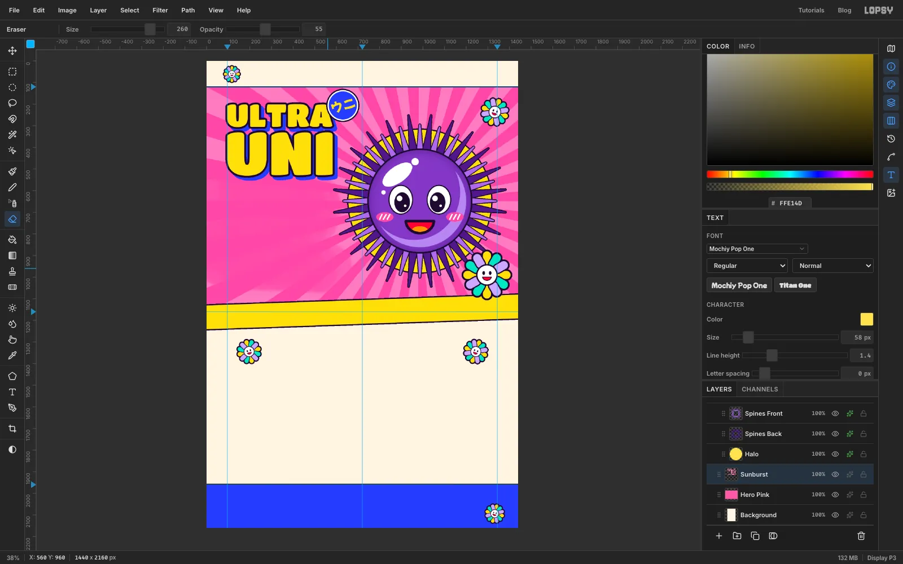

Small text on stripes is hard to read. Click `Sunburst`, pick the **Eraser** (**E**) and set **Size** `260` and **Opacity** `55`. In one stroke without letting go, zigzag across the left of the hero from about **y 600** to **y 960**, staying left of about **x 560**. The rays fade there, but don't disappear, so the hero still feels like one piece.

## Write the copy and add the buttons

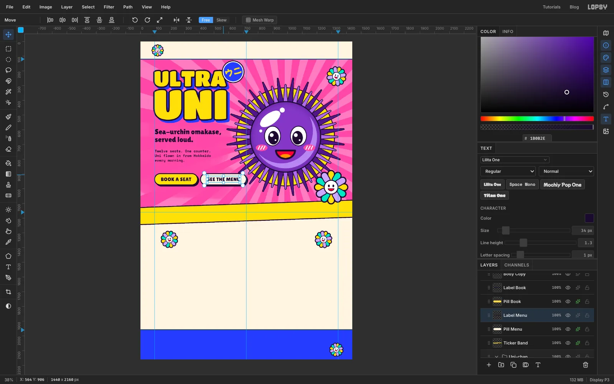

Click `Ticker Band`. With the **Text** tool in **Lilita One** at **Size** `50`, ink, click in empty space at about **96, 640** and type `Sea-urchin omakase,`, press [[Return]] and type `served loud.`. Don't click higher up: a click inside `UNI`'s text box edits the headline instead. Press [[Tab]], rename the layer `Subhead`, and in the **Text** panel set **Line height** to `1.05`. Move the block so its left edge sits on the **96** guide and its top at **y 594**.

Click `Ticker Band` again. In **Space Mono**, **Bold**, **Size** `24`, click at about **96, 780** and type `Twelve seats. One counter.` / `Uni flown in from Hokkaido` / `every morning.` on three lines. Rename it `Body Copy`, set **Line height** to `1.3`, and move it so its left edge is on the **96** guide and its top at **y 736**.

For each button, click `Ticker Band`, then **Add Layer**, name it `Pill Book` or `Pill Menu`. With the **Shape** tool on **Rectangle**, fill yellow for the first and cream for the second, stroke ink at **Width** `6`, **Corner Radius** `38`. Drag from the centre (**242, 936** for the first, **564, 936** for the second) out by **146** px across and **38** px down, giving pills **292 × 76** px. Give each pill a **Drop Shadow** of **8**, **8**, **Blur** `0`, **Opacity** `100` in ink.

With the pill layer selected, use **Lilita One** at **Size** `34`, **Align** centre, ink, **Letter spacing** `1`, and type `BOOK A SEAT` and `SEE THE MENU`. Rename them `Label Book` and `Label Menu`. Move each label so it's centred on its pill, the same distance from the top and bottom edges.

## Put a shine on the headline

Click `Headline UNI`, then **Add Layer**, and name it `Headline Gloss`. [[Cmd]]-click the `Headline ULTRA` thumbnail to select its letters, choose **Select → Shrink…** and shrink by `10`, so the shine stays inside the outline.

Pick the **Rectangular Marquee**, hold [[Shift]] and [[Alt]] and drag a rectangle across the whole word in a thin band near the top of the letters, from **y 215** to **y 225**. Only the parts of the letters inside the band stay selected. Fill with white and press [[Cmd+D]]. Do the same for `Headline UNI` with a band from **y 350** to **y 366**. Set the layer's opacity to `85`%.

## Add shine to the yellow button

Click `Label Book`, the top layer of the two buttons, then **Add Layer**, and name it `Button Gloss`. With the **Elliptical Marquee**, drag a thin streak inside the top left of the yellow pill, from **124, 906** to **192, 916**. Fill with white, press [[Cmd+D]] and set the layer to `80`%. Leave the cream button plain: white on cream wouldn't show, and one shiny button tells people which one to press.

## Run the ticker text along the band

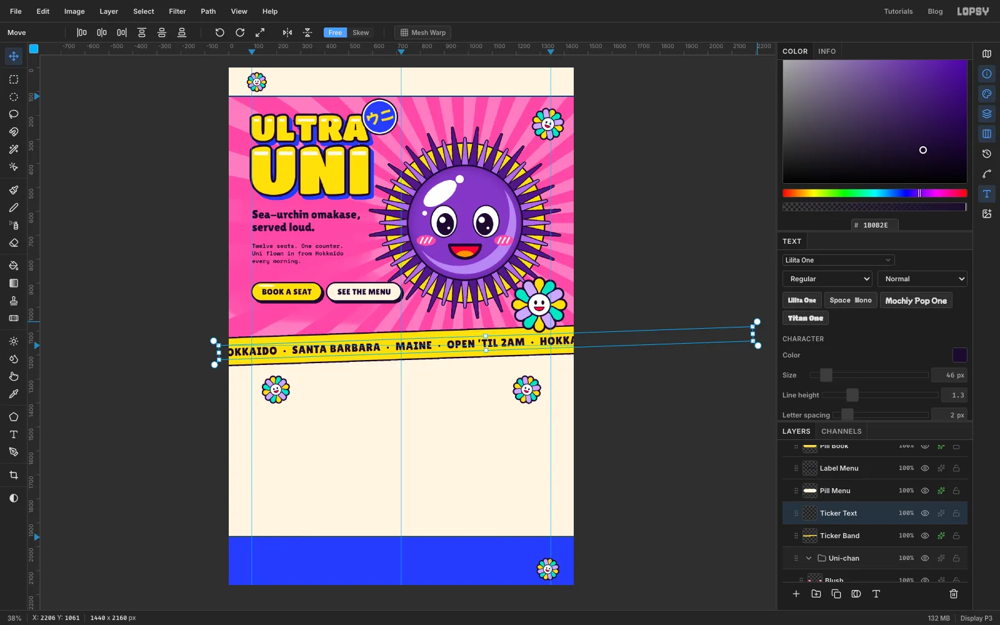

Click `Ticker Band`. In **Lilita One** at **Size** `46`, ink, **Letter spacing** `2`, click near the left end of the band and type:

`HOKKAIDO  •  SANTA BARBARA  •  MAINE  •  OPEN ’TIL 2AM  •  HOKKAIDO  •  SANTA BARBARA  •  MAINE`

It's much longer than the page, which is what you want. A ticker should look like it's sliding past. Rename the layer `Ticker Text`. Move the line so it starts about **40** px off the left edge and sits in the middle of the band. Then drag the text box's rotate handle about **2°** anticlockwise so the letters follow the band's slope, and press [[Enter]].

## Start the menu section

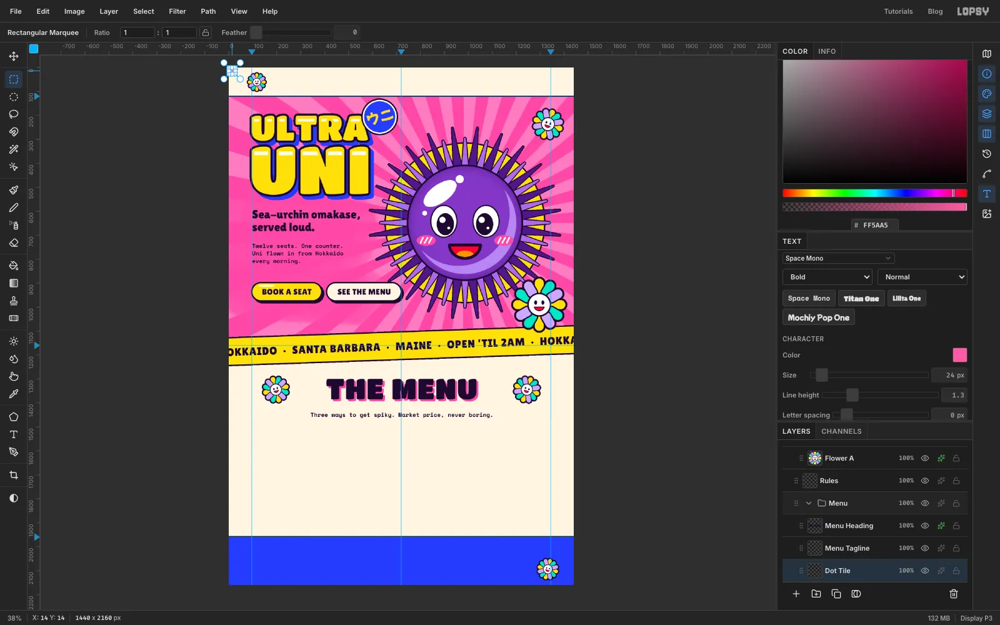

Click the `Footer` row, then **New Group**, and name the group `Menu`. Click **Add Layer** and name it `Menu Anchor`. It stays empty. You'll click it before making each piece of text, so the type always lands in the group.

With `Menu Anchor` selected, set **Titan One** at **Size** `120`, ink, **Align** centre, **Letter spacing** `2`, and type `THE MENU`. Rename it `Menu Heading` and centre it on the **720** guide with its top at **y 1300**, and give it a **Drop Shadow** of **8**, **8**, **Blur** `0` in hot pink `#FF5AA5`. Click `Menu Anchor` again and add a centred tagline in **Space Mono Bold** at `24`: `Three ways to get spiky. Market price, never boring.` with its top at **y 1440**.

Now make a pattern tile. Click **Add Layer** and name it `Dot Tile`. In the exact-corners dialog, fill a circle from **10, 10** to **18, 18** with hot pink `#FF5AA5`. Draw a marquee from **0, 0** to **28, 28** and choose **Edit → Define Pattern**. Press [[Cmd+D]] and delete the `Dot Tile` layer with the bin button. The pattern is saved, so you don't need the layer any more.

## Pour the dot pattern

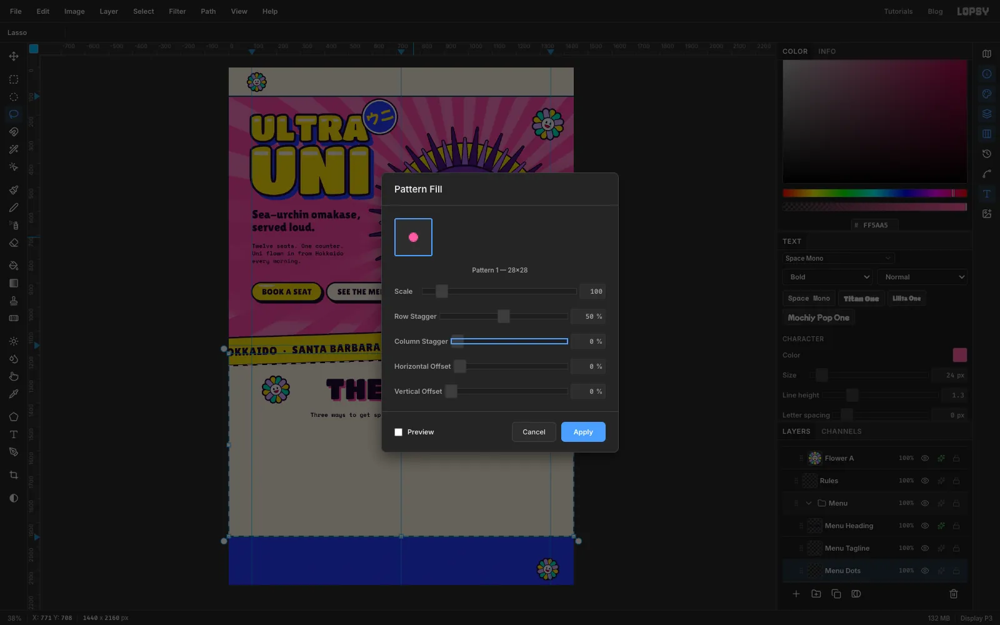

Click `Menu Anchor`, then **Add Layer**, and name it `Menu Dots`. With the **Lasso**, select the cream area between the ticker band and the footer, running off both sides of the page. Follow the band's bottom edge along the top, and run the bottom edge just above the **1960** guide.

Choose **Edit → Fill with Pattern…**, click your dot pattern and set **Row Stagger** to `50`, so every other row shifts half a tile, like a halftone screen. Click **Apply**, press [[Cmd+D]] and set the layer's opacity to `35`%. It gives the cream some texture without fighting the cards.

## Draw the three cards

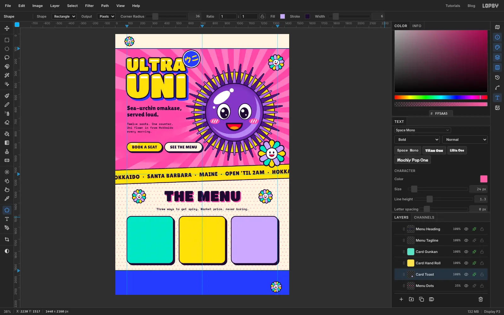

For each card, click `Menu Dots`, then **Add Layer**, and name it `Card Gunkan`, `Card Hand Roll` or `Card Toast`. Use the **Shape** tool on **Rectangle**, stroke ink at **Width** `6`, **Corner Radius** `36`, and fill mint `#5BE3C4`, yellow `#FFE14D` and lilac `#C7A8FF`.

The cards are **384 × 390** px with **48** px gutters, centred on **288**, **720** and **1152** at **y 1705**. Drag each from its centre **192** px across and **195** px down. The outer cards' edges snap to the **96** and **1344** margin guides, which keeps the grid honest. Give each card a **Drop Shadow** of **12**, **12**, **Blur** `0`, **Opacity** `100` in ink.

## Draw the gunkan

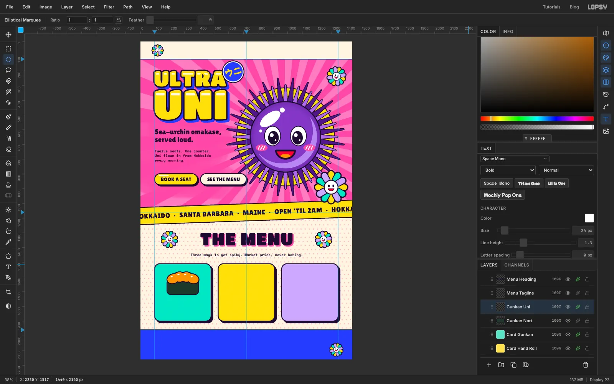

Click `Card Gunkan`, then **Add Layer**, and name it `Gunkan Nori`. With the **Shape** tool, draw a rounded rectangle in nori green `#22382C` with an ink stroke of `6` and **Corner Radius** `28`, centred on **288, 1668**, **216 × 104** px.

Click **Add Layer** and name it `Gunkan Uni`. Uni comes in soft tongue-shaped lobes. With the **Lasso**, draw four ovals about **80 × 60** px side by side along the top of the nori, centred around **y 1600–1612**, holding [[Shift]] from the second one on to add them. Tilt the outer two outwards a little. Fill with orange `#FF9A1F` and press [[Cmd+D]]. Then, with the **Elliptical Marquee** and [[Shift]], drag a small oval about **14 × 10** px near the top left of each lobe and fill them white. Press [[Cmd+D]] and give the layer a **Stroke** of `6` in ink.

## Draw the hand roll and start the toast

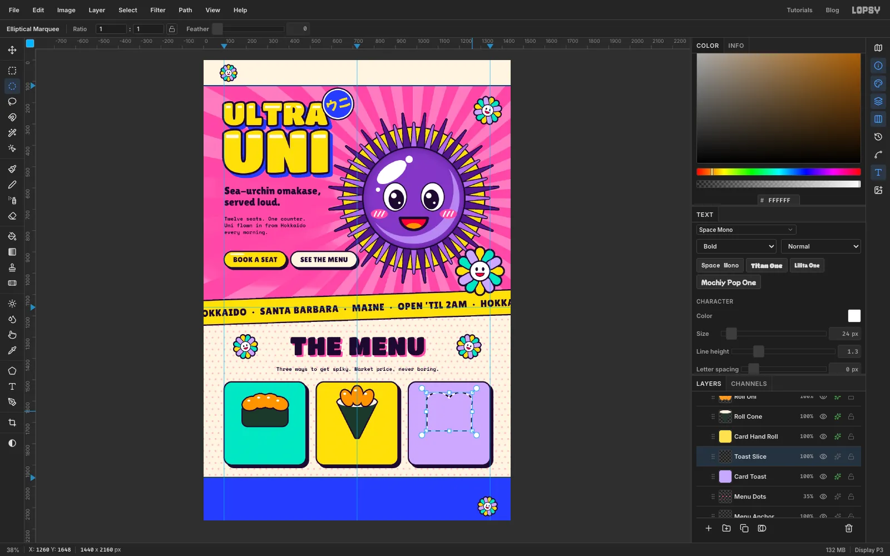

Click `Card Hand Roll`, then **Add Layer**, and name it `Roll Cone`. With the **Lasso**, draw a cone about **184** px wide at **y 1604**, centred on the card, narrowing to a blunt tip about **16** px wide at **y 1772**. Fill with nori green. Then, with the exact-corners dialog, fill an ellipse **from** `628, 1580` **to** `812, 1628` with cream for the rice. Press [[Cmd+D]] and add a **Stroke** of `6` in ink.

Click **Add Layer** and name it `Roll Uni`. With the **Lasso**, holding [[Shift]] from the second one on, draw three tall lobes fanning out of the rice: a centre one about **52 × 88** px standing straight at **720, 1574**, and two about **48 × 80** px leaning out on either side at **672, 1586** and **768, 1586**. Fill with orange and press [[Cmd+D]]. Add a small white oval near the top left of each lobe, as on the gunkan, and a **Stroke** of `6` in ink. Keep the tops of the lobes inside the card, below its top edge.

Now the toast. Click `Card Toast`, then **Add Layer**, and name it `Toast Slice`. Drag a rectangle marquee from **1048, 1600** to **1256, 1740**. Hold [[Shift]] and drag two ellipses **112 × 88** px centred on **1100, 1604** and **1204, 1604**. Added together they make the domed top of a slice of bread.

## Finish the toast

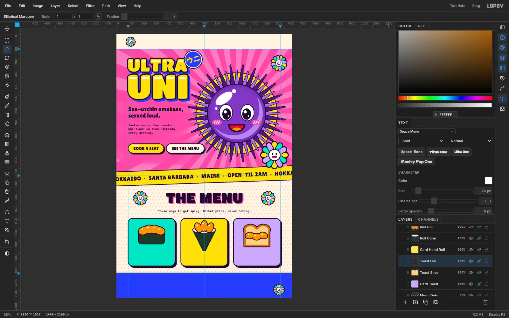

Fill the selection with crust `#C9782F`, choose **Select → Shrink…**, shrink by `14` and fill with brioche `#F7D38A`. The crust is what's left of the first fill. Press [[Cmd+D]] and add a **Stroke** of `6` in ink.

On a new layer `Toast Uni`, lay three orange lobes about **68 × 50** px across the toast at around **y 1650–1660**, each tilted a little differently, with a gloss dot on each and the same ink stroke as the other foods.

## Name and price the dishes

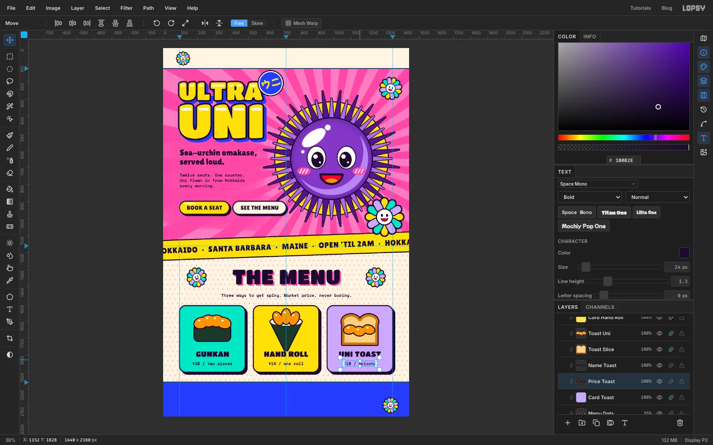

For each card, click the card's layer and add two lines of text, both centred on the card. Name the layers after the card, like `Name Hand Roll` and `Price Hand Roll`:

- The name in **Titan One** at **Size** `44`, **Letter spacing** `1`: `GUNKAN`, `HAND ROLL`, `UNI TOAST`, with the top of the letters at **y 1778**
- The price in **Space Mono Bold** at `24`: `$16 / two pieces`, `$14 / one roll`, `$19 / brioche`, top at **y 1838**

That leaves about **36** px between the price and the bottom of the card.

## Add a Chef's Pick starburst

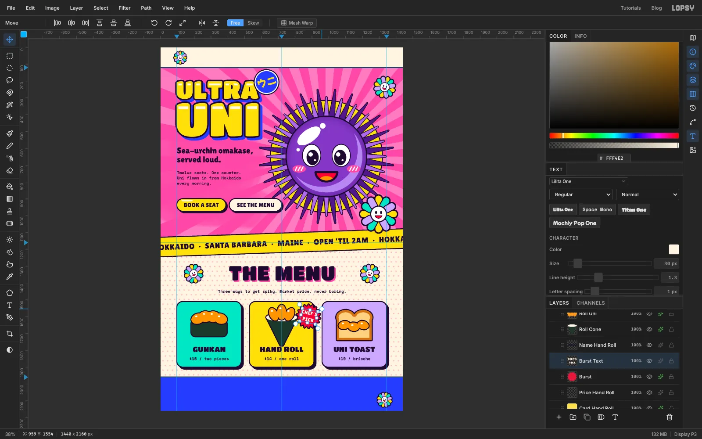

Click `Price Hand Roll`, then **Add Layer**, and name it `Burst`. With the **Lasso**, draw a starburst centred on **880, 1598**, over the yellow card's top-right corner: zigzag out to about **72** px and back in to about **57** px, **18** times round. Keep it clear of the lilac card next door. Fill with red `#E8193C`, press [[Cmd+D]] and add a **Stroke** of `6` in ink.

With `Burst` selected, set **Lilita One** at **Size** `30`, **Align** centre, cream, **Letter spacing** `1`, and type `CHEF'S`, [[Return]], `PICK`. Press [[Tab]]. Switch to the **Move** tool, nudge it to the middle of the burst with the arrow keys, then rotate it about **12°** clockwise with the rotate handle and press [[Enter]]. The burst sits below the tagline and inside the gutter, so nothing collides.

## Fill in the nav bar

Click `Rules`. For the logo, use **Titan One** at **Size** `50`, pink `#FF5AA5`, **Letter spacing** `1`, and type `ULTRA UNI`. Move it so it starts at **x 176**, just right of the flower, and is centred on **y 60**. Add a **Stroke** of **Width** `5` in ink.

Click `Rules` again and type `MENU      OMAKASE      VISIT      SHOP` (six spaces between words) in **Lilita One** at `30`, centred on **x 800** and **y 60**.

For the button, click `Rules`, then **Add Layer**, and name it `Nav Button`. Draw a **Shape** rectangle in cobalt with an ink stroke of `4` and **Corner Radius** `30`, from the centre **1232, 60** out **112** px across and **30** px down, so its right end lands on the **1344** margin guide. Add a **Drop Shadow** of **5**, **5**, **Blur** `0` in ink. Type `BOOK NOW` in **Lilita One** at `28`, cream, centred on the pill. Click **Add Layer**, name it `Nav Gloss`, and with the **Elliptical Marquee** fill a small white streak inside the pill's top-left end, above the letters, from **1144, 36** to **1180, 44**, and set it to **75**%.

## Finish the footer

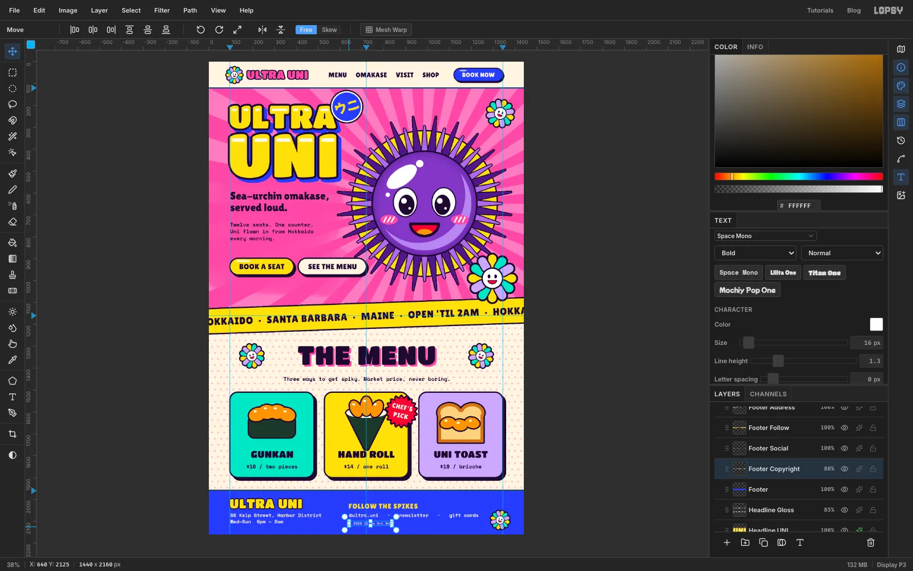

Click `Footer` before each line of text and set them all left-aligned:

- `ULTRA UNI` in **Titan One** at `60`, yellow, with a **Stroke** of `4` in ink, starting at **x 96** with its top at **y 1998**
- The address on two lines, `88 Kelp Street, Harbor District` / `Wed–Sun  6pm – 2am`, in **Space Mono Bold** at `22`, cream, top at **y 2064**
- `FOLLOW THE SPIKES` in **Lilita One** at `32`, yellow, **Letter spacing** `2`, starting at **x 640**, sitting on the same baseline as the footer logo
- `@ultra.uni   ·   newsletter   ·   gift cards` in **Space Mono Bold** at `22`, cream, at **x 640**, top at **y 2064**, the same as the address, so the two columns line up
- `© 2026 Ultra Uni Bar` in **Space Mono Bold** at `16`, white, at **x 640**, top at **y 2102**, with the layer at **80**% opacity

When you place type in the footer, click below the logo rather than on it, or the click edits the logo instead.

Save your work with **File → Save Project**, and export with **File → Quick Export PNG**.

> **Tip:** To turn this comp into a different restaurant, swap the mascot's colours and the three foods. The flowers, sticker, buttons, ticker and card grid all carry over unchanged.
