Embroidered patches and neon signs have more in common than you'd think.
Both draw with lines of colour on a dark ground, and both work best with
simple, bold shapes. Many patch makers stitch neon designs in fluorescent
satin thread, with the lightest thread down the middle of each "tube" so it
seems to glow.

In this tutorial you'll make a patch for **Flamingo Jukebox**, an imaginary
late-night bar. The patch is shaped like the top of a jukebox and sits on a
piece of denim, so it looks like it's ironed onto a jacket. The pink flamingo
is traced from a public-domain photo (Lisa Cox / USFWS, *Flamingo standing*,
on Wikimedia Commons). Each neon tube is a Pen-tool path stroked twice: once
in colour and once with a thin white-hot core. The document is
**1400 × 1760 px**.

Along the way you'll use:

- **Add Noise**, **Motion Blur** and **Clouds** for denim and twill
- the exact-corners marquee dialog, **Shrink**, **Grow** and **Inverse** for the patch shape
- **Define Pattern** and **Fill with Pattern** for satin stitches
- the **Pen** tool, **Stroke Path** and **Path to Selection** for every tube
- **Sunburst** for jukebox light rays
- dropping in a reference photo and scaling it with the transform handles
- text in **Sacramento**, **Monoton** and **Tilt Neon**, rotated with its handle
- **Stroke**, **Outer Glow**, **Inner Glow** and **Drop Shadow**
- copy and paste, rotate and scale, groups, and a multi-layer nudge
- **Copy Merged**, **Brightness/Contrast** and **Gaussian Blur** for a halation glow

The palette:

- Denim `#1D3253`
- Twill `#16111F`, weave grey `#808080`
- Merrow `#C2185B`, merrow sheen `#FF8FBE`, merrow shade `#3A0620`
- Violet tube `#9B5CFF`, violet core `#EADCFF`, violet glow `#7A3DFF`, rays `#3B1E6E`
- Flamingo pink `#FF4FA0`, pink core `#FFE2F0`, pink glow `#FF2E8C`
- Script core `#E4FDFF`, cyan outline `#2FE6FF`, cyan glow `#12CFFF`
- Amber `#FFB43D`, tagline `#FFC56B`, amber glow `#FF8A12`
- Sparkle `#D9FCFF`, sparkle glow `#3FE8FF`

> **Tip:** Positions are in document pixels, written `x, y`, and the status
> bar shows where the pointer is. **Edit → Fill** fills the selection with
> the foreground colour, and [[Cmd+D]] deselects. For an exact rectangle or
> circle, pick a marquee, make sure nothing is selected and click the canvas
> once without dragging. A dialog asks for the **From** and **To** corners.

> **Tip:** New layers appear above the selected layer. Effects and the
> **Blend** dropdown live in each layer's effects drawer (the sparkle icon on
> its row). [[Cmd]]-clicking a layer thumbnail loads that layer's pixels as
> a selection, and [[Cmd+Shift]]-clicking another thumbnail adds to it.

## Make the denim

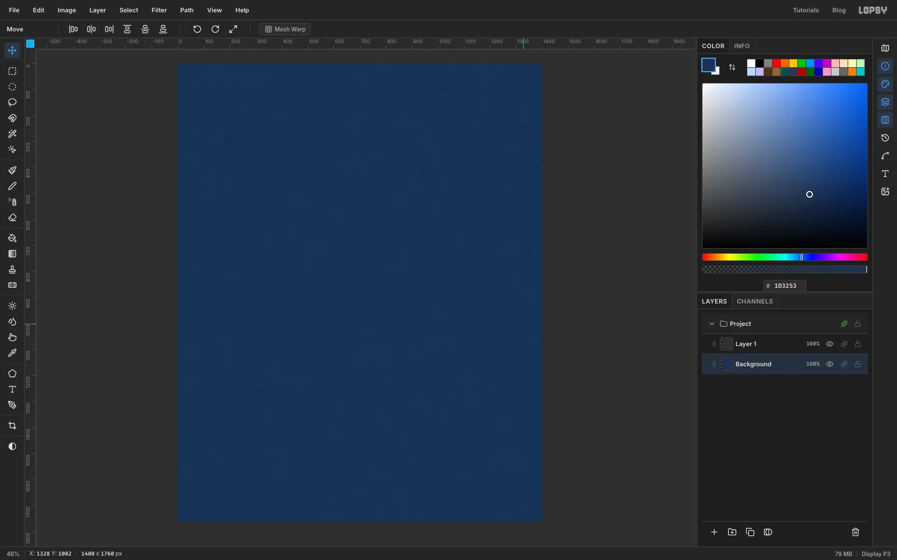

Choose **File → New**, enter **1400 × 1760** and click **Create**. Click the
*Background* row, set the foreground to denim `#1D3253` and choose
**Edit → Fill**.

Choose **Filter → Add Noise…**, pick **Mono** and **Gaussian**, set
**Amount** to `50` and click **Apply**. Then choose **Filter → Motion Blur…**
with **Angle** `45` and **Distance** `20`. The speckles smear into fine
diagonal threads, like the twill of a denim jacket.

## Fade the denim

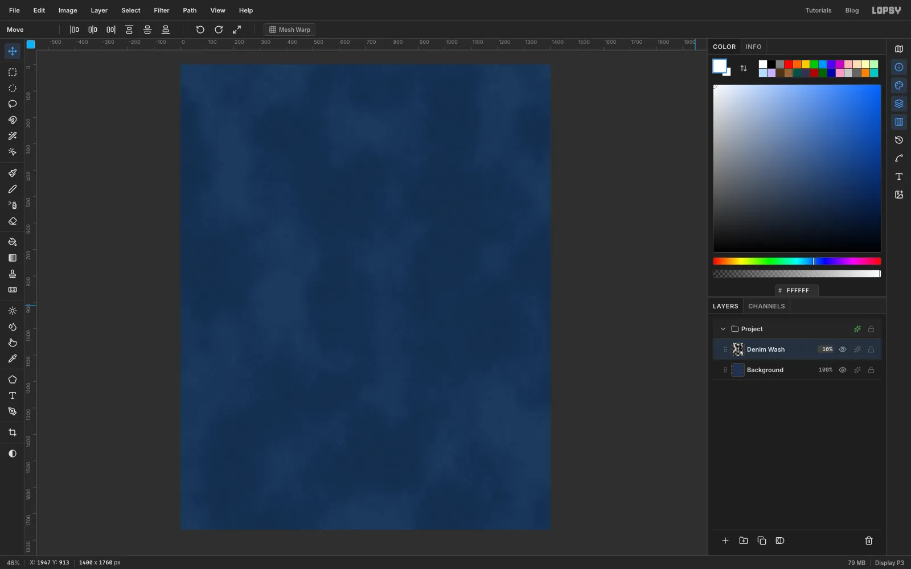

Click *Layer 1* and rename it *Denim Wash*. Set the foreground to white and
choose **Filter → Clouds…** with **Scale** `7`. Set the layer's **Blend** to
**Soft Light** and its opacity to **10%**. The clouds become gentle fading,
like a jacket that's been washed a hundred times.

## Drop two guides

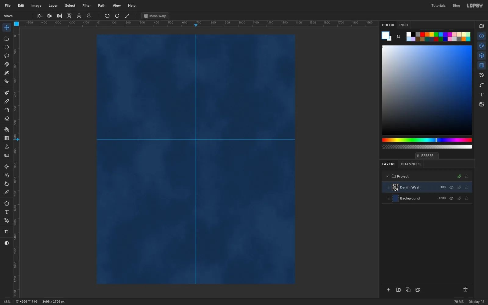

Click the top ruler at `700` to drop a vertical guide down the middle. Then
click the left ruler at `740`. That's the centre of the arch you're about to
draw.

## Draw the arch top

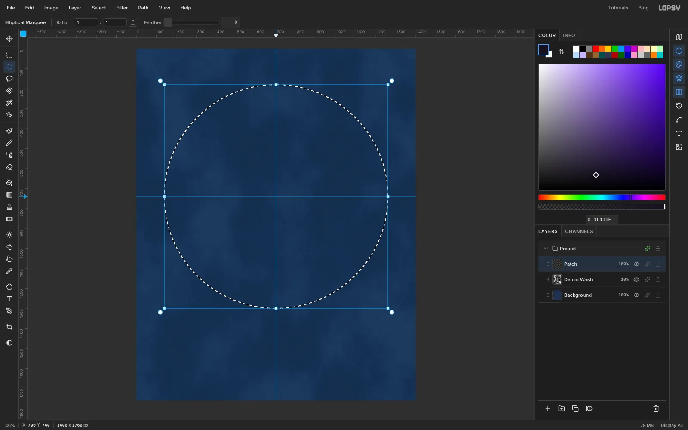

Click *Denim Wash* and add a new layer named *Patch*. Set the foreground to
twill black `#16111F`. Pick the **Elliptical Marquee**, click the canvas once
and select from `140, 180` to `1260, 1300`. That's a circle of radius 560
centred on the guides. Choose **Edit → Fill**.

## Add the rectangle below

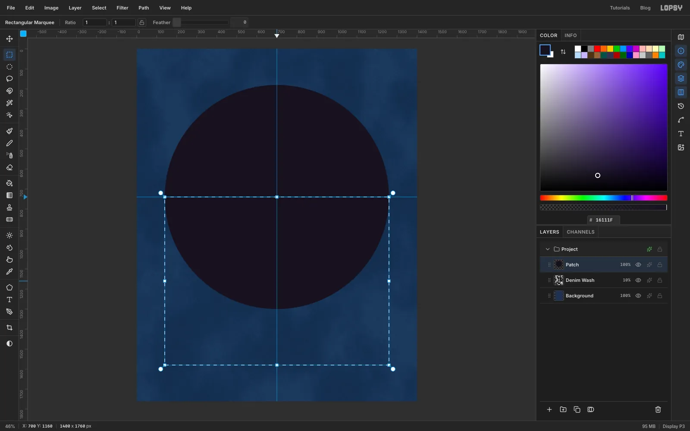

Deselect, pick the **Rectangular Marquee**, click once and select from
`140, 740` to `1260, 1580`. Fill it too. The circle and the rectangle merge
into an arch: the shape of a 1950s jukebox top.

## Round the bottom corners

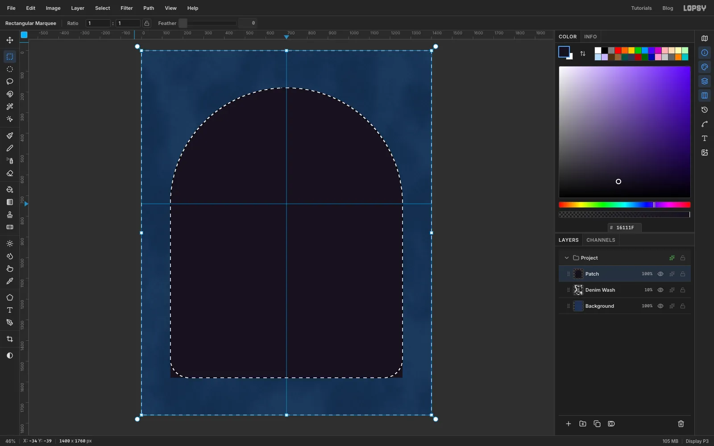

Deselect, then [[Cmd]]-click the *Patch* thumbnail to select the arch.
Choose **Select → Shrink…** `90`, then **Select → Grow…** `90`. Shrinking
and growing by the same amount rounds the square bottom corners and leaves
the curved top alone. Choose **Select → Inverse**, press [[Delete]] to trim
the corners off, and deselect.

## Shadow and twill

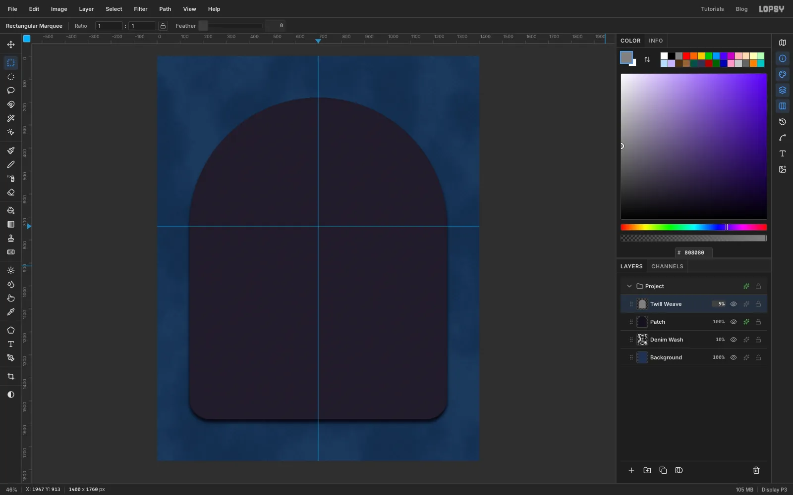

Open *Patch*'s effects and turn on **Drop Shadow**: **Offset X** `0`,
**Offset Y** `14`, **Blur** `18`, **Spread** `20`, **Opacity** `100` and the
colour `#070B16`. The patch now sits on the fabric instead of being printed
on it.

Add a layer named *Twill Weave*, [[Cmd]]-click the *Patch* thumbnail and
fill the selection with grey `#808080`. Run **Add Noise…** (**Mono**,
**Gaussian**, **Amount** `70`), then **Motion Blur…** at **Angle** `135` and
**Distance** `9`, so the weave runs the opposite way to the denim. Deselect,
set **Blend** to **Screen** and the opacity to **9%**. You only want a hint
of it.

## Cut the merrow ring

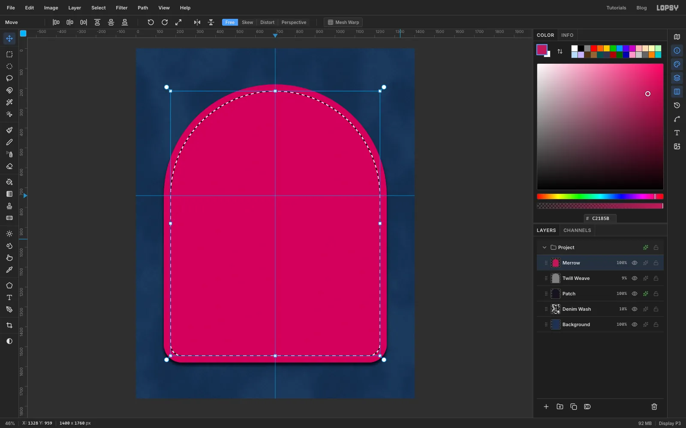

The merrow is the thick, wrapped border stitched around a patch. Add a layer
named *Merrow*, [[Cmd]]-click the *Patch* thumbnail and fill it with
raspberry `#C2185B`. Choose **Select → Shrink…** `34`, press [[Delete]] and
deselect. You're left with a 34 px ring.

## Draw a satin-stitch tile

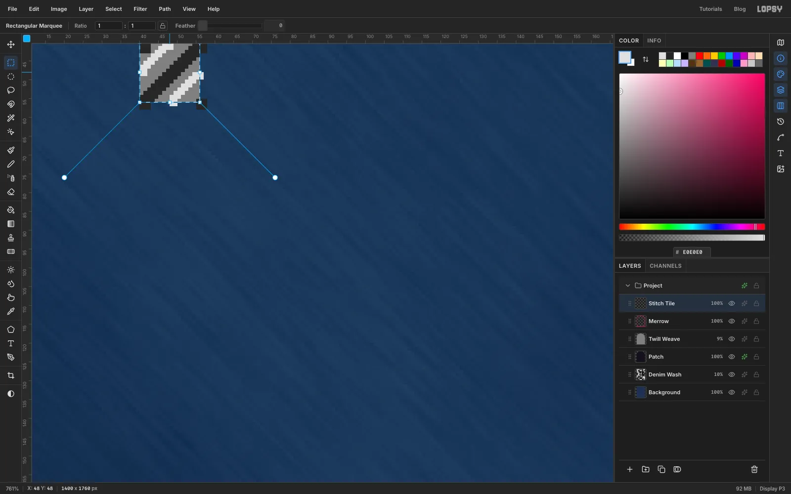

Add a layer named *Stitch Tile* and zoom right in on the top left of the
canvas. With the exact-corners dialog, select from `40, 40` to `56, 56` and
fill it with grey `#808080`. Deselect.

Pick the **Pencil**, set **Size** to `3` and the foreground to `#262626`.
Click the bottom-left pixel of the tile, then [[Shift]]-click the top-right
pixel to draw a diagonal groove. Click once in the top-left and the
bottom-right pixels too, so the groove carries on across the tile's edges.
Switch to **Size** `2` and light grey `#E0E0E0`, and draw two short
diagonals parallel to the groove: one from `40, 47` to `47, 40`, and one
from `48, 55` to `55, 48`.

Select the tile again (`40, 40` to `56, 56`) and choose
**Edit → Define Pattern**. Deselect and delete the *Stitch Tile* layer, then
press [[Cmd+0]] to fit the page back on screen.

> **Tip:** Defined patterns only last until you reload the page, and they
> aren't saved in the project file. You'll use this tile again for the
> tubes near the end, so if you reload before then, draw and define it
> again.

## Stitch the merrow

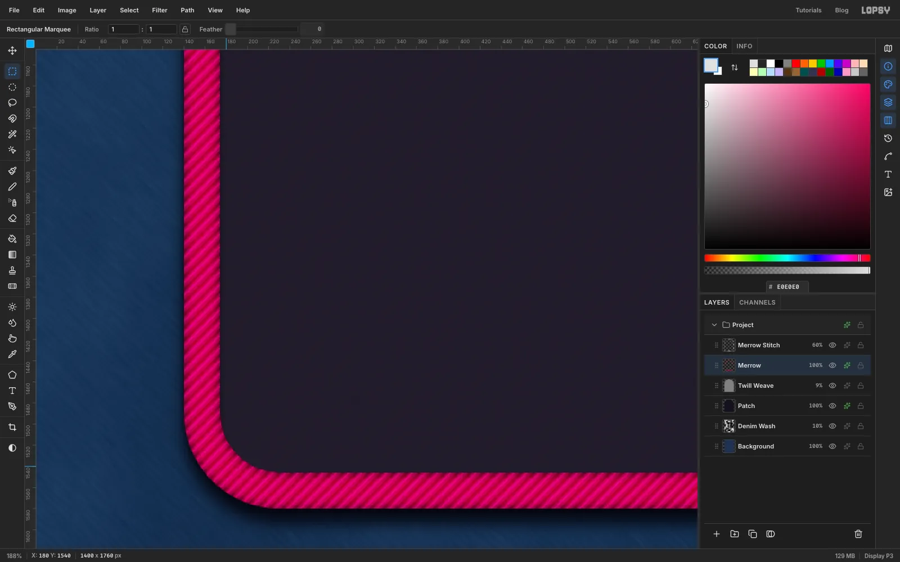

Add a layer named *Merrow Stitch*, [[Cmd]]-click the *Merrow* thumbnail and
choose **Edit → Fill with Pattern…**. Pick your tile, set **Scale** to `75`
and click **Apply**. Deselect, set **Blend** to **Overlay** and the opacity
to **60%**. The grey disappears in Overlay and leaves slanted thread
highlights.

Click *Merrow* and give it an **Inner Glow** in `#3A0620` (**Size** `14`,
**Spread** `0`, **Opacity** `80`), which darkens both edges so the border
looks rolled. Add a **Drop Shadow** in `#05030A` with **Offset Y** `4`,
**Blur** `6` and **Opacity** `65`.

## Draw the outer window with the Pen

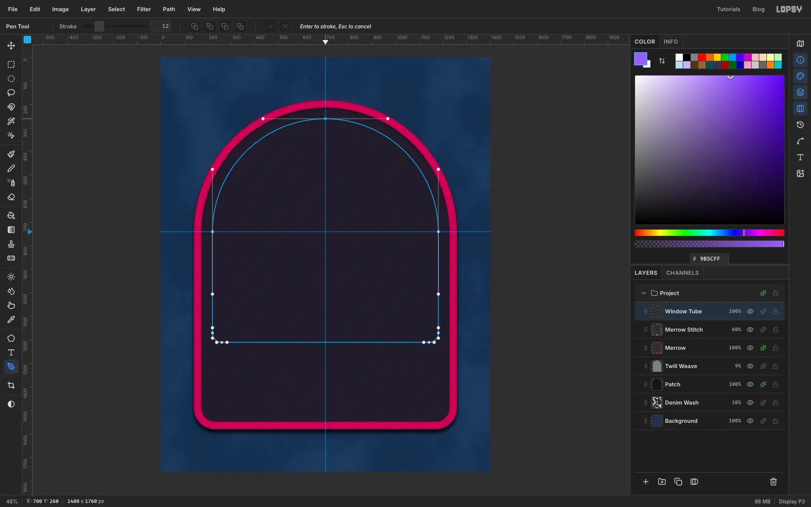

Add a layer named *Window Tube* and set the foreground to violet `#9B5CFF`.
Pick the **Pen** tool and set **Stroke** to `12` in the options bar.

To draw a curve with the Pen, press on the anchor point and drag in the
direction you're travelling. That pulls out handles. A plain click makes a
sharp corner. Go clockwise:

- press at `700, 260` (the top) and drag right about 265 px
- press at `1180, 740` and drag straight down about 265 px
- press at `1180, 1170` and drag down about 22 px
- press at `1140, 1210` and drag left about 22 px
- press at `260, 1210` and drag left about 22 px
- press at `220, 1170` and drag up about 22 px
- press at `220, 740` and drag up about 265 px

Finally click the first anchor to close the path. A drag of about 0.55 × the
radius makes a near-perfect quarter circle. That's why the long drags are
265 px for a 480 px arch and the short ones 22 px for the 40 px corners.

## Stroke both window tubes

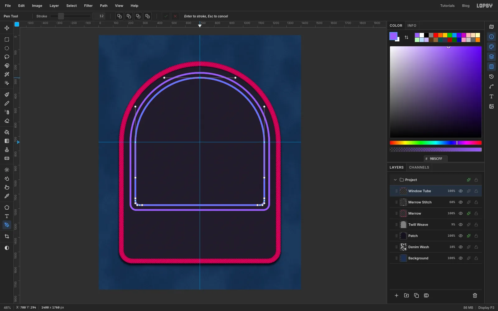

Press [[Enter]] to stroke the closed path in violet. Then draw a second
window 34 px inside the first, the same way:

- press at `700, 294` and drag right about 246 px
- press at `1146, 740` and drag down about 246 px
- press at `1146, 1146` and drag down about 17 px
- press at `1116, 1176` and drag left about 17 px
- press at `284, 1176` and drag left about 17 px
- press at `254, 1146` and drag up about 17 px
- press at `254, 740` and drag up about 246 px

Click the first anchor to close it and press [[Enter]] again.

If a tube wobbles, [[Cmd+Z]] removes the stroke and a second [[Cmd+Z]]
removes the path. [[Cmd+Shift+Z]] brings both back exactly as they were.

## Add the white-hot cores

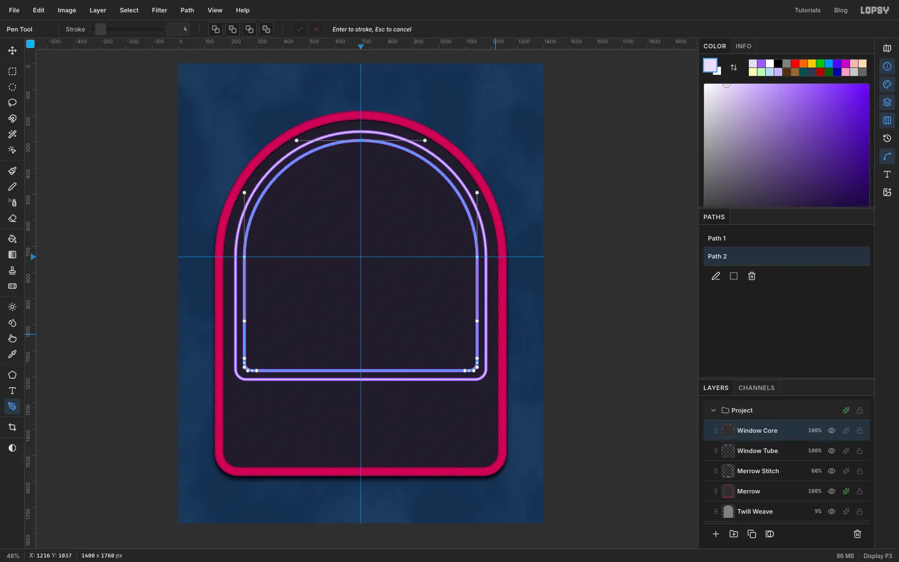

A real neon tube is brightest in the middle. Add a layer named
*Window Core* and set the foreground to pale lavender `#EADCFF`. Open the
**Paths** panel, click *Path 1* and click the **Stroke Path** button at the
bottom of the panel. Enter **Width** `4` and click **Stroke**. Do the same
for *Path 2*.

## Make the window glow

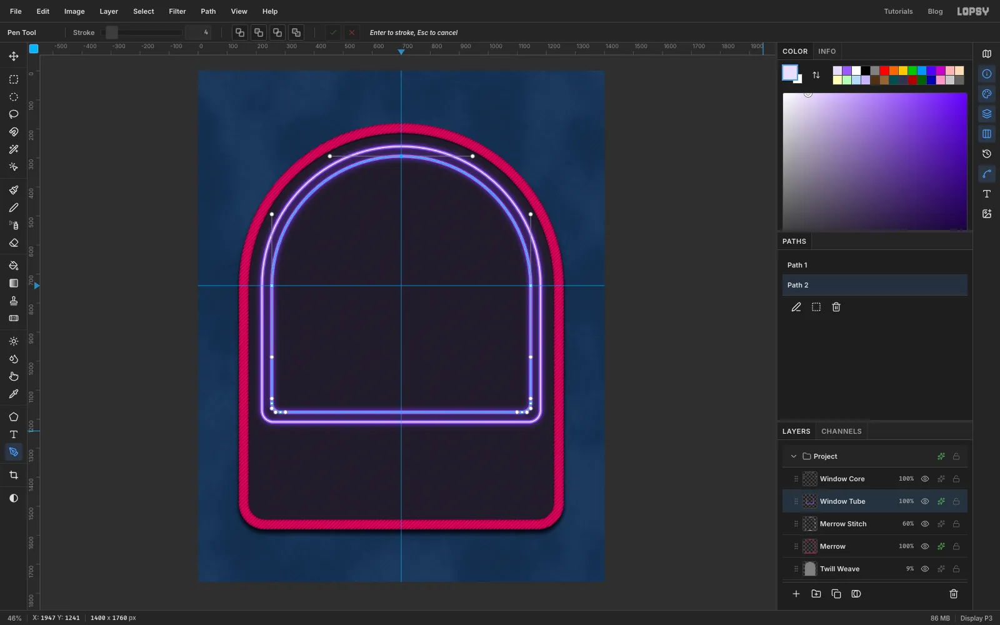

Click *Window Tube* and turn on **Outer Glow** with the colour `#7A3DFF`,
**Size** `26`, **Spread** `10` and **Opacity** `85`. The cores stay crisp
because they sit on their own layer above the glow.

## Paint the jukebox rays

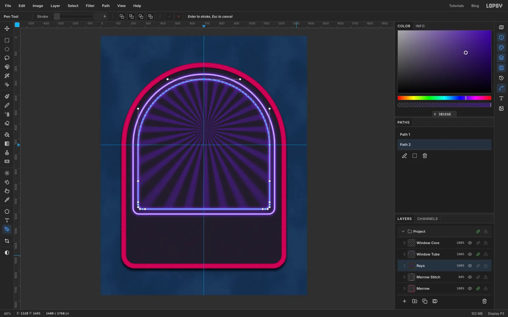

Click *Merrow Stitch* and add a layer named *Rays*, so the rays sit under
the tubes. In the **Paths** panel click *Path 2* and click
**Path to Selection**. Set the foreground to `#3B1E6E` and choose
**Filter → Sunburst…**: **Rays** `28`, **Length** `100`, **Width** `45`,
**Taper** `0`, **Fade** `70`, **Softness** `60`, **Center X** `51` and
**Center Y** `36` (percentages of the canvas, so the rays radiate from
about `714, 634`). Click **Apply**. Because the inner window is selected,
the rays stay inside it.

## Clear the centre of the rays

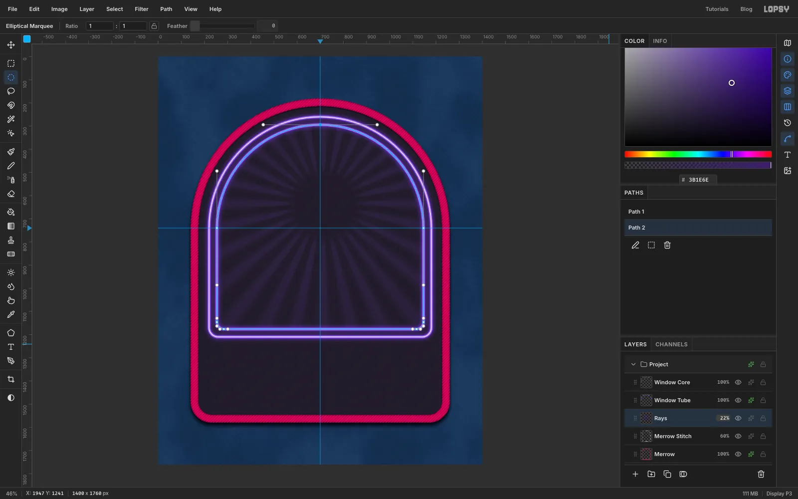

Deselect. All the rays meet at one point, and that knot of lines would
fight with the bird. Set the marquees' **Feather** to `50`, then select an
ellipse from `570, 490` to `870, 790` and press [[Delete]]. Deselect and
set **Feather** back to `0`. Set *Rays* to **Screen** at **22%**.

## Drop in the reference photo

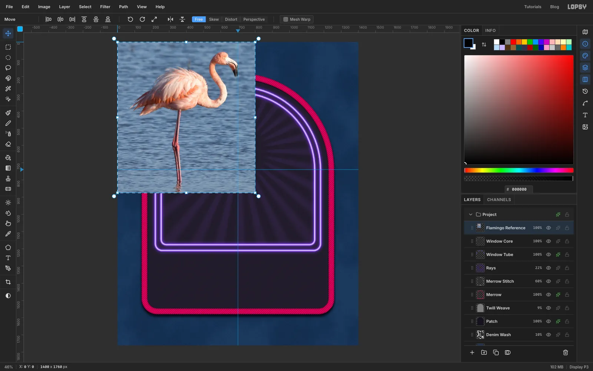

Download the photo from
[Wikimedia Commons](https://commons.wikimedia.org/wiki/File:Flamingo_standing_(40501208232).jpg)
and crop it to the bird, about 800 × 875 px with a little water around it.
Click *Window Core*, so the photo and your tracing go above the window
tubes, then drag the photo from your desktop onto the canvas. It arrives
as a new layer at the top-left corner, already selected, with the **Move**
tool active. Rename the layer *Flamingo Reference*.

## Scale the photo

Hold [[Cmd]] and drag the bottom-right corner handle up and to the left.
[[Cmd]] keeps the proportions. Stop when the photo is about **736 × 805 px**,
92% of its size.

## Place and fade the photo

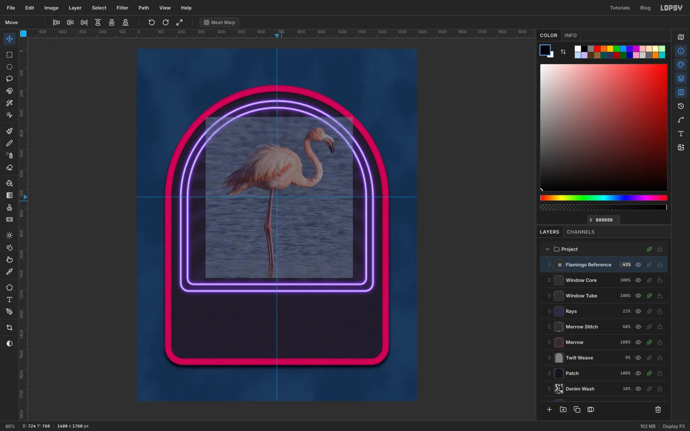

Drag the photo so its top-left corner is at about `344, 340`. That puts the
bird's head well clear of the window tubes. Press [[Cmd+D]] to commit the
transform and set the layer's opacity to **45%**, so your tubes will stand
out against it.

## Trace the flamingo outline

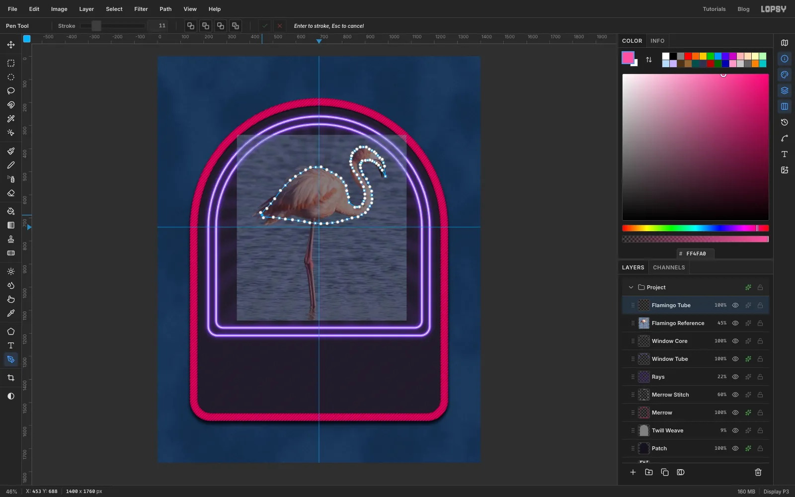

Add a layer named *Flamingo Tube*, set the foreground to flamingo pink
`#FF4FA0` and set the Pen's **Stroke** to `11`. Now trace the outline of the
body, neck and head as one closed path:

- Start at the tail tip and go clockwise along the back, about one anchor
  every 70 px, dragging each one along the curve.
- Make **plain clicks** (sharp corners) at only two places: where the front
  of the neck leaves the chest, and at the tip of the beak.
- Come back along the underside of the beak and the throat, down the front
  of the neck, and along a gently sagging belly to the tail.
- Click the first anchor to close the loop.

Don't follow every feather. A neon sign is a simplified drawing, so round
off anything fluffy.

## Stroke the outline

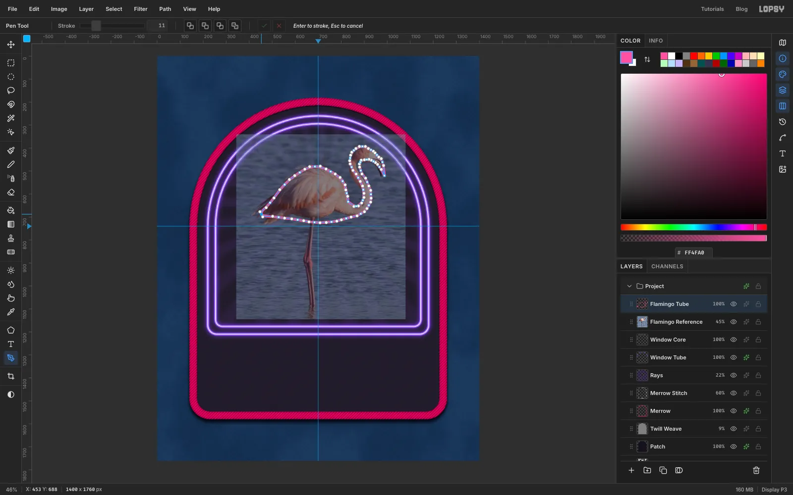

Press [[Enter]] to stroke the outline. Zoom in and check the tube runs
smoothly. If a curve kinks, undo and drag that anchor's handle further.

## Add the wing and legs

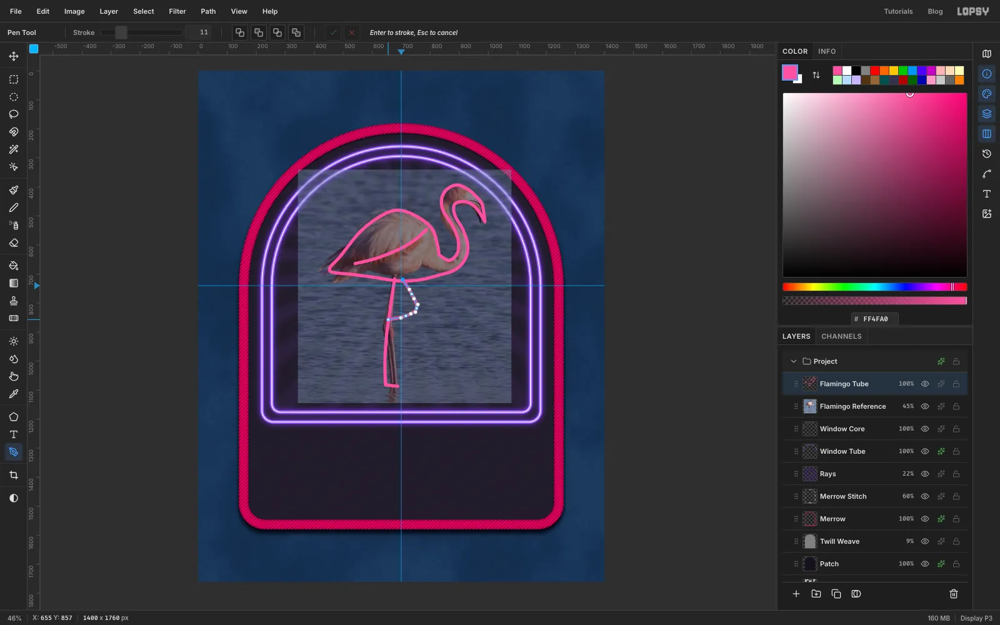

Draw three open paths with the Pen, pressing [[Enter]] after each one to
stroke it:

- **Wing:** one long curve from the rear of the body up to the shoulder.
- **Standing leg:** from the belly straight down, with a plain click at the
  joint halfway down, and a short foot pointing forward.
- **Folded leg:** from the belly forward to a rounded knee, then back to
  meet the standing leg at the joint. Flamingos tuck one leg up, and the
  folded "4" shape is the classic neon flamingo pose.

For the eye, use the Elliptical Marquee to select a 12 px circle from
`901, 413` to `913, 425` and fill it.

## Add the flamingo cores

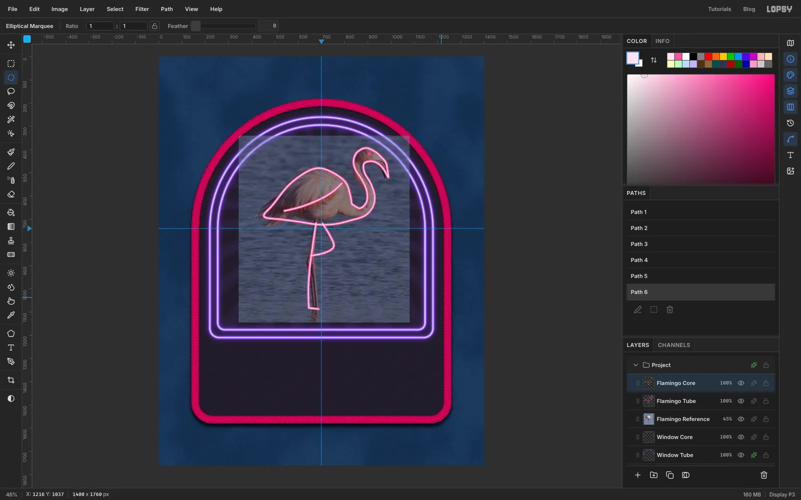

Add a layer named *Flamingo Core* and set the foreground to `#FFE2F0`. In the
**Paths** panel the flamingo paths are *Path 3* (the outline), *Path 4*
(the wing), *Path 5* (the standing leg) and *Path 6* (the folded leg). Click
each in turn and use **Stroke Path** with **Width** `4`. Then click the
highlighted row once more to deselect it, so its blue path outline stops
showing on the canvas.

## Light the flamingo

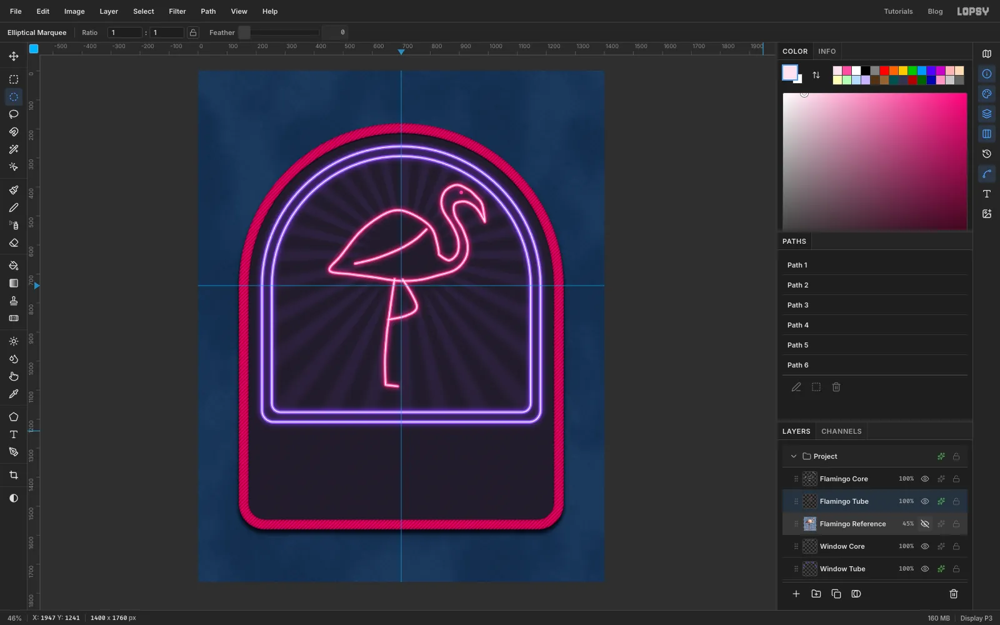

Click *Flamingo Tube* and turn on **Outer Glow** in `#FF2E8C` with **Size**
`24`, **Spread** `12` and **Opacity** `90`. Then click the eye icon on
*Flamingo Reference* to hide the photo. Keep the layer in case you want to
trace something else later.

## Group the flamingo

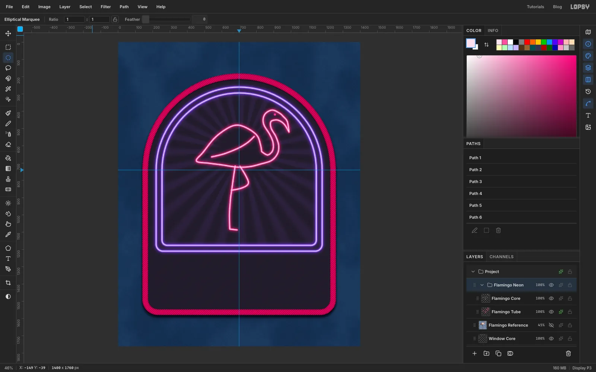

Click *Flamingo Core*, [[Shift]]-click *Flamingo Tube* and choose
**Layer → Group Layers**. Rename the group *Flamingo Neon* and collapse it
with its arrow. Click the collapsed group so the type you add next lands
above it rather than inside it.

## Set the tagline

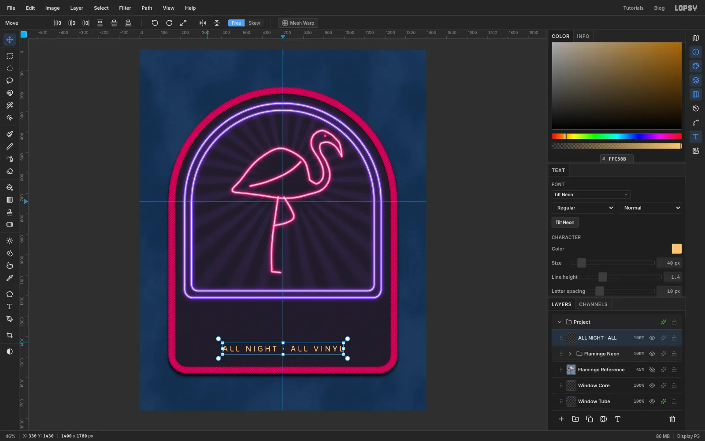

Start with the bottom panel. Text you click near existing type edits it, so
work from the bottom up. Pick the **Text** tool and choose **Tilt Neon** at
size `40`. In the **Text** panel set **Letter spacing** to `10`, and set the
foreground to `#FFC56B`. Click near `330, 1430`, type
`ALL NIGHT · ALL VINYL` and press [[Tab]] to commit.

Switch to the **Move** tool and nudge the line with the arrow keys until its
centre sits at about `700, 1458`.

## Set JUKEBOX

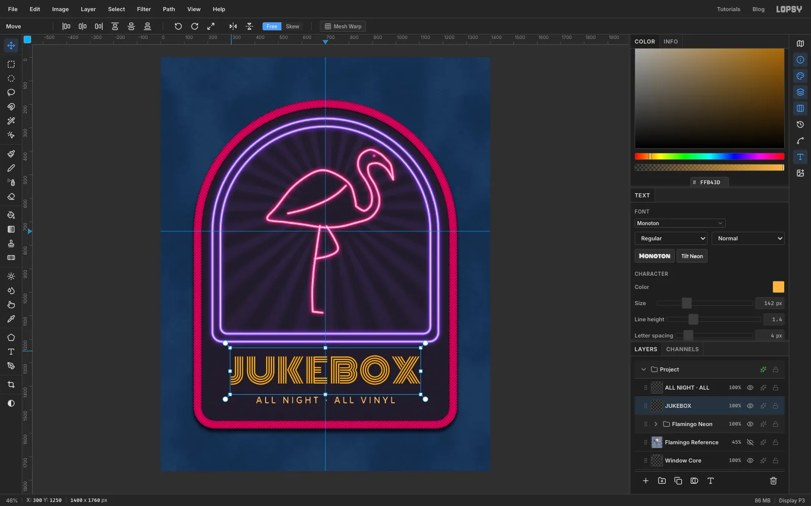

Click the *Flamingo Neon* group again. Pick the **Text** tool and choose
**Monoton** at `142` with **Letter spacing** `4` and amber `#FFB43D`. Click
near `300, 1250`, type `JUKEBOX` and press [[Tab]]. Monoton's letters are
already made of parallel lines, so they look like bent glass tubing. Nudge
the word so its centre sits at about `700, 1330`, with equal space above and
below.

## Write the script

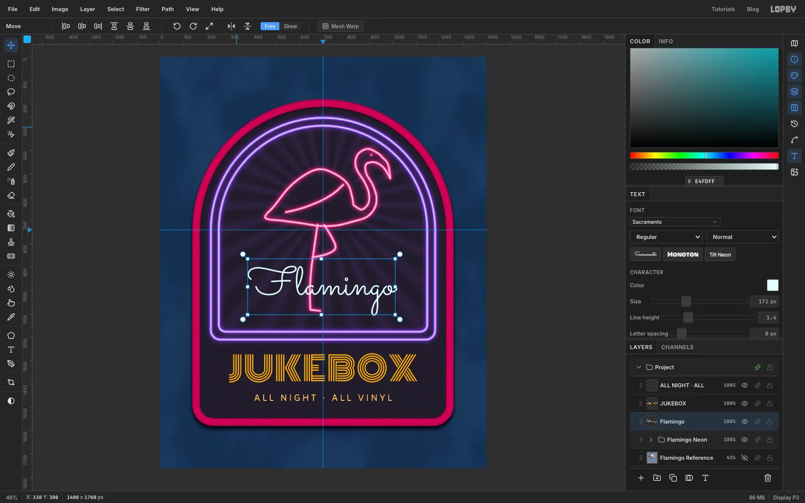

Click *Flamingo Neon* once more and pick **Sacramento**, a script whose
letters are a single line of even width, just like a neon tube. Set the
foreground to `#E4FDFF` and **Letter spacing** to `0`. Click anywhere in the
empty top of the window, type `Flamingo` and press [[Tab]].

With the text layer selected, change **Size** until the word is about 640 px
wide (around `171`). Switch to the **Move** tool and nudge it with the arrow
keys so its centre sits at about `697, 1000`, across the flamingo's legs.

## Tilt the script

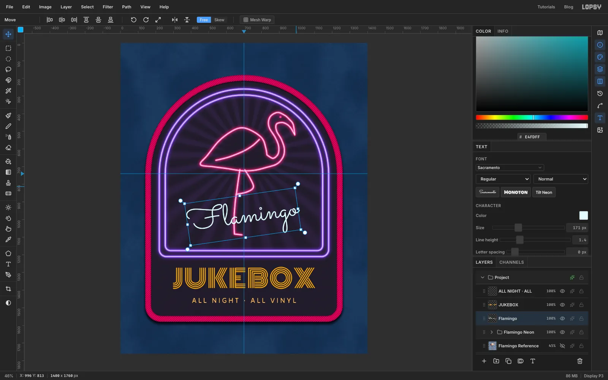

With the **Move** tool, hover just outside the script's top-right corner
until the cursor becomes a crosshair, then drag up to tilt the word about 8°
counter-clockwise. Signs often run their script uphill like this. Press
[[Cmd+D]] to commit, and nudge it back to the centre.

## Turn the type into neon

Effects make the type look like tubes. On *Flamingo*, turn on **Stroke** in
cyan `#2FE6FF` with **Width** `3`. The pale fill becomes the hot core and the
stroke becomes the coloured glass. Then add an **Outer Glow** in `#12CFFF`:
**Size** `22`, **Spread** `10`, **Opacity** `85`.

Give *JUKEBOX* an **Outer Glow** in `#FF8A12` with **Size** `56`, **Spread**
`14` and **Opacity** `100`. Give the tagline a smaller one in the same colour:
**Size** `14`, **Spread** `6`, **Opacity** `80`.

## Select the script

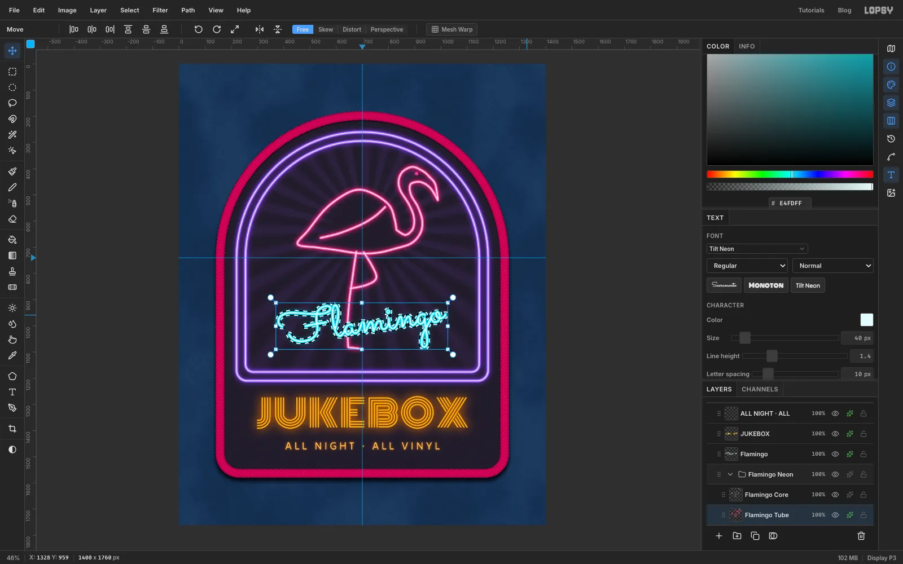

Real neon signs hide a tube by painting it black where it passes behind
another one. Do the same so the leg goes *behind* the script.

[[Cmd]]-click the *Flamingo* text thumbnail to select its letters, and choose
**Select → Grow…** `6`. Expand *Flamingo Neon* and click *Flamingo Tube*.

## Break the leg behind the letters

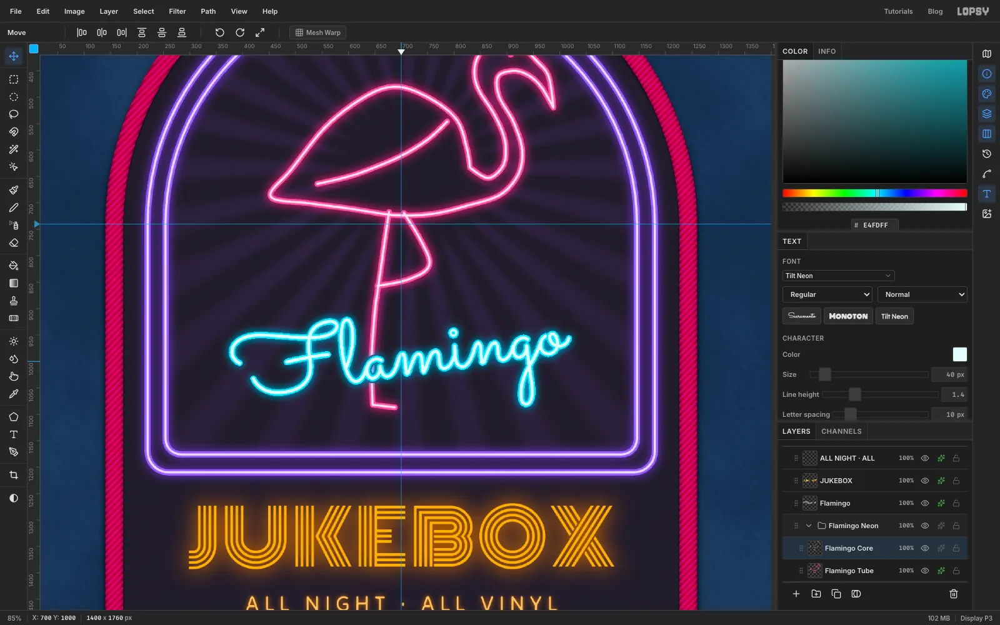

Press [[Delete]]. Click *Flamingo Core* and press [[Delete]] again, then
deselect. The leg now stops just short of each letter it crosses and carries
on through the gaps between them, as if it runs behind the script.

## Draw an eighth note

Collapse *Flamingo Neon* again and click the tagline layer, so the
ornaments go on top. Add a layer named *Note A* and set the foreground to amber
`#FFB43D`. Select an ellipse from `968, 846` to `1032, 890` and fill it
for the note head. Deselect.

With the **Pen** at **Stroke** `10`, draw the stem and flag as **one** path:
click at `1028, 864`, click straight up at `1028, 712`, press at
`1062, 754` and drag down and to the right about 17 px, press at
`1068, 796` and drag straight down about 16 px, click at `1054, 824`, and
press [[Enter]]. Then click **Delete Path** in the **Paths** panel. The
stroke stays, and the canvas is clear for the next path.

> **Tip:** If you draw the flag as a separate path, its first click lands on
> the stem's top anchor, which is still selected. The Pen then grabs that
> anchor instead of starting a new path, and the flag comes out
> disconnected.

## Tilt the note

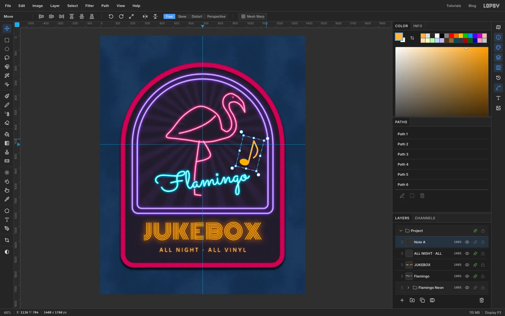

Select a rectangle around the note, from `950, 693` to `1095, 908`. With the
**Move** tool, drag the top-right rotate handle clockwise about 14°, so the
note leans out towards the edge of the window. Press [[Cmd+D]] to commit.

## Copy the note

Select a slightly bigger rectangle, `925, 668` to `1120, 923`, and press
[[Cmd+C]] then [[Cmd+V]]. The copy lands in place on a new layer. Rename it
*Note B* and drag it up and to the left until the note head sits at about
`392, 606`, above the tail.

## Turn and shrink the copy

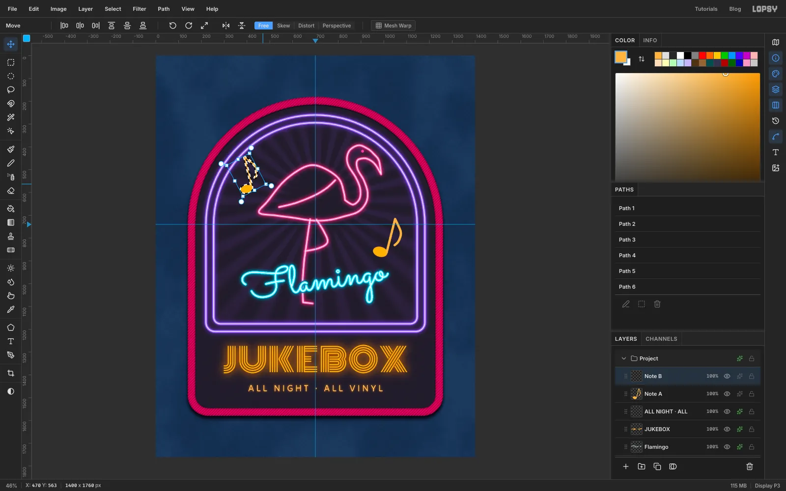

Drag the copy's top-right rotate handle about 28° counter-clockwise, so it
leans out to the left. The two notes now splay away from the bird, as if the
music is bursting out of it. Then hold [[Cmd]] and drag the bottom-right
corner handle in to shrink it by about 15%. Press [[Cmd+D]].

## Light the notes

Give *Note A* and *Note B* each an **Outer Glow** in `#FF8A12` with **Size**
`18`, **Spread** `10` and **Opacity** `85`.

## Draw the first sparkle

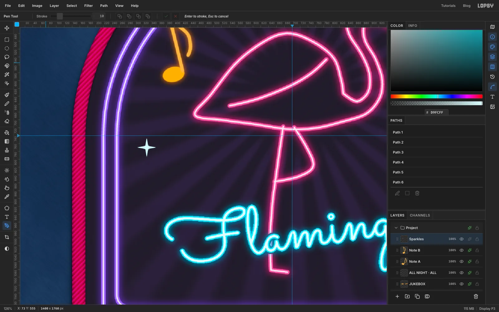

Click *Note B* and add a layer named *Sparkles*. Set the foreground to
`#D9FCFF`. Zoom in on `330, 770`, left of the body. A sparkle is a Pen star
made of eight plain clicks, going clockwise:

- the top point at `330, 746`, 24 px above the centre
- an inner corner at `334, 766`, about 6 px from the centre on the diagonal
- the right point at `354, 770`
- an inner corner at `334, 774`
- the bottom point at `330, 794`
- an inner corner at `326, 774`
- the left point at `306, 770`
- an inner corner at `326, 766`

Click the first point again to close the star. The new path is selected, so
click **Path to Selection** in the **Paths** panel, choose **Edit → Fill**,
deselect, and click **Delete Path**.

## Add three more sparkles

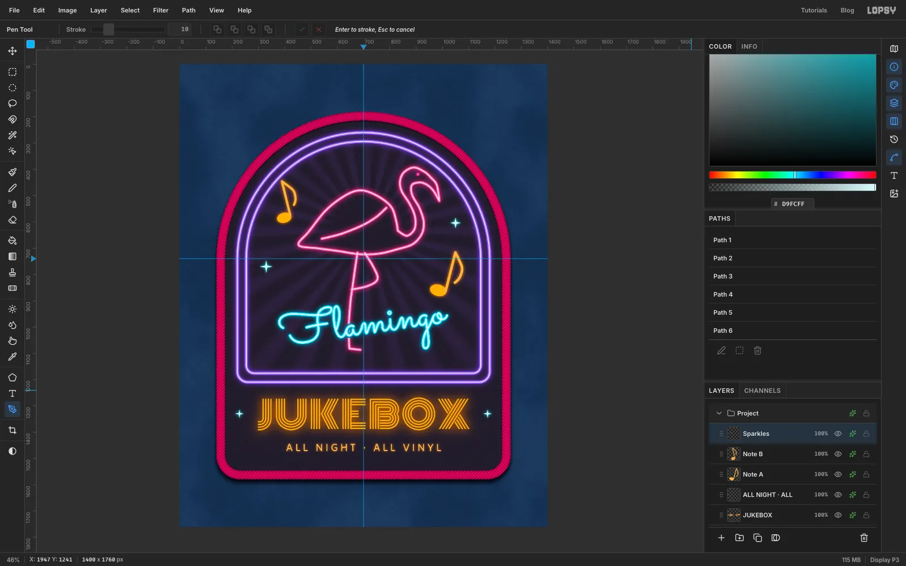

Draw three more the same way, smaller: points 20 px out (inner corners
5 px) around `1050, 604` below the beak, and points 16 px out (inner corners
4 px) around `228, 1330` and `1172, 1330`, either side of JUKEBOX. Give the
layer an **Outer Glow** in `#3FE8FF`: **Size** `14`, **Spread** `20`,
**Opacity** `90`.

## Group the ornaments

Click *Sparkles*, [[Shift]]-click *Note A* and choose
**Layer → Group Layers**. Name the group *Ornaments*. Now the ornaments move as
one. With the group selected and the **Move** tool active, press [[Up]] six
times to lift them all 6 px, so the right note gets a little more room above
the script.

## Select every tube

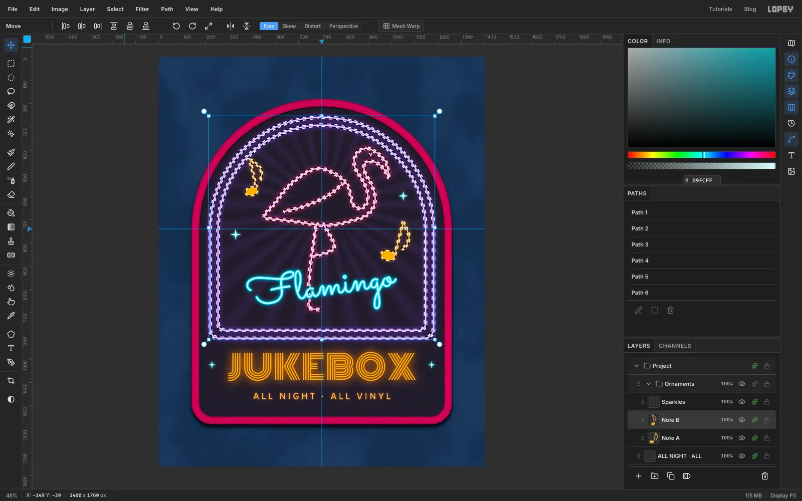

Next, give the tubes a satin-stitch texture. [[Cmd]]-click the
*Window Tube* thumbnail. Then [[Cmd+Shift]]-click the *Flamingo Tube*,
*Note A* and *Note B* thumbnails to add them, expanding the groups to reach
them.

## Stitch the tubes

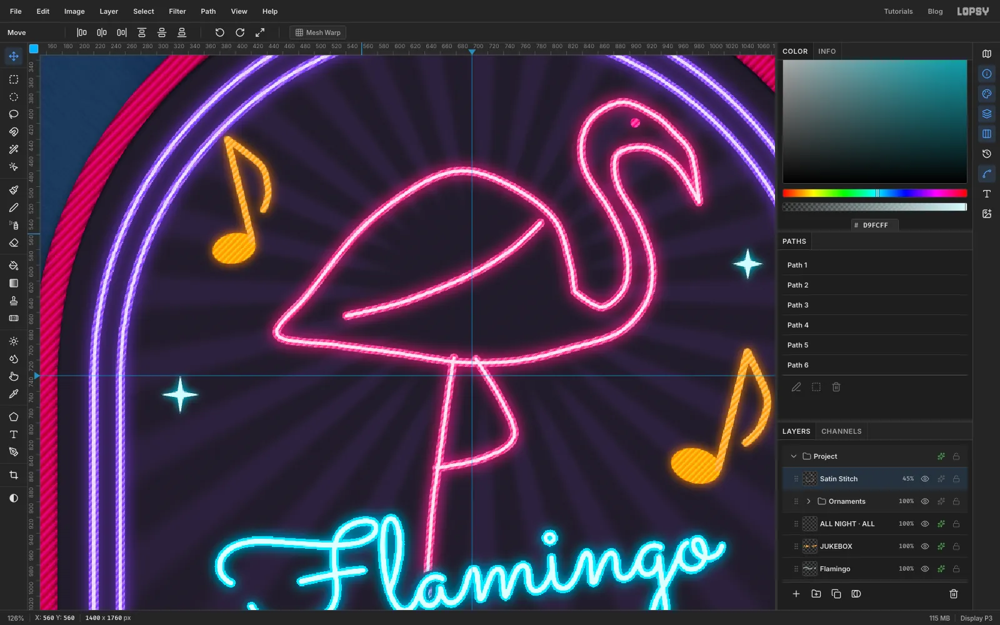

Collapse the groups, click *Ornaments* and add a layer named
*Satin Stitch*. Choose **Edit → Fill with Pattern…** with your stitch tile at
**Scale** `50`. Deselect, set **Blend** to **Overlay** and the opacity to
**45%**. Up close every tube now looks like satin thread. At normal size it
still reads as glowing glass.

## Add halation

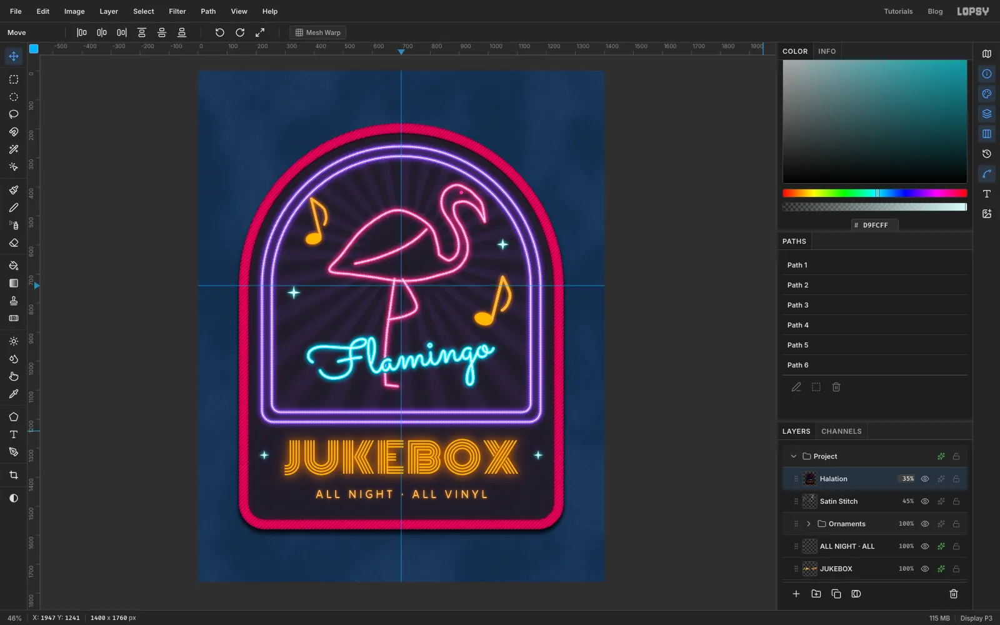

Real neon lights up the air around it. Press [[Cmd+A]], choose
**Edit → Copy Merged** and press [[Cmd+V]]. Rename the pasted layer
*Halation* and deselect.

Choose **Filter → Brightness/Contrast…** with **Brightness** `-40` and
**Contrast** `70`. That crushes the dark twill to black, so only the lit
tubes will glow. Then run **Gaussian Blur…** at **Radius** `26`.
[[Cmd]]-click the *Patch* thumbnail (this loads the selection but keeps
*Halation* as the active layer), choose **Select → Inverse** and press
[[Delete]] so the glow stays on the patch. Deselect and
set **Blend** to **Screen** at **35%**.

## Give the merrow a sheen

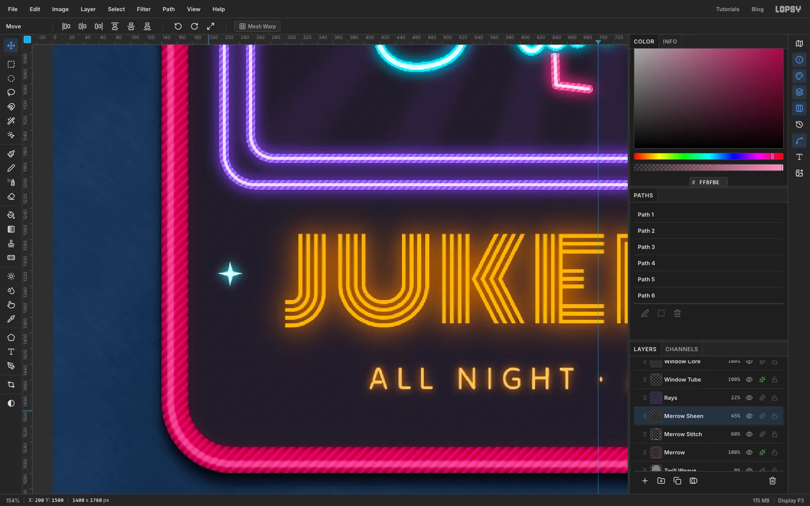

Click *Merrow Stitch* and add a layer named *Merrow Sheen*. [[Cmd]]-click
the *Patch* thumbnail, choose **Select → Shrink…** `7` and fill with
`#FF8FBE`. Choose **Select → Shrink…** `9` and press [[Delete]], which leaves
a thin band near the outer edge. Deselect, run **Gaussian Blur…** at `4`,
and set the layer to **Screen** at **45%**. The border now catches the light
like a rolled cord.

## Lift the patch

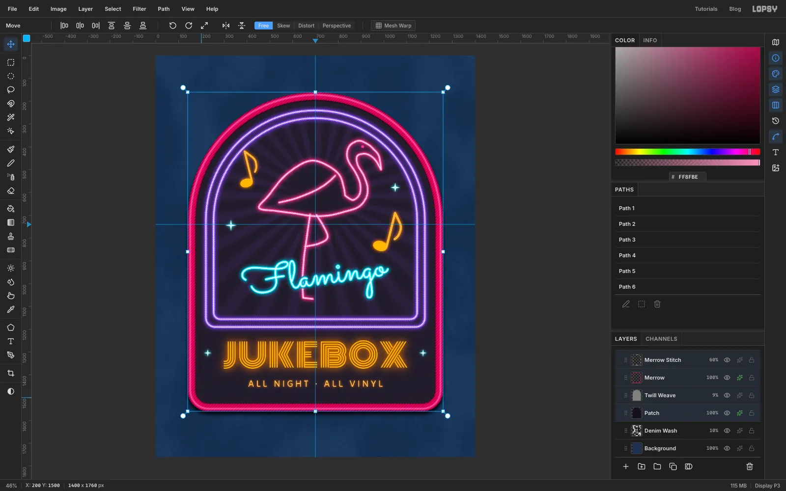

The patch has equal 180 px margins above and below, but the drop shadow adds
weight underneath, so it looks low. Designers lift things slightly above
the true centre (the *optical* centre) to fix this. Click *Halation* at the
top, then
[[Shift]]-click *Patch* to select every patch layer at once. Leave
*Background* and *Denim Wash* out. With the **Move** tool, press
[[Shift+Up]] twice to move the whole patch up 20 px together.

Export with **File → Quick Export PNG**, and save the project with
**File → Save Project**. To make a matching patch for another bar, swap the
script and redraw the bird.
