The great roadside motel signs of the 1950s were built to be seen from a car at sixty miles an hour. They used onion domes, boomerang cabinets, arrows ringed with chasing bulbs, and a reader board for the week's specials. At dusk the neon came on against a still-blue sky. After a desert storm the whole sign hung upside down in the wet road.

In this tutorial you'll build that moment in Lopsy as a flyer for **Hotel Xanadu**, a made-up motel on a desert highway that runs a Friday lounge night. The flyer is 1200 × 1800 px, the 2:3 shape of a printed flyer.

Along the way you'll learn a neon recipe you can reuse anywhere:

- each tube is a **Pen** stroke with an **Outer Glow** and a small **Drop Shadow**, so it seems to stand off the metal behind it
- the white-hot core comes from loading the tube as a selection, **shrinking** it and filling it with a pale tint
- the light spills onto the cabinet, the poles and the wet ground

The tools you'll use:

- **guides**, the **Reference** drawer, and the Rectangular and Elliptical Marquee's exact-corner dialog
- the **Pen** tool, **Path to Selection** and Enter-to-stroke
- the **Gradient**, **Brush**, **Pencil** and **Eraser**
- **Select → Shrink** and **Feather**, plus [[Cmd]]-click to load a layer's shape
- **Copy**, **Copy Merged**, **Paste**, **Flip Vertical**, and the Move tool's scale and rotate handles
- the filters **Add Noise**, **Threshold**, **Clouds**, **Motion Blur** and **Gaussian Blur**
- **layer masks**, and the Screen, Soft Light, Overlay and Multiply blend modes
- the layer effects **Stroke**, **Outer Glow**, **Inner Glow** and **Drop Shadow**
- groups, and live text in Yellowtail, Monoton, Tilt Neon and League Gothic

The palette:

- Sky `#05071F` → `#122068` → `#38287A` → `#A8467A` → `#FF9758`
- Mesas `#2B2150` / `#140F2A`, road `#0A0911` / `#14121C`
- Cabinet teal `#0C2333`, cabinet trim `#2E6F82`
- Red neon `#FF3B2E`, red core `#FFE0D6`
- Mint neon `#22FFB5`, mint core `#DDFFF1`
- Amber neon `#FFAA22`, amber core `#FFF2CC`
- Bulbs `#FFF5DA`, bulb glow `#FFB040`
- Arrow crimson `#8E1424`, arrow trim `#D8C08A`
- Reader board `#F4ECD6`, board letters `#16131C`, rails `#9C9278`
- Footer cream `#FFE7C2`

> **Tip:** On a wide-gamut (Display P3) screen, Lopsy reads typed hex codes as P3 colours. These codes were picked as P3 values, so they match the finished flyer. On an sRGB screen they come out a touch duller.

> **Note:** Shortcuts are written for a Mac. On Windows use [[Ctrl]] wherever it says [[Cmd]].

## Set up the flyer, guides and a reference photo

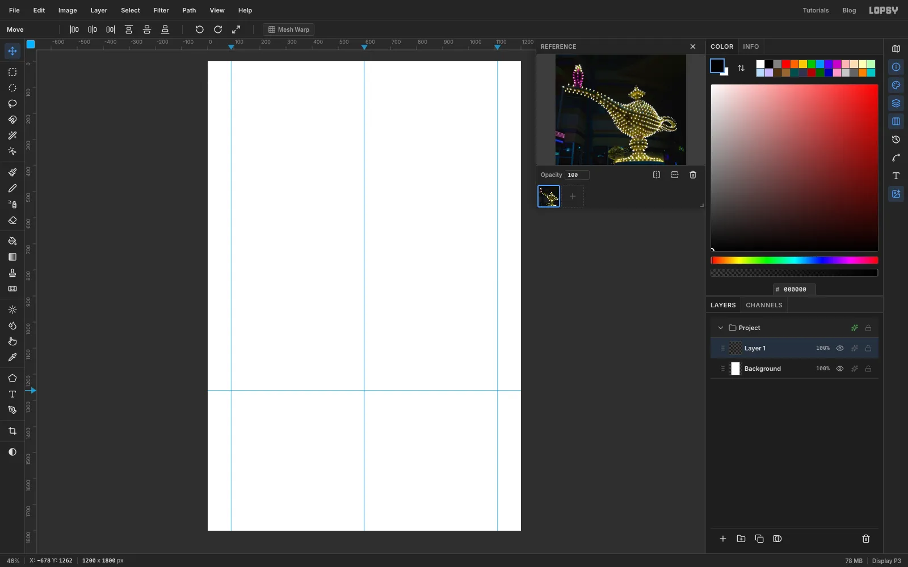

Choose **File → New**, keep the units on **Pixels**, and make the document **1200** wide and **1800** high.

Click the top ruler to drop vertical guides at **90**, **600** and **1110**. The outer two mark the sign's edges and the middle one is the centre line. Click the left ruler at **1262** for the horizon. Everything above it is sky and everything below it is road.

Real signs are the best teacher. Open the **Reference** drawer from the right-hand toolbar and load a photo of vintage neon. This one is Carol M. Highsmith's *Old Motels and Historic Neon Art, Las Vegas, Nevada* from the Library of Congress, which is in the public domain. Look at how the bulbs sit in rows and how the glow fades into the dark. Close the drawer when you're done.

## Paint the blue-hour sky

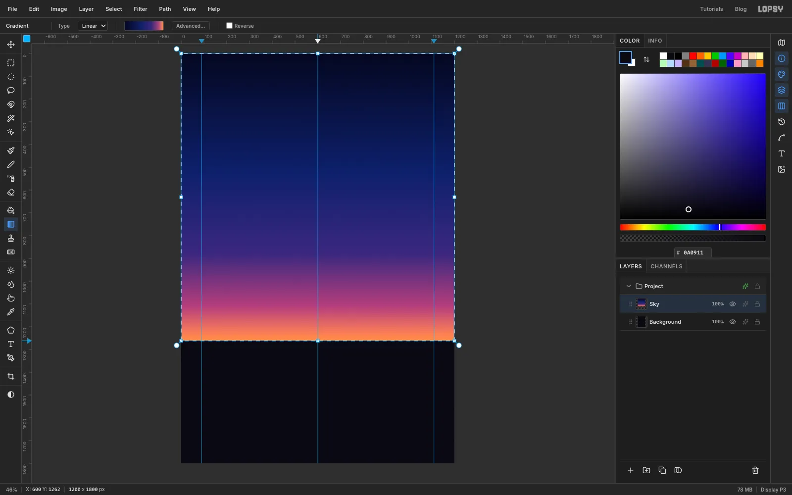

Click *Background*, set the foreground to `#0A0911` and choose **Edit → Fill**. That's the road colour.

Click *Layer 1* and rename it *Sky*. Pick the **Rectangular Marquee** and drag a selection from the top-left corner of the canvas down to the right edge at the horizon guide.

Pick the **Gradient** tool, set it to **Linear** and open **Advanced…**. Build five stops: `#05071F` at the left end, `#122068` at 42%, `#38287A` at 70%, `#A8467A` at 88% and `#FF9758` at the right end. Click **Done**, then drag from the top edge of the canvas straight down to the horizon guide. Hold the drag vertical so the bands stay level.

## Sprinkle stars with noise and Threshold

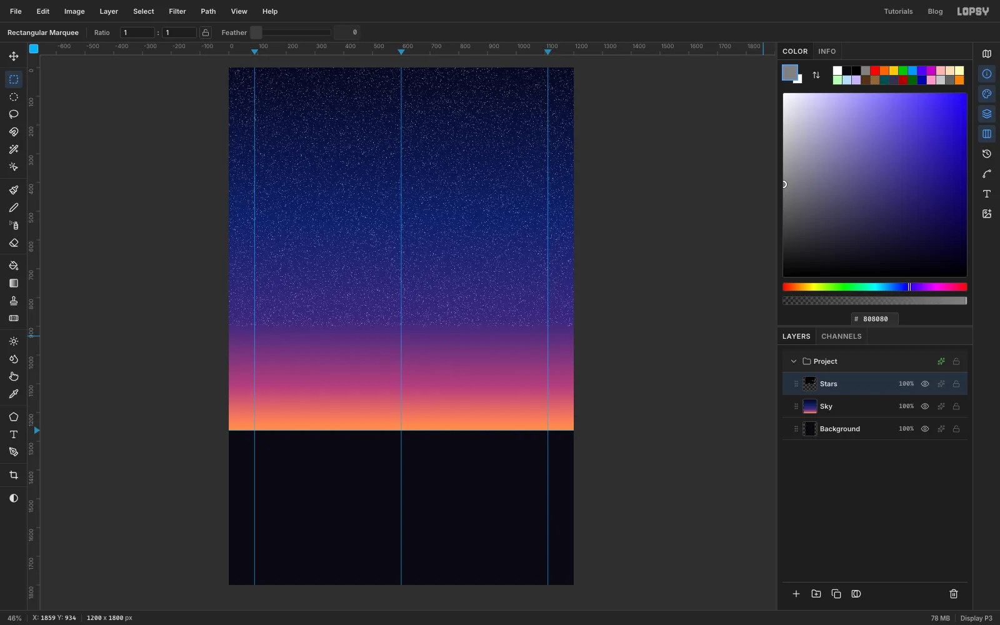

Press [[Cmd+D]] to deselect. Click **Add Layer** and name the layer *Stars*.

Draw a marquee over the top half of the canvas, from the top-left corner to the right edge at about y 900. Set the foreground to mid-grey `#808080`, choose **Edit → Fill**, and deselect.

Choose **Filter → Add Noise…** with **Amount 100**, **Mono** and **Uniform**. Then choose **Filter → Threshold…** and set **Level** to **176**. Only the brightest specks of noise turn white, and the rest go black.

Open the layer's effects (the ✦ button on its row) and set **Blend** to **Screen**. The black disappears and the white specks stay as stars.

## Fade the stars with a layer mask

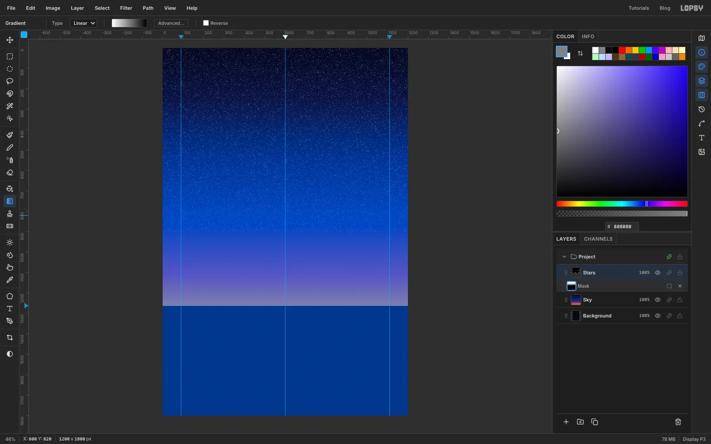

Stars disappear into the glow near the horizon, so fade them out with a mask.

With *Stars* active, click **Add Mask** at the bottom of the Layers panel, then click the new mask thumbnail to edit the mask. The canvas shows the masked-out area as a blue overlay.

Pick the **Gradient** tool. In **Advanced…**, make a two-stop gradient from white `#FFFFFF` to black `#000000`. Drag from about y 250 straight down to about y 820. Click the layer's name to stop editing the mask.

## Streak in some cirrus cloud

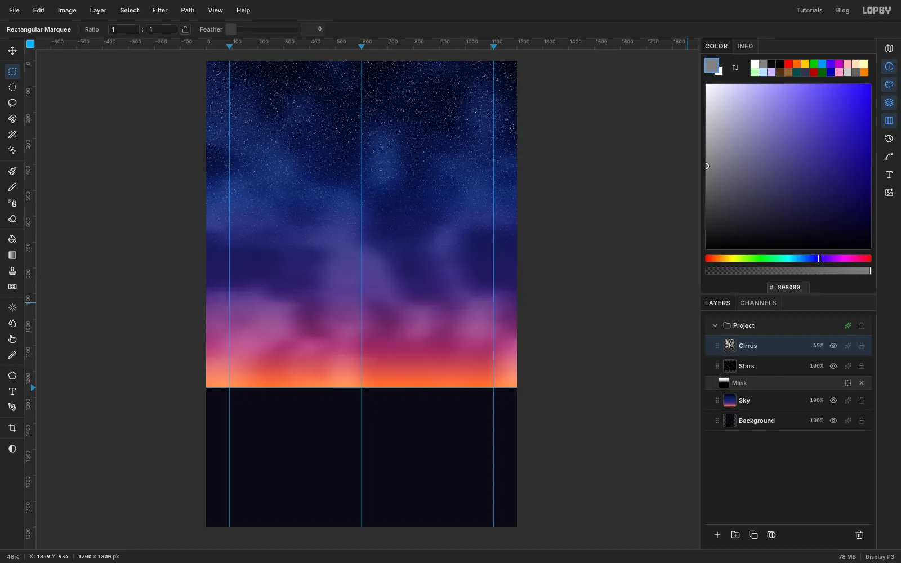

Click **Add Layer** and name the layer *Cirrus*. Draw a marquee over the whole sky, from the top-left corner to the right edge at the horizon guide.

Choose **Filter → Clouds…** with **Scale 9**, then deselect. Choose **Filter → Motion Blur…** with **Angle 0** and **Distance 100** to stretch the clouds into long, thin streaks.

Open the effects, set **Blend** to **Soft Light**, and set the layer's opacity to **45%** from the opacity button on its row. The clouds now only lighten and darken the gradient beneath them.

## Trace the far mesas with the Pen

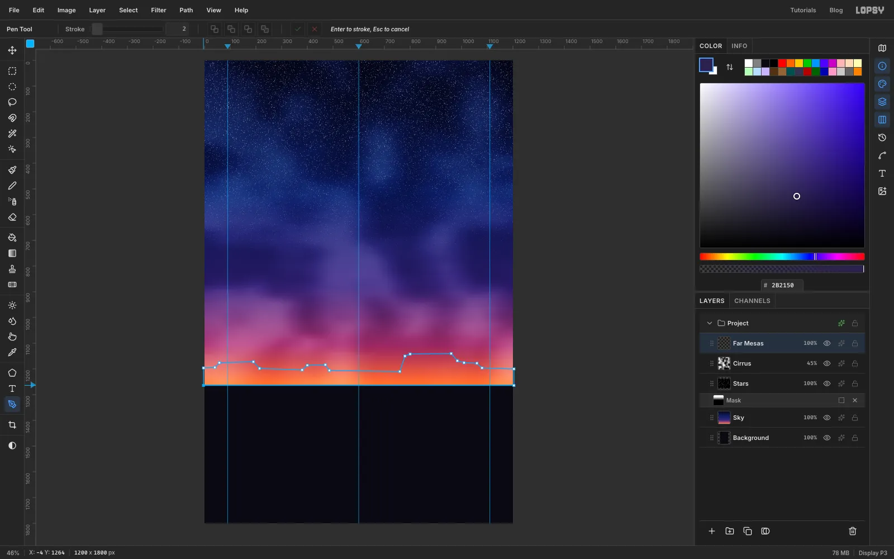

Click **Add Layer** and name the layer *Far Mesas*. Set the foreground to `#2B2150`.

Pick the **Pen** tool. Mesas are flat-topped with steep sides, so use plain clicks, which make sharp corners. Start just off the left edge on the horizon guide, then click your way along the skyline:

- a low mesa on the left, about 90 px tall
- a long, gentle stretch through the middle, where the sign will cover it
- a tall butte about 120 px high between x 780 and x 1000
- a lower shoulder off the right edge

Come back along the horizon guide and click the first anchor to close the path.

Open the **Paths** panel and click **Path to Selection**, then **Delete Path**. Choose **Edit → Fill** and deselect.

## Add the near mesas and a telephone pole

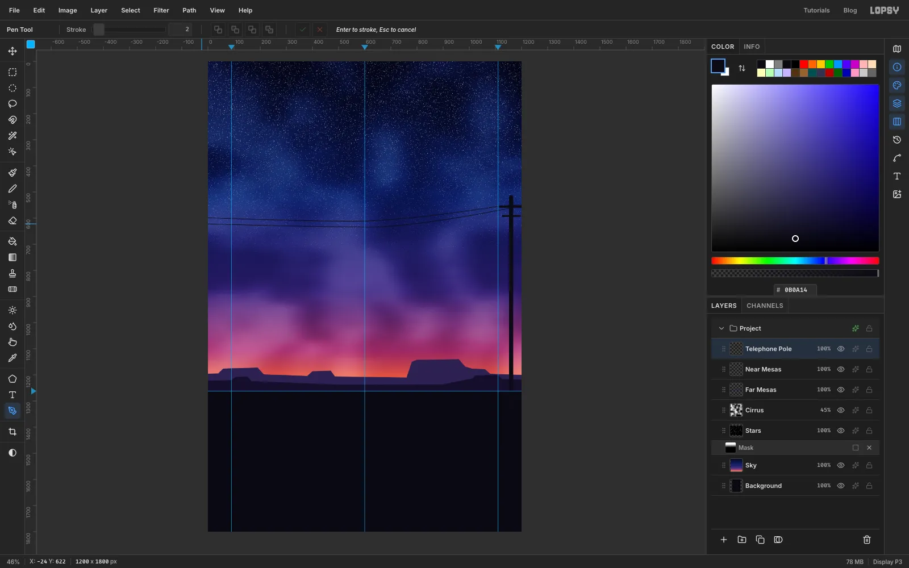

Click **Add Layer** and name it *Near Mesas*. Set the foreground to the darker `#140F2A`. Trace a lower, nearer ridge the same way, only 30–60 px tall, with a small bump on each side. Fill it and delete the path as before.

Click **Add Layer** and name it *Telephone Pole*. Set the foreground to `#0B0A14`. With the **Pen** tool, set **Stroke** to **16** in the options bar, click at the bottom of the pole (x 1160, just below the horizon, at about y 1332) and click again at the top (y 520). Press [[Enter]] to stroke the path, then delete it in the **Paths** panel. If you leave it selected, your next click would edit it instead of starting a new path.

In the same way, stroke a **9** px crossarm across the pole at y 556, from x 1118 to x 1204, and a **7** px one at y 592.

For the wires set **Stroke** to **2**. Click just off the right edge, then click the left end of the top crossarm. Now press at about x 560, a little lower (y 612), and drag to the left to pull out curve handles. Finally click just off the left edge. Press [[Enter]]. Draw a second wire through the right end of the crossarm, sagging a bit lower. Delete the paths when you're done.

## Build the steel poles

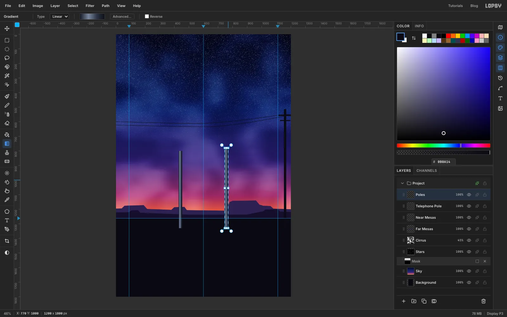

Click **Add Layer** and name it *Poles*.

Pick the **Gradient** tool and build a four-stop steel gradient in **Advanced…**: `#141824` at the left end, `#7A869E` at 35%, `#2A3142` at 70% and `#0E1018` at the right end.

Pick the **Rectangular Marquee** and click once on the canvas without dragging. That opens the exact-corners dialog. Enter **From 430, 800** and **To 454, 1330**. Switch to the **Gradient** tool and drag across the pole from its left edge to its right edge.

Click once with the marquee again and make the second pole, **From 746, 780** and **To 770, 1330**. Drag the gradient across it the same way, then deselect.

## Cut the dome backing and the cabinet

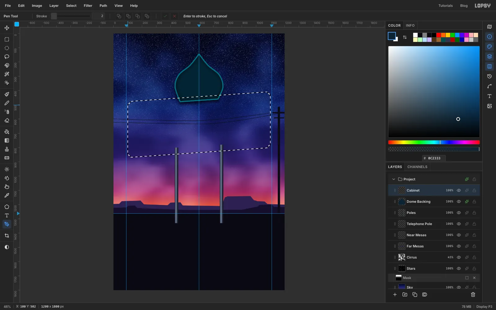

Click **Add Layer** and name it *Dome Backing*. Set the foreground to cabinet teal `#0C2333`.

With the **Pen** tool, draw an onion dome centred on the middle guide:

1. Click a sharp corner at the bottom left (about x 470, y 474).
2. Press and drag to place smooth anchors up the left side. Bulge out to about x 436 at y 372, then curve in to about x 462 at y 292 and x 540 at y 226.
3. Click a sharp corner at the tip (x 600, y 150).
4. Come back down the right side as a mirror image.
5. Click a sharp corner at the bottom right (about x 730, y 456).
6. Click the first anchor to close the path.

Use **Path to Selection**, delete the path, **Edit → Fill** and deselect.

Click **Add Layer** and name it *Cabinet*. Its top edge rises to the right, from about (124, 476) to (1076, 410), and its bottom edge runs parallel to it, from (124, 868) to (1076, 802). Click the eight corners with the **Pen**, clipping each corner with a 24 px bevel. Use **Path to Selection** as before. Fill the selection with the same teal and deselect.

## Turn the cabinet into painted sheet metal

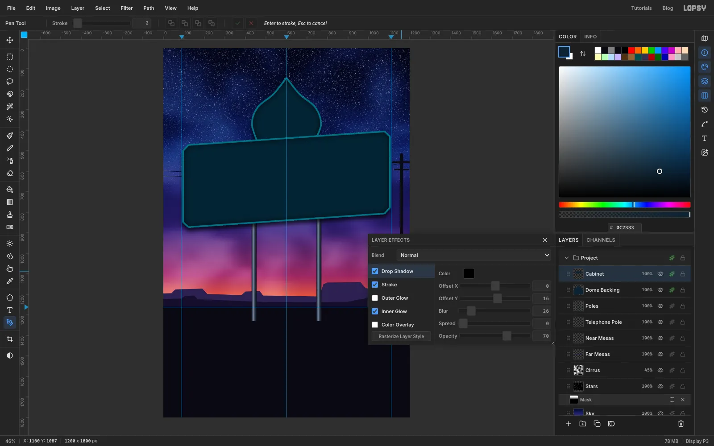

With *Cabinet* active, open its effects and turn on:

- **Stroke**: **Width 8**, position **outside**, colour `#2E6F82`, for the folded metal rim
- **Inner Glow**: colour black `#000000`, **Size 40**, **Opacity 70**, for depth at the edges
- **Drop Shadow**: black, **Offset X 0**, **Offset Y 16**, **Blur 26**, **Opacity 70**

Give *Dome Backing* exactly the same three effects. The two shapes now read as one riveted steel sign.

## Bend the amber dome tubes

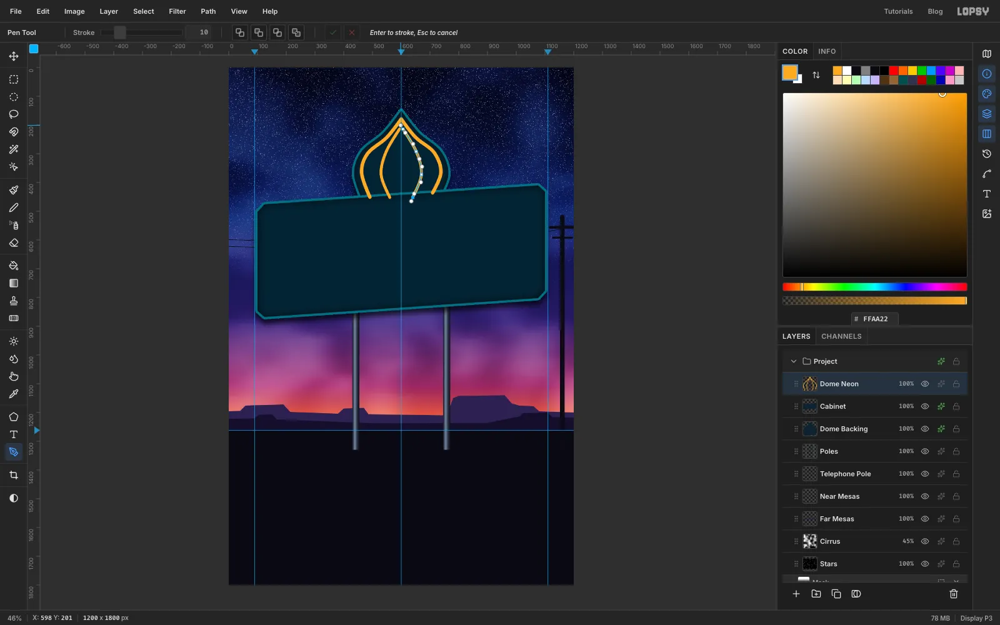

Click *Cabinet*, then click **Add Layer** and name the new layer *Dome Neon*. Set the foreground to amber `#FFAA22`.

Pick the **Pen**, set **Stroke** to **12**, and trace a smaller onion about 30 px inside the backing. Start with a sharp corner at the bottom left, use smooth anchors up and over to a sharp corner at the tip, and come down to a sharp corner at the bottom right. Don't close it: a neon tube ends where it plugs into the cabinet. Press [[Enter]] to stroke it.

Set **Stroke** to **10** and draw two ribs. Each one runs from the cabinet's top edge, bows outward, and comes up to meet just under the tip (left rib through about (530, 372) and (548, 292)). Press [[Enter]] after each one.

## Light the tubes and give them a hot core

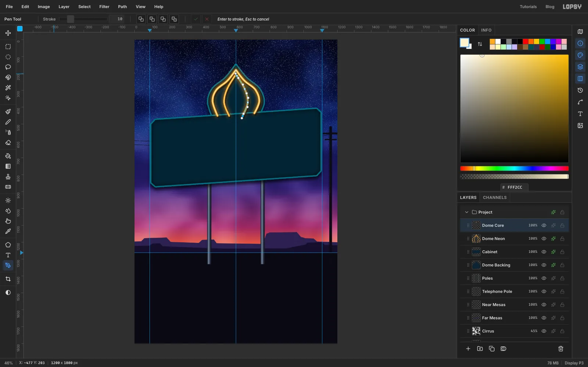

Open the effects for *Dome Neon* and turn on:

- **Outer Glow**: colour `#FFAA22`, **Size 34**, **Spread 6**, **Opacity 90**
- **Drop Shadow**: black, **Offset X 6**, **Offset Y 10**, **Blur 8**, **Opacity 55**

The small shadow makes the tubes stand off the metal.

Real neon is brightest in the middle of the glass. [[Cmd]]-click the *Dome Neon* thumbnail to load the tubes as a selection, then choose **Select → Shrink…** and shrink by **4** px. Click the *Dome Neon* row, click **Add Layer** and name the new layer *Dome Core*. Set the foreground to amber core `#FFF2CC`, choose **Edit → Fill** and deselect.

You'll use this glow-plus-core recipe for every tube on the sign.

## Hollow a crescent moon out of two circles

Click **Add Layer** and name it *Moon Neon*.

Pick the **Elliptical Marquee**, click once on the canvas to open the corner dialog, and make a circle **From 806, 122** **To 954, 270**. Now hold [[Alt]] and drag a slightly smaller circle from (850, 110) to (974, 234). It is offset up and to the right, and it bites the crescent out of the first circle.

Set the foreground to mint `#22FFB5` and choose **Edit → Fill**. Choose **Select → Shrink…** by **11** px and press [[Delete]]. Only an 11 px ring of glass is left. Deselect.

Give the moon the tube effects in mint: **Outer Glow** `#22FFB5` at **Size 32**, **Spread 6**, **Opacity 90**, and the same **Drop Shadow**. Then make its hot core: [[Cmd]]-click the thumbnail, **Shrink** by **4**, click *Moon Neon*, **Add Layer** (*Moon Core*), and fill it with `#DDFFF1`.

## Draw a sparkle and paste smaller copies

Click **Add Layer** and name it *Sparkles*. Set the foreground to `#FFF2CC`.

With the **Pen**, click eight sharp corners for a four-point star centred at about (296, 246). The points sit 50 px out and the pinched corners only 13 px from the centre. Close the path, use **Path to Selection**, fill it and deselect.

Now duplicate it:

1. Draw a marquee around the sparkle. Press [[Cmd+C]], then [[Cmd+V]]. The copy lands on a new layer in the same spot, and Lopsy switches to the **Move** tool.
2. Drag the copy down and to the left, to about (206, 372).
3. Draw a marquee around the copy. With the **Move** tool, hold [[Cmd]] and drag its bottom-right corner handle inward to shrink it to about 55%. Press [[Cmd+D]] to commit.

## Scatter the sparkles

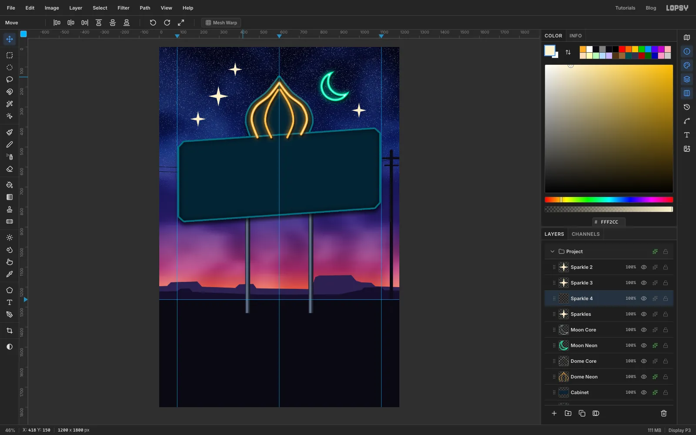

Click the *Sparkles* row again before each copy, so you always copy the big original. Paste two more: one at about (1012, 330) at 50%, and one high above the dome at about (396, 128) at 40%.

Click the top pasted layer and choose **Layer → Merge Down** three times, until all four sparkles are on *Sparkles*. Then give that layer a **Stroke** of **Width 3**, outside, in `#FFAA22`, and an **Outer Glow** in `#FFAA22` at **Size 24**, **Spread 4**, **Opacity 85**.

## Set "Hotel" and "XANADU"

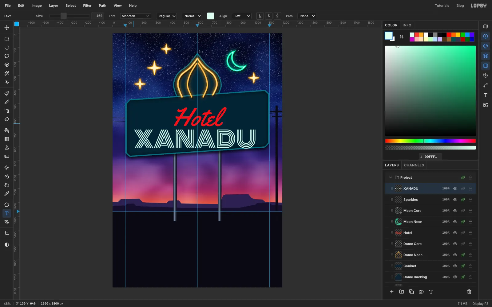

Click the *Dome Core* row first. The Text tool restyles whatever text layer is active, so start each new text from a normal layer.

Pick the **Text** tool. Choose **Yellowtail**, size **180**, set the colour to red `#FF3B2E`, click near the top of the cabinet, type **Hotel**, and press [[Tab]] to commit. Make sure **Letter spacing** in the Text panel is **0**.

Click the *Sparkles* row. Choose **Monoton**, size **160**, colour mint core `#DDFFF1`, click at the left of the cabinet, type **XANADU** and press [[Tab]]. Monoton is drawn as bundles of parallel lines, so it already looks like bent tubing.

Click **Rasterize Layer** at the bottom of the Layers panel for each word. Then move them with the **Move** tool. *XANADU* goes centred on the middle guide, with even margins of about 65 px each side. *Hotel* goes just right of centre, with roughly equal space above and below it.

## Tilt the words to match the cabinet

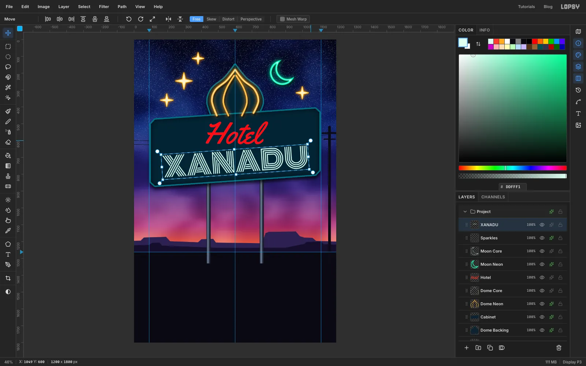

The cabinet rises about 4° to the right, so the type should too.

Draw a marquee a little bigger than *XANADU*. With the **Move** tool, press just outside the marquee's top-right corner, where the pointer turns into a rotate arrow, and drag upward until the word lines up with the cabinet's top edge (about 4°). Press [[Cmd+D]] to commit.

Do the same for *Hotel*, but tilt it a touch more (about 6°). That gives the script a little lift.

## Make the type glow

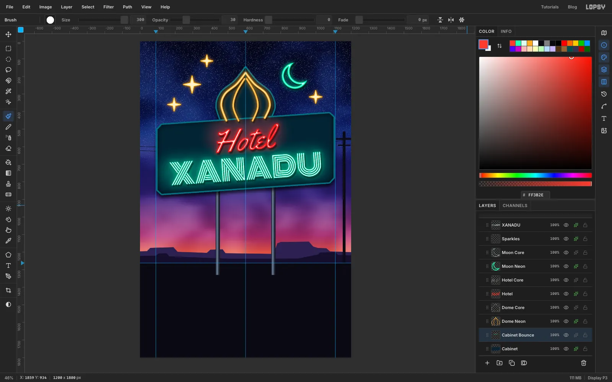

*Hotel* gets the tube recipe. Give it an **Outer Glow** in `#FF3B2E` at **Size 36**, **Spread 6**, **Opacity 80**, plus the usual **Drop Shadow**. Then [[Cmd]]-click its thumbnail, **Shrink** by **5**, click *Hotel*, **Add Layer** (*Hotel Core*) and fill with `#FFE0D6`.

*XANADU*'s pale fill is already the core. Give it a **Stroke** of **Width 1**, outside, in `#22FFB5`, an **Outer Glow** in `#22FFB5` at **Size 45**, **Spread 6**, **Opacity 75**, and the **Drop Shadow**.

Neon also tints the metal around it. Click *Cabinet*, click **Add Layer** and name it *Cabinet Bounce*. [[Cmd]]-click the *Cabinet* thumbnail, then click the *Cabinet Bounce* row.

Pick the **Brush** and open its settings. Set **Size 300**, **Hardness 0**, **Spacing 10**, **Opacity 30** and **Taper 0**. Paint one sweep of mint `#22FFB5` under *XANADU* and one of red `#FF3B2E` behind *Hotel*. Deselect, and set the layer's **Blend** to **Screen**.

## Cut the arrow and ring it with bulbs

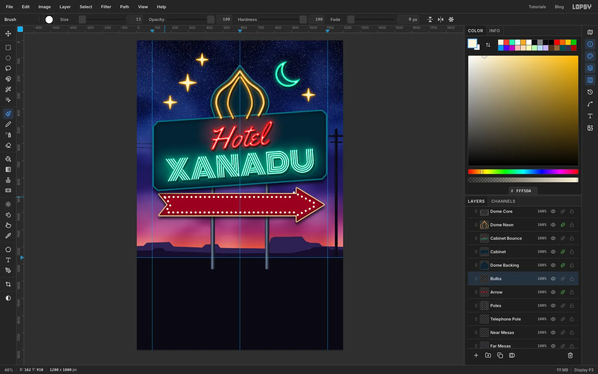

Click *Poles*, then click **Add Layer** and name the new layer *Arrow*. It sits behind the cabinet but in front of the poles. Set the foreground to `#8E1424`.

With the **Pen**, click the eight corners of an arrow:

- the shaft runs from x 130 to x 930, between y 893 and y 1017
- the head flares out to y 858 and y 1052, with its tip at (1088, 955)
- the tail is notched in to (180, 955)

Use **Path to Selection**, fill it and deselect. Add effects:

- **Stroke**: **Width 6**, outside, `#D8C08A`
- **Inner Glow**: black, **Size 30**, **Opacity 60**
- **Drop Shadow**: **Offset X 0**, **Offset Y 14**, **Blur 22**, **Opacity 70**

Click **Add Layer** and name it *Bulbs*. Pick the **Brush** and open its settings. Set **Size 13**, **Hardness 100**, **Opacity 100**, and **Spacing 200**: at 200% the dabs separate into a row of bulbs.

Set the foreground to `#FFF5DA`. Click at the start of the run, about 17 px inside the arrow's top-left corner. Then hold [[Shift]] and click your way around the arrow, about 17 px inside its edge, back to the start. Every Shift-click lays a straight row of bulbs.

## Light the bulbs and add COCKTAILS

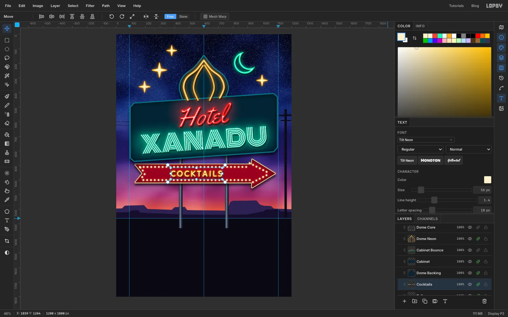

Give *Bulbs* an **Outer Glow** in `#FFB040` at **Size 16**, **Spread 10**, **Opacity 95**.

With *Bulbs* still active, pick the **Text** tool. Choose **Tilt Neon**, size **56**, colour `#FFF2CC`, and type **COCKTAILS**. Press [[Tab]], then set **Letter spacing** to **10** in the Text panel. Move it so it's centred on the shaft, with equal space to the bulb rows above and below. Here that's centred at y 955, just left of the arrow's middle so it balances against the head.

Give it a **Stroke** of **Width 2**, outside, in `#FFAA22`, an **Outer Glow** in `#FFAA22` at **Size 20**, **Spread 6**, **Opacity 90**, and the tube **Drop Shadow**.

## Hang a backlit reader board

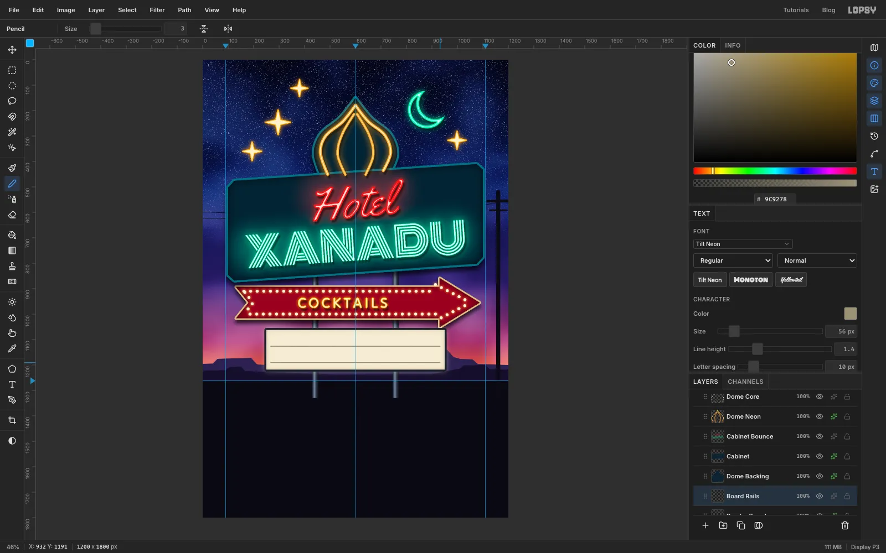

Click *Cocktails*, then **Add Layer** and name it *Reader Board*. With the marquee's corner dialog make **From 250, 1062** **To 950, 1218**. Fill it with `#F4ECD6` and deselect.

Add effects:

- **Stroke**: **Width 8**, outside, `#1C2029`
- **Inner Glow**: `#B9A57A`, **Size 26**, **Opacity 55**, so the light falls off toward the frame
- **Outer Glow**: `#FFF1C8`, **Size 30**, **Spread 0**, **Opacity 35**

Real reader boards have ledges the letters sit on. Click **Add Layer** and name it *Board Rails*. Pick the **Pencil**, set **Size 3** and the foreground to `#9C9278`. Click 18 px in from the board's left edge at y 1127, then [[Shift]]-click 18 px in from the right edge. Draw a second rail at y 1191.

## Seat the letters on the rails

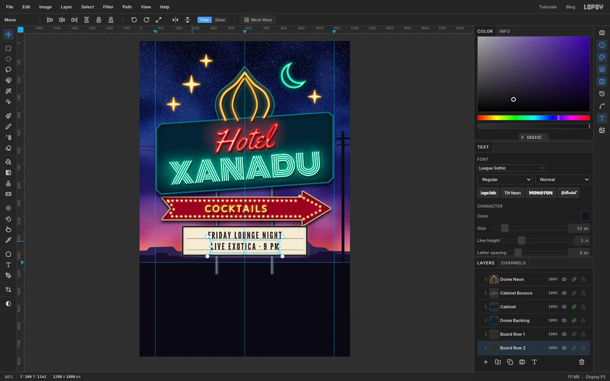

With *Board Rails* active, pick the **Text** tool. Choose **League Gothic**, size **52**, colour `#16131C`, and type **FRIDAY LOUNGE NIGHT**. Press [[Tab]] and set **Letter spacing** to **6**.

Click *Board Rails* again and type **LIVE EXOTICA · 9 PM** with the same settings.

Move each line so it's centred on the middle guide and its letters sit right on their rail. Zoom in to check: the bottoms of the letters should touch the rail without a gap or overlap. That gives the board about 25 px of padding top and bottom.

## Add NO VACANCY with the NO switched off

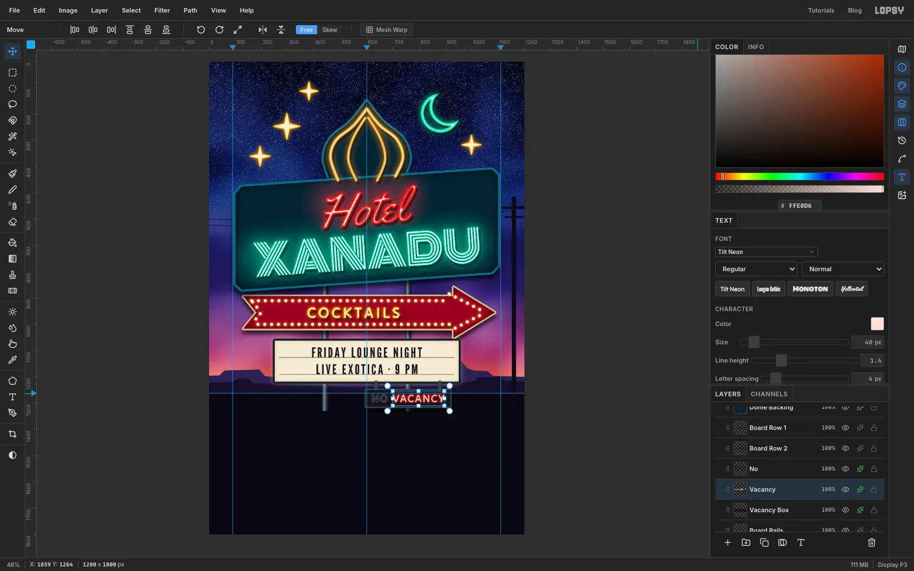

Click *Board Rails*, then **Add Layer** and name it *Vacancy Box*. Use the marquee dialog for **From 596, 1250** **To 918, 1314**, fill it with `#14161E`, and deselect. Give it a **Stroke** (**Width 5**, outside, `#3B4252`) and a **Drop Shadow** (**Offset Y 10**, **Blur 16**, **Opacity 70**).

Hang it from the board. Pick the **Pencil**, set **Size 4** and the foreground to `#3B4252`. Draw two short vertical rods from the bottom of the board to the top of the box, 40 px in from each end of the box.

Now set the words in **Tilt Neon**, size **40**, **Letter spacing 4**:

- Click *Vacancy Box*, type **NO** in the box colour `#14161E`, and give it a **Stroke** of **Width 2**, outside, in grey `#6A6F7A`. With no glow it reads as a dark glass tube that's switched off.
- Click *Vacancy Box* again and type **VACANCY** in `#FFE0D6`. Give it a red **Stroke** (**Width 2**, `#FF3B2E`), an **Outer Glow** in `#FF3B2E` at **Size 18**, and the tube **Drop Shadow**.

Leave about a word space between the two words and centre the pair in the box.

## Spill the neon light into the sky

Click *Telephone Pole*, then **Add Layer** and name it *Light Spill*. It sits behind the whole sign.

Pick the **Brush** and set **Size 520**, **Hardness 0**, **Spacing 10** and **Opacity 32**. Paint broad strokes of colour behind each neon:

- mint `#22FFB5` behind *XANADU*
- red `#FF3B2E` behind *Hotel*
- amber `#FFAA22` above the dome and behind the arrow

Set **Blend** to **Screen**.

## Group the sign

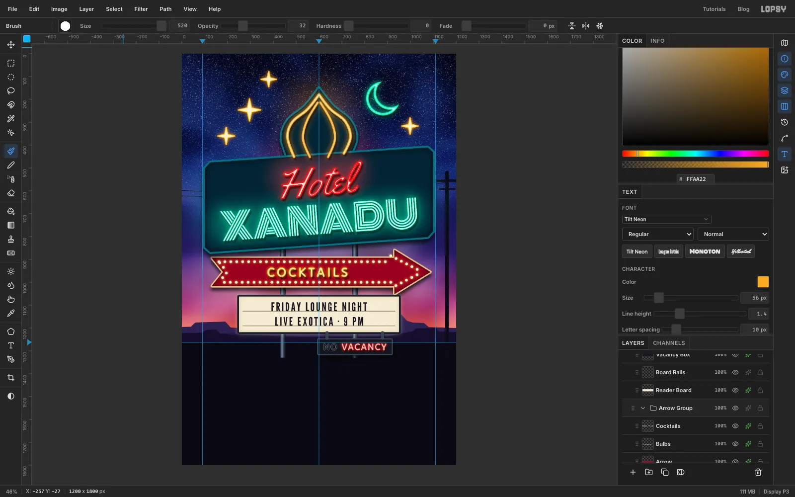

Groups keep the sign easy to move. Click *XANADU* at the top of the stack, then [[Shift]]-click *Dome Backing*. Choose **Layer → Group Layers** and rename the group *Neon Head*.

Do the same from *Board Row 1* down to *Reader Board* (name it *Reader Board Group*), and from *Cocktails* down to *Arrow* (*Arrow Group*).

## Nudge the whole head up

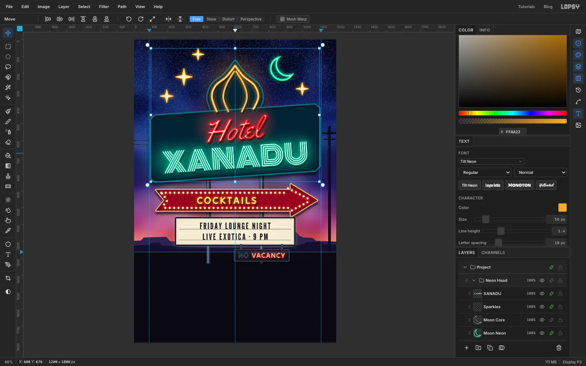

Click the *Neon Head* group's row and pick the **Move** tool. Drag anywhere on the cabinet and lift the whole head, dome, sparkles, moon and all, by about **24 px**. That gives the arrow some breathing room.

Press [[Cmd+Z]] and [[Cmd+Shift+Z]] a few times to compare. Everything in the group moves together, and nothing else on the canvas changes.

## Lay the road, spill light on the poles and plant the footings

Click *Near Mesas*, then **Add Layer** and name it *Asphalt*. Marquee from the horizon guide to the bottom-right corner, fill it with `#14121C` and deselect. Choose **Filter → Add Noise…** with **Amount 12**, **Mono** and **Gaussian** for a fine grit.

Click *Poles*, then **Add Layer** and name it *Pole Spill*. [[Cmd]]-click the *Poles* thumbnail and click the *Pole Spill* row. Set the **Brush** to **Size 160**, **Hardness 0**, **Opacity 70**, and the foreground to `#FFB347`. Paint a stroke across both poles just under the arrow, and another near the ground. Deselect and set **Blend** to **Overlay**. The steel now picks up the arrow's warm light.

Click **Add Layer** and name it *Footings*. With the **Elliptical Marquee**'s dialog, make **From 412, 1323** **To 472, 1337** under the left pole. Hold [[Shift]] and drag two more ellipses to add them: one under the right pole and one under the telephone pole. Fill the selection with `#15131F` and deselect.

## Copy just the sign for its reflection

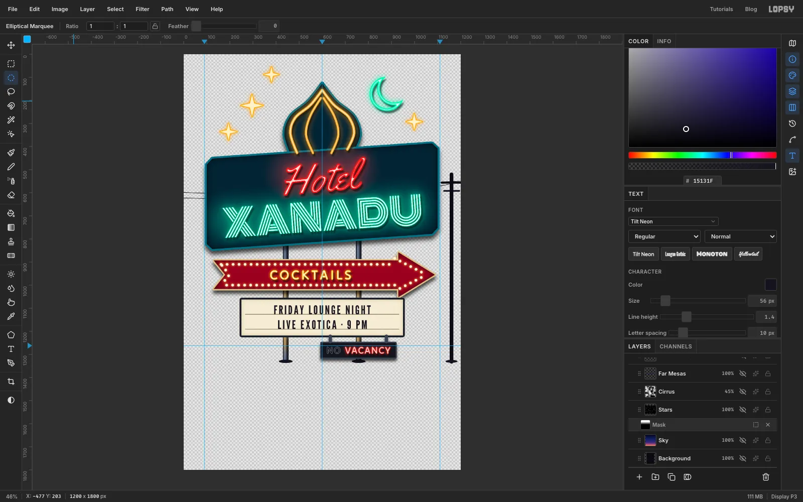

A wet road reflects the bright sign, not the dark sky. So hide everything behind the sign before copying. Click the eye on *Light Spill*, *Asphalt*, *Near Mesas*, *Far Mesas*, *Cirrus*, *Stars*, *Sky* and *Background*.

With the marquee dialog, select **From 0, 600** **To 1200, 1330**. That's the lower half of the sign, down to the footings. Choose **Edit → Copy Merged**, press [[Cmd+D]], and click the eyes again to show the hidden layers.

## Flip and squash the reflection

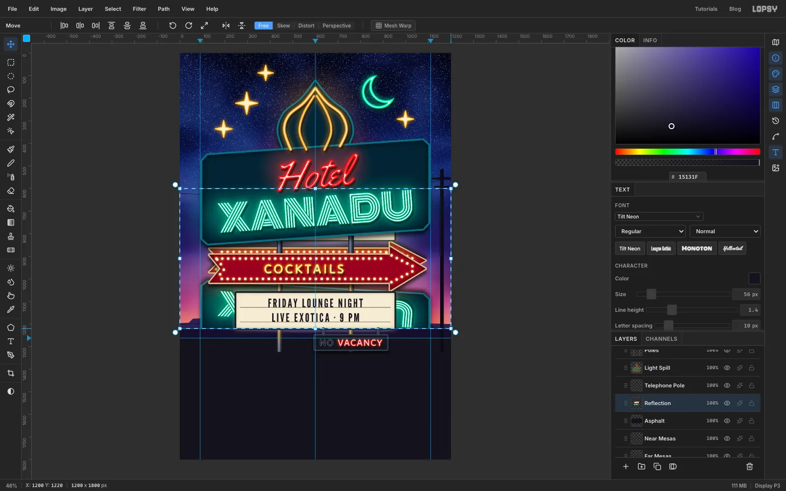

Click *Asphalt* and press [[Cmd+V]]. The copy lands in place above the road. Rename it *Reflection* and choose **Image → Flip Vertical**.

Reflections in a wet road look a little shorter than the real thing. Marquee the same area again (**From 0, 600** **To 1200, 1330**). With the **Move** tool, drag the bottom-right handle straight up by about 110 px, without [[Cmd]], to squash it to about 85% of its height. Press [[Cmd+D]].

Now drag the layer straight down until its top edge sits on the footings at y 1330.

## Smear it into wet asphalt

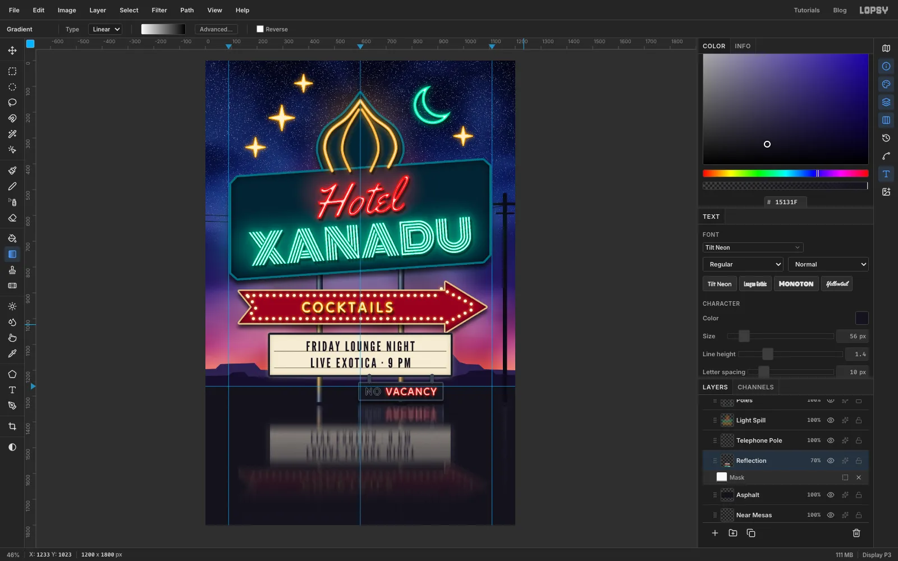

Choose **Filter → Motion Blur…** with **Angle 90** and **Distance 45** to drag the light into vertical streaks. Then add **Filter → Gaussian Blur…** with **Radius 2**. Set the layer's **Blend** to **Screen** and its opacity to **70%**.

Click **Add Mask**, then click the mask thumbnail. Drag a white-to-black linear gradient from the footings (y 1330) down to about y 1710, so the reflection fades into the distance.

While you're still in the mask, choose **Filter → Add Noise…** (**Amount 40**, **Mono**). Then choose **Filter → Motion Blur…** with **Angle 0** and **Distance 80**. The noise smears sideways into ripples that break up the reflection. Click the layer's name when you're done.

## Pool the light on the road and add the footer

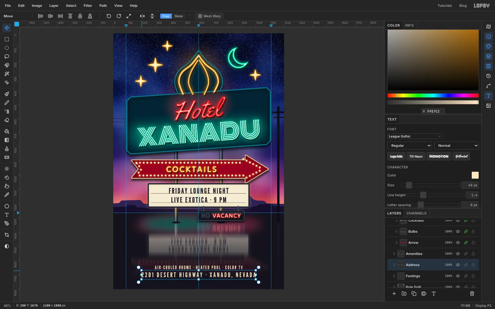

With *Reflection* active, click **Add Layer** and name it *Ground Spill*. Use the **Elliptical Marquee**'s dialog for **From 160, 1270** **To 1040, 1420**, then choose **Select → Feather…** with **70** px. Fill with `#FF4A6A`.

Make a smaller ellipse under the left pole, **From 200, 1290** **To 700, 1390**, feather it by **70** and fill it with `#3FFFD0`. Deselect, set **Blend** to **Screen** and the opacity to **28%**.

Now the footer. Click *Footings* so the new text starts from a normal layer. Pick the **Text** tool with **League Gothic**, size **34**, colour `#FFE7C2`, **Letter spacing 5**. Type **AIR-COOLED ROOMS · HEATED POOL · COLOR TV** and centre it at about y 1646.

Click *Footings* again, set size **46** and **Letter spacing 8**, and type **2201 DESERT HIGHWAY · XANADU, NEVADA**. Centre it at about y 1700.

## Darken the edges of the sky

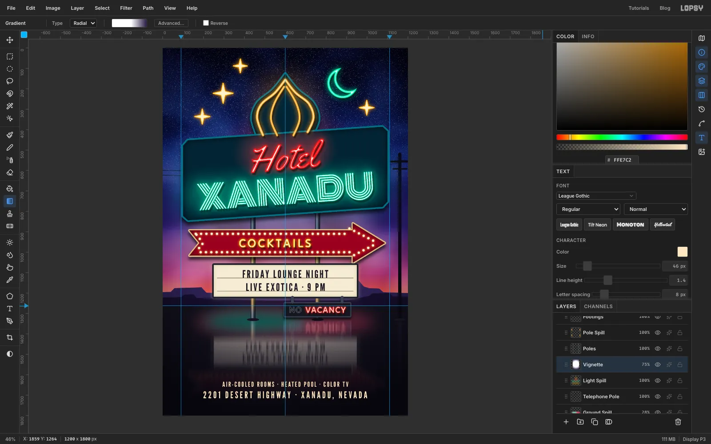

Click *Light Spill*, then **Add Layer** and name it *Vignette*. It sits behind the sign so the neon stays bright.

Pick the **Gradient** tool, switch it to **Radial**, and make a three-stop gradient in **Advanced…**: white `#FFFFFF` at the left end, white again at 55%, and `#2A1C44` at the right end. Drag from the middle of the sign (about 600, 820) straight down to the bottom edge. Set **Blend** to **Multiply** and the opacity to **75%**.

## Make the bulbs chase

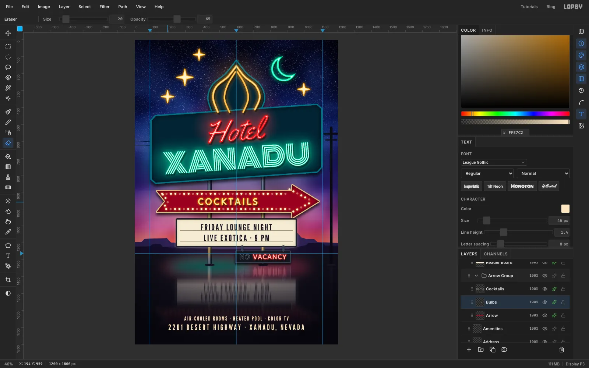

Chaser bulbs light in turns, so a photo always catches some of them dim. Click *Bulbs* and pick the **Eraser**. Set **Size 20** and **Opacity 65%**.

Click every third bulb, working around the arrow. Each click leaves a dimmer bulb with a weaker glow.

Choose **File → Save Project** to keep the layers, then **File → Export…** for a PNG to print or post.
