Neubrutalism suits data better than you might expect. Its thick outlines, flat
colour and blocky shapes push you towards charts that say one thing loudly. In
this tutorial you'll build **Espresso Jitters**, a 1500 × 2000 poster about what
five espresso shots do to one Tuesday. It has three charts in a bento grid:
hourly caffeine in the blood, milligrams per drink, and a coffee cup seen from
above whose rim works as a donut chart.

You'll use pattern fills, guides, the Shape tool, layer effects, groups,
multi-layer rotation, the Halftone filter, a photo and text on a path.

Every colour is flat:

- Ink `#17120E`
- Bone `#F6EEDD`
- Tomato `#FF5A36`
- Mint `#7CF0C0`
- Lilac `#B79CFF`
- Mustard `#FFC629`
- Coffee `#4A2A18`, bean dots `#C9975F`

**The numbers.** Caffeine per drink comes from Mayo Clinic's table (2025 version).
The 400 mg a day is the figure the U.S. FDA cites for most adults. The hourly levels
are a simple model: caffeine halves every 5 hours and each dose arrives instantly.
The 5-hour half-life is a common estimate, not an FDA figure. Doses are two shots at
08:00, one at 11:00 and two at 15:00, with 63 mg in a shot.

**The photo.** You'll need
[Roasted coffee beans](https://commons.wikimedia.org/wiki/File:Roasted_coffee_beans.jpg)
by MarkSweep on Wikimedia Commons, released into the **public domain**. Download
the 1600 × 1200 original.

**Five habits to use throughout.**

- **Exact selections.** With nothing selected, a single click with a Marquee
  opens a dialog where you type **From** and **To** corners. Use it whenever a
  step gives coordinates. The status bar shows the cursor position as you move.
- **Exact shapes.** With the **Shape** tool set to **Pixels**, a single click
  opens a dialog for **Width** and **Height**, and the shape is centred on your
  click. Cards use two shapes on one layer, and the gap between your two clicks
  sets the shadow, so zoom in (hold [[Cmd]] and scroll) if you need to be accurate.
  Set **Stroke** before each shape, because it carries over: every shadow has no
  stroke.
- **New text.** Before you set up new text, click a raster layer's row, so the
  options don't restyle the last text layer. Open the **Text** panel from the T icon
  on the right-hand rail. Set **Line height** `1`, **Letter spacing** `0` and **Align
  left** unless a step says otherwise, because these carry over. Press [[Tab]] to
  commit text. If your click lands inside existing text, it edits that text instead,
  so start new text in empty space and move it afterwards.
- **Moving and turning.** Rotation handles and arrow-key nudges only work with the
  **Move** tool, so press V first after typing text or making a marquee. Hold [[Shift]]
  to nudge 10 px at a time.
- **Effects.** Close the **Layer effects** drawer with its X when you've finished with
  it. It floats over the canvas and catches clicks meant for the picture.

## Set up the mustard ground

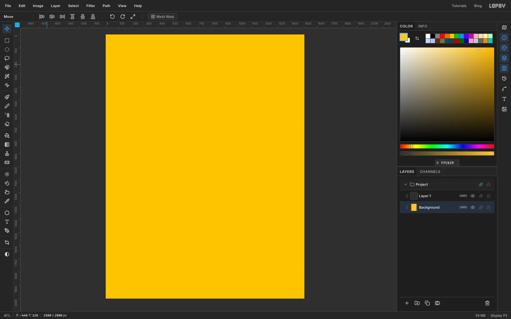

Choose **File → New**, set **Width** `1500` and **Height** `2000` in pixels, and
click **Create**.

Click the **Background** row, set the foreground to Mustard `#FFC629` and choose
**Edit → Fill**. Leave `Layer 1` for the next step.

## Draw a graph-paper tile

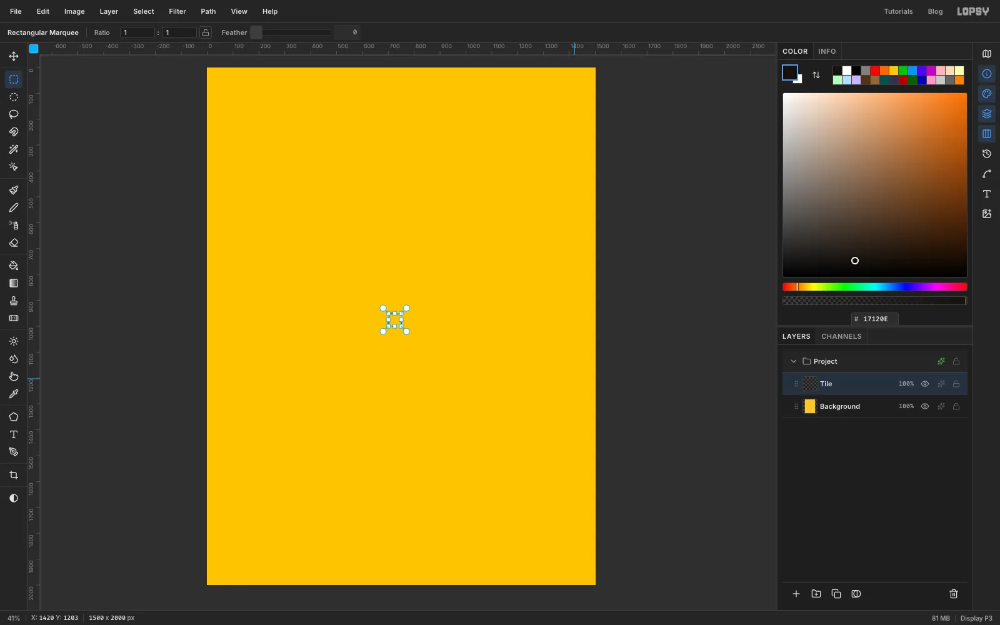

Click `Layer 1` and rename it `Tile`. Pick the **Pencil** (N) at **Size** `3` and set
the foreground to Ink `#17120E`.

This step needs exact pixels, so zoom in on the middle of the canvas to at least 200%
and watch the status bar. Draw an L: click at `701, 951`, then [[Shift]]-click at
`750, 951` for the top line. Click at `701, 951` again and [[Shift]]-click at
`701, 1000` for the side.

Use an exact Rectangular Marquee from `700, 950` to `750, 1000`, then choose
**Edit → Define Pattern**. Press [[Cmd+D]] to deselect, delete the layer with the bin
icon under the Layers panel, and zoom back out to fit the page.

## Fill the page with the pattern

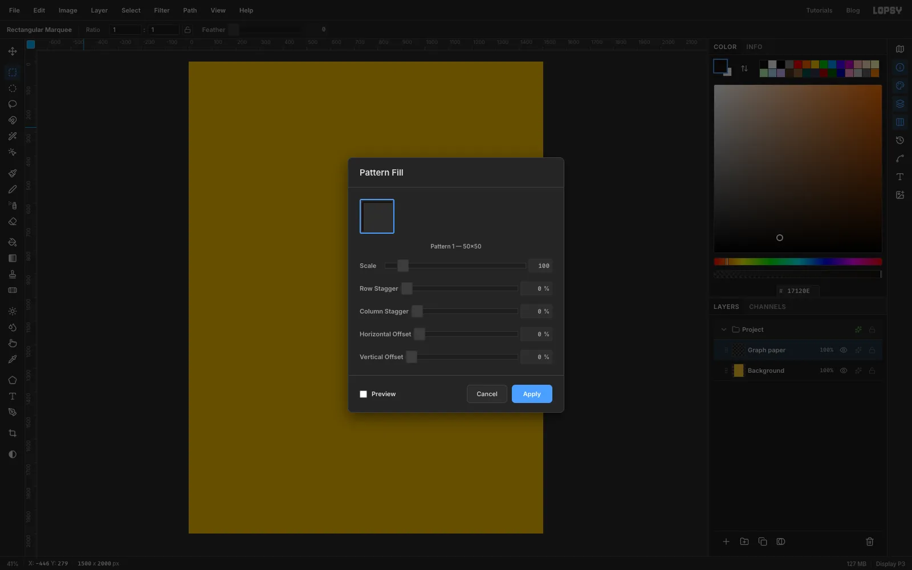

Click **Add Layer** (the + under the Layers panel) and double-click the new row
to rename it `Graph paper`. Choose **Edit → Fill with Pattern…**, make sure your
new tile is selected and click **Apply**.

## Fade the grid back

Click the `100%` on the Graph paper row and set the opacity to `22%`. The grid
should sit quietly behind everything, as a nod to chart paper.

## Lay out the bento grid with guides

Click a ruler to drop a guide. Clicking the top ruler makes a vertical guide, and
the left ruler a horizontal one. Add these:

- Vertical at `60`, `880`, `920` and `1440`
- Horizontal at `60`, `520`, `570`, `1190`, `1240`, `1800`, `1850` and `1940`

That gives a full-width title, a full-width chart, two panels side by side and a
footer strip.

## Build the first card

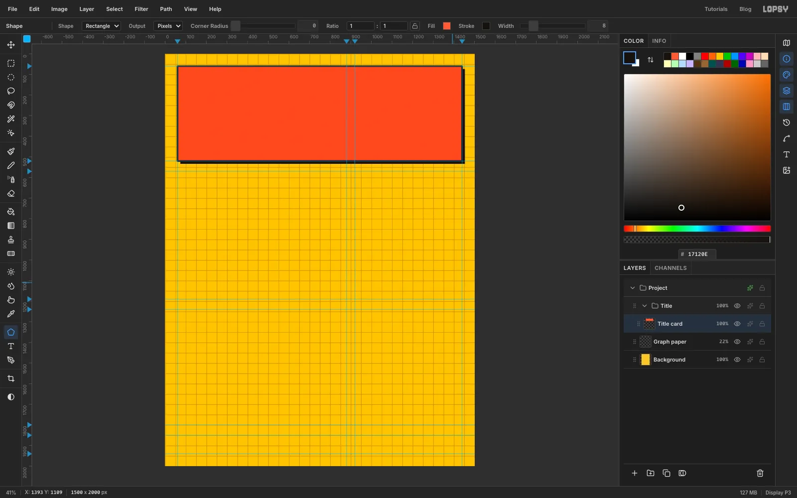

Every panel gets its own group. With **Graph paper** active, click **New Group**
(the folder with a + under the Layers panel) and rename it `Title`. Click **Add
Layer** and rename the new layer `Title card`. It should sit inside the group.

Pick the **Shape** tool (U). Set **Shape** to **Rectangle**, **Output** to
**Pixels** and **Corner Radius** to `0`. Click the **Fill** swatch and type Ink
into its hex field, and use **Remove stroke** if there's a stroke. Close the
popover by clicking the swatch again.

Click at `764, 304` and enter **Width** `1380`, **Height** `460`. That's the hard
shadow. Now change **Fill** to Tomato, add a **Stroke** in Ink at **Width** `8`,
then click at `750, 290` and enter the same size. Both shapes stay on one layer,
and the 14 px offset between them is the shadow.

## Add the other four cards

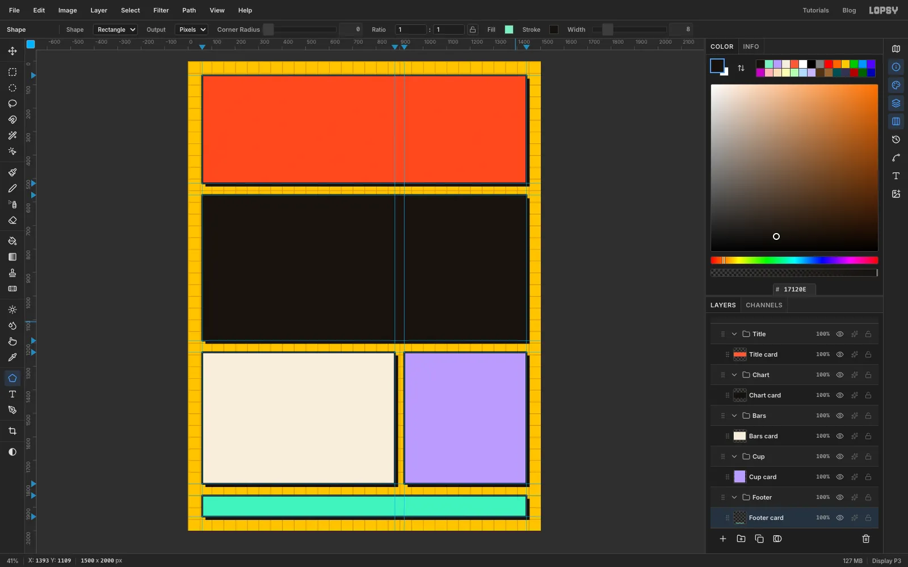

Repeat that for each card below. Each time, click the **Graph paper** row first,
then **New Group**, then **Add Layer**. A new group lands directly above the
active layer, so the Title group stays on top and its stickers can overlap
what's below.

Each shadow is an Ink shape 14 px down and to the right, with no stroke. Each card
is the fill colour with an 8 px Ink stroke.

- **Chart** / `Chart card`: Ink, centre `750, 880`, size 1380 × 620
- **Bars** / `Bars card`: Bone, centre `470, 1520`, size 820 × 560
- **Cup** / `Cup card`: Lilac, centre `1180, 1520`, size 520 × 560
- **Footer** / `Footer card`: Mint, centre `750, 1895`, size 1380 × 90

## Start the comic dots

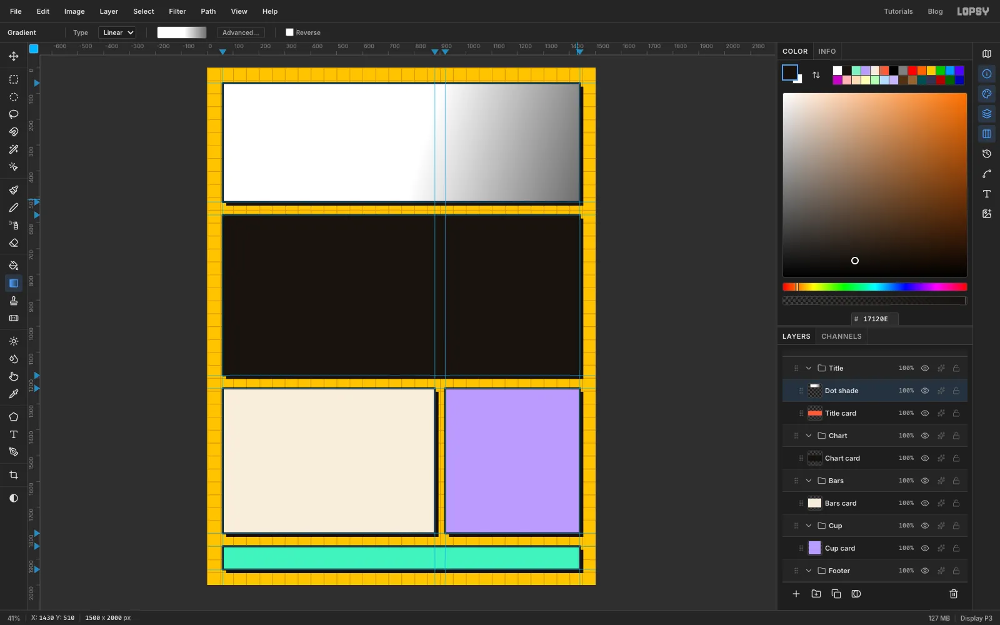

Click the **Title card** row. Make an exact Rectangular Marquee from `64, 64` to
`1436, 516`, just inside the outline. **Add Layer** and rename it `Dot shade`.

Pick the **Gradient** tool, keep **Type** on **Linear** and click **Advanced…**. The
end stops are already there, so click each one and type its colour into the **Hex**
field: white `#FFFFFF` on the left and grey `#707070` on the right. Click the empty
row beside the bar at about 55% to add a middle stop, and make that white too. Click
**Done**.

Drag from the top-left corner of the card to the bottom-right corner, then press
[[Cmd+D]]. The tomato disappears for now. The blend mode in the next step brings it
back.

## Turn the gradient into halftone dots

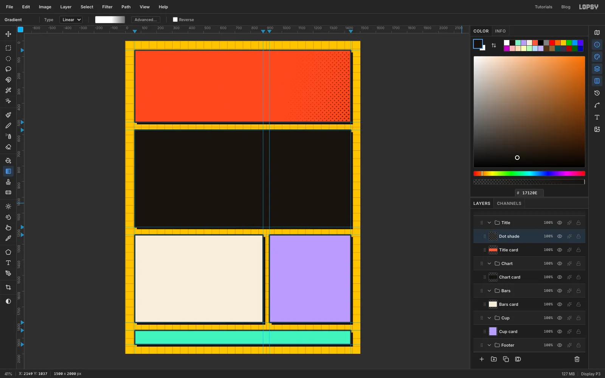

Choose **Filter → Halftone** and set **Dot Size** `18`, **Density** `1`, **Angle**
`45`, **Softness** `1`. Click **Apply**. White prints no dot, so the left side
stays clean while the dots grow towards the corner.

Click the row's **Layer effects** icon and set the blend mode to **Multiply**, so
the dots darken the tomato instead of covering it in grey. Close the drawer with its X.

## Set the headline

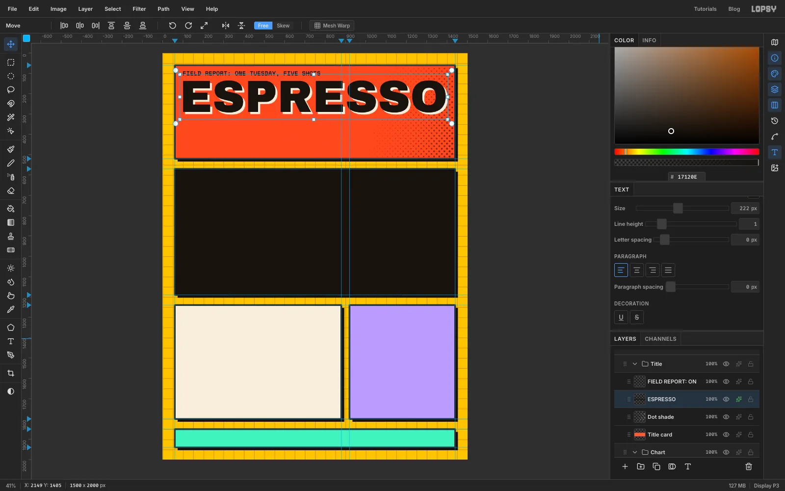

Click the **Dot shade** row. Pick the **Text** tool (T), set the font to **Space
Mono**, weight **Bold**, **Size** `30` and the foreground to Ink. Click near the
top-left of the card and type:

`FIELD REPORT: ONE TUESDAY, FIVE SHOTS`

Press [[Tab]]. Click **Dot shade** again, set the font to **Archivo Black** at
**Size** `222`, click just below the first line and type `ESPRESSO`, then press
[[Tab]].

Press V and use the arrow keys to line both up, with their left edges at about
`x = 100`, the small line's top at about `y = 88` and ESPRESSO's top at about
`y = 134`.

With ESPRESSO active, open its **Layer effects** and turn on **Drop Shadow**:
colour Bone, **Offset X** and **Offset Y** `10`, **Blur** `0`, **Spread** `0`,
**Opacity** `100`. Close the drawer.

## Make the seven letter tiles

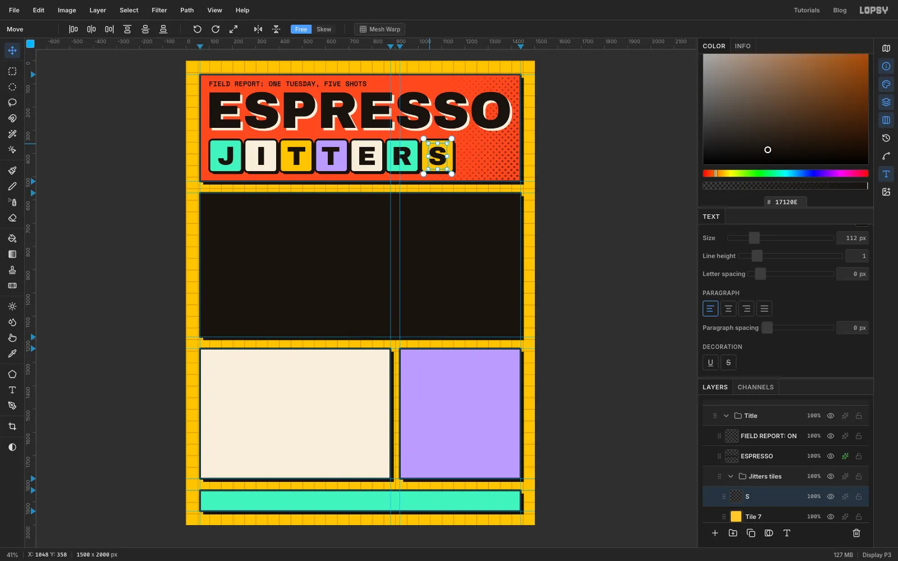

Click **Dot shade**, click **New Group** and rename it `Jitters tiles`. For each
tile, **Add Layer**, then use the **Shape** tool with **Corner Radius** `14`:

1. Ink, no stroke, size 140 × 140, centred 9 px down and right of the tile's spot.
2. The tile's colour with an 8 px Ink stroke, size 140 × 140, on the spot itself.
3. With that tile active, add the letter in **Archivo Black**, **Size** `112`,
   Ink. Press V and nudge it to the middle of the tile.

All seven centre on `y = 410`:

- **J**, Mint, `x = 170`
- **I**, Bone, `x = 322`
- **T**, Mustard, `x = 474`
- **T**, Lilac, `x = 626` (put this letter 5 px left of centre, because the tilt
  pushes it right)
- **E**, Bone, `x = 778`
- **R**, Mint, `x = 930`
- **S**, Mustard, `x = 1082`

Click the last letter's row before each **Add Layer**, so the tiles stack in order.

## Tilt each tile with its letter

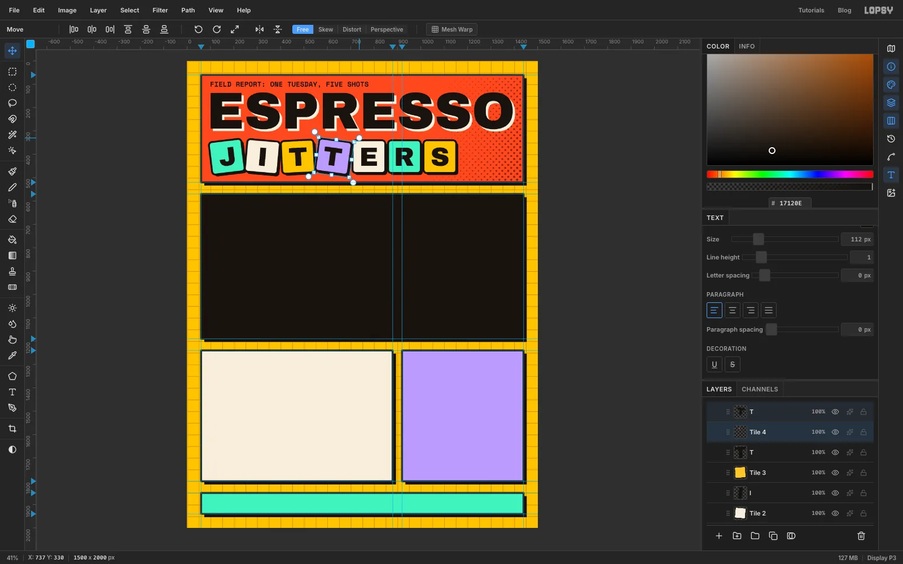

This is where the jitters come in. Click a tile's row, then [[Cmd]]-click its
letter's row. With the **Move** tool active and no marquee, handles frame both
layers. Hover just outside the top-right corner until you see the round rotation
handle, and drag to turn them together.

Press [[Cmd+D]] to commit before moving on. Start with the J, then work along the row.

## Vary the angles

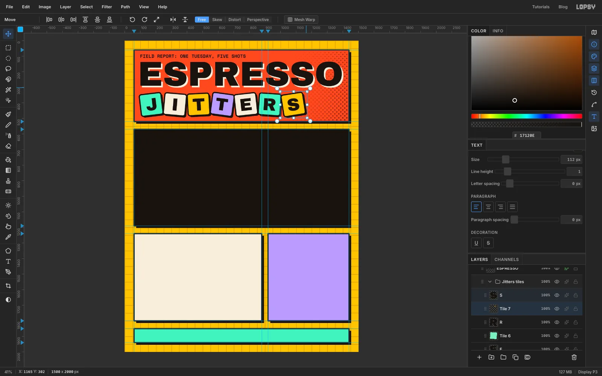

Give each tile its own tilt, alternating directions so the row looks unsteady. These
angles are rough, so judge them by eye:

- J: 7° anticlockwise
- I: 5° clockwise
- First T: 3° anticlockwise
- Second T: 8° clockwise
- E: 6° anticlockwise
- R: 4° clockwise
- S: 9° anticlockwise

Press [[Cmd+Z]] and redo if an angle overshoots. To shift the whole row later,
click the **Jitters tiles** group row and nudge it with the arrow keys.

## Start the starburst

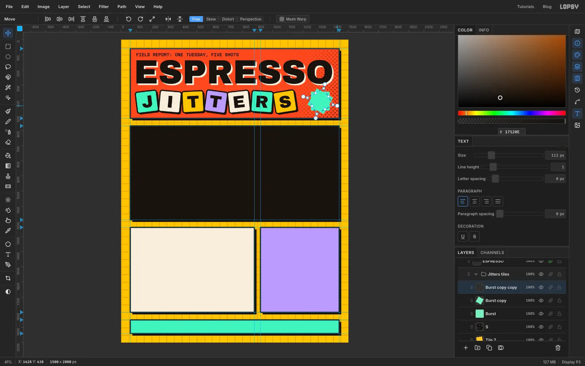

Click the last letter's row, **Add Layer** and rename it `Burst`. Draw a square
with the **Shape** tool: Mint, no stroke, **Corner Radius** `0`, 124 × 124, centred
on `1315, 407`.

1. Choose **Layer → Duplicate Layer** and click the copy's row.
2. Make an exact Rectangular Marquee from `1253, 345` to `1377, 469`, around the
   square. Press V, hold [[Cmd]] and drag the rotation handle to turn it 30° (Cmd
   snaps to 15° steps). Press [[Cmd+D]].
3. Duplicate that copy, click its row, draw the same marquee, press V and
   [[Cmd]]-rotate 60°. Press [[Cmd+D]].

The second marquee clips the first copy's corners, which gives the star its uneven
points.

## Merge and outline the burst

With the top copy active, choose **Layer → Merge Down** twice, so the copies and
the square become one layer. Then click its row and open **Layer effects**:

- **Stroke**: Ink, **Width** `7`
- **Drop Shadow**: Ink, **Offset X** and **Y** `9`, **Blur** `0`, **Spread** `0`,
  **Opacity** `100`

The effects follow the merged outline, which is why you merge first. Close the
drawer.

## Label the burst and tilt it

With the burst row active, add `315` in **Archivo Black**, **Size** `44`, Ink. Click
the burst row again and add `MG DRUNK` in **Space Mono Bold**, **Size** `18`. Press V
and nudge them to the middle of the star, with `315` above `MG DRUNK`.

Click the burst row, [[Cmd]]-click both text rows, and rotate all three about 10°
anticlockwise. Press [[Cmd+D]]. That finishes the title panel.

## Rule the gridlines and start the bars

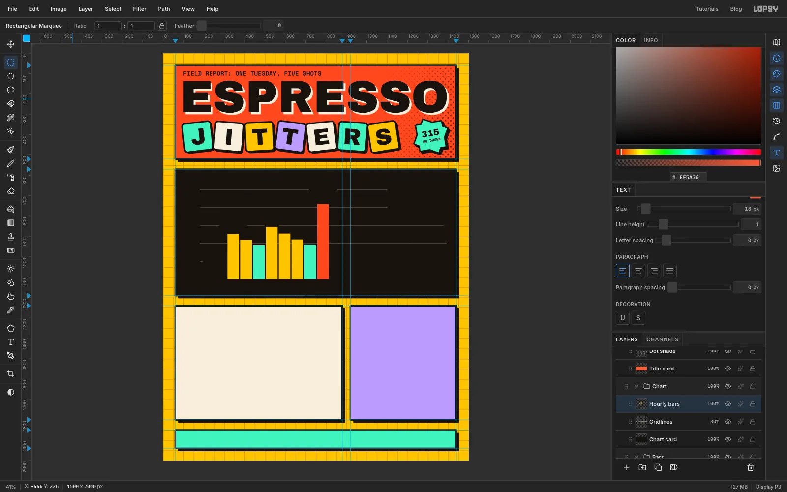

Now for the main chart. Its scale is `y = 1110 − 1.76 × milligrams`, so 50 mg is
88 px tall.

Click **Chart card**, **Add Layer**, rename it `Gridlines`. Pick the **Pencil**
at **Size** `2` in Bone, and draw each line by clicking one end and
[[Shift]]-clicking the other. The gaps leave room for labels and the sticker you'll
add later:

- `y = 670` (250 mg): `x` 182 to 714, and 856 to 1100
- `y = 758` (200 mg): `x` 182 to 1100
- `y = 846` (150 mg): `x` 182 to 276, 414 to 497, and 570 to 1376
- `y = 934` (100 mg): `x` 182 to 1392
- `y = 1022` (50 mg): a short tick from `x` 182 to 194

Set the layer's opacity to `30%`.

**Add Layer** again and rename it `Hourly bars`. Each bar is 57 px wide and ends
at `y = 1110`, so use an exact Rectangular Marquee from `x, top` to
`x + 57, 1110`, then set the foreground, choose **Edit → Fill** and press
[[Cmd+D]]. Start with these bars:

- 08:00: `x 316`, top `888`, Mustard
- 09:00: `x 379`, top `917`, Mustard
- 10:00: `x 442`, top `942`, Mint
- 11:00: `x 505`, top `853`, Mustard
- 12:00: `x 568`, top `886`, Mustard
- 13:00: `x 631`, top `915`, Mustard
- 14:00: `x 694`, top `940`, Mint
- 15:00: `x 757`, top `741`, Tomato

Colour shows the level: Tomato for 150 mg and up, Mustard for 100 and up, Mint
below that. The 06:00 and 07:00 columns stay empty because nothing's been drunk yet.

## Finish the bars

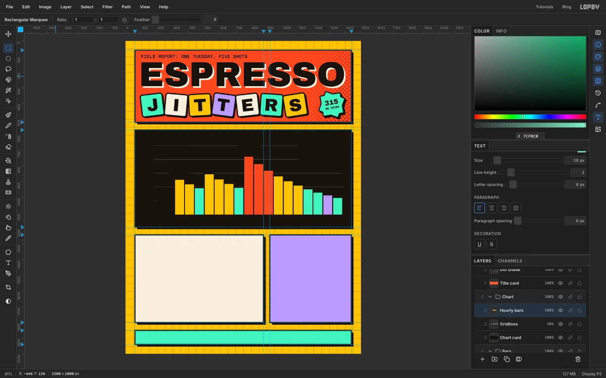

Add the rest the same way:

- 16:00: `x 820`, top `788`, Tomato
- 17:00: `x 883`, top `830`, Tomato
- 18:00: `x 946`, top `866`, Mustard
- 19:00: `x 1009`, top `898`, Mustard
- 20:00: `x 1072`, top `925`, Mustard
- 21:00: `x 1135`, top `949`, Mint
- 22:00: `x 1198`, top `970`, Mint
- 23:00: `x 1261`, top `988`, Lilac
- 24:00: `x 1324`, top `1004`, Mint

The stepped blocks suit the style better than a smooth curve, and the sawtooth
shape shows each dose landing on what's left of the last one.

## Label the axes and the doses

**Baseline.** **Add Layer**, rename it `Baseline`. With the **Pencil** at **Size**
`6` in Bone, click `182, 1113` and [[Shift]]-click `1392, 1113`.

**Hours.** With Baseline active, add each label in **Space Mono Bold**, **Size**
`24`, Bone, clicking the Baseline row before each one. Add every second hour, `06`
to `24`, and centre each under its column. The columns are 63 px apart, and the
06:00 column's centre is at `x = 218`. Keep the tops at about `y = 1130`. Working
from right to left stops your clicks landing in earlier text.

**Milligrams.** One text layer does all six labels. Click Baseline, keep Space
Mono Bold in Bone, set **Size** `22`, **Line height** `4` and **Align right**, and
type each value on its own line: `250`, `200`, `150`, `100`, `50`, `0`. At Size 22,
Line height 4 gives exactly the chart's 88 px spacing. Press [[Tab]], press V and nudge
the block until its right edge is at `x = 168` and `250` sits on its gridline. Click
the Baseline row before you set **Align left** again, or the labels will change too.

**Doses.** Above each dose bar add a value in **Archivo Black**, **Size** `30`, Bone,
about 10 px above the bar: `126`, `146` and `210`, on the 08:00, 11:00 and 15:00 bars.
Above each value, click the Baseline row, **Add Layer** and draw a pill with the
**Shape** tool: Lilac fill, Ink stroke **Width** `4`, **Corner Radius** `20`, size
126 × 38, centred on its bar 66 px above the bar's top. That puts them at `345, 822`,
`534, 787` and `786, 675`. Add each pill's label in **Space Mono Bold**, **Size** `20`,
Ink: `2 SHOTS`, `1 SHOT`, `2 SHOTS`.

## Title the chart

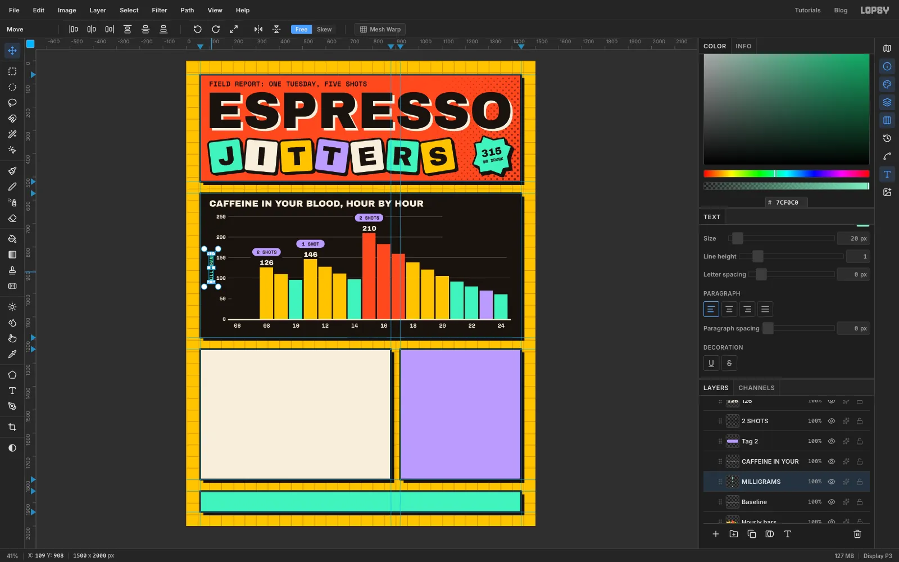

Click Baseline and add `CAFFEINE IN YOUR BLOOD, HOUR BY HOUR` in **Archivo Black**,
**Size** `38`, Bone. Nudge its left edge to `x = 100` and its top to about `y = 600`.

Click Baseline again and add `MILLIGRAMS` in **Space Mono Bold**, **Size** `20`,
Mint. Press V, hold [[Cmd]] and rotate it 90° anticlockwise with the rotation
handle, then press [[Cmd+D]]. Nudge it to the left of the axis labels, with its
left edge at `x = 100`, centred beside the bars.

## Add the key and the bedtime card

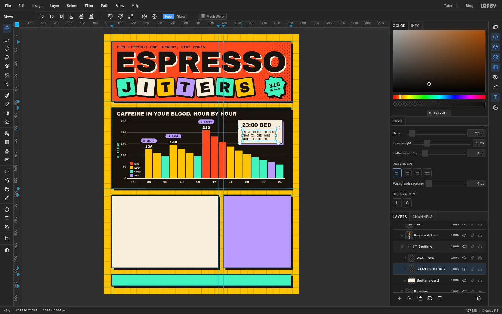

**Key.** Click Baseline, **Add Layer**, rename it `Key swatches`. Fill four 24 × 24
squares from `x = 200`, at `y` `986`, `1016`, `1046` and `1076`, in Tomato, Mustard,
Mint and Lilac. Beside them at `x = 234`, add `150+`, `100+`, `<100` and `BED` in
**Space Mono Bold**, **Size** `20`, Bone.

**Card.** Click Baseline, click **New Group**, rename it `Bedtime`. **Add Layer**,
rename it `Bedtime card`. With the **Shape** tool, **Corner Radius** `10`, draw a
340 × 190 Lilac shape with no stroke, centred on `1212, 762`. Then draw a Bone one
with a 6 px Ink stroke, the same size, centred on `1202, 752`.

Add `23:00 BED` in **Archivo Black**, **Size** `40`, Ink. Click the card's row and
add this in **Space Mono Regular**, **Size** `22`, **Line height** `1.25`:

`69 MG STILL IN YOU.`
`THAT IS ONE MORE`
`WHOLE ESPRESSO.`

Press [[Enter]] between lines. Press V and nudge both blocks so their left edges sit
at `x = 1066`, with the heading's top at `y = 686` and the small text's at `y = 746`.

## Tilt the card and draw its arrow

Click the card's row, [[Cmd]]-click both text rows, press V and rotate them about 4°
clockwise. Press [[Cmd+D]].

Click the card's row, **Add Layer**, rename it `Arrow` and set the foreground to
Lilac. Pick the **Pen** (P), set **Stroke** to `7`, and click once under the
card at about `1250, 862`. Then press at the top of the 23:00 bar, about 20 px above
it, and drag a little downwards to curve the line.

## Finish the arrow

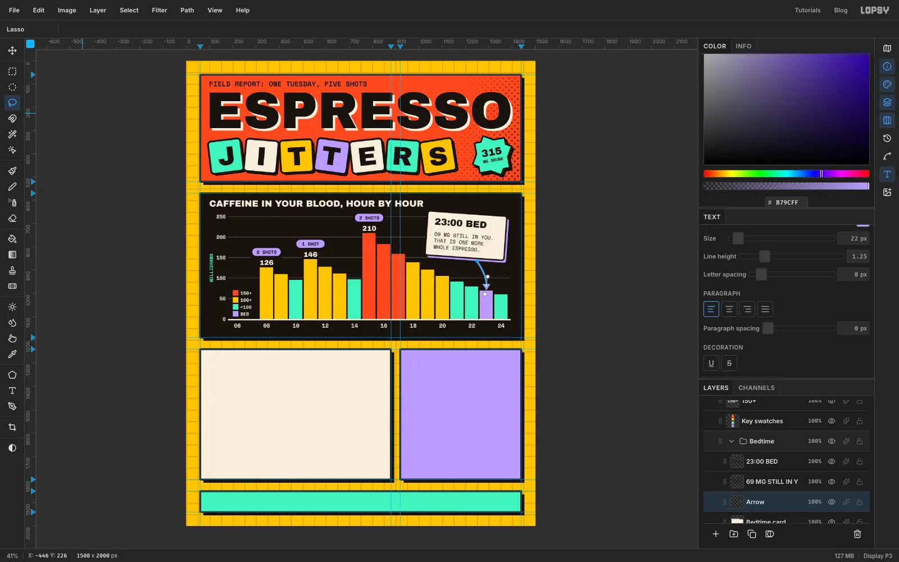

Press [[Enter]] to stroke the path. Then pick the **Lasso** (L), drag a small
downward triangle at the end of the line, choose **Edit → Fill** and press
[[Cmd+D]]. Lilac ties the arrow, the card's shadow, the bar and the key together.

## Draw the drink bars

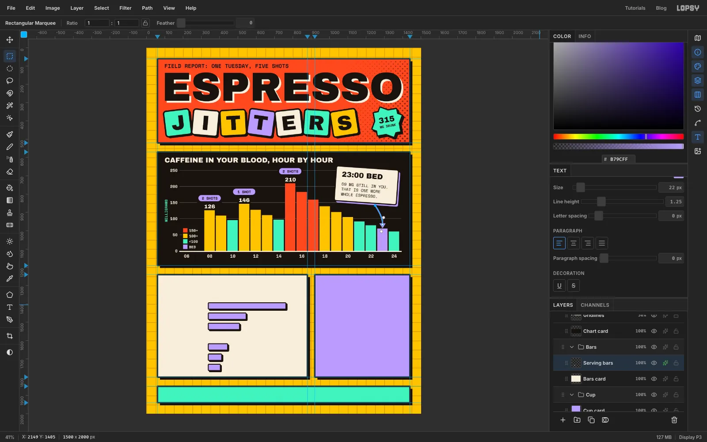

Click **Bars card**, **Add Layer**, rename it `Serving bars`. All bars start at
`x = 340` and are 30 px tall, with 56 px from one row to the next, starting at
`y = 1396`. The width is milligrams × 2.1. Marquee and fill each one in Lilac on
this one layer, leaving row 4 empty for now:

- Row 1, `y 1396`: Energy shot, 200 mg, width `420`
- Row 2, `y 1452`: Brewed coffee, 96 mg, width `202`
- Row 3, `y 1508`: Energy drink, 79 mg, width `166`
- Row 5, `y 1620`: Black tea, 48 mg, width `101`
- Row 6, `y 1676`: Cola, 33 mg, width `69`
- Row 7, `y 1732`: Green tea, 29 mg, width `61`

Open **Layer effects** and add a **Stroke** in Ink, **Width** `5`, and a **Drop
Shadow** in Ink with both offsets `6`, **Blur** `0`, **Spread** `0`, **Opacity**
`100`. Close the drawer.

## Highlight espresso and add the values

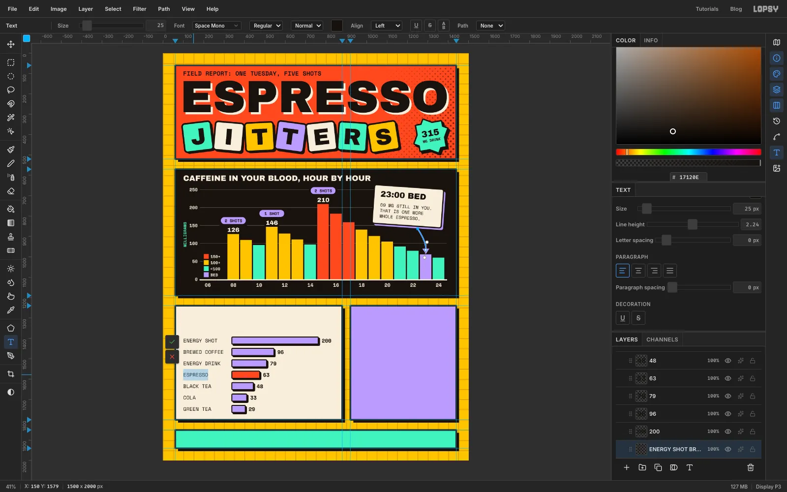

**Add Layer**, rename it `Espresso bar`. Fill the row 4 bar in Tomato: `y 1564`,
width `132`. Give it the same two effects, and close the drawer.

With the Espresso bar row active, add each value in **Space Mono Bold**, **Size**
`26`, Ink, 20 px past the end of its bar, starting from the bottom row and clicking
the row again each time.

Then add the row labels as one text layer in **Space Mono Regular**, **Size** `25`,
**Line height** `2.24`, which gives the 56 px spacing, with each label on its own
line: `ENERGY SHOT`, `BREWED COFFEE`, `ENERGY DRINK`, `ESPRESSO`, `BLACK TEA`,
`COLA`, `GREEN TEA`. Press [[Tab]], and nudge the block so each label lines up with
its bar and the left edge is at `x = 100`. Press V before nudging.

To recolour one word, click once on the labels with the **Text** tool to edit them,
then double-click `ESPRESSO`.

## Recolour one word

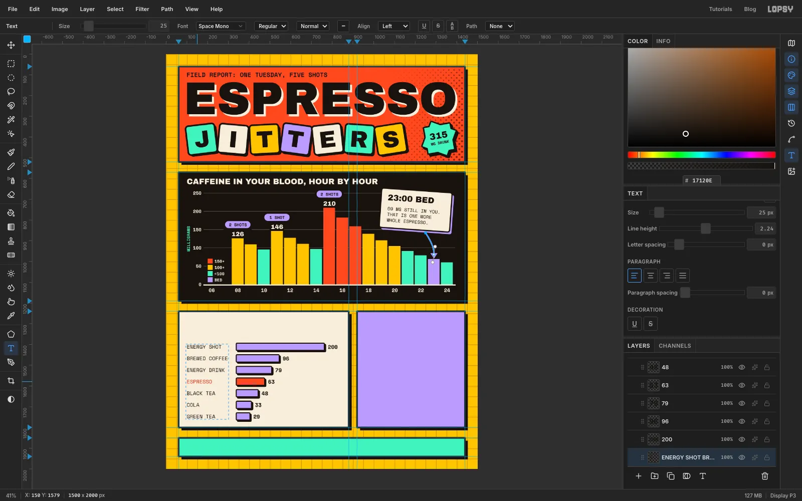

With the word selected, click the **Text color** swatch in the options bar, type
`#C8341A` into the hex field and click the swatch to close it. Press [[Tab]]. Only
the selected word changes. It's slightly darker than the bar so it stays legible on
Bone.

## Head the panel and add the sticker

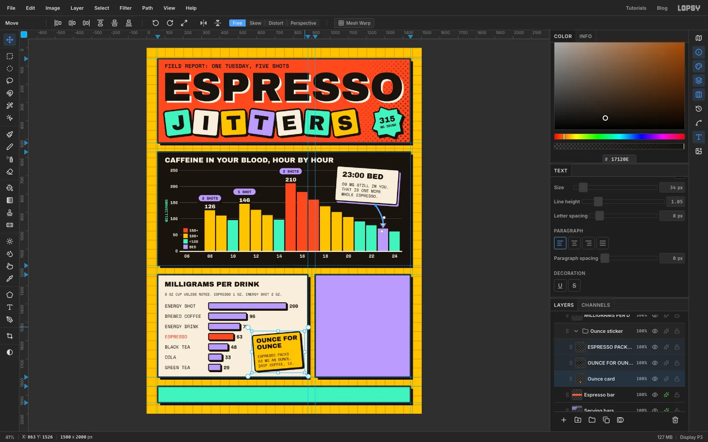

Click the Espresso bar row and add this note in **Space Mono Regular**, **Size**
`19`, Ink, with its top at about `y = 1340` and left edge at `x = 100`:

`8 OZ CUP UNLESS NOTED. ESPRESSO 1 OZ, ENERGY SHOT 2 OZ.`

Click the row again and add `MILLIGRAMS PER DRINK` in **Archivo Black**, **Size**
`38`, with its baseline at about `y = 1305`.

**Sticker.** Click the Espresso bar row, **New Group**, rename it `Ounce sticker`.
**Add Layer**, rename it `Ounce card`, then draw a 262 × 196 Ink shape with no stroke,
**Corner Radius** `10`, centred on `723, 1668`, and a Mustard one with a 6 px Ink stroke
centred on `715, 1660`. Add `OUNCE FOR` and `OUNCE` on two lines in **Archivo Black**,
**Size** `34`, **Line height** `1.05`, with the top-left at about `605, 1580`. Click
the Ounce card row and add this in **Space Mono Regular**, **Size** `20`, **Line height**
`1.3`, with its top-left at about `605, 1670`:

`ESPRESSO PACKS`
`63 MG AN OUNCE.`
`DRIP COFFEE, 12.`

Click the Ounce card row, [[Cmd]]-click both text rows, press V and rotate about 5°
anticlockwise. Press [[Cmd+D]].

## Draw the cup handle

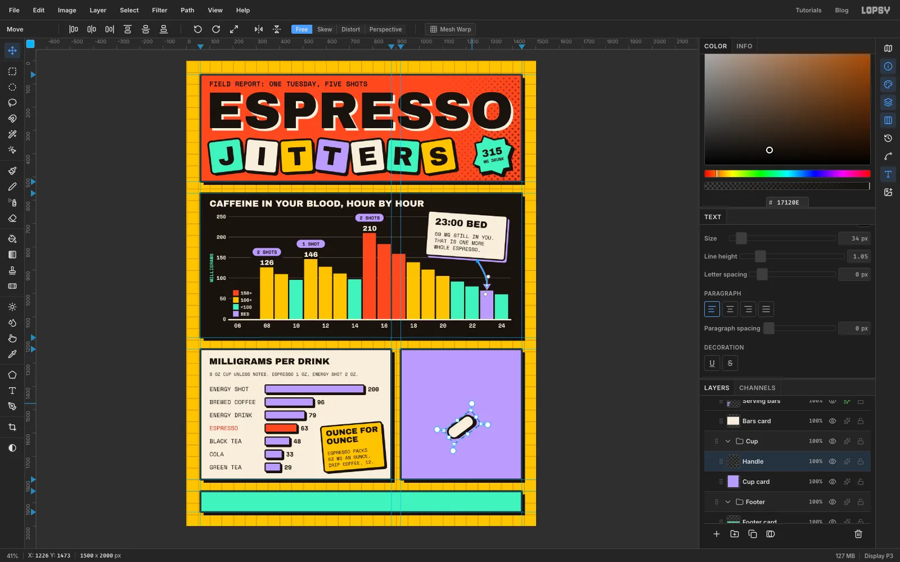

Now the cup. Its centre is at `1180, 1570`. Draw the handle first so the saucer covers
its root. The next few images are close-ups, so zoom in if you like: hold [[Cmd]] and
scroll over the cup.

Click **Cup card**, **Add Layer**, rename it `Handle`. With the **Shape** tool, **Corner
Radius** `24`, draw a 124 × 52 Ink shape with no stroke, centred on `1189, 1579`. Then
draw a Bone one with an 8 px Ink stroke, centred on the cup's centre.

Make an exact Rectangular Marquee around it, from `1112, 1538` to `1258, 1612`. Press V
and drag the rotation handle anticlockwise about 37°, then press [[Cmd+D]]. Nudge the
bar about 170 px right and 130 px up, so its middle is at the cup's upper right.

## Add the saucer

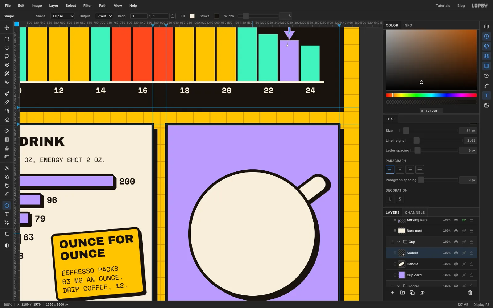

**Add Layer**, rename it `Saucer`. Set the **Shape** tool to **Ellipse**. Draw a
380 × 380 Ink circle centred on `1192, 1582` with no stroke, then a Bone one with an
8 px Ink stroke centred on `1180, 1570`. The offset makes the same hard shadow as
the cards.

## Cut the unused wedge

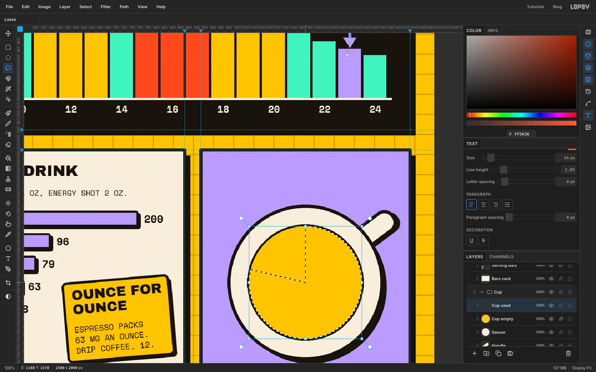

This is the donut. Five shots are 315 mg, which is 79% of 400 mg, so 21% of the ring
stays empty.

**Add Layer**, rename it `Cup empty`. Make an exact Elliptical Marquee from `1040, 1430`
to `1320, 1710`, fill it with Mustard, press [[Cmd+D]], and add a **Stroke** effect in
Ink, **Width** `5`. Close the drawer.

**Add Layer**, rename it `Cup used`, and set the foreground to Tomato. Make the same
Elliptical Marquee. Pick the **Lasso**, hold [[Alt]] and drag a wedge to subtract it.
Start at the centre and go out past the rim through `1044, 1537`, round past the top,
and come back to the centre straight down from `1180, 1430`. Keep the two straight
edges as clean as you can. The divider lines will cover small wobbles.

## Fill the ring

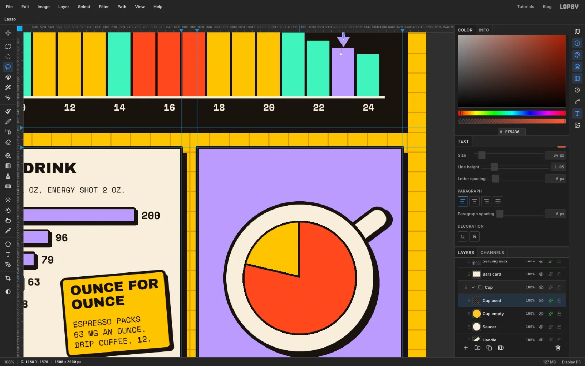

Choose **Edit → Fill**, press [[Cmd+D]] and add a **Stroke** effect in Ink, **Width**
`5`, to match the mustard disc. Close the drawer, because the next clicks land right
where it floats.

## Divide it into five shots

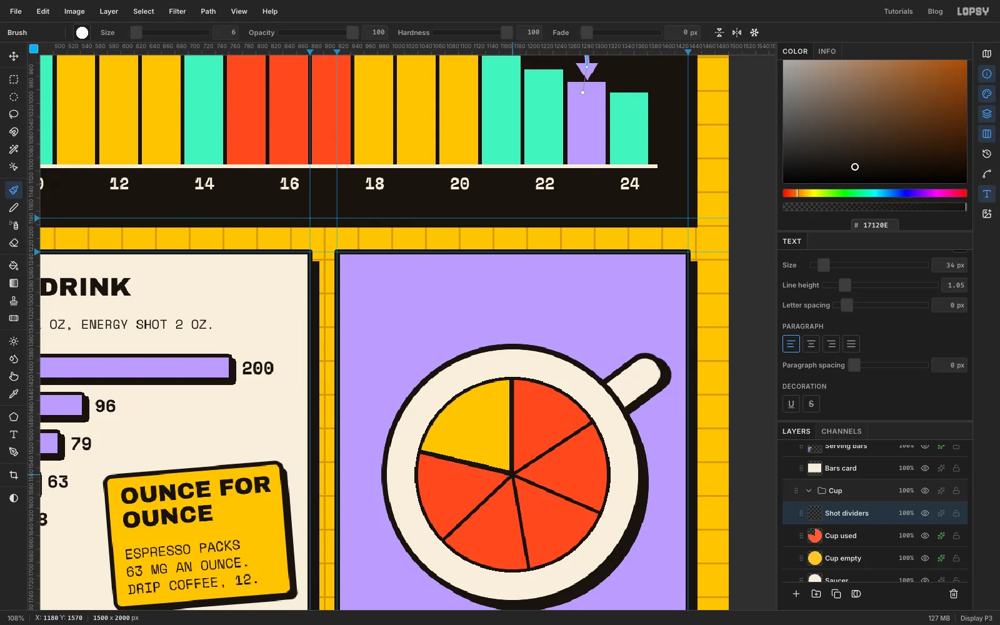

**Add Layer**, rename it `Shot dividers`. Pick the **Brush** (B). Check it's the plain
round tip, set **Size** `6`, **Hardness** `100`, **Opacity** `100`, and set the foreground
to Ink.

Each shot takes up 56.7° of the circle. Going clockwise from 12 o'clock, draw a line at
each angle below. Click the centre, `1180, 1570`, then [[Shift]]-click the point on the
rim:

- 0°: `1180, 1430`
- 56.7°: `1297, 1493`
- 113.4°: `1308, 1626`
- 170.1°: `1204, 1708`
- 226.8°: `1078, 1666`
- 283.5°: `1044, 1537`

The first and last lines cover the wedge's edges.

## Drop in the bean photo

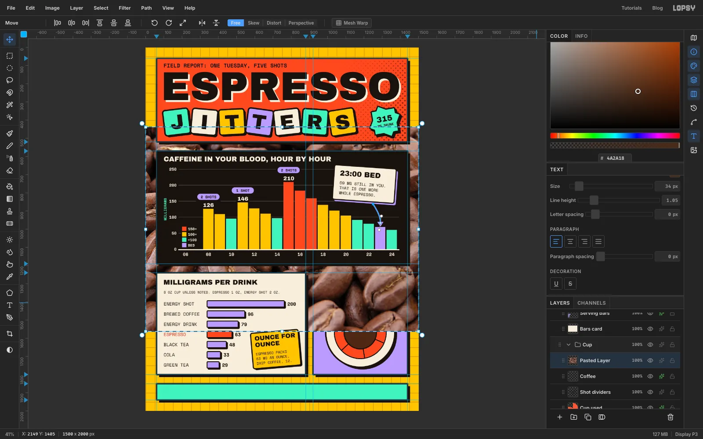

**Add Layer**, rename it `Coffee`. Make an exact Elliptical Marquee from `1094, 1484`
to `1266, 1656`, fill with Coffee `#4A2A18`, press [[Cmd+D]], and add a **Stroke**
effect in Ink, **Width** `6`. Close the drawer. This is the coffee surface and also the
donut's hole.

Drag `Roasted_coffee_beans.jpg` from your computer onto the canvas. It lands as a new
`Pasted Layer` fitted to the document's width. Rename it `Beans`.

## Shrink the photo

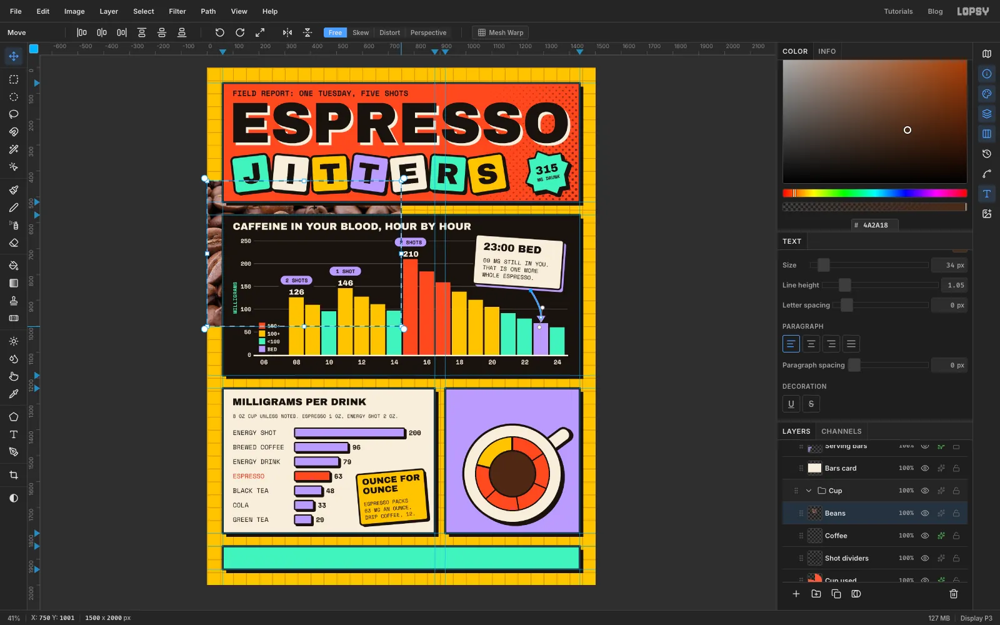

Press [[Cmd+D]], then make an exact Rectangular Marquee around the photo, from `0, 438`
to `1500, 1563`. Press V, hold [[Cmd]] and drag the bottom-right corner handle in to
about `750, 1000`, half the size. Press [[Cmd+D]] to commit. You'll mostly see the
photo's frame, because the panels above it cover the rest.

## Clip the photo to the coffee

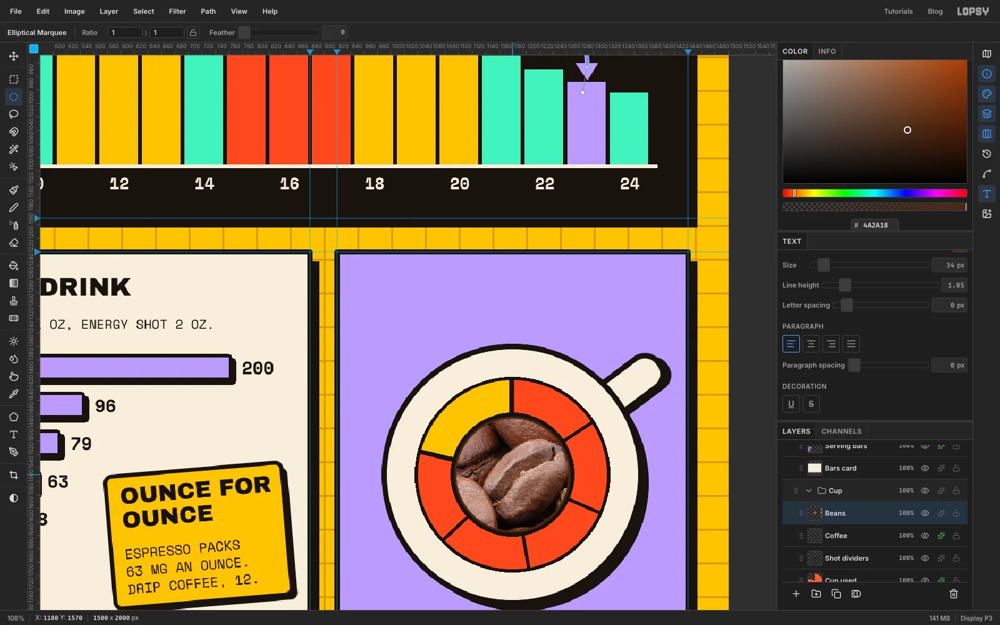

With the **Move** tool, drag from the middle of the photo to the middle of the cup.
Make an exact Elliptical Marquee from `1097, 1487` to `1263, 1653`, just inside the
coffee circle, and choose **Select → Inverse**. Check the **Beans** row is active, so you
trim the photo and not another layer, then press [[Delete]] and [[Cmd+D]].

## Turn the beans into dots

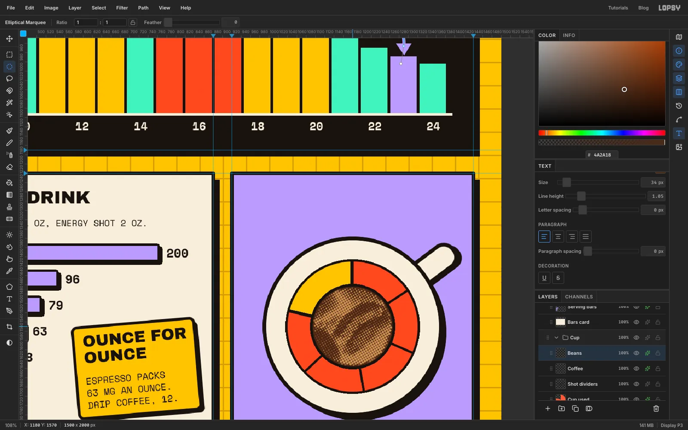

Run these on the Beans layer, in order:

1. **Filter → Desaturate**.
2. **Filter → Brightness/Contrast…**, **Contrast** `45`.
3. **Filter → Halftone**, **Dot Size** `5`, **Density** `1`, **Angle** `30`,
   **Softness** `1`.

Halftone leaves transparent gaps, so the Coffee disc shows through. Open **Layer
effects** and turn on **Color Overlay** in `#C9975F` so all the dots become tan and
tie in with the print-style dots in the header. Close the drawer.

## Put the headline number on top

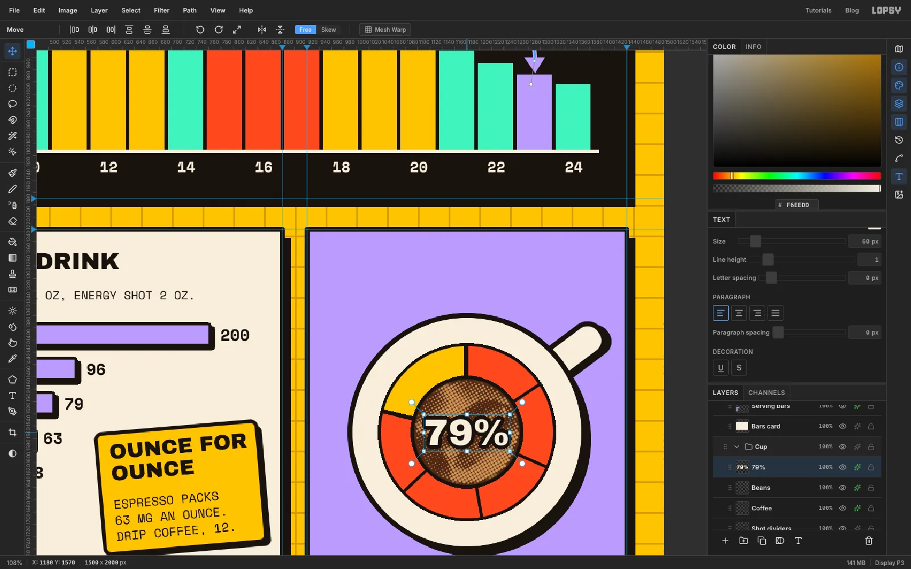

Add `79%` in **Archivo Black**, **Size** `60`, Bone. Press V and nudge it to the centre
of the cup. Add a **Stroke** effect in Ink, **Width** `6`, and close the drawer.

## Draw the rim arcs

The saucer band is where the labels go. If one circle of text ran all the way round,
the bottom half would be upside down, so use two arcs.

Click the **Saucer** row and pick the **Pen** (P). Press at each anchor and drag along
the curve's direction to pull out its handles:

1. **Top arc, drawn left to right over the top.** Drag about 75 px at each anchor. Start
   on the left at `1026, 1543` and drag upwards. At the top, press at `1180, 1414` and
   drag right. Finish on the right at `1334, 1543` and drag downwards. Click **Commit
   path** (✓).
2. **Bottom arc, also drawn left to right.** Drag about 60 px at each anchor. Start at
   `1029, 1657` and drag down and to the right, steeply. At the bottom, press at
   `1180, 1744` and drag right. Finish at `1331, 1657` and drag up and to the right,
   steeply. Click ✓.

The first arc disappears from view once you start the second, but it's saved in the
**Paths** panel. Text follows a path's direction, so the left-to-right bottom arc keeps
its letters upright.

## Put the labels on the arcs

Click the **Saucer** row. Pick the **Text** tool and set **Space Mono Bold**, **Size**
`23`, Ink, **Align center**. Click in the empty lilac area below the saucer, type
this and press [[Tab]]:

`85 MG UNUSED * 315 MG DRUNK`

With that text selected, set **Path** in the options bar to the top arc (`Path 2`).
Centring on the path puts `85 MG UNUSED` over the mustard wedge.

Click **Saucer** again and repeat in the same spot with `5 SHOTS AT 63 MG`, choosing
the bottom arc (`Path 3`). The arrow you drew earlier is `Path 1`.

## Head the cup panel

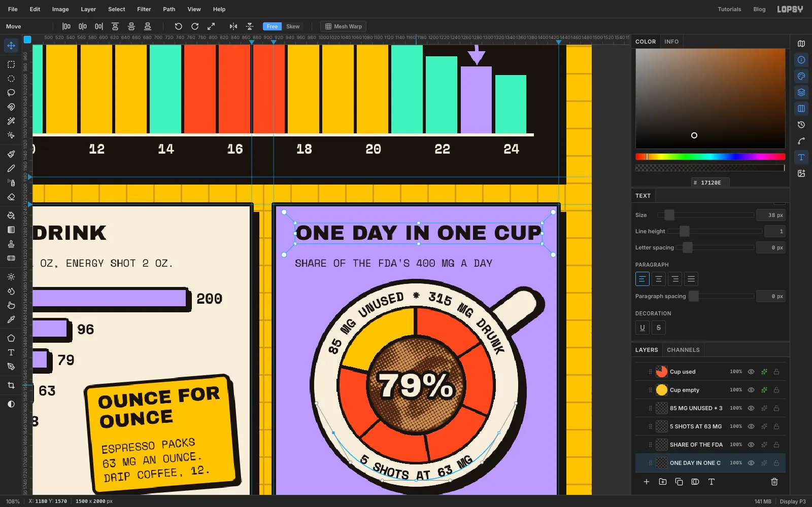

Click **Saucer** and add this in **Space Mono Regular**, **Size** `19`, Ink, **Align
left**, with its top at about `y = 1340` and left edge at `x = 960`:

`SHARE OF THE FDA'S 400 MG A DAY`

Click **Saucer** again and add `ONE DAY IN ONE CUP` in **Archivo Black**, **Size**
`38`, with its baseline at about `y = 1305`, level with the heading beside it.

## Credit your sources

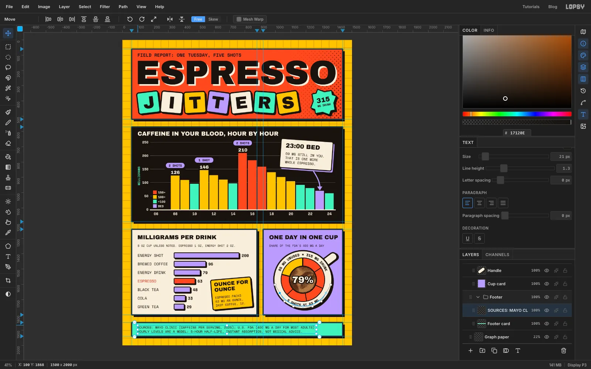

Click **Footer card** and add these two lines in **Space Mono Regular**, **Size**
`21`, **Line height** `1.3`, Ink, with a left edge at `x = 100`, centred vertically
in the strip:

`SOURCES: MAYO CLINIC (CAFFEINE PER SERVING, 2025); U.S. FDA (400 MG A DAY FOR MOST ADULTS).`
`HOURLY LEVELS ARE A MODEL: 5-HOUR HALF-LIFE, INSTANT ABSORPTION. NOT MEDICAL ADVICE.`

## Save and export

Choose **File → Save Project** to keep an editable `.lopsy`, then **File → Quick
Export PNG**.

To make your own version, swap the doses or the drink list. The chart's maths stays
the same: multiply the previous hour by about `0.87`, add any new dose, and multiply by
`1.76` for the bar height. Then the bar's top is `1110` minus that height.
