This tutorial makes the one-sheet for an imaginary 1940s thriller, **Gramercy Park**. The New York park is famously locked, and only the people who live around it get a key. So the poster's single idea is a giant iron key. Its round bow becomes a keyhole view of the film's femme fatale, standing under a street lamp behind the park railings.

The canvas is 1200 × 1800 px, the 2:3 shape of a movie one-sheet. The palette is noir: fog greys, black ink, and one poisonous lime accent for the lamplight.

The portrait comes from Erik Holmén's fashion photograph
[NMA.0038744, Fashion Photo by Erik Holmén ca 1940–1950.jpg](https://commons.wikimedia.org/wiki/File:NMA.0038744,_Fashion_Photo_by_Erik_Holm%C3%A9n_ca_1940%E2%80%931950.jpg)
on Wikimedia Commons, from Nordiska museet, licensed **CC BY 4.0**. Credit the photographer if you publish your poster. Download the 960 px wide preview (960 × 964). The model stands in front of a white wall with a big black ring behind her, so you'll cut her out by hand. Any half-length portrait with a raised hand will work just as well.

Along the way you'll use:

- ruler **guides**
- radial and linear **gradients**, including a stop that fades to transparent
- the **Clouds**, **Gaussian Blur**, **Brightness/Contrast**, **Add Noise** and **Motion Blur** filters
- copy, paste and **Merge Down** to double a row of shapes
- the **Move** tool's **Skew**, **Perspective** and scale handles
- **Define Pattern** and **Fill with Pattern**
- the **Lasso**, with [[Shift]] to add and [[Alt]] to subtract
- marquee selections built up with [[Shift]] and [[Alt]]
- **Feather**, **Shrink** and **Select → Inverse**
- [[Cmd]]-clicking layer thumbnails to load a layer's shape as a selection
- arrow keys to nudge a selection
- the **Brush** and **Smudge** tools
- blend modes: **Soft Light**, **Multiply**, **Screen** and **Overlay**
- a group, a **group mask** and a **layer mask**
- **Drop Shadow**, **Stroke** and **Outer Glow** effects
- **Text** in Limelight, Six Caps and Playfair Display SC
- a **Vignette** adjustment

The palette:

- Fog `#DAD8CF` → `#B9BBB4` → `#6F7672`
- Night falls `#FFFFFF` → `#2C3032` (Multiply)
- Ink `#0E1013`, night `#06080B`
- Lamp `#E4F07A` → `#C8DC4A` → `#3B4A22` → `#18211E` → `#06080B`
- Rim light `#D8EC5A`
- Mist `#6E7C62`
- Iron edge `#7C8284`
- Keyline `#C9CCCB`, light type `#D3D5CE`
- Smoke `#EEF0E6`

> **Tip:** Positions are written as `x, y` in document pixels. The status bar at the bottom left shows the cursor's position, and the **Info** panel shows the size of the selection while you drag. Key names use Mac keys. On Windows and Linux, use Ctrl for Cmd. A few pixels either way won't show. The steps say when a number really matters.

> **Tip:** "Fill with a colour" means set the foreground colour to it (type it into the hex field of the Color panel) and choose **Edit → Fill**. New layers are added directly above the layer you have selected, so the steps always say which layer to click first.

## Set up the canvas, guides and fog

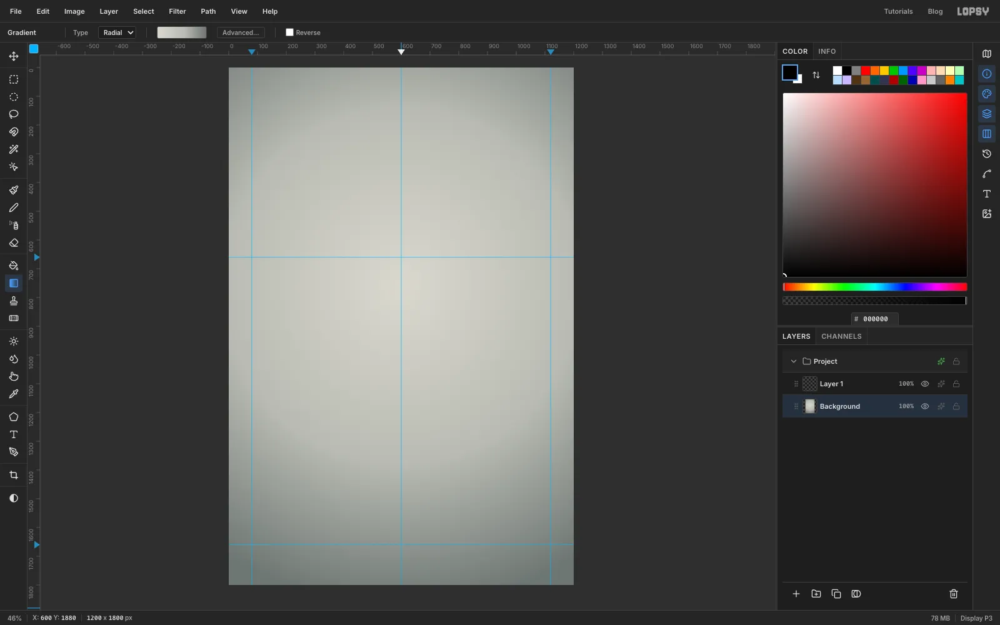

Open [Lopsy](/). In the **New Document** dialog, set **Width** to `1200` and **Height** to `1800` and click **Create**. You get a white `Background` and an empty `Layer 1`.

1. Click the top ruler at **80**, **600** and **1120** to drop three vertical guides: the side margins and the centre line. Click the left ruler at **660** (the centre of the key's bow) and **1660** (the top of the billing block).
2. Click the `Background` row. Pick the **Gradient** tool, set **Type** to **Radial** and click **Advanced…**. Give it three stops: `#DAD8CF` at 0%, `#B9BBB4` at 55% and `#6F7672` at 100%. Click **Done**.
3. Drag from 600, 760 straight down past the bottom edge of the canvas, to about 600, 1880.

## Roll in the fog

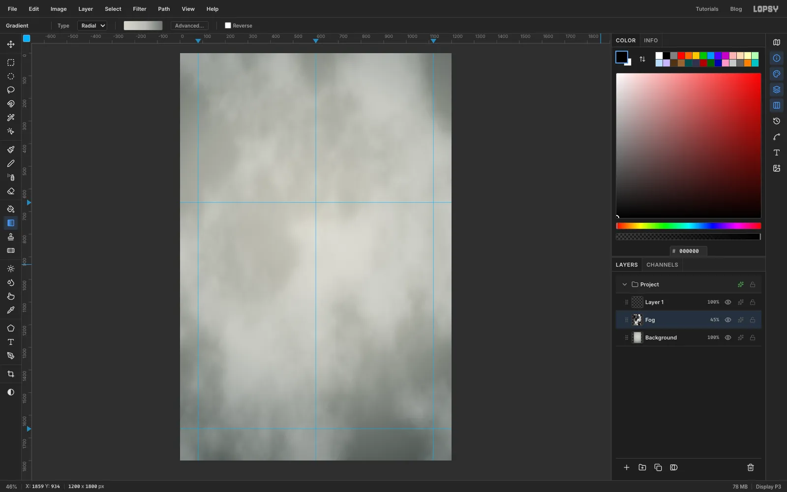

1. With `Background` still selected, click **Add Layer** at the bottom of the Layers panel and rename the new layer `Fog` (double-click its name).
2. Choose **Filter → Clouds…** with **Scale** `4` and click **Apply**.
3. Set the layer's **Blend** mode to **Soft Light** and its opacity to **45%**.

Soft Light keeps only the light and dark of the clouds, so the gradient underneath shows through as drifting fog.

## Draw one railing picket

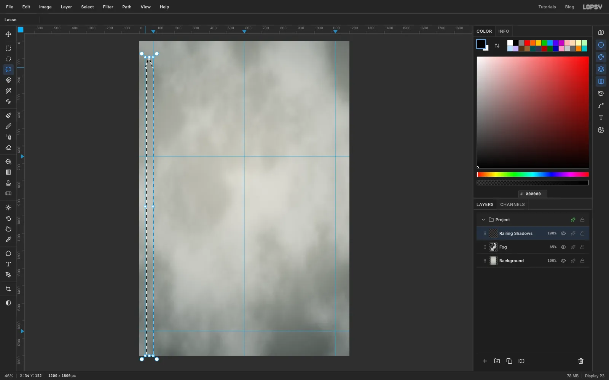

These pickets will become the long shadows of the park's railings.

1. Click `Layer 1` and rename it `Railing Shadows`.
2. With the **Rectangular Marquee**, drag a tall, thin box from 40, 150 down to the bottom edge at 70, 1800. That's a bar 30 px wide.
3. Pick the **Lasso**. Hold [[Shift]] and draw a small triangle on top of the bar for the spear tip: from just left of the bar's top (34, 152), up to a point at 55, 92, and down to just right of it (76, 152). A quick three-cornered loop is fine. Small wobbles vanish under the blur later.
4. Fill with `#0E1013` and press [[Cmd+D]] to deselect.

## Double the pickets with copy and paste

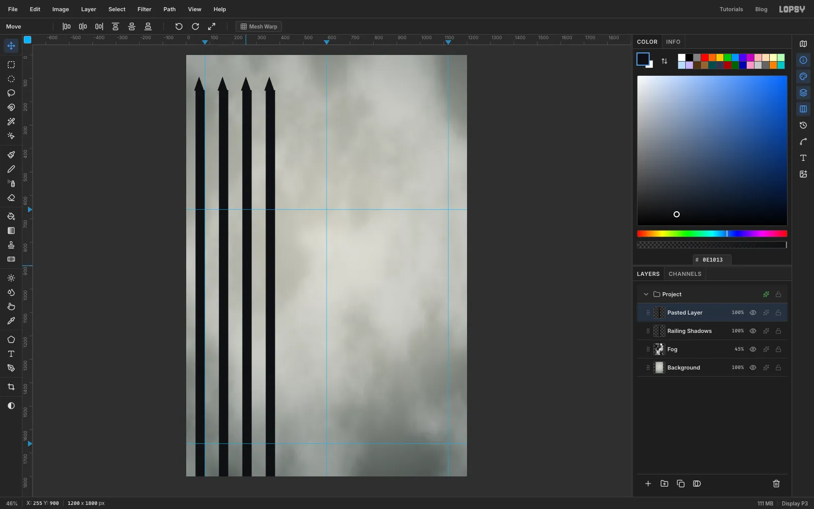

Rather than drawing sixteen pickets, double the row four times.

1. Press [[Cmd+A]], [[Cmd+C]] and [[Cmd+V]]. The paste lands exactly on top of the original as a new layer.
2. Press [[Cmd+D]], pick the **Move** tool and drag the pasted picket **100 px** to the right. Watch the cursor position in the status bar as you drag, and fine-tune with the arrow keys if you overshoot.
3. Choose **Layer → Merge Down**. You now have two pickets.
4. Repeat the same three steps, moving the paste **200 px** (four pickets), then **400 px** (eight), then **800 px** (sixteen).

The last few pickets hang off the right edge of the canvas. Keep them, because the next transforms swing them back in.

## Add the cross rails

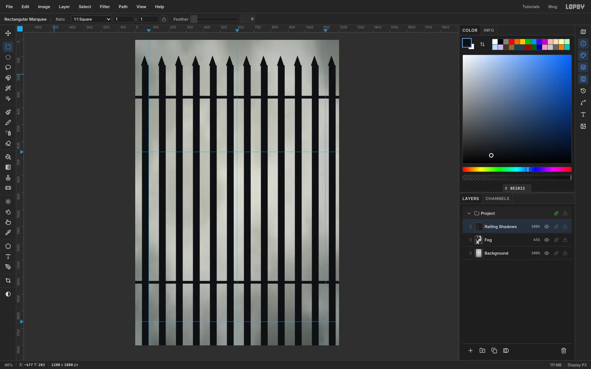

1. With the **Rectangular Marquee**, drag a thin strip right across the canvas from 0, 330 to 1200, 346.
2. Hold [[Shift]] and drag a second strip from 0, 1420 to 1200, 1436.
3. Fill with `#0E1013` and deselect.

## Skew the railing into a raking shadow

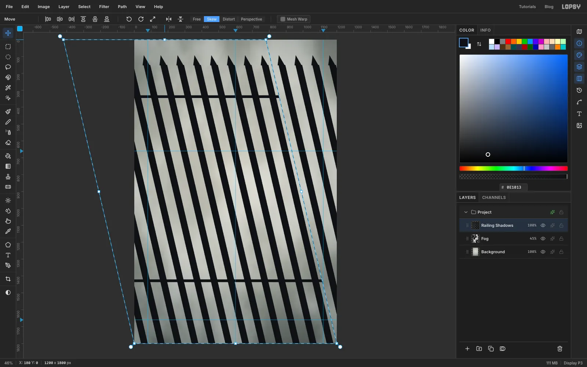

Shadows from a low lamp fall long and slanted.

1. Press [[Cmd+A]] and pick the **Move** tool. Click **Skew** in the options bar.
2. Drag the top-middle handle to the left by about **420 px**, so it ends near x 180. The bottom edge stays put and every picket leans over.
3. Press [[Cmd+D]] to apply the transform.

The top rail now stops short on the right, because it was only drawn as wide as the canvas. The blur hides it.

## Fan the shadows out with Perspective

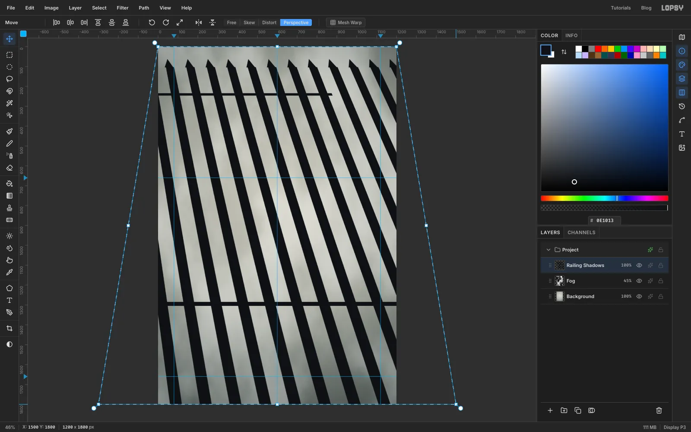

1. Press [[Cmd+A]] again and click **Perspective** in the options bar.
2. Drag the bottom-right corner handle about **300 px** to the right, out onto the grey pasteboard. The bottom-left corner moves out to match, so the bars fan wider towards the viewer.
3. Press [[Cmd+D]], then click **Free** in the options bar so the next transform starts in the normal mode.

## Soften the bars into shadows

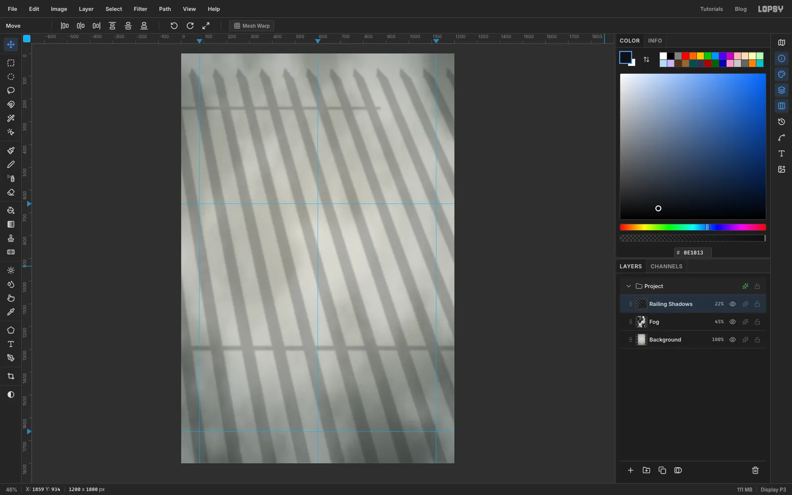

1. Choose **Filter → Gaussian Blur…** with **Radius** `10`.
2. Set the layer's **Blend** mode to **Multiply** and its opacity to **22%**.

Blurred and faint, they read as shadows on fog rather than a fence you could touch.

## Let night fall

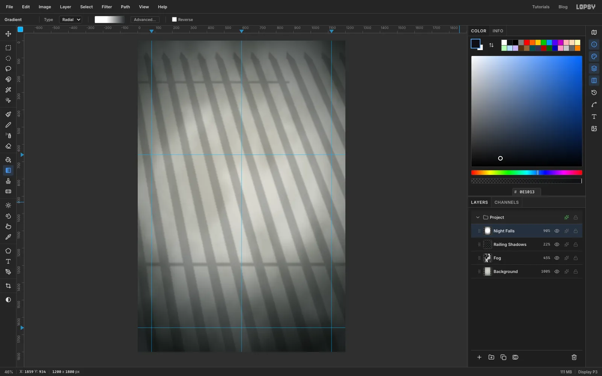

Noir lives in the dark, so push the edges of the poster down to near black.

1. With `Railing Shadows` selected, click **Add Layer** and rename it `Night Falls`.
2. Set up a radial gradient with `#FFFFFF` at 0%, `#FFFFFF` at 40% and `#2C3032` at 100%.
3. Drag from 600, 820 down past the bottom edge to about 600, 1860.
4. Set the layer to **Multiply** at **90%**.

White does nothing in Multiply, so the middle stays lit and only the edges sink into the dark.

## Start the keyhole scene with a lamp glow

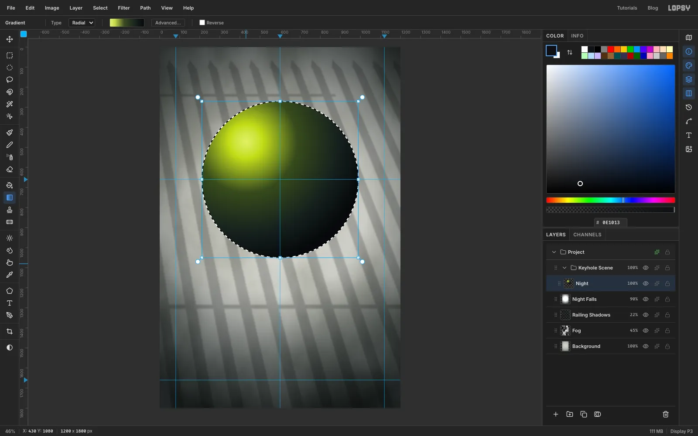

Everything seen through the key goes in one group.

1. With `Night Falls` selected, click **New Group** and rename it `Keyhole Scene`. Then click **Add Layer** and rename the new layer `Night`. It goes inside the group.
2. With the **Elliptical Marquee**, drag a circle from 210, 270 to 990, 1050. That's centred on the guide crossing at 600, 660.
3. Set up a radial gradient: `#E4F07A` at 0%, `#C8DC4A` at 14%, `#3B4A22` at 42%, `#18211E` at 75% and `#06080B` at 100%.
4. Drag from 430, 470 (the street lamp, up and left of centre) down to 430, 1080. Deselect.

## Add mist and draw a fence picket tile

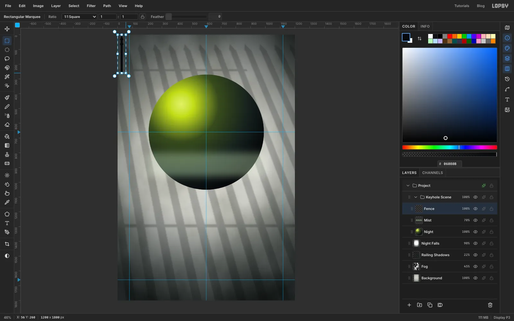

1. Click **Add Layer** and rename it `Mist`. Pick the **Rectangular Marquee** and drag a rectangle from 200, 800 to 1000, 960, choose **Select → Feather…** with `50`, and fill with `#6E7C62`. Deselect, set the layer to **Screen** and its opacity to **70%**. That's a band of lit mist at fence height.
2. Click **Add Layer** and rename it `Fence`. Zoom in to 400% or more on the top-left corner and draw one ornate picket: a **Rectangular Marquee** from 21, 34 to 35, 260, then [[Shift]] with the **Lasso** for a spear tip from 16, 36 up to 28, 4 and down to 40, 36, then [[Shift]] with the **Elliptical Marquee** for a small ball from 17, 53 to 39, 75.
3. Fill with `#06080B`.
4. With the **Rectangular Marquee**, drag a rectangle from 0, 0 to 56, 260 around the picket. Choose **Edit → Define Pattern**, then press [[Delete]] to clear the tile off the canvas.

## Tile the fence with Fill with Pattern

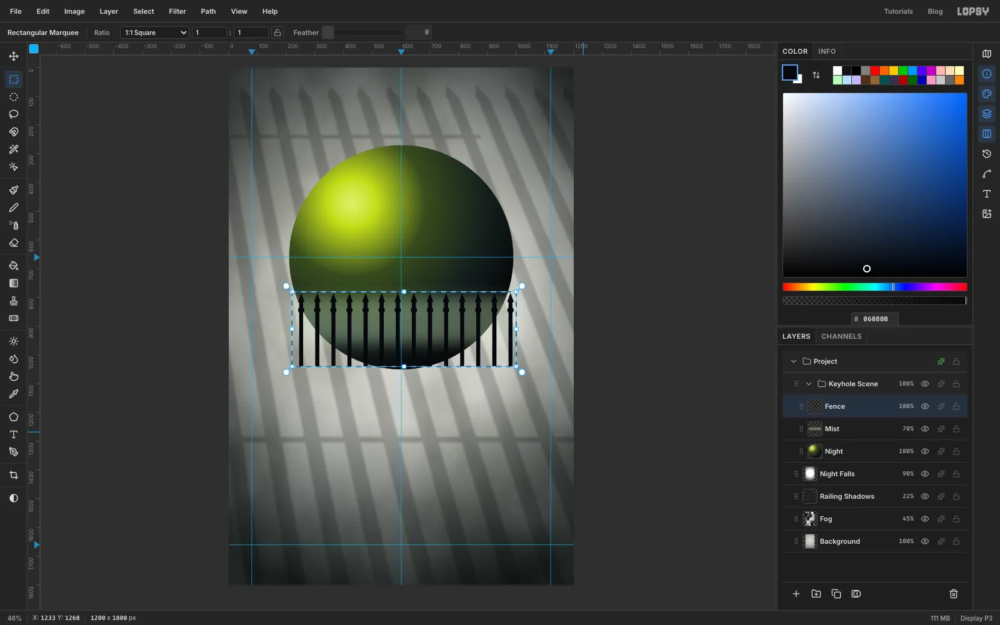

1. Drag a rectangle from 220, 780 to 1000, 1040.
2. Choose **Edit → Fill with Pattern…**, click the picket pattern and click **Apply**.

The pattern tiles from the canvas's top-left corner. The tile is 260 px tall and the band starts at 780 (3 × 260), so every spear tip lands at the top of the band.

## Add the fence rail

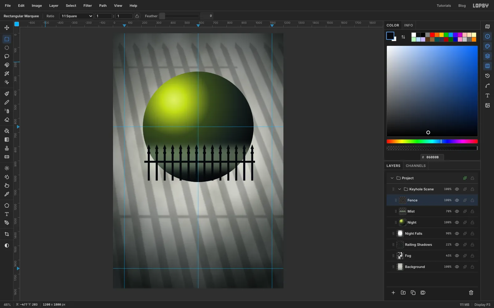

Drag a thin rectangle from 220, 900 to 1000, 914, fill with `#06080B` and deselect.

## Drop in the photograph

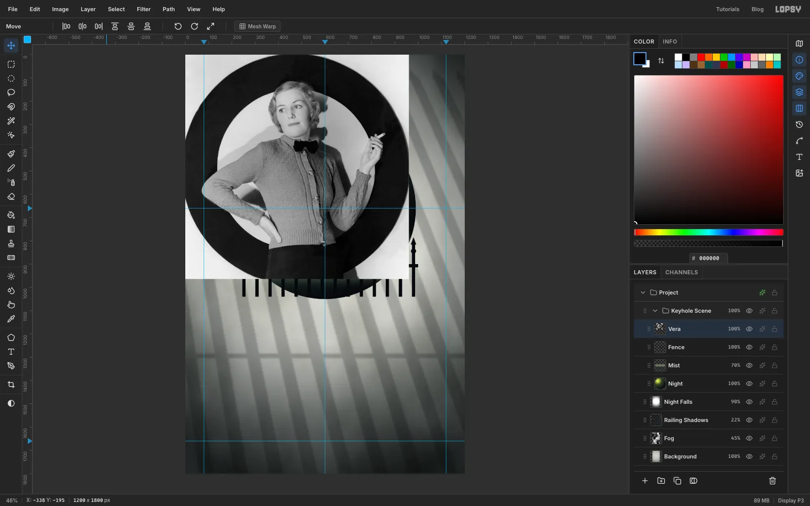

1. With `Fence` selected, drag the downloaded JPG from your desktop onto the canvas. It lands at its own size (960 × 964) in the top-left corner, as a new layer called `Pasted Layer` inside the group.
2. Rename the layer `Vera`. Lopsy selects the new layer's pixels when it arrives, so press [[Cmd+D]] to deselect them.

Cut her out here at full size, before scaling. It's much easier to trace accurately.

## Trace her with the Lasso

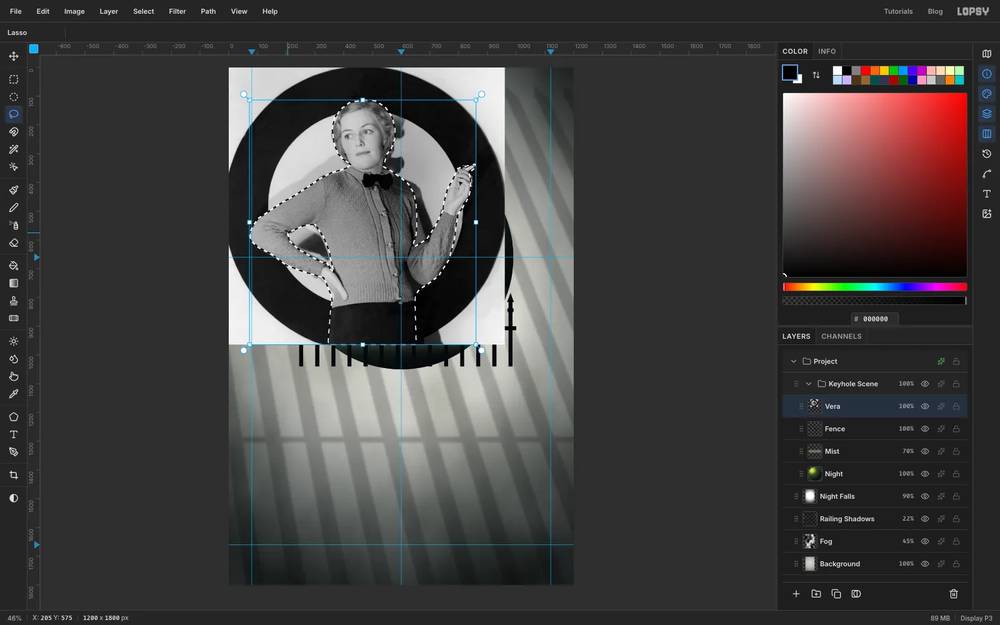

1. Pick the **Lasso** and zoom in. Trace one slow loop around her: over the top of her hair, down past her jaw to the collar, out along the shoulder and raised arm on the right of the picture, around her fingers and the cigarette, down the outside of that sleeve to the elbow, along the hem of her cardigan, down the right side of her skirt to the photo's bottom edge, along that edge, up the left side of the skirt, around the hand on her hip, along her bent arm and back up to her hair. Release where you started. If you can't trace it in one drag, trace it in sections and hold [[Shift]] to add each one.
2. Hold [[Alt]] and lasso the triangle of white wall between her bent arm and her waist to take it out of the selection.

## Cut her out

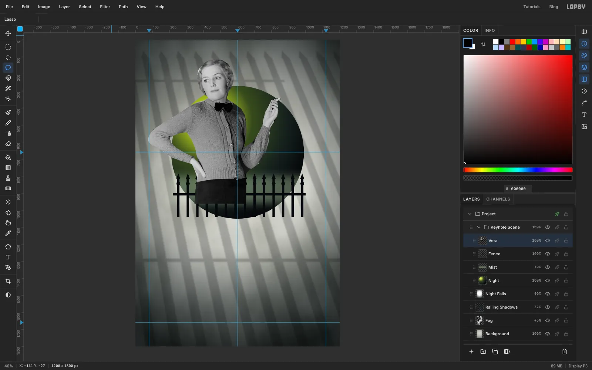

1. Choose **Select → Inverse** and press [[Delete]]. Deselect.
2. To lose the pale fringe of the white wall, [[Cmd]]-click the `Vera` thumbnail to load her shape. Choose **Select → Shrink…** with `2`, then **Select → Inverse**, press [[Delete]], and deselect.

## Scale her to fit the bow

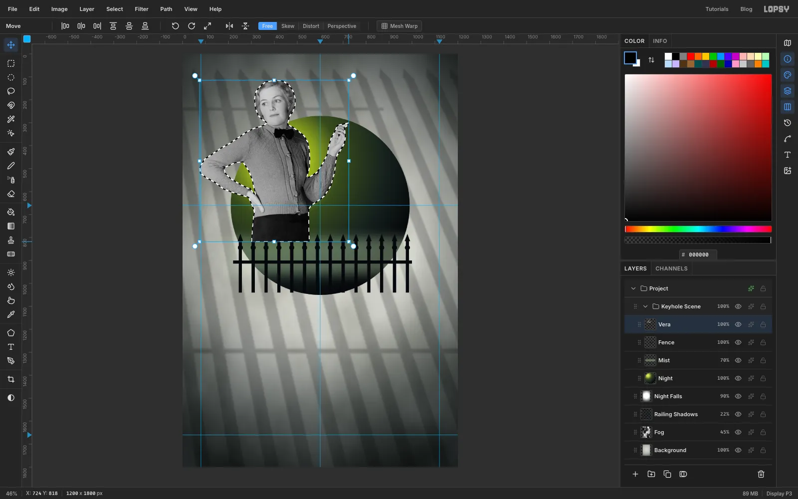

1. [[Cmd]]-click the `Vera` thumbnail again. That gives the Move tool a box around her.
2. With the **Move** tool, hold [[Cmd]] and drag the bottom-right corner handle up and to the left until she's about **83%** of her size: roughly 650 px wide instead of 783. [[Cmd]] keeps her proportions.
3. Press [[Cmd+D]] to apply.

## Seat her in the window

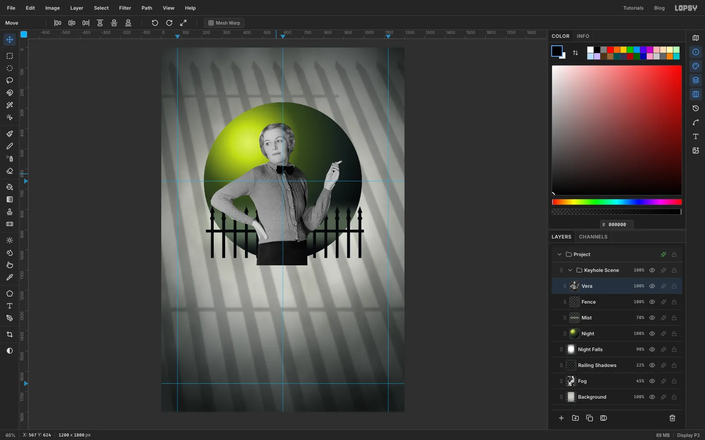

With the **Move** tool, drag her so the top of her hair sits at about y **373** and the point of the bent elbow on the left of the picture at about x **244**. Her face is now just right of the lamp's hot spot, and the cigarette sits just inside the circle on the right. She hangs off the bottom of the circle, which is fine, because the key will cover it.

## Crush the tones

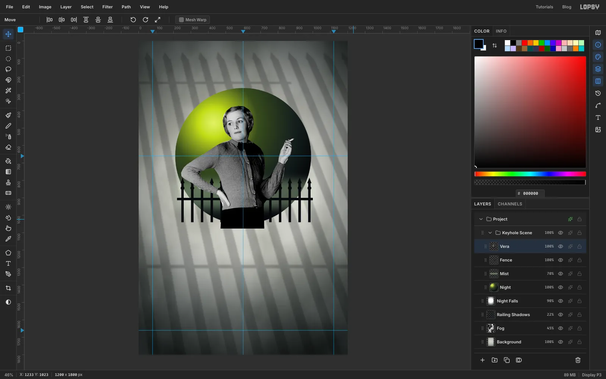

Choose **Filter → Brightness/Contrast…** with **Brightness** `-12` and **Contrast** `55`.

Fashion photos are lit to be even and friendly. Noir wants deep blacks and hard highlights.

## Wash her in lamplight and paint a rim light

1. With `Vera` selected, click **Add Layer** and rename it `Lamp Wash`. [[Cmd]]-click the `Vera` thumbnail. Set up a linear gradient from `#C8DC4A` to `#06080B` and drag from 330, 400 (her lamp side) to 780, 780. Deselect, then set the layer to **Overlay** at **85%**.
2. Click **Add Layer** and rename it `Rim Light`. [[Cmd]]-click the `Vera` thumbnail again so the paint stays inside her.
3. Pick the **Brush** ([[B]]) and click the brush preview in the options bar to open the **Brushes** dialog. On its **Shape** tab set **Size** `26`, **Hardness** `0`, **Opacity** `80` and **Spacing** `10`, then close it. Set the colour to `#D8EC5A`.
4. Paint three soft strokes along the edges that face the lamp: one over the top and left of her hair down to her jaw, one along the shoulder and upper arm on the left of the picture down to the elbow, and one up the inside of her raised hand.

## Blend the rim light

Deselect and set `Rim Light` to **Screen**. Screen only ever brightens, so the strokes become light catching her edges rather than lime paint.

## Lasso the fence's shadow bars

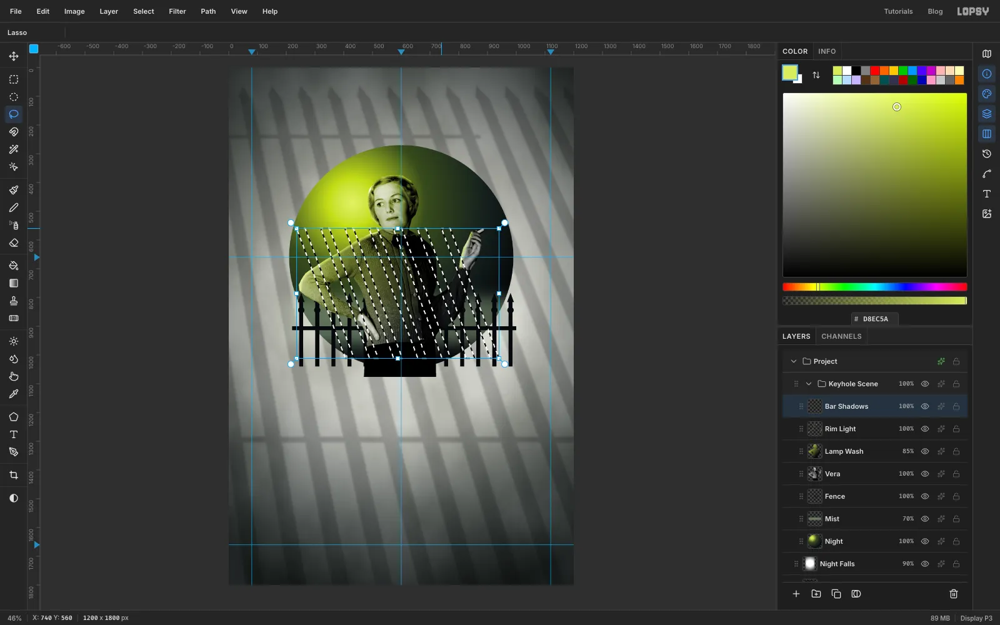

The lamp is behind the fence, so the railings throw bars of shadow across her.

1. With `Rim Light` selected, click **Add Layer** and rename it `Bar Shadows`.
2. With the **Lasso**, draw a thin slanted bar: 30 px wide at y 560, leaning 170 px to the right by y 1012. Start the first one at x 236. It doesn't have to be exact. The bars get blurred.
3. Hold [[Shift]] and draw six more, each one **84 px** to the right of the last.
4. Fill with `#06080B` and deselect.

## Keep the bars on her and darken her lower half

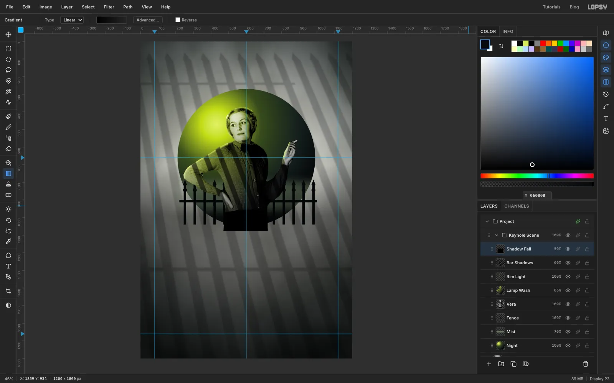

1. [[Cmd]]-click the `Vera` thumbnail, choose **Select → Inverse** and press [[Delete]]. Deselect.
2. Run **Gaussian Blur** with **Radius** `4`, set the layer to **Multiply** and its opacity to **60%**.
3. Click **Add Layer** and rename it `Shadow Fall`. Set up a linear gradient from `#000000` to `#000000`. Click the second stop and drag its **Opacity** bar all the way to the left. Drag from 600, 990 up to 600, 700, then set the layer to **Multiply** at **50%**.

The cardigan now falls into shadow, so her face is the brightest thing in the window. The gradient also darkens the poster below the circle for now. The group mask in a later step trims it away.

## Select the key's bow

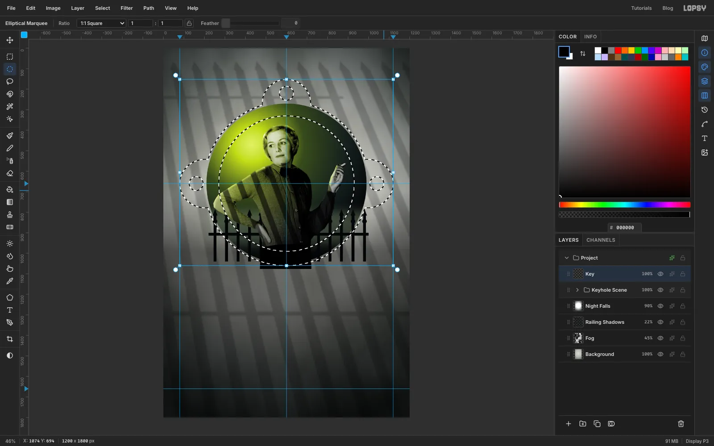

The whole key is one selection, built up from circles and rectangles.

1. Click the arrow on the `Keyhole Scene` row to collapse the group, click the group's row, then click **Add Layer** and rename it `Key`. Because the group is collapsed, the new layer goes above it rather than inside.
2. With the **Elliptical Marquee**, drag a circle from 200, 260 to 1000, 1060.
3. Hold [[Shift]] and add three lobes: circles from 92, 542 to 328, 778 (left), 482, 152 to 718, 388 (top) and 872, 542 to 1108, 778 (right).
4. Hold [[Alt]] and subtract the window: a circle from 270, 330 to 930, 990.
5. Still with [[Alt]], subtract a small hole from each lobe: 126, 626 to 194, 694, then 566, 186 to 634, 254, then 1006, 626 to 1074, 694.

## Add the shaft, collars and bit

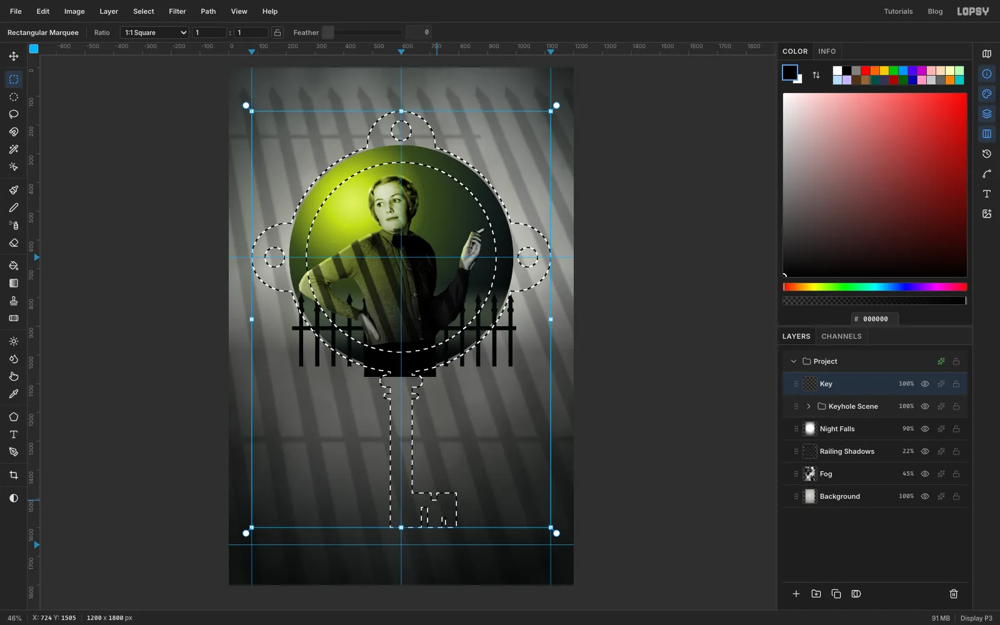

Keep adding with [[Shift]], switching marquee tools as you go:

1. The shaft, with the **Rectangular Marquee**: 562, 1030 to 638, 1600.
2. A collar, still with the **Rectangular Marquee**: 547, 1070 to 653, 1112. Then with the **Elliptical Marquee**, give it a round end at each side: 526, 1070 to 568, 1112 and 632, 1070 to 674, 1112.
3. A thin second collar, back with the **Rectangular Marquee**: 549, 1134 to 651, 1152. Then with the **Elliptical Marquee**, add round ends from 540, 1134 to 558, 1152 and 642, 1134 to 660, 1152.
4. The bit, with the **Rectangular Marquee**: 636, 1480 to 792, 1600.
5. Still with the **Rectangular Marquee**, hold [[Alt]] and cut three wards of different sizes: 670, 1530 to 692, 1604, then 742, 1565 to 754, 1604, then a notch from the top at 704, 1476 to 724, 1505.

Uneven wards matter. Two equal slots make the bit look like a letter.

## Fill the key and lift it off the fog

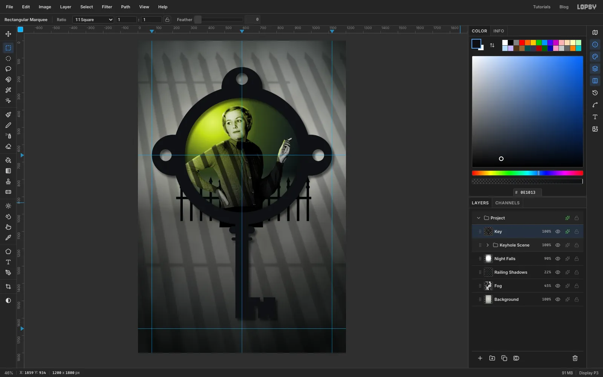

1. Fill with `#0E1013` and deselect.
2. Click the layer's effects button and turn on **Drop Shadow** with **Offset X** `12`, **Offset Y** `14`, **Blur** `18` and **Opacity** `55`.

## Catch the light on the iron's edges

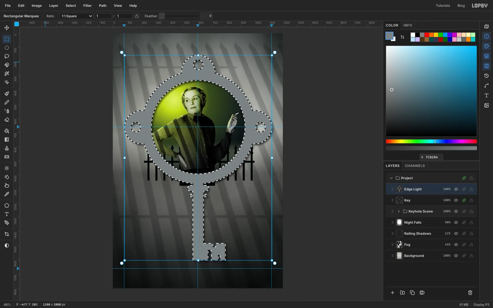

1. With `Key` selected, click **Add Layer** and rename it `Edge Light`. [[Cmd]]-click the `Key` thumbnail and fill with `#7C8284`.
2. Pick the **Rectangular Marquee** and press [[Right]] three times and [[Down]] three times. The selection outline moves 3 px down and to the right, without moving any pixels.
3. Press [[Delete]].

What's left is a 3 px sliver along every edge that faces up or left.

## Keep only the lamp-side edges

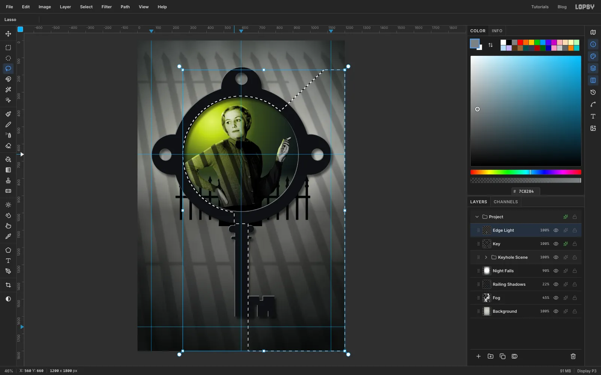

Light from the upper left shouldn't catch the right-hand edges or the inside of the window.

1. With the **Elliptical Marquee**, drag a circle from 262, 322 to 938, 998, just bigger than the window.
2. Hold [[Shift]] and, with the **Lasso**, add a shape that covers the right-hand side of the key. Start at the bow's centre (560, 660), go up past the bow's one o'clock edge to 1080, 170, across to the canvas's right edge, down to the bottom-right corner, along the bottom to x 640, up to just below the bow at 640, 1062, across to 560, 1062 and back up to the start. That takes in the bit and everything right of the shaft.
3. Press [[Delete]] and deselect.

## Give the key a cast-iron grain

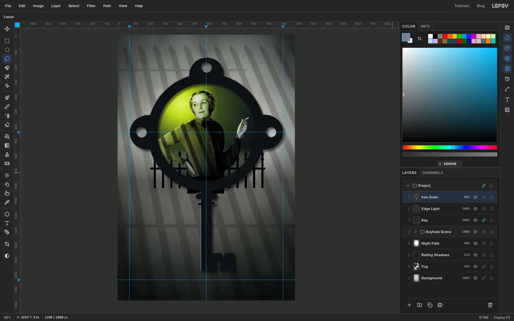

1. Click **Add Layer** and rename it `Iron Grain`. [[Cmd]]-click the `Key` thumbnail and fill with `#808080`.
2. Choose **Filter → Add Noise…** with **Amount** `45`, **Mono** and **Gaussian**.
3. Choose **Filter → Motion Blur…** with **Angle** `90` and **Distance** `6`.
4. Deselect and set the layer to **Overlay** at **60%**.

## Add a lime catch-light on the window's rim

1. Click **Add Layer** and rename it `Window Rim`. With the **Elliptical Marquee**, drag a circle from 266, 326 to 934, 994, then hold [[Alt]] and subtract the window circle, 270, 330 to 930, 990. That leaves a 4 px ring.
2. Set up a linear gradient: `#E4F07A` at 0%, `#C8DC4A` at 50% with its **Opacity** bar at 55%, and `#C8DC4A` at 100% with its **Opacity** at 0.
3. Drag from 330, 380 to 860, 940. Deselect and set the layer's opacity to **55%**.

## Round off the scene with a group mask

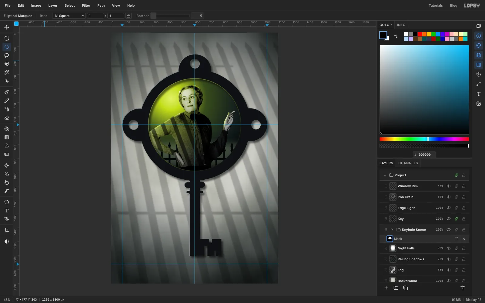

The fence and her skirt still poke out past the key's bow.

1. Click the `Keyhole Scene` group row and click **Add Mask**. Click the mask thumbnail on the row to edit the mask.
2. With the **Elliptical Marquee**, drag a circle from 240, 300 to 960, 1020. That's 30 px bigger than the window, so the mask's edge hides under the iron.
3. Choose **Select → Inverse** and fill with `#000000`. Deselect.
4. Click the `Window Rim` row to finish editing the mask.

## Set the type

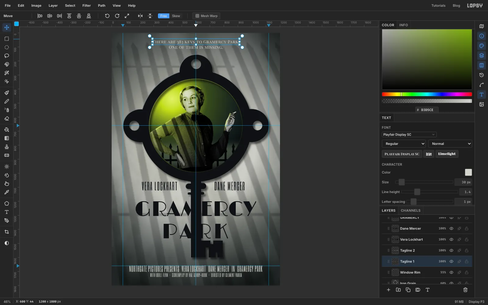

Before each new piece of type, click the `Window Rim` row. If a text layer is selected when you change the font or size, you restyle that layer instead. Pick the **Text** tool, set the font, size, colour and alignment in the options bar, click the canvas at the point given, type, and press [[Tab]]. Rename the new layer to the bold name in the list, and set its letter spacing in the **Text** panel. Work from the bottom of the poster up, so you never click inside a line you've already set.

The point you click is the top of the line's box, so the letters themselves start a few pixels lower. Horizontally it's the middle of the line for centred type, the left edge for left-aligned type and the right edge for right-aligned type. After each one, pick the **Move** tool and nudge it with the arrow keys (1 px a time) until the tops of the letters sit where the list says.

- **Credits**: Six Caps, `32`, `#D3D5CE`, centred, letter spacing `2`. Click at 600, 1706 and type `WITH ODILE FENN  ·  SCREENPLAY BY HAL ASHBY-ROOK  ·  DIRECTED BY CLEMENT VARGA`. Letter tops at y 1712.
- **Billing**: Six Caps, `52`, `#D3D5CE`, centred, spacing `2`. Click at 600, 1646 and type `NORTHGATE PICTURES PRESENTS  VERA LOCKHART  DANE MERCER  IN  GRAMERCY PARK`. Tops at y 1658. It ends about 45 px inside each margin guide.
- **PARK**: Limelight, `150`, `#0E1013`, centred, spacing `16`. Click at 600, 1320 and type `PARK`. Tops at y 1356.
- **GRAMERCY**: Limelight, `150`, `#0E1013`, centred, spacing `0`. Click at 600, 1160 and type `GRAMERCY`. Tops at y 1196.
- **Dane Mercer**: Six Caps, `72`, `#0E1013`, **left** aligned, spacing `4`. Click at 734, 1046 and type `DANE MERCER`. Left edge at x 734, tops at y 1061.
- **Vera Lockhart**: the same, but **right** aligned. Click at 466, 1046 and type `VERA LOCKHART`, with its right edge at x 466. Each name now sits about 60 px from the key's collar, and their caps line up with it.
- **Tagline 2**: Playfair Display SC, `30`, `#D3D5CE`, centred, spacing `1`. Click at 600, 82 and type `One of them is missing.` Tops at y 90.
- **Tagline 1**: the same. Click at 600, 44 and type `There are 383 keys to Gramercy Park.` Tops at y 52.

Type the taglines in ordinary upper and lower case. Playfair Display SC turns the lower case into small capitals.

## Seat the title over the shaft

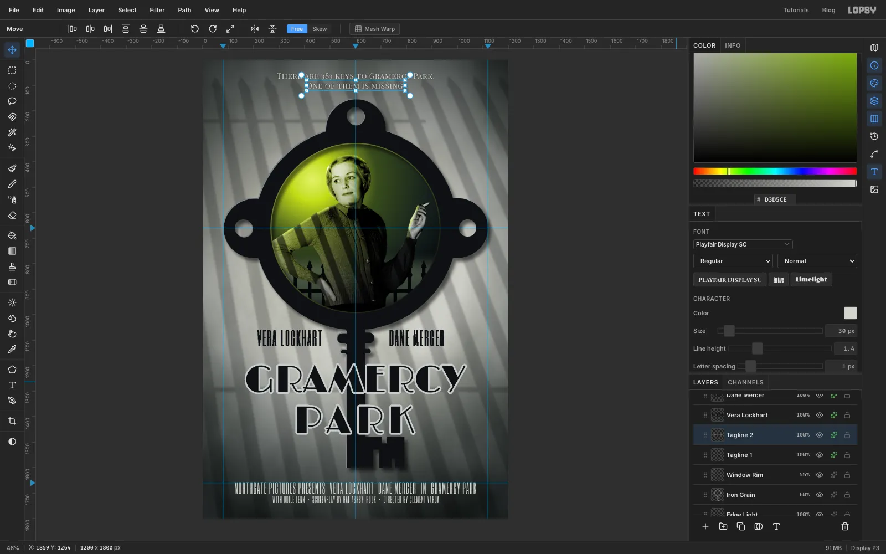

1. Click `GRAMERCY`, open its effects and turn on **Stroke** with **Width** `7` and colour `#C9CCCB`, positioned **outside**. Do the same on `PARK`. The pale keyline cuts a gap in the black shaft around each letter, so the title reads as sitting over the key, not merging into it.
2. Give `Vera Lockhart` and `Dane Mercer` a **Stroke** of **Width** `1` in `#0E1013`. That thickens the thin condensed letters a little, so they hold up as star billing under the heavy title.
3. Give `Tagline 1` and `Tagline 2` an **Outer Glow** in `#000000` with **Size** `8`, **Spread** `10` and **Opacity** `60`. The soft dark halo keeps the light type readable over the fog.

## Paint the cigarette smoke

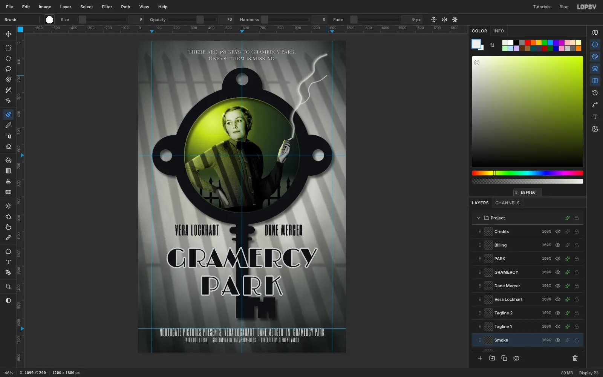

1. Click `Window Rim`, click **Add Layer** and rename it `Smoke`. It goes above the key, so the smoke drifts out of the window and over the iron.
2. Pick the **Brush** and set the colour to `#EEF0E6`. Start at the cigarette's tip (about 892, 556) and draw a wavering line up and to the right, curling left and right a few times, to about 1085, 80.
3. Draw it three times: once at **Size** `30` and **Opacity** `35` for a faint body, once over the top at **Size** `14` and **Opacity** `60` for the core, and once at **Size** `9` and **Opacity** `70` for a thin wisp that branches off to the right about halfway up.

## Curl it with the Smudge tool

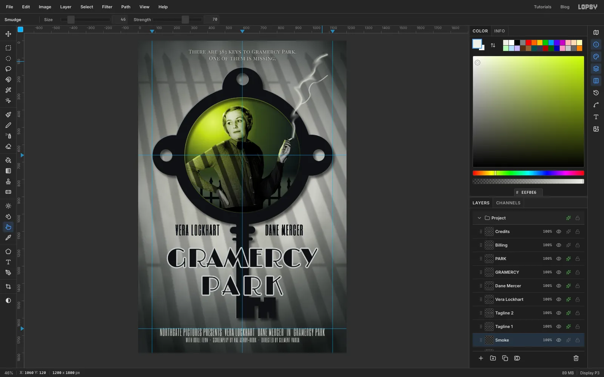

1. Pick the **Smudge** tool ([[R]]). Set **Size** to `46` and **Strength** to `70`.
2. Make four short, slightly curved drags across the plume, alternating left and right as you go up.
3. Run **Gaussian Blur** with **Radius** `3`, set the layer to **Screen** and its opacity to **80%**.

## Fade the smoke out with a layer mask

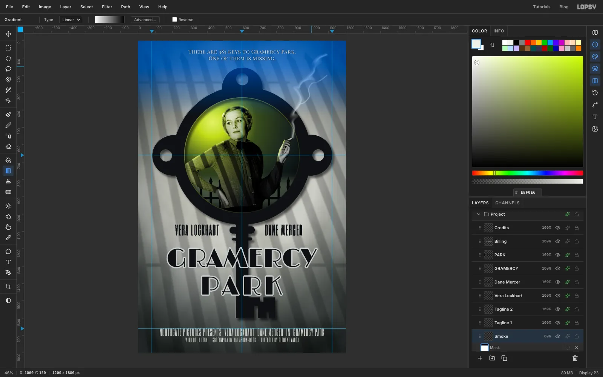

1. With `Smoke` selected, click **Add Mask**, then click the mask thumbnail to edit it.
2. Set up a linear gradient from `#FFFFFF` to `#000000` and drag from 1000, 430 straight up to 1000, 150.

White keeps the smoke and black hides it, so the plume thins out and disappears instead of ending in a hard line. Click another layer's row to finish editing the mask. The fade shows once the blue overlay is gone.

## Add film grain

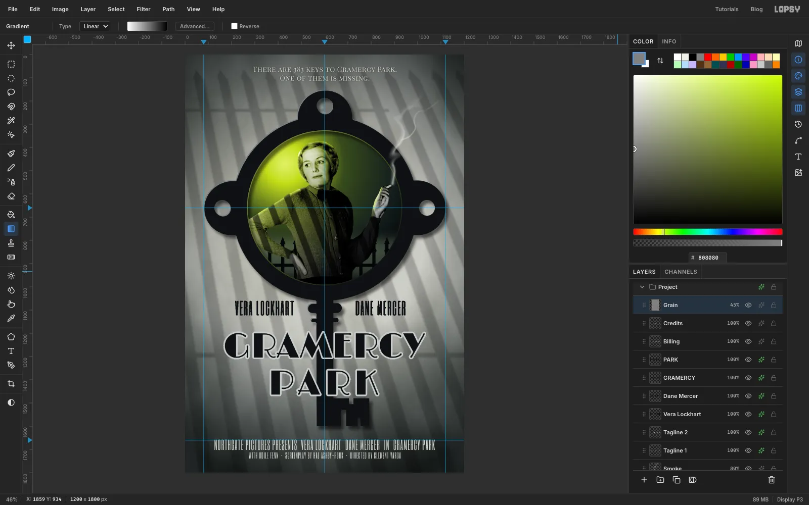

1. Click the topmost layer, `Credits`, then click **Add Layer** and rename it `Grain`.
2. Press [[Cmd+A]], fill with `#808080` and deselect.
3. Choose **Filter → Add Noise…** with **Amount** `40`, **Mono** and **Gaussian**.
4. Set the layer to **Overlay** at **45%**.

Mid grey disappears in Overlay, so only the noise is left, as grain over everything.

## Close in with a vignette, then save and export

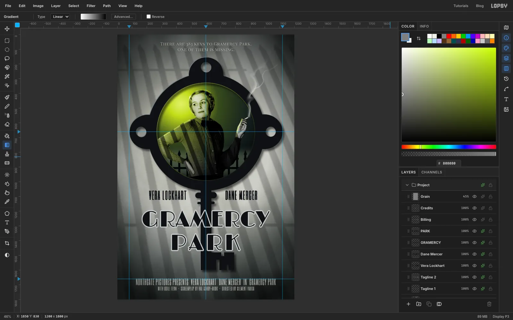

1. Click the `Project` group at the top of the Layers panel and open its effects. Click **Add Adjustment**, choose **Vignette** and set it to `50`.
2. Choose **File → Save Project** to keep a `.lopsy` with every layer, then **File → Quick Export PNG** for the finished poster.

The poster reads in three beats. The lit window catches the eye first, then the title, then the billing. Everything else stays in the dark.
