In the 1960s, op art went from the gallery onto paperback covers. Bridget Riley's black-and-white paintings and Victor Vasarely's warped grids seemed to move while you looked at them. Publishers wanted that effect on the shelf, so covers filled up with stripes, checks and spirals.

In this tutorial you'll make that kind of cover for *The Mirror Labyrinth*, a made-up novel by a made-up author, Lena Moravec. The book is about a woman lost in a corridor that keeps folding back on itself. The cover is 1200 × 1800 px. The top two-thirds is a vortex of turning squares with a tiny figure at its heart. The bottom third is a mirror floor that reflects the vortex and holds the title. The figure has no reflection, which is the cover's quiet joke.

The vortex is built from one simple move, repeated: draw a smaller square, turn it a little further than the last one, and alternate black and white. The optical buzz comes from the repetition, not from any single step.

The tools you'll use:

- **guides** and the **Rectangular** and **Elliptical Marquee**'s exact-corner dialog
- the Move tool's **rotation** and **scale handles**, and **Flip Vertical**
- **Merge Down**, groups, and the **Difference** blend mode
- a dropped photo, **Threshold**, the **Magic Wand**, and a **Lasso** intersect
- **Select → Grow** and **Shrink**, the **Eraser** and **Gaussian Blur**
- **Edit → Copy Merged**, a group **Gradient Map**, and **layer masks** filled with a gradient
- the **Pencil**, **Define Pattern** and **Fill with Pattern**, and **Add Noise**
- live text in Syncopate Bold and Michroma, and a **Color Overlay** effect

The palette:

- Ink `#0B0B0D`, paper `#F4F1EA`
- Vermilion `#EB4D33`
- Ring fill `#FFFCF7` (for the Difference ring)
- Mirror floor `#03061C` → `#2340FF`
- Echo tint `#8395F8`

> **Tip:** On a wide-gamut (Display P3) screen, Lopsy reads typed hex codes as P3 colours. These codes were picked as P3 values, so they match the finished cover. The vermilion `#EB4D33` comes out as a classic sRGB `#FF3A1F`.

> **Note:** Shortcuts are written for a Mac. On Windows use [[Ctrl]] wherever it says [[Cmd]].

## Set up a black page and guides

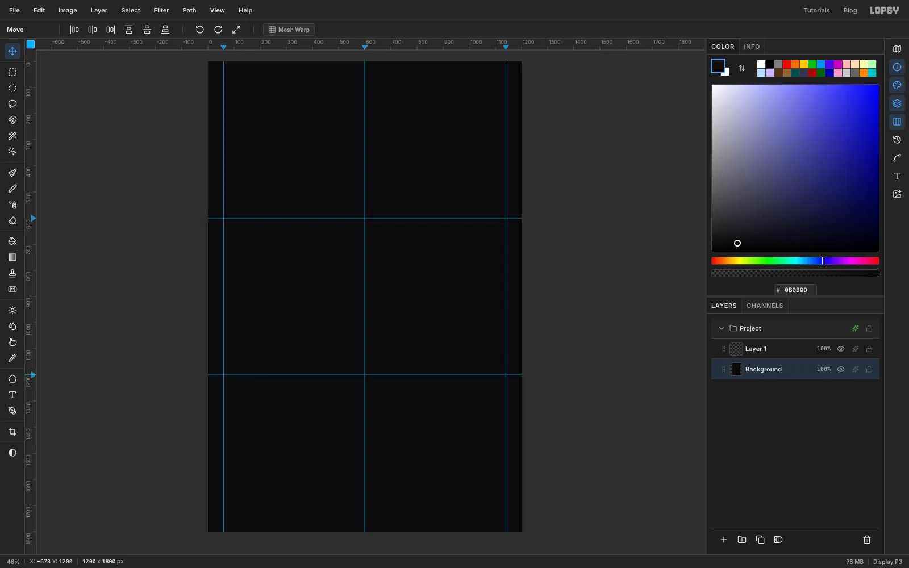

Choose **File → New**, keep the units on **Pixels**, and make the document **1200** wide and **1800** high.

Click *Background* in the Layers panel, set the foreground colour to `#0B0B0D` and choose **Edit → Fill**. Op-art covers are hard black and white, so start from black.

Click the top ruler at **60**, **600** and **1140** to drop three vertical guides. The outer two mark the side margins, and the middle one is the centre line for the type. Then click the left ruler at **600** and **1200**. The guides cross at (600, 600), which will be the centre of the vortex. The line at 1200 is where the mirror starts.

A new document also comes with an empty *Layer 1* at the top. Leave it there: it becomes the grain layer at the very end.

## Draw the first square and turn it

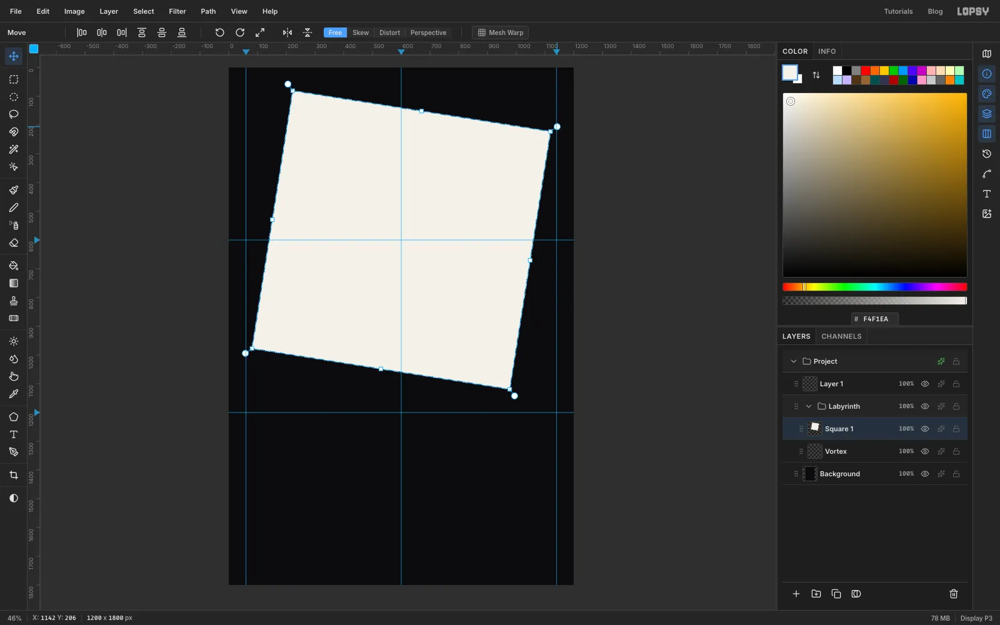

Click **New Group** at the bottom of the Layers panel and name the group *Labyrinth*. Click **Add Layer** and name the new layer *Vortex*. Every square will be merged into it.

Click **Add Layer** again for the first square (call it *Square 1* if you like; the name disappears when you merge). Pick the **Rectangular Marquee** ([[M]]) and click once on the canvas without dragging. A dialog asks for the corners. Type **From 146, 146** and **To 1054, 1054**, which gives a 908 px square centred on the guides' crossing. Set the foreground to paper `#F4F1EA` and choose **Edit → Fill**.

Switch to the **Move** tool ([[V]]). Grab the round rotation handle just outside the top-right corner and drag it clockwise by about **9°**. Lopsy has no angle readout, so use the pointer position in the status bar instead: stop when the square's top-right corner sits at about **x 1120, y 220**. The top edge should slope gently down to the right, as in the screenshot. It doesn't need to be exact. The effect only needs each square to turn a little further than the one before. Press [[Enter]] to commit, then [[Cmd+D]] to deselect.

Choose **Layer → Merge Down** to fold the square into *Vortex*.

## Stack the next square inside it

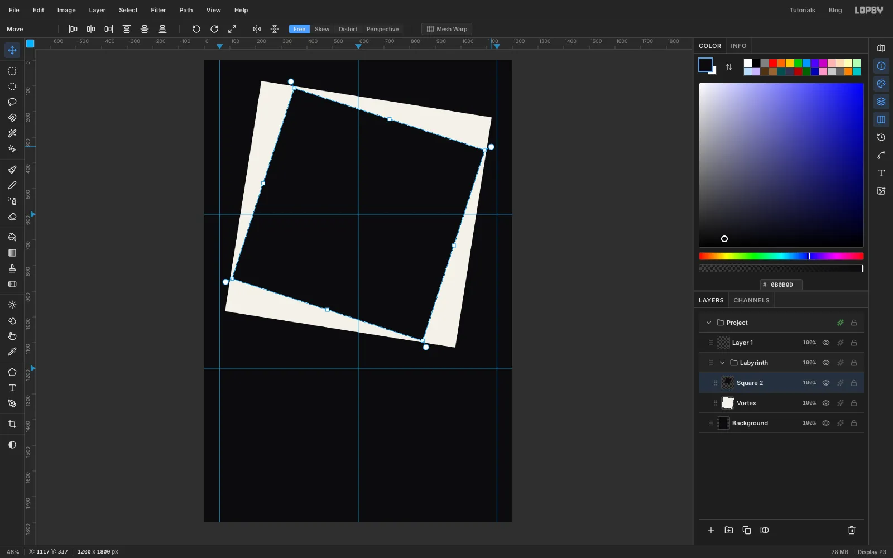

Repeat the same moves for the second square, in ink this time:

1. **Add Layer**.
2. Rectangular Marquee, click once, **From 210, 210** **To 991, 991**.
3. Foreground `#0B0B0D`, **Edit → Fill**.
4. Move tool, drag the rotation handle clockwise about **18°**, twice as far as the first. Each corner of the new square should land just inside an edge of the square before it.
5. [[Enter]], [[Cmd+D]], **Layer → Merge Down**.

The white shows only as four thin triangles around the black square. That sliver is what makes the pattern spin. If a corner of the new square pokes outside the one before, turn it back a degree or two.

## Keep going to ten squares

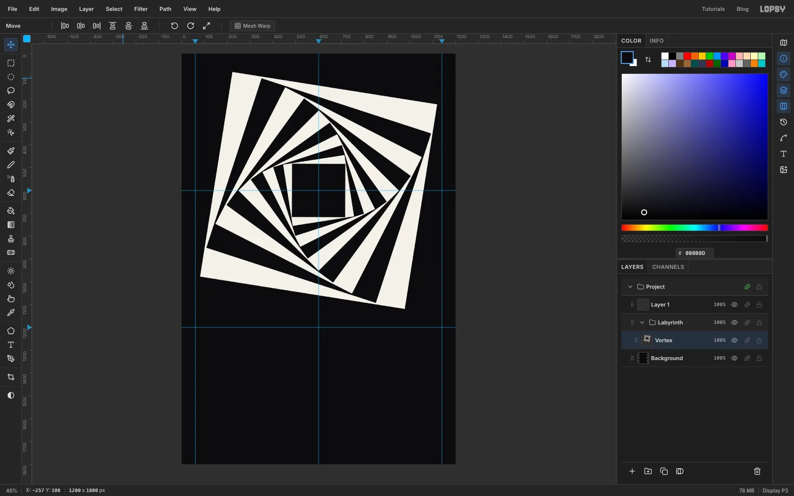

Keep stacking. Each square is about 14% smaller than the last, turns another 9°, and swaps colour. Past 45° it's easier to turn the other way, because a square looks the same after a quarter turn: 54° clockwise looks exactly like 36° anticlockwise. Here are the marquee corners, the turn and the colour for squares three to ten:

- 3: **264 → 936**, 27° clockwise, paper
- 4: **311 → 889**, 36° clockwise, ink
- 5: **352 → 849**, 45° clockwise (hold [[Cmd]] and it snaps there), paper
- 6: **387 → 814**, 36° anticlockwise, ink
- 7: **417 → 784**, 27° anticlockwise, paper
- 8: **442 → 758**, 18° anticlockwise, ink
- 9: **464 → 736**, 9° anticlockwise, paper
- 10: **483 → 717**, no turn at all, ink

Use the same number for X and Y in both boxes of the dialog. By the tenth square the spiral has come a full quarter turn, so it sits square to the page again. The dialog only opens when nothing is selected, which is why each round ends with [[Cmd+D]].

## Finish with a vermilion core

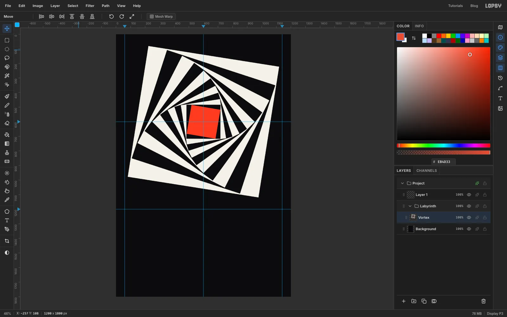

The last square is the light at the end of the corridor. Add a layer, make the square **From 500, 500** **To 701, 701**, fill it with vermilion `#EB4D33`, turn it just **9°** clockwise, the same as the first square, and merge it down.

Look at the whole vortex. Its outer corners clear the page edges and the mirror guide by about 80 px. That gap matters: a corner that almost touches an edge reads as a mistake, so the vortex should float clearly.

## Drop in a photo for the figure

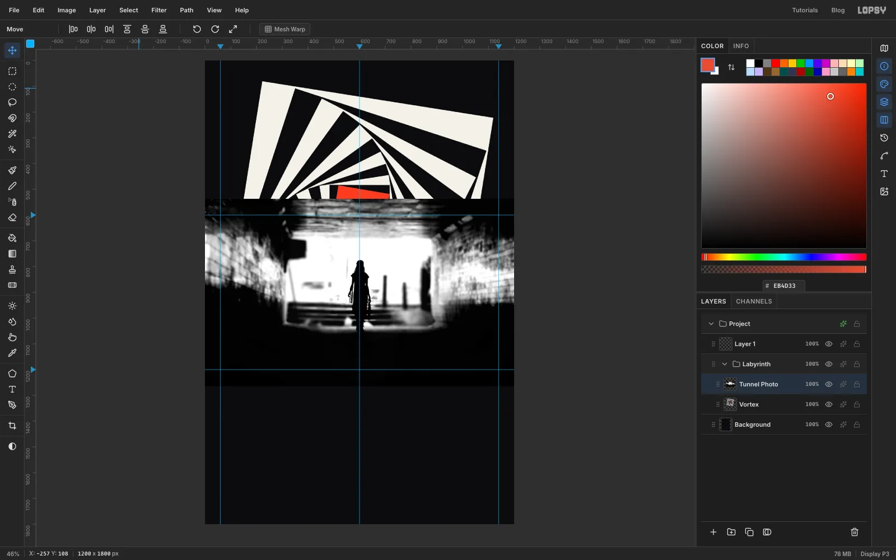

The figure comes from a real photo, so her proportions and gait feel right. This one is [*Woman in Dadar tunnel*](https://commons.wikimedia.org/wiki/File:Woman_in_dadar_tunnel_(Unsplash).jpg) by Himanshu Singh Gurjar, from Unsplash via Wikimedia Commons, released under CC0. Download a copy at least 1600 px wide. Lopsy only shrinks a dropped image to fit when it's bigger than the page. A backlit figure in a tunnel is already a silhouette, which makes the cut-out easy.

Click *Vortex*, then drag the photo file from your desktop onto the canvas. Lopsy scales it to the page width and places it in the middle on a new layer. Rename it *Tunnel Photo* and press [[Cmd+D]].

## Turn the photo into a silhouette

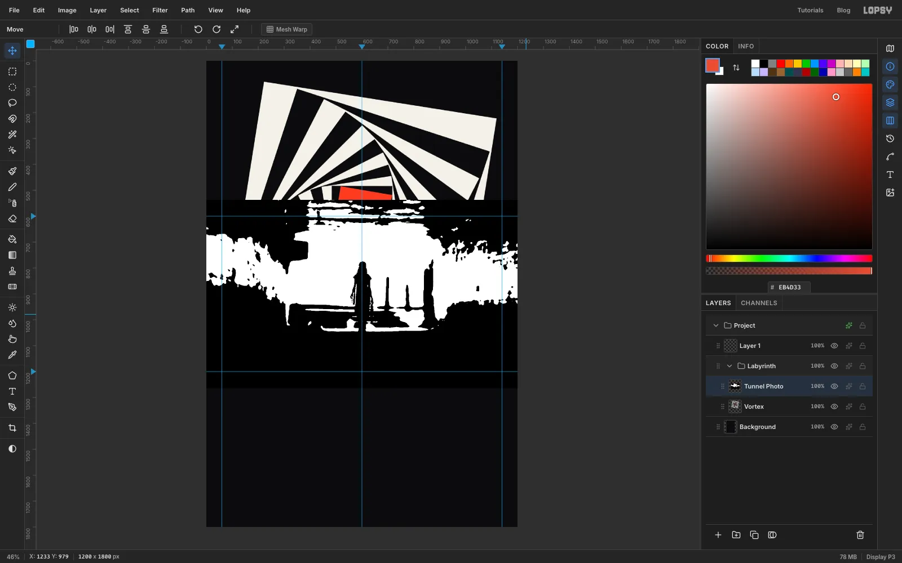

Choose **Filter → Threshold…** and set **Level** to **110**. Every pixel becomes pure black or pure white. The woman is now a solid black shape against the white tunnel mouth. Her legs still run into the dark floor, which you'll fix with the next selection.

## Select her with the Magic Wand and a Lasso

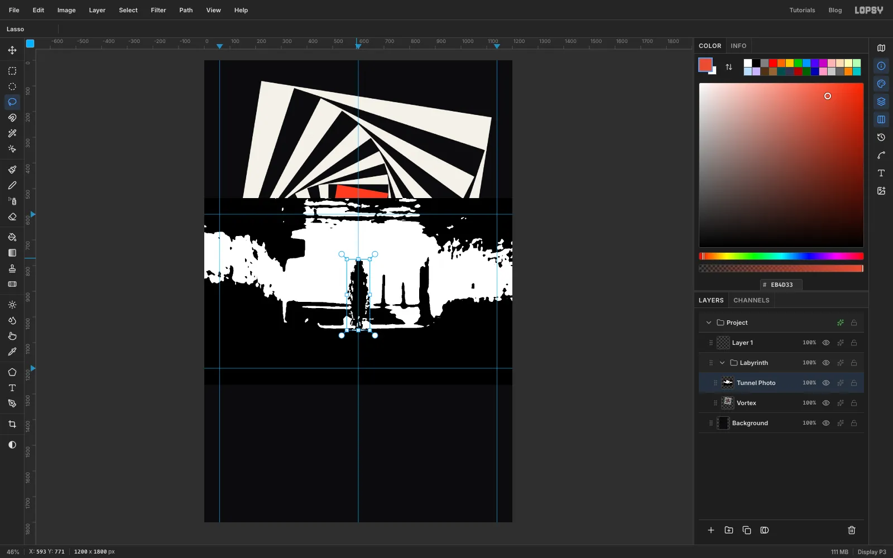

Pick the **Magic Wand** ([[W]]). Set **Tolerance** to **20** and make sure **Contiguous** is ticked, then click her torso. The selection grabs her and everything dark that touches her, including the floor.

Now trim it. Pick the **Lasso** ([[L]]), hold [[Shift+Alt]] and draw around her. Hold [[Shift+Alt]] all the way through: that combination *intersects* the new shape with the wand's selection. Go loosely around her head, shoulders and arms, where the white background already cuts her out. Then go tightly down the outside of each leg, and back up into a narrow V between the legs to separate them. Only the part inside both selections survives.

## Cut her onto her own layer

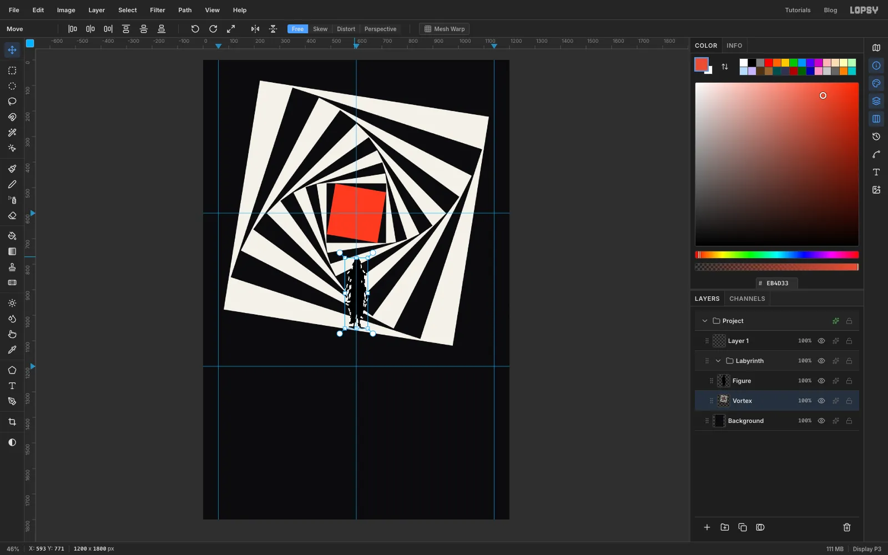

Press [[Cmd+X]] and then [[Cmd+V]]. The figure pastes back in place on a new layer. Name it *Figure*. Click *Tunnel Photo* and click **Delete Layer**, since its job is done. Lopsy makes the layer below active, so click *Figure* again before going on.

Threshold leaves a few white specks inside her dress where the scarf caught the light. To close them, [[Cmd]]-click the *Figure* thumbnail to load her shape. Choose **Select → Grow…** with **3** px, then **Select → Shrink…** with **3** px. Growing swallows the specks and shrinking brings the outline back. Set the foreground to `#0B0B0D`, choose **Edit → Fill**, and press [[Cmd+D]].

## Scale her to fit the core

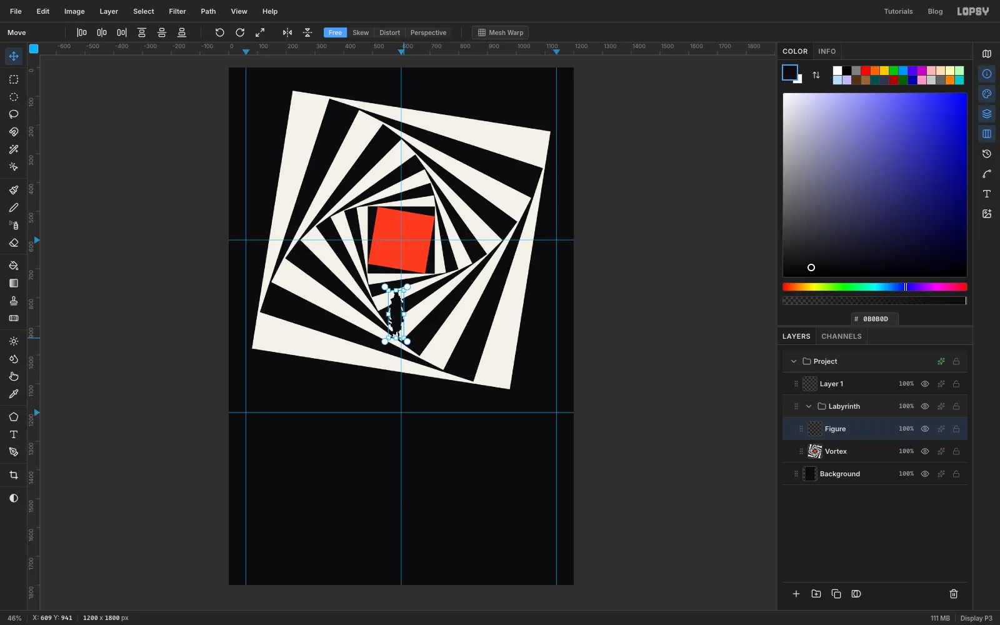

[[Cmd]]-click the *Figure* thumbnail again so the handles hug her. With the **Move** tool, hold [[Cmd]] and drag the bottom-right corner handle in until she is about 60% of her height, roughly **166 px** tall. Watch the Y value in the status bar to measure. [[Cmd]] keeps the scale uniform. Press [[Enter]] and [[Cmd+D]].

## Centre her in the light

Drag her into the vermilion square, centred on the vertical guide and a few pixels below the horizontal one. Feet slightly low reads as standing on a floor. Nudge with the arrow keys to finish.

Two clean-ups at this size:

- Her left hand and scarf leave a small stub sticking out from her hip. Pick the **Eraser** ([[E]]), set **Size** to **5**, and rub it out with one short stroke.
- Threshold edges are stair-stepped. Choose **Filter → Gaussian Blur…** with **Radius 1** to soften them by a pixel.

## Cut a ring for the inversion

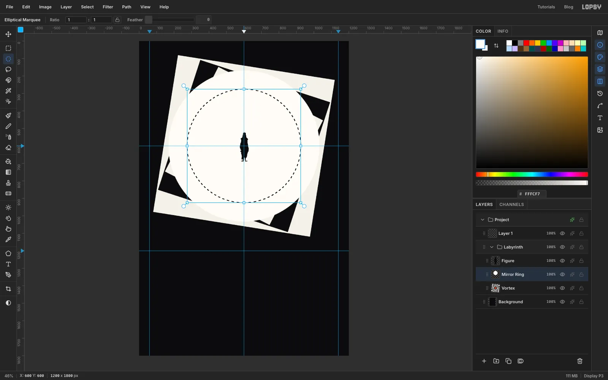

The classic op-art move is to cut through a pattern with a shape that flips it. Click *Vortex*, then **Add Layer**, and name it *Mirror Ring*. It sits between the vortex and the figure, so it won't touch her.

Pick the **Elliptical Marquee** and click once for its dialog. Type **From 168, 168** **To 1032, 1032**, a circle with a 432 px radius. Set the foreground to `#FFFCF7` and choose **Edit → Fill**.

Press [[Cmd+D]], click once again, and type **From 275, 275** **To 925, 925** for the inner circle (radius 325). Press [[Delete]] to punch it out, then [[Cmd+D]]. Both radii sit in quiet parts of the vortex, so neither arc runs through a corner where squares meet.

## Set the ring to Difference

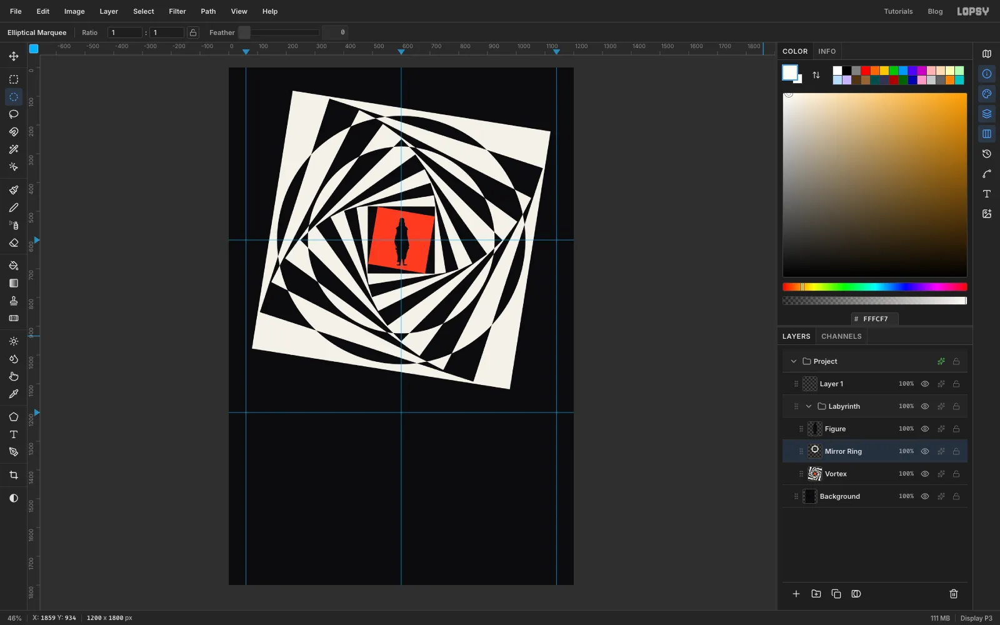

Open the ring's effects (the ✦ button on its row) and set **Blend** to **Difference**. Inside the ring, black and white swap places, and the spiral seems to jump forward.

Why `#FFFCF7` and not pure white? Difference subtracts one colour from the other. `#FFFCF7` is the paper and ink colours added together, so over ink it gives exactly paper, and over paper it gives exactly ink. Pure white would turn the inverted bands slightly cooler than the rest of the cover.

## Copy the vortex for the mirror

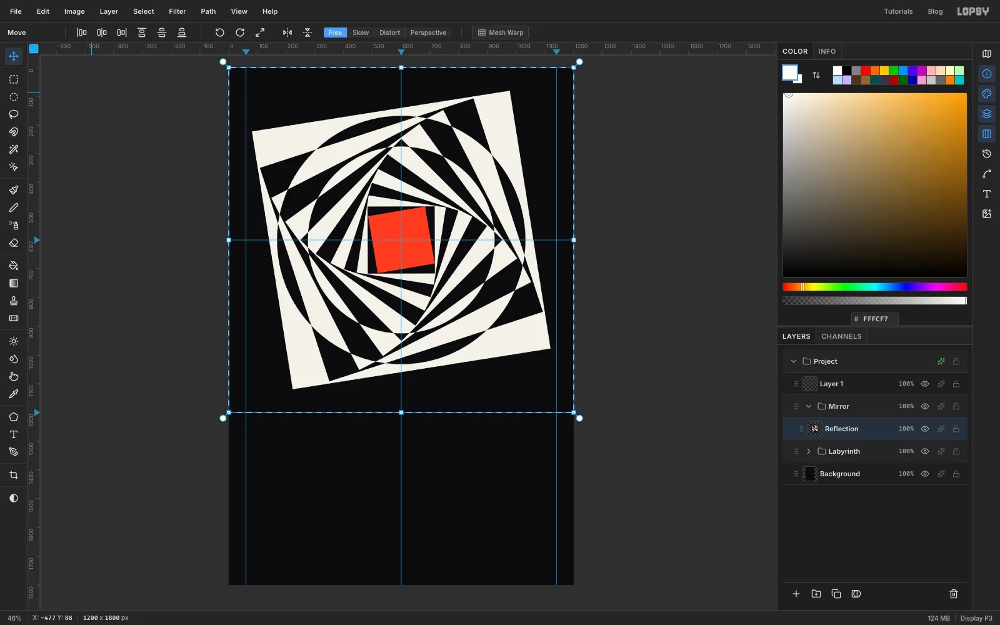

Click the eye on *Figure* to hide her. She won't appear in the mirror.

Collapse the *Labyrinth* group with its arrow, click its row, and click **New Group**. Name it *Mirror*. Because *Labyrinth* is collapsed, the new group sits beside it instead of inside it.

Pick the **Rectangular Marquee** ([[M]]), click once, and type **From 0, 0** **To 1200, 1200**, the whole top part. Choose **Edit → Copy Merged**, which copies everything you can see rather than one layer. Press [[Cmd+V]] and name the pasted layer *Reflection*. Then, with the **Move** tool, click **Flip Vertical** in the options bar.

## Squash the reflection onto the floor

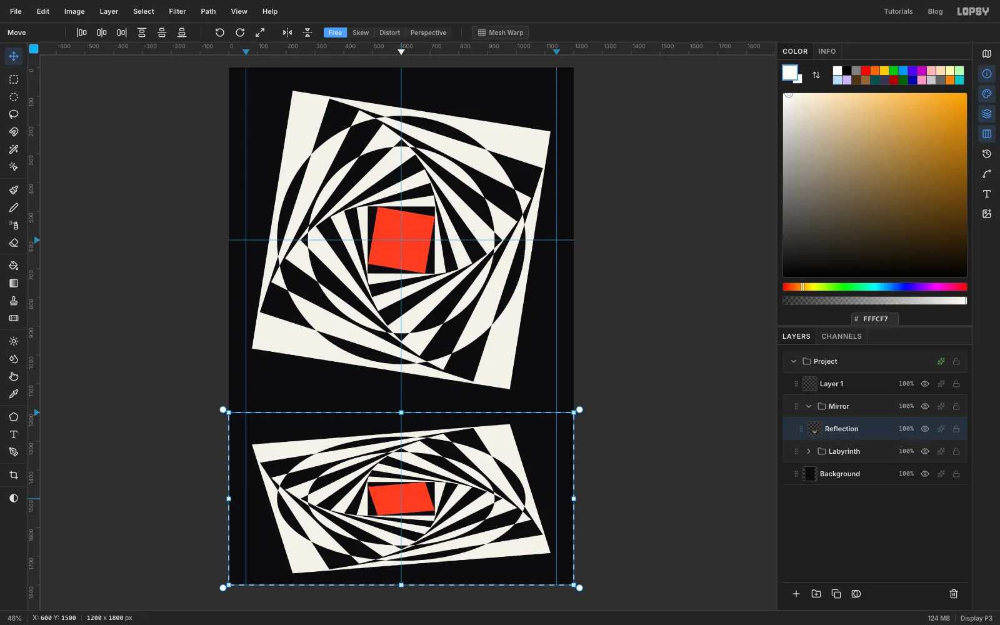

A reflection on a floor looks foreshortened. Drag the transform box's top-middle handle down to the **600** guide. The bottom stays pinned and the vortex squashes to half its height.

Now drag from inside the box straight down until its top sits on the **1200** guide. Press [[Enter]] and [[Cmd+D]].

Expand *Labyrinth* and click the eye on *Figure* to show her again.

## Turn the mirror cobalt with a Gradient Map

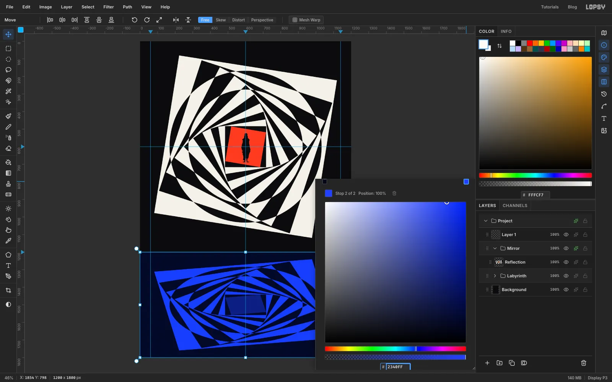

Click the *Mirror* group row and open its effects with the ✦ button. Groups get an adjustments drawer. Click **Add Adjustment → Gradient Map**.

Click the left stop and type `#03061C` in the hex box, then click the right stop and type `#2340FF`. Black now maps to midnight and white to cobalt. Everything you put in the *Mirror* group gets the same treatment. Close the drawer.

## Fade the reflection with a mask

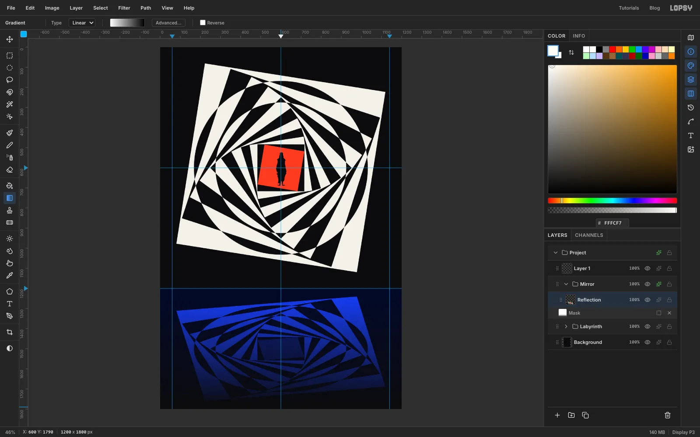

Click *Reflection* and click **Add Mask** at the bottom of the Layers panel. Click the new mask thumbnail to paint into the mask.

Pick the **Gradient** tool, set it to **Linear**, and open **Advanced…**. Make the left stop white `#FFFFFF` and the right stop black `#000000`, and click **Done**. Drag from just below the mirror guide straight down to the bottom edge, keeping the drag vertical. White keeps the reflection and black hides it, so it fades into the dark floor.

While you edit a mask, Lopsy tints the canvas to show it, so the fade can look wrong. Click the layer's name to leave mask editing and see the real result.

## Draw the horizon line

Collapse *Mirror*, click its row and click **Add Layer**. Name the layer *Horizon*. It sits above the group, so the Gradient Map doesn't turn it blue.

Pick the **Pencil** ([[N]]), set **Size** to **2** and the foreground to paper `#F4F1EA`. Click just off the left edge on the **1200** guide, then [[Shift]]-click just off the right edge. Shift-click draws a straight line between the two clicks. Set the layer's opacity to **80%** so the line doesn't shout.

## Set the title

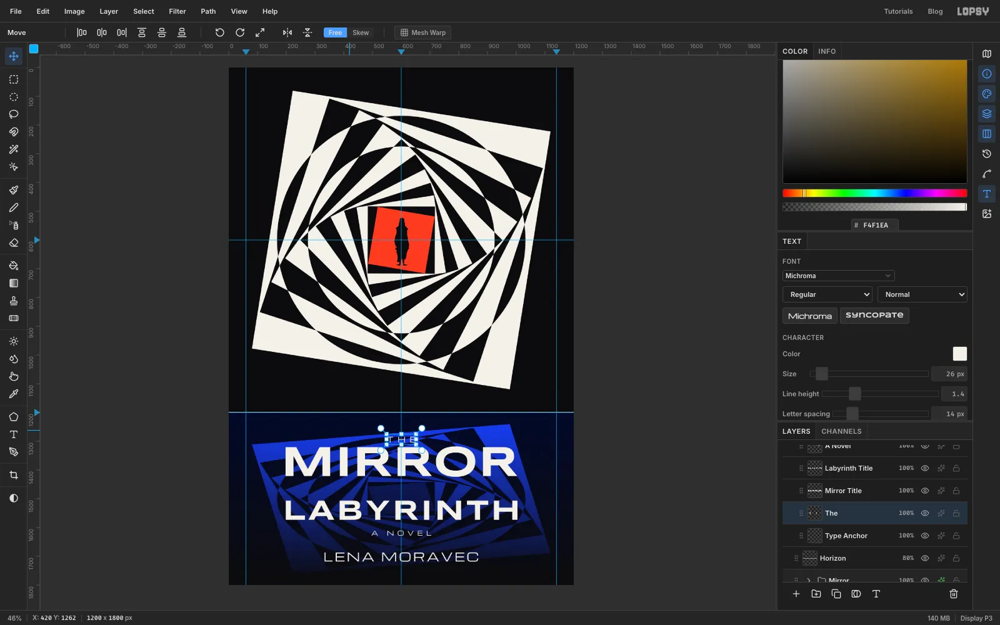

Double-click *Layer 1*, the empty layer at the top of the stack, and rename it *Grain* so it's easy to find at the end.

Click *Horizon* and click **New Group**. Name it *Type*. Then **Add Layer** inside it and name the layer *Type Anchor*. Before each new line of text, click *Type Anchor*. If a text layer is active, the Text tool's font and size controls restyle that layer instead of setting up the new one.

Work from the bottom line up. A click inside an existing line of text edits it, and each text box hangs below the point you click, so clicking above earlier lines keeps them safe. For each line, pick the **Text** tool ([[T]]), set the font, weight and size, and set the colour to paper `#F4F1EA`. Click in empty space, type the text, press [[Tab]], then set **Letter spacing** in the Text panel. Switch to the **Move** tool and drag the line until it's centred on the middle guide with the top of its letters at the height given, then fine-tune with the arrow keys.

- **LENA MORAVEC**: Michroma, size **41**, letter spacing **6**, top at about y **1687**. Name the layer *Author*.
- **A NOVEL**: Michroma, size **22**, letter spacing **12**, top at about y **1611**. Name it *A Novel*.
- **LABYRINTH**: Syncopate **Bold**, size **99**, letter spacing **8**, top at y **1506**. Name it *Labyrinth Title*.
- **MIRROR**: Syncopate **Bold**, size **150**, letter spacing **2**, top at about y **1318**. Name it *Mirror Title*.
- **THE**: Michroma, size **26**, letter spacing **14**, top at about y **1284**. Name it *The*.

Leave the gap under MIRROR empty for now. LABYRINTH's spacing makes it exactly as wide as MIRROR, so the two words form one block. Check that no letter touches the slanted outline of the reflection, especially THE and the M of MIRROR. If one does, move the whole block down a little.

## Mirror the word MIRROR

Click *Mirror Title* and choose **Layer → Duplicate Layer**. Name the copy *Mirror Echo* and click **Rasterize Layer** at the bottom of the Layers panel, since flipping and squashing need pixels.

Pick the **Rectangular Marquee** and drag a box around the word. Switch to the **Move** tool ([[V]]) and click **Flip Vertical** in the options bar. Press [[Cmd+D]], then [[Cmd]]-click the *Mirror Echo* thumbnail so the handles hug the letters. Drag the bottom-middle handle up to halve its height, the same squash as the floor. Press [[Enter]] and [[Cmd+D]].

The squashed echo now sits over the top half of MIRROR. Drag it straight down until its top is **4 px** under MIRROR's baseline (about y 1427), and finish with the arrow keys.

## Tint and fade the echo

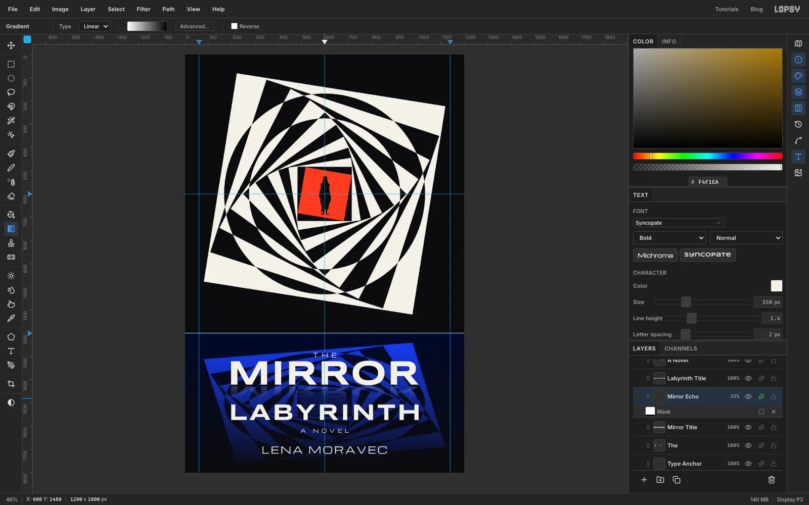

Open the echo's effects and turn on **Color Overlay** with `#8395F8`. That's a lighter blue than the floor, so the echo reads over both its cobalt and its black patches. Set the layer's opacity to **35%**.

Click **Add Mask** and click the mask thumbnail. Pick the **Gradient** tool again (it keeps the white-to-black stops) and drag from the top of the echo to its bottom. Click the layer name to leave mask editing.

## Make a stripe pattern

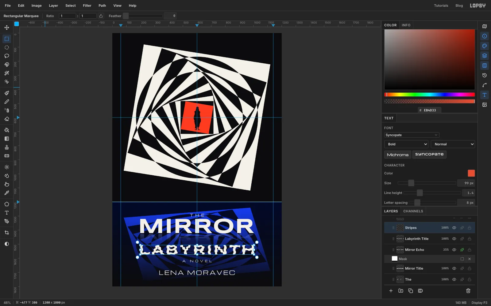

Op-art type is often filled with lines. First make a tiny pattern tile. Click *Type Anchor*, **Add Layer**, and name it *Stripe Tile*. Set the foreground to `#EB4D33`. Use the Rectangular Marquee's dialog for **From 0, 2** **To 10, 7** and fill it: that's a red band 5 px tall. Press [[Cmd+D]], then make a **From 0, 0** **To 10, 10** marquee and choose **Edit → Define Pattern**. The tile is 10 px tall, half red and half clear. Press [[Cmd+D]] and delete the *Stripe Tile* layer.

Patterns tile from the top-left corner of the page, so where the stripes fall depends on where the word sits. With LABYRINTH's top at 1506, the letters start with a white band. If a red stripe slices the very top of your letters, nudge LABYRINTH up or down a couple of pixels before you fill.

Click *Labyrinth Title* and click **Rasterize Layer**. Then **Add Layer** and name it *Stripes*. It lands just above the word. [[Cmd]]-click the *Labyrinth Title* thumbnail to load the letters as a selection. Choose **Edit → Fill with Pattern…**, pick your new stripe pattern, and click **Apply**. Press [[Cmd+D]].

## Knock the white out under the stripes

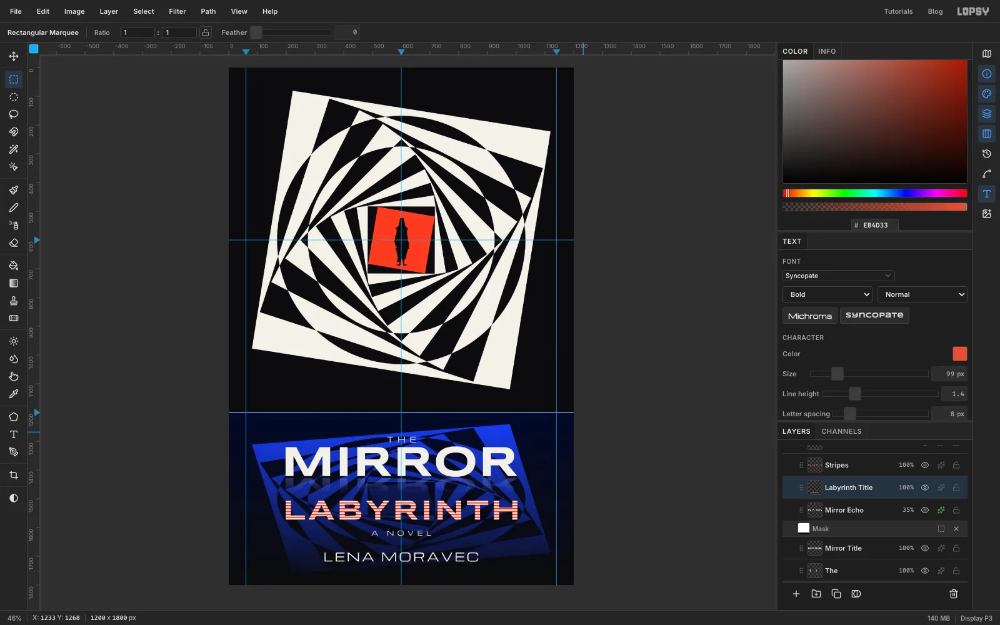

Where a red stripe crosses a letter's soft edge, the white underneath shows through as a pink fringe. To fix it, [[Cmd]]-click the *Stripes* thumbnail to load the stripes. Click *Labyrinth Title* and press [[Delete]] to remove the white under them. Press [[Cmd+D]]. The stripe edges are now clean red.

## Run the imprint up the spine edge

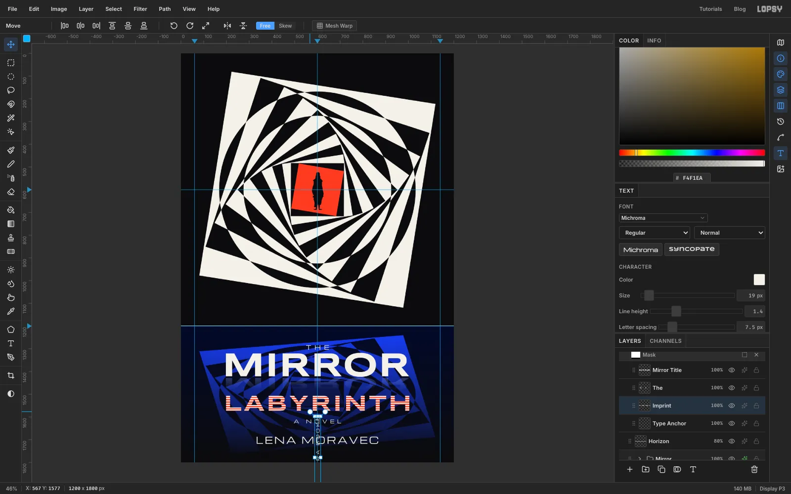

Click *Type Anchor*. With the **Text** tool, choose Michroma at size **19** and set the colour back to paper `#F4F1EA`, since the stripes left the foreground red. Click in the empty strip under the author's name, type **PENUMBRA BOOKS** and press [[Tab]]. Name the layer *Imprint* and set **Letter spacing** to **7.5**.

Switch to the **Move** tool. Hold [[Cmd]] and drag the top-right rotation handle anticlockwise. [[Cmd]] snaps rotation to 15° steps, so stop when the text stands upright, a quarter turn, reading bottom to top. Press [[Enter]]. (The **Rotate 90° CCW** button in the options bar does the same in one click.)

## Seat the imprint in the margin

Drag the imprint into the left margin so it sits just left of the 60 guide, centred about **50 px** from the edge. Slide it so its lower end lines up with the bottom of LENA MORAVEC. At this spacing it runs from about y 1359 to 1718. That's well inside the trim, and clear of the reflection's left corner.

## Add print grain

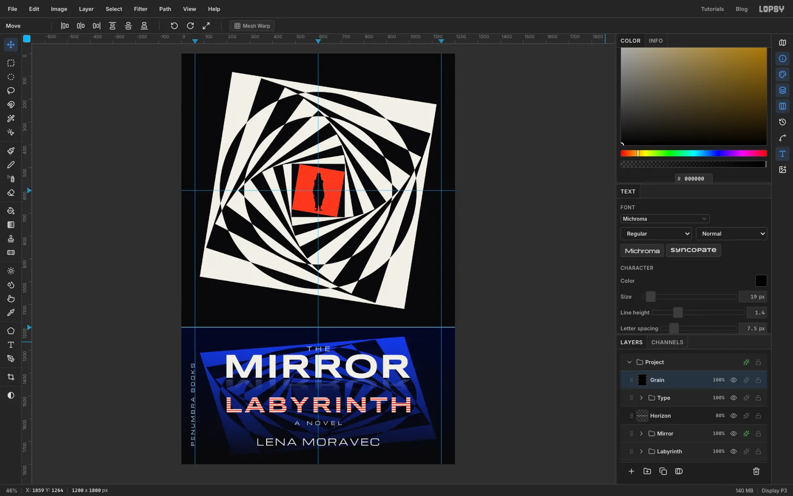

Flat digital black and white looks like vector art, not ink on paper. Click *Grain*, the empty layer at the very top of the stack. Set the foreground to pure black `#000000`, choose **Edit → Fill**, then **Filter → Add Noise…** with **Amount 36**, **Mono** and **Gaussian**.

Open its effects and set **Blend** to **Difference**. Black noise in Difference speckles the blacks and the whites alike. Overlay would leave pure black and pure white untouched, and Normal would hide the cover under a sheet of static.

Choose **File → Save Project** to keep the layers, then **File → Export…** for a PNG.
