Op art makes the eye do the work. Bridget Riley and Victor Vasarely used
nothing but flat black lines and shapes, and let the viewer's eye see the
movement, the bulges and the pictures. One of their simplest tricks is the
**line screen**: a field of parallel lines that swell where the picture is
dark and thin where it is light. Up close it is just stripes. From across
the street it is a face, or here, an eye.

In this tutorial you'll make a billboard for **Retina Zero**, an imaginary
laser eye clinic. The headline, EVERY LINE STRAIGHT., is a joke on the
picture: every line on the board really is straight, and it's your eye
that turns them into an eye. You'll build it at **2400 × 1200 px**, the 2:1
shape of a 48-sheet roadside billboard.

The eye starts as a photo: [Brown eye.jpg](https://commons.wikimedia.org/wiki/File:Brown_eye.jpg)
on Wikimedia Commons, by Entertheninja, released into the public domain
(**CC0**). Download the original (803 × 512 px). Any front-on, level close-up
of an eye works the same way, but you'll need to adjust the coordinates:
every position below assumes this photo, scaled 2.4× and shifted 90 px left.
The type is set in **Anton** and **Michroma**, both free Google Fonts under
the SIL Open Font License.

Along the way you'll use:

- ruler guides, **Snap to Guides**, the grid and the marquee's exact-corners dialog
- a gradient tile, **Define Pattern** and **Fill with Pattern** with a vertical offset
- **Desaturate**, **Brightness/Contrast**, **Gaussian Blur**, **Motion Blur**, **Sunburst** and **Threshold**
- the **Pen** tool and **Path to Selection**, ⌘-click thumbnail selections with intersect, **Grow**, **Shrink**, **Feather** and **Inverse**
- the **Brush**, the **Magic Wand** and radial gradients
- layer opacity, **Merge Down**, **Color Overlay**, **Stroke**, **Drop Shadow** and **Outer Glow**
- text in **Anton** and **Michroma**, fitted to a measure with Size and letter spacing
- copy and paste in place, scaling, moving and rotating a whole group, and undo and redo

The palette:

- Paper `#F1ECE0`, ink `#17161F`
- Iris `#D8F23C` → `#12B8A6` → `#2340E0`
- Cobalt `#2340E0` (LINE and the shadows)
- Vermilion `#FF4B1F` (the offer and the sticker)
- Tone-map greys `#C8C8C8`, `#E4E4E4`, `#C0C0C0` (working values, never seen in the finished board)

## Set up the canvas and guides

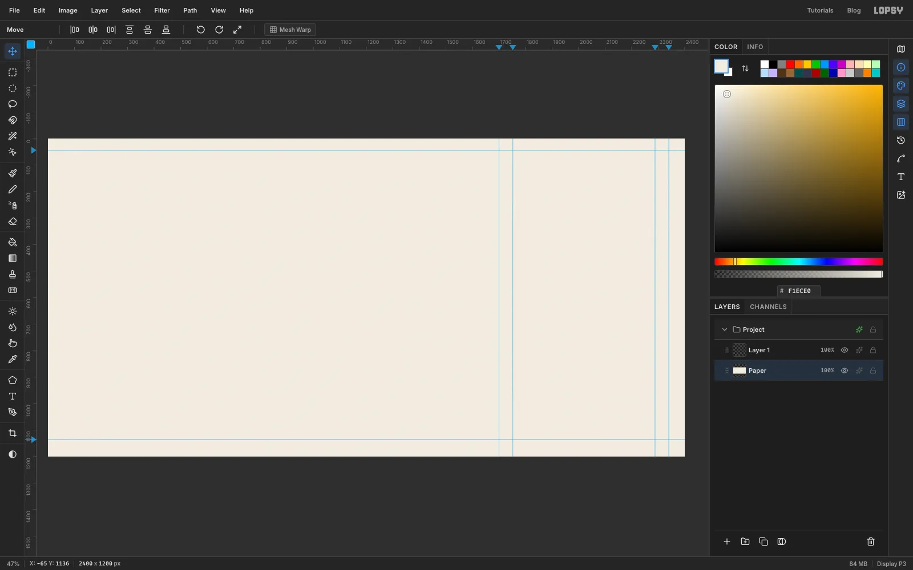

Choose **File → New**, enter **2400 × 1200** pixels and click **Create**.
Select the *Background* layer, set the foreground colour to `#F1ECE0`,
choose **Edit → Fill** and rename the layer *Paper*.

Now drop guides for the type panel. Click the top ruler at **1700** and
**2340** for the panel's sides and at **1752** and **2288** for its text
margins. Click the left ruler at **44** and **1136** for the panel's top and
bottom. Later, when you set the type, it helps to add two more on the left
ruler, at **211** and **1084**, for the top of the headline and the bottom of
the last line.

## Make a soft stripe tile

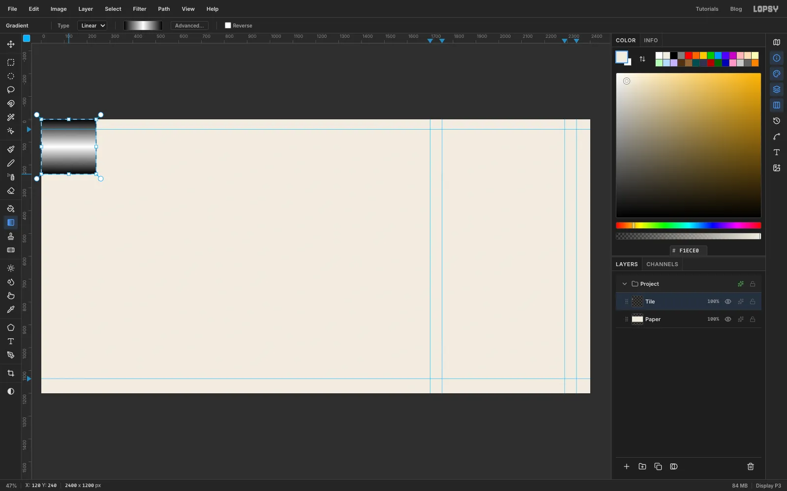

The line screen needs stripes that fade smoothly from black to white and
back, not hard bars. That smooth ramp is what lets a line grow thicker or
thinner later.

Select *Layer 1* and rename it *Tile*. Pick the **Rectangular Marquee** and
click once on the canvas without dragging. A dialog opens where you can type
exact corners. Enter From **0, 0** and To **240, 240**.

Pick the **Gradient** tool, set the type to **Linear** and click
**Advanced…**. The editor opens with two stops. Click one, type `000000` in
its **Hex** field, then do the same for the other. Click the bar halfway
along to add a third stop and make it `FFFFFF`. You now have black, white,
black. Click **Done**. Drag from the top of
the square straight down to its bottom edge.

Choose **Edit → Define Pattern**, press [[Cmd+D]] and delete the *Tile*
layer with the trash button. The pattern is kept.

> **Tip:** Patterns only last for the current session. Don't reload the page
> before you reach the stripe fill, or you'll have to define it again.

## Bring in the eye photo

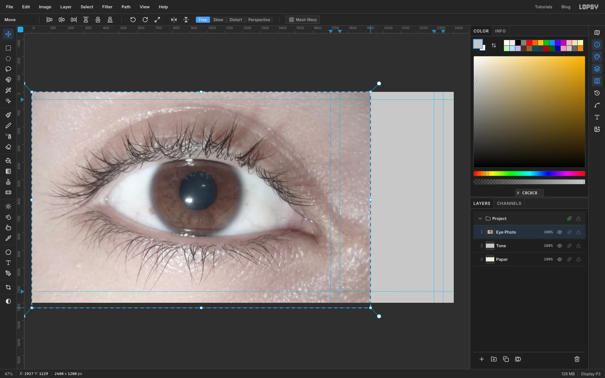

Select *Paper* and click **Add Layer**. Name it *Tone*, set the foreground to
`#C8C8C8` and choose **Edit → Fill**. This flat grey becomes the open field
of lines around the eye.

Drag the photo file from your desktop onto the canvas. It lands in the
top-left corner as *Pasted Layer*, already selected with handles. Rename it
*Eye Photo*. Hold [[Cmd]] and drag its bottom-right handle down and right
until the photo's right edge reaches about **1927** on the top ruler. That's
**2.4 times** its size, and the bottom now hangs just past the canvas. Press
[[Cmd+D]] to commit.

With the **Move** tool active, press [[Shift+←]] nine times to move the photo
**90 px to the left**. That
puts the middle of the iris at about **(851, 600)** and leaves the right side
of the board clear for the panel. Some of the photo now hangs off the left
edge, which is fine.

## Fade the photo into the grey

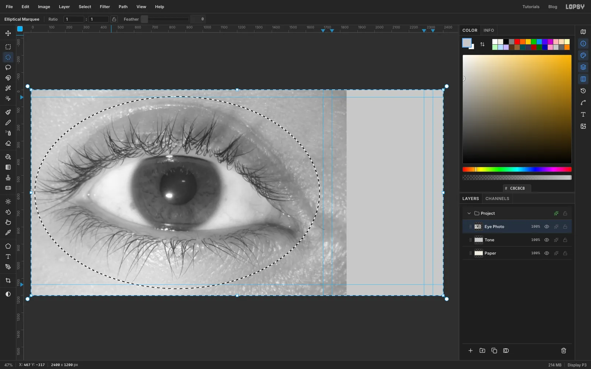

Choose **Filter → Desaturate**. Only the photo's light and dark matter from
here on.

Pick the **Elliptical Marquee**, click once and enter From **21, 40** and To
**1681, 1160**. Choose **Select → Feather…**, enter **63** and click
**Apply**. That's the largest feather Lopsy applies; bigger values look the
same. Choose **Select → Inverse** and press [[Delete]]. The photo now
fades softly into the flat grey, so the lines will run on without a seam.
Press [[Cmd+D]].

Choose **Layer → Merge Down** to merge the photo into *Tone*. A merged layer
keeps the name of the layer underneath, so it's still called *Tone*.

## Smooth the tone map

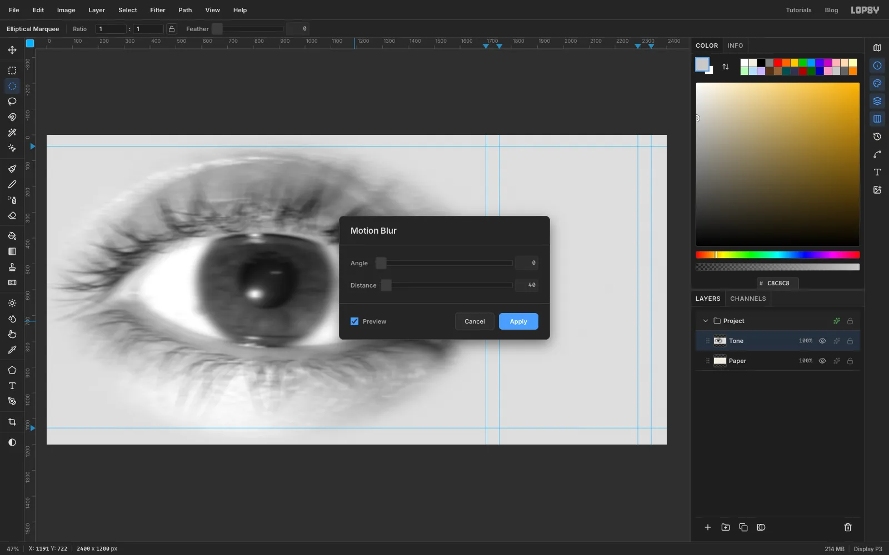

Every speck in this layer will show up as a lump in a line, so soften it
first. Choose **Filter → Brightness/Contrast…**, set **Contrast** to **30**
and click **Apply**. Then choose **Filter → Gaussian Blur…** with
**Radius 6**.

Finally choose **Filter → Motion Blur…**, set **Angle 0** and **Distance
40**, and click **Apply**. A sideways smear evens out each line along its
length, so the lines swell smoothly instead of wobbling.

## Trace the eye opening

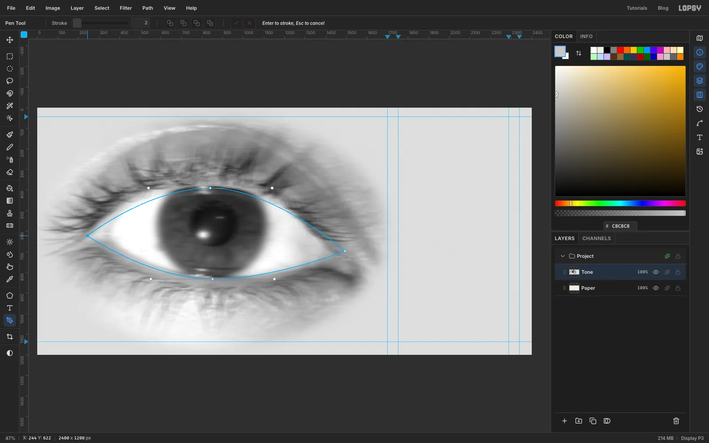

The iris has to tuck under the lids, so you need the exact shape of the eye
opening. Pick the **Pen** tool and draw a closed almond:

1. Click the inner corner of the eye at about **(244, 622)**.
2. Press at the top of the opening, about **(840, 390)**, and drag right to
   about **(1140, 390)** to pull out a curved handle.
3. Click the outer corner at about **(1494, 696)**.
4. Press under the iris at about **(851, 832)** and drag left to about
   **(551, 832)**.
5. Click the first point again to close the path.

The top passes over the iris, about 50 px below its top edge, and the bottom
passes just above its bottom edge.

Open the **Paths** panel and click **Path to Selection**, then **Delete
Path**. Click **Add Layer**, name it *Opening*, fill the selection with any
bright colour and press [[Cmd+D]]. Hide the layer with its eye icon. It's a
helper you'll ⌘-click later to load the opening as a selection.

## Darken the lids

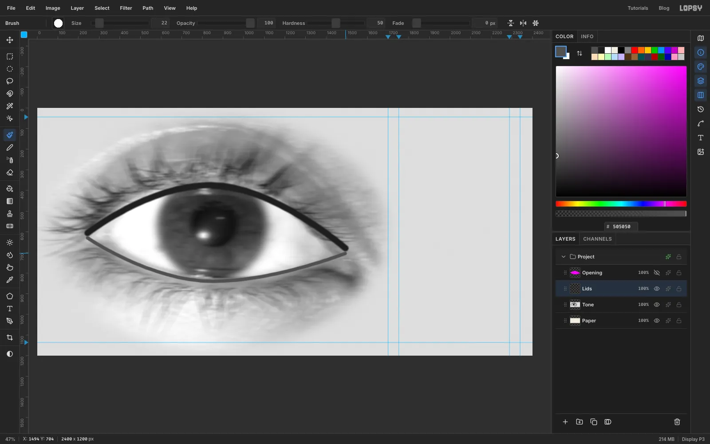

Select *Tone* and click **Add Layer**. Name it *Lids*. Pick the **Brush** and
open the brush settings: **Size 40**, **Hardness 50**, **Spacing 10**,
**Opacity 100**. Set the foreground to `#1E1E1E` and paint one smooth stroke
along the upper lash line, just above the top of the opening, from corner to
corner.

Change the brush **Size** to **22** and the foreground to `#505050`, and paint
along the lower lid, just below the opening. Choose **Layer → Merge Down**.
The strokes merge into *Tone*.

Dark areas on this map become thick lines, so these strokes make the almond
read clearly in the finished screen.

## Flatten the iris tone

The photo's iris has blotches that would show up as grey smudges in the rays,
so replace it with a clean ramp.

First, light up the white of the eye right up to the iris. With the
**Elliptical Marquee**, click once and enter From **562, 311** To **1140,
889**. Hold [[Cmd+Shift+Alt]] and click the *Opening* thumbnail in the
Layers panel. That intersects the circle with the opening. Set the
foreground to `#E4E4E4`, choose **Edit → Fill** and press [[Cmd+D]].

Now click once again and enter the iris itself: From **592, 341** To
**1110, 859**. Intersect it with the *Opening* thumbnail the same way. Pick
the **Gradient** tool, set it to **Radial**, and open **Advanced…**. Click
the middle stop left over from the tile and remove it with the trash button,
then set the two end stops to `9A9A9A` and `303030`. Drag from the centre of the iris
**(851, 600)** straight out to its edge. Press [[Cmd+D]].

## Keep every line open

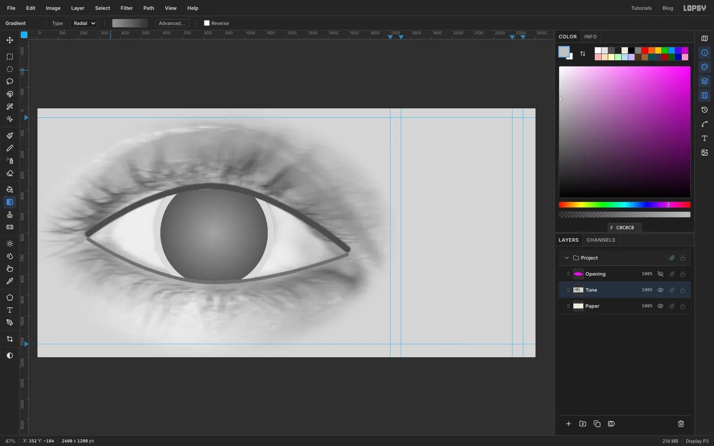

If the map has pure white, a line vanishes. If it has pure black, two lines
fuse into a slab. Squeeze the range so neither can happen.

Select *Paper* and click **Add Layer**. Name it *Clamp Grey* and fill it
with `#C0C0C0`. Select *Tone*, set its opacity to **72 %** and choose
**Layer → Merge Down**. Rename the result *Tone*. The
darkest lines now stop just short of touching, and the lightest stay a thin
hairline.

## Fill a layer with stripes

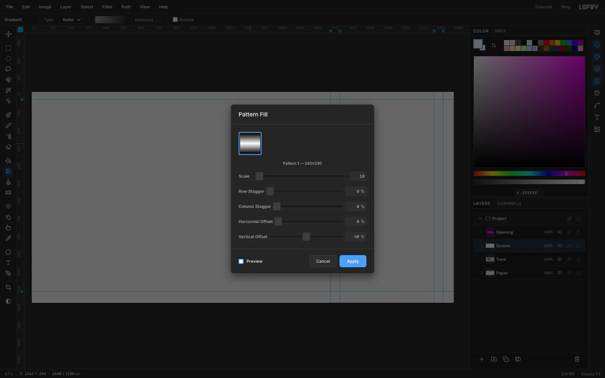

With *Tone* selected, click **Add Layer** and name it *Screen*. Choose
**Edit → Fill with Pattern…** and click your gradient tile.
Set **Scale** to **10 %**, so the 240 px tile repeats every 24 px, and
**Vertical Offset** to **50 %**, so the first and last lines aren't cut in
half at the edges. Click **Apply**.

## Select the visible iris

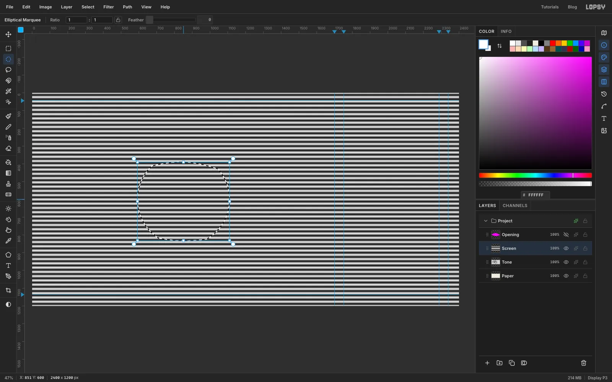

Inside the iris, the horizontal stripes give way to rays. With the
**Elliptical Marquee**, click once and enter the iris again: From **592,
341** To **1110, 859**. Hold [[Cmd+Shift+Alt]] and click the *Opening*
thumbnail. You're left with only the part of the iris the lids don't cover.

## Burst rays inside the iris

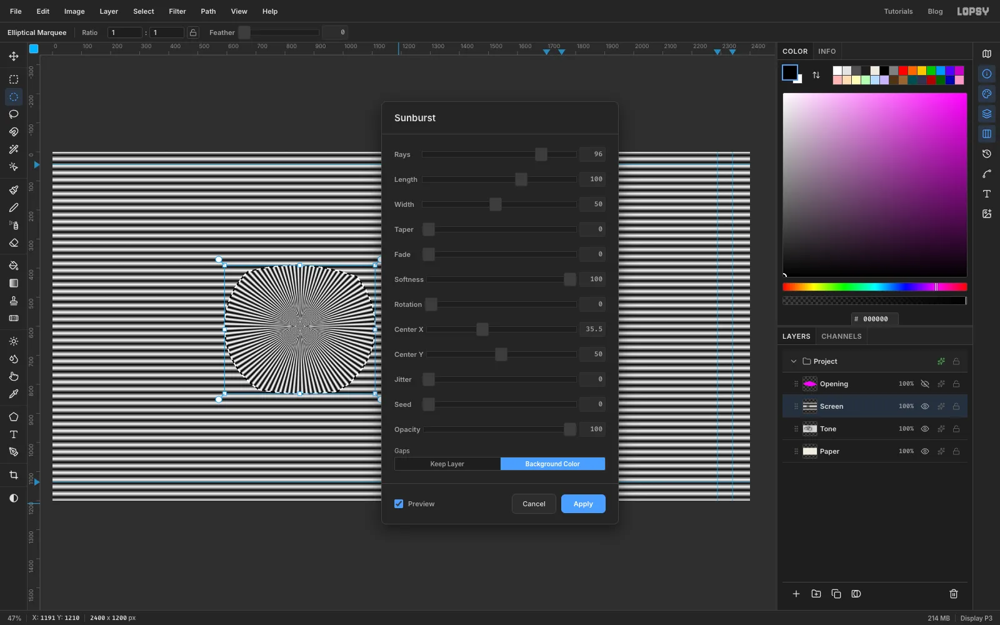

Sunburst paints its rays in the foreground colour and fills the gaps with
the background colour. Set the foreground to `#FFFFFF`, press [[X]] to swap
it into the background, then set the foreground to `#000000`.

Choose **Filter → Sunburst…** and set **Rays 96**, **Length 100**, **Width
50**, **Softness 100**, **Center X 35.5** and **Center Y 50**. The centre is a percentage of the
document, and 851 px across a 2400 px board is 35.5 %. Under
**Gaps** click **Background Color**. Softness 100 gives each ray the same
smooth black-to-white ramp as the stripes. Click **Apply**.

## Mix the screen with the tone

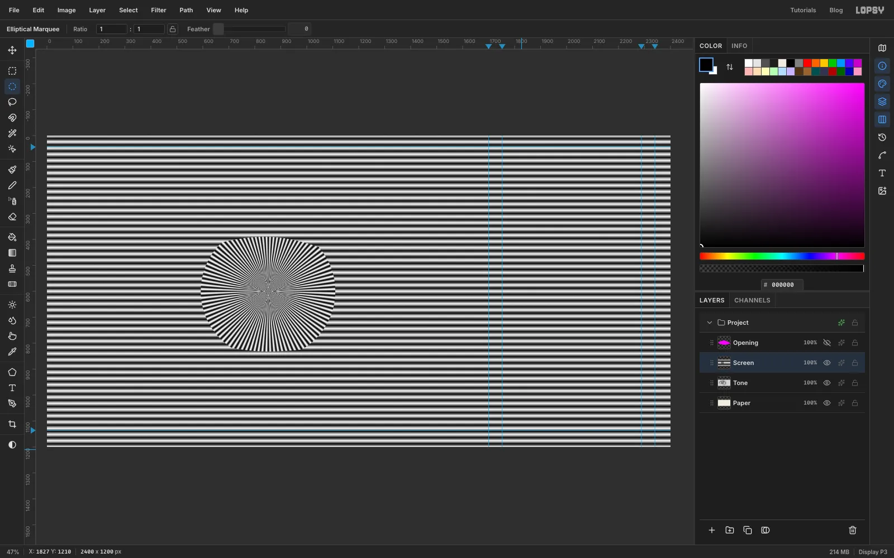

Press [[Cmd+D]]. Set the *Screen* layer's opacity to **50 %** and choose
**Layer → Merge Down**. The merged layer is still called *Tone*. Rename it
*Lines*.

The layer now holds half stripe, half photo. Where the photo is dark, more
of each stripe falls below middle grey, and that's what the next step turns
into thick lines.

## Threshold it into lines

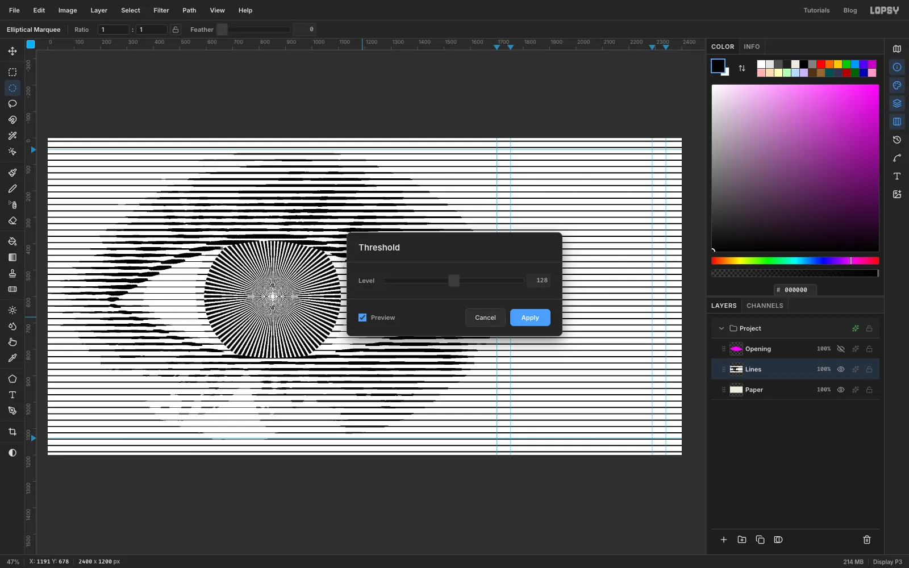

Choose **Filter → Threshold…**, leave **Level** at **128** and click
**Apply**. Everything darker than middle grey becomes black, and everything
lighter becomes white. The eye appears, drawn only in lines.

To smooth any stair-steps on the edges, run **Filter → Gaussian Blur…** at
**Radius 2**, then **Filter → Threshold…** at **128** again.

## Knock out the paper

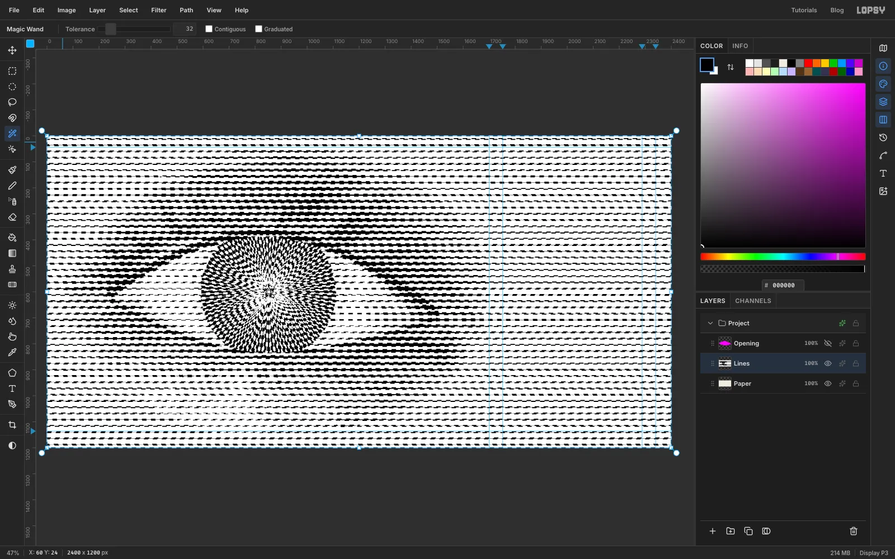

Pick the **Magic Wand** and untick **Contiguous**. Click any white gap
between two lines, for example near the top-left corner. Every white pixel on
the layer is selected. Press [[Delete]], then [[Cmd+D]]. The cream *Paper*
now shows through the gaps.

## Ink the lines

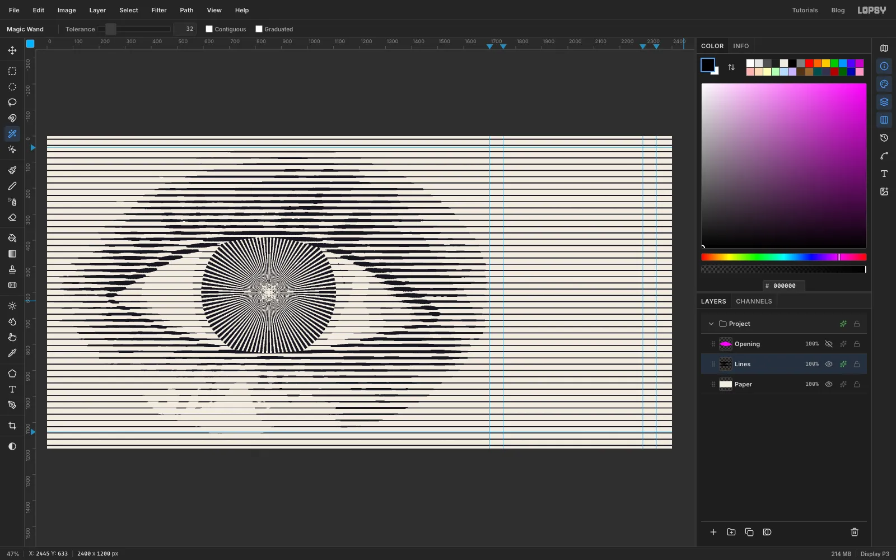

Click the effects button (the sparkle icon) on the *Lines* row to open the
layer effects, and enable **Color Overlay**. Set its
colour to `#17161F`. Pure black looks harsh next to the cream; this
blue-black ink is softer and still reads as black.

## Colour the iris

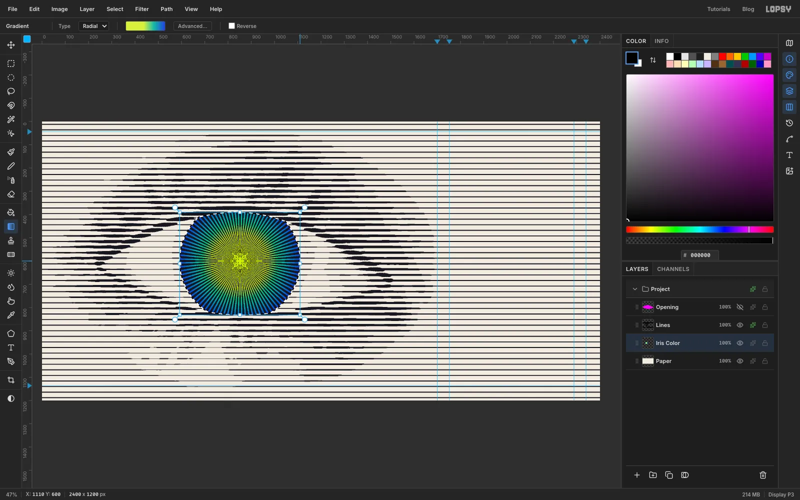

Select *Paper* and click **Add Layer**. Name it *Iris Color*. Make the
visible-iris selection again: the iris circle, From **592, 341** To **1110,
859**, intersected with the *Opening* thumbnail.

Pick the **Gradient** tool (still **Radial**) and open **Advanced…**. Click
the bar twice to add two stops, so there are four. Set `D8F23C` at the left
end, `D8F23C` at about **45 %**, `12B8A6` at about **72 %** and `2340E0` at
the right end. Drag a stop to move it along the bar. Drag from the
centre of the iris to its edge and press [[Cmd+D]]. The colour sits under
the lines, so it only shows in the gaps between the rays.

## Add the limbus ring

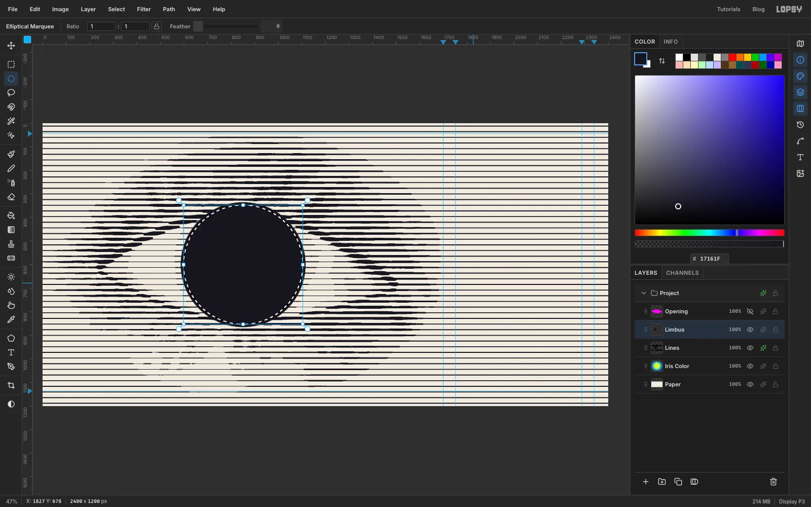

Select *Lines* and click **Add Layer**. Name it *Limbus*. Set the foreground
to `#17161F`. Click once with the **Elliptical Marquee** and enter From
**586, 335** To **1116, 865**, then choose **Edit → Fill**. Choose **Select
→ Shrink…**, enter **12** and press [[Delete]]. That leaves a ring round the
iris.

Now tuck the ring under the lids too. [[Cmd]]-click the *Opening* thumbnail,
choose **Select → Inverse**, click the *Limbus* layer and press [[Delete]].
Press [[Cmd+D]].

## Outline the lids

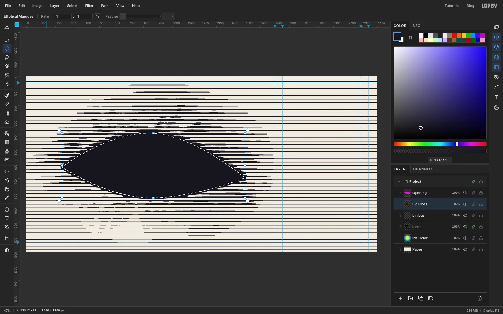

Click **Add Layer** and name it *Lid Lines*. [[Cmd]]-click the *Opening*
thumbnail, choose **Select → Grow…** with **10**, and fill with `#17161F`.
[[Cmd]]-click the *Opening* thumbnail again, click *Lid Lines* and press
[[Delete]]. You're left with a 10 px outline running just outside the opening,
so the iris disappears under the lid line at the top and bottom. Press
[[Cmd+D]].

The *Opening* helper has done its job. Select it and delete it.

## Draw the pupil and catchlights

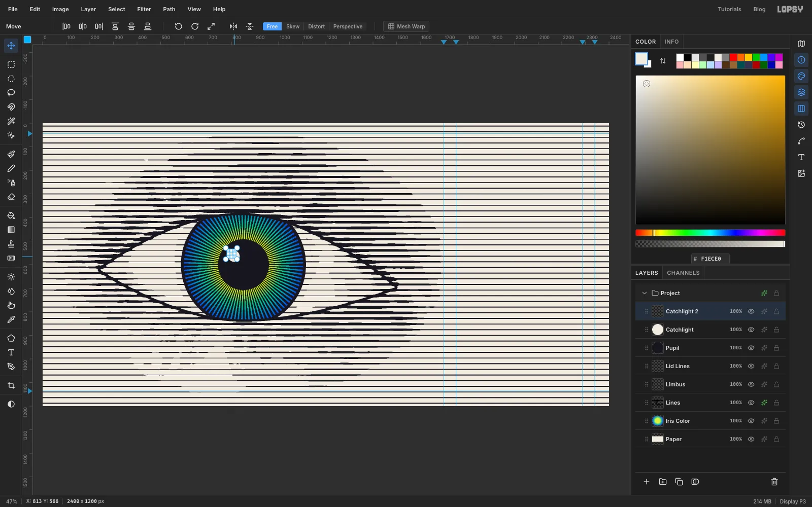

Select *Lid Lines* and click **Add Layer**. Name it *Pupil*. Click once with
the **Elliptical Marquee**, enter From **743, 492** To **959, 708** and
fill with `#17161F`. Press [[Cmd+D]]. The pupil is centred on the iris. The
photo's pupil sat a little high, which pressed it against the lid.

Click **Add Layer** and name it *Catchlight*. Set the foreground to
`#F1ECE0`, click once and enter From **787, 540** To **835, 588**, and
choose **Edit → Fill**.
Press [[Cmd+C]] and [[Cmd+V]]. The copy pastes in place, already selected.
Rename it *Catchlight 2*, hold [[Cmd]] and drag its bottom-right handle
inward until it is about half the size. Press [[Cmd+D]].

## Move the second catchlight

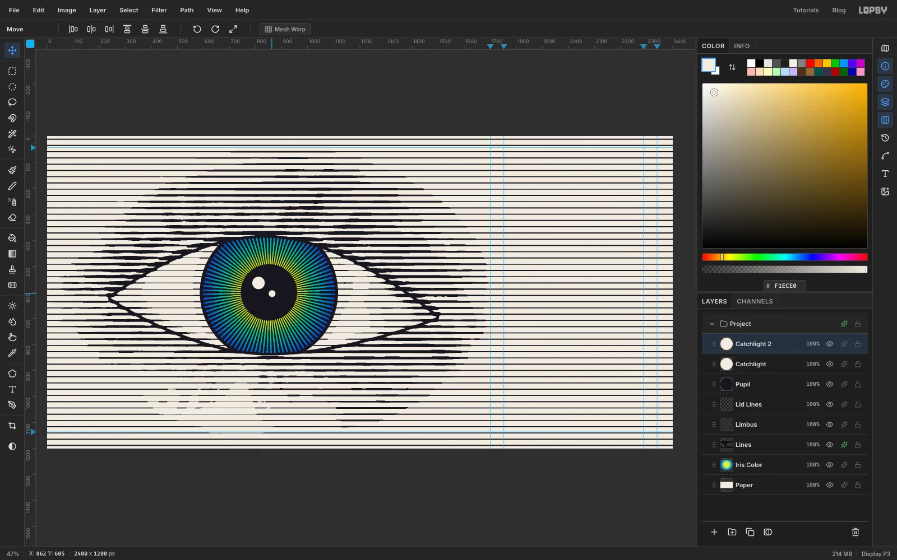

With the **Move** tool, press [[Shift+→]] six times and [[Shift+↓]] five
times. That moves *Catchlight 2* 60 px right and 50 px down, just right of the
pupil's centre. Two catchlights, one big and one small, make the eye look wet and
round.

## Draw the panel

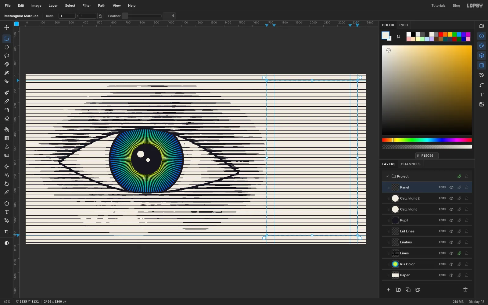

Select *Catchlight 2* and click **Add Layer**. Name it *Panel*. Open the
**View** menu and check that **Snap to Guides** has a tick (it's on by
default). Pick the **Rectangular Marquee** and drag from
the top-left guide crossing **(1700, 44)** to the bottom-right one
**(2340, 1136)**. The edges snap exactly to the guides. Fill with `#F1ECE0`
and press [[Cmd+D]].

The guides put the panel's top border and its shadow's bottom edge in the
gaps between two lines, so neither one touches a stripe.

## Give the panel a frame and a shadow

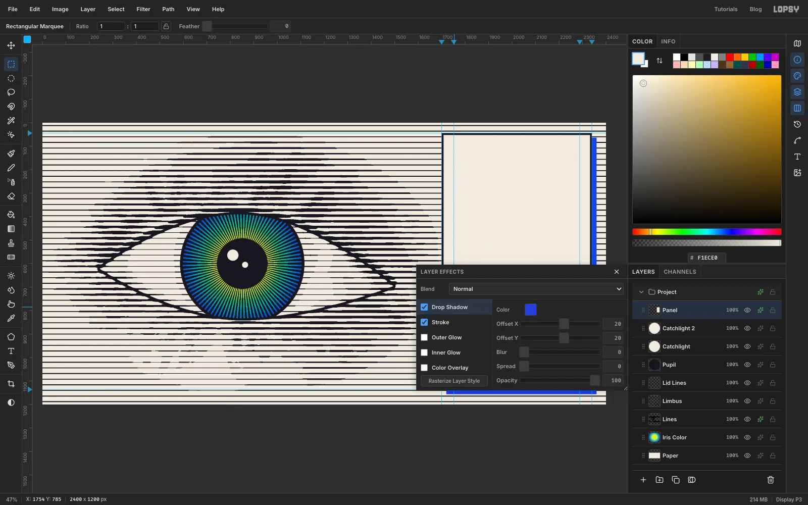

Click the effects button on the *Panel* row. Enable **Stroke**, set **Width** to
**8**, the colour to `#17161F` and the position to **Inside**. Enable
**Drop Shadow** with **Offset X 20**, **Offset Y 20**, **Blur 0**, **Spread
0**, **Opacity 100** and colour `#2340E0`. A hard, flat shadow looks
printed; a blurred one would look like a web button.

## Type the copy

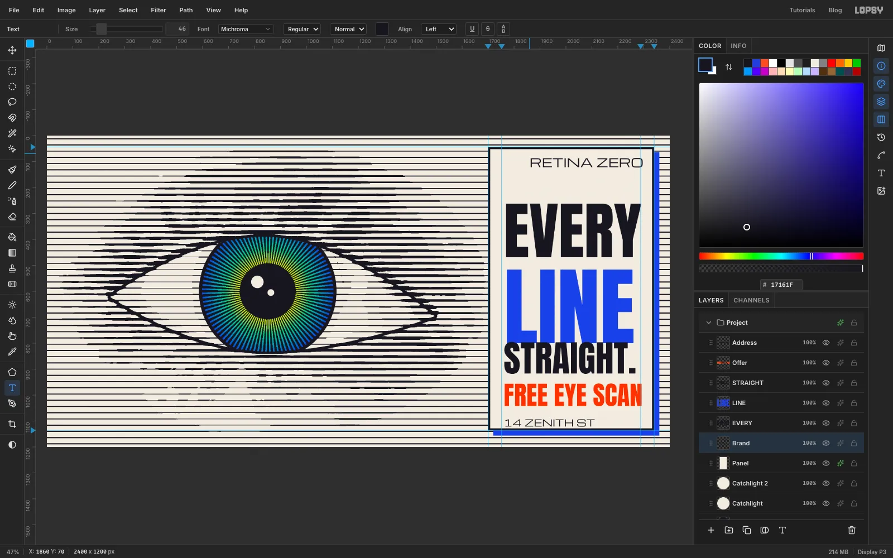

Make sure *Panel* is the selected layer before each new text, so the Text
options don't restyle the last text layer. Before you start, open the **Text**
panel and check **Letter spacing** is **0**.

A text layer's click area reaches a little below its letters, so clicking
just under a line re-opens it for editing. Typing from the bottom up avoids
that. Pick the **Text** tool. For each line, set the font and size in the
options bar and the foreground to its colour, click inside the panel
(bottom line first, each one higher than the last), type, and press [[Tab]]
to finish:

1. **14 ZENITH ST**, **Michroma** **36**, `#17161F`
2. **FREE EYE SCAN**, **Anton** **100**, `#FF4B1F`
3. **STRAIGHT.**, **Anton** **140**, `#17161F`
4. **LINE**, **Anton** **330**, `#2340E0`
5. **EVERY**, **Anton** **240**, `#17161F`
6. **RETINA ZERO**, **Michroma** **46**, `#17161F`, near the top

Rename the layers *Address*, *Offer*, *STRAIGHT*, *LINE*, *EVERY* and
*Brand*. Don't worry about sizes or positions yet.

## Fit the type to the measure

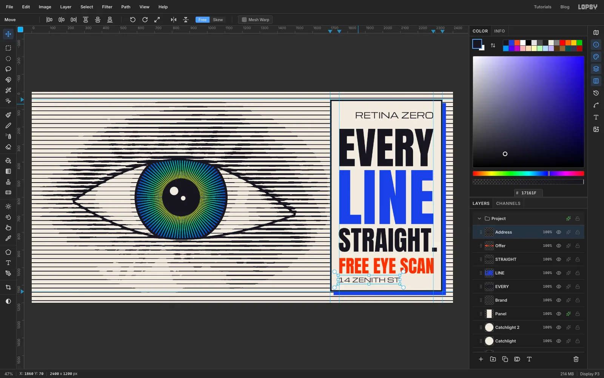

Each headline line should run exactly from the **1752** guide to the
**2288** guide. Select a text layer and change **Size** in the options bar
until it fits. These are the sizes that work:

- **EVERY 247**
- **STRAIGHT. 155**: the T stops about 14 px short of the right guide, so
  the full stop hangs just past it. A hanging stop looks straighter than one
  tucked inside the measure
- **FREE EYE SCAN 102**
- **RETINA ZERO 47**, which runs from 1846 to the right guide, leaving room
  for the logo
- **LINE 357** with **Letter spacing 3** in the Text panel

Then line them up with the **Move** tool and the arrow keys
([[Shift]]+arrow moves 10 px). Click the left ruler at **211** and **1084**
to add two guides, and zoom in to check edges against them.

- Put every left edge on the **1752** guide. Round letters look indented
  against a straight edge, so let the S of STRAIGHT. sit 3 px past it.
- Sit the top of EVERY on the **211** guide and the bottom of 14 ZENITH ST
  on the **1084** guide.
- Leave the same gap (about 22 px) between EVERY, LINE and STRAIGHT., a larger one (about 34 px) above FREE
  EYE SCAN, and 22 px again above the address.
- Centre RETINA ZERO vertically about 80 px above the 211 guide. The logo
  goes to its left in the next step.

That leaves the same 44 px of paper inside the frame on all four sides.

## Draw the ring logo

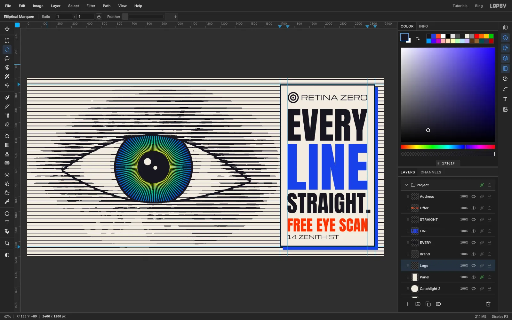

Select *Panel* and click **Add Layer**. Name it *Logo* and set the
foreground to `#17161F`. Make a target from five circles, all centred on
**(1790, 133)**, working from the outside in. For each one, click once with
the **Elliptical Marquee**, type the corners, and fill or clear. A marquee
click with a selection active just deselects, so press [[Cmd+D]] before each
one:

- From **1753, 96** To **1827, 170**: **Edit → Fill**
- From **1761, 104** To **1819, 162**: [[Delete]]
- From **1769, 112** To **1811, 154**: **Edit → Fill**
- From **1777, 120** To **1803, 146**: [[Delete]]
- From **1784, 127** To **1796, 139**: **Edit → Fill**

Press [[Cmd+D]] when you're done. The logo's top sits on the panel's 44 px
margin, level with RETINA ZERO. The ring echoes the iris and the line screen in one small
mark.

## Make the sticker

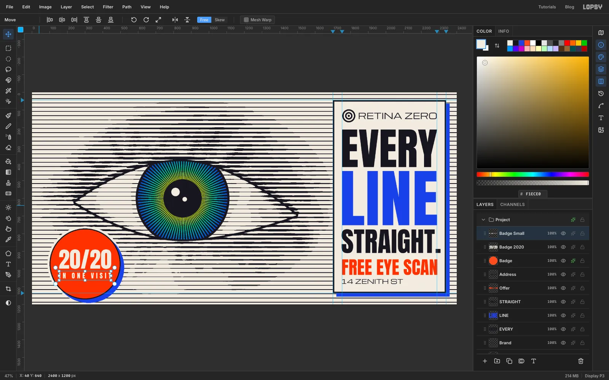

Select *Address* (the top layer) and click **Add Layer**. Name it *Badge* and
set the foreground to `#FF4B1F`. Click once with the **Elliptical Marquee**,
enter From **105, 776** To **495, 1166** and fill. Press [[Cmd+D]].

Open the layer effects from the *Badge* row and enable **Stroke** with **Width 6**, `#17161F`,
position **Outside**. Enable **Drop Shadow** with **Offset X 20**, **Offset
Y 20**, **Blur 0**, **Opacity 100** and colour `#2340E0`, the same as the
panel. Enable **Outer Glow** with colour `#F1ECE0`, **Size 12**, **Spread
100** and **Opacity 100**. The glow is a thin paper halo that keeps the
stripes off the sticker's outline.

With *Badge* selected and the foreground set to `#F1ECE0`, use the **Text**
tool to type **IN ONE VISIT** in **Anton 37**, then set its **Letter
spacing** to **12** in the Text panel. Select *Badge* again and type
**20/20** in **Anton 126**, and set its Letter spacing back to **0**. Click
over the line field at the far left, away from other text, for each one,
then move it onto the disc. Rename the layers *Badge Small* and *Badge
2020*. Centre 20/20 on the disc with IN ONE VISIT 22 px below it, and
the pair as a block on the disc's centre, **(300, 971)**.

## Group the layers

Click *Iris Color*, [[Shift]]-click *Catchlight 2* and choose **Layer →
Group Layers**. Name the group *Eye*. Do the same for *Panel* to *Address*
(call it *Type Panel*) and *Badge* to *Badge Small* (call it *Sticker*).

> **Tip:** Grouping is a good moment to check your history. Press
> [[Cmd+Z]] a few times and then [[Cmd+Shift+Z]] the same number of times.
> The board comes back exactly as it was.

## Move and tilt the sticker

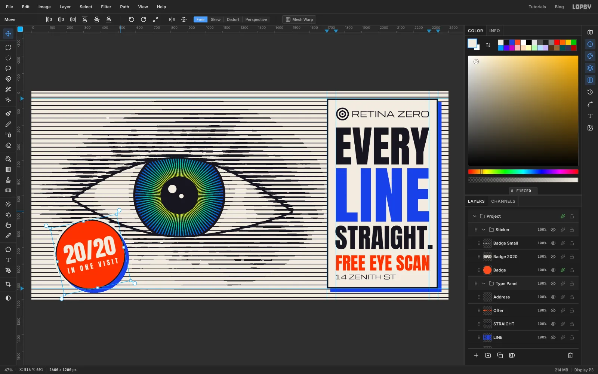

Click the *Sticker* group's row and pick the **Move** tool. Press
[[Shift+→]] four times and [[Shift+↑]] three times. That moves the whole
sticker 40 px right and 30 px up, so its centre sits at **(340, 941)** and
the bottom of its cobalt shadow lines up with the panel's shadow.

Now hover just outside the top-right corner of its box until the cursor
changes to the rotate cursor, and drag anticlockwise about **12°**, a little
less than the 15° step you'd get holding [[Cmd]]. The disc
and both lines of text turn together. Press [[Cmd+D]] to commit.

## Check the layout and export

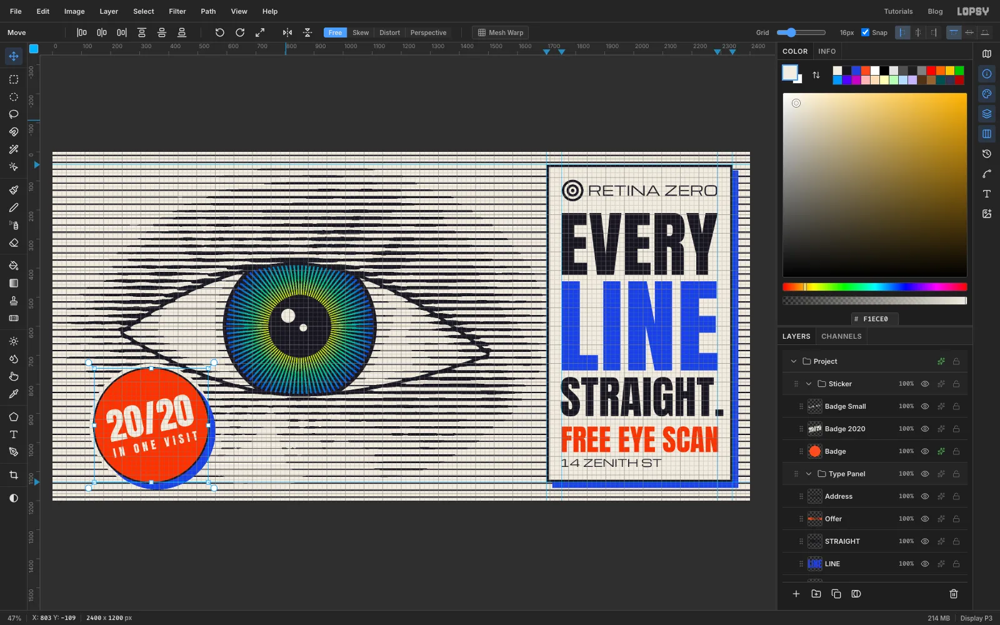

Turn on **View → Show Grid**. The grid makes it easy to see that the panel's
shadow and the sticker's shadow end on the same row, and that the eye's outer
corner sits well clear of the panel. Showing the grid also switches on
**Snap** in the Move options, so turn the grid off afterwards and untick
Snap. Turn off **View → Show Guides** too.

Choose **File → Quick Export PNG** to export the billboard and **File →
Save Project** to keep a `.lopsy` you can come back to.

Step back from the screen, or zoom out until the board is small. The lines
should melt into an eye. If one area looks blotchy, the fix is almost always
on the tone map, before the threshold, rather than on the lines themselves.
