In the late 1950s Victor Vasarely painted *Vega*, a black-and-white checkerboard that swells in the middle as if a ball were pushing up through the canvas. Bridget Riley was soon filling canvases with stripes that seem to ripple while you look at them. Within a few years, paperback covers were full of both.

In this tutorial you'll make that kind of cover for *Jellyfish Undertow*, a made-up novel by a made-up author, Clea Varga. The cover is 1200 × 1800 px. In the middle, a moon jelly seen from below floats in a field of chevron stripes. Its bell is a Vega bulge: a checkerboard that you blow up into a dome with Liquify, then colour with a glowing gradient. Cream rings and long tentacles turn the bulge into an animal, and two small copies of it drift off into the current. Cream bands at the top and bottom hold the type, and the second word of the title is filled with stripes.

You'll work from a real photo of a moon jelly, [Jellyfish 1 (Unsplash).jpg](https://commons.wikimedia.org/wiki/File:Jellyfish_1_%28Unsplash%29.jpg), a CC0 picture by Ferdinand Stöhr on Wikimedia Commons. You'll use it to size and place the bell, and to see where the canals and gonads go, then hide it.

The tools you'll use:

- **guides**, the **Rectangular** and **Elliptical Marquee**'s exact-corner dialog, and **Select → Inverse / Grow / Shrink**
- **Define Pattern** and **Fill with Pattern** with offsets
- the Move tool's **Mesh Warp**, **scale** and **rotation handles**, and **Rotate 90°** buttons
- **Liquify** (Bloat), **Threshold**, **Gaussian Blur** and **Sunburst**
- the **Gradient** tool with a radial gradient and the **Multiply** blend mode
- the **Pen** tool, the **Brush** with **Radial Symmetry**, and the **Stroke** effect
- **Edit → Copy Merged**, **Paste**, **Duplicate Layer** and **Group Layers**
- live text in Syncopate Bold and Michroma

The palette:

- Navy `#120F45`, stripe violet `#2C27A0`, ink `#0E0B33`
- Cream `#F4EEDF`
- Bell glow `#FFD447` → `#FF7657` → `#E23B95` → `#B42C7E`
- Magenta rules `#E23B95`, coral strands `#FF7657`

> **Tip:** On a wide-gamut (Display P3) screen, Lopsy reads typed hex codes as P3 colours. These codes were picked on a P3 screen, so they match the finished cover there and look a touch duller on an sRGB screen.

> **Note:** Shortcuts are written for a Mac. On Windows use [[Ctrl]] wherever it says [[Cmd]].

> **Tip:** To read a position or a size while you work, watch the **X** and **Y** readout in the status bar at the bottom left, which follows the pointer in document pixels.

## Set up a navy page with guides

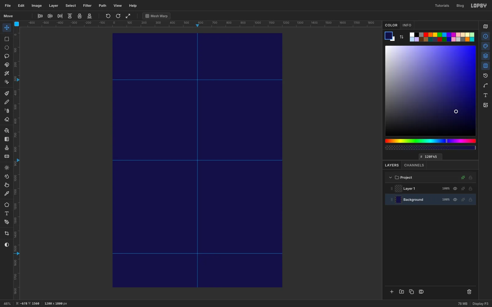

Choose **File → New**, keep the units on **Pixels**, and make the document **1200** wide and **1800** high.

Click *Background* in the Layers panel, set the foreground colour to navy `#120F45` and choose **Edit → Fill**.

Now drop some guides. Click the top ruler at **600** for a vertical centre line. Then click the left ruler at **330**, **900** and **1560**. The top and bottom guides mark where the cream title and author bands will start. The guides cross at (600, 900), the centre of the page, and that's where the jellyfish's bell will go.

## Fill the page with stripes

Riley's line paintings start from plain stripes, so make a stripe pattern first.

A new document comes with an empty *Layer 1*. Rename it *Stripe Tile* (double-click its name). Pick the **Rectangular Marquee** ([[M]]) and click once on the canvas without dragging. A dialog asks for the corners. Type **From 0, 0** **To 40, 12** and press [[Enter]]. Set the foreground to stripe violet `#2C27A0` and choose **Edit → Fill**.

Press [[Cmd+D]] to drop that selection (the corners dialog only opens when nothing is selected), click once more and enter **From 0, 0** **To 40, 24**. That's the violet bar plus 12 px of nothing below it. Choose **Edit → Define Pattern**, press [[Cmd+D]] to deselect, and delete the *Stripe Tile* layer with the bin button at the bottom of the Layers panel.

Click **Add Layer** and name the new layer *Undertow Stripes*. Choose **Edit → Fill with Pattern…**, pick your stripe tile and click **Apply**. The transparent half of the tile lets the navy show through, so you get even violet and navy stripes 12 px apart.

## Bend the stripes into chevrons with Mesh Warp

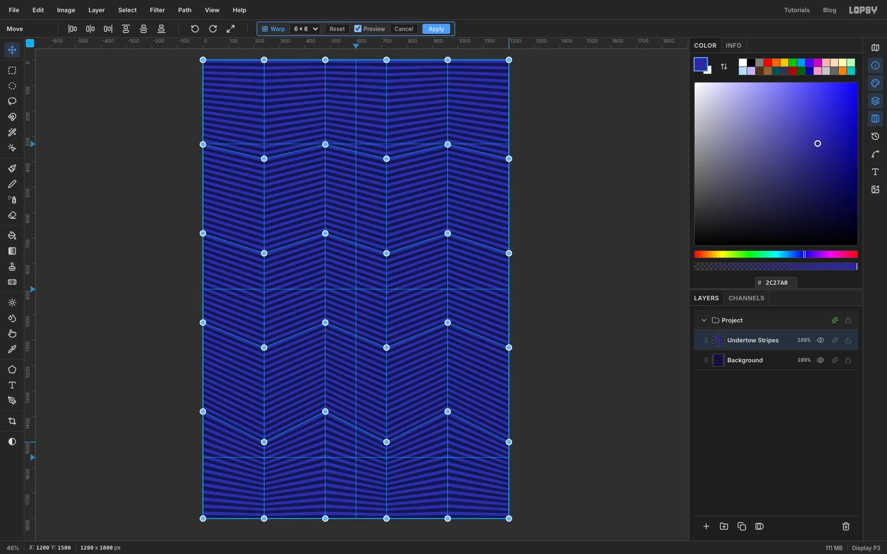

With *Undertow Stripes* still selected, switch to the **Move** tool ([[V]]) and click **Mesh Warp** in the options bar. Set the grid to **6 × 6** and tick **Preview**.

Leave the top and bottom rows of points alone, so the warp doesn't pull the stripes off the page. Then work down the columns:

- In the 1st, 3rd and 5th columns from the left, drag each point **up**.
- In the 2nd, 4th and 6th columns, drag each point **down**.
- Drag the points near the top only about **20 px**. Make each row further down move a bit more, up to about **70 px** for the row just above the bottom.

Mesh Warp bends straight between its points, so the stripes fold into sharp zigzag chevrons rather than soft waves. That's the look you want here: the chevrons get deeper toward the bottom, like a current getting stronger. Click **Apply**.

## Drop in the reference photo

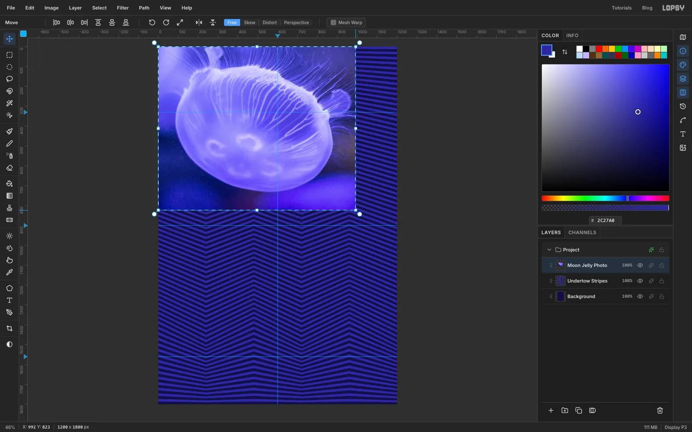

Download the moon jelly photo. It's a big landscape picture with plenty of empty water around the animal, so crop it to just the jellyfish in any photo app first (the crop used here is 820 × 680 px). Drag the file onto the canvas. It lands at the top left at its own size, as a new layer above the stripes. Rename the layer *Moon Jelly Photo*.

Switch to the **Move** tool. Hold [[Cmd]] (to keep the proportions) and drag the bottom-right corner handle outward until the jellyfish's bell is about **790 px** across. With this crop that's about 1.2 times its size. Press [[Enter]], then [[Cmd+D]].

## Line the photo up with the guides

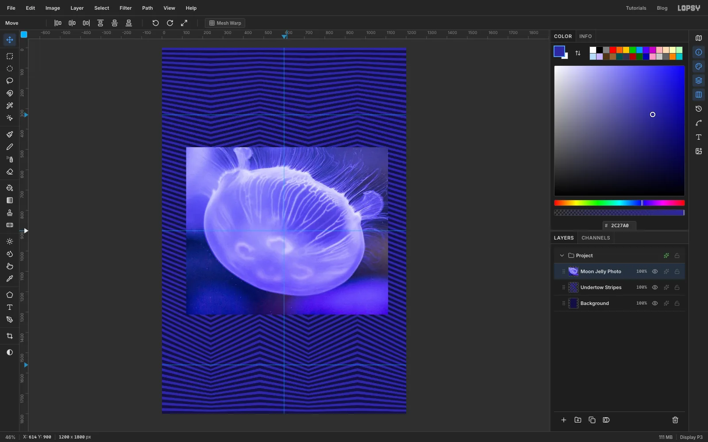

Drag the photo so the centre of the jellyfish's bell sits right where the centre guides cross. Then lower the layer's **Opacity** to **45%** so you can see what you build under it.

The photo's bell is a slightly squashed oval, about 790 px across at its widest and narrower the other way. The op-art bell will be a circle that fits inside it: **708 px** across, a radius of 354, centred on the guides.

## Make a fine checkerboard

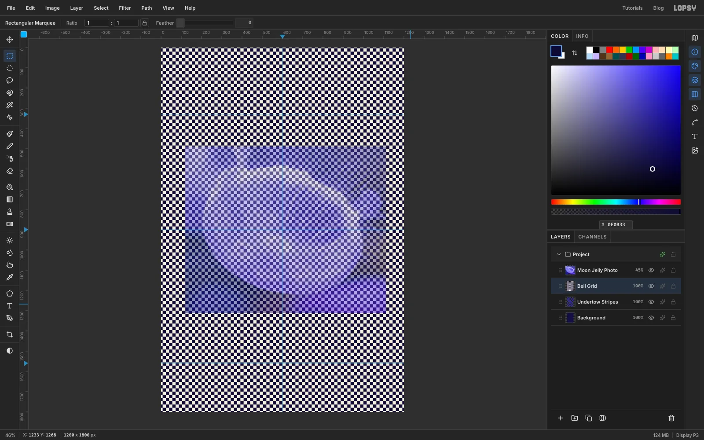

Click *Undertow Stripes* so the new layers land above it, under the photo.

Make a checker tile the same way as the stripes. **Add Layer**, name it *Checker Tile*, and set the foreground to cream `#F4EEDF`. With the marquee dialog, select **From 0, 0** **To 16, 16** and choose **Edit → Fill**. Press [[Cmd+D]], click again, select **From 16, 16** **To 32, 32** and fill that too. That's two cream squares on the diagonal. Press [[Cmd+D]] once more, select **From 0, 0** **To 32, 32**, choose **Edit → Define Pattern**, press [[Cmd+D]] and delete the tile layer.

**Add Layer** again and name it *Bell Grid*. Fill it with ink `#0E0B33`, then choose **Edit → Fill with Pattern…** with the checker tile. Set **Horizontal Offset** to **25** and type **12.5** into the **Vertical Offset** box (the slider only moves in whole steps), then **Apply**.

Those offsets put the corner of four squares exactly on the page centre, where the bulge will be. The squares are 16 px, so a square edge falls every 16 px. 600 is 8 px past one, and 8 px is 25% of the 32 px tile. 900 is 4 px past one, which is 12.5%.

## Blow the centre up with Liquify

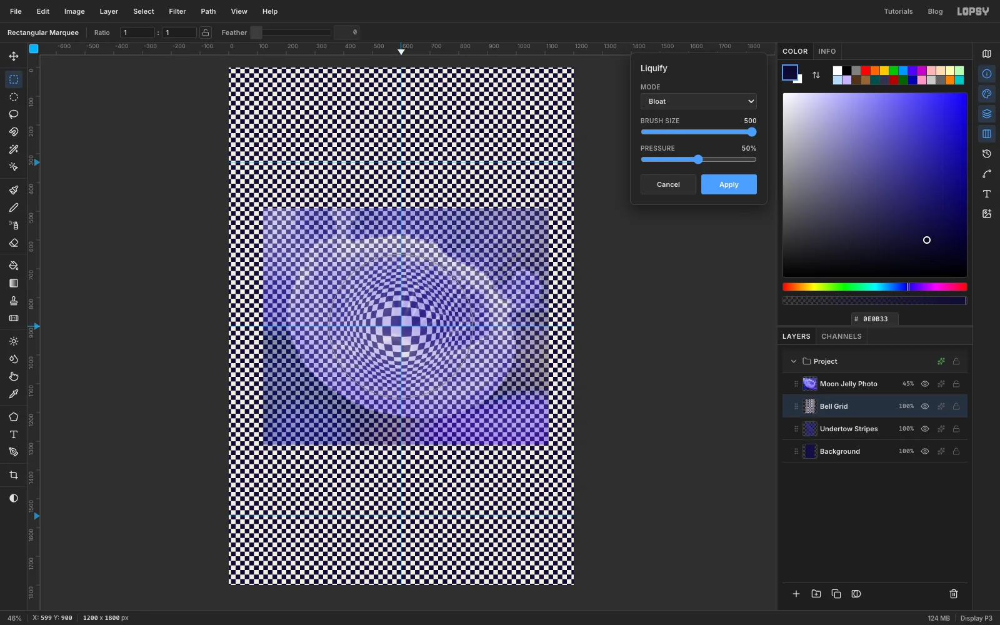

With *Bell Grid* selected, choose **Filter → Liquify…**. Set **Mode** to **Bloat**, **Brush Size** to **500** and **Pressure** to **50%**.

Press the mouse button down where the guides cross and make tiny circles, a pixel or two across, while you watch the middle. Bloat adds a dab every time the pointer moves, so it works fast. Let go when the four middle squares are about **three times** their size. The squares near the brush's edge get squeezed smaller at the same time. If you overshoot, click **Cancel** and try again. Click **Apply**.

## Keep only the dome

A Vega bulge has the biggest squares at the centre, getting steadily smaller toward the edge. Right at the edge of the Bloat brush the squares start to grow again. So keep only the inner part, where they're still shrinking.

Pick the **Elliptical Marquee**, click once on the canvas, and enter **From 420, 720** **To 780, 1080**. That's a circle with a radius of 180, centred on the guides. Choose **Select → Inverse**, press [[Delete]] and then [[Cmd+D]]. You're left with a small round dome.

## Scale the dome up to bell size

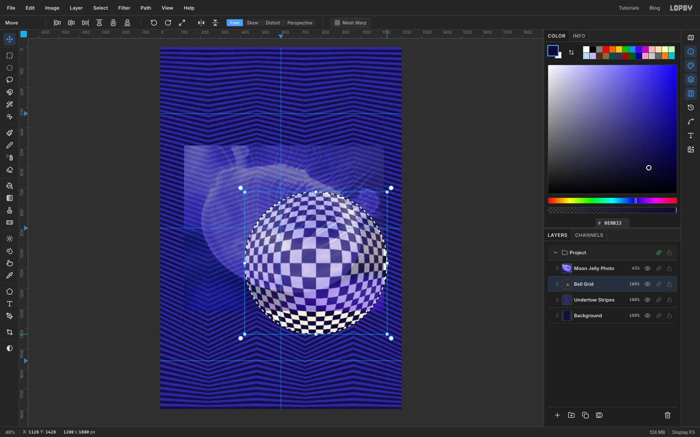

[[Cmd]]-click the *Bell Grid* thumbnail to select the dome. With the **Move** tool, hold [[Cmd]] and drag the bottom-right handle out until the dome is about **708 px** across. That's about twice its size, and about the size of the photo's bell. Press [[Enter]] and [[Cmd+D]].

Scaling from a corner moves the dome off centre. Drag it, or nudge it with the arrow keys, until it sits back on the guides' crossing.

## Re-crisp the squares

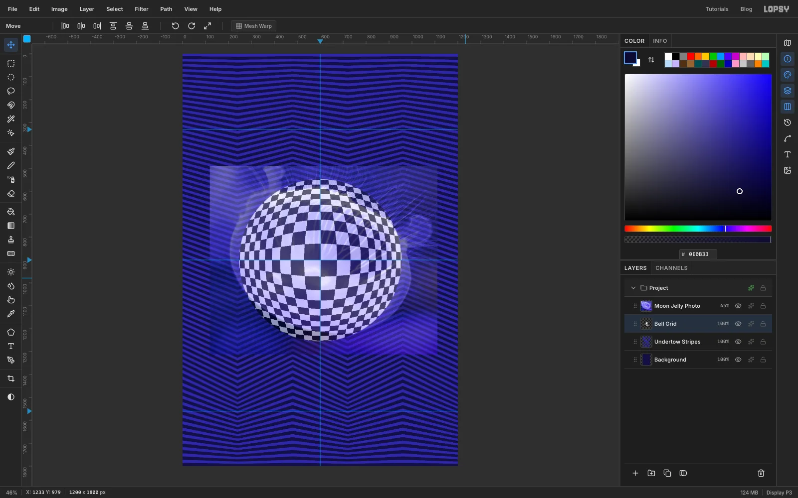

Doubling the size softens every square's edge. The dome only has two colours, so **Filter → Threshold…** at **Level 128** snaps every pixel back to pure black or pure white. Then run **Filter → Gaussian Blur…** with **Radius 1** to put back a hair of anti-aliasing, so the edges aren't stair-stepped.

(Threshold turns the cream squares pure white. That doesn't matter, because the next step colours them.)

## Colour the bell with a glowing gradient

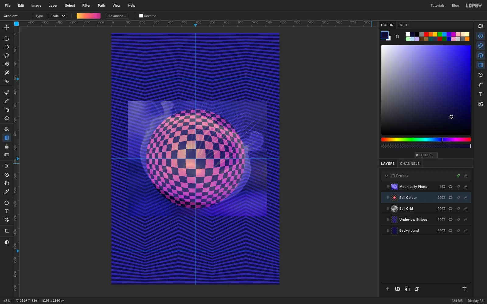

Click **Add Layer** and name the new layer *Bell Colour*. It lands right above *Bell Grid*. [[Cmd]]-click the *Bell Grid* thumbnail to load the dome as a selection.

Pick the **Gradient** tool, set **Type** to **Radial** and click **Advanced…**. In the Gradient Editor, click the left stop handle and type lemon `#FFD447` into the hex field, then click the right handle and type deep magenta `#B42C7E`. Click the bar at about **35%** to add a stop there and make it coral `#FF7657`, and click at about **80%** for a magenta `#E23B95` stop. Click **Done**.

Start the drag a little above and to the left of the centre, about 40 px left and 60 px up, and drag to just past the bell's right edge. The off-centre start makes the light look like it's falling on a sphere. Press [[Cmd+D]].

Open the layer's effects (the sparkle button on its row) and set **Blend** to **Multiply**. White squares take the gradient's colour, and black squares stay black.

## Add radial canals with Sunburst

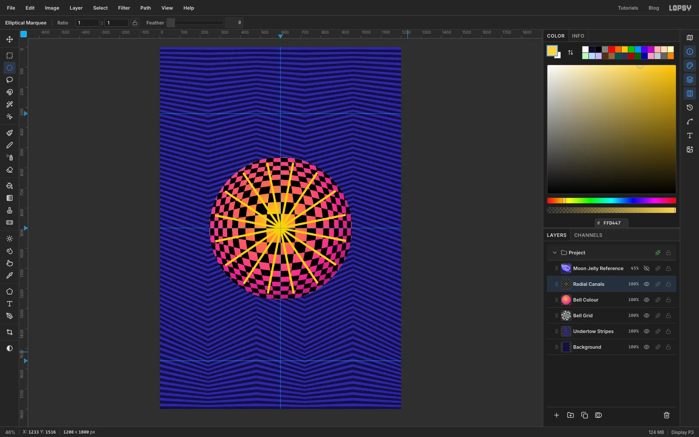

The photo has done its job, so rename it *Moon Jelly Reference* and click its eye to hide it.

A moon jelly has thin canals running from its stomach out to the rim. Click *Bell Colour* and **Add Layer**, named *Radial Canals*. Make a circle marquee around the bell, **From 246, 546** **To 954, 1254**, and choose **Select → Shrink…** by **22** so the canals stop short of the rim.

Set the foreground to lemon `#FFD447` and choose **Filter → Sunburst…**. Use **Rays 16**, **Width 5** (the lowest it goes), **Taper 50** for straight-sided rays and **Rotation 11**. Leave the centre at 50 / 50, the middle of the page. Click **Apply**, then [[Cmd+D]].

## Thin the canals and clear the centre

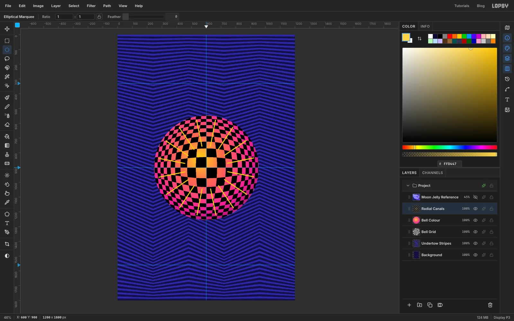

The rays come out about 10 px wide at the rim, which looks more like a sunburst than a jellyfish. To thin them, [[Cmd]]-click the *Radial Canals* thumbnail and choose **Select → Shrink…** by **2**. Then choose **Select → Inverse** and press [[Delete]]. That shaves 2 px off each side of every ray. Press [[Cmd+D]].

In a real moon jelly the canals start at the stomach, not the exact centre. Make a circle marquee **From 455, 755** **To 745, 1045** (radius 145), press [[Delete]] and [[Cmd+D]]. The canals now start just outside the big centre squares.

## Ring the bell with halos

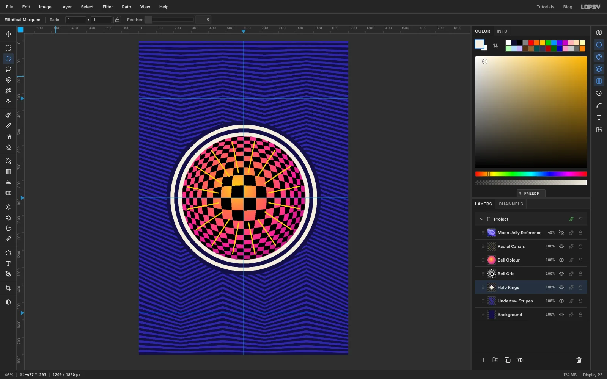

Op-art loves concentric rings, and they give the bell an outline. Click *Undertow Stripes* and **Add Layer**, named *Halo Rings*, so the rings sit under the bell.

Build the rings from the biggest one inward:

1. [[Cmd]]-click the *Bell Grid* thumbnail, choose **Select → Grow…** by **88**, set the foreground to navy `#120F45` and choose **Edit → Fill**.
2. [[Cmd]]-click the thumbnail again, **Grow** by **66**, and fill with cream `#F4EEDF`.
3. Again with **Grow 44**, filled navy.
4. Finally **Grow 22**, filled cream.

Press [[Cmd+D]]. Each fill covers the middle of the one before, so you end up with two cream rings, each 22 px wide, separated by navy.

## Draw the tentacles with the Pen

Click *Halo Rings* and **Add Layer**, named *Tentacles*. It goes above the rings and under the bell, so the tentacles look like they hang from the bell's rim.

Pick the **Pen** tool ([[P]]), set **Stroke** to **12** in the options bar, and set the foreground to cream. For each tentacle:

1. Start just inside the bottom of the bell, where the bell will hide the end.
2. Click-and-drag downward to place five more points. Drag each one a little along the direction of the curve so it comes out smooth.
3. Swing each point a little left and right to make a gentle S, and let the whole line drift left as it goes down. The bottom end should be about 200 px left of the top.
4. End below the bottom guide. The cream band will cover the ends.
5. Press [[Enter]] to stroke the path.

Draw seven of them, with their tops spread evenly across the underside of the bell, about 90 px apart, from about 270 px left of the centre guide to 270 px right of it. Give every one the same drift and nearly the same wave, so they flow side by side like a Riley line painting instead of crossing.

## Outline the tentacles and add fine strands

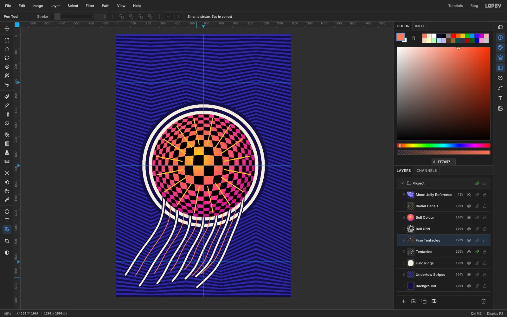

Where a cream tentacle crosses a cream ring, the two run together. Open the *Tentacles* layer's effects, turn on **Stroke**, and set it to navy `#120F45` with **Width 6**. Each tentacle now has a dark edge that keeps it separate.

**Add Layer** again, named *Fine Tentacles*. Set the Pen's **Stroke** to **5** and the foreground to coral `#FF7657`. Draw six thinner strands the same way, one between each pair of cream tentacles, ending a little higher, just below the bottom guide.

## Draw the four gonads with radial symmetry

A moon jelly has four horseshoe-shaped gonads around its stomach. Turn the reference photo's eye back on for a moment to see them, then hide it again. Click *Radial Canals* and **Add Layer**, named *Gonads*.

Pick the **Brush** ([[B]]), set **Size 20** and **Hardness 100**, and set the foreground to cream. Click the snowflake **Radial Symmetry** button in the options bar and set **Segments** to **4**. The symmetry centre starts at the middle of the page, which is the middle of the bell.

Draw one horseshoe: a round C about 125 px across, out on the diagonal toward the lower right, about 165 px from the middle of the bell, with its open side facing the centre. Put it halfway between two canals. The other three appear at the same time, a quarter turn apart. Turn **Radial Symmetry** off again.

Give the layer a navy **Stroke** effect, **Width 3**, so the horseshoes read on both the pink and the black squares.

## Clear the canals around the gonads

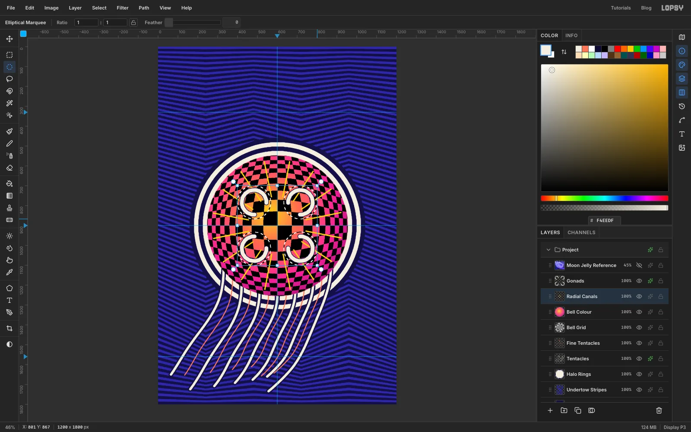

Where canals run through the horseshoes, they tangle into a mess. Click *Radial Canals*. With the **Elliptical Marquee**, hold [[Cmd]] (which keeps it a circle) and drag a circle about **168 px** across around the first horseshoe. Then hold [[Cmd+Shift]] and drag a circle around each of the other three to add them to the selection.

Press [[Delete]] and [[Cmd+D]]. The canals now stop short of each gonad, and the horseshoes sit on clean checkerboard.

## Copy the whole jellyfish

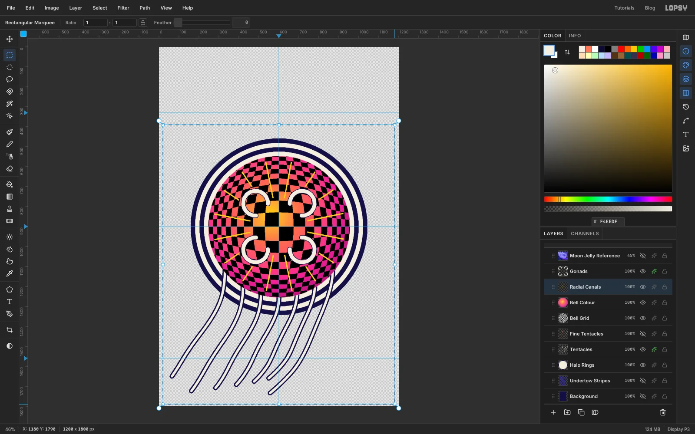

Small copies of the jellyfish, drifting off in the current, will add depth. To copy the jellyfish without its background, hide *Background*, *Undertow Stripes* and *Fine Tentacles* by clicking their eyes. The coral strands are too thin to survive being shrunk, so leave them out.

Draw a rectangular marquee around the whole jellyfish, from just below the top guide to near the bottom of the page. Choose **Edit → Copy Merged**. That copies what you see, all visible layers flattened together. Press [[Cmd+D]] and turn the three layers back on.

## Shrink and turn the first copy

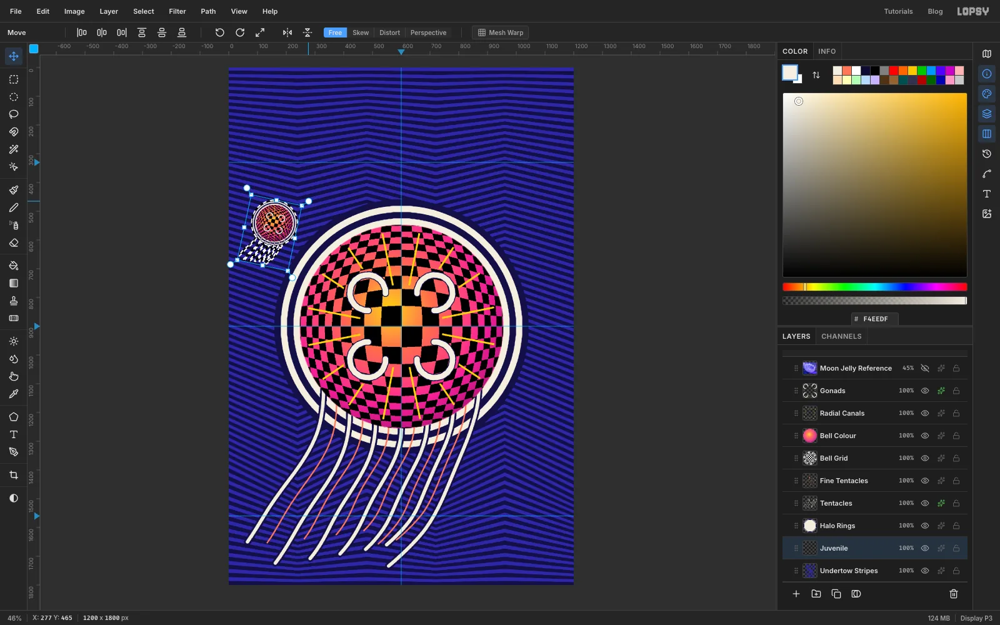

Click *Undertow Stripes* so the copy lands behind the big jellyfish, then choose **Edit → Paste**. The copy lands in exactly the place it came from, hidden behind the original, so you won't see anything change yet. Rename the new layer *Juvenile*.

[[Cmd]]-click its thumbnail to show its handles. With the **Move** tool, hold [[Cmd]] and drag the bottom-right handle inward and up until the copy is about **18%** of its size, around 180 px wide. It shrinks toward the top-left corner and peeks out from behind the big rings. Press [[Enter]], then [[Cmd+D]].

[[Cmd]]-click the thumbnail again and drag the rotation handle (just outside the top-right corner) a little clockwise, to about the tilt in the screenshot, so the juvenile looks like it's swimming against the current. Press [[Enter]], then [[Cmd+D]].

## Set the juveniles adrift

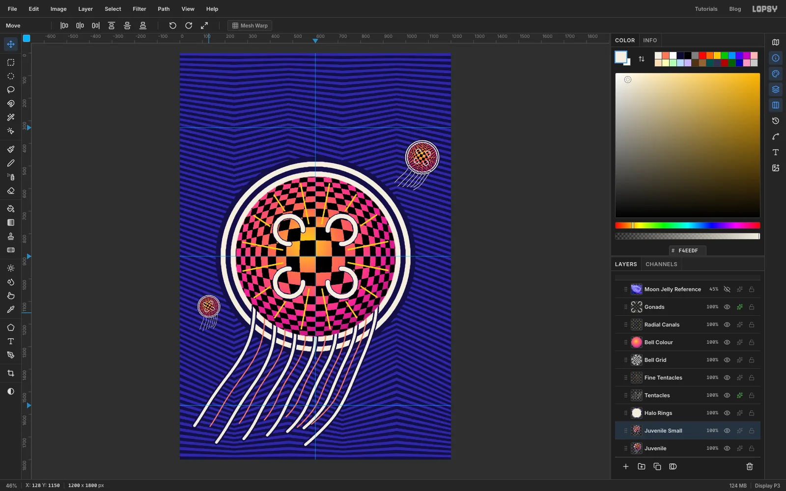

Drag the *Juvenile* into the open water at the upper right. Keep it about 50 px from the right edge and the top guide, and clear of the big jellyfish's outer ring.

Choose **Edit → Paste** again for a second copy and rename it *Juvenile Small*. Shrink it the same way to about **12%**, turn it a little anticlockwise, and drag it to the left side, level with the bottom of the bell. Give it the same 50 px or more of space from the edge.

## Lay down the cream bands

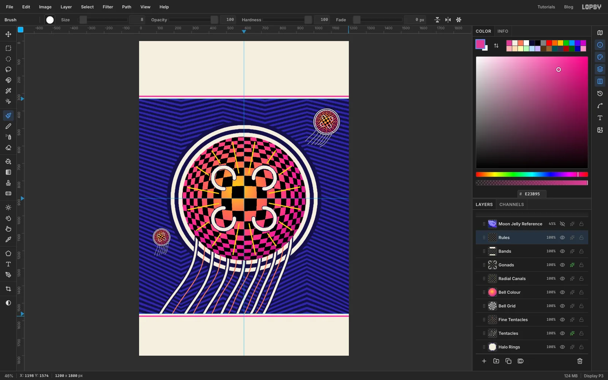

Click *Gonads*, the top layer of the jellyfish, and **Add Layer**, named *Bands*. Set the foreground to cream. Drag a rectangular marquee from above the top-left corner of the page down to the **330** guide (it snaps), and choose **Edit → Fill**. Do the same from the **1560** guide to below the bottom of the page.

**Add Layer** again, named *Rules*. Pick the **Brush** with **Size 8** and set the foreground to magenta `#E23B95`. Click at the left edge of the page about **14 px** above the 330 guide, hold [[Shift]] and click at the right edge for a straight line. Draw the same line about 14 px below the 1560 guide, just inside the bottom band.

## Set the title

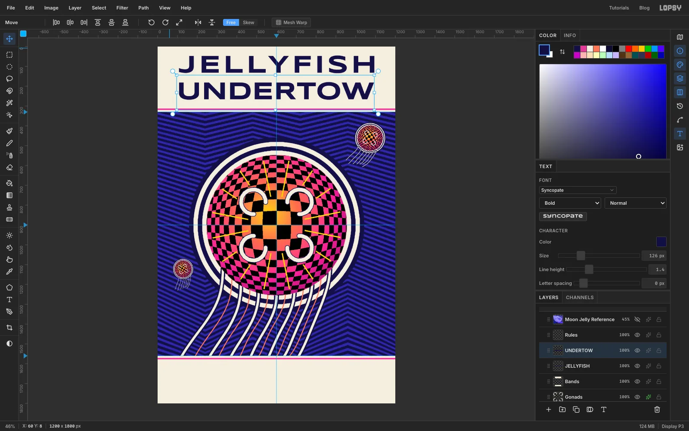

Click *Bands*. Changing the font, size or colour while a text layer is active restyles that layer, so always pick a plain layer before you set up new type. Pick the **Text** tool ([[T]]), choose **Syncopate**, **Bold**, size **126**, colour navy.

Set the bottom line first. A click inside an existing line of text edits that line, so work upward. Click in the lower half of the top band, type **UNDERTOW** and press [[Tab]]. Click *Bands* again, click near the very top of the page, type **JELLYFISH** and press [[Tab]].

JELLYFISH is narrower than UNDERTOW. Select it and set **Letter spacing** to **14** in the Text panel, so the two lines come out the same width.

Drag each line onto the centre guide with the Move tool. Put the top of JELLYFISH about **45 px** below the top edge, and the top of UNDERTOW at about **y 179**. That leaves an even gap above, between and below the lines.

## Fill UNDERTOW with stripes

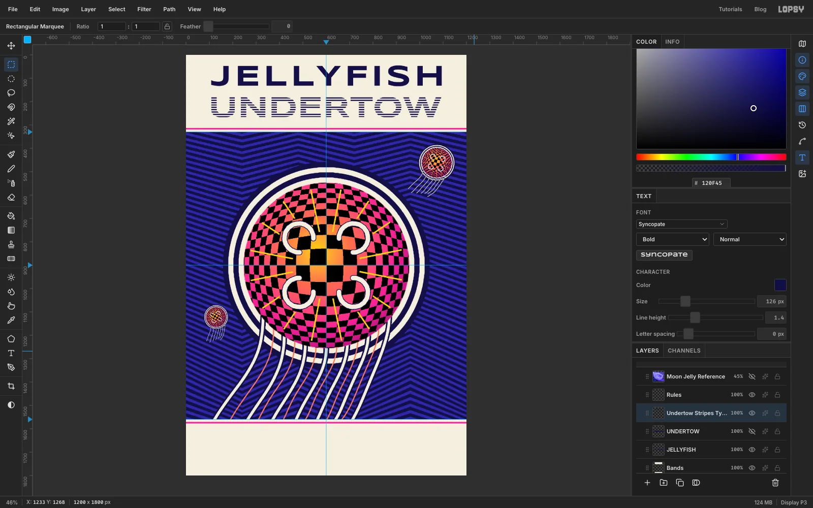

Op-art type is often made of lines. Make one more pattern, a **40 × 10** tile with a **5 px** navy bar at the top:

1. Click *Bands*, **Add Layer** and name it *Stripe Tile*. Set the foreground to navy.
2. Click the Rectangular Marquee once, enter **From 0, 0** **To 40, 5** and choose **Edit → Fill**. Press [[Cmd+D]].
3. Click again, enter **From 0, 0** **To 40, 10** and choose **Edit → Define Pattern**. Press [[Cmd+D]] and delete the tile layer.

Click *UNDERTOW*, **Add Layer** and name it *Undertow Stripes Type*. [[Cmd]]-click the *UNDERTOW* thumbnail to select the letters. Choose **Edit → Fill with Pattern…** with the new tile.

The pattern tiles from the top of the page, so set **Vertical Offset** so a bar starts exactly on the flat tops of the letters. Hover over the top of the U and read the Y in the status bar: here it's **182**. (The round O pokes up a few pixels higher, which is why the line looked like it started at 179.) 182 is 2 px past a multiple of 10, and 2 px is **20%** of the 10 px tile, so set **Vertical Offset** to **20**. Click **Apply**, press [[Cmd+D]], and hide the *UNDERTOW* text layer.

## Set the author, the tagline and the first label

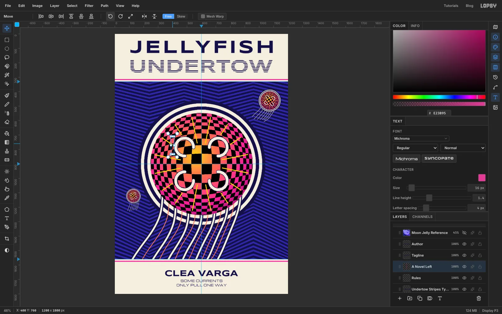

Click *Rules*. With the **Text** tool, choose Syncopate Bold **60** in navy. Click somewhere empty in the middle of the cover (clicking on existing type would edit it), type **CLEA VARGA**, press [[Tab]] and rename the layer *Author*. Move it to the centre guide with the tops of its capitals about **76 px** below the bottom guide.

Click *Rules* again. Choose **Michroma** at **22**, set **Align** to **Center**, click in an empty part of the cover again and type the tagline on two lines: **SOME CURRENTS**, [[Enter]], **ONLY PULL ONE WAY**. Press [[Tab]], rename the layer *Tagline* and set **Letter spacing** to **1**. Move it under the name, centred, with about **24 px** of space between them.

For the side label, click *Rules* once more, choose Michroma **16** in magenta `#E23B95`, click in an empty spot and type **A NOVEL**. Press [[Tab]], rename the layer *A Novel Left* and set **Letter spacing** to **4**. With the **Move** tool, click **Rotate 90° CCW** in the options bar. It now reads from bottom to top.

## Frame the author block with the labels

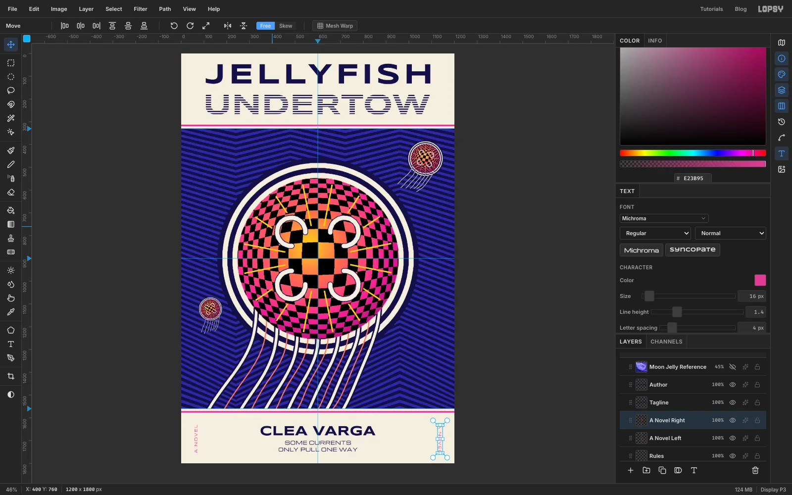

Drag *A Novel Left* into the left margin, about **64 px** from the edge. Centre it vertically on the name and tagline taken together.

Click **Duplicate Layer**, rename the copy *A Novel Right*, and click **Rotate 90° CW** twice. It now reads from top to bottom, the way a spine does. Drag it to the same height, 64 px in from the right edge.

## Group the layers and save

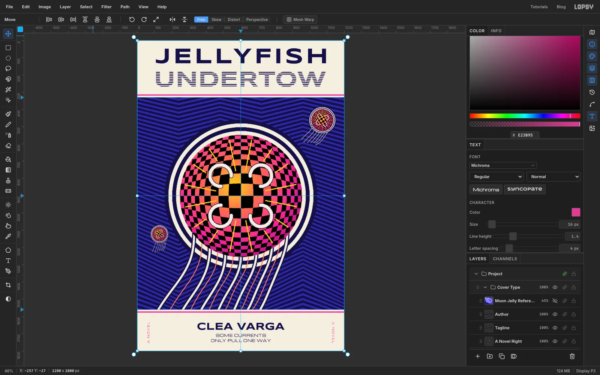

Tidy the Layers panel into groups. Click *Halo Rings*, [[Shift]]-click *Gonads* and choose **Layer → Group Layers**. Name the group *Jellyfish*. Do the same for the two juveniles (*Juveniles*) and for everything from *Bands* to the top of the stack (*Cover Type*). The hidden *Moon Jelly Reference* sits at the very top, so it ends up in *Cover Type* too. It stays hidden, so it does no harm, but you can delete it if you'd rather.

Now you can click a group and move it all at once. Try nudging the *Jellyfish* group and pressing [[Cmd+Z]]: the whole animal moves and comes back together.

Choose **File → Save Project** to keep the layers, then **File → Export…** for a PNG.
