*Op art* (short for optical art) uses nothing but stripes, rings and hard
edges to make a flat picture seem to bulge, shimmer or move. Bridget Riley
and Victor Vasarely made it famous in the 1960s. Vasarely's *Zebras* draws two
animals with no outlines at all: you only see them because their stripes turn
a different way from the stripes around them.

This tutorial uses the same trick on a back patch for a made-up race, the
**Kudu Quest** 100 km trail run in South Africa's Karoo. A greater kudu head is
built only from horizontal stripes, set against vertical ones. Then the patch
gets an embroidered finish: a stitched *merrow* edge (the thick overlocked
border on real patches), thread texture and a slight raised relief.

The kudu is traced from a reference photo, "Tragelaphus strepsiceros ♂
(head)" by Hans Hillewaert, via
[Wikimedia Commons](https://commons.wikimedia.org/wiki/File:Tragelaphus_strepsiceros_%E2%99%82_(head).jpg),
used under CC BY-SA 4.0. Any front-on photo of an antelope with its horns in
view will do.

The canvas is 1800 × 2300 px. Positions are document coordinates. Watch **X**
and **Y** in the status bar at the bottom of the window while you move the
pointer. The patch is centred on `x 900`.

Along the way you'll use:

- ruler **guides**, **New Group**, **Duplicate Layer**, **Merge Down** and dragging layers in the Layers panel
- the **Elliptical** and **Rectangular Marquee** with add and subtract, the **Lasso**, **Select → Shrink**, **Grow** and **Inverse**, and ⌘-clicking a thumbnail to select a layer's pixels
- **Define Pattern** and **Fill with Pattern**
- **Add Noise**, **Motion Blur**, **Lens Distortion**, **Liquify**, **Sunburst**, **Emboss** and **Desaturate**
- the **Multiply**, **Difference**, **Overlay** and **Screen** blend modes, and the **Stroke** and **Drop Shadow** effects
- the **Move** tool to scale, rotate and flip, plus copy, paste and **Copy Merged**
- the **Pen** tool, **Path to Selection** and **text on a path**, in Bungee, Archivo Black and Syncopate

The palette:

- Ink `#15120F`, bone `#F1E6CC`
- Saffron `#F2A516`, terracotta `#C4471F`, stitch shadow `#7A250E`
- Canvas olive `#59603F`
- Swap `#FFF2D6` (for the Difference trick)
- Thread grey `#808080` (texture layers only)

Blend modes live in each layer's effects drawer. Click the ✦ button on the
layer's row and use the **Blend** dropdown at the top. A layer's opacity is
the percentage button on its row.

## Set up the canvas and weave the backdrop

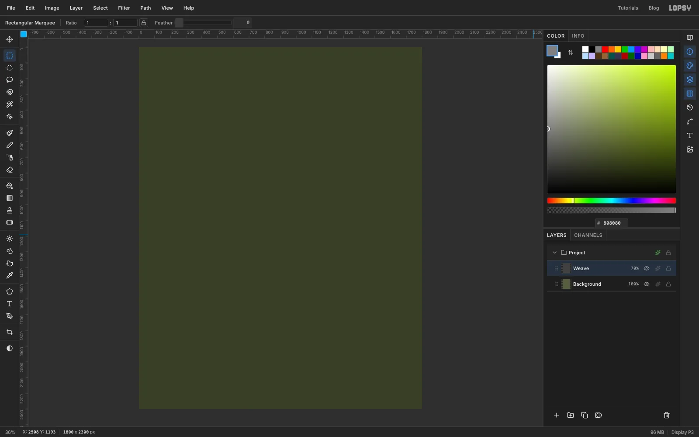

The patch will sit on olive canvas fabric, like the flap of a backpack.

1. Choose **File → New**, set **Width** to `1800` and **Height** to `2300`, and click **Create**.
2. Select the `Background` layer, press [[Cmd+A]], set the foreground colour to `#59603F` and choose **Edit → Fill**.
3. Rename the empty `Layer 1` to `Weave` (double-click its name). The whole canvas is still selected, so **Edit → Fill** it with `#808080`, then press [[Cmd+D]].
4. Choose **Filter → Add Noise…**, set **Amount** to `60`, click **Mono** and **Gaussian**, and click **Apply**.
5. Choose **Layer → Duplicate Layer** and name the copy `Weave V`. Run **Filter → Motion Blur…** on it with **Angle** `90` and **Distance** `14`.
6. Select `Weave` and run **Motion Blur** again, this time with **Angle** `0` and **Distance** `14`.
7. Select `Weave V` again, set it to **Multiply** and choose **Layer → Merge Down**. Set the merged `Weave` to **Overlay** at `70%`.

The horizontal and vertical streaks cross like the threads of a woven cloth.

## Draw the arch-shaped patch outline

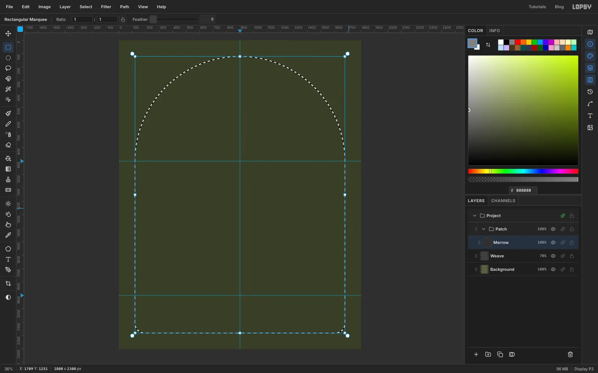

1. Click the top ruler at `x 900` to drop a vertical guide down the centre. Click the left ruler at `y 900` and again at `y 1900`. The first marks the centre of the arch. The second marks where the picture ends and the bottom text band starts.
2. With `Weave` selected, click **New Group** at the bottom of the Layers panel and name it `Patch`. Everything else goes inside this group.
3. Click **Add Layer** and name it `Merrow`.
4. Pick the **Elliptical Marquee** and drag a circle from `120, 120` to `1680, 1680`.
5. Pick the **Rectangular Marquee**, hold [[Shift]] and drag from `120, 900` to `1680, 2180`. The rectangle's sides line up with the edges of the circle, so the two join into an arch.
6. Choose **Select → Shrink…** `70`, then **Select → Grow…** `70`. Growing a selection always rounds its corners, so this softens the two bottom corners and leaves the arch alone.

## Fill the merrow, frame and field

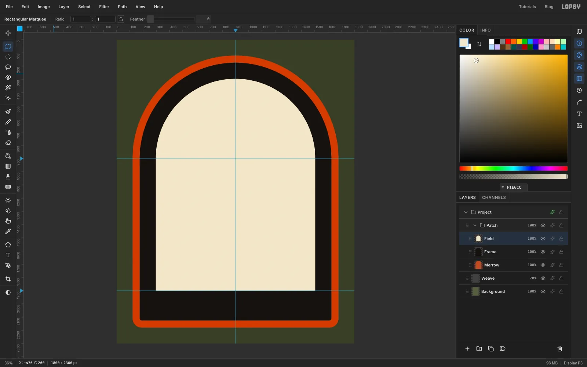

1. With the arch still selected, fill the `Merrow` layer with terracotta `#C4471F`.
2. Choose **Select → Shrink…** `54`. Add a layer called `Frame` and fill it with ink `#15120F`. Press [[Cmd+D]] to deselect.
3. Add a layer called `Field`. With the Elliptical Marquee, drag a circle from `296, 296` to `1504, 1504`. Hold [[Shift]] and add a rectangle with the Rectangular Marquee from `296, 900` down to `1504, 1900`, on the lower guide.
4. Fill with bone `#F1E6CC` and deselect.

That leaves a 54 px terracotta merrow, a 122 px black frame around the arch for the title, and a deeper black band at the bottom for the race details.

## Paint two stripe tiles

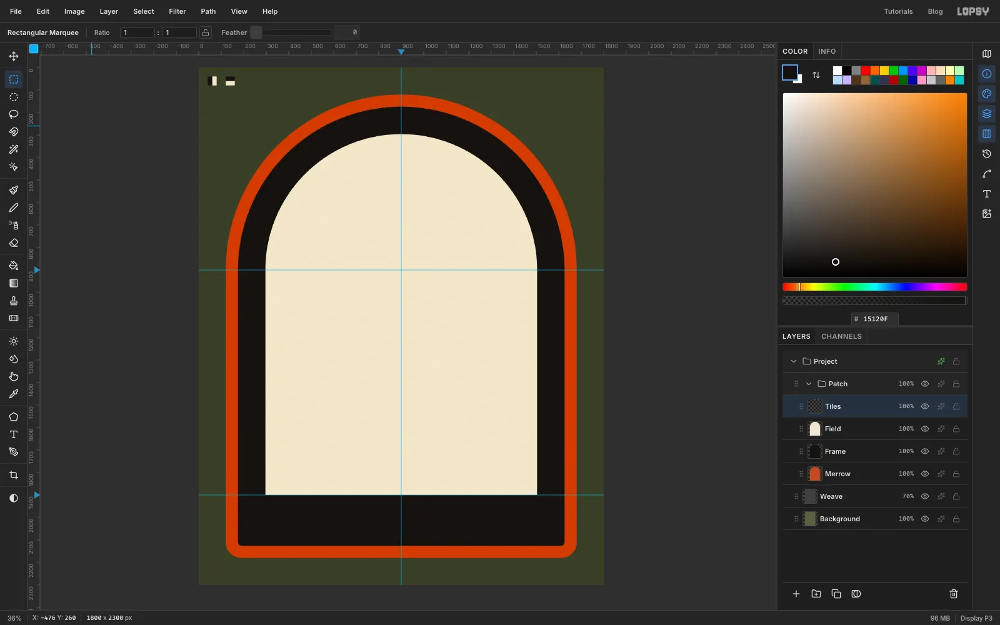

Every stripe in the design comes from two 40 px tiles.

1. Add a layer called `Tiles`.
2. With the Rectangular Marquee, select from `40, 40` to `80, 80` and fill it with bone. Then select from `40, 40` to `60, 80` and fill it with ink. That makes a tile with an ink stripe on the left half and bone on the right half.
3. Select from `120, 40` to `160, 80` and fill it with bone. Then select from `120, 40` to `160, 60` and fill it with ink. This is the same tile turned on its side.
4. Select the first tile again (`40, 40` to `80, 80`) and choose **Edit → Define Pattern**. Do the same for the second tile.
5. Deselect and delete the `Tiles` layer. The patterns stay saved.

> **Tip:** Patterns last for the session only. If you close Lopsy partway through, define them again before you use **Fill with Pattern**.

## Fill a layer with vertical stripes

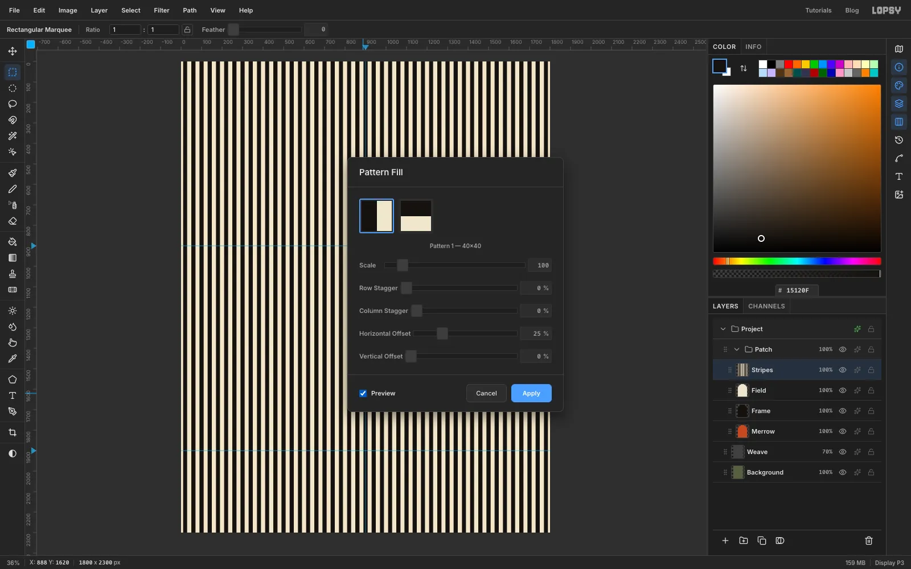

1. Select `Field` and add a layer above it called `Stripes`.
2. Choose **Edit → Fill with Pattern…** and click the first (vertical) tile.
3. Set **Horizontal Offset** to `25%`. That shifts the stripes 10 px so one sits right on the centre guide, which keeps the left and right halves mirror images.
4. Click **Apply**.

The stripes cover the whole canvas for now. That gives the next filter room to work.

## Bow the stripes with Lens Distortion

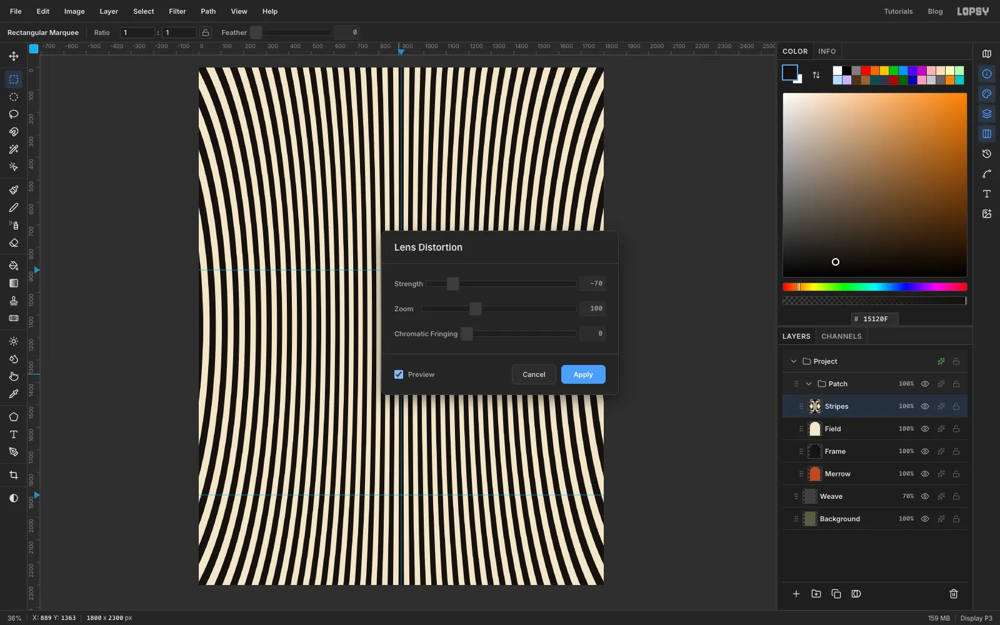

1. With `Stripes` selected, choose **Filter → Lens Distortion…**.
2. Set **Strength** to `-70` and leave **Zoom** at `100`. Negative strength is *pincushion*: lines near the middle stay straight and the ones near the edges bend outward.
3. Click **Apply**.

## Clip the stripes to the field

1. Hold [[Cmd]] and click the `Field` thumbnail to select its pixels.
2. Choose **Select → Inverse**, press [[Delete]] and deselect.

Only the arch is striped now. The stripes lean out toward the frame, so the
middle of the patch seems to come forward.

## Add the saffron sun

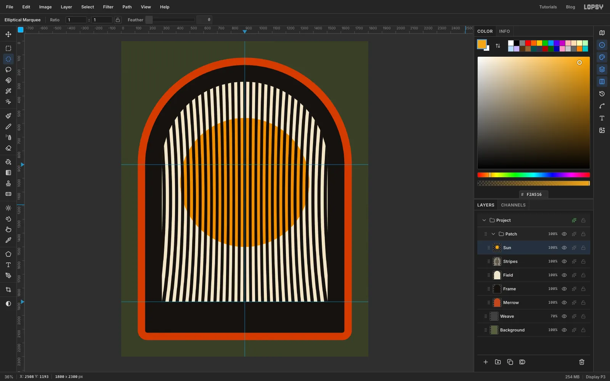

1. Add a layer above `Stripes` called `Sun`.
2. With the Elliptical Marquee, drag a circle from `430, 560` to `1370, 1500`.
3. Fill it with saffron `#F2A516` and deselect.
4. Set `Sun` to **Multiply**.

Multiply leaves black as black and tints cream to saffron, so the sun only
shows between the black stripes.

## Drop in the reference photo

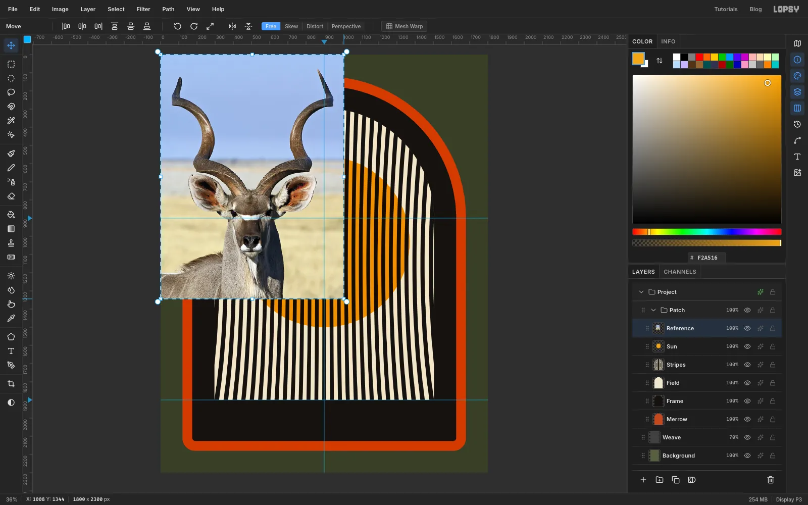

1. With `Sun` selected, drag your kudu photo from your desktop onto the canvas. It lands in the top-left corner at its own size, on a new layer. Name the layer `Reference`.
2. The photo's pixels are already selected, so the Move tool shows handles around it. Hold [[Cmd]] (to keep the proportions) and drag the bottom-right handle up and in until the photo's right edge is near `x 1000`. Press [[Enter]].

## Line the kudu up on the centre guide

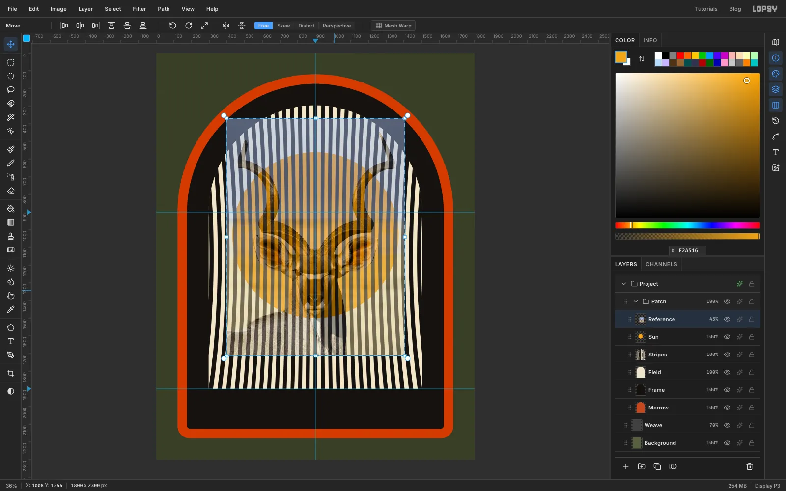

1. With the **Move** tool, drag the photo until the animal's nose sits on the centre guide and its horn tips sit about 50 px below the top of the striped field. Fine-tune with the arrow keys.
2. Set the layer's opacity to `45%` so you can see the stripes through it.

The kudu's head should overlap the top half of the sun.

## Trace the head and neck

1. With `Reference` selected, click **New Group** and name it `Kudu`. Inside it, add a layer called `Head`.
2. Pick the **Lasso**. Start at the top of the head between the horns, at about `900, 1110`. Trace a rounded dome over the forehead and down the left side of the face, just inside where the ear joins the head. Keep the head and neck about 280 px wide all the way down to around `y 1740`. Then let the neck flare out into the shoulders, so it meets the `y 1900` guide at about `x 600`. Come back up the right side as a mirror of the left, and close the shape where you started.

Don't trace the ears or horns, and don't follow every bump in the photo. The
ears and horns get their own layers, and a simple, symmetrical head reads
better as a badge.

## Fill the head with horizontal stripes

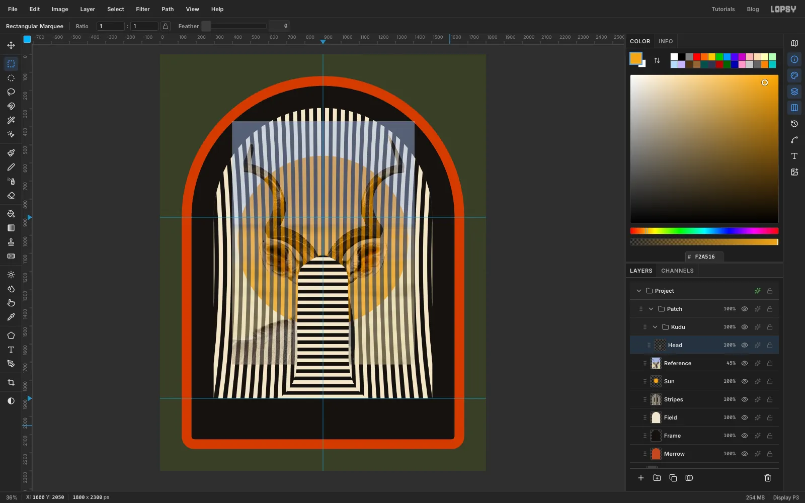

1. Choose **Edit → Fill with Pattern…**, click the second (horizontal) tile, set **Vertical Offset** to `50%` and click **Apply**.
2. With the Rectangular Marquee, select everything below the `y 1900` guide and press [[Delete]]. That trims the neck flush with the bottom band.
3. Deselect.

You can already read the shape. Nothing outlines it: the stripes just change
direction.

## Give the face some volume with Liquify

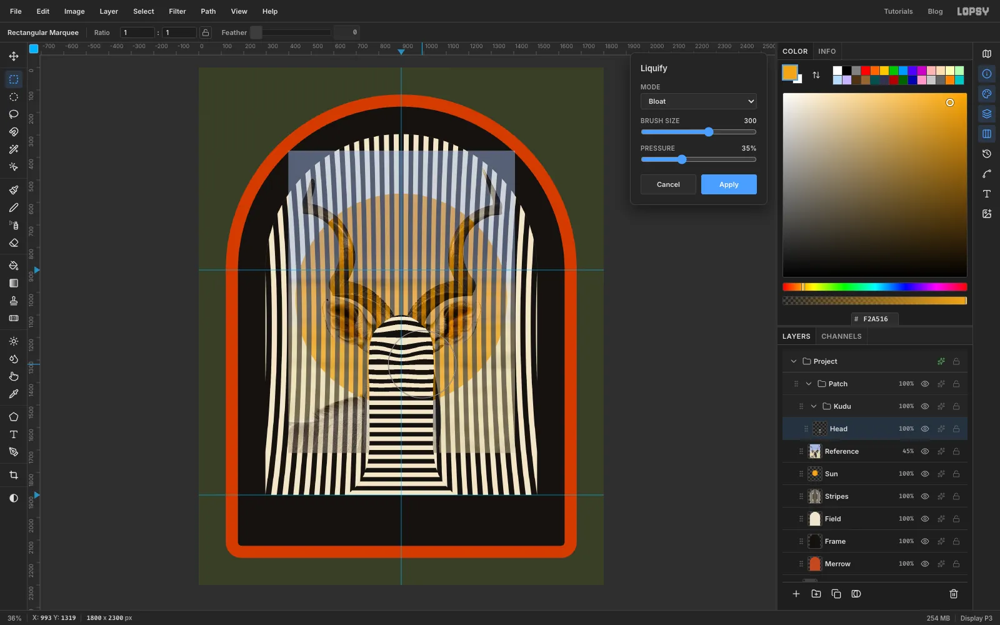

1. Choose **Filter → Liquify…**. Set **Mode** to **Bloat**, **Brush Size** to `300` and **Pressure** to `35%`.
2. Press on the middle of the forehead (about `900, 1198`), give the mouse two or three tiny wiggles without letting go, then release.
3. Give each cheek a single tiny wiggle, at about `810, 1319` and `990, 1319`.
4. Click **Apply**.

Go easy here. Bloat builds up with every bit of movement, so a long scrub
blows the stripes into blobs. Stop as soon as the stripes start to curve
around the brow.

## Shift the face half a stripe with Difference

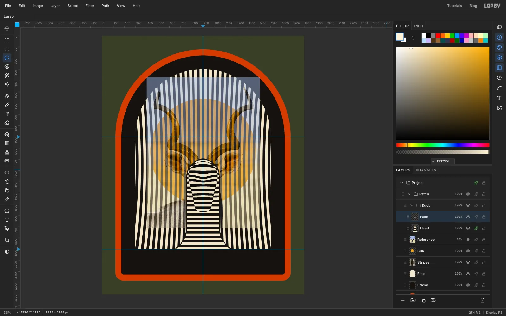

1. Add a layer above `Head` called `Face`.
2. With the Lasso, trace the face only: across the forehead, down past the eyes and in to a narrow muzzle at the chin.
3. Fill it with `#FFF2D6`. That warm near-white is roughly ink plus bone, so in **Difference** mode it turns ink stripes into bone and bone stripes into ink.
4. Hold [[Cmd]] and click the `Head` thumbnail, choose **Select → Inverse**, press [[Delete]] and deselect. That trims away any of the face that hangs past the head.
5. Set `Face` to **Difference**.
6. Select `Head`, open its effects drawer and turn on **Stroke**. Set **Width** `8`, the colour to ink `#15120F` and **Position** to **outside**.

Where the face meets the neck, the stripes jump half a step, and that jump
draws the jawline. The ink stroke keeps the head from blending into the
background stripes.

## Trace both horns

1. Select `Face` and add a layer called `Horns`.
2. With the Lasso, trace the left horn from its base on the head, out and up through each bend, to a sharp point at the tip.
3. Hold [[Shift]] and trace the right horn the same way, as a mirror image of the left one.

Leave a small gap between the two horn bases at the top of the head so they don't knot together.

## Fill the horns with fine ridges

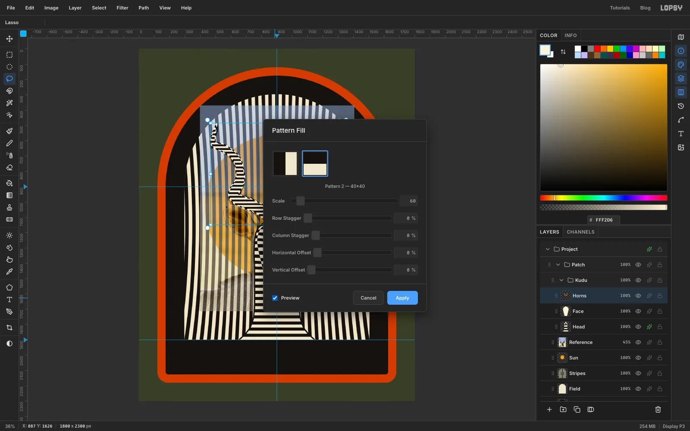

1. Choose **Edit → Fill with Pattern…**, pick the horizontal tile and set **Scale** to `60%`.
2. Click **Apply** and deselect.

The smaller stripes look like the ridges on a real horn. Where the horn
twists, the ridges cross it at an angle, and that sells the spiral.

## Outline the horns

Open the effects drawer on `Horns` and turn on **Stroke**: **Width** `8`, ink
`#15120F`, **outside**.

Without the outline, the thin horn tips get lost among the vertical stripes.

## Draw an ear as a ring target

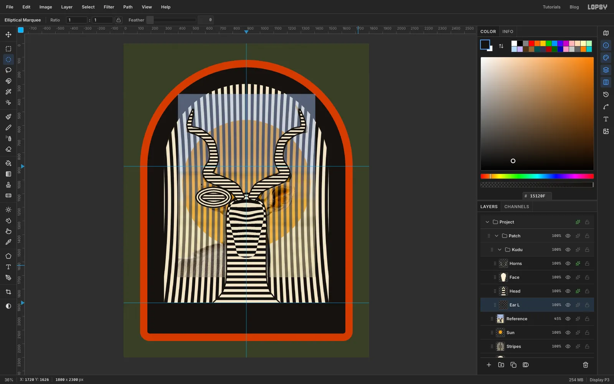

1. Select `Head` and add a layer called `Ear L`. In the Layers panel, drag `Ear L` by its grip so it sits just *below* `Head`. Ears go behind the head.
2. With the Elliptical Marquee, drag a level oval from `526, 1049` to `795, 1205`. That's centred on the left ear in the photo.
3. Fill it with ink. Choose **Select → Shrink…** `9` and fill with bone. Repeat the shrink-and-fill three more times, alternating ink and bone, so you end on ink.
4. Shrink by `9` once more and choose **Edit → Fill with Pattern…** with the horizontal tile at **Scale** `50%`.
5. Deselect.

## Rotate the ear into place

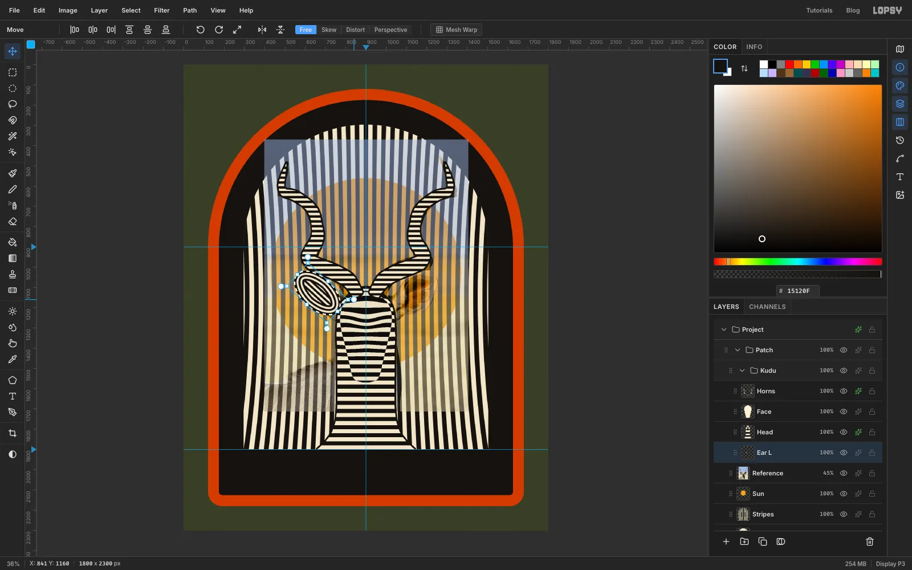

1. Hold [[Cmd]] and click the `Ear L` thumbnail to select the ear.
2. With the **Move** tool, drag the round rotation handle at the top-right corner clockwise, about 42°, until the oval points up and out like the ear in the photo.
3. Press [[Enter]] and deselect. If the ear has drifted, nudge it back over the photo's ear with the arrow keys.

The stripes in the middle turn with the ear, so they now run on a diagonal.

## Mirror it for the right ear

1. Choose **Layer → Duplicate Layer** and name the copy `Ear R`.
2. Hold [[Cmd]] and click its thumbnail. With the Move tool, click **Flip Horizontal** in the options bar and press [[Enter]].
3. Deselect, then drag the copy across the centre guide until it covers the photo's right ear. Its centre should sit at about `1139, 1127`.

## Draw the chevron, eyes and nose

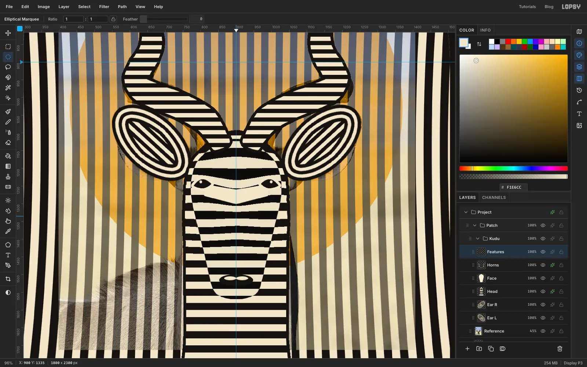

Zoom in on the face for this step ([[Cmd+=]] a few times, with the pointer over the eyes).

1. Select `Horns` and add a layer called `Features`.
2. **Chevron:** with the **Pen** tool, click six corners for a cream V just under the eyes: `812, 1245`, `900, 1260`, `988, 1245`, `990, 1278`, `900, 1301`, `810, 1278`. Click the first point again to close it. In the Paths panel, click **Path to Selection**, then **Delete Path**. Fill with bone.
3. **Left eye:** with the Pen, click the inner corner at `830, 1244`. Press at the top-middle point `806, 1231` and drag a little to the left to curve it. Click the outer corner at `780, 1249`. Press at the bottom-middle point `806, 1256` and drag a little to the right. Close the path and turn it into a selection.
4. Choose **Select → Grow…** `7` and fill with bone, then **Shrink…** `7` and fill with ink. For a catchlight, use the **Elliptical Marquee** to draw a tiny 8 px circle near the top of the eye and fill it with bone.
5. Repeat for the right eye, mirrored across the guide (inner corner `970, 1244`, outer corner `1020, 1249`).
6. **Nose:** with the Elliptical Marquee, draw an oval from `852, 1498` to `948, 1532` and fill it with ink. Then draw a small oval from `866, 1505` to `886, 1515`, hold [[Shift]] to add a matching one from `914, 1505` to `934, 1515`, and fill both with bone.
7. Deselect.

Keep the eyes inside the head outline. If an eye crosses the edge, the head stops reading as one shape.

## Draw the arch for the title

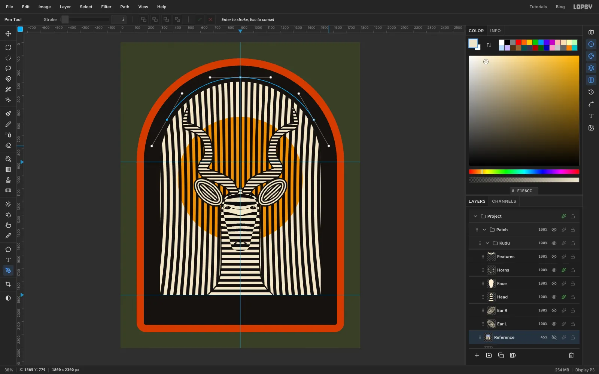

1. Hide `Reference` with the eye button on its row, then click the row to select it. The text you add next will sit just above it. Press [[Cmd+D]].
2. With the Pen, press at `348, 582` and drag up and to the right about 230 px to pull out a handle. Press at the top, `900, 263`, and drag about 230 px to the right. Press at `1452, 582` and drag about 230 px down and to the right.
3. Click **✓ Commit path** in the options bar.

The curve should run round the black frame a little inside its middle. The
letters will stand on it.

## Type the title

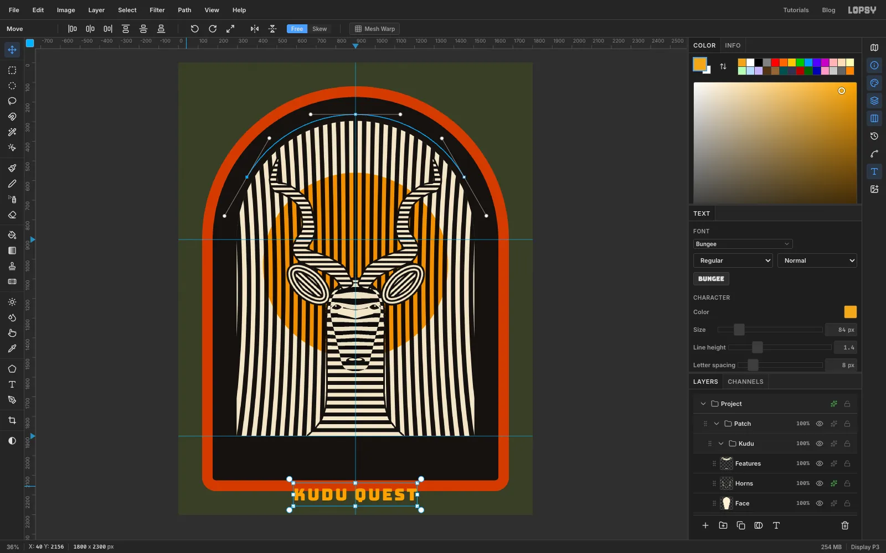

1. Pick the **Text** tool. In the options bar, set the font to **Bungee** and the size to `84`, and set the foreground colour to saffron.
2. Click an empty spot near the bottom-left of the canvas, type `KUDU QUEST` and press [[Tab]] to finish editing.
3. Rename the new text layer `Title`. In the **Text** panel, set **Letter spacing** to `8`.

Bungee is a solid, chunky face. Fine hairline fonts like Monoton look great on
screen, but they're too thin to embroider at patch size.

## Set the title on the arch

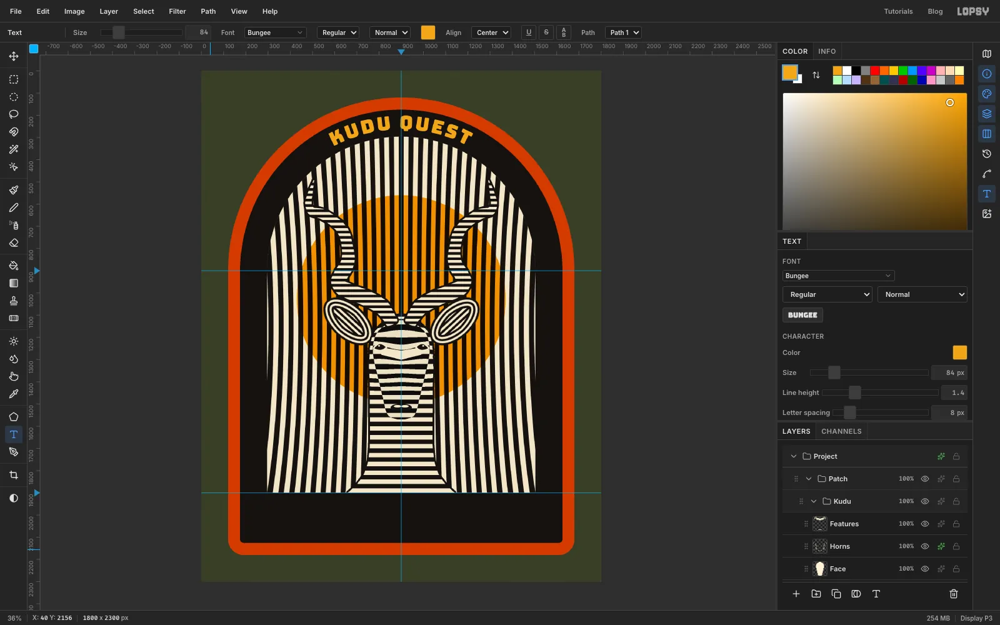

1. With the title layer still active, set **Align** to **Center** in the options bar.
2. Open the **Path** dropdown and choose **Path 1**. The words jump onto the curve and centre themselves on it.
3. Click the path in the Paths panel to deselect it so its outline goes away.

Check the gap: the letters should have about the same space above them (to the merrow) as below them (to the stripes).

## Set the race details in the bottom band

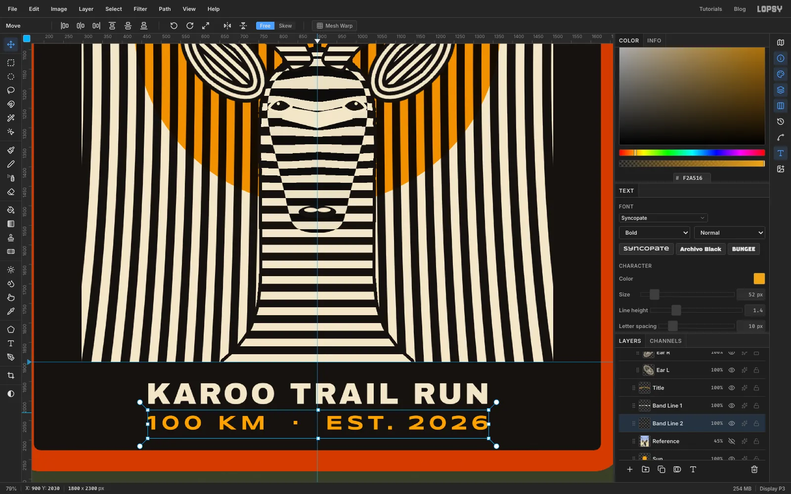

1. Select `Reference` again. With the **Text** tool, set **Archivo Black**, size `76` and bone, click an empty spot, type `KAROO TRAIL RUN` and press [[Tab]]. Name the layer `Band Line 1` and set **Letter spacing** to `6`.
2. Select `Reference` once more and do the same for `100 KM  ·  EST. 2026` in **Syncopate**, **Bold**, size `52`, saffron, with **Letter spacing** `10`. Put two spaces on each side of the middle dot. Name it `Band Line 2`.
3. With the **Move** tool, drag both lines into the bottom band and centre them on the guide. Treat them as one block: about 30 px between the lines, and the same black margin above the block as below it.

## Add diamonds at the ends of the title

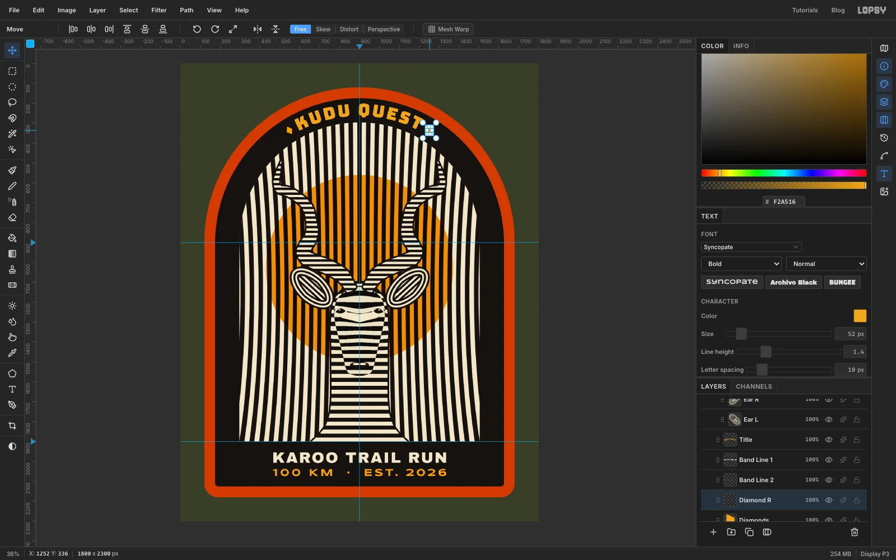

1. Add a layer above `Reference` called `Diamonds`.
2. With the Pen, click four corners for a small diamond about 28 px before the **K**, at the height of the middle of the letters. Make it about 32 px wide and 45 px long, with the long points aimed out from the centre of the arch, like the letters. Click **Path to Selection** in the Paths panel and fill with saffron.
3. Press [[Cmd+C]] and then [[Cmd+V]]. The copy pastes in place on its own layer, already selected, and Lopsy switches to the **Move** tool. Name it `Diamond R`.
4. Click **Flip Horizontal** in the Move options bar and drag the copy to the matching spot after the **T**. Press [[Enter]].
5. Deselect and choose **Layer → Merge Down** to merge it into `Diamonds`.

Flipping the copy keeps it tilted to follow the arch on the right side.

## Stitch the merrow edge with Sunburst

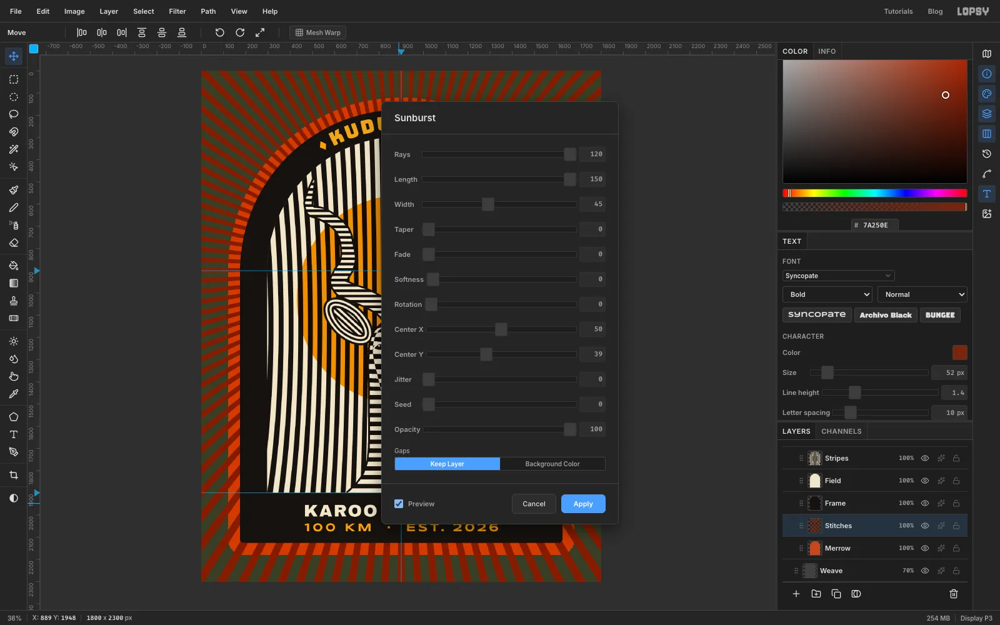

1. Select `Merrow` and add a layer above it called `Stitches`.
2. Set the foreground colour to `#7A250E`.
3. Choose **Filter → Sunburst…** and set **Rays** `120`, **Length** `150`, **Width** `45`, **Center X** `50%` and **Center Y** `39%`. 39% of 2300 is about 900, so the burst is centred on the arch's centre at `900, 900`.
4. Click **Apply**.

## Clip the stitches to the edge

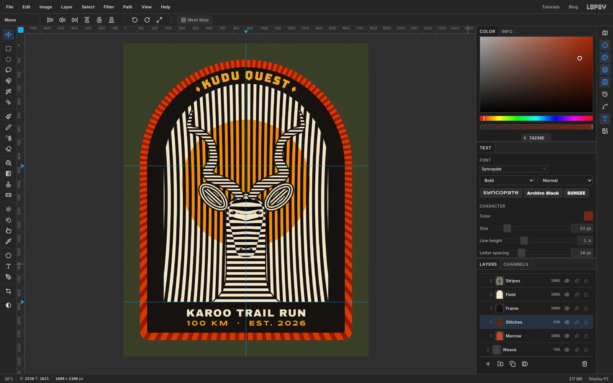

1. Hold [[Cmd]] and click the `Merrow` thumbnail, choose **Select → Inverse**, press [[Delete]] and deselect.
2. Set `Stitches` to **Multiply** at `55%`.

Round the arch, the rays cross the edge straight on. Down the sides they hit
it at a slant, just like real overlocked stitches.

## Add a thread texture

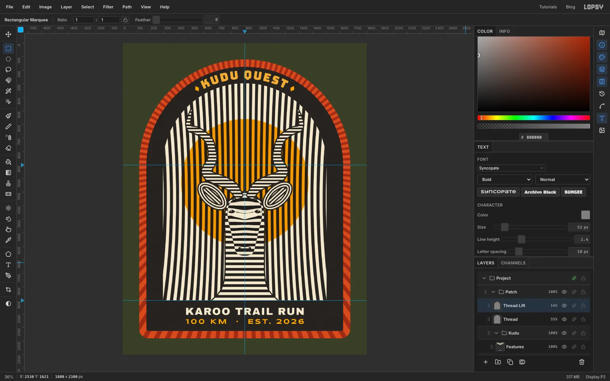

1. Select the `Patch` group and click **Add Layer**. Name it `Thread`. It goes at the top of the group.
2. Fill the whole layer with `#808080`. Run **Add Noise** (**Amount** `70`, **Mono**, **Gaussian**) and then **Motion Blur** (**Angle** `45`, **Distance** `8`).
3. Hold [[Cmd]], click the `Merrow` thumbnail, choose **Select → Inverse**, press [[Delete]] and deselect.
4. Set `Thread` to **Overlay** at `55%`.
5. **Overlay** can't change pure black. Duplicate the layer, name it `Thread Lift`, and set it to **Screen** at `14%` so the grain shows on the black frame too.

## Raise the stitching with Emboss

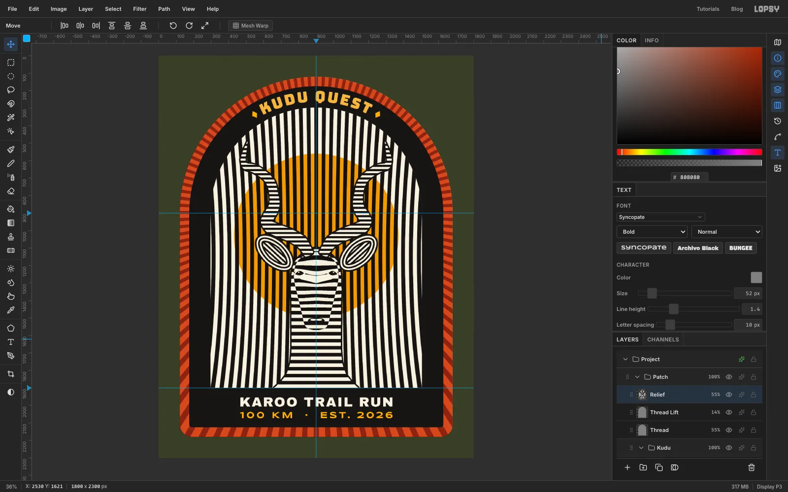

1. Select `Thread Lift`. Hold [[Cmd]] and click the `Merrow` thumbnail.
2. Choose **Edit → Copy Merged** ([[Cmd+Shift+C]]), then press [[Cmd+V]]. The flattened copy of the patch lands on a new layer above. Name it `Relief` and deselect.
3. Run **Filter → Emboss…** with **Angle** `135` and **Strength** `35`, then **Filter → Desaturate**.
4. Set `Relief` to **Overlay** at `55%`.

Emboss turns flat areas mid-grey, and Overlay ignores mid-grey. Only the
edges between colours show, as a soft highlight and shadow.

## Lift the patch off the cloth

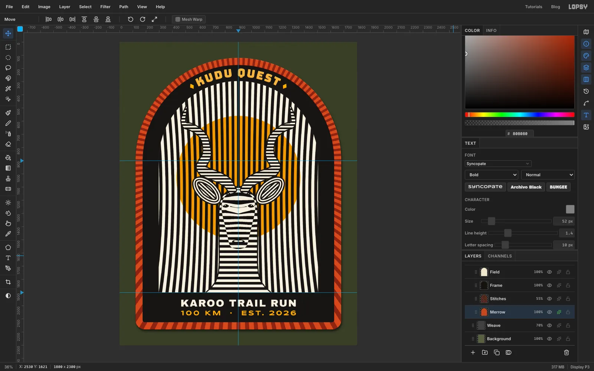

1. Select `Merrow`, open its effects drawer and turn on **Drop Shadow**. Set **Offset X** `6`, **Offset Y** `14`, **Blur** `24` and **Opacity** `55`.
2. Hide the guides ([[Cmd+;]]), save the project with **File → Save Project**, and choose **File → Quick Export PNG**.

Lopsy doesn't draw effects on groups, so put the shadow on `Merrow`, the
patch's outermost layer.
