Op art makes a flat surface seem to move. In the 1960s Bridget Riley
painted rows of wavy black lines, as in *Current* (1964), that seem to shimmer
while you look at them. Victor Vasarely bent checkerboard grids until they
seemed to bulge off the canvas, as in his *Vega* series. Both effects are
easy to build in Lopsy, and they suit a billboard: you can't scroll past a
board that seems to move.

In this tutorial you'll make a billboard for **Kip & Idle**, an imaginary
mattress company. The left side is the restless mind at 3 a.m.: stripes
that ripple around a bulging checker moon. Toward the right the waves
settle into flat, parallel lines, right where the headline says **Lie down.
The lines will too.** You'll build it at **3000 × 1000 px**, close to the
shape of a roadside bulletin board.

Along the way you'll use:

- ruler guides, **Snap to Guides**, the grid and the marquee's exact-corner dialog
- **Define Pattern**, **Fill with Pattern**, and **Liquify** in Push Forward and Bloat modes
- the **Difference** and **Multiply** blend modes and a group **Gradient Map**
- radial gradients, **Merge Down** and **Select → Inverse**
- the **Pen** tool with **Path to Selection**, the **Pencil** and copy and paste
- scaling and rotating with the **Move** tool, including a whole group
- text in **Monoton**, **Archivo Black** and **DM Mono**, with letter spacing and line height
- the **Stroke** effect and **Add Noise** in Overlay for print grain

The palette:

- Bone `#F1EADB`, ink `#16141C`
- Coral `#FF5A36`
- Moon `#FF7A4D` → `#E8401F`
- Halo white `#FFFFFF` (only used to flip the stripes)
- Grain grey `#808080`

## Set up a bone canvas

Choose **File → New**, enter **3000 × 1000** pixels and click **Create**.
Select the *Background* layer, set the foreground colour to `#F1EADB` in
the Color panel's Hex field, and choose **Edit → Fill**.

## Add guides for the panel

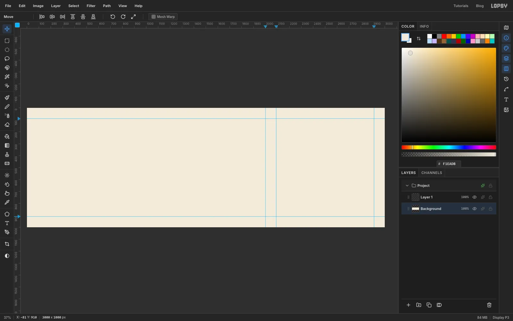

The type will live in a panel on the right third of the board. Click the
top ruler at **2000** for the panel's edge, then at **2090** and **2910**
for its left and right margins. Click the left ruler at **90** and **910**
for the top and bottom margins.

## Make a stripe tile

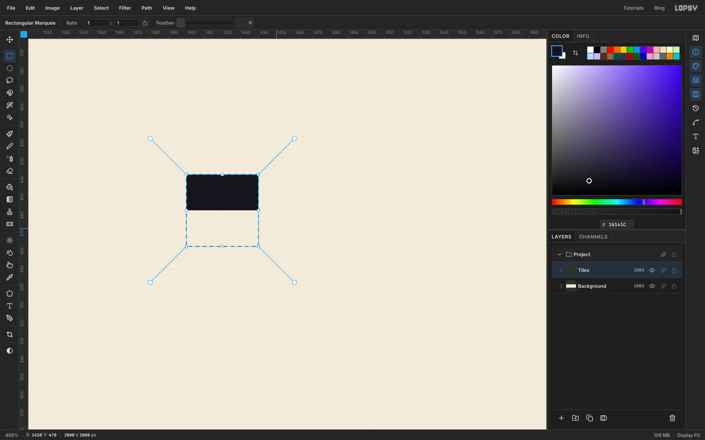

Select *Layer 1* and double-click its name to rename it *Tiles*. Set the
foreground to `#16141C`.

Pick the **Rectangular Marquee** and click once on the canvas without
dragging. A dialog opens where you can type exact corners. Enter From
**1400, 440** and To **1440, 460**, click **Select**, and choose
**Edit → Fill**. That gives you a black bar 40 px wide and 20 px tall.

Press [[Cmd+D]] to deselect (with a selection active, a marquee click only
deselects). Click again and enter From **1400, 440** To **1440, 480**: a
40 px square with the bar in its top half. Choose **Edit → Define
Pattern**, press [[Cmd+D]], and delete the *Tiles* layer with the trash
button. The pattern is kept.

## Fill a layer with stripes

Select *Background* and click **New Group** at the bottom of the Layers
panel. Name the group *Field*. Click **Add Layer**, name it *Paper* and
fill it with the bone colour. This group will get a colour adjustment
later, so it needs its own paper inside it.

Click **Add Layer** again and name it *Stripes*. Choose **Edit → Fill with
Pattern…**, click the stripe pattern and click **Apply**. The tile repeats
across the whole board as 20 px stripes.

## Push the stripes into waves

Choose **Filter → Liquify…**. Set **Mode** to **Push Forward**, **Brush
Size** to **500** and **Pressure** to **70**.

Push Forward moves the pixels under the brush in the direction you drag.
Short vertical drags make the wave crests:

1. Near the left edge, at about x 130, make five short **upward** drags of
   about 70 px: one at the top of the board, one a quarter of the way down,
   one in the middle, one three quarters down and one at the bottom. Start
   each a little to the right of the one above, so the crest leans slightly.
2. About 300 px further right, make another column of five, this time
   **downward** drags of about 55 px.
3. Move another 300 px right and drag **up** about 40 px.
4. Then **down** about 25 px.
5. Finish with a gentle column of **upward** 10 px drags around x 1260.

Because the brush is so wide, the drags in each column blend into one
smooth swell, and the stripes keep a fairly even width. Near the top and
bottom edges a few bands open up a little wider where the waves pull in
from outside the canvas. Past about x 1450 you
haven't touched anything, so the lines stay perfectly flat. Click
**Apply**.

> **Tip:** If a column looks lumpy, press [[Cmd+Z]] to undo the whole Liquify session and try again with fewer, longer drags.

## Fill the outer circle

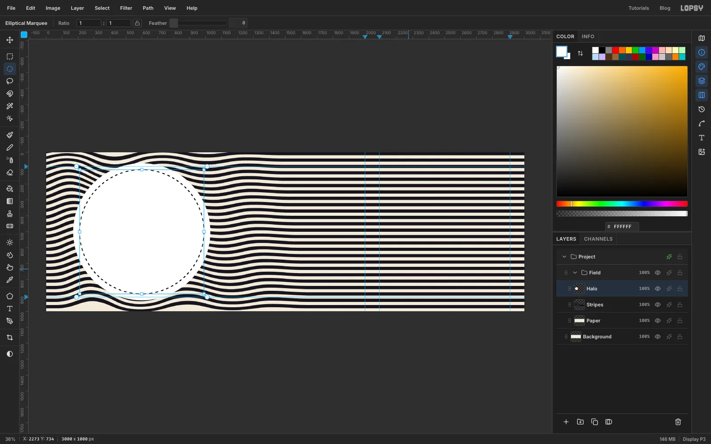

Click **Add Layer** and name it *Halo*. It goes inside the *Field* group,
above the stripes. Set the foreground to white `#FFFFFF`.

The moon will sit at **600, 500**. Pick the **Elliptical Marquee**, click
once on the canvas and enter From **170, 70** To **1030, 930**, a circle
of radius 430. Choose **Edit → Fill**.

Press [[Cmd+D]], click again and enter From **210, 110** To **990, 890**.
That circle is 40 px smaller all the way round.

## Cut the rest of the rings

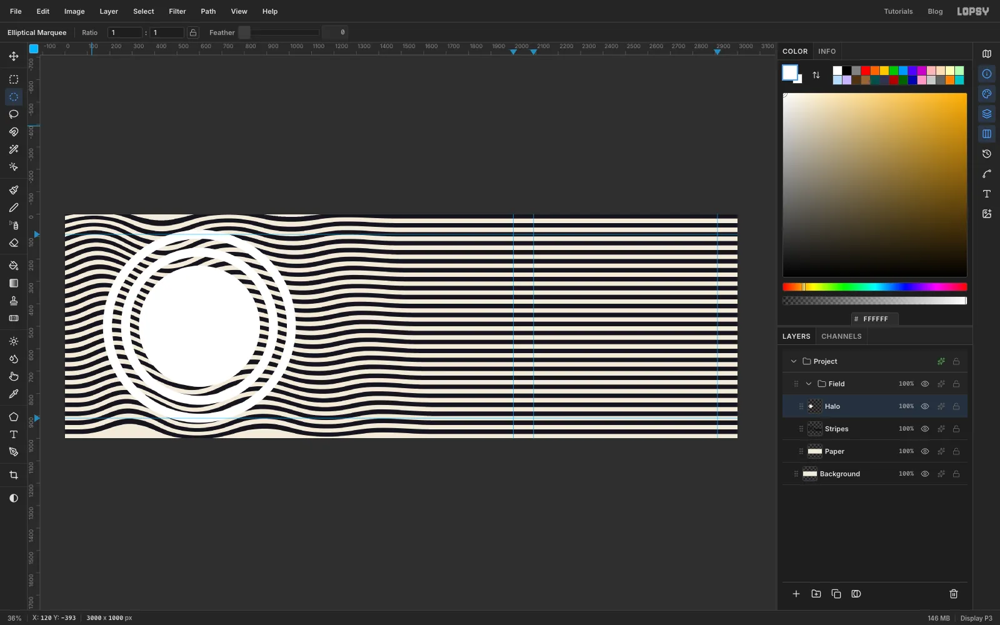

Press [[Delete]] to clear the inside of that smaller circle, which leaves a
40 px white ring. Keep stepping inward 40 px at a time, deselecting before
each click, and alternate between filling and deleting:

- From **250, 150** To **950, 850**: **Edit → Fill**
- From **290, 190** To **910, 810**: [[Delete]]
- From **330, 230** To **870, 770**: **Edit → Fill**

You end up with two rings and a centre disc, separated by gaps. Press
[[Cmd+D]].

## Flip the stripes with Difference

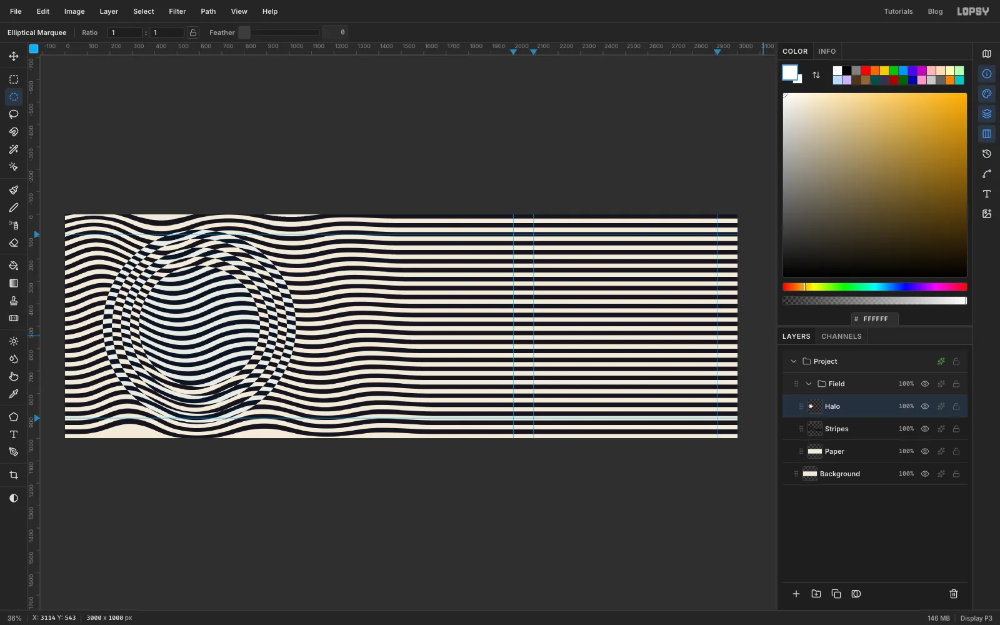

Click the effects button on the *Halo* row to open its drawer and set
**Blend** to **Difference**. Close the drawer.

Difference subtracts one colour from the other: white minus black is
white, and white minus bone is nearly black. So wherever there is a ring,
the stripes swap places. The
rings vanish as shapes and leave only that interference, the same effect
op artists painted by hand.

## Keep the rings in the palette

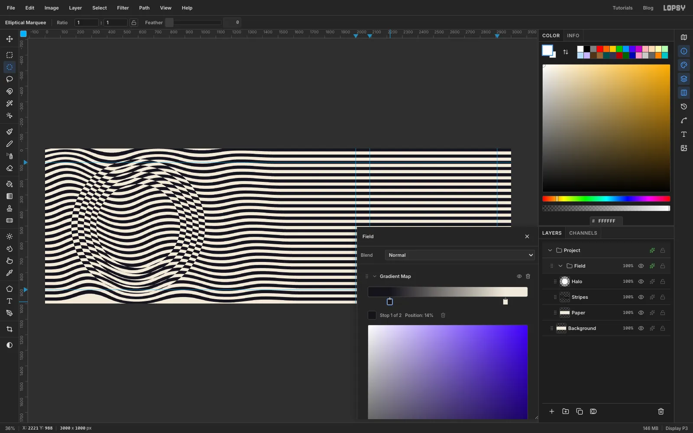

Difference flips colours exactly, so the inverted stripes come out a cold
white and a navy that aren't in the palette. A **Gradient Map** on the
group maps every brightness back onto ink and bone.

Click the effects button on the *Field* group row, then **Add Adjustment →
Gradient Map**. Click the left stop and type `16141C` in the Hex field.
Click the right stop and type `F1EADB`. Then drag the left stop in to
about **14 %** and the right stop to about **86 %**. Everything darker
than the first stop becomes pure ink and everything lighter than the
second becomes pure bone, so the field matches the paper exactly. Close
the drawer.

## Make a checker tile

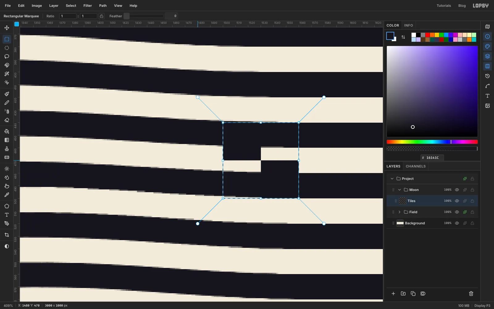

Click the arrow on the *Field* row to collapse it, keep *Field* selected,
and click **New Group**. Name it *Moon*. It sits above *Field*. Click
**Add Layer** and name the layer *Tiles*.

Zoom in on the empty stripes in the middle of the board so you can see
what you're doing. Set the foreground to ink `#16141C` and switch back to
the **Rectangular Marquee**. Then:

1. Click, enter From **1500, 440** To **1530, 470** and choose **Edit → Fill**.
2. Press [[Cmd+D]], click, enter From **1530, 470** To **1560, 500** and fill again. The two 30 px squares touch at one corner.
3. Press [[Cmd+D]], click, and select the 60 px square around them: From **1500, 440** To **1560, 500**.
4. Choose **Edit → Define Pattern**, press [[Cmd+D]] and delete the *Tiles* layer.

Press [[Cmd+0]] to fit the board back on screen.

## Fill a checker square

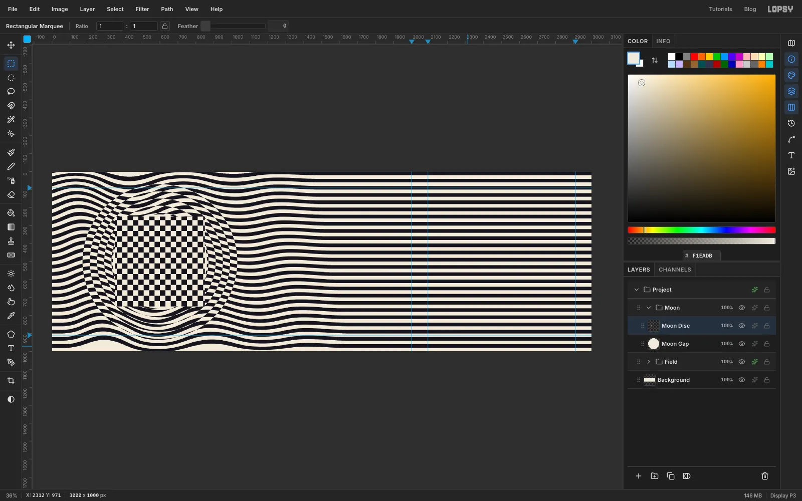

Select the *Moon* group and click **Add Layer**. Name it *Moon Gap*. Set
the foreground to bone `#F1EADB`, switch to the **Elliptical Marquee** and
fill a circle From **338, 238** To **862, 762**. This 12 px bone ring will separate the moon from the stripes.
Deselect.

Add another layer called *Moon Disc*. Switch to the **Rectangular
Marquee**, select the square From **350, 250** To **850, 750** and fill it
with bone. Then choose **Edit → Fill with
Pattern…**, pick the checker pattern and click **Apply**. The pattern only
fills the selection. Press [[Cmd+D]].

## Bloat the checker into a sphere

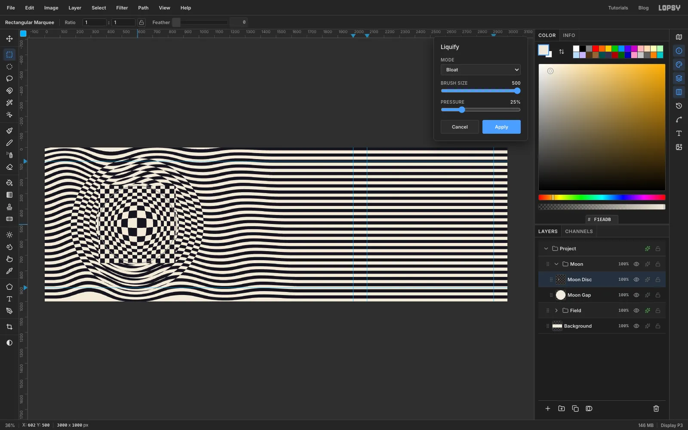

Choose **Filter → Liquify…** again. Set **Mode** to **Bloat**, **Brush
Size** to **500** and **Pressure** to **25**.

Press on the middle of the checker, at **600, 500**, and let go almost at
once. Bloat magnifies everything under the brush, most strongly at the
centre and fading to nothing at the brush edge. The middle squares swell
and the outer ones crowd together, which is Vasarely's *Vega* bulge. Click
**Apply**.

> **Tip:** Holding the brush down keeps magnifying. One quick press is plenty.

## Cut the moon to a circle

Switch to the **Elliptical Marquee** and select a circle From **350, 250**
To **850, 750**, the same size as the square. Choose **Select → Inverse** and press [[Delete]] to trim the
corners away. Choose **Select → Inverse** again so the circle is selected
for the next step.

## Paint the moon's colour

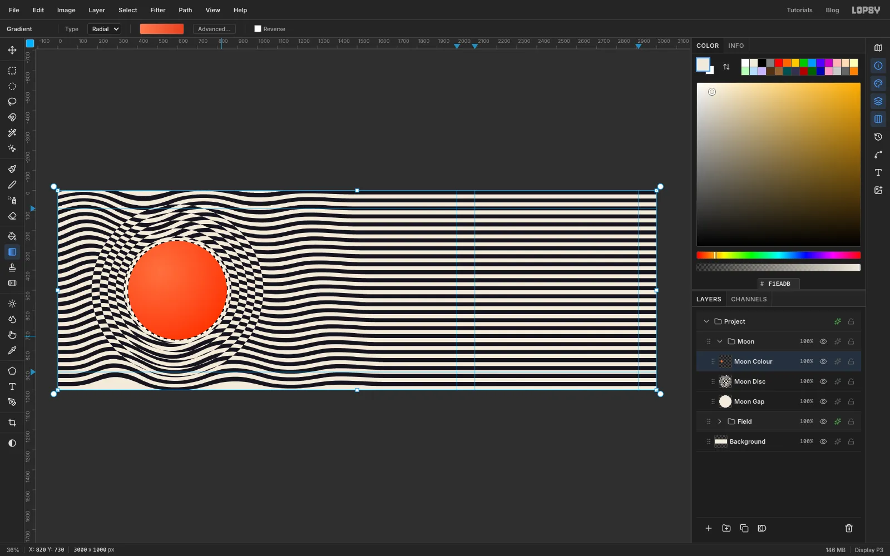

With the circle still selected, click **Add Layer** and name it *Moon
Colour*. Pick the **Gradient** tool, set the type to **Radial** and open
**Advanced…**. Click the left stop and type `FF7A4D`, click the right stop
and type `E8401F`, then click **Done**.

Press a little up and left of the moon's centre, at about **510, 400**, and
drag down and right to just past the moon's lower-right edge. That puts
the highlight on the upper left. Press [[Cmd+D]].

## Multiply and merge

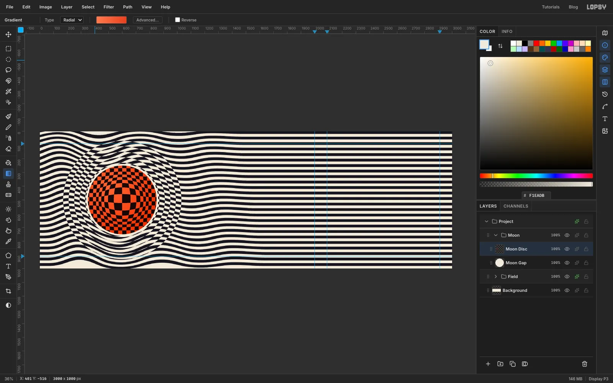

Open the *Moon Colour* row's effects drawer and set **Blend** to
**Multiply**. Multiply leaves black squares black and tints the bone
squares orange. Close the drawer and choose **Layer → Merge Down** to bake
the colour into *Moon Disc*.

## Draw a star with the Pen

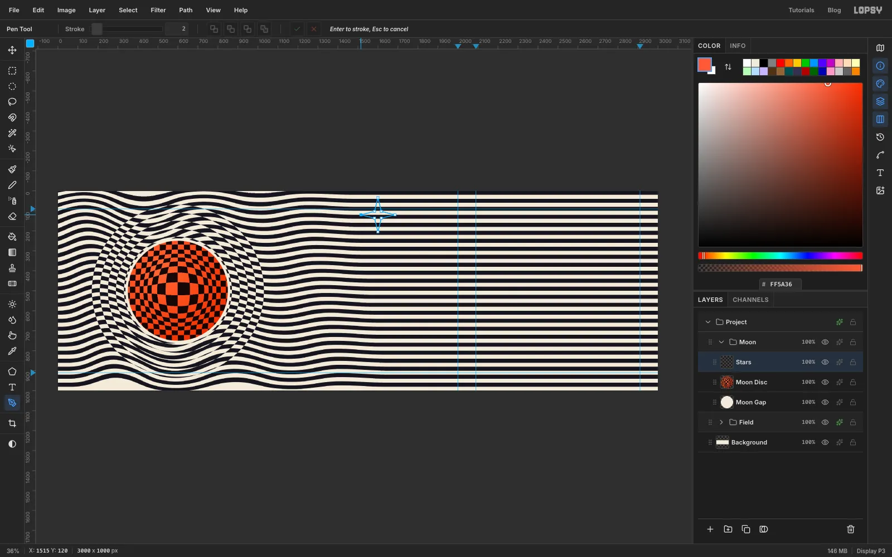

Click **Add Layer** and name it *Stars*. It goes inside the *Moon* group,
above the moon. Pick the **Pen** tool. You'll click the eight corners of a
slim four-point star centred at **1600, 120**. Its tips are 85 px from the
centre and its inner corners sit close in, about a quarter of the way out.
Watch the X/Y readout in the status bar to place each click.

Start with the left tip at **1515, 120**, then click the inner corner at
**1583, 103**, the top tip at **1600, 35**, **1617, 103**, the right tip
at **1685, 120**, **1617, 137**, the bottom tip at **1600, 205** and
**1583, 137**. Click the first point again to close the path.

Open the **Paths** panel from the right-hand rail and click **Path to
Selection**. Set the foreground to coral `#FF5A36` and choose **Edit →
Fill**. Then click **Delete Path** in the Paths panel, since you won't
need the outline again, and close the panel.

## Paste and shrink two copies

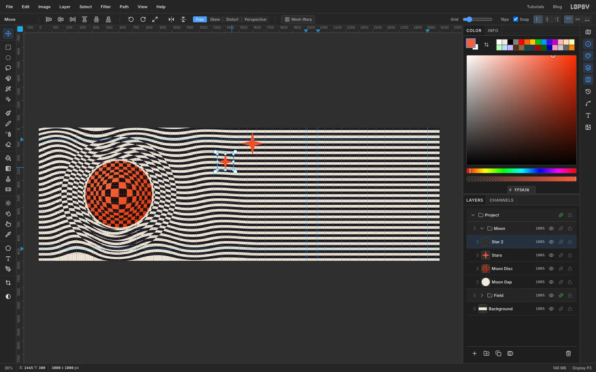

With the star still selected, press [[Cmd+C]] and then [[Cmd+D]]. Choose
**View → Show Grid** to help you judge the spacing.

Press [[Cmd+V]]. The copy lands in place on a new layer above *Stars*.
Name it *Star 2*. Draw a marquee around the star, switch to the **Move**
tool, and drag the copy down and to the left. Hold [[Cmd]] and drag the
bottom-right corner handle inward until the star is about two-thirds the
size, then press [[Enter]]. Its centre should land near **1390, 245**.

Select *Star 2* and press [[Cmd+V]] again. This copy is full size too, and
lands above *Star 2*. Name it *Star 3*. As before, draw a marquee around
it, drag it with the **Move** tool down and left, and [[Cmd]]-drag its
corner handle in until it's about 40 % of the original, centred near
**1215, 355**. Press [[Enter]]. The three stars now climb away from the
moon on a diagonal.

## Merge the stars

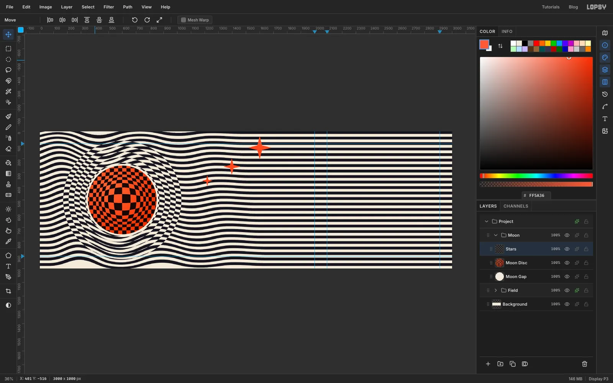

Choose **View → Show Grid** again to hide it. Select *Star 3* and choose **Layer → Merge Down** twice. All three stars end up on
the *Stars* layer.

## Draw the type panel

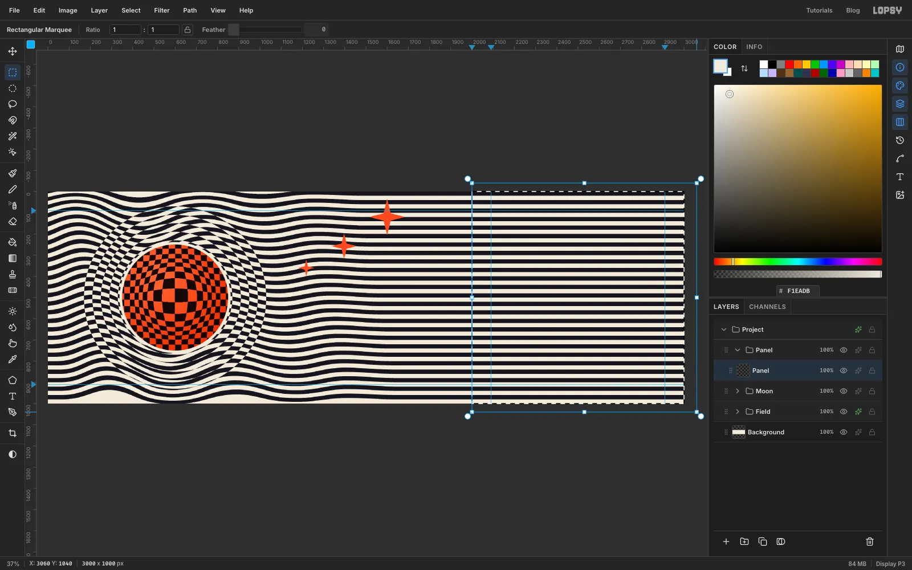

Collapse the *Moon* group, keep it selected and click **New Group**. Name
it *Panel*. Click **Add Layer** and name the layer *Panel*.

With the **Rectangular Marquee**, press just right of the 2000 guide above
the top of the canvas and drag past the bottom-right corner. **Snap to
Guides** is on by default, so the left edge jumps onto the guide. Set the
foreground to bone `#F1EADB`, choose **Edit → Fill** and press [[Cmd+D]].

## Add a coral divider

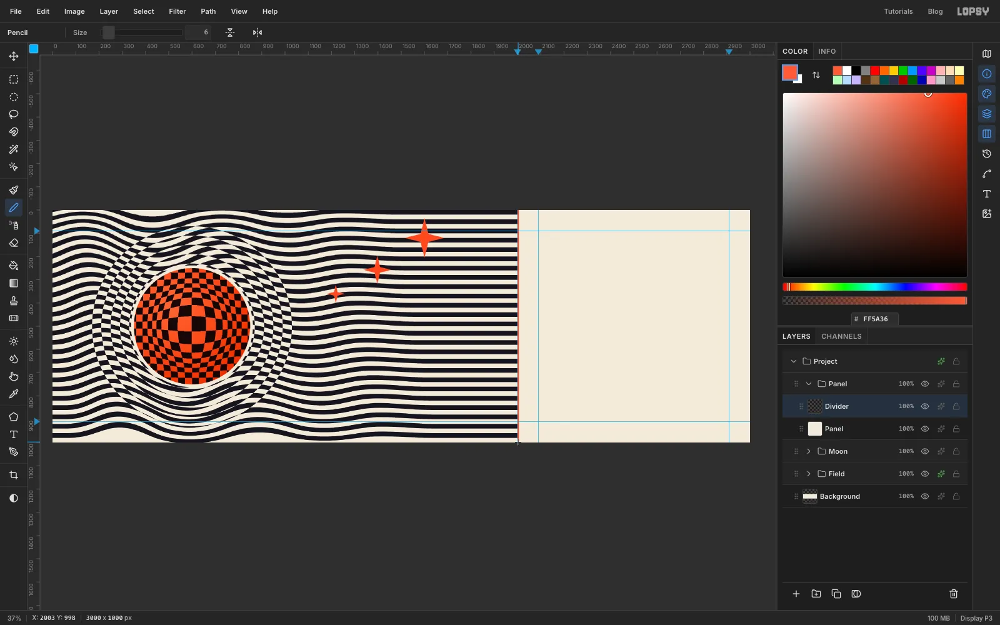

Click **Add Layer** and name it *Divider*. Pick the **Pencil**, set
**Size** to **6** and the foreground to coral. Click at the top of the
panel edge, at **2003, 0**, then hold [[Shift]] and click at the bottom,
**2003, 1000**. Shift+click draws a straight line from the last point.

## Set the logo

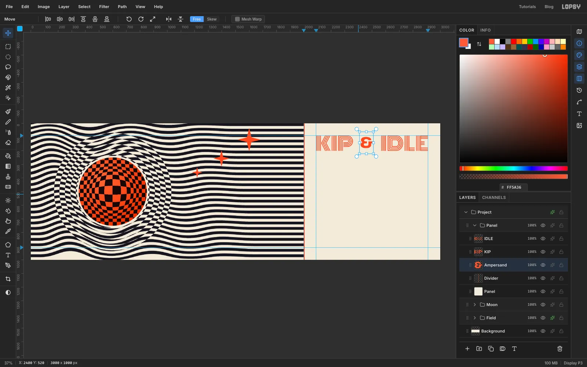

Monoton's capitals are drawn as parallel lines, which suits a board made
of stripes. Its ampersand reads like "Et", though, so set the "&" in a
different font.

Pick the **Text** tool. Set **Size** to **140**, the font to **Monoton**
and the colour to coral. Click in the empty top-right of the panel, type
`IDLE` and press [[Tab]] to commit. Switch to **Move** and nudge it with
the arrow keys until its right edge sits on the 2910 guide.

Every piece of text from here on follows the same routine: select the
*Divider* layer first (otherwise the Text options restyle the text layer
you just made), pick the **Text** tool, set the options, click in empty
space, type, press [[Tab]], then switch to **Move** to nudge it into place.
Double-click each new layer's name and give it a short name as you go.

Type `KIP` the same way and line its left edge up with the 2090 guide.
Finally type `&` in **Archivo Black** at **115** px, also coral, and name
the layer *Ampersand*. Move it so it sits centred in the gap between KIP
and IDLE, a few pixels above their middle so it doesn't look low.

## Add the tagline and headline

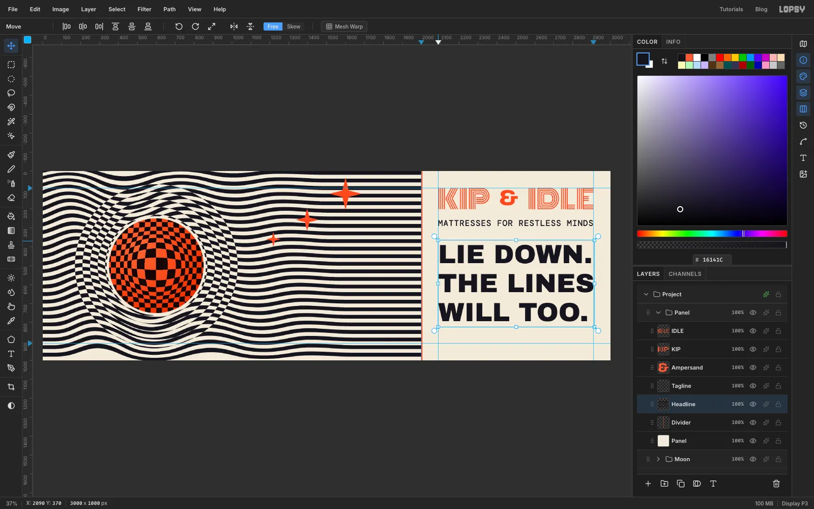

Select *Divider*, then type `MATTRESSES FOR RESTLESS MINDS` in **DM
Mono**, weight **Medium**, at **44** px in ink, and name the layer
*Tagline*. Keep it selected, open the **Text** panel from the right-hand
rail and set **Letter spacing** to **2**. That spreads the line to the same
width as the logo, from guide to guide. Move it so the gap under the logo
is a little more than the tagline's own height.

Select *Divider* again. In the Text panel, set **Letter spacing** back to
**0** and **Line height** to **1.1**. Type the headline in **Archivo
Black** at **139** px in ink (just big enough for the widest line to reach
the right margin), pressing [[Enter]] after each line, and name it
*Headline*:

`LIE DOWN.` / `THE LINES` / `WILL TOO.`

Line its left edge up with the 2090 guide. Its top sits at about **390**,
leaving a clear gap under the tagline. At this size the widest line runs
almost exactly to the right margin.

## Sign off with the address

Select *Divider* again and set **Line height** back to **1.2** in the Text
panel. Type `kipandidle.com` in **DM Mono Medium** at **56** px, ink, and
name it *URL*. Nudge it so the bottom of the *p* rests on the
910 guide. The top and bottom margins now both measure about 90 px.

## Build the sticker

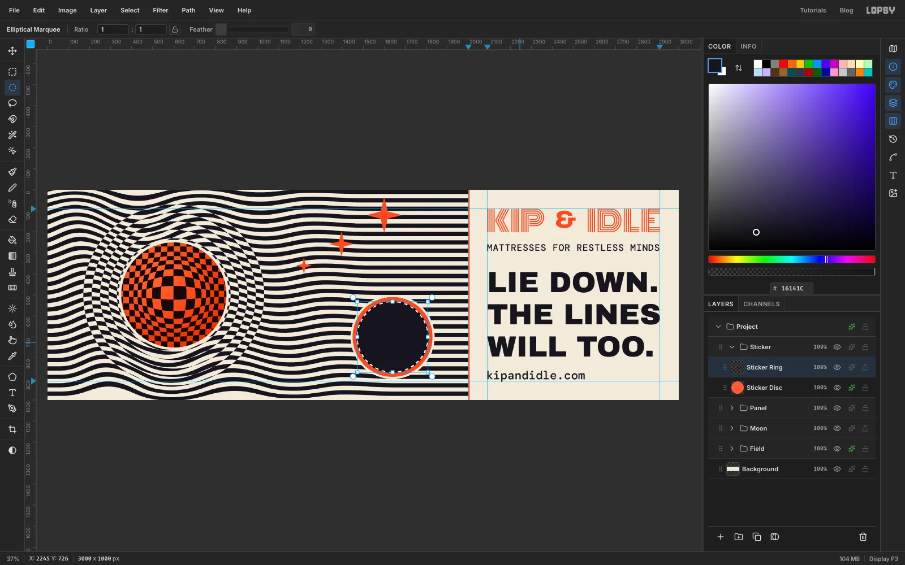

Collapse the *Panel* group, keep it selected and click **New Group**. Name
it *Sticker*. Add a layer called *Sticker Disc*, set the foreground to
coral, switch to the **Elliptical Marquee** and fill a circle From **1450,
510** To **1830, 890**. Press
[[Cmd+D]]. In the layer's effects drawer, turn on **Stroke** with a
**Width** of **10** and the colour `#F1EADB`. The bone outline lifts the
sticker off the stripes.

Add a layer called *Sticker Ring*. Set the foreground to ink and fill the
circle From **1468, 528** To **1812, 872**. Press [[Cmd+D]], then select
From **1472, 532** To **1808, 868** and press [[Delete]]. Press
[[Cmd+D]]. That leaves a crisp 4 px
ring, 18 px in from the edge.

## Add the sticker text

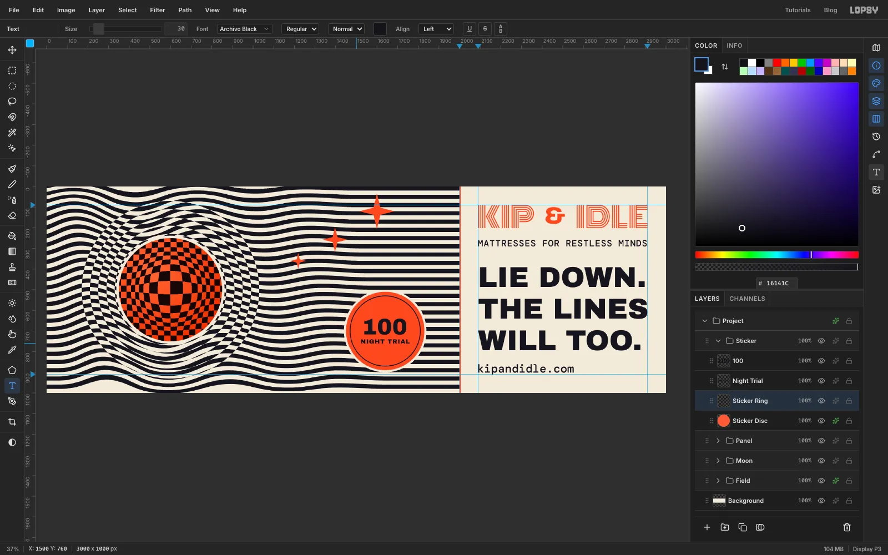

Use the same text routine, but select *Sticker Ring* instead of *Divider*
before each one. Type `100` in **Archivo Black** at **110** px, ink, name
the layer *100*, and move it so it's centred on the disc horizontally, a
little above the middle.

Select *Sticker Ring* again, set **Letter spacing** to **2** in the Text
panel, and type `NIGHT TRIAL` in Archivo Black at **30** px. Name it
*Night Trial* and centre it under the 100, so the two lines sit as one
block in the middle of the ring with at least 30 px of coral on each side.
Then select *Sticker Ring* once more and set the letter spacing back to
**0**, so the next text you type isn't tracked out.

## Rotate the sticker group

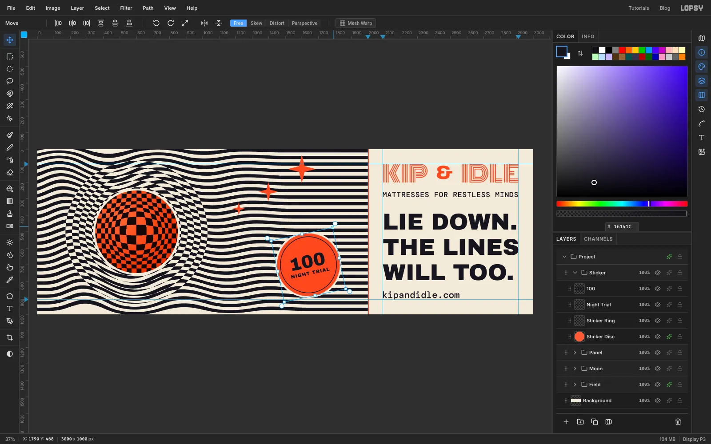

Select the *Sticker* group row and switch to the **Move** tool. Its
transform box appears around everything in the group. Hover just outside
the top-right corner until the cursor shows the rotate arrow, then drag
upward to turn the sticker about **12°** anticlockwise. Press [[Enter]].
The disc, ring and both lines of text turn together.

## Add print grain

Collapse the *Sticker* group, keep it selected, and click **Add Layer**.
Name it *Grain*. Set the foreground to `#808080`, choose **Edit → Fill**,
then choose **Filter → Add
Noise…**, set **Amount** to **60**, click **Mono** and **Gaussian**, and
click **Apply**. Set the layer's **Blend** to **Overlay** and its opacity
to **50 %**. Mid-grey disappears in Overlay, so only the speckle shows, as
a fine print texture.

Choose **File → Quick Export PNG** to save the billboard, and **File →
Save Project** to keep the layers.
