*Op art*, short for optical art, was the big new look of the mid-1960s. Bridget
Riley painted rows of black and white waves that seem to shimmer. Victor
Vasarely bent checkerboards until they swelled like spheres. In this tutorial
you'll put both ideas on a souvenir patch for a made-up surf club,
**Riptide Point**, founded in 1966, and show it ironed onto a denim jacket.

The art is built from a few optical tricks:

- a sky of thin rays
- a sun made of rings and wedges, swapped black-for-white with the
  **Difference** blend mode and then bulged with **Lens Distortion**
- a sea of stripes that squeeze toward the horizon and twist into two eddies
  (the "riptides")

After that, you'll make it look stitched. That means a wrapped *merrow* edge
(the thick overlocked border real patches have), thread texture and a soft
shadow on the cloth.

The canvas is 1400 × 1400 px. The background is a CC0 denim texture, "Denim
fabric 03" by Rico Cilliers and colormass (via Poly Haven, on Wikimedia
Commons). Any flat photo of denim works.

Along the way you'll use:

- ruler **guides**, the **Grid** with snapping, **New Group** and **Merge Down**
- the **Elliptical Marquee** and **Rectangular Marquee** with add and subtract, the **Lasso**, **Select → Shrink**, **Feather** and **Inverse**
- **Sunburst**, **Lens Distortion**, **Liquify**, **Mesh Warp**, **Threshold**, **Gaussian Blur**, **Fibers**, **Add Noise**, **Motion Blur** and **Radial Blur**
- **Define Pattern** and **Fill with Pattern**
- the **Difference**, **Multiply**, **Overlay** and **Screen** blend modes, and the Drop Shadow, Inner Glow and Outer Glow effects
- the **Pen** tool and **text on a path** in Rubik Mono One
- the **Pencil**, the **Dodge/Burn** tool, copy and paste, and rotating with the **Move** tool

The palette:

- Bone `#EEE5D0`, ink `#161517`, coral `#D85B3A`
- Merrow thread `#E9DFC7`, stitch shade `#CDBFA2`, stitch highlight `#FBF6EA`
- Shadow navy `#050B18` / `#061024`, merrow glow `#5E4E33`, band glow `#2A2116`
- Thread grey `#808080` (texture layers only)

Blend modes live in each layer's effects drawer: click the ✦ button on the
layer's row and use the **Blend** dropdown at the top. Opacity is the
percentage button on the row.

Positions are given as document coordinates where things have to line up.
Watch **X** and **Y** in the status bar at the bottom of the window as you
move the pointer. Everything is centred on the middle of the canvas
(`700, 700`) unless I say otherwise.

## Set up guides and drop in the denim

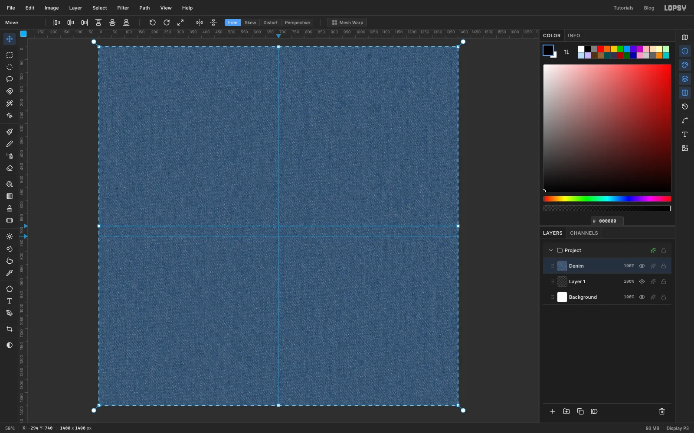

1. Choose **File → New**, set **Width** and **Height** to `1400` and click **Create**.
2. Click the top ruler at `x 700` to drop a vertical centre guide.
3. Click the left ruler at `y 700` (the centre) and again at `y 740`. The second guide is the horizon.
4. Drag your denim photo from your desktop onto the canvas. Lopsy fits a big photo to the canvas and puts it on its own layer.
5. Double-click the new layer's name and call it `Denim`. The new document's `Background` and empty `Layer 1` stay underneath, hidden by the photo.

## Build the patch blank from four circles

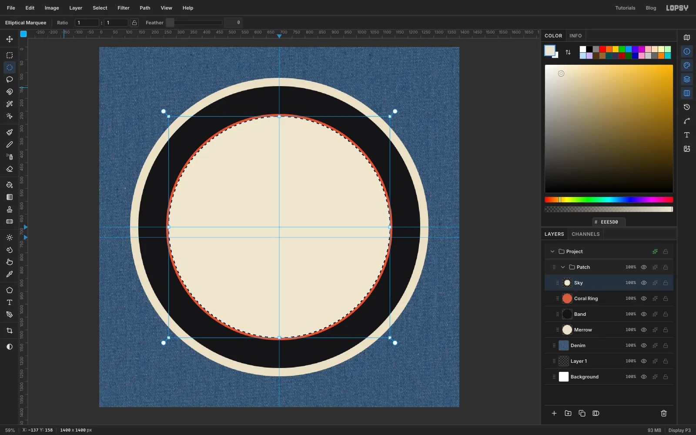

The patch is four stacked discs, each a little smaller than the one below.
Seen from above, they make the edge, the lettering band, a coral keyline and
the art area.

1. With **Denim** selected, click **New Group** at the bottom of the Layers panel and name it `Patch`. Everything from now on goes inside this group.
2. Click **Add Layer** and name it `Merrow`. Pick the **Elliptical Marquee** in the toolbox. Drag from `120, 120` to `1280, 1280` to make a circle. Set the foreground colour to `#E9DFC7` and choose **Edit → Fill**.
3. Add a layer called `Band`. Draw a circle from `152, 152` to `1248, 1248` and fill it with `#161517`.
4. Add a layer called `Coral Ring`. Draw a circle from `260, 260` to `1140, 1140` and fill it with `#D85B3A`.
5. Add a layer called `Sky`. Draw a circle from `270, 270` to `1130, 1130` and fill it with `#EEE5D0`. That leaves a 10 px coral keyline. Keep the selection for the next step.

## Fan out the sky rays with Sunburst

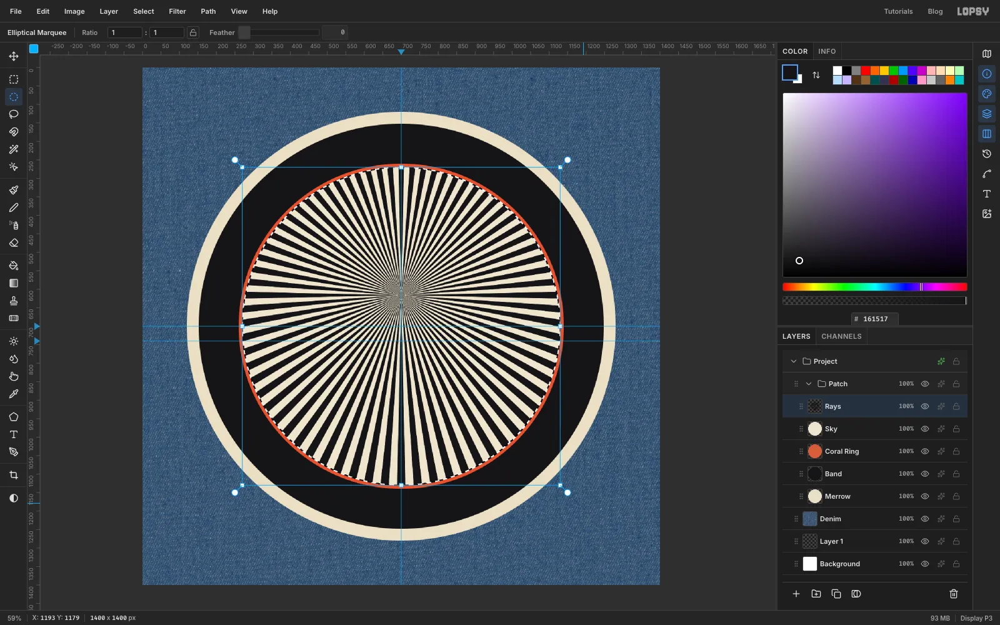

1. Add a layer called `Rays`. Your Sky circle should still be selected.
2. Set the foreground colour to ink `#161517`.
3. Choose **Filter → Sunburst…** and set **Rays** `72`, **Length** `150`, **Width** `50` and **Taper** `0`. Set **Center X** to `50` and **Center Y** to `44`. That's 44% of the way down, which puts the burst at `700, 616`, where the sun will go.
4. Click **Apply**. Sunburst only paints inside the selection, so the rays stop at the coral ring.

Width 50 makes each ray exactly as wide as the gap next to it. Equal black
and cream is what makes rays like this flicker.

## Clear a halo around the sun

All 72 rays meet in a muddy point. Cut a clean hole there:

1. With the Elliptical Marquee, drag a circle from `485, 401` to `915, 831`. That's a 215 px radius around the sun's centre.
2. Press [[Delete]], then [[Cmd+D]] to deselect.

The cream gap that's left will frame the sun.

## Draw concentric rings with Shrink

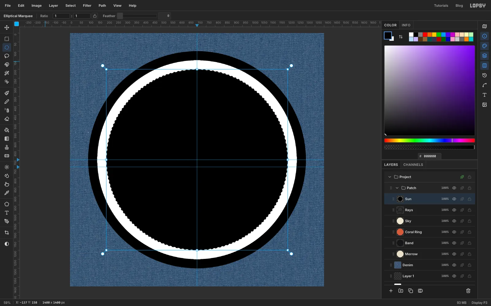

The sun starts out big, in the middle of the canvas. That way the Lens
Distortion in a later step has room to work. You'll shrink it into place
afterwards.

1. Add a layer called `Sun`.
2. Draw a circle from `100, 100` to `1300, 1300` (a 600 px radius) and fill it with pure black `#000000`.
3. Choose **Select → Shrink…**, enter `50` and click **Apply**. Fill the smaller selection with pure white `#FFFFFF`.
4. Shrink by `50` again and fill with black.

Use pure black and white here, not ink and bone. You'll recolour the sun
later, and pure values keep the next step exact.

## Finish the rings

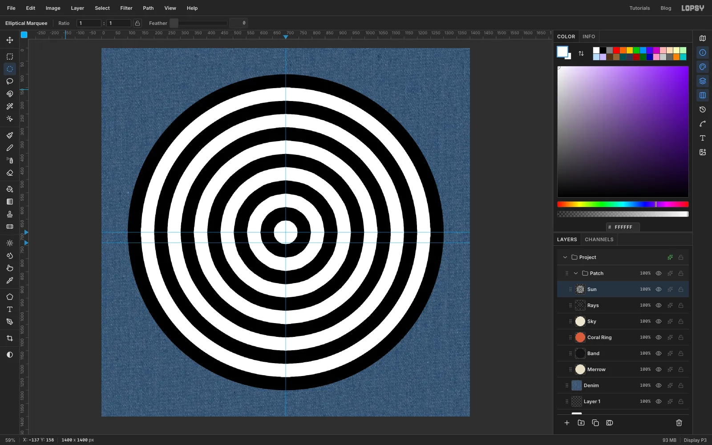

Keep going: **Shrink** `50`, fill white, **Shrink** `50`, fill black. Stop
after the eleventh shrink. You'll have twelve rings, black on the outside
and white at the centre. Deselect.

## Turn the rings into a checkerboard with Difference

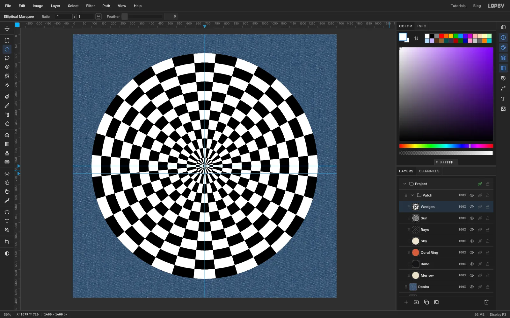

1. Add a layer called `Wedges` and draw the same 600 px circle again.
2. Set the foreground colour to white and choose **Filter → Sunburst…**. Set **Rays** `16`, **Length** `150`, **Width** `50`, **Taper** `0` and **Center** `50` / `50`. Click **Apply**, then deselect.
3. Open the layer's effects (the ✦ button on the row) and set **Blend** to **Difference**.

Difference flips the rings to their opposite colour wherever a white wedge
covers them. The result is a polar checkerboard. Choose **Layer → Merge
Down** to bake it into the `Sun` layer.

## Bulge the checkerboard with Lens Distortion

1. Choose **Filter → Lens Distortion…**, set **Strength** `100` and **Zoom** `100`, and click **Apply**.
2. Run it a second time at **Strength** `80`.

Barrel distortion pushes the outer rings together and leaves the middle
alone. That's how a sphere looks when it curves away from you, and it's
Vasarely's *Vega* trick. The disc also shrinks noticeably, from a 600 px
radius to about 390, because the outer rings get pushed off the edge.

## Scale the sun down

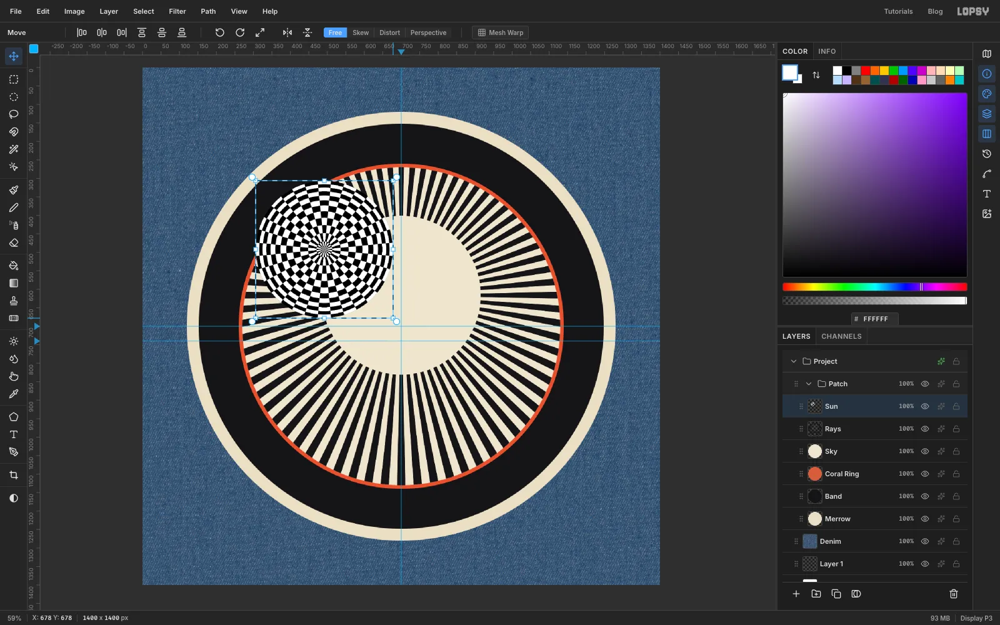

1. Drag a rectangular marquee just around the sun (read its edges from the rulers).
2. Switch to the **Move** tool ([[V]]).
3. Hold [[Cmd]] and drag the bottom-right handle up and to the left until the box is about 370 px wide. [[Cmd]] keeps it in proportion. The top-left corner stays pinned.
4. Press [[Cmd+D]] to commit.

## Move the sun into place

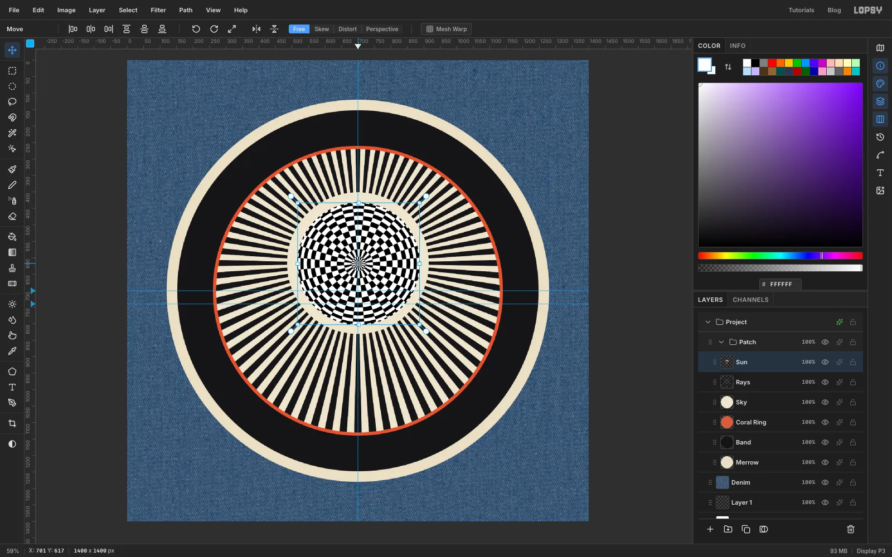

1. [[Cmd]]-click the `Sun` layer's thumbnail to select its pixels.
2. With the Move tool, drag the sun into the middle of the halo. Its selection box's middle handles should line up with the vertical guide and with `y 616` on the left ruler.
3. Deselect.

## Colour the sun and swell its middle

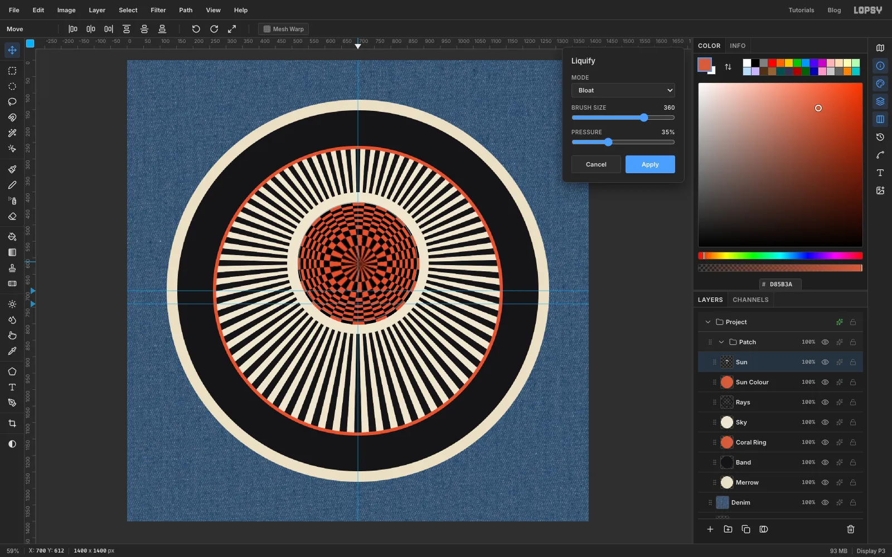

1. [[Cmd]]-click the `Sun` thumbnail again. Then click the `Rays` layer and add a layer called `Sun Colour`. It goes between Rays and Sun.
2. Fill the selection with coral `#D85B3A` and deselect.
3. Select the `Sun` layer and set its **Blend** to **Multiply**. White multiplied by coral is coral, and black stays black.
4. To exaggerate the bulge, choose **Filter → Liquify…**. Set the mode to **Bloat**, **Brush Size** `360` and **Pressure** `35`.
5. Press on the sun's centre for a moment and give it a tiny wiggle, then click **Apply**.

Bloat only works inside its brush circle, so the sun's outline stays put.

## Plug the centre with a bullseye

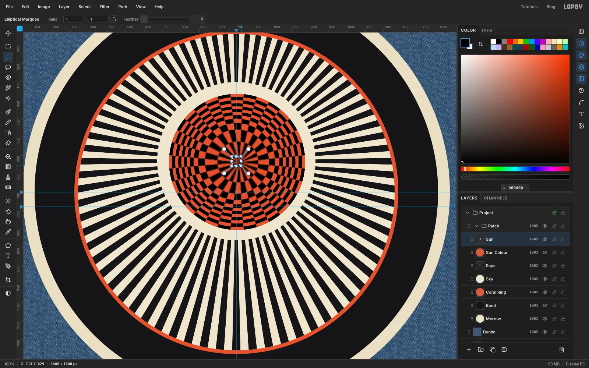

The sixteen wedges still pinch together into a grey pinwheel at the centre.

1. Stay on the `Sun` layer and zoom in twice ([[Cmd+=]]).
2. Draw a small circle, about 26 px across, centred on `700, 616`. Fill it with black.

> **Tip:** Marquee edges snap to guides within 8 screen pixels. Zoom in (or
> turn off **View → Snap to Guides**) before drawing a tiny marquee next to a
> guide, or it snaps shut.

## Lay in the sea and its reflection

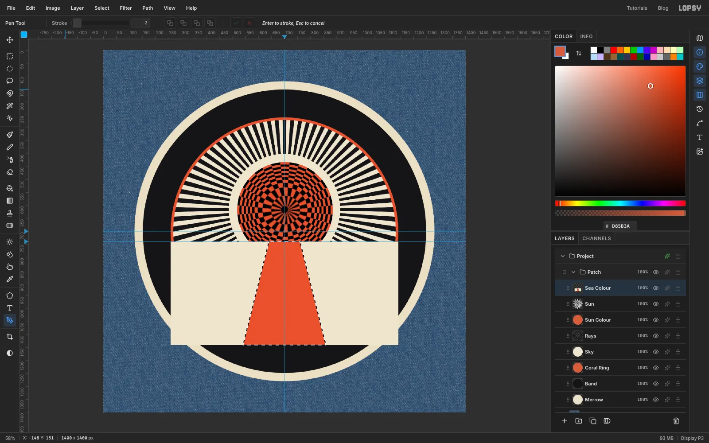

1. Select `Sun` and add a layer called `Sea Colour`, so the sea sits above the sun.
2. With the Rectangular Marquee, drag from `260, 740` (on the horizon guide) to `1140, 1140` and fill with bone `#EEE5D0`. This hides the bottom of the sun.
3. Draw the reflection as a trapezoid with the **Pen** ([[P]]). Click (don't drag) at `640, 740` and `760, 740` on the horizon, then `860, 1140` and `540, 1140` at the bottom. Click the first anchor again to close the shape.
4. Open the **Paths** panel (its button is on the narrow strip at the far right of the window), click **Path to Selection**, then **Delete Path** (the selection stays). Fill it with coral.

The reflection is narrow at the horizon and widens toward you, the way a
real one does.

## Draw a stripe tile on the grid

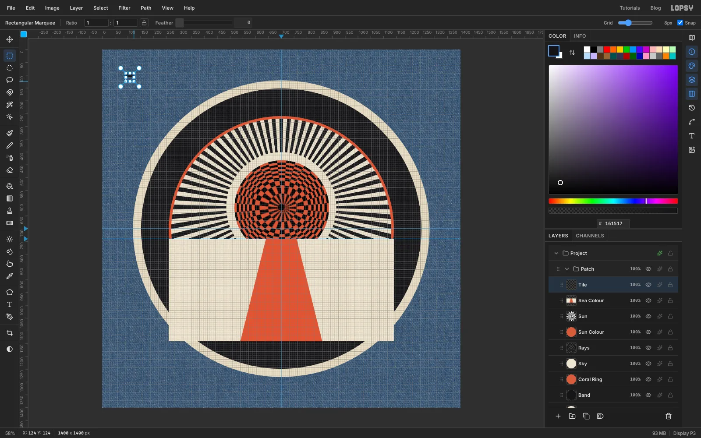

1. Choose **View → Show Grid** and set the grid size slider in the options bar to `8px`. Showing the grid also turns on **Snap**, so marquees land on grid lines.
2. Add a layer called `Tile`. Drag a marquee from `92, 92` to `124, 108` and fill it with ink. That's a bar 32 px wide and 16 px tall.
3. Drag a marquee from `92, 92` to `124, 124` (a 32 px square) and choose **Edit → Define Pattern**.
4. Deselect, then delete the `Tile` layer with the trash button. The pattern stays in the session.
5. Choose **View → Show Grid** again to hide it, and untick **Snap**.

## Fill the sea with stripes

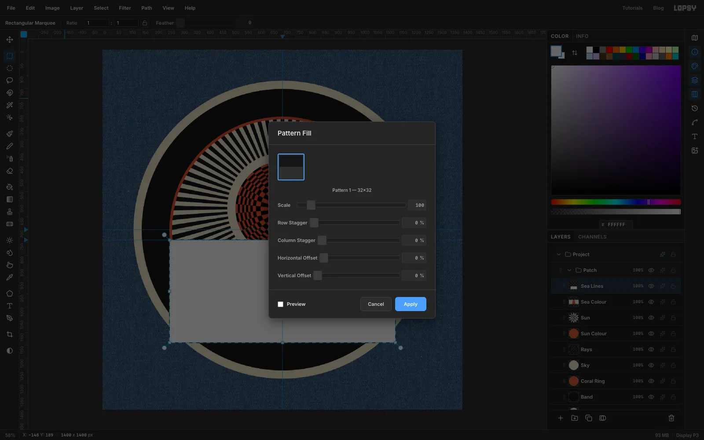

1. Select `Sea Colour` and add a layer called `Sea Lines`.
2. Draw the same rectangle as before (`260, 740` to `1140, 1140`) and fill it with white.
3. Choose **Edit → Fill with Pattern…**, pick your tile, leave **Scale** at `100` and click **Apply**.

The stripes go on a white layer, not a transparent one, so the next steps can
treat them as a black-and-white image.

## Multiply the stripes over the sea

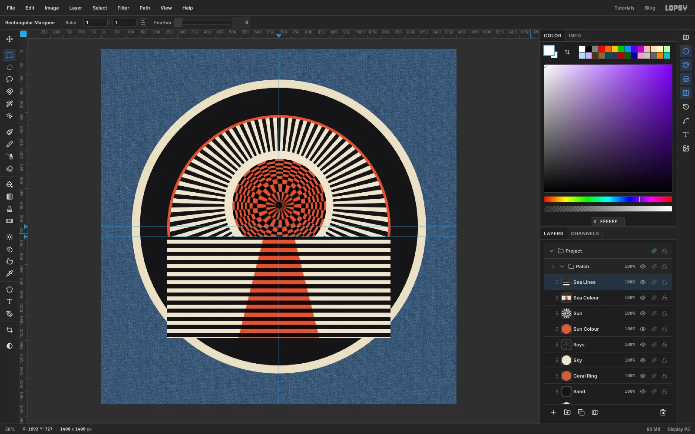

Deselect and set the `Sea Lines` **Blend** to **Multiply**. The white
disappears, the black stays, and the coral reflection shows through between
the stripes.

## Squeeze the stripes toward the horizon with Mesh Warp

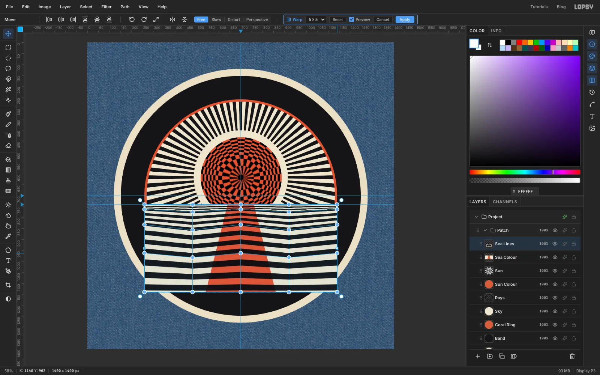

1. With the **Rectangular Marquee**, draw the sea rectangle again (`260, 740` to `1140, 1140`).
2. Switch to the **Move** tool, click **Mesh Warp** in the options bar, set the grid to **5 × 5** and tick **Preview**.
3. Leave the top and bottom rows of handles alone. Drag every handle in the second row up about 70 px, the third row about 95 px and the fourth about 70 px.
4. Nudge the handles in the second and fourth columns down a few pixels and the middle column up, so the stripes swell gently.
5. Click **Apply** and deselect.

The stripes now crowd together near the horizon and open out toward you.
That's Riley's rush of depth.

## Twist two riptide eddies with Liquify

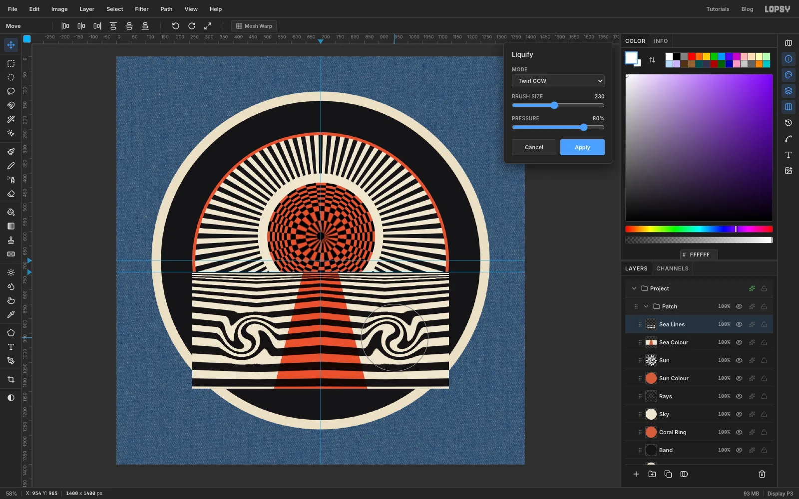

1. Keep `Sea Lines` selected and choose **Filter → Liquify…**.
2. Set the mode to **Twirl CW**, **Brush Size** `230` and **Pressure** `80`.
3. Press at `450, 965` and keep wiggling the pointer in tiny circles until the stripes curl round into a wave.
4. Switch to **Twirl CCW** and do the same at `950, 965`. This gives a mirror-image eddy.
5. Click **Apply**.

Keep both eddies clear of the reflection.

## Re-sharpen the edges with blur and Threshold

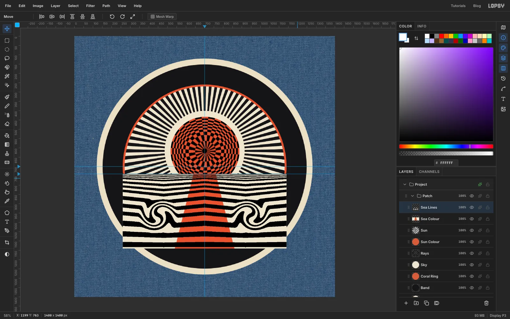

Liquify resamples the pixels, so the stripe edges come out soft and slightly
ragged. Because the layer is pure black and white, you can rebuild them:

1. **Filter → Gaussian Blur…**, **Radius** `3`. This rounds off the raggedness.
2. **Filter → Threshold…**, **Level** `128`. This snaps everything back to black or white.
3. **Filter → Gaussian Blur…**, **Radius** `1`. This anti-aliases the new edges.

## Trim the sea and rule the horizon

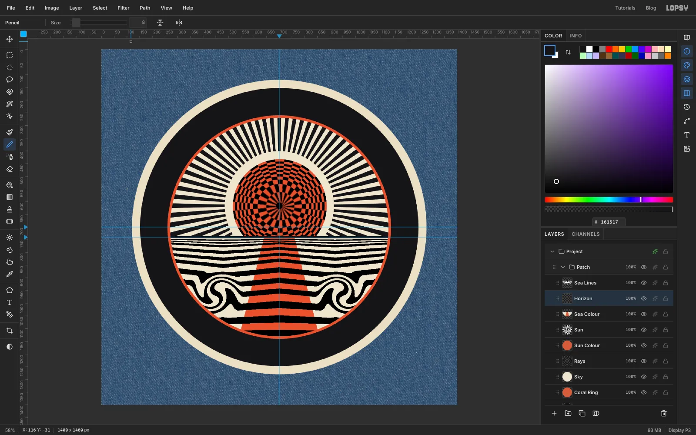

1. [[Cmd]]-click the `Sky` thumbnail and choose **Select → Inverse**.
2. Select `Sea Lines` and press [[Delete]]. Then select `Sea Colour` and press [[Delete]]. Deselect.
3. With `Sea Colour` still selected, add a layer called `Horizon`. Pick the **Pencil** ([[N]]), set **Size** `8` and ink as the colour.
4. Click at `260, 740`, then hold [[Shift]] and click at `1140, 740` to draw a straight line along the horizon guide.
5. Trim the line's ends the same way: [[Cmd]]-click Sky, Inverse, [[Delete]], deselect.

## Set RIPTIDE POINT

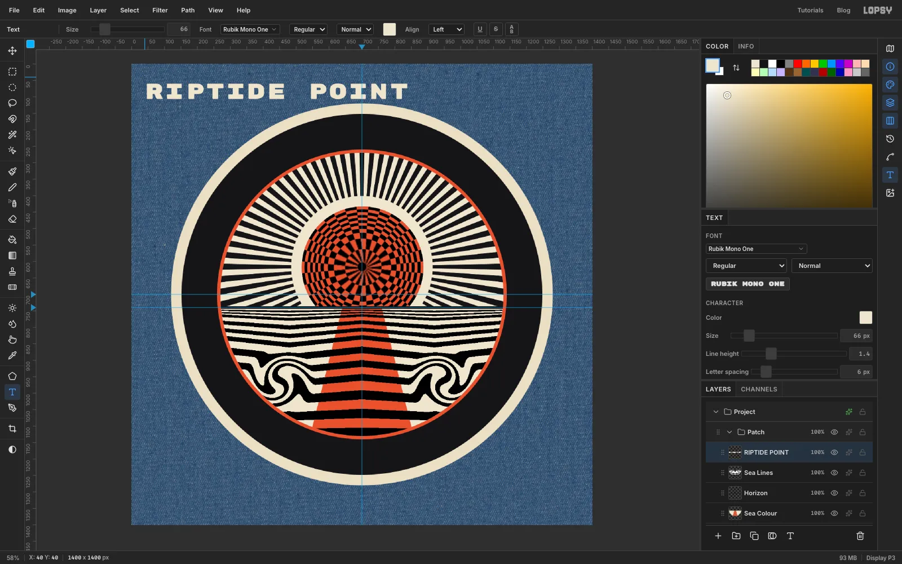

1. Select `Sea Lines` so the text lands above the art.
2. Pick the **Text** tool ([[T]]). Choose **Rubik Mono One** at size `66`, with bone `#EEE5D0` as the colour.
3. Click in the empty denim at the top-left, type `RIPTIDE POINT` and press [[Tab]] to commit.
4. In the Text panel, set **Letter spacing** to `6`.

## Arch it over the top on a path

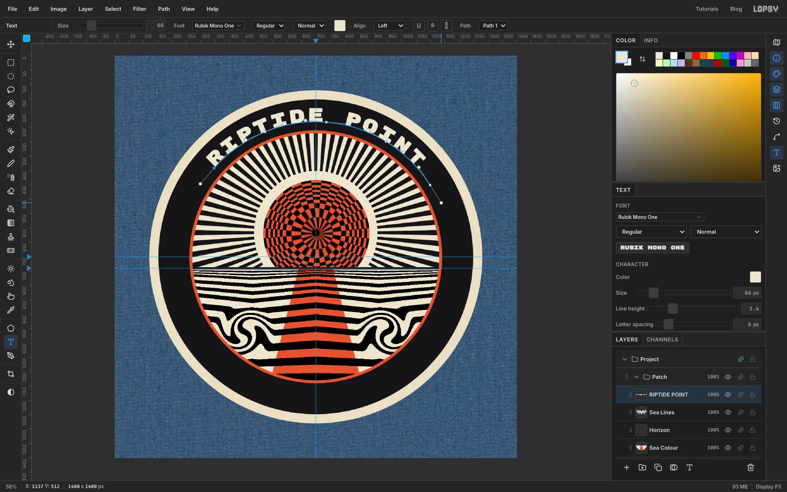

The lettering band runs from radius 440 to 548, so the middle of the
letters should sit on a 494 px circle. With caps about 48 px tall, the
baseline goes on a 470 px circle.

1. Pick the **Pen** tool ([[P]]). Press at about ten o'clock on that circle (`345, 392`) and drag a little along the curve to pull out a handle.
2. Add three more anchors the same way over the top (at about eleven, twelve and one o'clock), and a last one at about two o'clock (`1099, 451`). Always drag each handle along the circle's direction.
3. Click ✓ in the options bar to keep it as a path.
4. Select the text layer and choose that path from **Path** in the Text options bar.

If the word isn't centred over `x 700`, draw the arc again, starting a
little further round, and pick the new path.

## Run SURF CLUB along the bottom

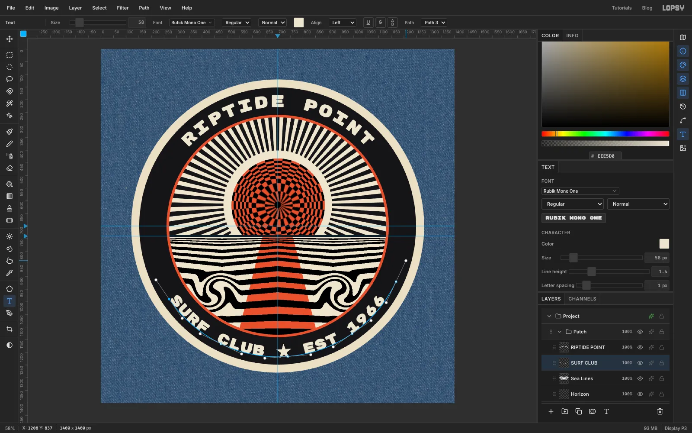

1. Click the `Sea Lines` row first, so the new settings can't restyle RIPTIDE POINT. With the Text tool in Rubik Mono One, set size `58`.
2. Click in empty denim and type `SURF CLUB ★ EST 1966` (paste the ★ if it won't type), then press [[Tab]]. Set **Letter spacing** to `1`.
3. For upright text along the bottom, the path must run left to right *under* the circle, with the baseline on the outside. Use a 518 px circle (494 plus half the cap height). With the **Pen**, start at about eight o'clock (`271, 990`), add anchors under the bottom and end at about four o'clock (`1166, 927`). Click ✓.
4. Bind the text to this path from the **Path** dropdown, as before.

Set the bottom line in the same face as the top one. Size it and space it
so it spans roughly the same angle. Two different typefaces fight on a
badge this small.

## Add a star and point it outward

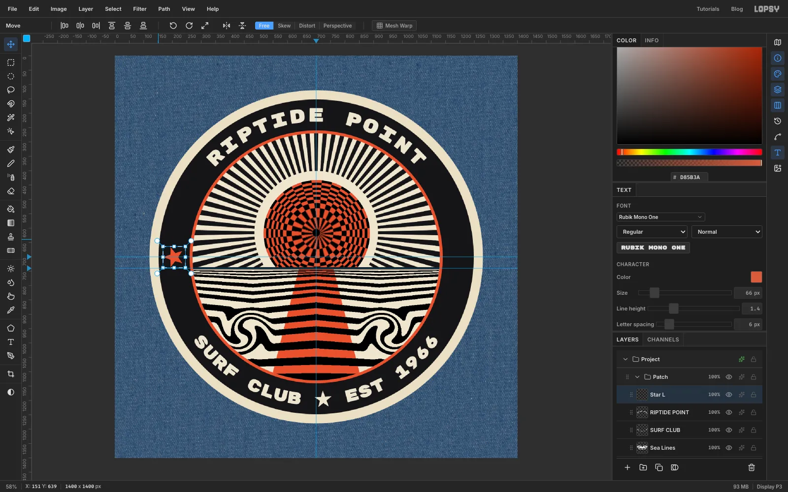

1. Select `RIPTIDE POINT` and add a layer called `Star L`.
2. With the **Pen**, click the ten corners of a five-point star about 72 px across, centred at `206, 700` (in the band at nine o'clock). Click the first corner again to close it. As with the reflection, use **Path to Selection** and **Delete Path**, then fill with coral.
3. Draw a marquee around the star. With the Move tool, hold [[Cmd]] and drag a round rotation handle just outside a corner. Turn it a quarter turn counter-clockwise, so a point faces out of the patch. [[Cmd]] snaps the angle to 15° steps.
4. [[Cmd+D]] to commit. If the star has drifted off centre, nudge it back with the arrow keys.

## Copy it to the other side

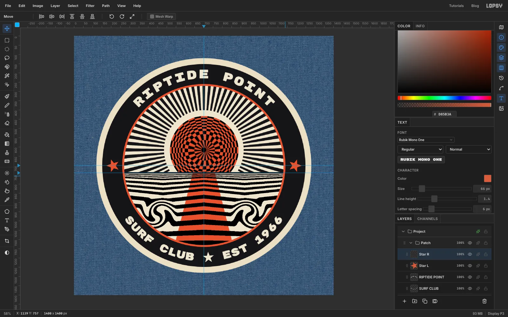

1. [[Cmd]]-click the `Star L` thumbnail, press [[Cmd+C]], deselect and press [[Cmd+V]]. The copy pastes in place on a new layer. Name it `Star R`.
2. Drag it straight across with the Move tool to `1194, 700`.
3. Marquee it and turn it 180° with the rotation handle, so it points right.
4. Commit, and nudge it until it's centred in the band.

## Wrap stitches round the merrow edge

1. Select `Merrow` and [[Cmd]]-click its thumbnail.
2. Run **Sunburst** with `#CDBFA2`: **Rays** `120`, **Length** `150`, **Width** `35`, **Taper** `0`, **Rotation** `0`, **Center** `50` / `50`.
3. Run it again with `#FBF6EA`, changing only **Width** to `14` and **Rotation** to `2`. This puts a highlight beside each stitch.
4. **Filter → Add Noise…**, **Amount** `30`, **Mono**.
5. **Filter → Motion Blur…**, **Angle** `60`, **Distance** `10`. The streaks slant the stitches the way an overlocking machine wraps them.
6. Deselect.

## Round the edge and lift it off the denim

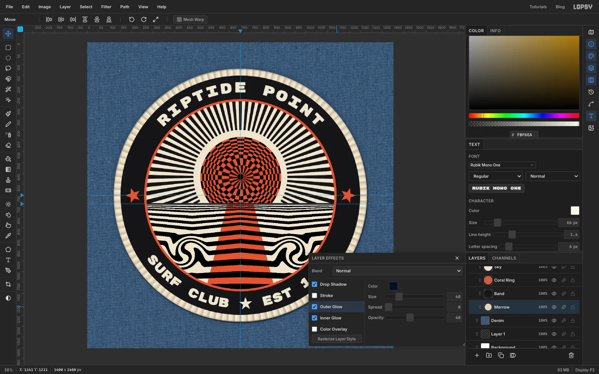

Open the `Merrow` layer's effects and turn on:

- **Inner Glow** in `#5E4E33`, **Size** `12`, **Opacity** `65`. This darkens the outer lip so the cord looks rounded.
- **Drop Shadow** in `#050B18`, **Offset X** `3`, **Offset Y** `5`, **Blur** `6`, **Opacity** `75`. This is a tight contact shadow.
- **Outer Glow** in `#061024`, **Size** `40`, **Opacity** `40`. This is a wide, soft ambient shadow.

Close the drawer.

## Shade the inside of the cord

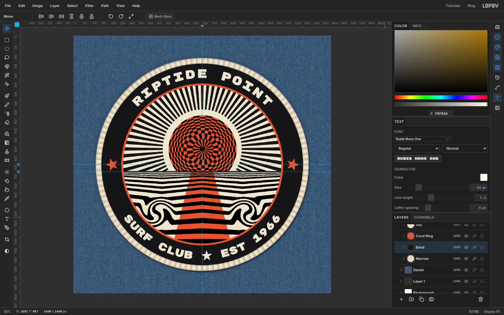

Select `Band` and give it an **Outer Glow** in `#2A2116`, **Size** `9`,
**Opacity** `70`. The glow falls on the inside of the merrow, so the
cord is now shaded on both sides.

## Give the sea a sideways satin grain

Real embroidery shines along the direction of its stitches, so each area gets
its own grain. All three texture layers start as thread grey `#808080`.

1. Select `Horizon` and add a layer called `Sea Thread`.
2. With the Rectangular Marquee, drag from `250, 250` to `1150, 1150` and fill it with grey.
3. **Filter → Fibers…**, **Variance** `24`, **Strength** `40`. Fibers always run up and down.
4. Switch to the **Move** tool, hold [[Cmd]] and turn the square a quarter turn with a rotation handle, so the fibres run sideways. Deselect.
5. Trim it to the sea: [[Cmd]]-click the `Sky` thumbnail, then hold [[Option]] and drag a rectangle over everything above the horizon to subtract it. Choose **Select → Inverse**, press [[Delete]] and deselect.
6. Set **Blend** to **Overlay** and the opacity to `30%`.

## Radiate a grain through the sky

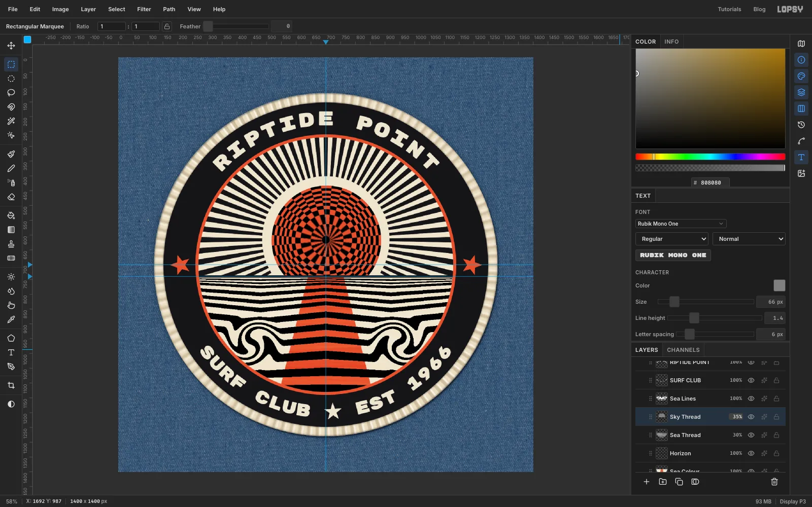

1. Add a layer called `Sky Thread` above `Sea Thread`.
2. [[Cmd]]-click the `Sky` thumbnail, then [[Option]]-drag a rectangle over everything below the horizon to subtract the sea.
3. Fill with grey and run **Filter → Add Noise…**, **Amount** `60`, **Mono**.
4. **Filter → Radial Blur…**, **Amount** `40`. Radial Blur always centres on the canvas, a little below the sun, but under the rays nobody can tell.
5. Deselect. Set **Blend** to **Overlay** and the opacity to `35%`.

## Add a grain to the band and edge

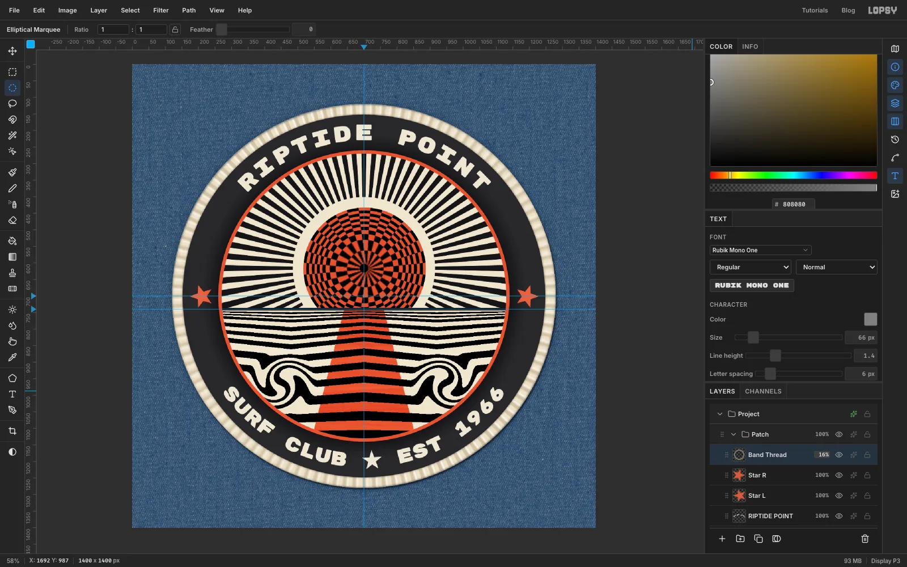

1. Select `Star R` and add a layer called `Band Thread`.
2. [[Cmd]]-click the `Merrow` thumbnail to load the whole patch. With the Elliptical Marquee, [[Option]]-drag a circle from `260, 260` to `1140, 1140` to cut out the art. The band and the merrow edge are left.
3. Fill with grey, then repeat the **Add Noise** `60` **Mono** and **Radial Blur** `40`. Deselect.
4. Set **Blend** to **Screen** and the opacity to `16%`. Overlay does nothing on pure black, but Screen lifts faint highlights out of it.

## Burn the shadow side of the edge

1. Select `Merrow` and pick the **Dodge/Burn** tool ([[O]]). Set **Mode** to **Burn**, **Exposure** `14` and **Size** `44`.
2. Drag along the middle of the cream edge from about three o'clock, round the bottom, to nine o'clock.
3. Do a second, shorter pass over the bottom.

Within one stroke, Burn doesn't build up when you go over the same spot
again. The second stroke does add to the first, so the darkening is strongest
at the bottom and fades toward the sides.

## Darken the denim around the patch

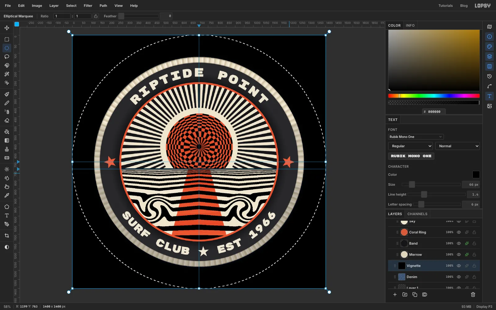

1. Select `Denim` and add a layer called `Vignette`.
2. Select the whole canvas and fill it with black.
3. Draw a circle from `0, 0` to `1400, 1400` and choose **Select → Feather…** `160`.
4. Press [[Delete]], deselect and set the layer's opacity to `45%`.

The edges of the denim fall into shadow, which pushes the patch forward.

## Turn the whole patch

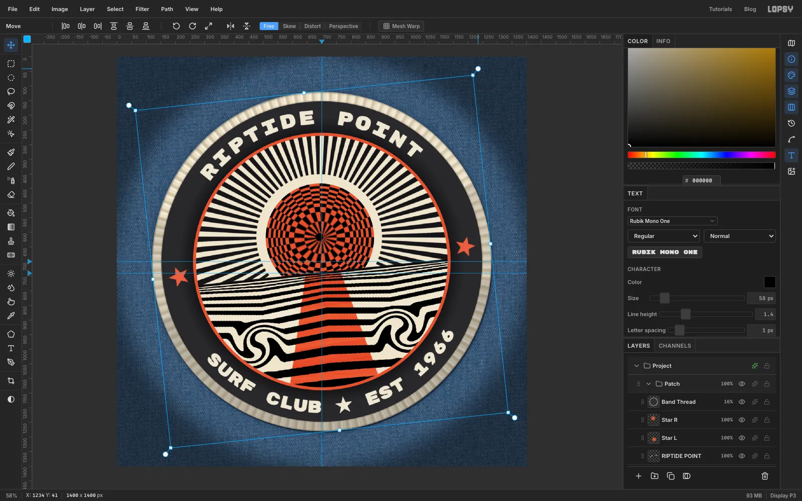

A patch ironed on by hand is never quite straight.

1. Text on a path has to be flattened before it can turn with other layers. Select each text layer and click **Rasterize Layer** at the bottom of the Layers panel.
2. Click the `Patch` group's row with nothing selected on the canvas. The Move tool draws one box around everything inside the group.
3. Drag a round rotation handle outside a corner about 6° counter-clockwise, then press [[Cmd+D]].

Hide the guides ([[Cmd+;]]), save the project with **File → Save
Project** and choose **File → Quick Export PNG**.
