Op art and pop art grew up side by side in the 1960s. Op artists like
Victor Vasarely and Bridget Riley used hard black-and-white patterns that
seem to bulge and vibrate. Pop artists like Roy Lichtenstein borrowed comic
books: flat colour, heavy black outlines and printed Ben-Day dots.
Put the two together and you get **op-pop**: loud, graphic and readable
from across the street. That makes it a good fit for a billboard.

In this tutorial you'll make a billboard for **Barber Pole**, an imaginary
barbershop. The name is a rebus: BARBER sits on one comic panel, POLE on
the other, and a real chrome-capped barber pole stands between them. Behind
everything, an op-art checker radiates out from the pole. You'll build it at
**2400 × 800 px**, the shape of a standard 48 × 14 ft roadside billboard.

The scissors start as a photo: [2scissors-clean.jpg](https://commons.wikimedia.org/wiki/File:2scissors-clean.jpg)
on Wikimedia Commons, a scan by Modeha cleaned up by Iainf, licensed
**CC BY 2.5**. Credit them if you publish your version. Download the
original (840 × 777 px). Any photo of scissors on a white background works
the same way.

Along the way you'll use:

- ruler guides, **Snap to Guides**, the grid and the marquee's exact-size dialog
- radial and linear gradients with alpha stops, **Define Pattern** and **Fill with Pattern**
- **Lens Distortion**, **Sunburst**, **Halftone**, **Surface Blur**, **Posterize**, **Hue/Saturation** and **Add Noise**
- the **Difference**, **Multiply** and **Overlay** blend modes and group opacity
- the **Shape** tool's exact-size dialog, the **Magic Wand**, the **Lasso** and the **Pencil**
- ⌘-click thumbnail selections with **Grow**, **Shrink**, **Inverse** and Shift+Alt intersect
- **Drop Shadow**, **Stroke**, **Outer Glow** and **Color Overlay** effects
- text in **Monoton**, **Bowlby One** and **Bangers**, with letter spacing
- copy and paste in place, and scaling and rotating layers and whole groups with the **Move** tool

The palette:

- Background ramp `#FFE14A` → `#FFA21F` → `#EE2E2A` → `#A10E3B`
- Pole red `#D7262E`, pole blue `#1D46B8`, pole white `#FFF8EE`
- Chrome `#3C3C44` → `#F4F4F6` → `#8C8C96` → `#FFFFFF` → `#34343C`
- Panel cream `#FFF4DC`, ink `#141414`
- Ben-Day red `#E4343C`, headline shadow navy `#1A2A7A`
- SNIP! yellow `#FFE14A`

## Set up the canvas and guides

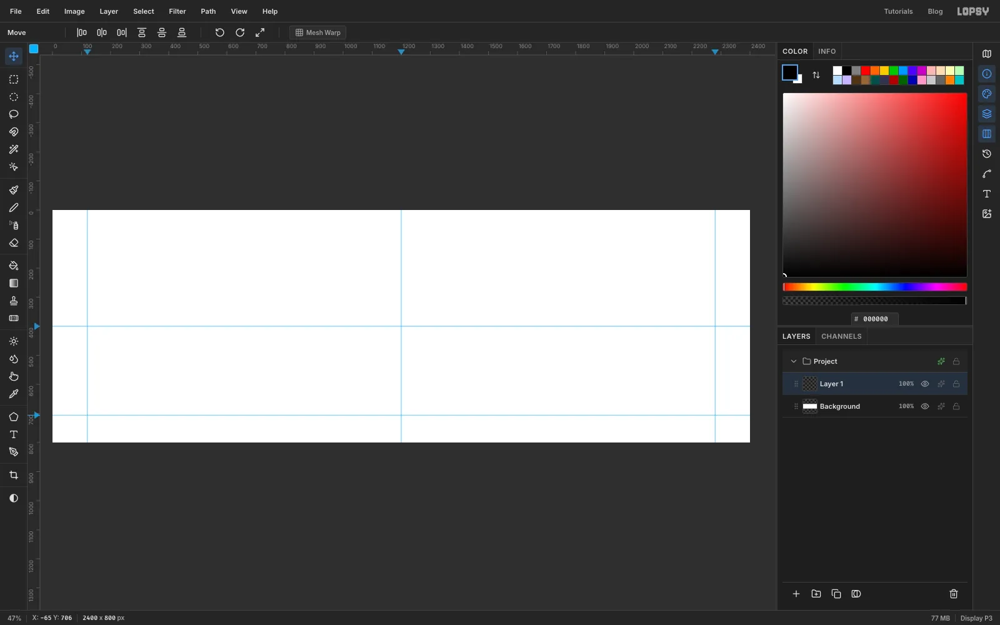

Choose **File → New**, enter **2400 × 800** pixels and click **Create**.

Click the top ruler at **120**, **1200** and **2280** to drop vertical
guides for the left margin, the centre line and the right margin. Click the
left ruler at **400** for the middle and at **706** for the top of the
address bar you'll add at the end. The pole will stand on the centre guide.

## Paint the pop background

Select the *Background* layer and pick the **Gradient** tool. Set the type
to **Radial** and open the gradient editor. Make four stops: `#FFE14A` at
the left end, `#FFA21F` at about 30 %, `#EE2E2A` at about 62 % and `#A10E3B`
at the right end. Type each colour into the **Hex** field after you click
its stop, and click **Done**.

Press on the middle of the canvas and drag straight down, well past the
bottom edge, about 1,200 px. The yellow core is where the pole will stand.

## Make a stripe tile

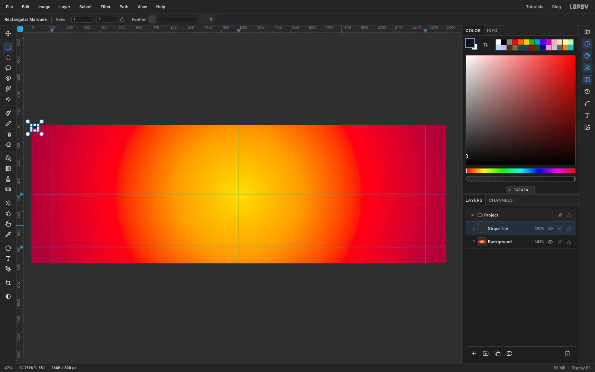

Select *Layer 1* and rename it *Stripe Tile*. Pick the **Rectangular
Marquee** and click once on the canvas without dragging. That opens a
dialog where you can type exact corners. Enter From **0, 0** and To
**40, 16**, click **Select**, set the foreground to `#141414` and choose
**Edit → Fill**.

Now make the selection the full tile. Press [[Cmd+D]] first: with a
selection active, a single marquee click just deselects instead of opening
the dialog. Then click again and enter From **0, 0** To **40, 32**. That's a black bar on the top half and empty space
on the bottom half. Choose **Edit → Define Pattern**, press [[Cmd+D]] to
deselect, then delete the *Stripe Tile* layer with the trash button. The
pattern is kept.

## Fill a layer with stripes

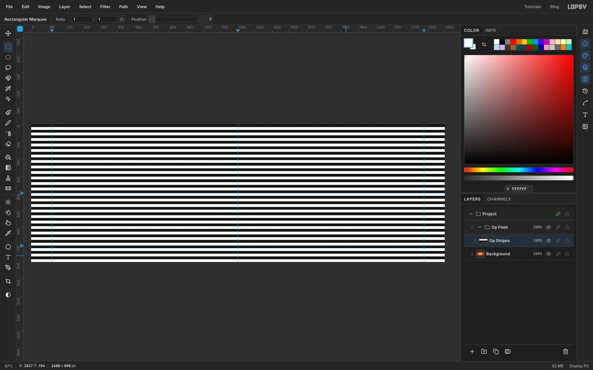

Select *Background* and click **New Group** at the bottom of the Layers
panel. Double-click the group's name and call it *Op Field*. Click **Add
Layer**, name the new layer *Op Stripes*, select the whole canvas with
[[Cmd+A]], fill it with white and press [[Cmd+D]].

Choose **Edit → Fill with Pattern…**, click your stripe pattern and click
**Apply**. The tile repeats across the whole layer as even 16 px stripes.

## Bulge the stripes

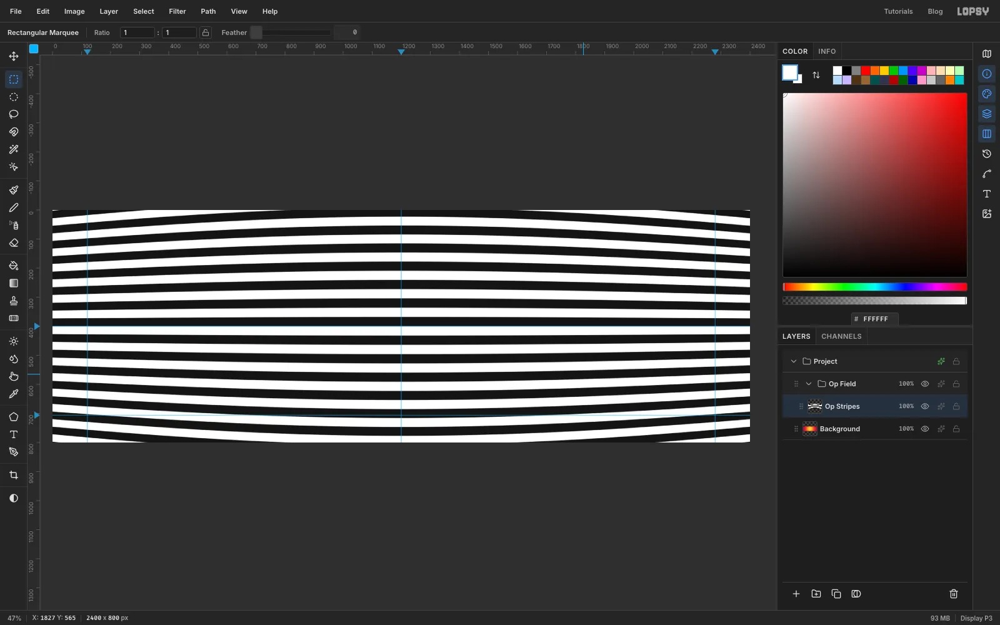

Choose **Filter → Lens Distortion…**. Set **Strength** to **100** and
**Zoom** to **200**, and click **Apply**. The stripes swell in the middle and
squeeze together at the ends, the same bulge Vasarely used to make a flat
pattern look like a sphere.

The zoom matters. A strong barrel distortion pulls the corners of the layer
inwards, and Zoom pushes them back out so no empty corners show.

## Burst rays from the centre

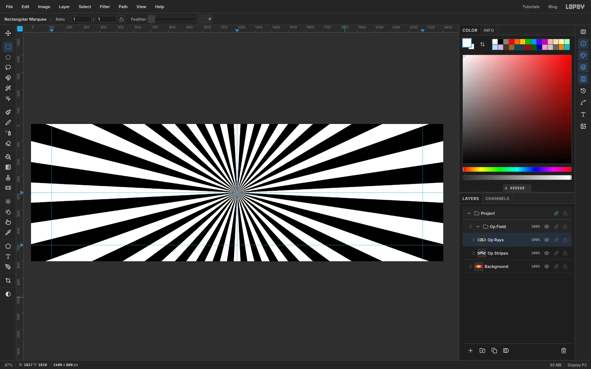

Click **Add Layer** and name it *Op Rays*. Select all, fill the layer with
black and deselect, then set the foreground colour to white.

Choose **Filter → Sunburst…**. Set **Rays** to **32**, **Length** to
**150**, **Width** to **50** and **Taper** to **0**, and leave **Center X**
and **Center Y** at **50**. Click **Apply**. Sunburst paints its rays in the
foreground colour, so you get white wedges on black, all meeting at the
centre of the canvas.

## Turn stripes and rays into a checker

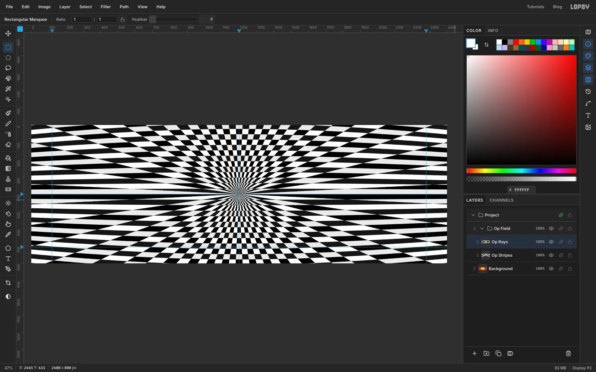

Open the *Op Rays* layer's effects drawer (the sparkle button on its row)
and set **Blend** to **Difference**. Wherever a white ray crosses a white
stripe the two cancel to black, and wherever it crosses a black stripe it
shows white. The result is a checkerboard that fans out from the middle and
bends with the bulge. That interference is the heart of op art.

## Multiply the checker over the colour

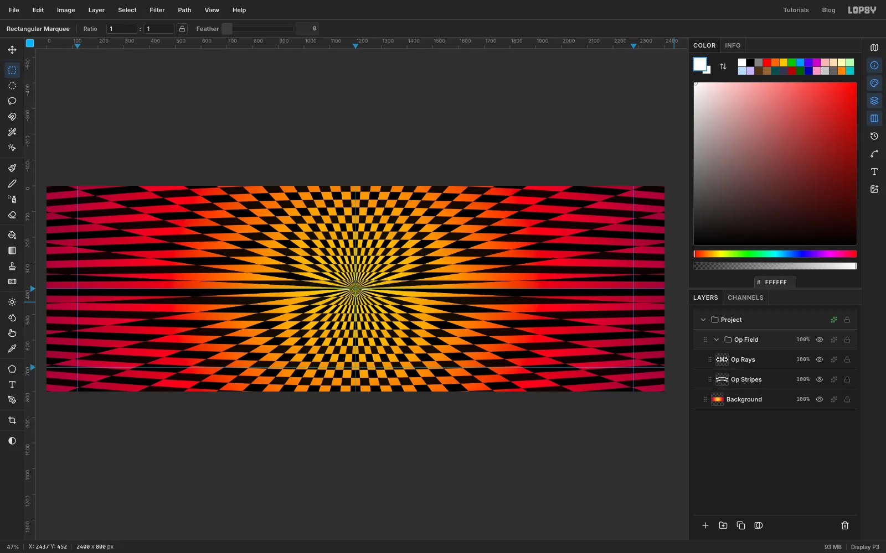

Select the *Op Field* group, open its effects drawer and set its **Blend**
to **Multiply**. White multiplies to nothing and black stays black. The
checker's white squares now show the radial background, and the board turns
yellow and orange at the centre and red at the ends.

## Start the barber pole

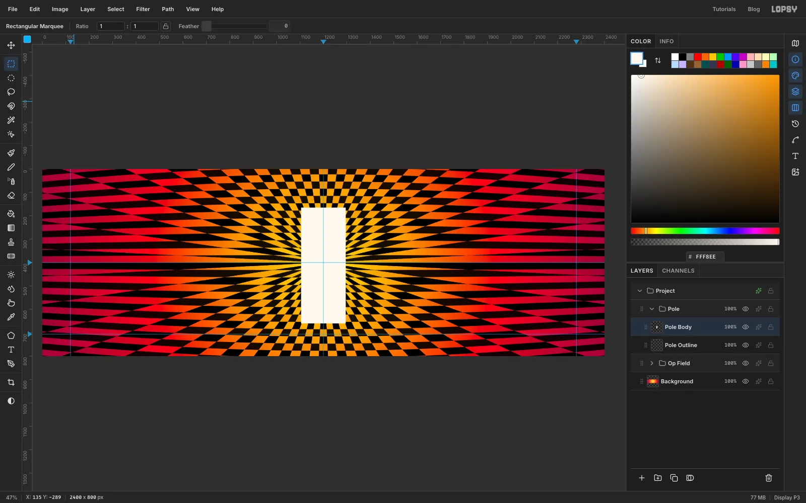

Click the arrow beside *Op Field* to collapse it, select it, and click **New
Group**. Name the group *Pole*. Add an empty layer called *Pole Outline*
now; you'll fill it at the end of the pole. Then add a layer called *Pole
Body*.

Click once with the **Rectangular Marquee** and enter From **1105, 165** To
**1295, 660**. Fill it with `#FFF8EE`, a warm white, and deselect.

## Fill a band of stripes

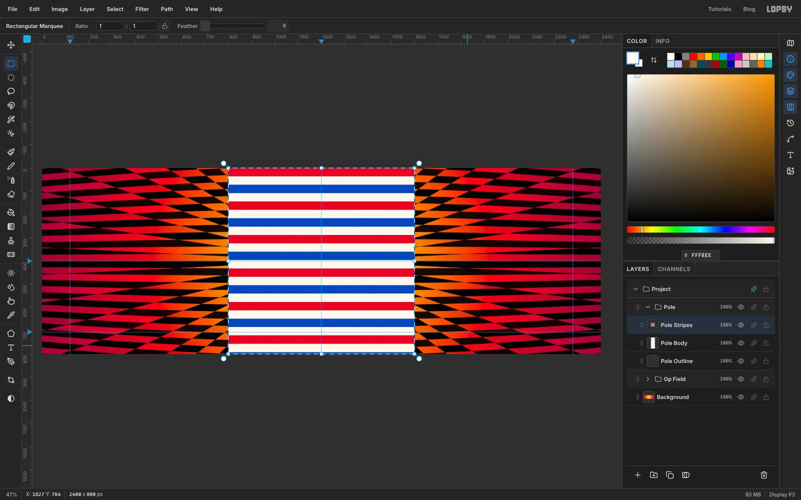

Barber-pole stripes come from a second pattern. Add a temporary layer and
make four 20 × 36 px rectangles stacked down the top-left corner. Use the
marquee dialog for each one, and deselect after each fill so the next click
opens the dialog again: From **0, 0** To **20, 36** filled with red
`#D7262E`, then **0, 36** → **20, 72** in white `#FFF8EE`, **0, 72** →
**20, 108** in blue `#1D46B8`, and **0, 108** → **20, 144** in white again.
Select From **0, 0** To **20, 144**, choose **Edit → Define Pattern**,
deselect and delete the temporary layer.

Select *Pole Body* and add a layer above it called *Pole Stripes*. Click once
with the Rectangular Marquee and enter From **800, 0** To **1600, 800**,
then choose **Edit → Fill with
Pattern…**, click the new red, white and blue pattern and click **Apply**.

## Tilt the bands

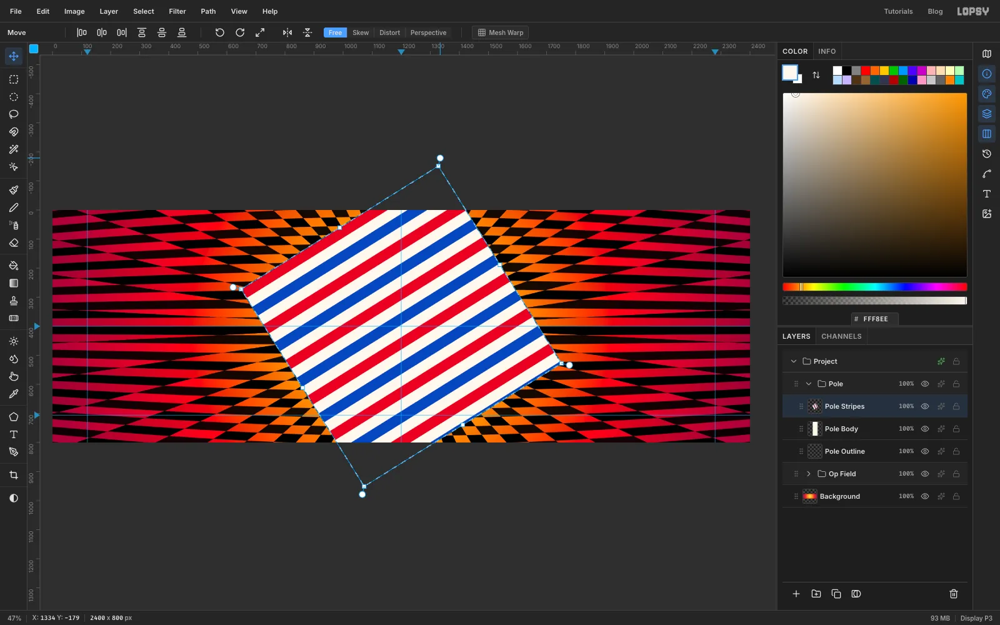

Keep the marquee and pick the **Move** tool. A transform box appears around
the square, with round rotation handles just outside each corner. Drag the
top-right rotation handle anticlockwise until the stripes lean about
**32°**. Press [[Cmd+D]] to commit the rotation.

The square is much bigger than the pole, so even after the turn it still
covers the pole completely.

## Clip the stripes to the pole

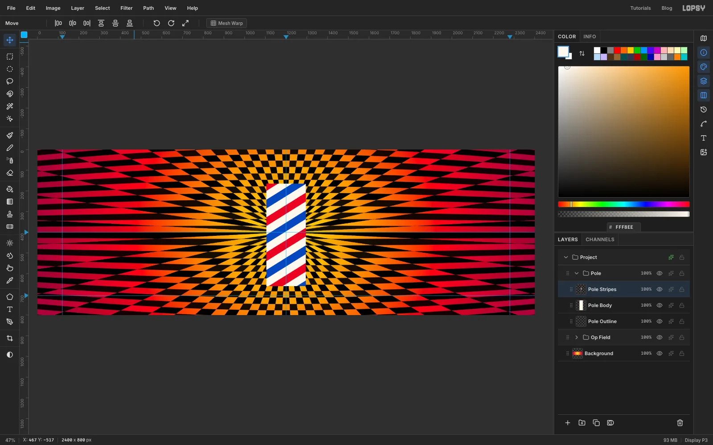

Hold [[Cmd]] and click the *Pole Body* thumbnail in the Layers panel. That
selects the pole's shape. Choose **Select → Inverse**, make sure *Pole
Stripes* is still the active layer, press [[Delete]] and deselect. The
bands now stop exactly at the pole's edges.

## Shade the cylinder

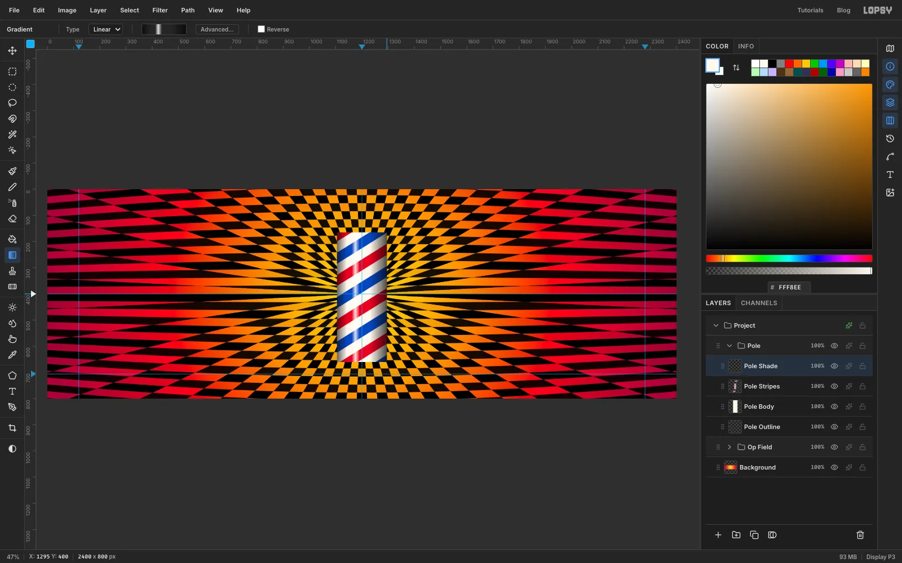

Add a layer called *Pole Shade* and [[Cmd]]-click the *Pole Body* thumbnail
again. With the **Gradient** tool set to **Linear**, make a gradient that
uses only black, white and opacity:

- black at **60 %** opacity at the left end, fading to black at **0 %** by 20 %
- white at **0 %** at 30 %, rising to white at **85 %** at 37 %, and back to **0 %** at 45 %
- black at **0 %** at 66 %, ending in black at **70 %** at the right end

Set each stop's opacity with the editor's opacity strip. Drag from the
pole's left edge to its right edge, holding [[Cmd]] so the drag snaps
level, and deselect.
The dark edges and the bright streak make the flat stripes read as a glass
tube.

## Add chrome caps

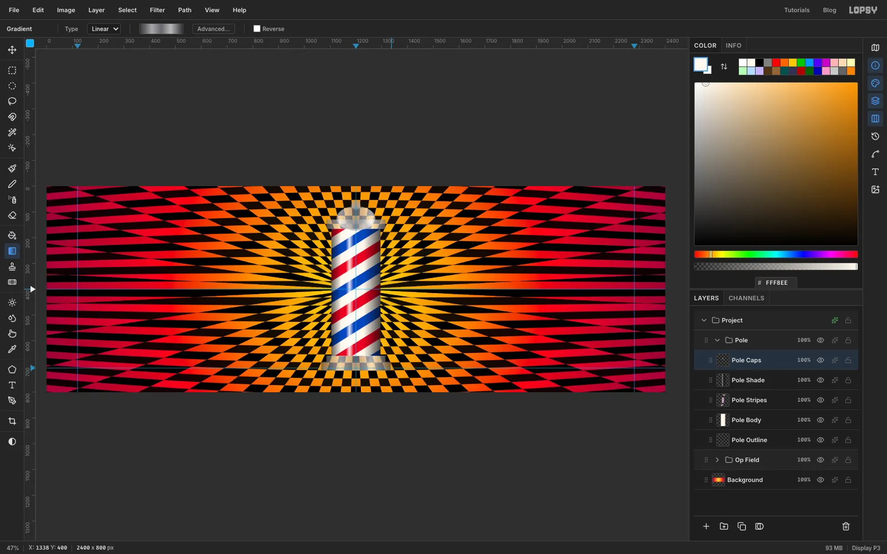

Add a layer called *Pole Caps*. Set up a linear chrome gradient: `#3C3C44`,
`#F4F4F6` at 28 %, `#8C8C96` at 50 %, `#FFFFFF` at 72 % and `#34343C`. Then
make each piece of the caps with a marquee and fill it by dragging the
gradient across the whole pole, from just left of the foot to just right of
it, with [[Cmd]] held to keep it level. Deselect after each piece:

1. the dome: an **Elliptical Marquee** from **1125, 78** to **1275, 172**
2. the top cap: a rectangle from **1085, 130** to **1315, 166**
3. the finial ball: an ellipse from **1182, 56** to **1218, 92**
4. the collar: a rectangle from **1085, 658** to **1315, 682**
5. the foot: a rectangle from **1065, 681** to **1335, 716**

Use the same drag for every piece so the highlights line up. The bottom of
the dome is hidden behind the top cap.

## Ink the outline

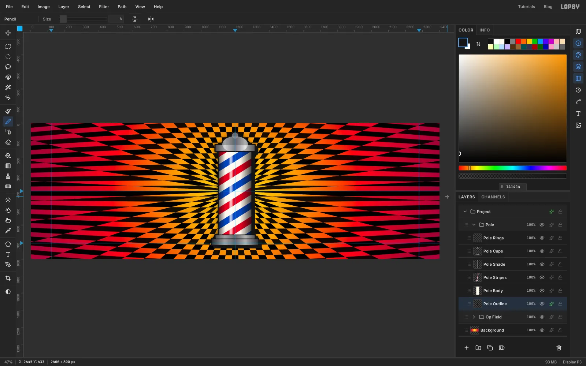

Add a layer called *Pole Rings* and draw the joins with the **Pencil**:
set **Size** to **5** and the colour to `#141414`, click at the left end of
the top cap's lower edge and [[Shift]]-click at the right end for a straight
line. Do the same at the top of the collar, then draw a **4 px** line where
the collar meets the foot.

Now the outline. [[Cmd]]-click the *Pole Body* thumbnail, then
[[Shift]]+[[Cmd]]-click the *Pole Caps* thumbnail to add the caps to the
selection. Choose **Select → Grow…**, enter **7** and apply. Select the empty
*Pole Outline* layer at the bottom of the group, fill with `#141414` and
deselect.

Open *Pole Outline*'s effects and turn on **Drop Shadow**: **Offset X** and
**Y** **14**, **Blur** **0**, **Spread** **0**, **Opacity** **100**, colour
`#141414`. That's the hard offset shadow of a comic panel. Add an **Outer
Glow** in black at **Size 40**, **Spread 0** and **Opacity 55** too. It
softens the checker right next to the pole so the stripes don't buzz
against it.

## Draw the first comic panel

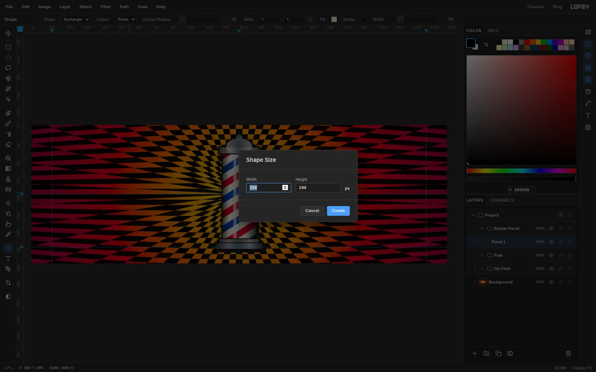

Collapse *Pole*, select it and click **New Group**; name it *Barber Panel*.
Add a layer called *Panel L*.

Pick the **Shape** tool. Set **Shape** to **Rectangle**, **Output** to
**Pixels** and **Corner Radius** to **28**. Click the **Fill** swatch and
enter `#FFF4DC`, then click the **Stroke** swatch, enter `#141414` and set
the stroke **Width** to **10**.

Click once at about **565** on the top ruler, level with the middle guide.
That's the centre of the space between the left margin and the pole. A click without a drag opens the
**Shape Size** dialog. Enter **860** × **420** and click **Create**. The
panel is drawn centred on your click.

## Give the panel a shadow, keyline and grain

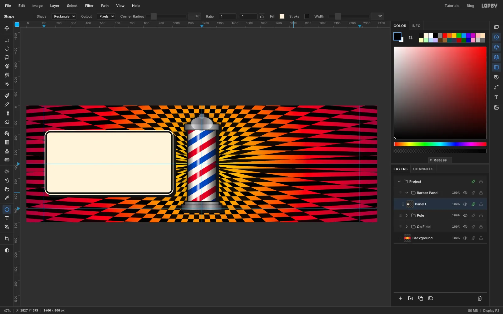

Open *Panel L*'s effects. Turn on **Drop Shadow** with **Offset X** and
**Y** at **18**, **Blur 0**, **Spread 0**, **Opacity 100** and colour
`#141414`. Then turn on **Stroke**: colour `#FFF4DC`, **Width 6**, position
**Outside**. The thin cream keyline outside the black border keeps the panel
from melting into the black squares behind it.

Close the drawer and choose **Filter → Add Noise…**. Set **Amount** to
**14**, pick **Mono** and **Gaussian**, and click **Apply**. It gives the
cream a little printed paper tooth.

## Lay down a gradient for the dots

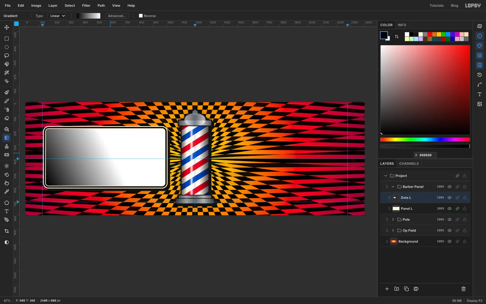

Add a layer called *Dots L*. [[Cmd]]-click the *Panel L* thumbnail, choose
**Select → Shrink…** and shrink by **14** so the selection sits inside the
black border.

Pick the **Gradient** tool, set it to **Linear** with a plain black-to-white
gradient, and drag from the panel's bottom-left corner up towards the
middle of the panel. Deselect. The darkness of this gradient is going to
decide how big each dot is.

## Turn it into Ben-Day dots

Choose **Filter → Halftone…**. Set **Dot Size** to **18**, **Density** to
**1**, **Angle** to **45** and **Softness** to **0**, and click **Apply**.
Dark areas become big dots and light areas become small ones, just like a
newspaper printing screen.

## Make the dots red

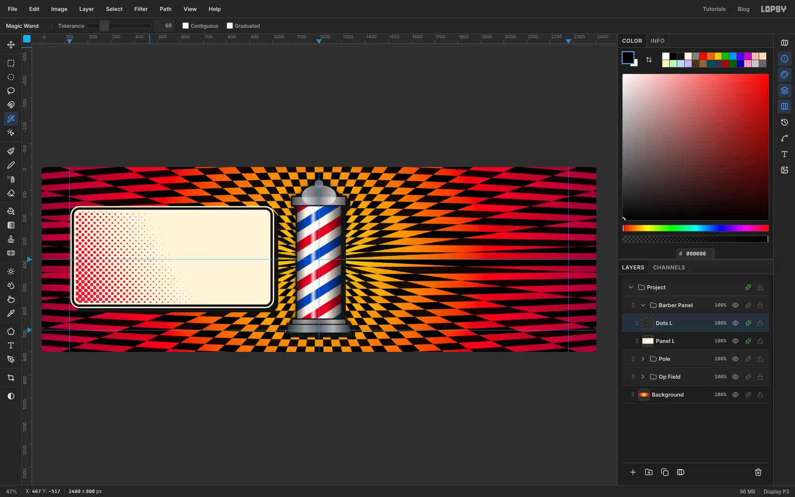

Pick the **Magic Wand**, set **Tolerance** to **60** and untick
**Contiguous**. Click any white spot between the dots and press [[Delete]]
to clear all the white at once, then deselect.

Open the *Dots L* effects and turn on **Color Overlay** with the colour
`#E4343C`. An overlay recolours every pixel on the layer, including the
faint half-transparent dots along the edges, which a plain Fill would leave
grey.

The Halftone grid can leave half dots in the panel's rounded corners. To
trim them, [[Cmd]]-click *Panel L*, **Shrink** by **18**, choose **Select →
Inverse**, press [[Delete]] and deselect.

## Set the BARBER headline

Pick the **Text** tool. In the options bar choose **Monoton**, set the size
to **148**, set the colour to `#D7262E` and set **Align** to **Center**.
Click in empty space above the panel's centre, type **BARBER** and press
[[Tab]] to commit. ([[Escape]] would cancel a new text layer.)

Switch to the **Move** tool and nudge the word with the arrow keys
([[Shift]] + arrow moves 10 px) until it's centred on the panel and sits a
little above the middle. Monoton's letters are built from parallel lines,
an op-art idea in type form.

## Grow a block shadow

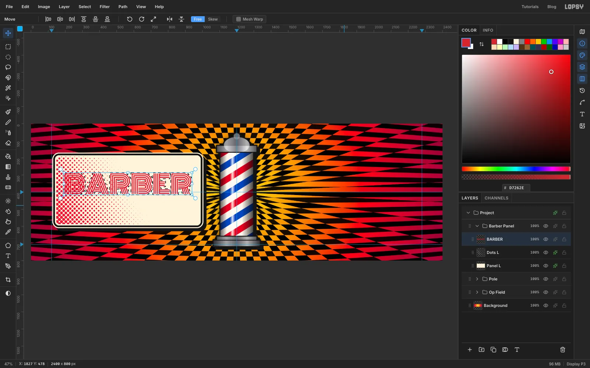

Thin lines on their own look weak from a distance, so the headline needs a
solid shadow. [[Cmd]]-click the *BARBER* thumbnail to select its letters.
Choose **Select → Grow…** and grow by **5**. The gaps between each letter's
lines close up, and the selection becomes a set of solid, fat letter
shapes.

## Fill the shadow in navy

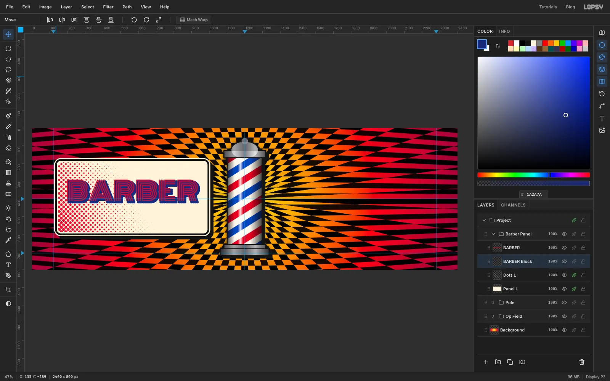

Select *Dots L*, the layer under the text, and click **Add Layer**. The new
layer lands between the dots and the headline; name it *BARBER Block*. Fill
the selection with navy `#1A2A7A` and deselect. Pick the **Move** tool and
nudge the layer down and to the right with the arrow keys until about 9 px
of navy shows below and to the right of the red lines. The solid letters
now sit behind the outlines like a printed block.

## Add the tagline

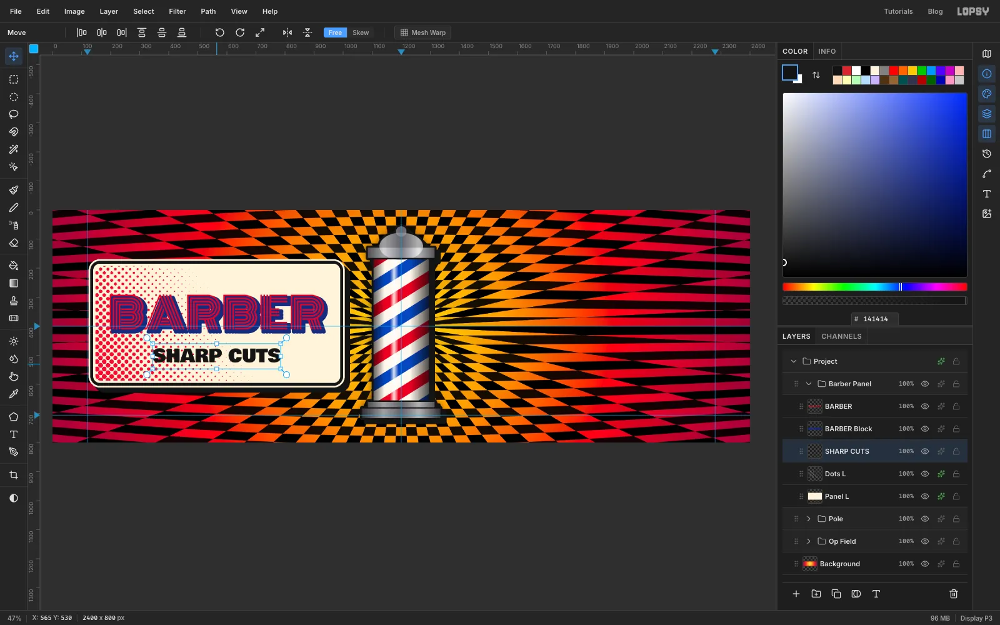

Select *Dots L* again, so the new text isn't styled onto the headline.
With the **Text** tool choose **Bowlby One** at **62**, colour `#141414`,
still centred. Click in empty space below the panel, type **SHARP CUTS** and
press [[Tab]]. Move it up into the panel, centred under BARBER, with a clear
gap below the navy shadow and plenty of room above the panel's bottom
edge.

## Copy the panel

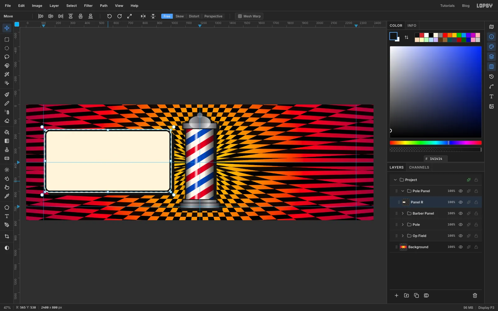

Select *Panel L*, press [[Cmd+A]] and [[Cmd+C]], then [[Cmd+D]]. Collapse
*Barber Panel*, select it, click **New Group** and name the new group *Pole
Panel*. Press [[Cmd+V]]. Something copied inside Lopsy pastes in place, so
the copy lands exactly on top of the original. Rename it *Panel R*.

## Move the copy across

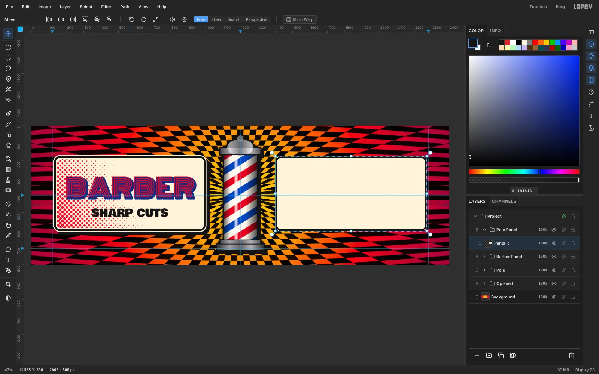

With the **Move** tool, drag *Panel R* to the right half of the canvas, then
nudge it with the arrow keys until it's centred between the pole and the
right margin guide, level with the first panel.

A paste copies pixels only, not effects, so give *Panel R* the same **Drop Shadow** and
outside cream **Stroke** as *Panel L*: offset 18, 18, blur 0, spread 0,
opacity 100 and black, and a 6 px `#FFF4DC` stroke. The
Add Noise grain was baked into the pixels, so the copy already has it.

## Add dots to the second panel

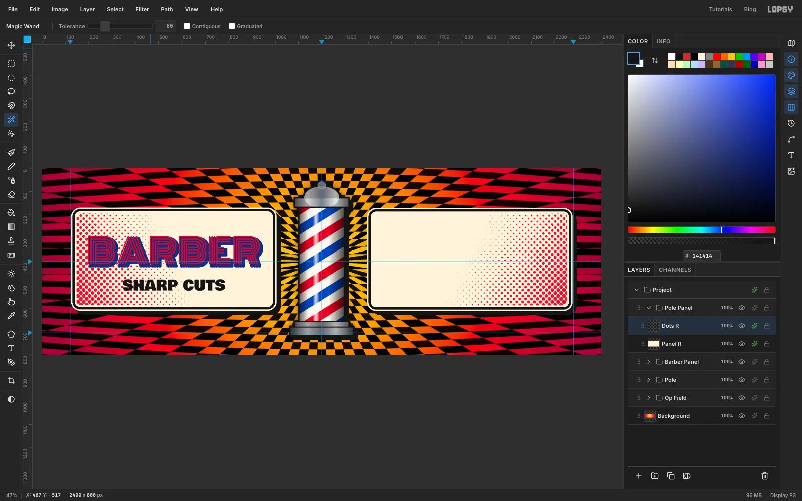

Make the dots for the right panel the same way as the left. Select *Panel
R* and add a layer called *Dots R*. [[Cmd]]-click the *Panel R* thumbnail
and **Shrink** by **14**. Drag the black-to-white gradient from the panel's
bottom-right corner up towards the middle, so the dots mirror the left
panel, and deselect.

Run **Halftone** with the same settings, delete the white with the
non-contiguous **Magic Wand**, add the red `#E4343C` **Color Overlay**, and
trim the corners with a **Shrink 18** → **Inverse** → [[Delete]].

## Set the POLE headline

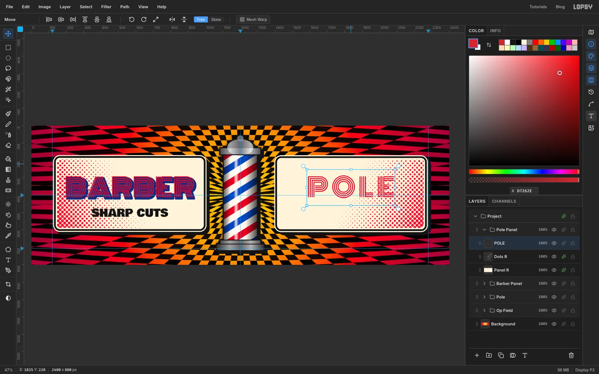

With *Dots R* selected, pick the **Text** tool and set it up again, because
it still holds the tagline's settings: **Monoton**, **148**, `#D7262E`,
**Center**. Click in empty space above the panel, type **POLE** and press
[[Tab]].

POLE is a shorter word than BARBER, so it would look lost in the same-sized
panel. With *POLE* active, open the **Text** panel from the right-hand
toolbar and set **Letter spacing** to **16**. Then centre the word on the
panel with the **Move** tool, at the same height as BARBER.

## Shadow and tagline for POLE

Give POLE its own block shadow exactly as before: [[Cmd]]-click its
thumbnail, **Grow** by **5**, select *Dots R*, add a *POLE Block* layer,
fill with `#1A2A7A`, deselect and nudge it down and to the right.

With *Dots R* still selected, open the **Text** panel and set **Letter
spacing** back to **0**. Changing a Text panel setting also changes the
default for the next text you create, so without this the tagline would be
spaced out too. Then add **HOT SHAVES** in **Bowlby One** at **62**, colour
`#141414`, centred under POLE.

## Paste in the scissors photo

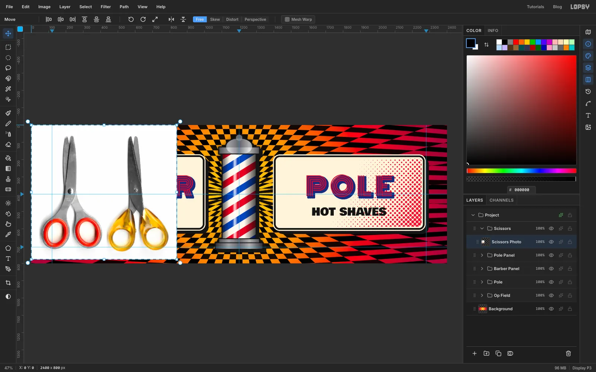

Collapse *Pole Panel*, select it and make a new group called *Scissors*.
Open the scissors photo in another app, copy it, and press [[Cmd+V]] in
Lopsy. An image from outside lands in the top-left corner of the canvas.
Rename the layer *Scissors Photo*.

## Delete the second pair

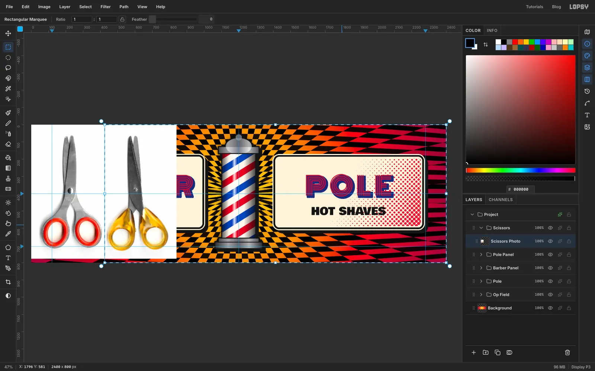

You only need the pair with the red handles. The paste left the whole photo
selected, so press [[Cmd+D]] first; a drag inside a selection would only
move its outline. Then drag a **Rectangular Marquee** around the right-hand
pair, from just right of the gap between them to well past the photo's
right edge, and press [[Delete]]. Deselect.

## Select the white background

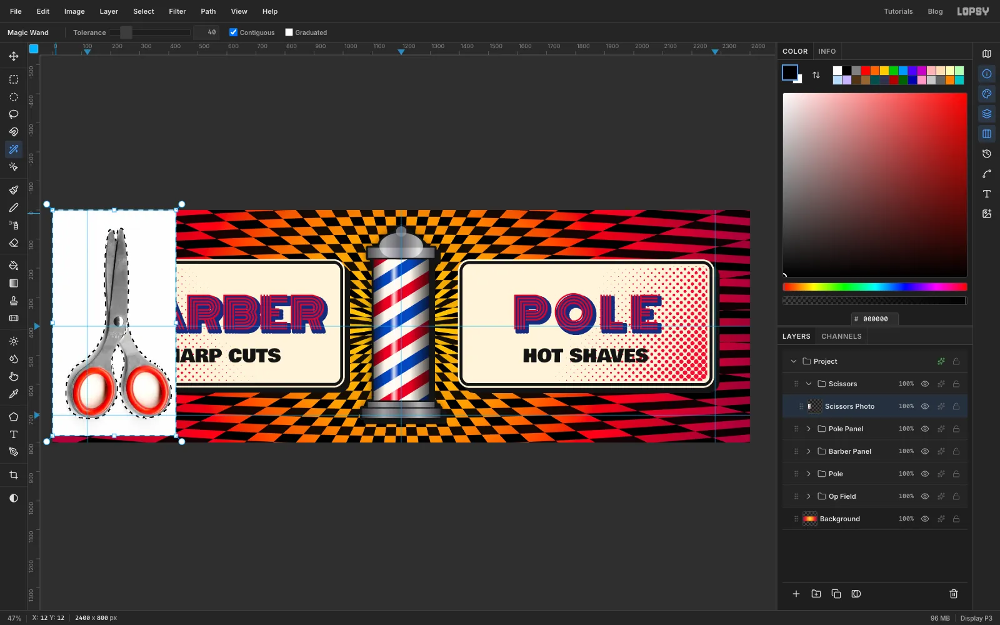

Pick the **Magic Wand**, set **Tolerance** to **40** and tick
**Contiguous**. Click the white background in the photo's corner and press
[[Delete]].

## Clear the finger holes and the fringe

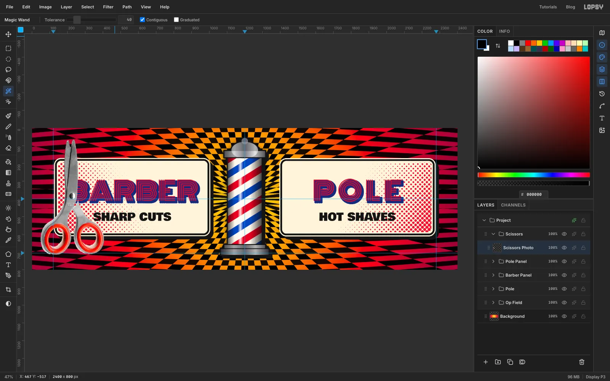

The white inside the two finger holes isn't connected to the rest of the
background, so deselect, click inside one hole with the wand, press
[[Delete]], and do the same for the other.

A scan always leaves a pale fringe around the edges. To remove it,
[[Cmd]]-click the *Scissors Photo* thumbnail, choose **Select → Shrink…**
and shrink by **3**. Choose **Select → Inverse**, press [[Delete]] and
deselect.

## Flatten the photo into pop-art colour

Choose **Filter → Surface Blur…** with **Radius** **12** and **Threshold**
**40**. It smooths away the grain of the scan but keeps the edges sharp.
Then choose **Filter → Posterize…** with **Levels** **4**. The scissors
break into a few flat tones, like a printed comic.

Finally choose **Filter → Hue/Saturation…**, set **Hue** to **-8** and
**Saturation** to **10**. That nudges the orange handles towards the
billboard's red.

## Select just the metal

Posterized grey looks blotchy, like dirty metal. Swap it for clean chrome.
[[Cmd]]-click the *Scissors Photo* thumbnail to select the whole pair.
Then pick the **Rectangular Marquee**, hold [[Shift]]+[[Alt]], and drag a
box wider than the scissors, from just above the blade tips down to just
above the red rings. Holding both
keys keeps only the overlap, so the selection is now the blades and arms.

## Make the blades chrome

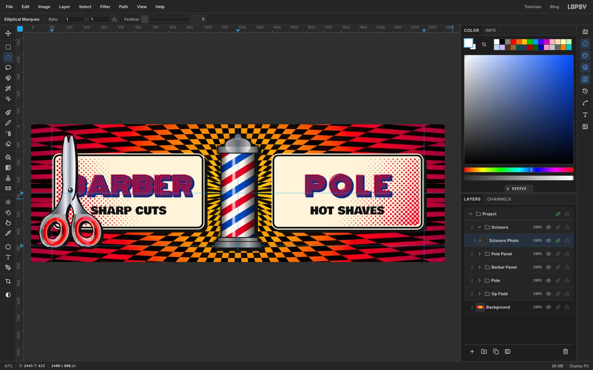

With the **Gradient** tool, make a linear gradient: `#5E636E`, `#E8ECF2` at
34 %, `#959BA6` at 50 %, `#F8FAFC` at 66 % and `#535863`. Drag it across
the blades from just left of them to just right, holding [[Cmd]] to keep it
level. Deselect.

The gradient covered the pivot screw, so paint a new one. Make a small
circle over the pivot with the **Elliptical Marquee** (hold [[Cmd]] for a
perfect circle) and fill it with `#2E3138`. Deselect, then make a much
smaller circle near its top-left and fill it with white for a glint.

Open the layer's effects and add a black **Stroke** (**6**, **Outside**) and
a **Drop Shadow** at **9, 9**, blur **0**, black. The scissors now match the
comic panels.

## Scale the scissors down

Drag a marquee around the scissors and pick the **Move** tool. Hold [[Cmd]]
and drag the bottom-right corner handle in towards the top-left until the
scissors are about **60 %** of their size. [[Cmd]] keeps the proportions.

## Turn the blades sideways

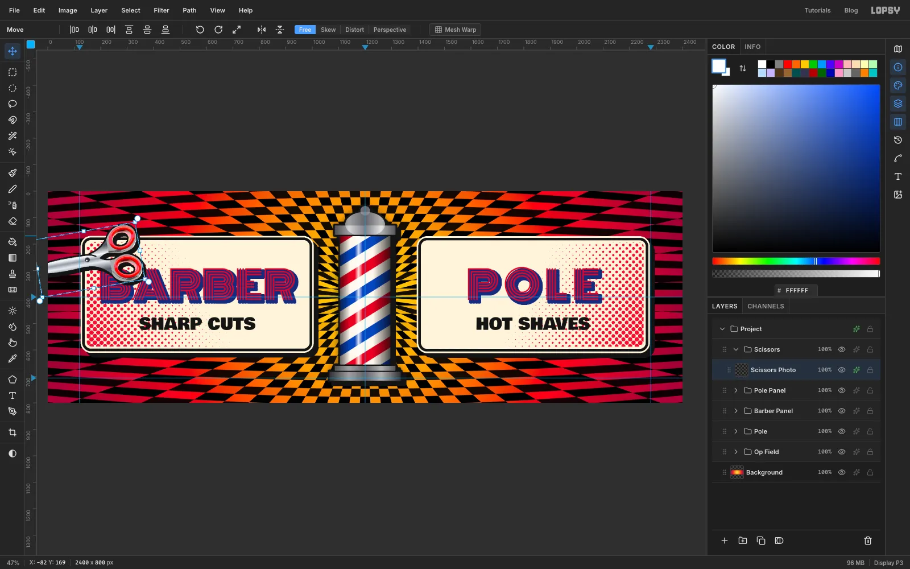

Still in the same transform, drag the top-right rotation handle round
anticlockwise until the blades point left and slightly down, about
**100°**. Press [[Cmd+D]] to commit.

## Place the scissors on the corner

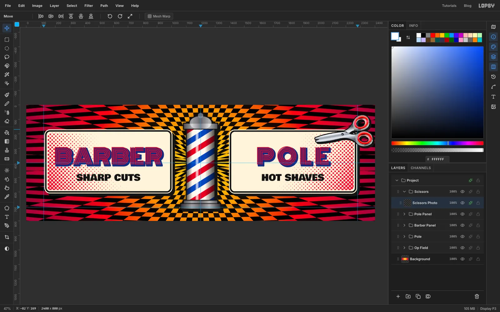

Drag the scissors to the top-right of the canvas so the open blades bite
into the POLE panel's top-right corner, as if they're snipping it. Leave
some space between the handles and the top and right edges of the
billboard.

## Add a SNIP! burst

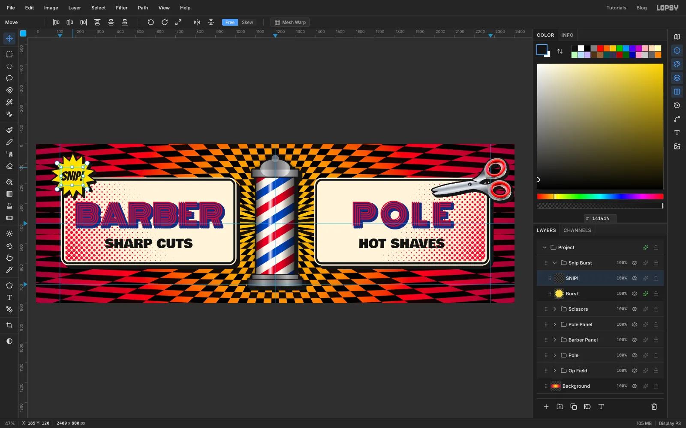

Collapse *Scissors*, select it and make a group called *Snip Burst* with a
layer called *Burst* inside. With the **Lasso**, drag a zig-zag around a
point above the left panel's top-left corner, swinging out to a tip about
110 px away and back in again, about 14 times. It doesn't need to be
regular. Fill it with `#FFE14A` and deselect.

Give *Burst* a black **Stroke** (**6**) and the same **9, 9** black **Drop
Shadow**. Then add **SNIP!** with the **Text** tool in
**Bangers** at **65**, black and centred. Click in empty space, type, press
[[Tab]], and move the word into the middle of the star.

## Tilt the burst

Select the *Snip Burst* group itself and deselect any marquee. With the
**Move** tool, the transform box now frames everything in the group. Drag
the top-right rotation handle anticlockwise about **14°**. The star and the
live text turn together, and the text stays editable.

## Tilt both panels

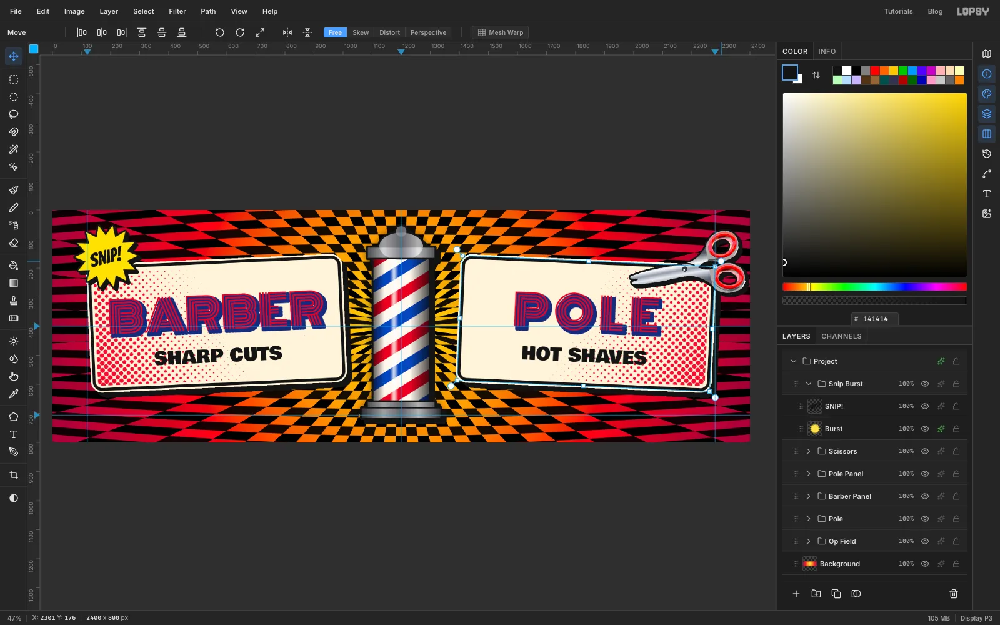

Select the *Barber Panel* group and rotate it the same way, but only about
**2.5°** anticlockwise. Then select *Pole Panel* and rotate it about **2.5°**
clockwise. The two panels now lean away from the pole like a pair of
swinging signs, and everything inside them, text included, tilts as one.

## Calm the edges

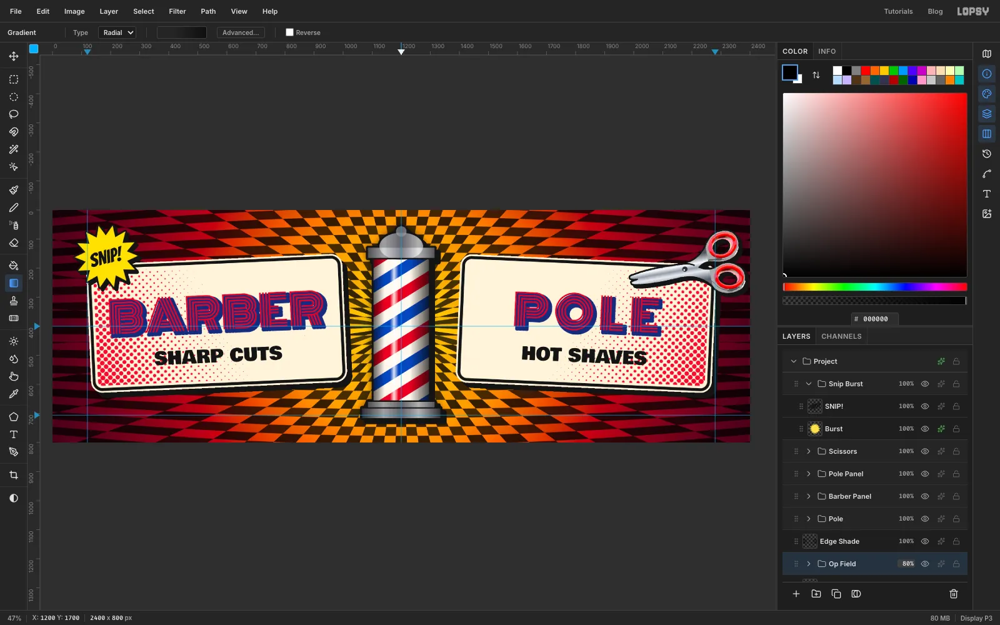

The checker is loud. That's the point, but it shouldn't fight the panels.
Select the collapsed *Op Field* group and click **Add Layer**; the layer
lands just above the group. Name it *Edge Shade*. Make a **Radial**
gradient that's black at **0 %** opacity at the centre, still **0 %** at
32 %, and black at **60 %** at the end. Drag from the middle of the canvas
straight down, about 1,300 px.

Then select *Op Field* and set its opacity to **80 %** with the opacity
button on its row.

## Draw the address bar

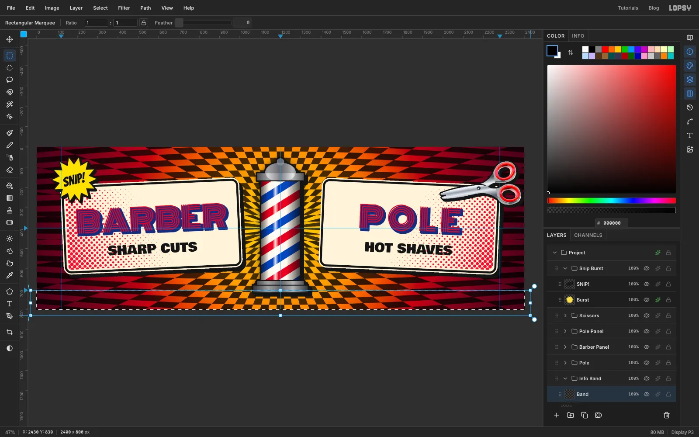

Select *Edge Shade* and make a group called *Info Band* with a layer called
*Band* in it. It sits under the pole, so the pole's foot will stand on the
bar.

With the **Rectangular Marquee**, drag from a little left of the canvas and
just below the lower guide to past the bottom-right corner. **Snap to
Guides** is on by default, so the top edge jumps onto the guide at 706.
Fill with `#1D46B8` and deselect. Then pick the **Pencil**, set **Size** to
**6** and the foreground to `#141414`, and draw a line along the bar's top
edge: click at the left edge and [[Shift]]-click at the right edge.

## Set the address

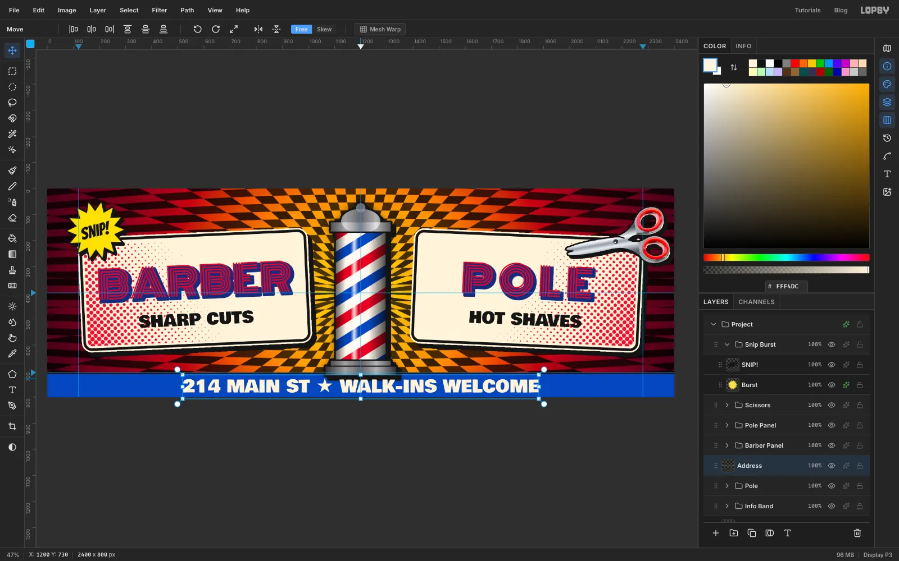

Collapse *Info Band* and select the *Pole* group, so the new text goes above
the pole and its shadow. With the **Text** tool, choose **Bowlby One** at
**66**, colour `#FFF4DC`, centred. Click in empty space on the blue bar, type
**214 MAIN ST ★ WALK-INS WELCOME**, press [[Tab]], and rename the layer *Address*.

Move it until it's centred on the centre guide and sits in the middle of the
bar, with the same gap above and below. On a billboard every word costs
reading time, so keep this line short.

## Add print grain

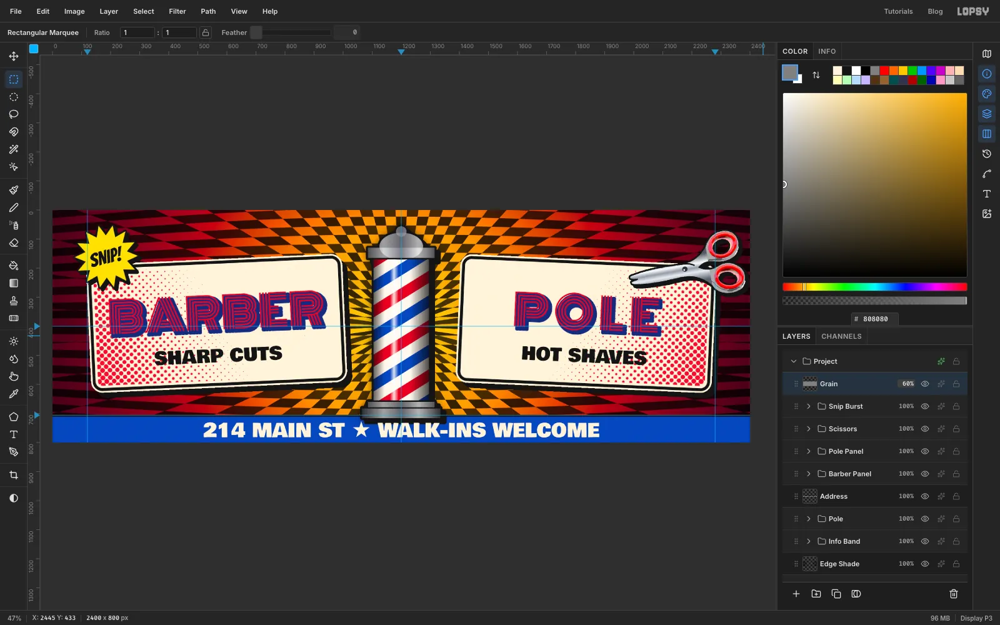

Collapse *Snip Burst* and select it, then click **Add Layer**. The layer
lands at the top of the stack. Name it *Grain*. Fill the whole canvas with
`#808080` and choose **Filter → Add Noise…** with **Amount 40**, **Mono**
and **Gaussian**. Set its blend mode to **Overlay** and its opacity to
**60 %**. Mid grey disappears in Overlay, so only the speckle is left.

## Check the layout and export

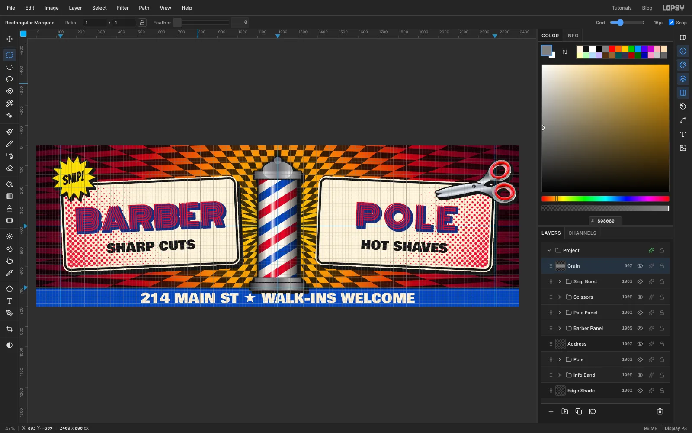

Turn on **View → Show Grid** and check the layout. The two panels should
mirror each other either side of the pole, the burst and the scissors
should balance across the top corners, and the address should sit on the
centre line. Turn the grid off again.

Choose **File → Quick Export PNG** to export the billboard and **File →
Save Project** to keep a `.lopsy` you can come back to.
