In the mid-1960s, Op Art and Pop Art arrived in galleries and advertising
at about the same time. Bridget Riley's *Blaze* paintings used nothing but
black and white zigzags arranged in rings, and the rings seem to spin as
you look at them. Roy Lichtenstein, meanwhile, painted comic-book Ben-Day
dots by hand. In *Magnifying Glass* (1963) he painted a lens that makes
those dots look bigger. Put the two ideas together and you get **op-pop**:
optical patterns in flat, loud, printed colours.

In this tutorial you'll make an op-pop flier for **Yuzu Highball Hour**, a
made-up Friday happy hour. A *Blaze*-style disc of zigzag rings sits behind
a highball glass. The liquid in the glass shows the same rings magnified,
the way Lichtenstein's lens does. The flier is **1200 × 1560 px**.

Along the way you'll use:

- **Define Pattern**, **Fill with Pattern** and **Kaleidoscope** to turn plain stripes into zigzag rings
- exact-corner marquees, **Select → Inverse**, and Shift+Alt marquees that keep only the overlap with a layer's shape
- the **Gradient** tool and **Halftone** for Ben-Day dots
- the **Shape** tool's click-to-size dialog for the glass, ice cubes and bubbles
- rotation and scale handles, copy and paste, **Merge Down** and **Duplicate Layer**
- the **Brush** with **Radial Symmetry** for the yuzu wheel
- **Sunburst** for a starburst badge
- text in **Chango**, **Rubik Mono One** and **Archivo Black**
- **Stroke**, **Color Overlay** and **Inner Glow**, plus the **Screen** blend mode
- the **Eraser** for a final clean-up

The palette:

- Yuzu yellow `#FFD60A`, hot pink `#FF3D8B`, ink `#151515`
- Cyan `#2BB8EE`, white `#FFFFFF`
- Glass tint `#FFF4C0` (used in Screen mode)
- Yuzu flesh `#FFEB7A`, juice dots `#FFF6C8`
- Dot ramps `#FFFFFF` → `#4A4A4A` / `#3C3C3C` (backdrop / glass)

> **Tip:** Positions are in document pixels, written `x, y`. The status bar
> at the bottom shows where the pointer is. **Edit → Fill** fills the
> selection with the foreground colour, and [[Cmd+D]] deselects. New layers
> appear directly above the selected layer. If the selected row is an
> *expanded* group, a new layer goes inside it; if the group is *collapsed*,
> the new layer or group goes next to it.

> **Tip:** For an exact rectangle or circle, pick the **Rectangular** or
> **Elliptical Marquee**, make sure nothing is selected, and click the
> canvas once without dragging. A dialog asks for the **From X / Y** and
> **To X / Y** corners. Effects and the **Blend** dropdown live in each
> layer's effects drawer (the sparkle icon on its row).

## Set up the canvas, guides and yellow ground

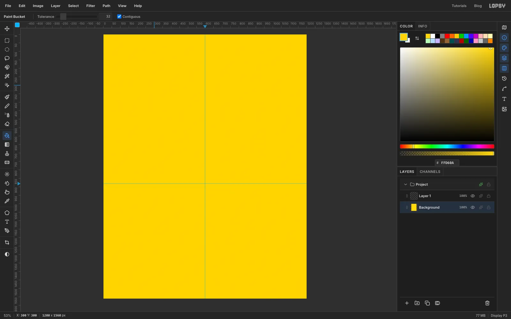

Choose **File → New**, enter **1200 × 1560** pixels with a **White**
background, and click **Create**.

Click the top ruler at `600` to drop a vertical guide down the middle. Then
click the left ruler at `881`. That's where the centre of the ring disc
will go.

Click the *Background* row, set the foreground to yuzu yellow `#FFD60A`,
pick the **Paint Bucket** ([[G]]) and click the canvas.

## Make a stripe tile

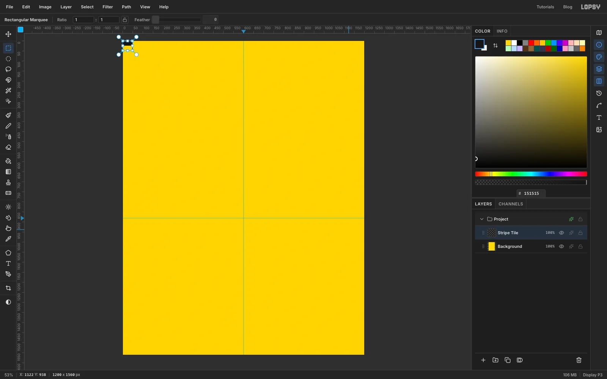

The rings start life as plain horizontal stripes. Double-click the name of
*Layer 1* and rename it *Stripe Tile*.

With the **Rectangular Marquee**, click once and enter **From** `0, 0`
**To** `48, 24`. Set the foreground to ink `#151515` and choose
**Edit → Fill**. Press [[Cmd+D]]. Then make a second exact selection from
`0, 0` to `48, 48`, so the tile is half ink and half empty.

Choose **Edit → Define Pattern**, press [[Cmd+D]], and delete the *Stripe
Tile* layer with the trash button. The pattern stays saved for the rest of
the session.

## Fill a layer with stripes

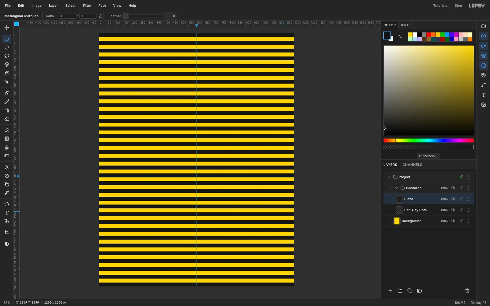

Click the *Background* row and press the **New Group** button (the folder
with a plus) at the bottom of the Layers panel. Name the group *Backdrop*.
With *Backdrop* selected, press **Add Layer** and name it *Ben-Day Dots*,
then press **Add Layer** again and name it *Blaze*. You'll use the dots
layer later.

On *Blaze*, choose **Edit → Fill with Pattern…**, click your stripe tile
and press **Apply**. The page fills with 24 px stripes.

## Fold the stripes into Blaze rings

Choose **Filter → Kaleidoscope…** and set **Segments** to `16` and
**Rotation** to `45`. Click **Apply**.

Kaleidoscope mirrors a wedge of the layer around the canvas centre. The
stripes cross each wedge at an angle, so the mirrored copies meet in
zigzags and form rings that look like Riley's *Blaze*.

## Cut the rings into a disc

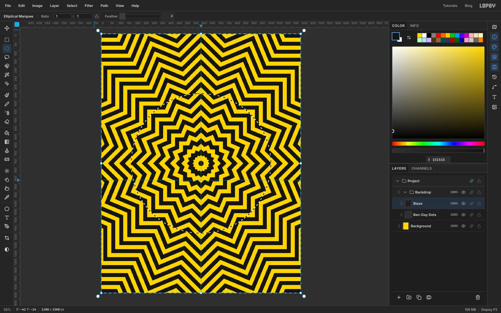

Pick the **Elliptical Marquee**, click once and enter **From** `180, 360`
**To** `1020, 1200`. That makes a circle 840 px across, centred on the
canvas, where the rings are centred.

Choose **Select → Inverse**, press [[Delete]] to clear everything outside
the circle, then press [[Cmd+D]].

## Move the disc onto the guide

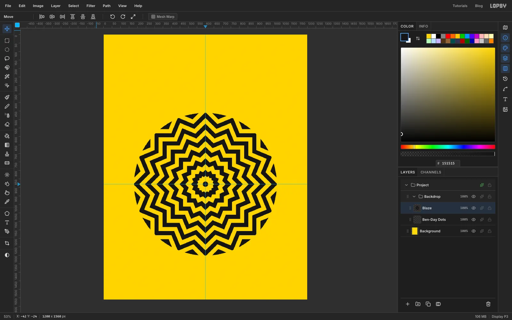

Switch to the **Move** tool ([[V]]) and press [[Shift+Down]] ten times and
[[Down]] once. That moves the disc 101 px down, so the centre of the rings
sits where the two guides cross (`600, 881`). This leaves room for the
title and a banner above it.

## Fill the centre rings with pink

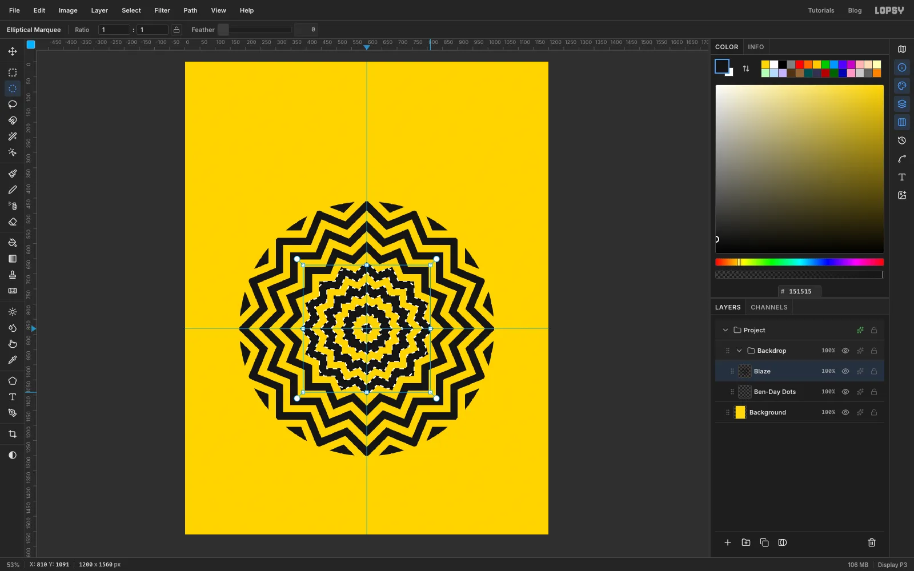

[[Cmd]]-click the *Blaze* thumbnail to select its ink rings. Pick the
**Elliptical Marquee**, hold [[Shift+Alt]] and drag a circle about **420 px
across**, centred where the guides cross: from about `390, 671` to
`810, 1091`. Holding Shift+Alt keeps only the part of the selection inside
the circle.

Set the foreground to hot pink `#FF3D8B`, choose **Edit → Fill**, then
press [[Cmd+D]]. The inner rings turn pink and the outer rings stay ink.

## Add a target rim

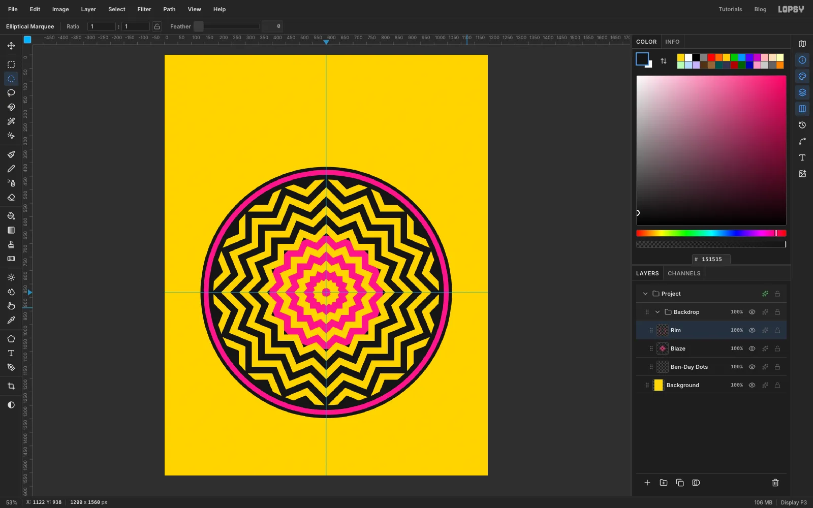

Press **Add Layer** above *Blaze* and name it *Rim*. With the Elliptical
Marquee's dialog, make four circles, all centred where the guides cross.
Press [[Cmd+D]] between them so each click opens the dialog again:

1. `134, 415` to `1066, 1347`, then **Edit → Fill** with ink `#151515`
2. `146, 427` to `1054, 1335`, then fill with pink `#FF3D8B`
3. `164, 445` to `1036, 1317`, then fill with ink
4. `182, 463` to `1018, 1299`, then press [[Delete]] to punch out the middle

That leaves a 12 px ink line, an 18 px pink ring and an 18 px ink band
hugging the zigzags.

## Lay a grey ramp for the Ben-Day dots

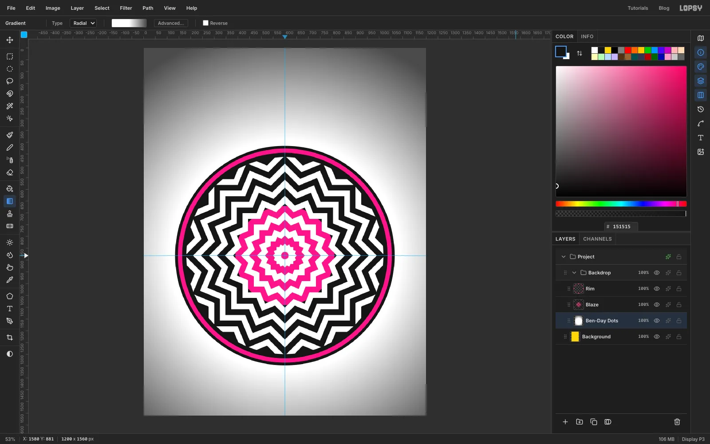

Click the *Ben-Day Dots* row. Pick the **Gradient** tool, set **Type** to
**Radial** and open **Advanced…**. Set three stops: white `#FFFFFF` at 0%,
white at 50%, and `#4A4A4A` at 100%.

Drag from where the guides cross straight right, about 980 px, past the
edge of the canvas. Darker grey will become bigger dots, so the dots grow
towards the corners.

## Turn the ramp into pink dots

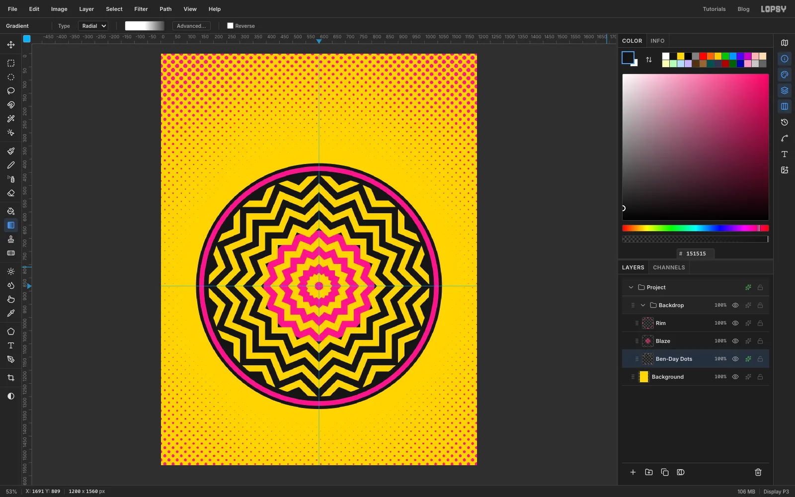

Choose **Filter → Halftone…** and set **Dot Size** `22`, **Density** `1`,
**Angle** `45` and **Softness** `0.6`. White prints no dots at all, so the
middle stays clear.

Open the layer's effects drawer, turn on **Color Overlay** and set it to
hot pink `#FF3D8B`. You now have Lichtenstein-style Ben-Day dots.

## Make a striped straw

Collapse the *Backdrop* group, keep it selected, and press **New Group**.
Name it *Highball*. Everything for the glass goes in here.

Press **Add Layer** and name it *Straw*. With the **Rectangular Marquee**,
make an exact rectangle from `570, 400` to `604, 1230`, set the foreground
to white and fill it. Keep the selection, press
**Add Layer** again (*Straw Stripes*) and choose **Edit → Fill with
Pattern…** with the same stripe tile. The pattern only fills the
selection. Give this layer a pink **Color Overlay**, then choose
**Layer → Merge Down** to bake the stripes into *Straw*.

## Tilt the straw

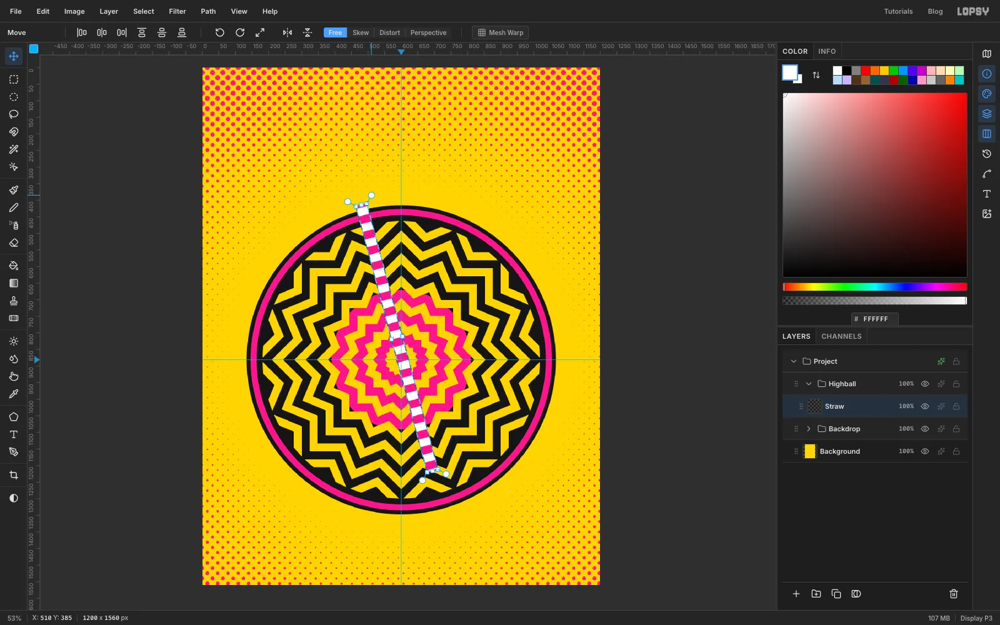

Press [[Cmd+D]] to clear the old selection, then use the Rectangular
Marquee's dialog to draw the same rectangle again (`570, 400` to
`604, 1230`), so the transform box hugs the straw. Switch to the **Move**
tool. Grab the small round rotation
handle just outside the top-right corner and drag anticlockwise while
holding [[Cmd]]. Cmd snaps the angle to 15° steps, so stop at the first
step: **−15°**.

Press [[Cmd+D]] to commit the rotation.

## Draw the glass

Press **Add Layer** and name it *Glass Body*. Pick the **Shape** tool
([[U]]). Set **Shape** to **Rectangle**, **Output** to **Pixels** and
**Corner Radius** to `44`. Set the fill to `#FFF4C0` and remove the stroke.

Click once at `600, 895` without dragging. In the **Shape Size** dialog
enter **320 × 710**. The glass runs from `440, 540` to `760, 1250`.

In the effects drawer, set **Blend** to **Screen**. Screen can only
lighten, so the black zigzags behind the glass turn pale cream and the
glass looks clear.

## Fill the liquid

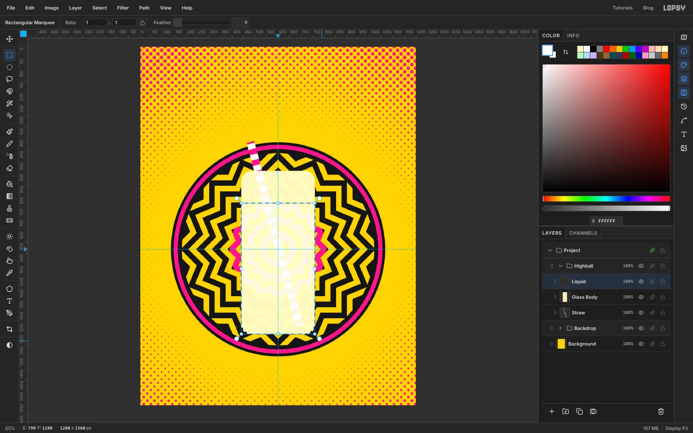

Press **Add Layer** and name it *Liquid*. [[Cmd]]-click the *Glass Body*
thumbnail to select the glass shape. Pick the **Rectangular Marquee**, hold
[[Shift+Alt]] and drag from just left of the glass at `y = 680` to below
its bottom-right corner. Only the glass below the liquid line stays
selected.

Fill it with yuzu yellow `#FFD60A` and press [[Cmd+D]].

## Make magnified rings for the liquid

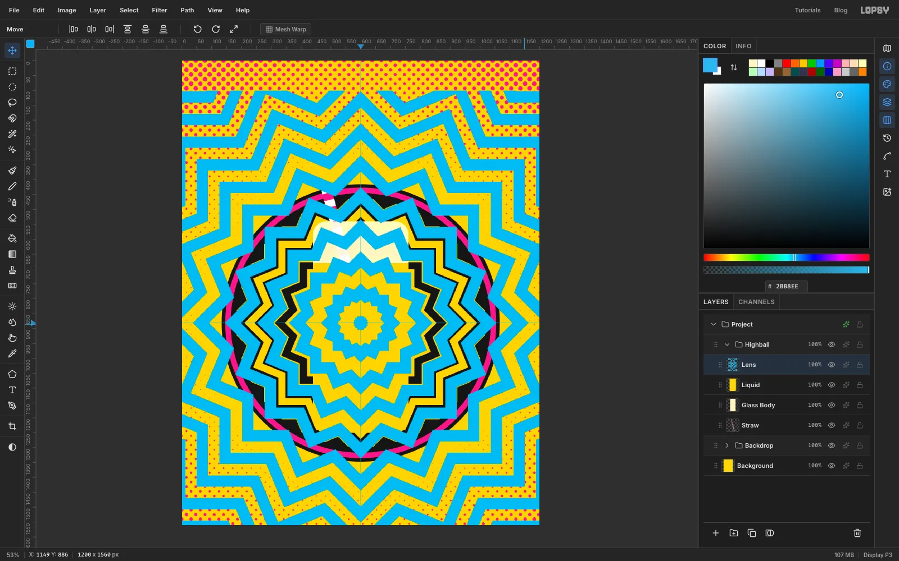

The liquid acts as a lens. You'll use the same recipe as the Blaze, with a
bigger tile, so the rings come out 1.6× larger instead of blurry.

Press **Add Layer**. With the **Rectangular Marquee**, make an exact
rectangle from `0, 0` to `76, 38` and fill it with cyan `#2BB8EE`. Press
[[Cmd+D]], make a second exact selection from `0, 0` to `76, 76`, and
choose **Edit → Define Pattern**. Press [[Cmd+D]] and delete that tile layer.

Click the *Liquid* row and add a layer named *Lens*. Choose **Edit → Fill
with Pattern…** and pick the new cyan tile. Run **Filter → Kaleidoscope…**
with **Segments** `16` and **Rotation** `45` again. Then, with the
**Move** tool, press [[Shift+Down]] ten times and [[Down]] once, exactly as
you did for the Blaze, so both sets of rings share a centre.

## Trim the lens to the liquid

Select the liquid again: [[Cmd]]-click the *Glass Body* thumbnail, then
hold [[Shift+Alt]] and drag the same rectangle from the liquid line down.
Choose **Select → Inverse**, press [[Delete]] and press [[Cmd+D]].

Inside the glass the rings are now cyan and much bigger than outside it.

## Bend the straw at the liquid line

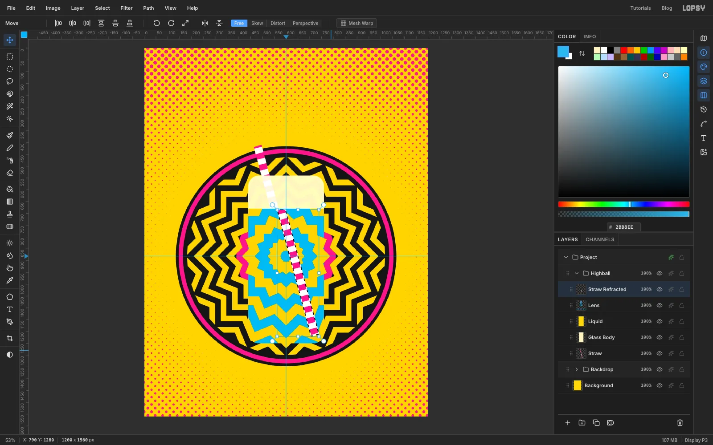

A straw looks broken where it enters water. [[Cmd]]-click the *Straw*
thumbnail, then hold [[Shift+Alt]] and drag a rectangle from just below the
liquid line to below the glass. That keeps only the underwater part of the
straw.

Click the *Straw* row and press [[Cmd+C]]. Click the *Lens* row and press
[[Cmd+V]]. The copy pastes in place on a new layer above the lens. Rename
it *Straw Refracted*. With the **Move** tool, press [[Shift+Right]] twice
and [[Right]] eight times to shift it 28 px.

## Shade the liquid with dots

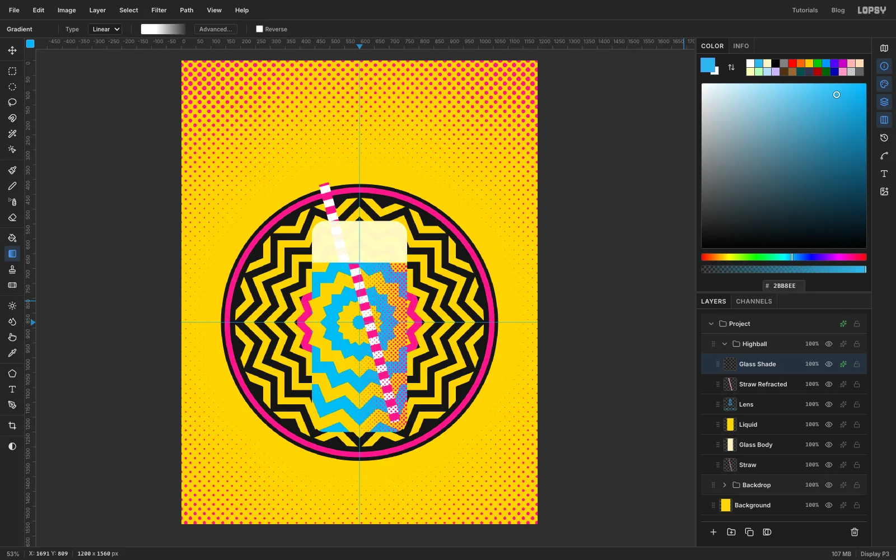

Select the liquid again (Cmd-click *Glass Body*, then Shift+Alt drag) and
add a layer named *Glass Shade*. With the **Gradient** tool set to
**Linear**, use three stops: white at 0%, white at 35%, `#3C3C3C` at 100%.
Drag from the left wall of the glass to the right wall.

Run **Filter → Halftone…** with **Dot Size** `10`, **Density** `1`,
**Angle** `45` and **Softness** `0.5`. Press [[Cmd+D]] and give the layer
a hot pink **Color Overlay**. The dots shade the right side of the glass
like a printed cylinder.

## Outline the glass

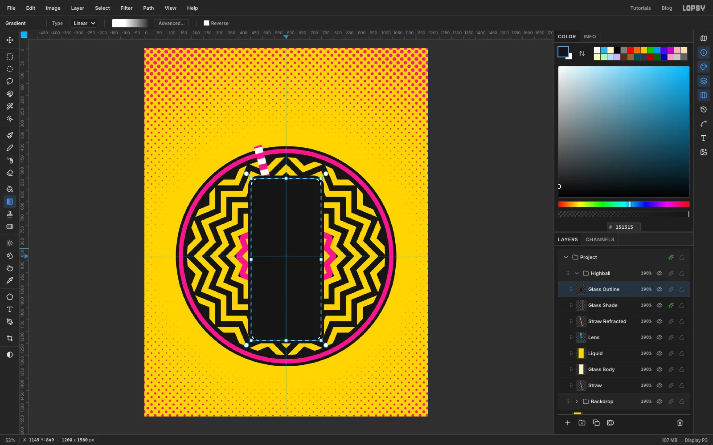

Add a layer named *Glass Outline*. [[Cmd]]-click the *Glass Body*
thumbnail, fill the selection with ink, then choose **Select → Shrink…**
and enter `12`. Press [[Delete]] and [[Cmd+D]]. What's left is a 12 px
outline, the same weight as the rim.

## Add the liquid line and glints

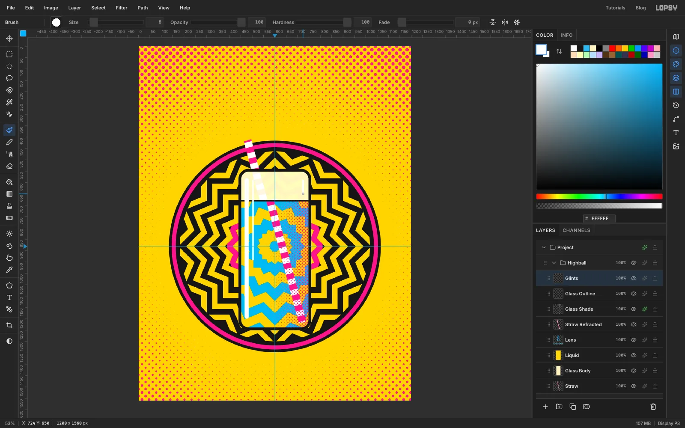

Stay on *Glass Outline*. Pick the **Brush** ([[B]]) and set **Size** `8`,
**Hardness** `100` and **Opacity** `100` with ink as the colour. Click at `446, 680`, then
[[Shift]]-click at `754, 680` for a straight liquid line.

Add a layer named *Glints* and switch to white. With **Size** `20`, click
at `476, 590` and Shift-click at `476, 1190`. With **Size** `8`, draw a
shorter stroke from `504, 590` to `504, 940`, and a short one near the top
right from `724, 590` to `724, 650`.

## Drop in two ice cubes

Click the *Glass Shade* row so the cubes sit under the outline. Add a layer
named *Ice A*. Pick the **Shape** tool with **Rectangle**, **Corner
Radius** `16`, a white fill and an ink stroke with **Width** `6`. Click once
at `652, 702` and enter **96 × 96**.

With the **Rectangular Marquee**, make an exact rectangle around the cube,
from `599, 649` to `705, 755`.
With the **Move** tool, drag the rotation handle clockwise while holding
[[Cmd]] for **30°**, then press [[Cmd+D]]. In the effects drawer, turn on
**Inner Glow** in cyan `#2BB8EE` with **Size** `10`, **Spread** `100` and
**Opacity** `100`. The full spread gives a flat cyan edge instead of a soft
glow.

Add *Ice B* the same way: click at `700, 800` and enter **64 × 64**, select
`663, 763` to `737, 837`, rotate **−15°**, and give it the same Inner Glow.

## Add two columns of bubbles

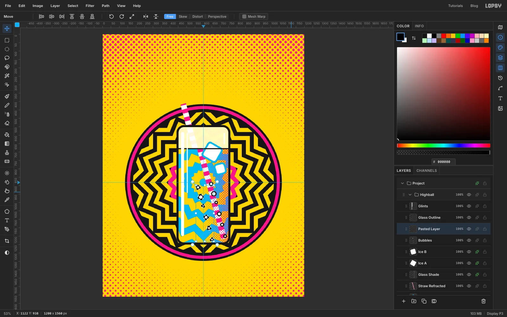

Add a layer named *Bubbles*. Switch the Shape tool to **Ellipse** with a
white fill and a 6 px ink stroke. Click-to-size six bubbles of mixed sizes
up the right side of the straw:

- `729, 1200` at 16 × 16, `711, 1132` at 18 × 18, `694, 1068` at 22 × 22
- `676, 1000` at 14 × 14, `662, 948` at 26 × 26, `646, 890` at 20 × 20

With the **Rectangular Marquee**, make an exact rectangle around them,
from `630, 872` to `742, 1214`. Press
[[Cmd+C]], then [[Cmd+V]] to paste a copy in place on a new layer. With the
**Move** tool, nudge it 78 px left and 20 px down with the arrow keys, onto
the other side of the straw. Choose **Layer → Merge Down**.

## Build the yuzu wheel

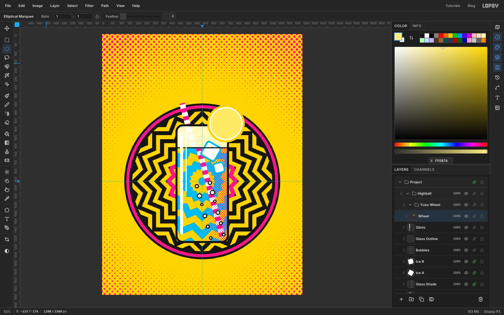

Click the *Glints* row and press **New Group**. Name it *Yuzu Wheel*, and
add a layer inside it named *Wheel*. With the Elliptical Marquee dialog,
make three circles centred on `742, 536`. Press [[Cmd+D]] after each fill
so the next click opens the dialog again:

1. `630, 424` to `854, 648`, filled with yuzu yellow `#FFD60A` (the rind)
2. `642, 436` to `842, 636`, filled with white (the pith)
3. `650, 444` to `834, 628`, filled with `#FFEB7A` (the flesh)

## Paint the segments with Radial Symmetry

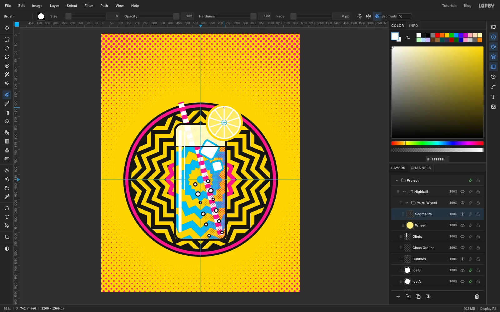

Add a layer named *Segments*. Pick the **Brush** with **Size** `8`,
**Hardness** `100` and white. In the options bar, turn on **Radial
Symmetry** and set **Segments** to `10`. [[Cmd]]-click the centre of the
wheel (`742, 536`) to move the symmetry centre there.

Click the centre, then [[Shift]]-click straight up at `742, 446`. One
stroke paints all ten spokes. Change to **Size** `12` and `#FFF6C8`, and
click once between two spokes about 58 px out (around `760, 481`) for ten
juice dots. Then click the centre once at **Size** `22` in white.

Turn **Radial Symmetry** off and choose **Layer → Merge Down**.

## Outline the wheel and cut a slit

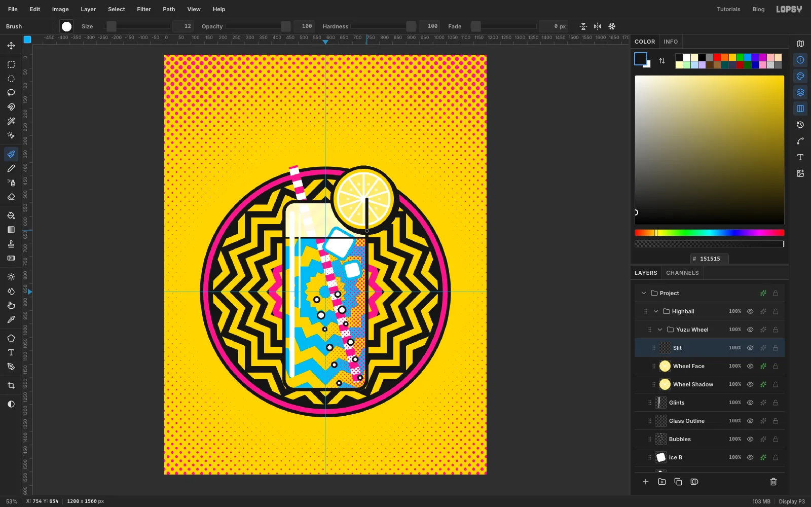

Give *Wheel* a **Stroke** in ink with **Width** `12`. For a hard pop
shadow, choose **Layer → Duplicate Layer** and name the copy *Wheel Face*.
Click the original, rename it *Wheel Shadow*, give it an ink **Color
Overlay**, and nudge it 10 px right and 10 px down with the arrow keys. The
copy on top stays in colour.

Click *Wheel Face*, add a layer named *Slit*, and with a 12 px ink brush
click at `754, 536`, then Shift-click at `754, 654`. The line continues the
glass wall up into the wheel, so it reads as a slice cut onto the rim.

## Nudge the wheel group onto the rim

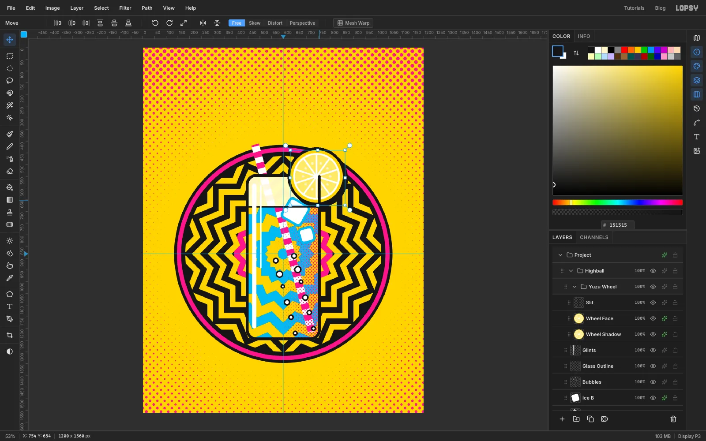

Click the *Yuzu Wheel* group row. With the **Move** tool, press
[[Shift+Down]] once and [[Down]] four times. All three layers move together,
14 px down, so the slice sits on the rim.

## Add the bands and the price badge

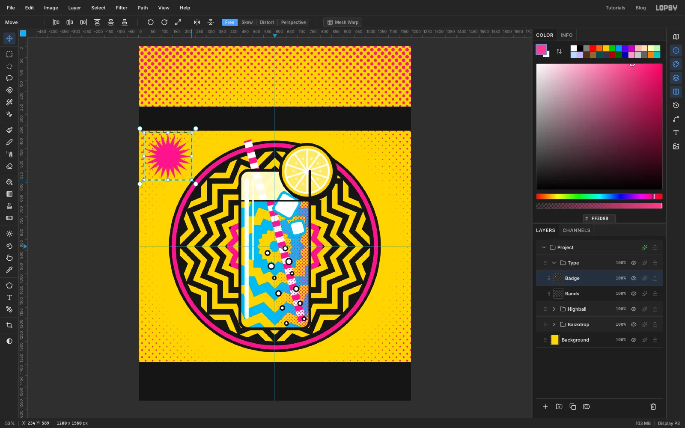

Collapse *Highball*, keep it selected, and press **New Group**. Name it
*Type*. Add a layer named *Bands*. With the **Rectangular Marquee**, fill
two exact rectangles with ink:
`0, 266` to `1200, 372` for the banner, and `0, 1390` to `1200, 1560` for
the info band.

Add a layer named *Badge*, set the foreground to hot pink, and choose
**Filter → Sunburst…**. Use **Rays** `20`, **Length** `8`, **Width** `100`,
**Taper** `100`, **Rotation** `0`, **Center X** `12` and **Center Y** `32`.
Taper 100 turns the rays into spikes that merge into a solid star.

The star is a little too big. Draw a marquee around it, switch to **Move**,
hold [[Cmd]] and drag the bottom-right handle inward to about 88%. Press
[[Cmd+D]], then nudge the star with the arrow keys until it sits about
25 px in from the left edge, with a clear gap above it to the banner and
below it to the ring (its centre ends up near `140, 500`). Give it a 12 px
ink **Stroke**, then make a hard shadow exactly as you did for the wheel:
duplicate it and rename the copy *Badge Face*, turn the original into an
ink *Badge Shadow*, and nudge that 10 px right and down.

## Set the YUZU title

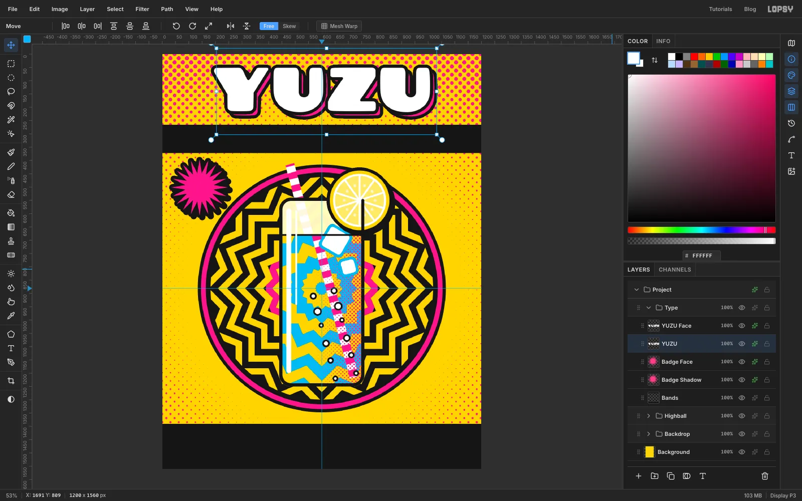

Click the *Badge Face* row first. If a text layer is selected, the text
options restyle that layer instead of the next one.

Pick the **Text** tool ([[T]]). Choose **Chango**, set **Size** to `232`
and **Align** to **Center**, and set the foreground to white. Click at
`600, 30`, type `YUZU` and press [[Tab]] to commit. With the **Move** tool
and the arrow keys, nudge it down until the gap above the letters roughly
matches the gap between the pink shadow you're about to add and the
banner (the letters end up about 51 px from the top).

Add a 12 px ink **Stroke**. Duplicate the layer and rename the copy *YUZU
Face*, then click the original, give it a hot pink **Color Overlay** and nudge it
16 px right and 16 px down for a block shadow.

## Set the banner, badge and event details

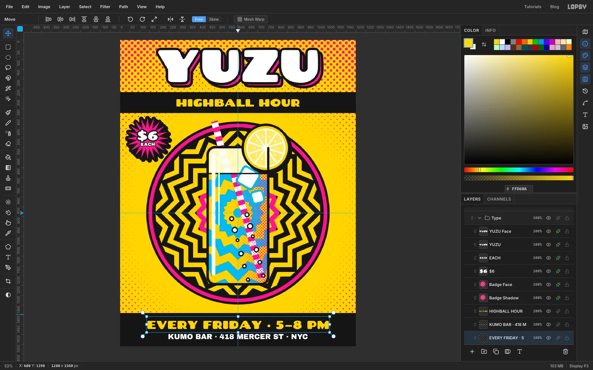

> **Tip:** A Text tool click within a few pixels of an existing text layer
> edits that layer instead of starting a new one. So for each pair of lines
> below, set the lower line first.

Pick the **Text** tool again. Click *Bands*, then make **HIGHBALL HOUR** in
**Chango** at `54` in yuzu yellow, centred. Click at `600, 285`, type it, press [[Tab]], and nudge it
until it sits in the middle of the banner.

For the badge, click *Badge Face* and set **EACH** in **Rubik Mono One** at
`22` in white, clicking at `140, 512`. Nudge it so it's centred on
`140, 530`, and give it a 3 px ink **Stroke**. Click *Badge Face* again and
set **$6** in **Chango** at `64` in white, clicking at `140, 438`. Nudge it
to centre on `140, 487` and give it a 6 px ink **Stroke**.

For the bottom band, click *Bands* and set **KUMO BAR · 418 MERCER ST ·
NYC** in **Archivo Black** at `37` in white (click at `600, 1488`). Click
*Bands* again and set **EVERY FRIDAY · 5–8 PM** in **Chango** at `58` in
yuzu yellow (click at `600, 1398`). Nudge the two lines so the gaps above,
between and below them look even: the first line sits about 39 px below
the top of the band and the second about 37 px above the bottom.

## Clear the dots behind the title

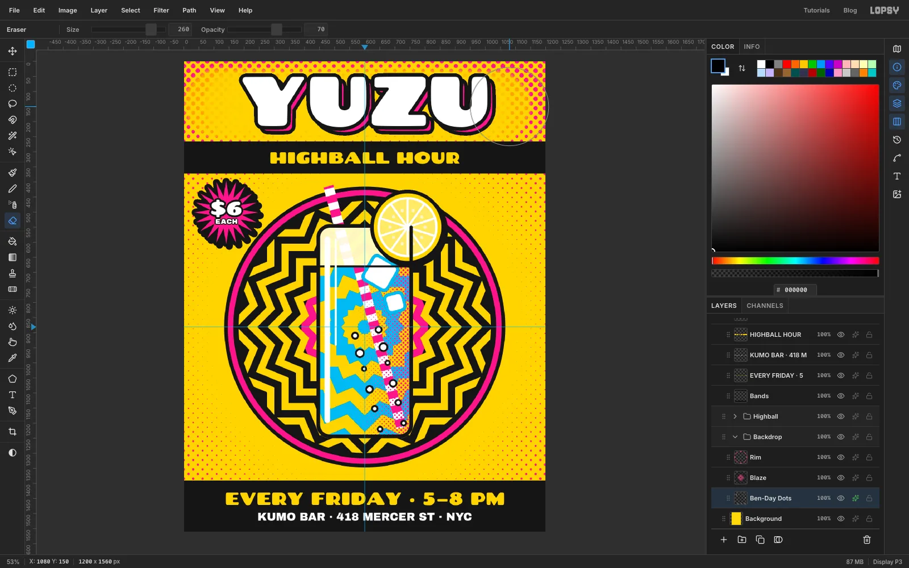

Expand *Backdrop* and click *Ben-Day Dots*. Pick the **Eraser** ([[E]])
with **Size** `260` and **Opacity** `70`. Make one sweep from left to right
behind the title, at about `y = 145`. The dots fade behind the letters and
stay strong at the edges, so YUZU reads cleanly.

Export with **File → Quick Export PNG**, and use **File → Save Project** to
keep a `.lopsy` with every layer.
