Op-Pop is what happens when two 1960s movements share a wall. **Op Art** makes flat lines seem to move, as in Bridget Riley's [Current](https://www.moma.org/collection/works/79998), where hand-painted curves billow as if the surface were caught in wind. **Pop Art** borrows from print and comics, with Roy Lichtenstein's dots, thick outlines and shouting captions.

This poster uses both to explain something real: which kinds of ultraviolet light get from the Sun to your skin. The stripes aren't only decoration. They are the chart, and they follow three rules:

- **Stripe spacing shows wavelength.** Each band's stripes repeat at 1 px for every 10 nm of its middle wavelength, so UVC is 19 px, UVB is 30 px and UVA is 36 px.
- **Band width follows the ruler.** Every nanometre is 3.2 px wide, so UVC is by far the widest band.
- **How far a band falls shows how far it gets.** UVC stops at the ozone band. UVB drops to thin lines and ends in the top of the skin. UVA keeps its full weight, because the atmosphere filters it far less, and goes deeper.

The facts come from the World Health Organization's [Q&A on ultraviolet radiation](https://www.who.int/news-room/questions-and-answers/item/radiation-ultraviolet-(uv)) , the [ICNIRP page on the UV Index](https://www.icnirp.org/en/applications/uv-index/index.html) and the WHO's [Global Solar UV Index guide](https://www.who.int/publications/i/item/9241590076). The poster simplifies two things. The skin layers aren't to scale, and it says so. Drawing UVC stopping at the ozone band is also shorthand: the WHO says ozone, water vapour, oxygen and carbon dioxide absorb all of the UVC and most of the UVB between them, so the card only says it never reaches the ground. BURN! and WRINKLES! are shorthand too, since the WHO also links UVB to skin ageing and both bands to tanning. Say what's simplified whenever you make a chart like this.

You'll need one public domain image. Download a version wider than 1800 px of [The Sun by the Atmospheric Imaging Assembly of NASA's Solar Dynamics Observatory](https://commons.wikimedia.org/wiki/File:The_Sun_by_the_Atmospheric_Imaging_Assembly_of_NASA's_Solar_Dynamics_Observatory_-_20100819.jpg), taken on 19 August 2010 in extreme ultraviolet at 30.4 nm. Lopsy shrinks an image that's wider than the canvas to fit, so the numbers below still work.

The document is 1800 × 2700 px. Because this is a chart, the bands use exact numbers. Click once with the **Rectangular** or **Elliptical Marquee** while nothing is selected and a dialog asks for From X, From Y, To X and To Y. Everything in this tutorial written as "(x, y) to (x, y)" goes in that dialog. Press [[Cmd+D]] between selections, because the dialog only opens with nothing selected. Text and bursts are placed by eye. The status bar at the bottom left shows the cursor's X and Y in document pixels, so use it for anything placed by hand.

The colours:

- Sky `#3A0FC2`, halo dots `#7A2BFF`, curtain shadow `#1A0659`
- Ink `#0B0B10`, paper `#FFFFFF`
- UVB and Sun dots `#FF1C8E`, UVA and Sun disc `#FFE600`
- Air `#12C4F5`, ozone `#FF5A1F`
- Epidermis `#FFD2B8`, dermis `#FF8E7A`, skin dots `#D8213B`
- UV Index `#3DB21E`, `#F7E400`, `#F85900`, `#D8001D`, `#6B49C8`

The tools you'll use:

- **Define Pattern** and **Fill with Pattern**
- **Liquify** in Push Forward mode
- the **Gradient** tool, **Halftone**, **Desaturate** and **Brightness/Contrast**
- a photo dropped on the canvas, **Select → Inverse**, and the Move tool's scale and rotate handles
- the **Pen** tool, with **Path to Selection**
- the **Pencil** with Shift-click straight lines, and the **Eraser**
- layer effects: **Color Overlay**, **Stroke** and **Drop Shadow**
- text in **Bowlby One**, **Bangers**, **Comic Neue** and **Space Mono**
- **Group Layers** and the **Color Grading** group adjustment

## Set up the sky and the guides

Press **File → New**, choose Pixels, and make a document 1800 px wide and 2700 px tall. Click the **Background** row in the Layers panel, set the foreground to the sky colour `#3A0FC2`, and choose **Edit → Fill**. Delete **Layer 1**, because you'll add layers as you need them.

Now mark the chart with guides. Click on the top ruler to place a vertical guide, and click on the left ruler to place a horizontal one. Don't chase exact pixels, because a guide within a few px is fine. They're only for your eye, and the exact numbers go in the dialog.

- Vertical guides at 420, 996, 1108 and 1380. These are 100, 280, 315 and 400 nm on the ruler you'll build.
- Horizontal guides at 1040, 1430, 1510, 2000, 2090 and 2380. These are the top of the stripes, the two edges of the ozone layer, the skin surface, the bottom of the epidermis and the top of the footer.

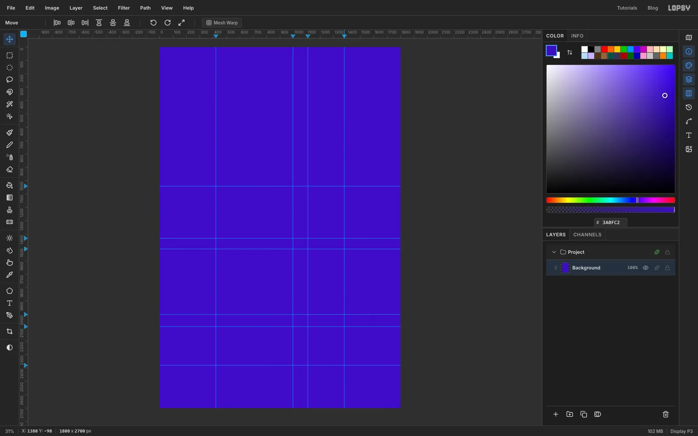

## Add a halo of dots behind the Sun

Add a layer and name it **Halo**. Click the **Gradient** tool in the toolbox (it has no shortcut), set the type to **Radial**, and open **Advanced…**. Make the stops solid black on the left and solid white on the right.

Marquee (0, 0) to (1800, 1430). Click the Gradient tool again, then drag from about (900, 690), where the Sun will sit, straight right to just past the canvas edge. Press [[Cmd+D]].

Choose **Filter → Halftone...** with Dot Size 30, Angle 45 and Softness 1. Halftone keeps the source colour, and the dots come out black and large near the Sun. Open the layer's effects with the sparkle button on its row and enable **Color Overlay** in `#7A2BFF`. These dots are only a little lighter than the sky, so they won't fight with the Sun later. Close the drawer with its X whenever you finish with effects, because it floats over the canvas.

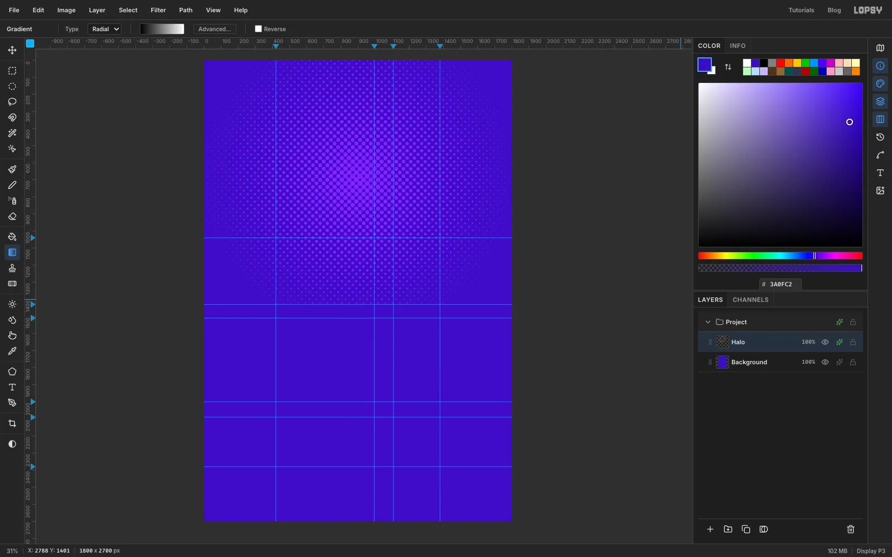

## Paint the lower atmosphere

Add a layer named **Air**. Marquee (0, 1510) to (1800, 2000) and use **Edit → Fill** with `#12C4F5`. Press [[Cmd+D]].

Add a layer named **Air Dots**. Click the Gradient tool, set it to **Linear**, and in **Advanced…** set `#FFFFFF` on the left and `#505050` on the right. Marquee the same area, (0, 1510) to (1800, 2000), click the Gradient tool again, and drag from the top of the band to the bottom. Press [[Cmd+D]].

Run **Filter → Halftone...** with Dot Size 26, Angle 45 and Softness 1, then add a **Color Overlay** in white. Pure white prints no dots, so the dots grow from nothing at the top into a Lichtenstein sky at the bottom.

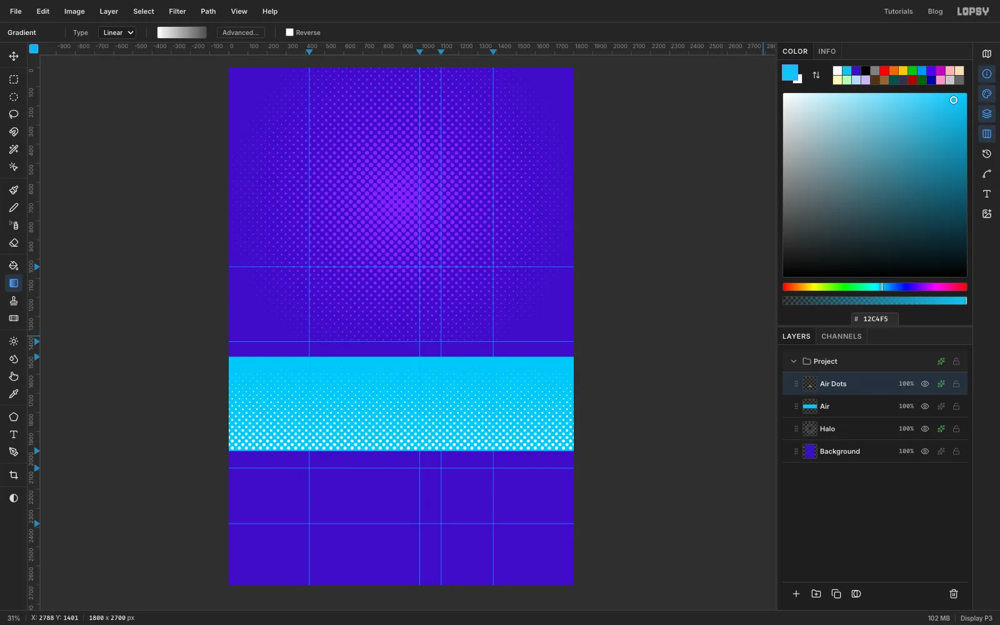

## Add the ozone, skin, footer and rules

Each of these goes on the layer named here, filled with **Edit → Fill** inside the marquee given:

1. **Ozone**: (0, 1430) to (1800, 1510) in `#FF5A1F`.
2. **Skin**: (0, 2000) to (1800, 2090) in `#FFD2B8`, then (0, 2090) to (1800, 2380) in `#FF8E7A`, both on one layer.

Add a layer named **Skin Dots**. Set the Linear gradient's stops to `#E8E8E8` and `#6A6A6A`. Marquee (0, 2000) to (1800, 2380), click the Gradient tool again, and drag from the top of the skin to the bottom. Press [[Cmd+D]], run **Halftone...** with Dot Size 20, Angle 45 and Softness 1, add a **Color Overlay** in `#D8213B`, and set the layer's blend mode to **Multiply**.

Add a layer named **Footer** and fill (0, 2380) to (1800, 2700) with `#0B0B10`.

Add a layer named **Lines** and draw the black rules with the Pencil. Press [[N]], set Size to 12 and the foreground to `#0B0B10`. Click at the left edge on the guide at y 1430, then Shift-click at the right edge on the same guide. Do the same at y 1510 and y 2000. Set Size to 8 and draw the last rule at y 2090.

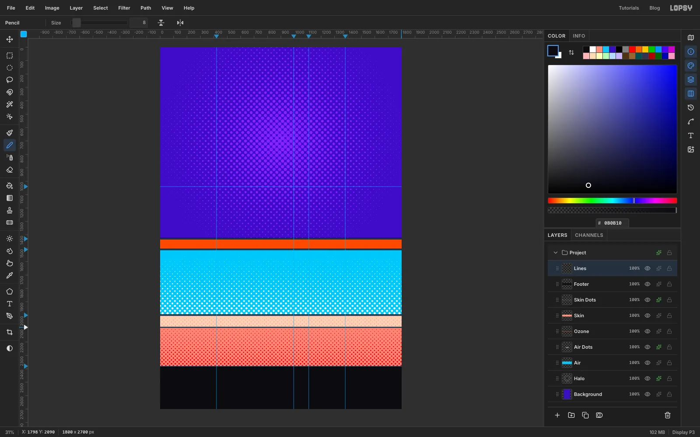

## Define the stripe patterns

You need four pattern tiles, and you'll make each one in the same way. Add a temporary layer. Marquee (100, 100) to (119, 140) and fill it with `#0B0B10`. Marquee (100, 100) to (109, 140) and fill it with white. That's 9 px of white and 10 px of ink, 19 px in all. Marquee the whole tile, (100, 100) to (119, 140), and choose **Edit → Define Pattern**. Delete the temporary layer.

Make the other three in this order, keeping each tile 40 px tall:

- **UVB, thick**: 30 px wide, with 15 px of `#FF1C8E` at the left and ink behind.
- **UVB, thin**: 30 px wide, with only 6 px of `#FF1C8E` at the left and nothing else. Leave the rest of this tile transparent.
- **UVA**: 36 px wide, with 18 px of `#FFE600` at the left and ink behind.

Patterns only last for the current session, so finish the next step before you reload the page.

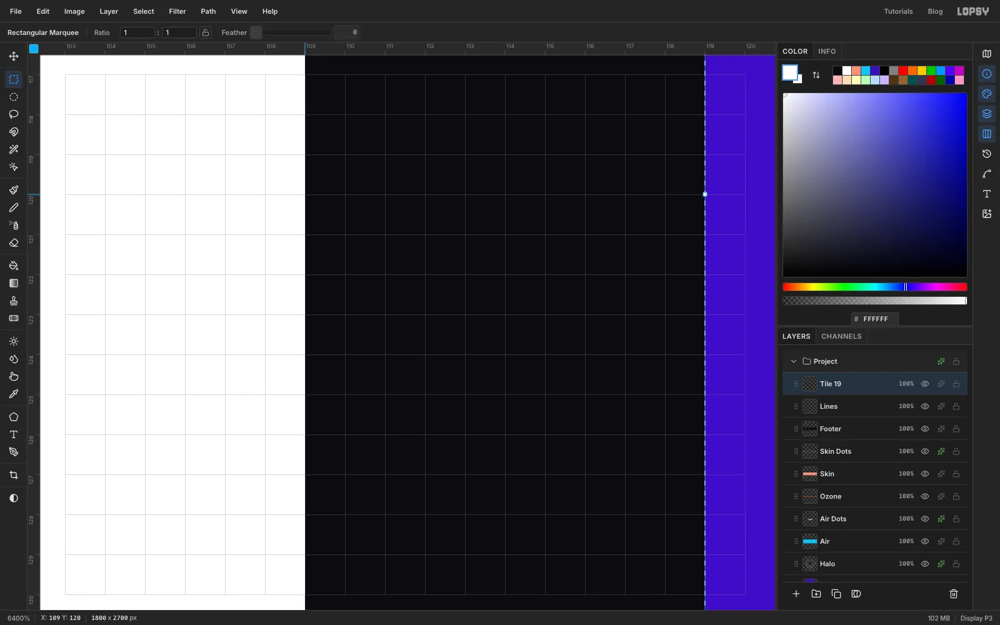

## Fill the three curtains

Click the **Lines** row and add a layer named **Curtains**. Use **Edit → Fill with Pattern...** for each of these, choosing the swatch for that tile and leaving the other settings alone. Press [[Cmd+D]] after each one.

- UVC tile, the first swatch: (420, 1040) to (996, 1430)
- UVB thick tile, the second swatch: (996, 1040) to (1108, 1430)
- UVA tile, the fourth swatch: (1108, 1040) to (1380, 2290)

Add a layer above it named **UVB Thin**, and fill (996, 1415) to (1108, 2060) with the thin tile, the third swatch. It starts 15 px above the ozone so that the thin lines grow out of the thick stripes.

Look at what you've already got. UVC stops dead at the ozone band, UVB fades into thin lines and stops in the epidermis, and UVA runs on into the dermis. The chart is done. The next step makes it move.

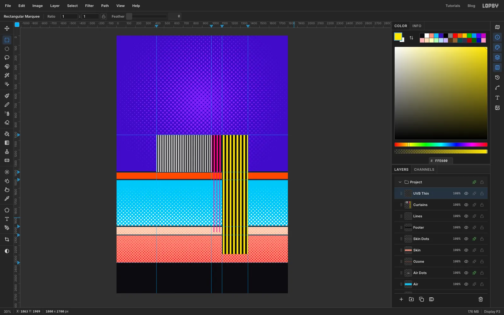

## Bend the stripes with Liquify

Click the **Curtains** row and choose **Filter → Liquify...**. Set Mode to **Push Forward**, Brush Size to 400 and Pressure to 26.

Make five long horizontal drags, each starting about 170 px outside the stripes on one side and ending 170 px outside them on the other. Alternate the direction:

1. Left to right at y 1350
2. Right to left at y 1570
3. Left to right at y 1790
4. Right to left at y 2010
5. Left to right at y 2230

Each drag pushes a whole row of stripes sideways, and the big soft brush blends one push into the next, so you get a Riley wave with no kinks. The top of the curtains stays straight, which keeps the spacing readable under the ruler. Press **Apply**.

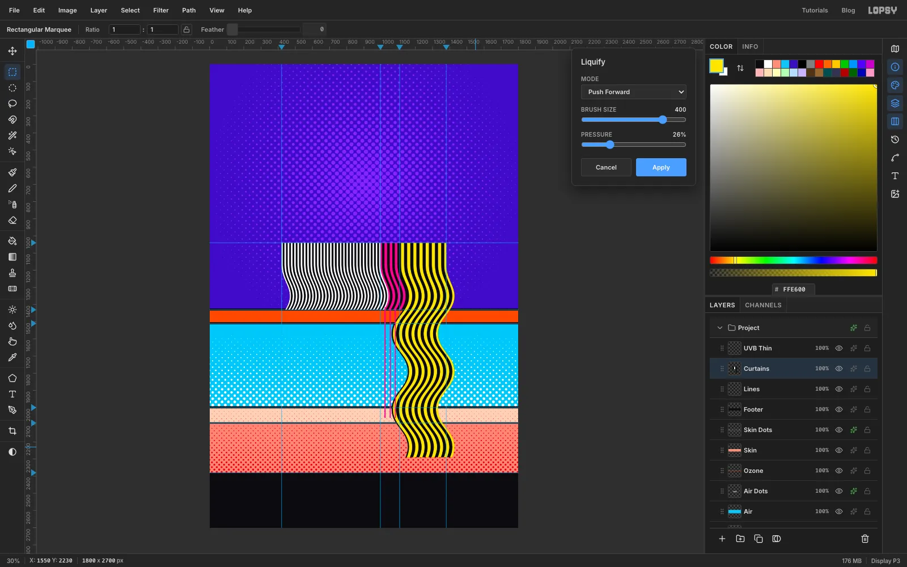

## Give the curtains some weight

With **Curtains** still active, add a **Drop Shadow**: Offset X 16, Offset Y 16, Blur 1, Opacity 100, colour `#1A0659`. A Blur of 1 looks hard but avoids a pale seam along the edges.

Click **UVB Thin**, open Liquify again, and make the same five drags with the same settings, starting and ending at the same status-bar numbers. Before you press **Apply**, check that the thin lines still meet the thick stripes above the ozone, and undo a drag if they don't. Then press **Apply** and add a **Stroke** of Width 2 in `#0B0B10`. The keyline keeps the thin magenta lines visible over the white dots.

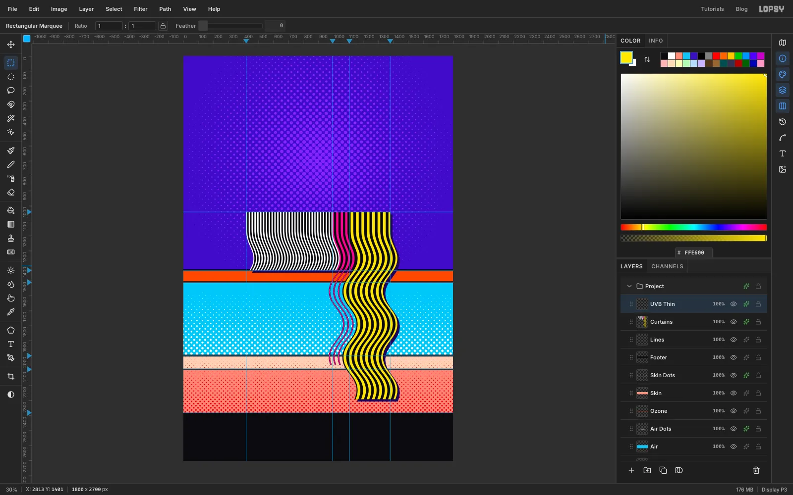

## Make the Sun disc and bring in the photo

Keep **UVB Thin** active and click **New Group** in the Layers panel. Name the group **Sun**, then add a layer inside it named **Sun Disc**.

With the Elliptical Marquee, select (580, 370) to (1220, 1010) and fill it with `#FFE600`. Press [[Cmd+D]] and add a **Stroke** of Width 10 in `#0B0B10`.

Drag the NASA image from your desktop onto the canvas. It lands as a new layer fitted to the canvas width, with its pixels selected. Press [[Cmd+D]] and rename it **Sun Photo**.

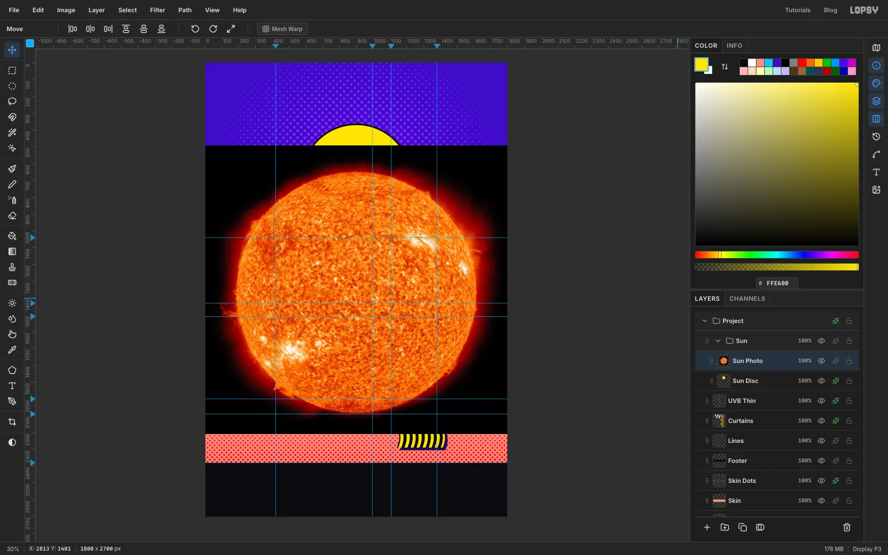

## Cut the Sun out of space

With the Elliptical Marquee, select (187, 654) to (1615, 2082). This is the disc itself, without the red haze and the black sky around it. Choose **Select → Inverse**, press [[Delete]], then press [[Cmd+D]].

If the circle sits off the disc on your copy, press [[Cmd+D]] and enter new numbers before you choose Inverse.

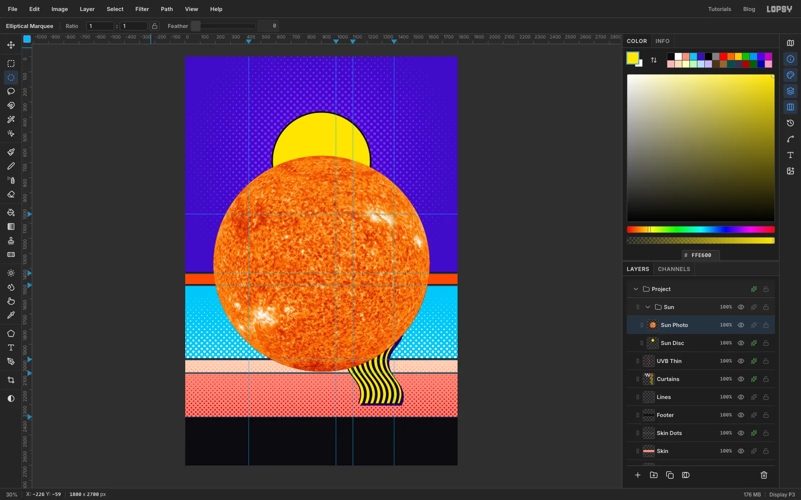

## Scale the photo down to the disc

With the Rectangular Marquee, select (186, 653) to (1616, 2083). Press [[V]] for the Move tool. Aim just inside the bottom-right corner until you see a diagonal double arrow, not the curved rotate cursor. Hold [[Cmd]] so the scale stays in proportion, and drag up and to the left. The top-left corner stays pinned, so stop when the status bar reads about X 824, Y 1291, which makes the box about 636 px wide. Press [[Cmd+D]].

Now drag the photo with the Move tool so that it sits on the yellow disc, with the black outline showing evenly around it. The picture shows it just before that drag.

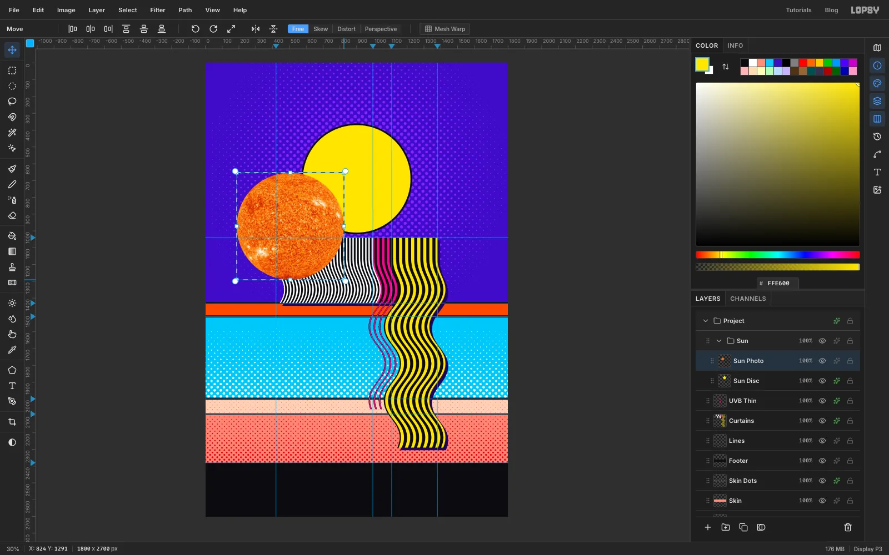

## Push the contrast before the dots

A halftone only shows what's in the tones. The orange here is NASA's false colour, and the detail sits in a narrow range of tones. If you skip this step you get a polka-dot ball with no solar detail.

Choose **Filter → Desaturate**. Then run **Filter → Brightness/Contrast...** twice: first with Brightness −30 and Contrast 100, then with Brightness 0 and Contrast 100. Filter dialogs reset each time they open, so type the values both times. The surface should turn into hard black and white blotches, with the active regions standing out as white patches.

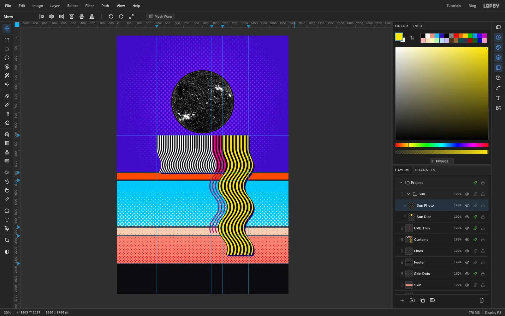

## Halftone the Sun

Run **Filter → Halftone...** with Dot Size 18, Angle 45 and Softness 1. Add a **Color Overlay** in `#FF1C8E`.

White prints nothing, so the yellow disc shows through wherever the Sun was brightest. That's a real NASA picture of the Sun, printed like a 1960s comic.

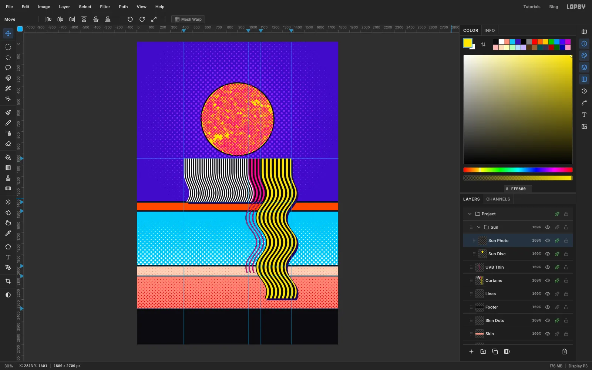

## Build the ruler and band tags

Collapse the **Sun** group with its arrow, click its row, and add a layer named **Ruler**. A layer added while a collapsed group is active lands above the group, not inside it.

Fill (420, 970) to (1380, 1040) with white and add a **Stroke** of Width 6 in `#0B0B10`. It overlaps the bottom of the Sun, so the disc seems to sit behind it.

Press [[N]] for the Pencil, set Size to 4 and the foreground to `#0B0B10`, and draw the ticks with click and Shift-click. Zoom in with [[Cmd]]+scroll for these. Ticks fall every 20 nm, leaving out 120, 260, 320 and 380, where a number will sit:

- short ticks from y 1026 to y 1039 at x 548, 612, 676, 804, 868, 1060, 1188 and 1252
- a slightly taller tick from y 1016 to y 1039 at x 740, for 200 nm
- full-height dividers from y 972 to y 1039 at x 996 and x 1108, for 280 and 315 nm

Add a layer named **Tags** and fill three boxes that hang from the ruler: (618, 1043) to (798, 1100) in white, (1002, 1043) to (1102, 1100) in `#FF1C8E`, and (1154, 1043) to (1334, 1100) in `#FFE600`. Add a **Stroke** of Width 6 in ink.

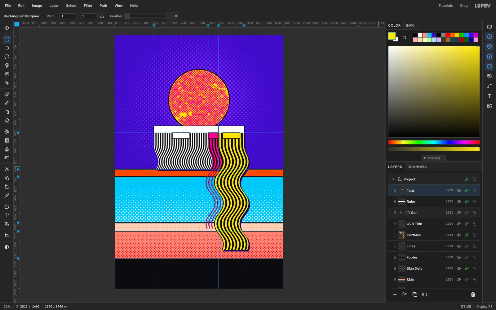

## Draw a comic burst with the Pen

Add a layer named **Burst Stopped**. Zoom in to about 100% with [[Cmd]]+scroll, and hold [[Space]] and drag to pan. Press [[P]] for the Pen and click your way around a spiky star over the UVC stripes, centred near (708, 1265). Use about 14 long points and 14 short ones, and keep it about 370 px wide and 250 px tall. Make the spikes a little uneven so it looks hand drawn. Click the first anchor again to close the path, and land right on it, because a near miss adds another point.

Click the curve icon in the panel toolbar at the far right to open **Paths**. Click **Path to Selection**, then **Delete Path**. Fill with `#FFE600` and press [[Cmd+D]]. Add a **Stroke** of Width 9 and a **Drop Shadow** of Offset X 12, Offset Y 12, Blur 1, Opacity 100, both in ink.

Keep the burst clear of the tag above and the ozone below, so the reader can see the stripes hit the band. The picture shows the burst before its effects.

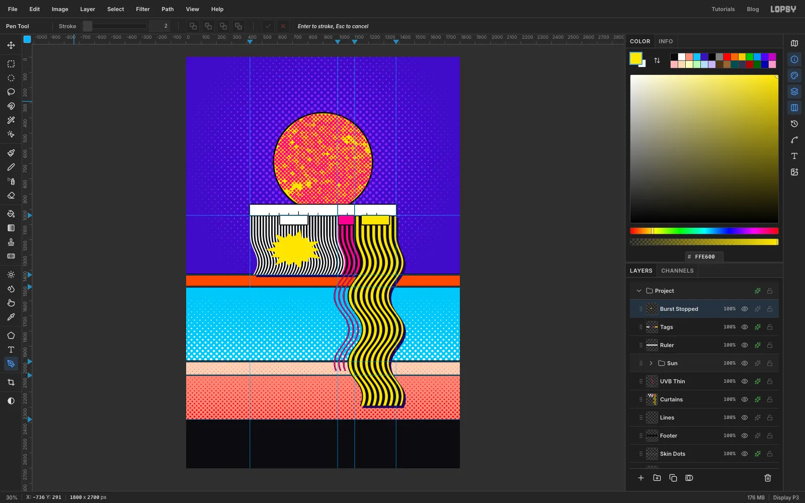

## Copy the burst, scale it and rotate it

Marquee around the burst, press [[Cmd+C]], then [[Cmd+D]]. For each copy, click the **Burst Stopped** row and press [[Cmd+V]]. The copy pastes in place, directly above that row. Rename it, then:

1. The paste is already selected with handles on it, and the Move tool is active. Hold [[Cmd]] and drag a corner handle inward to scale it. Press [[Cmd+D]].
2. Marquee around it again and press [[V]]. Hover just outside a corner until you see the rotate cursor, then drag to turn it. There's no angle readout, so judge it by eye. Press [[Cmd+D]].
3. Drag the copy into place with the Move tool.

**Burst Burn** is about two-thirds the size of the original, turned 12° clockwise, and sits near (815, 2066) with a spike pointing at the ends of the UVB lines.

**Burst Wrinkles** is about 85% of the size, turned 9° anticlockwise, and sits near (960, 2240) with a spike pointing at the bottom corner of the UVA curtain. Leave some space around all three so that the ends of the lines stay visible.

In the picture the first copy is already finished, which you'll do in the next section. Yours will still be yellow.

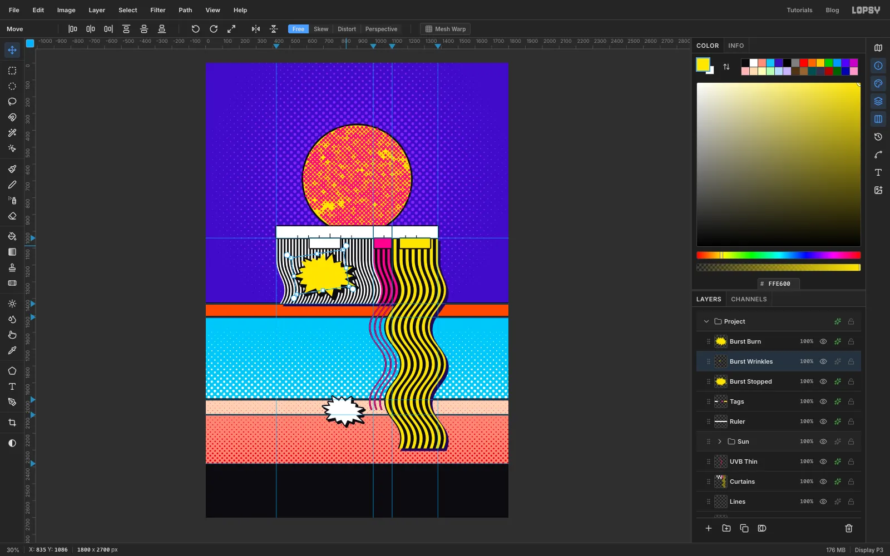

## Finish the copies

On both copies, add a **Color Overlay** in white, a **Stroke** of Width 7 in ink, and a **Drop Shadow** of Offset X 9, Offset Y 9, Blur 1, Opacity 100 in ink.

Copied pixels don't bring their effects with them, which is why you add these again. The white copies now stand out against the pink skin and leave yellow to the UVA curtain.

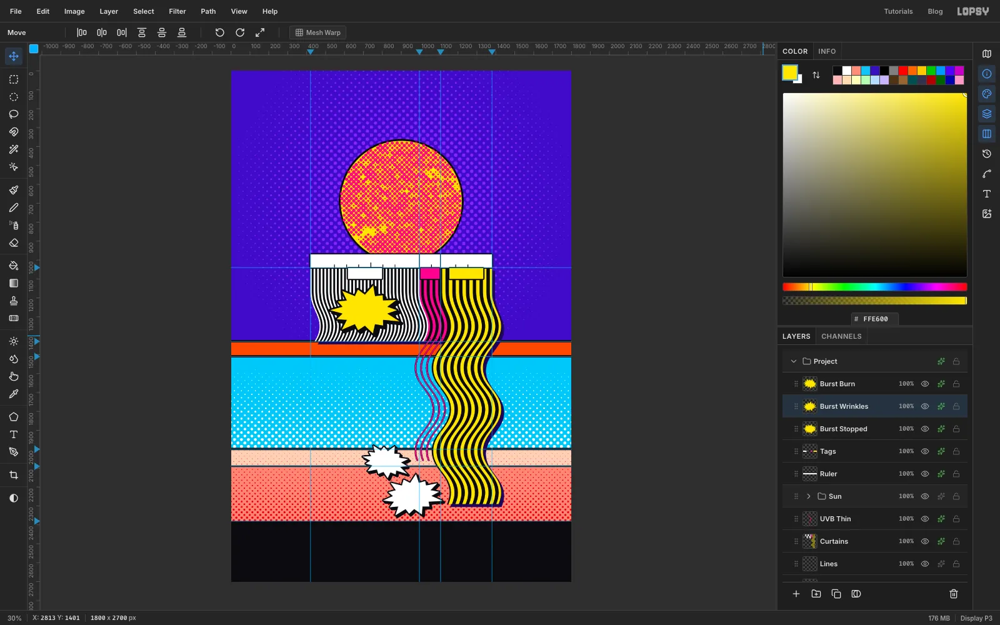

## Add the cards and index chips

Click the **Burst Burn** row, or whichever burst is highest in your panel, and add a layer named **Captions**. Fill these boxes in order:

- UVC card: (60, 1062) to (370, 1364), white
- UVB card: (595, 1570) to (905, 1944), `#FF1C8E`
- UVA card: (1475, 1570) to (1740, 1944), `#FFE600`
- How To Read card: (1290, 545) to (1740, 835), `#0B0B10`
- Scale note: (1475, 2240) to (1740, 2330), white

Each card's colour matches its band. Add a **Stroke** of Width 6 and a **Drop Shadow** of Offset X 9, Offset Y 9, Blur 1, Opacity 100, both in ink.

The UVB card isn't next to its band, so give it a leader. Press [[N]], set Size to 8 and the foreground to ink. Click just off the card's right edge at about y 1720, then Shift-click on the first thin magenta line at the same height. The layer's effects thicken it to match the cards.

Add a layer named **Chips** and fill five boxes from y 2476 to y 2562: x 60 to 463 in `#3DB21E`, x 463 to 866 in `#F7E400`, x 866 to 1135 in `#F85900`, x 1135 to 1538 in `#D8001D`, and x 1538 to 1740 in `#6B49C8`. The widths are in proportion to how many index values each category covers. The last one, 11+, has no upper limit, so it's only as wide as its label needs.

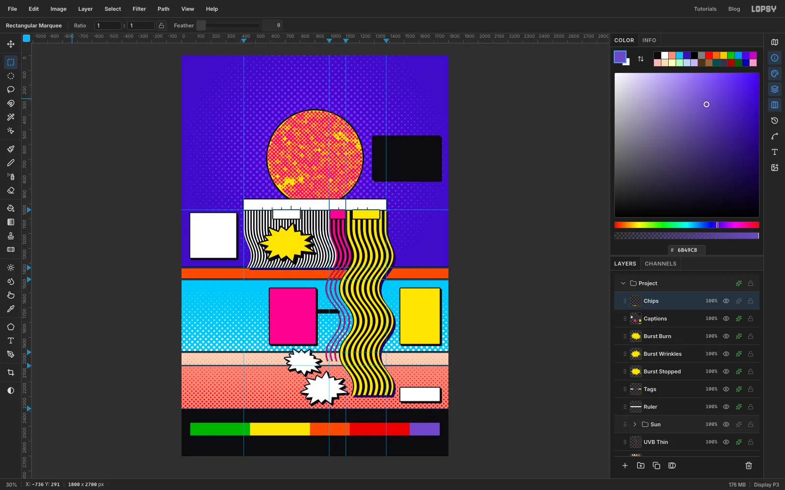

## Set the title

All the text in this tutorial follows the same loop:

1. Click the **Chips** row, because the text options restyle an active text layer.
2. Press [[T]]. Set the Size and font in the options bar, and set the foreground to the text colour.
3. Click in clear canvas, type, and press [[Tab]] to commit. Don't press [[Esc]], which cancels a new layer.
4. Rename the layer if you like, because text layers name themselves after their contents.
5. Press [[V]] and nudge it into place with the arrow keys. [[Shift]] moves it 10 px at a time.

Create these two, with **WAVELENGTHS** clicked well below the first line:

- **ULTRAVIOLET**: Bowlby One, Size 228, `#FFFFFF`
- **WAVELENGTHS**: Bowlby One, Size 203, `#12C4F5`

Nudge each one until it runs from margin to margin, 60 px in from each edge, with ULTRAVIOLET's letters centred on about y 135 and WAVELENGTHS on about y 322. Add a **Stroke** of Width 8 and a **Drop Shadow** of Offset X 13, Offset Y 13, Blur 1, Opacity 100, both in ink, to each. Let the bottom of WAVELENGTHS overlap the top of the Sun slightly, so the two feel connected.

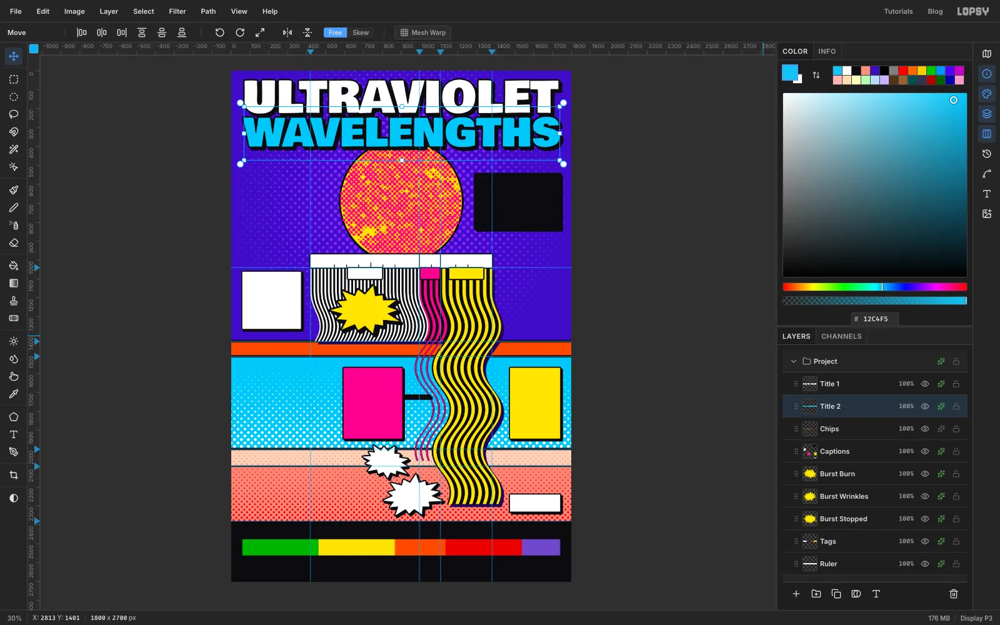

## Label the chart

A click on or just beside existing text edits that layer, so click in clear space and then nudge the new text into place. Your click sets the top-left corner of the text.

Click the **T** icon in the panel toolbar at the far right to open the Text panel, and set **Line height** to 1.2. It sticks for later text, so you only do this once.

- **WHAT THE SUN / SENDS, AND / WHAT REACHES / YOUR SKIN** on four lines: Bowlby One, Size 44, white, starting at x 60 and centred on the Sun's height
- **WAVELENGTH, NM**: Bowlby One, Size 24, white, ending just left of the ruler
- **OZONE LAYER**: Bowlby One, Size 36, ink, at x 60 and centred in the orange band
- **LOWER ATMOSPHERE**: Size 30, just under the ozone
- **EPIDERMIS** and **DERMIS**: Size 34, at x 60 in their bands

On the ruler, use **Space Mono**, Size 30, ink, and choose **Bold** in the Weight dropdown in the Text panel. Choose Weight right after you commit each one, while that layer is still active, so that it restyles the text you just made. Place **100** just inside the left end, **200** centred over its tick, **280** just left of its divider, **315** just right of its divider, and **400** just inside the right end. Keep all five on one baseline.

Name the tags in Bowlby One: **UVC** and **UVA** in ink at Size 40, **UVB** in white at Size 34.

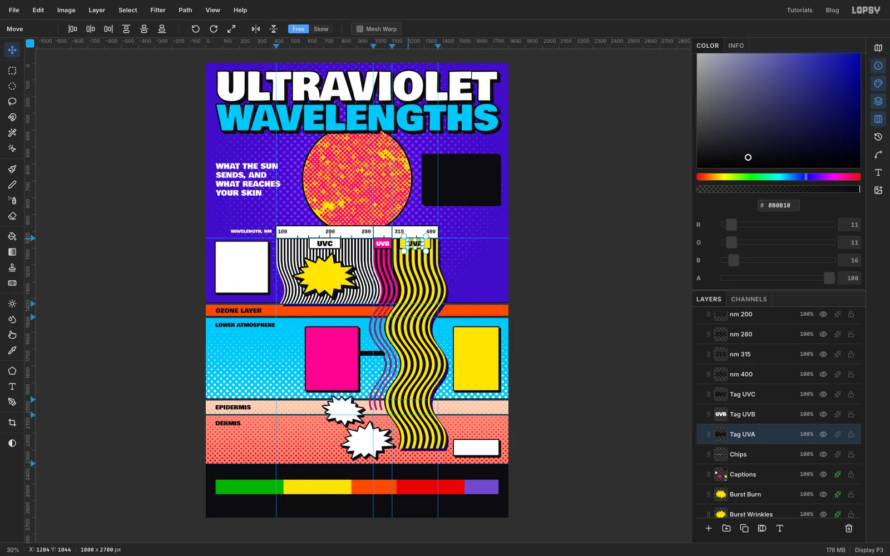

## Write the cards

Each card gets a band name, a range and a sentence or two, inset 28 px from the card's left edge. Set all of this in ink `#0B0B10`, including on the magenta card:

- the band name in Bowlby One, Size 42, about 30 px below the card's top
- the range in Bowlby One, Size 26, about 82 px below the card's top
- the text in Comic Neue, Size 30, with **Bold** chosen under Weight, about 130 px below the card's top

Break the lines by hand, where the slashes are:

- **UVC, 100–280 NM**: All of it is / absorbed before / it reaches the / ground.
- **UVB, 280–315 NM**: Most is absorbed. / The rest stays / in the top skin / layers, where / it causes / sunburn.
- **UVA, 315–400 NM**: Filtered far / less. Reaches / deeper skin / layers, where / it tans and / wrinkles.

In the black card, set **HOW TO READ IT** in Bowlby One, Size 32, `#FFE600`, with its letters about 35 px below the card's top. Below it, in white Comic Neue Bold, Size 30: Wider stripes mean a longer / wavelength, drawn to scale. / Bands are as wide as their / range on the ruler. / Thin lines: most absorbed.

In the white box, set **SKIN LAYERS / NOT TO SCALE** in Comic Neue Bold, Size 28, in ink.

## Add the comic shouts

Use **Bangers**, which already leans like comic lettering:

- **STOPPED!**: Size 76, ink, on the yellow burst
- **BURN!**: Size 58, `#FF1C8E`, on the first white burst
- **WRINKLES!**: Size 50, ink, on the second white burst

Now tilt each one to match its burst. These words are finished, so I rasterized them with the **Rasterize Layer** button at the bottom of the Layers panel, then marqueed around each word, used the Move tool's rotate handle, and pressed [[Cmd+D]]. You don't have to rasterize: live text has rotate handles of its own under the Move tool, and it stays editable. Turn STOPPED! about 6° anticlockwise, BURN! about 12° clockwise and WRINKLES! about 9° anticlockwise.

## Set the UV Index and credits

In the footer, set **UV INDEX** in white Bowlby One, Size 50, at x 60. Beside it, starting at x 400, in white Comic Neue Bold, Size 34: How strong UV gets at ground level, on the WHO and ICNIRP scale

Each chip has a small name and a big number, centred on the chip. When two texts sit close together, make the lower one first, then click above it for the upper one, so that your click doesn't land in existing text.

- Names in Bowlby One, Size 22, with their tops at about y 2532: **LOW**, **MODERATE**, **HIGH**, **VERY HIGH**, **EXTREME**
- Numbers in Bowlby One, Size 40, with their tops at about y 2486: **0–2**, **3–5**, **6–7**, **8–10**, **11+**
- Use ink on the first three chips and white on the last two

For the credits, use Space Mono, Size 22, in `#E6E6EE`, on two lines at x 60, at about y 2585 and y 2617. Always say where your data comes from. Write the lower line first:

- Sources: WHO, Radiation: ultraviolet (UV) Q&A; WHO, Global Solar UV Index; ICNIRP, UV Index.
- Sun: NASA/SDO AIA, extreme UV at 30.4 nm, off this chart's scale, 19 Aug 2010. Public domain.

The Sun photo was taken at 30.4 nm, which is well off the ruler, and it's better to say so than to leave it for a reader to spot.

One small fix: if a red dot sits right after a label, such as the S of DERMIS, it can read as a full stop. Click **Skin Dots**, press [[E]] for the Eraser, set Size to about 30, and click once on that dot.

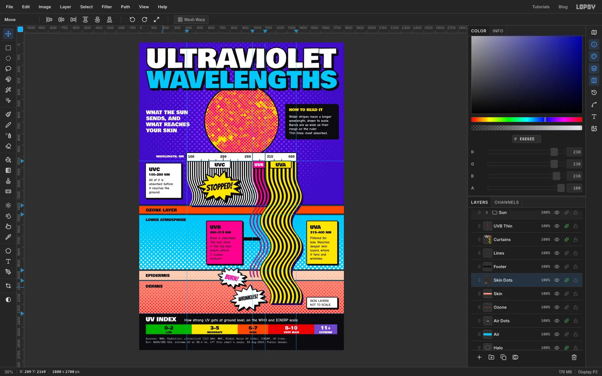

## Tidy up with groups

This poster now has about 70 layers, so group them. Click one end of a run in the Layers panel, Shift-click the other end, choose **Layer → Group Layers**, rename the group, and collapse it with its arrow:

- **Strata**: Air through Skin Dots
- **Type**: every text layer
- **Bursts**: the three bursts

Click a collapsed group's row and you can move everything inside it at once. Try [[Shift+Right]] with the Move tool on **Bursts**, then undo. It's a quick way to check that nothing has been left out of a group.

## Tint the blacks with Color Grading

Scroll to the top of the Layers panel and click the sparkle button on the **Project** row. Click **Add Adjustment** and choose **Color Grading**.

Click the **Shadows** tab under the wheels and set Hue to 262 and Saturation to 28. This pulls every black towards ultraviolet, so the ink looks as if it's lit by a blacklight. Click **Highlights** and set Hue to 52 and Saturation to 12, so the whites turn slightly creamy like old newsprint. Leave Midtones and Global alone.

Keep Shadows gentle. At higher values the blacks turn navy and the small type loses contrast. Close the drawer when you're done.

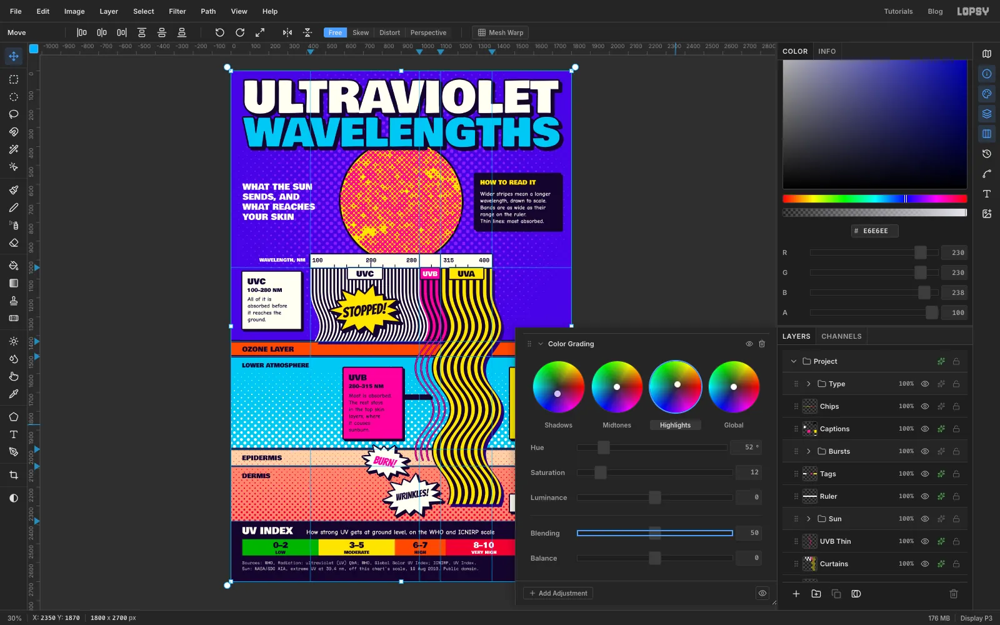

## Hide the guides and export

Choose **View → Show Guides** to hide the guides, then **View → Fit to Screen** and look the poster over. Check that each burst points at its line ends without covering them, and that nothing crowds the margins.

Save with **File → Save Project**, and export with **File → Quick Export PNG**.

Open the export next to the document. A viewer should get the story in about five seconds: three bands come down, one stops, one thins out, and one goes deep.

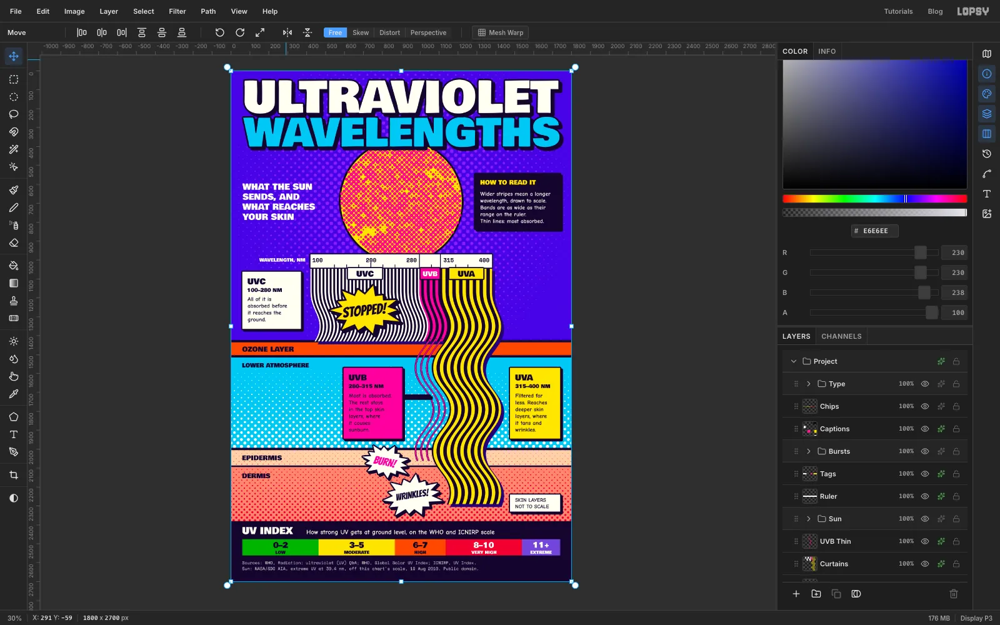
