**Outsider art** is made by painters with no formal training, working outside galleries and art schools. One of its best-known figures is **Martín Ramírez**, a Mexican-born artist who drew in pencil and crayon on pieced-together scraps of paper. His drawings come back to a few motifs again and again: horse riders and animals posed on little stages, trains running in and out of tunnels, and above all **bands of concentric lines** that turn every scene into a theatre arch or a rippling hillside.

In this tutorial you'll borrow that vocabulary for **Burro Arroyo**, a 1500 × 1700 px t-shirt graphic. ("Arroyo" is a dry creek bed in the desert.) A burro in a striped serape stands on a stage inside a tall arch. Behind it, a steam train crosses furrowed hills toward a tunnel. Hand lettering arches over the top, and the tagline below reads *agua, polvo, paciencia*: water, dust, patience.

The tools you'll use:

- the **Elliptical** and **Rectangular Marquee** with Shift-add and Shift+Alt intersect, the **Lasso**, and **Select → Shrink…** to cut rings
- the **Pencil** and **Brush**, with Shift-click straight lines
- **Mesh Warp**, **Sunburst**, **Fibers**, **Clouds**, **Brightness/Contrast**, **Add Noise**, **Gaussian Blur** and **Threshold**
- the **Magic Wand** with Contiguous off
- the **Stroke** and **Color Overlay** layer effects and the **Multiply** blend mode
- **Copy**, **Paste**, **Image → Flip Horizontal**, **Group Layers** and the Move tool's rotate and scale handles
- the **Pen** tool and the **Text** tool's **Path** option for type on an arc
- **Image → Canvas Size…** to balance the margins

You'll trace the burro over a reference photo: [Poitou Donkey 2851](https://commons.wikimedia.org/wiki/File:Poitou_Donkey_2851.jpg) by Amada44, CC BY 4.0, from Wikimedia Commons. Download it before you start. Any side-on photo of a donkey works too.

The fonts are **Rock Salt** for the title and **Permanent Marker** for the tagline. Both are free Google Fonts in Lopsy's font picker.

The palette:

- Shirt `#E6D8BC` (the background, not an ink)
- Graphite `#2A2420`, red oxide `#B0442B`, ochre `#D89A3B`
- Sage `#5B8A80`, burro brown `#7A5236`, cream `#F6EEDC`

> **Tip:** Positions are written as `x, y` in document pixels. The status bar at the bottom left shows the cursor's position as you move. With **nothing selected**, a click with a marquee tool (without dragging) opens a small dialog where you can type the two corners exactly. If something is already selected, that click deselects instead, so press [[Cmd+D]] first. When a step says to **Shift-add**, hold Shift and drag the next shape. **Shift+Alt** keeps only the overlap. Key names are Mac keys; on Windows and Linux use Ctrl for Cmd.

## Set up the shirt and guides

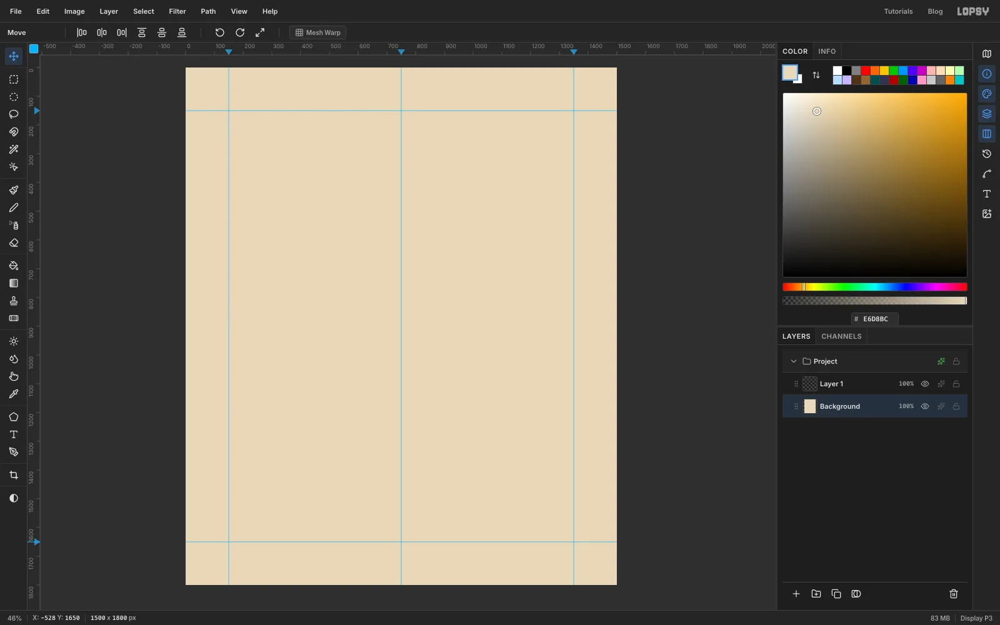

1. Choose **File → New**, enter **1500 × 1800** and click **Create**. You'll trim the height to 1700 near the end, once you can see how the artwork sits. The new document comes with an empty **Layer 1** above the Background. Leave it there; it becomes the stage later.
2. Click **Background** in the Layers panel, set the foreground colour to `#E6D8BC` and choose **Edit → Fill**. This stands in for the shirt.
3. Click the top ruler at **150**, **750** and **1350** to drop three vertical guides, and the left ruler at **150** and **1650** for two horizontal ones. The centre line is the one you'll use most. The others are loose framing marks: the arch and plinth stay inside them, while the cacti and the tips of the title are allowed to break out toward the edge of the print.

## Select the arch

The arch is a half circle sitting on a rectangle.

1. Click **Background** and click **Add Layer**. Double-click the new layer's name and call it `Arch`.
2. Pick the **Elliptical Marquee** (M cycles the marquees). Drag from `210, 280` to `1290, 1360` to select a circle 1080 px across, centred at `750, 820`.
3. Switch to the **Rectangular Marquee**, hold **Shift** and drag from `210, 820` to `1290, 1600`. The rectangle joins the lower half of the circle, and the selection becomes an arch.

## Cut the first ring

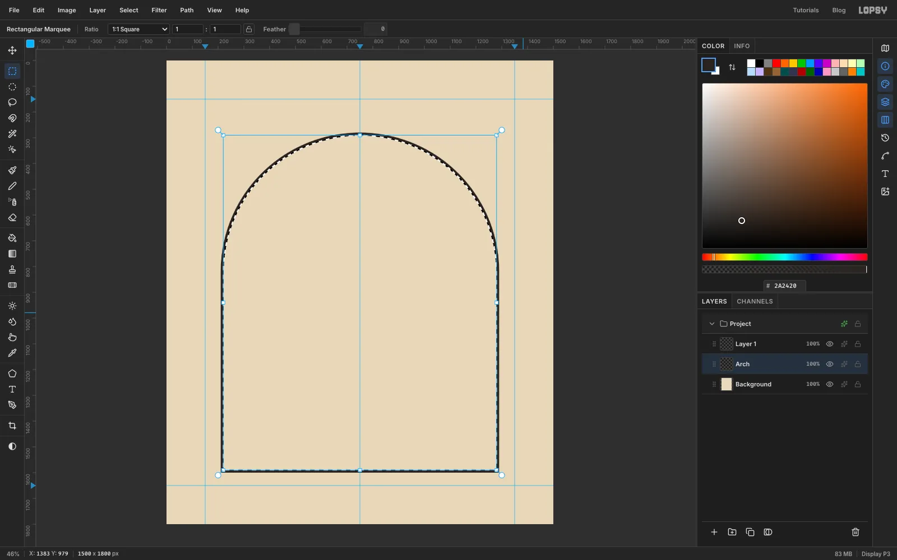

Ramírez built his arches from many parallel lines. In Lopsy each line is a fill that you hollow out with **Shrink**.

1. Set the foreground colour to graphite `#2A2420` and choose **Edit → Fill**. The whole arch turns solid graphite.
2. Choose **Select → Shrink…**, enter `10` and click **Apply**. The selection pulls in by 10 px all round.
3. Press [[Delete]]. The middle clears, leaving a 10 px graphite line, and the shrunken selection stays active.

## Add five more rings

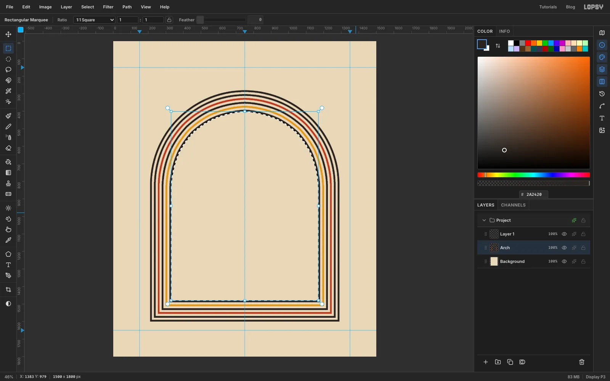

Each new ring repeats the same rhythm: a 12 px gap, a 10 px line.

1. Choose **Select → Shrink…** with `12`. This is the gap.
2. Set the colour for the ring, choose **Edit → Fill**, then **Select → Shrink…** with `10` and press [[Delete]].
3. Repeat steps 1 and 2 four more times. Going inward, the colours are graphite, red oxide `#B0442B`, graphite, ochre `#D89A3B` and graphite.

You end up with six lines, and the selection is the opening inside the arch. From here on, this opening is called the **niche**.

## Trim the rings at the floor

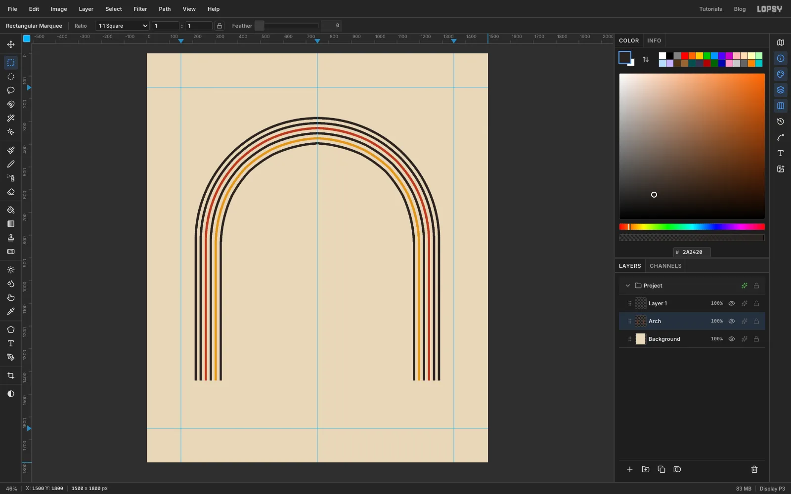

The rings run around the bottom of the rectangle too. Cut them off at the stage line.

1. Press [[Cmd+D]]. With the **Rectangular Marquee**, drag from the left edge of the canvas at `0, 1440` to the bottom-right corner.
2. Press [[Delete]], then [[Cmd+D]].

## Build the stage

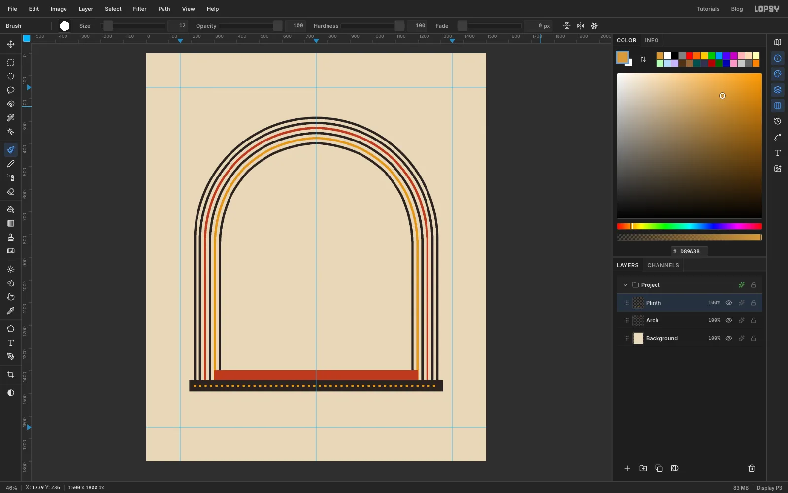

1. Click **Layer 1** (it sits above `Arch`) and rename it `Plinth`.
2. Marquee from `300, 1398` to `1200, 1440` and fill it with red oxide. This is the stage floor the burro will stand on.
3. Marquee from `190, 1440` to `1310, 1492` and fill it with graphite. It overhangs the outer ring by 20 px on each side, so the arch looks like it stands on it.
4. Press [[Cmd+D]]. Pick a hard **Brush** of size `12`, open the Brushes window and set **Spacing** to `200` % (its maximum) so the dabs separate into dots. In ochre, click at `214, 1466` and Shift-click at `1286, 1466`.
5. Set **Spacing** down to `10` % so later brush strokes are solid.

## Paint the sun's rays with Sunburst

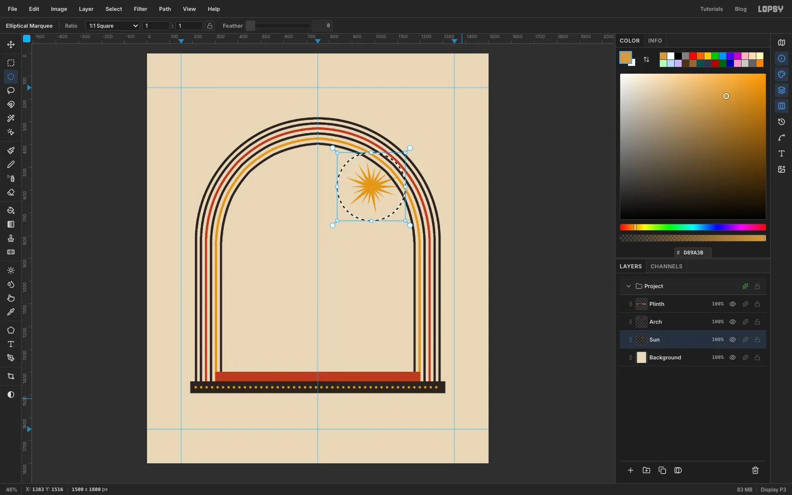

1. Click **Background** and add a layer named `Sun`. It sits under the arch, so the arch lines will always cover it.
2. With the **Elliptical Marquee**, drag from `835, 435` to `1135, 735`. That's a 300 px circle around the sun's centre at `985, 585`.
3. Set the foreground colour to ochre and choose **Filter → Sunburst…**. Set **Rays** `18`, **Length** `8.2`, **Width** `45`, **Taper** `100`, **Jitter** `45` and **Seed** `7`. Set **Center X** to `65.67` and **Center Y** to `32.5`. Those are percentages of the canvas, and they put the burst's centre at `985, 585`. Click **Apply**.

Taper 100 turns each ray into a spike, and Jitter cuts them to uneven lengths, so the burst looks hand-cut.

## Ring the sun

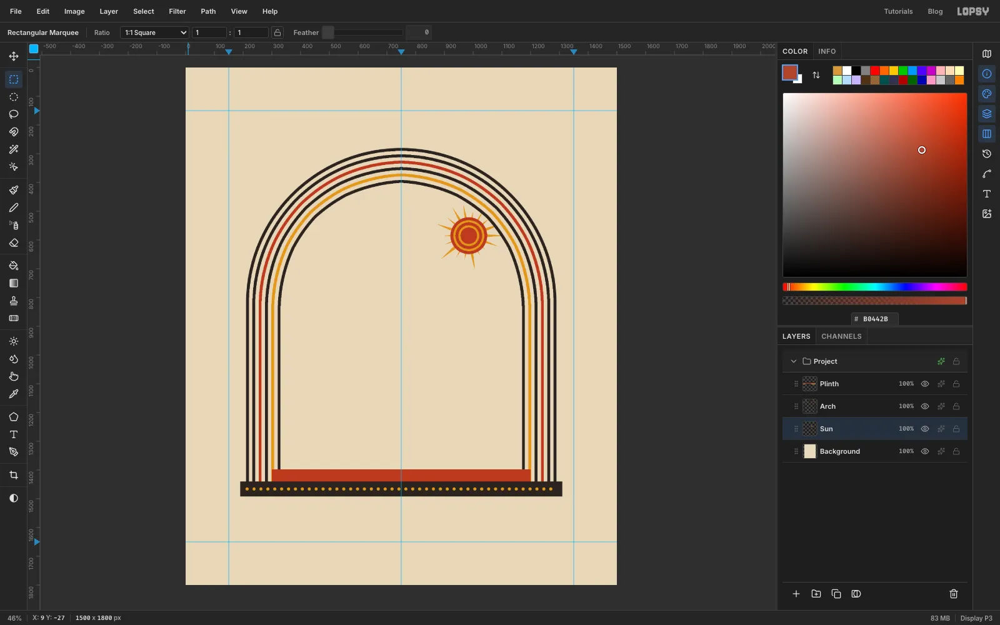

Use the same Shrink trick from the arch at a small scale.

1. Marquee a circle from `921, 521` to `1049, 649` and fill it with red oxide.
2. Shrink by `10` and fill with ochre, shrink by `7` and fill with red, shrink by `10` and fill with ochre, then shrink by `7` and fill with red.
3. Clip the rays to the niche. With the Elliptical Marquee, drag from `330, 400` to `1170, 1240`. With the Rectangular Marquee, Shift-drag from `330, 820` to `1170, 1440`. Choose **Select → Inverse**, press [[Delete]], then [[Cmd+D]].

## Fill the hills

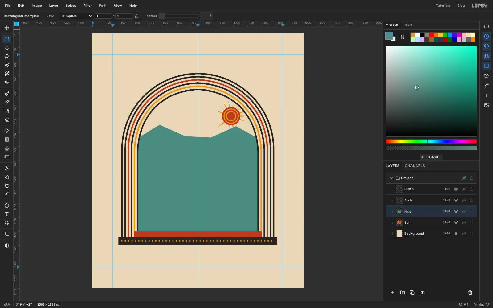

1. Add a layer named `Hills`.
2. With the **Lasso**, draw the skyline from left to right: start at the niche's left edge around `300, 756`, rise to a peak at `480, 646`, drop to a broad valley around `660–840, 730`, climb to a second peak at `1020, 656` and come down to `1200, 756`. Then go straight down past the stage line to `1200, 1460`, across to `300, 1460` and back up to where you started.
3. Fill with sage `#5B8A80`.
4. Select the niche again (circle plus Shift-added rectangle, as in the last step), choose **Select → Inverse**, press [[Delete]] and [[Cmd+D]].

## Rule the furrows

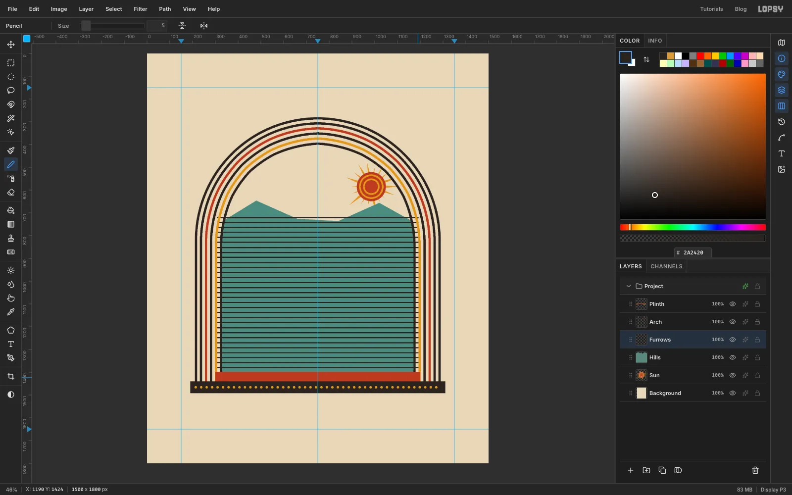

Ramírez filled his hills with parallel lines. Rule them straight first and bend them in the next step.

1. Add a layer named `Furrows`.
2. Pick the **Pencil** (N) at size `5` in graphite.
3. Click at `310, 720` and Shift-click at `1190, 720`. Repeat every 22 px down the canvas (`742`, `764`, `786`, and so on) until you reach y `1440`. That makes 33 lines. It takes a few minutes, and it's what makes the hills read as hand-ruled.

## Bend the furrows with Mesh Warp

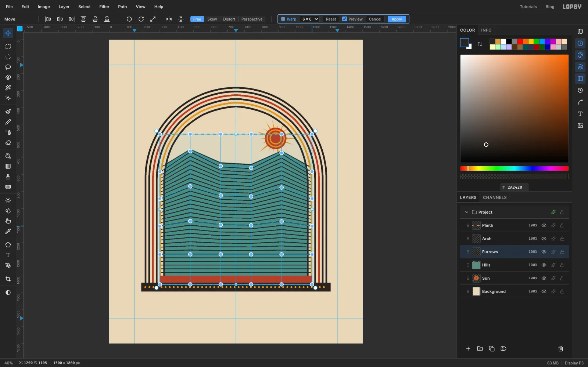

1. With the **Rectangular Marquee**, drag from `300, 560` to `1200, 1450`. Mesh Warp works inside a selection's bounding box.
2. Press [[V]] for the Move tool and click **Mesh Warp** in the options bar. Set the grid to **6 × 6** and tick **Preview**.
3. The grid columns sit at x 300, 480, 660, 840, 1020 and 1200. Drag the handles in the **second row** (y 738) straight up or down by these amounts, from left to right: down `44`, up `78`, down `11`, down `22`, up `67`, down `44`.
4. Move the **third row** (y 916) the same way by about 60 % of those amounts, and the **fourth row** (y 1094) by about a quarter. The lower furrows then flatten out toward the stage.
5. Click **Apply**.

The top furrow now follows the skyline you drew in the Hills step. Mesh Warp bends the lines straight between grid columns, so the hills keep sharp, folk-art peaks.

## Clip the furrows to the hills

1. **Cmd-click** the `Hills` thumbnail in the Layers panel to load the hill shape as a selection.
2. Choose **Select → Inverse**, click `Furrows` and press [[Delete]]. Press [[Cmd+D]].
3. Open the layer's effects (the ✦ button on its row), set the blend mode to **Multiply**, and drag the layer's opacity to **75%**. The lines now darken the sage instead of sitting on top of it.

## Dig a tunnel and lay the track

1. Add a layer named `Tunnel`. Marquee a circle from `1016, 734` to `1108, 826`, then Shift-add a rectangle from `1016, 780` to `1108, 834`. Fill with graphite.
2. Shrink by `7` and fill with ochre, then shrink by `6` and fill with graphite. That leaves a dark mouth with an ochre rim, a tiny echo of the big arch.
3. Add a layer named `Track`. With the **Pencil** at size `4` in graphite, Shift-click two rails: `334, 817` to `1040, 817`, and `334, 827` to `1040, 827`. They run into the tunnel's base.
4. Add the ties: short vertical lines from y `812` to `832`, starting at x `346` and every 26 px to the right.

## Build the boxcars and engine

Everything here is marquee rectangles and circles, Shift-added together and filled.

1. Add a layer named `Boxcars`. Fill two red oxide rectangles, `816, 760` to `900, 800` and `910, 760` to `994, 800`. Add graphite roofs, `812, 753` to `904, 762` and `906, 753` to `998, 762`, and small couplers in front of each car at y 787–792. With the **Pencil** at size `4`, draw an X across each car's side. Fill four graphite wheels of 18 px at y `807`, two under each car.
2. Add a layer named `Engine`. Select these graphite rectangles together and fill them in one go: the boiler `660, 764` to `760, 800`, the cab `752, 734` to `800, 800`, the cab roof `746, 728` to `806, 738`, the smokestack `672, 738` to `688, 766`, and its cap `664, 730` to `696, 740`. Shift-add a 36 px circle centred on `664, 782` for the rounded smokebox.
3. Marquee the cab window, `764, 744` to `788, 764`, and press [[Delete]].
4. Fill graphite wheels: two 22 px wheels centred on `690, 805` and `726, 805`, and a 26 px driver wheel on `776, 803`. Put small ochre hubs on them, and add a 14 px ochre headlamp at `650, 772`.
5. With the **Lasso**, click out a triangle at `628, 815`, `653, 790` and `653, 815`, and fill it with red for the cowcatcher. Pencil two ochre bands across the boiler at x `702` and `734`.

## Puff the smoke

1. Add a layer named `Smoke`. With the Elliptical Marquee, select a circle centred just above the smokestack at `682, 712` with a 15 px radius. Then Shift-add five more, rising and drifting back over the boxcars, growing and then tapering off: `704, 692` (radius 19), `736, 673` (23), `776, 660` (26), `822, 652` (22) and `862, 650` (16).
2. Fill with cream `#F6EEDC` and press [[Cmd+D]].
3. Open the layer's effects and turn on **Stroke** with **Width** `3` in graphite. Because the puffs are one merged shape, the outline runs around the whole cloud, not round each circle.

## Group the train and pull it out of the tunnel

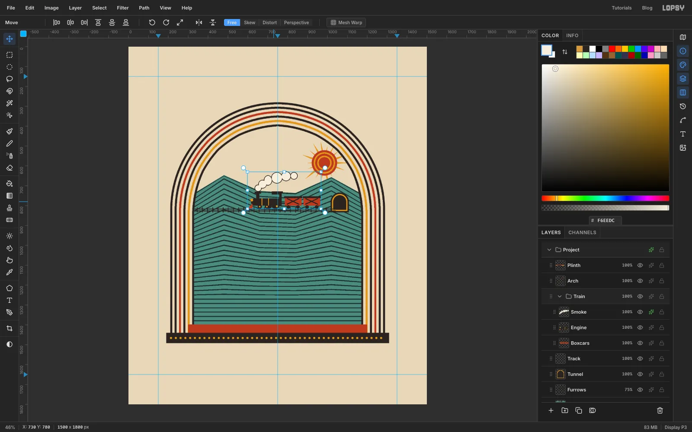

1. With `Smoke` selected, **Cmd-click** the *names* of `Engine` and `Boxcars` in the Layers panel (not their thumbnails), so all three rows are selected.
2. Choose **Layer → Group Layers** and rename the group `Train`.
3. Grouping pays off as soon as you want to adjust the composition. Here the last boxcar sits a little close to the tunnel. With the `Train` group selected and the **Move** tool, drag anywhere on the train **30 px to the left**. The engine, boxcars and smoke move together.

## Drop in the reference photo

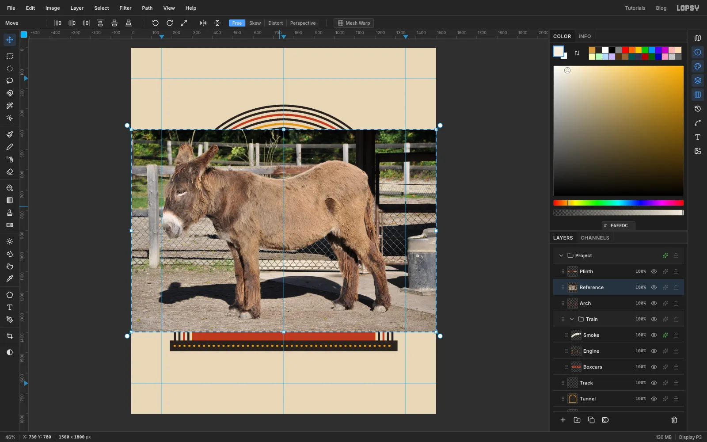

1. Click `Arch` so the photo lands above it.
2. Drag the donkey photo from your computer onto the canvas. It arrives as a new layer, scaled to the canvas width and already selected. Rename it `Reference`.

## Scale and place the photo

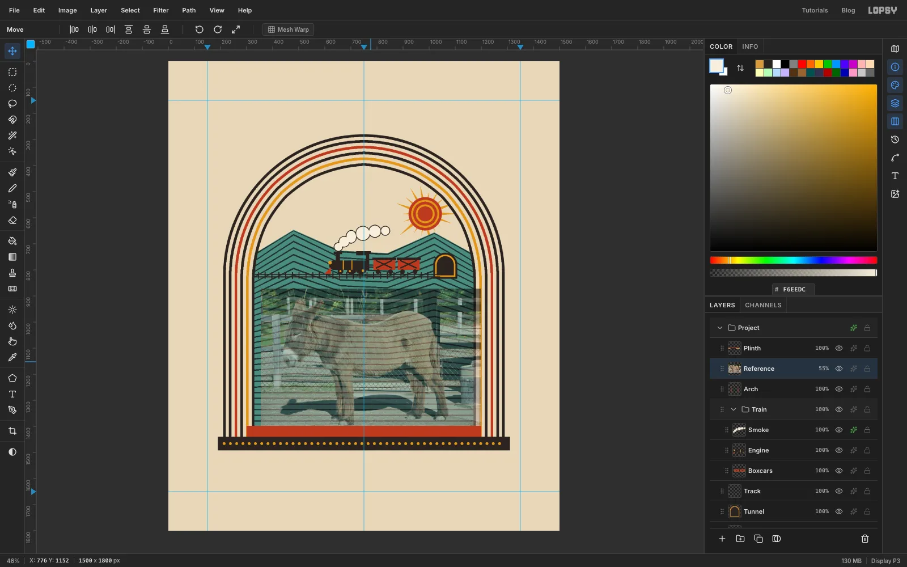

1. With the **Move** tool, hold **Cmd** and drag the bottom-right corner handle inward until the photo is about **845 px** wide. Holding Cmd keeps the proportions. Press [[Return]] to apply, then [[Cmd+D]].
2. Drag the photo so its top-left corner sits at about `354, 872`. The donkey's hooves should land on the red stage, with its nose about 110 px in from the inner ring on the left.
3. Drag the layer's opacity down to **55%** so you can see your tracing over it.

## Trace the burro

1. Click **Add Layer** and name the new layer `Burro`.
2. Pick the **Lasso** and trace around the donkey: up the front of the face, round both ears, along the mane and back, down the rump and the back of the hind legs. Then go round the hind hooves, up into the belly, down and round the front legs, and along the chest and throat back to the muzzle.
3. Don't follow every tuft of fur. Ramírez flattened his animals into clear silhouettes, so keep the line smooth. In the photo the two front legs overlap, so trace them as one column; you'll split them with a line later. **Flatten every hoof onto the stage line at y 1398**, even though the photo's back legs stand a little higher. That way the burro stands on the stage.

## Fill and outline the burro

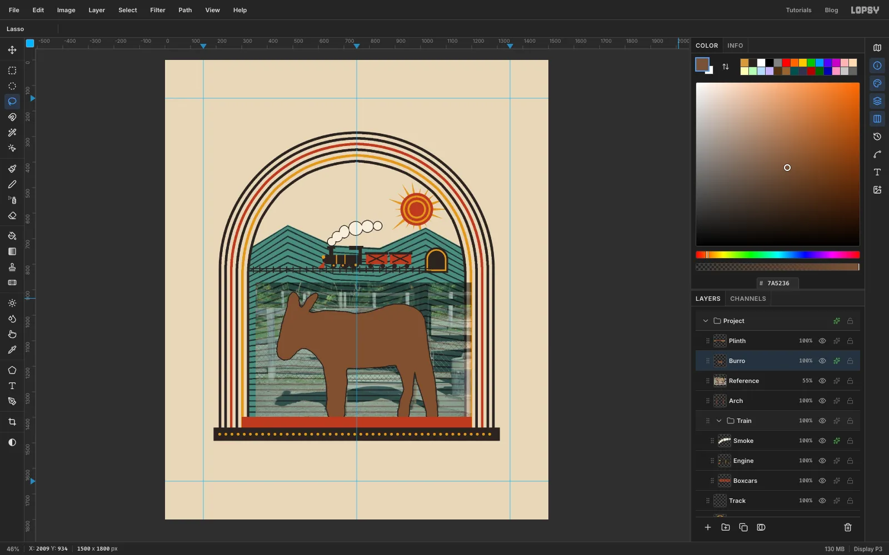

1. Fill the selection with burro brown `#7A5236` and press [[Cmd+D]].
2. Open the layer's effects and add a **Stroke** of `4` in graphite. Brown and sage are close in value, and the outline keeps the silhouette crisp against the hills.

## Hatch the coat with Fibers

1. Hide `Reference` with its eye icon. You'll keep it in the file in case you want to retrace.
2. Click `Burro`, add a layer named `Burro Hair`, then **Cmd-click** the `Burro` thumbnail to load the silhouette as a selection. Click `Burro Hair` again so it's the active layer.
3. Choose **Filter → Fibers…** with **Variance** `40` and **Strength** `40`. Grey vertical streaks fill only the burro shape.
4. Press [[Cmd+D]], set the blend mode to **Multiply** and the opacity to **40%**. Multiply drops the light streaks out and turns the darker ones into deeper brown, so they read as hatching in the coat.

## Paint the hooves

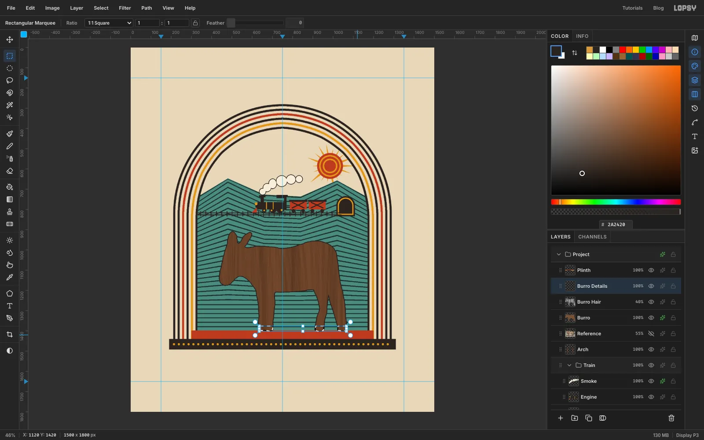

1. Add a layer named `Burro Details` and **Cmd-click** the `Burro` thumbnail again, then click `Burro Details`.
2. With the **Rectangular Marquee**, hold **Shift+Alt** and drag from `400, 1376` to `1120, 1420`. Only the overlap stays selected: the bottom 22 px of each leg.
3. Fill with graphite and press [[Cmd+D]]. Every hoof comes out the same height.

## Add the face, mane and tail

Stay on `Burro Details` for all of these. The positions are for the reference photo placed as above; since everyone's tracing differs a little, place each mark by eye on your own burro.

1. **Muzzle.** Cmd-click the `Burro` thumbnail, click `Burro Details`, and with the **Elliptical Marquee** Shift+Alt-drag an ellipse about 70 × 80 px over the front of the nose (around `464, 1141`). Only the part inside the burro stays selected. Fill it with cream and press [[Cmd+D]].
2. **Eye.** Marquee a small 30 × 20 px ellipse where the eye is in the photo (around `494, 1047`) and fill it with cream. Press [[Cmd+D]], pick a hard **Brush** of size `12` in graphite and click once in its middle. Click once more at the front of the muzzle for the nostril.
3. **Mouth.** At brush size `5`, drag a short, slightly curved line about 30 px long under the muzzle.
4. **Ears.** At size `7`, drag a line up the middle of each ear, from its base toward the tip.
5. **Mane.** At size `5`, drag 16 short tick marks along the crest of the neck, from just behind the ears to the withers. Make each one about 25 px long and leaning back, like the little dashes Ramírez used for hair.
6. **Leg seam.** Drag a line straight down the middle of the front-leg column, from the chest to the hoof, so it reads as two legs.
7. **Tail.** At size `13`, drag the tail so it hangs just outside the rump in a gentle curve, about 170 px long (in the example, from `1014, 1017` to `1061, 1180`). At size `10`, fan five short strokes downward from its end to make a tuft.

## Weave the serape

1. Add a layer named `Blanket`. Marquee a rectangle over the middle of the back that reaches well above the back line, here from `686, 950` to `902, 1120`, and fill it with red oxide. Press [[Cmd+D]]. You'll trim the top to the back in a moment.
2. With the **Pencil**, draw vertical stripes from the top edge to the bottom edge with Shift-click lines. Use `12` px ochre at x `704` and `884`, `4` px graphite at `720` and `868`, `12` px sage at `742` and `846`, and three `5` px cream lines at `780`, `794` and `808`.
3. With the **Lasso**, click out a diamond centred on `794, 1046`, 40 px wide and 60 px tall, and fill it with ochre.

## Tilt the blanket

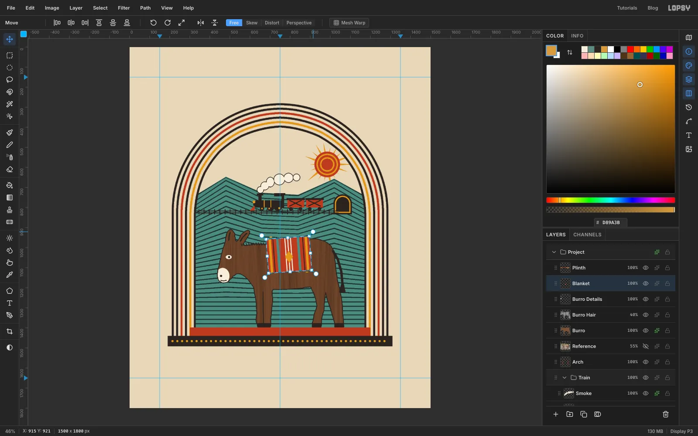

1. With `Blanket` active, pick the **Move** tool. Handles appear around the blanket.
2. Drag one of the round rotate handles outside the corners until the blanket turns about **4° anticlockwise**. A blanket thrown over a back never sits perfectly straight.
3. Press [[Return]], then [[Cmd+D]].

## Drape it over the back

1. **Cmd-click** the `Burro` thumbnail, choose **Select → Inverse**, click `Blanket` and press [[Delete]]. The part above the back is trimmed, so the blanket's top edge follows the burro's back. Press [[Cmd+D]].
2. With the **Pencil** at size `3` in cream, draw short fringe lines about 16 px long hanging from the blanket's bottom edge, every 9 px. Tilt them with the blanket so they hang straight off its edge.

## Plant a saguaro

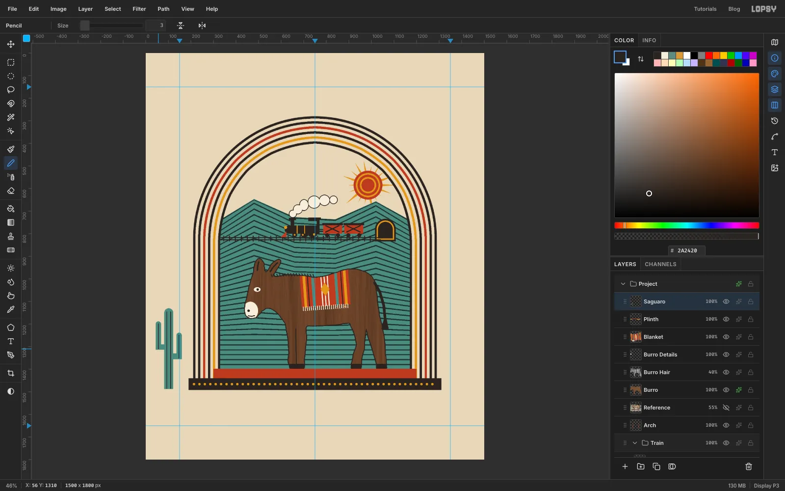

1. Click `Plinth` and add a layer named `Saguaro`.
2. With the **Rectangular Marquee**, select the trunk from `82, 1150` to `122, 1488`. Shift-add the right arm, `116, 1330` to `160, 1356` and `136, 1250` to `160, 1356`, and the left arm, `44, 1290` to `88, 1314` and `44, 1200` to `68, 1314`. With the **Elliptical Marquee**, Shift-add round tops: a 40 px circle on `102, 1150` and 24 px circles on `148, 1250` and `56, 1200`.
3. Fill with sage and press [[Cmd+D]].
4. With the **Pencil** at size `3` in graphite, rule two ribs down the trunk at x `94` and `110`, and one down the middle of each arm.

The trunk stops 4 px short of the plinth's bottom edge on purpose. The outline you add in the next step fills that gap, so the cactus sits exactly on the plinth line.

## Mirror the saguaro

1. Marquee around the cactus, from `30, 1120` to `170, 1492`. Press [[Cmd+C]] and [[Cmd+V]]. The copy lands in place on a new layer. Rename it `Saguaro Right`.
2. Choose **Image → Flip Horizontal**. The copy mirrors in place.
3. With the **Move** tool, drag it straight to the right until its left edge sits at x `1340`. It is then 30 px from the plinth, like the left one. Press [[Cmd+D]].
4. Give both `Saguaro` and `Saguaro Right` a **Stroke** of `4` in graphite. A paste doesn't carry layer effects with it, so add each one separately.

## Draw the title's arc

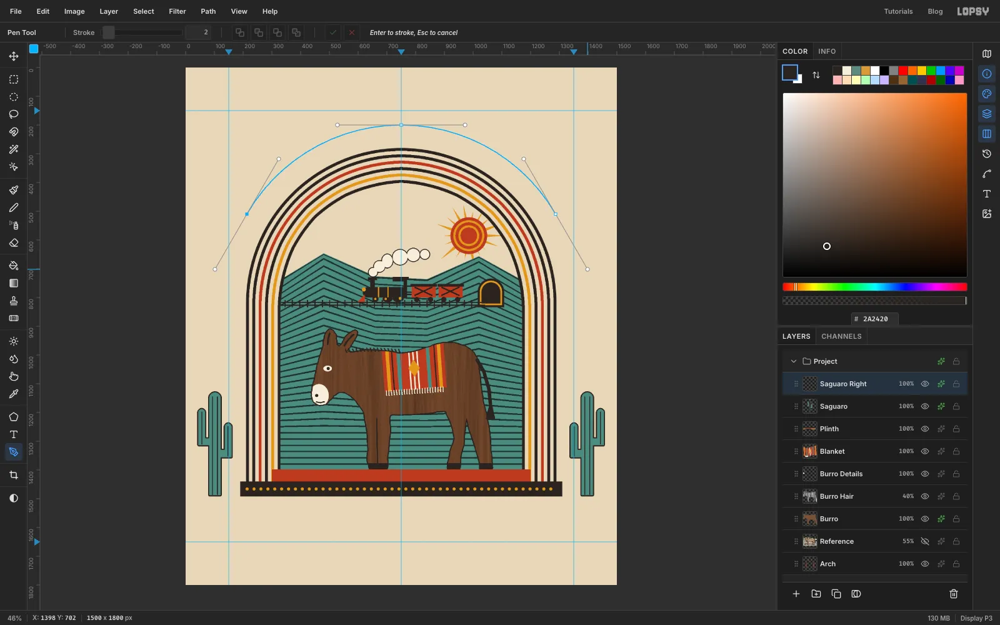

The title sits on an arc that shares the arch's centre, 80 px further out.

1. Pick the **Pen** (P). Press at `213, 510` and drag to `324, 318` to pull out a handle.
2. Press at `750, 200` and drag right to `971, 200`.
3. Press at `1287, 510` and drag down to `1398, 702`.
4. Click the ✓ in the options bar to finish the path without stroking it.

These three points lie on a circle of radius 620 around `750, 820`, and the handles keep the curve round between them.

## Set the title on the arc

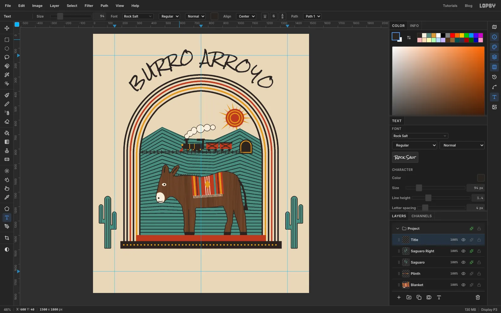

1. Make sure `Saguaro Right` is the active layer, so the new text lands at the top of the stack.
2. Pick the **Text** tool (T) and set **Rock Salt**, size `94`, in graphite. Click in an empty part of the canvas near the top, type `BURRO ARROYO` and press [[Tab]] to commit. Double-click the new layer's name and rename it `Title`.
3. In the **Text** panel, set **Letter spacing** to `4`.
4. In the options bar, set **Align** to **Center**, then choose **Path 1** from the **Path** menu. The title wraps onto the arc, centred over the arch.
5. In the **Paths** panel, click the path again to deselect it, so its line stops showing over the type.

Rock Salt's letters hang a little below the line they sit on. That's why the arc is 80 px out from the arch rather than 50: it leaves about 55–70 px of shirt between the letters and the outer ring.

## Letter the tagline

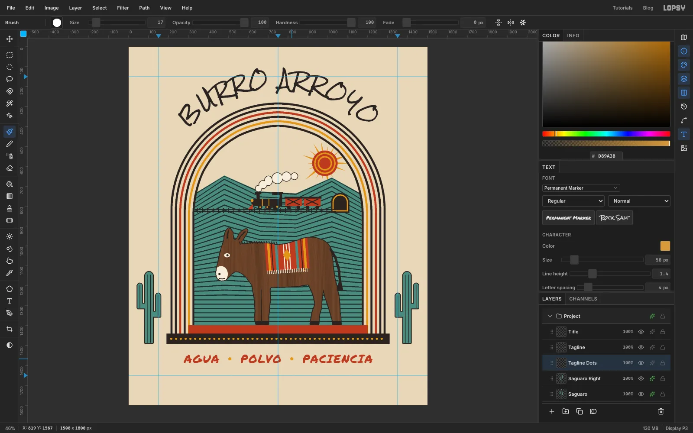

1. Click `Saguaro Right` again. Starting from a raster layer means the Text tool's new settings won't restyle the title. With the **Text** tool, set **Permanent Marker**, size `58`, in red oxide. Click in an empty spot below the plinth and type `AGUA    POLVO    PACIENCIA`, with four spaces between the words. Press [[Tab]], rename the layer `Tagline`, and set **Letter spacing** to `4`.
2. With the **Move** tool, drag the tagline so it is centred on the middle guide, with its letters running from about y `1545` to `1588`. Use the arrow keys for the last few pixels.
3. Click `Saguaro Right`, add a layer named `Tagline Dots`, and with a hard **Brush** of size `17` in ochre, click once in the middle of each gap. Painted dots are bigger and warmer than a typed middle dot.

## Balance the margins

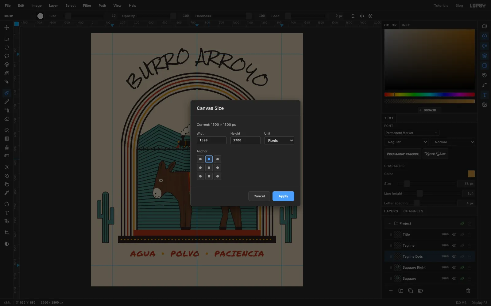

The artwork now runs from the title at the top to the tagline at the bottom, and there's more empty shirt below it than above. Trim the bottom.

1. Choose **Image → Canvas Size…**.
2. Set **Height** to `1700`, click the **top-centre** anchor so the canvas is cut from the bottom, and click **Apply**.

## Make the wear texture

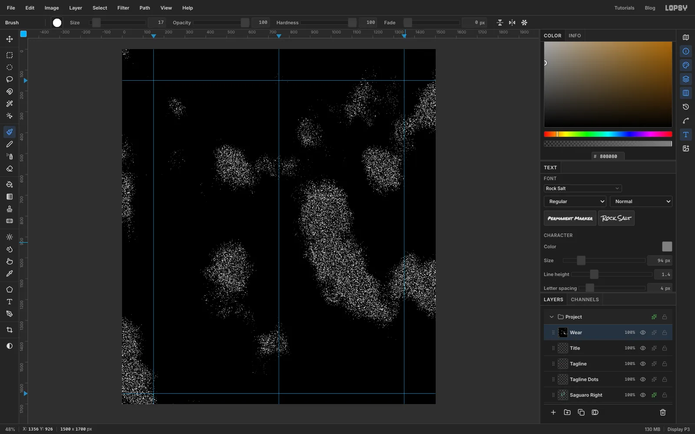

Real screen prints wear in patches, with some areas worn and some still clean. You'll build that from clouds and noise.

1. Click `Title` (the top layer) and add a layer named `Wear`.
2. Choose **Filter → Clouds…** with **Scale** `6`, then **Filter → Brightness/Contrast…** with **Contrast** `-72`. This turns the clouds into a gentle variation in grey.
3. Choose **Filter → Add Noise…** with **Amount** `100`, **Mono** and **Uniform**, then **Filter → Gaussian Blur…** with **Radius** `2`. The blur clumps the noise into flecks.
4. Choose **Filter → Threshold…** and set **Level** to about `173`. Only the brightest flecks turn white, and they cluster where the clouds were lightest. Clouds are random every time, so nudge the level until roughly one twentieth of the canvas is speckled.

## Knock the wear out of the inks

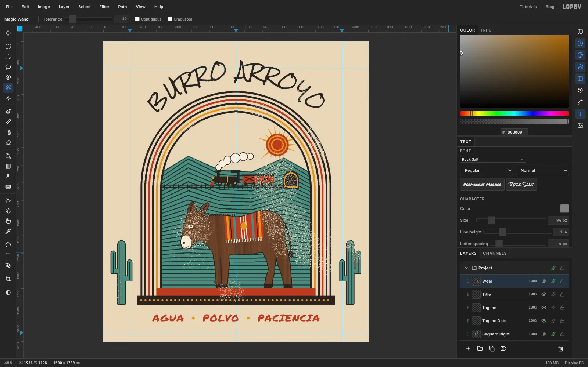

1. Pick the **Magic Wand**, untick **Contiguous**, and click a black part of the `Wear` layer. Every black pixel is selected.
2. Press [[Delete]] and [[Cmd+D]]. Only the white flecks remain.
3. Add a **Color Overlay** effect in the shirt colour `#E6D8BC`. The flecks now look like the shirt showing through worn ink. Where they fall on bare shirt, they disappear.

Save your work with **File → Save Project**, and use **File → Quick Export PNG** for the print file. To see how the layers fit together, or to swap in your own animal, open the project from the **Follow along** box at the top of this page. The reference photo is still in it, hidden under the burro.
