**The Hermit's Quarry** doesn't exist. It's an imaginary film about one man who spends thirty-one years carving a city out of a hill. Concept art is what a production designer paints to show everyone what a film will look like before a single set gets built. This piece imagines the production hired an **outsider artist** to do it.

Outsider art is work by people with no art training, who often make it obsessively and for no audience. Three artists shaped this picture:

- **Martín Ramírez** drew tunnels and trains in rhythmic parallel lines, on scraps of paper he glued together, and he pasted in figures cut from magazines
- **Adolf Wölfli** packed his sheets with dense bands of repeating ornament
- **Howard Finster** covered his paintings with sermons in his own hand

So everything here is lines on scrap card, and every figure in the quarry is the same photograph. There's only one man, after all. The slate label and the three colour keys are what make it concept art rather than a painting.

The document is 2400 × 1400 px. You don't need to match any position exactly, and wobble is the whole point. Where this tutorial gives coordinates, read them off the rulers as rough targets.

You'll need two public domain images from Wikimedia Commons. Download the 1920 px version of each:

- [World's largest granite quarries, Barre, Vt](https://commons.wikimedia.org/wiki/File:World%27s_largest_granite_quarries,_Barre,_Vt_%2887375%29.jpg), a linen postcard published by Tichnor Quality Views around 1930–45. Save it as `barre.jpg`
- [Steinhauer bei der Arbeit](https://commons.wikimedia.org/wiki/File:Zentralbibliothek_Z%C3%BCrich_-_Steinhauer_bei_der_Arbeit_-_991121155939705501.jpg), a photograph of a stonecutter by Robert Breitinger, 1896, from the Zentralbibliothek Zürich. Save it as `steinhauer.jpg`

The tools you'll use:

- the **Brush** set up as a crayon, its **Radial Symmetry**, and the **Pencil** for straight lines
- the **Lasso**, and the **Elliptical** and **Rectangular Marquee** with their exact-size dialogs
- the **Pen** tool, with **text on a path**
- **Define Pattern** and **Fill with Pattern**
- photos dropped on the canvas, **Select → Inverse**, **Copy**, **Paste**, **Copy Merged** and **Flip Horizontal**
- the **Move** tool's rotate and scale handles
- **Hue/Saturation**, **Brightness/Contrast**, **Add Noise**, **Motion Blur**, **Gaussian Blur**, **Clouds**, **Threshold** and **Unsharp Mask**
- the **Multiply** and **Lighten** blend modes, **Merge Down** and groups
- layer effects: **Drop Shadow**, **Outer Glow** and **Stroke**
- text in **Walter Turncoat**, **Covered By Your Grace** and **Special Elite**

The palette is scrap card and a cheap box of crayons:

- Card `#A98B62`, scraps `#B89B72` / `#C2A67F` / `#AD9068` / `#BCA078`, tooth `#BFA27A`
- Graphite `#26221E`, chalk cream `#EFE6D0`, strip cream `#E7D9B4`
- Dusk sky `#23264C` → `#2C3A73` → `#54548F` → `#A05F8C` → `#D37B88` → `#E8A96B`
- Brick `#B4412B`, mustard `#E3B63F`, lamp yellow `#F4C84A`, cobalt `#3C5E9A`
- Land `#3A3A22` / `#6B6A3A`, tape `#E6D79F`

> **Tip:** On a wide-gamut (Display P3) screen, Lopsy reads typed hex codes as P3 colours. These codes were picked that way, so they'll look a touch duller on an sRGB screen.

> **Note:** Shortcuts are written for a Mac. On Windows use [[Ctrl]] wherever it says [[Cmd]]. To rename a layer, double-click its name. Keep layers named as you go, because later steps refer to them.

## Glue four scraps of card together

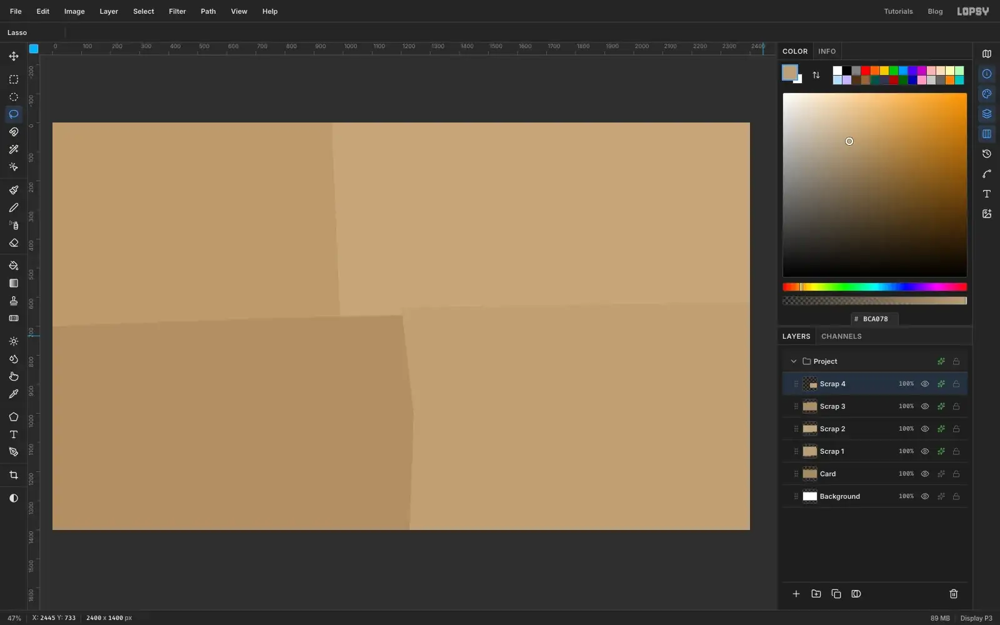

Choose **File → New**, keep the units on **Pixels**, and make the document **2400** wide and **1400** high.

Rename **Layer 1** to **Card**, set the foreground to `#A98B62` and choose **Edit → Fill**.

Now add the scraps. For each one, click **Add Layer** (the **+** under the Layers panel), rename it, set the foreground, press [[L]] for the **Lasso**, and draw a rough quarter of the card. Choose **Edit → Fill** and press [[Cmd+D]]:

- **Scrap 1**, `#B89B72`: top left, ending a little left of the middle and about halfway down
- **Scrap 2**, `#C2A67F`: top right, overlapping Scrap 1 by about 50 px
- **Scrap 3**, `#AD9068`: bottom left, overlapping the two above
- **Scrap 4**, `#BCA078`: bottom right, overlapping everything it touches

Take each lasso past the edge of the canvas where it meets one, and keep the inner edges slightly crooked.

On each scrap, click the row's effects button, tick **Drop Shadow**, and set **Offset X** to **2**, **Offset Y** to **3**, **Blur** to **6** and **Opacity** to **45**. Close the drawer. Those thin shadows are what make it look glued.

## Draw the sky in rows of crayon, then stitch the seam

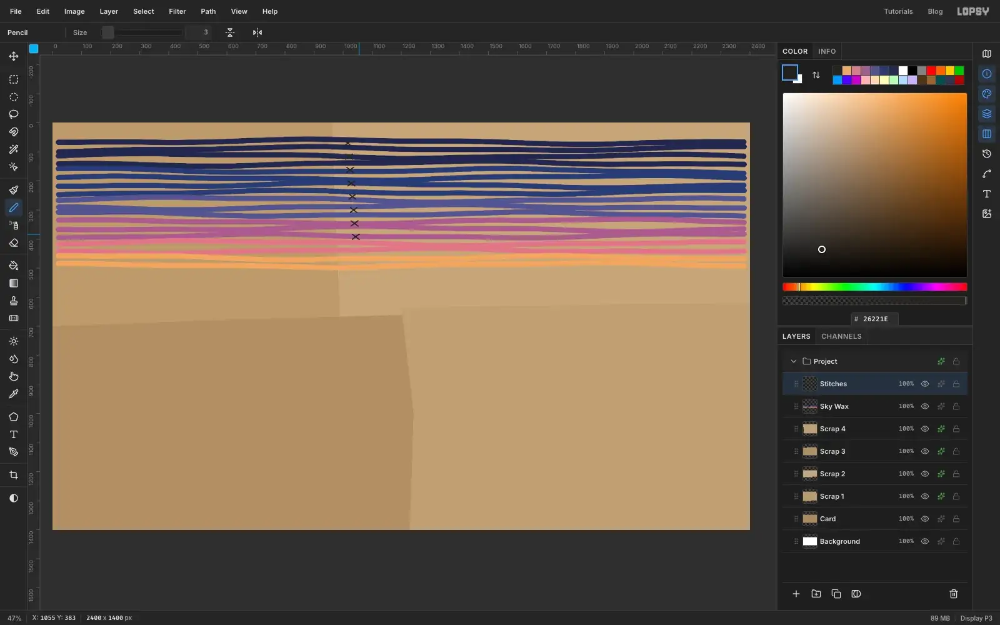

First set up the crayon, which you'll use for most of this picture. Press [[B]] for the **Brush**, click the brush-tip thumbnail at the left of the options bar to open the **Brushes** window, pick **Hard Round** on the **Presets** tab, then on the **Shape** tab set **Hardness** to **90** and **Spacing** to **6**. Close the window. From now on, "the crayon" means this brush, and you only change its **Size** in the options bar.

Add a layer called **Sky Wax** and set the Size to **19**. Draw long horizontal rows, freehand and slightly wavy, starting at about y 60 and working down to y 500, with about 25 px from one row to the next. Take each row from just inside one edge of the canvas to just inside the other. The border will hide the ends later. Don't fill the gaps: the card showing between the rows is the look.

Change colour as you go down, so you get about 18 rows in all:

- `#23264C` down to y 150
- `#2C3A73` down to y 250
- `#54548F` down to y 330
- `#A05F8C` down to y 395
- `#D37B88` down to y 450
- `#E8A96B` for the last rows

Add a layer called **Stitches**. Press [[N]] for the **Pencil**, set its **Size** to **3** and the foreground to `#26221E`. Where the two top scraps meet (around x 1020), make a column of small crosses from y 70 to y 400, one every 45 px or so. For each stroke of a cross, click one end, then hold [[Shift]] and click the other.

## Throw the sun's rays with Radial Symmetry

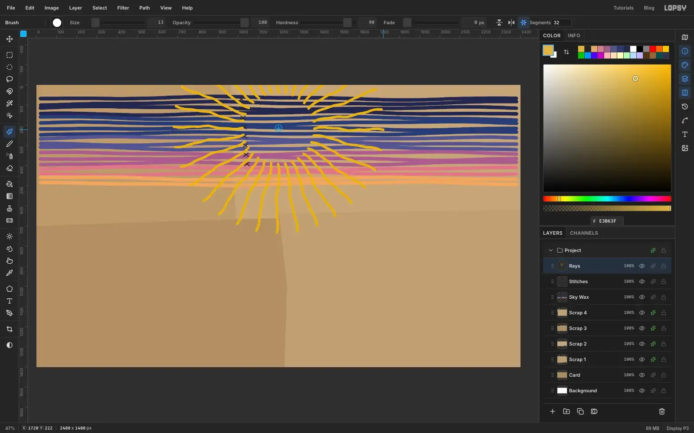

Add a layer called **Rays** and go back to the crayon ([[B]]), Size **13**, foreground `#E3B63F`.

Click **Radial Symmetry** in the options bar and set **Segments** to **32**. Then [[Cmd]]-click at about x 1200, y 214. That click moves the centre of the symmetry and paints nothing.

Now drag one wobbly stroke outward, starting about 180 px right of the centre and ending about 520 px from it. All thirty-two rays appear at once.

Set the Size to **6** and the foreground to `#EFE6D0`, and draw a shorter wobbly stroke halfway between the first ray and the next, from 180 to 340 px out. That adds thirty-two cream rays between the mustard ones.

Click **Radial Symmetry** again to turn it off. If you leave it on, every crayon stroke from here comes out thirty-two times.

## Stack the sun out of rings

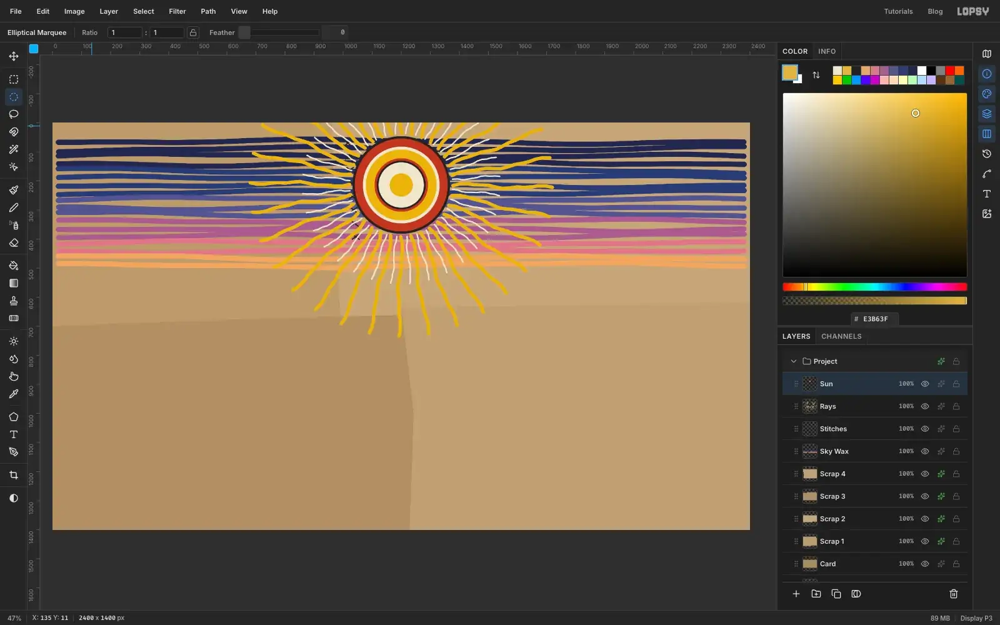

Add a layer called **Sun**. Press [[Cmd+D]] to make sure nothing is selected, pick the **Elliptical Marquee**, and click once on the canvas (a click, not a drag). A dialog asks for exact corners. For the first ring, enter **From** 1032, 46 and **To** 1368, 382, press [[Enter]], and choose **Edit → Fill** with the foreground set to the ring's colour.

Repeat for each ring, biggest first, all centred on 1200, 214. Press [[Cmd+D]] before each click, or the dialog won't open:

- radius 168: `#26221E`
- radius 160: `#B4412B`
- radius 132: `#EFE6D0`
- radius 122: `#E3B63F`
- radius 92: `#B4412B`
- radius 84: `#26221E`
- radius 78: `#EFE6D0`
- radius 40: `#E3B63F`

For radius 160, for example, that's From 1040, 54 and To 1360, 374. Press [[Cmd+D]] when you're done.

## Cut the spoil heaps out of the postcard

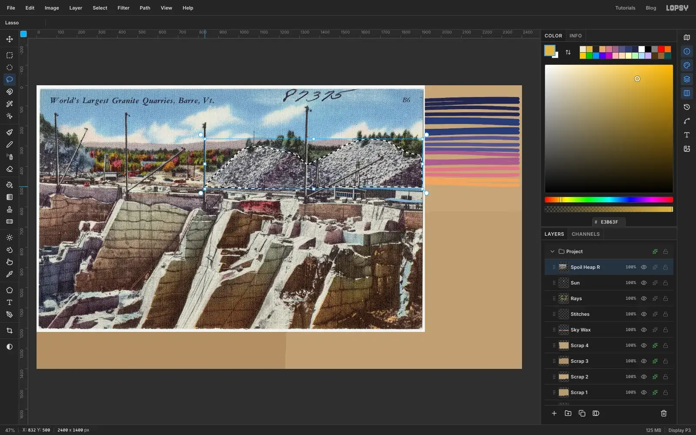

Real quarries pile their waste rock into huge grey heaps. This postcard has two good ones, and a printed halftone texture you'd never get with a crayon.

Drag **barre.jpg** from your computer onto the canvas. It arrives as a new layer at the top left and switches you to the **Move** tool, with its pixels selected. Press [[Cmd+D]] and rename the layer **Spoil Heap R**.

Press [[L]] for the **Lasso** and trace the two rock heaps on the right of the postcard. Start at the foot of the left heap, go up and over both, following the rocky outline and leaving out the trees, then come back along a straight line under them, just above the buildings.

Choose **Select → Inverse**, press [[Delete]], then [[Cmd+D]]. Only the heaps are left.

## Place a heap on each side of the sun

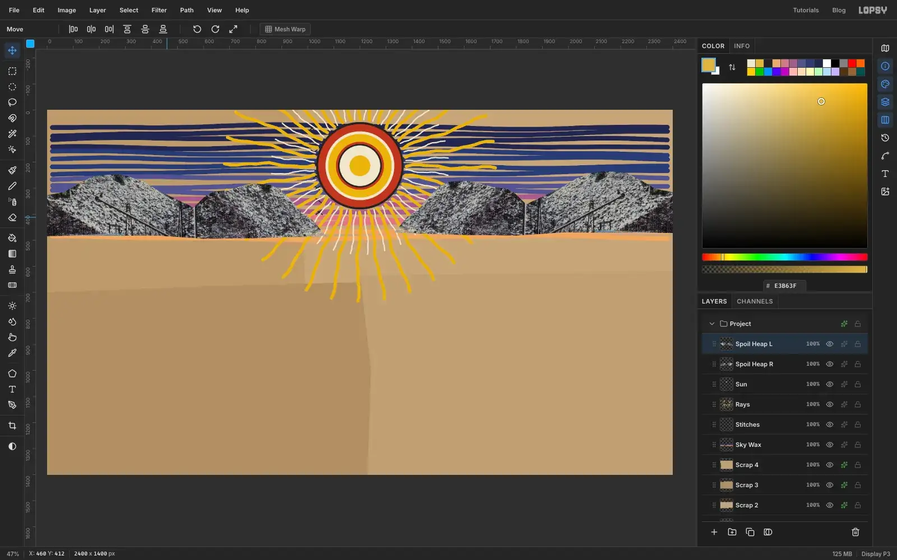

Choose **Filter → Hue/Saturation...**, set **Saturation** to **-28** and **Lightness** to **-8**, and click **Apply**. That takes the blue out of the rocks so they sit with the crayon.

Press [[V]] for the **Move** tool and drag the heaps about 500 px to the right and 30 px up, so their right edge hangs off the canvas.

Choose **Layer → Duplicate Layer** and rename the copy **Spoil Heap L**. Choose **Image → Flip Horizontal**, which mirrors the copy where it stands, then drag it about 1340 px to the left so it hangs off the left edge instead. The gap between the two should frame the sun.

## Lay in the land

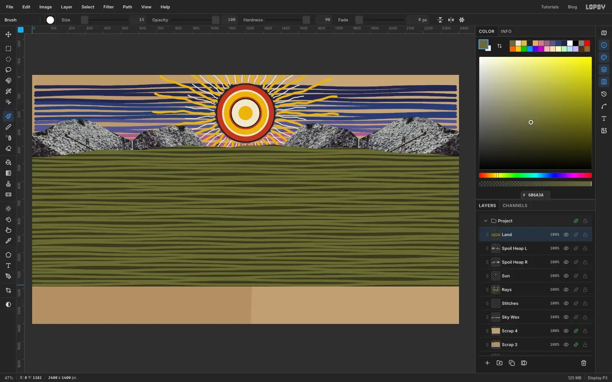

Add a layer called **Land** and set the foreground to `#3A3A22`.

With the **Lasso**, draw a low hill: a wavy horizon that sits at about y 400 in the middle and droops to about y 460 at both sides, then down past the canvas edges to y 1190, and across the bottom. Choose **Edit → Fill**, and **keep the selection**.

Switch to the crayon, Size **15**, foreground `#6B6A3A`. Draw horizontal rows about 21 px apart, from the horizon to the bottom. The live selection keeps them inside the hill, and the dark fill shows between them. Press [[Cmd+D]].

## Dig the quarry with nine ovals

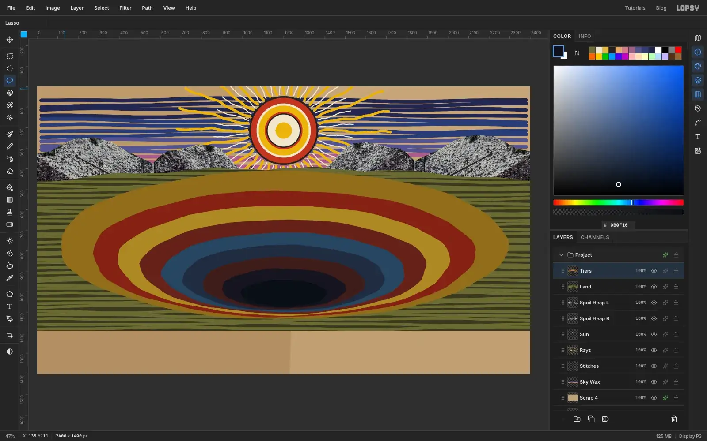

Add a layer called **Tiers**. Here's the trick that makes it read as a pit: each oval is smaller than the last, but their centres slide *down*. The rings stay wide at the far side of the quarry and bunch up at the near side.

For each oval, biggest first, set the foreground, draw it freehand with the **Lasso**, choose **Edit → Fill**, and press [[Cmd+D]]. The numbers are the oval's left and right edges, then its top and bottom:

- **1**, `#8C6E2C`: x 110–2290, y 410–1134
- **2**, `#7A2A1C`: x 270–2130, y 507–1123
- **3**, `#A88A3A`: x 392–2008, y 581–1115
- **4**, `#5E261D`: x 504–1896, y 648–1107
- **5**, `#2E4560`: x 608–1792, y 711–1100
- **6**, `#232C40`: x 709–1691, y 772–1093
- **7**, `#3A1E1C`: x 805–1595, y 830–1087
- **8**, `#16141F`: x 899–1501, y 887–1080
- **9**, `#0B0F16`: x 990–1410, y 942–1074

Don't try for perfect ovals. A slightly lumpy edge is much more convincing here.

## Wax the first two bands

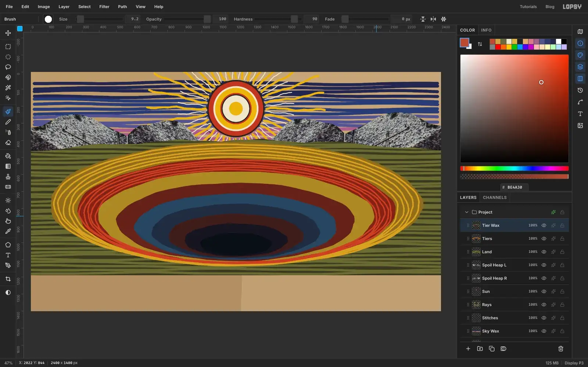

This is where Ramírez comes in. A **band** is the ring of colour between one oval and the next. Each one gets filled with loops of crayon that follow its curve.

Add a layer called **Tier Wax** and pick up the crayon. For band 1, set the Size to **10** and the foreground to `#D0A23F`. Draw **five** complete loops around the quarry, spaced evenly across the band, each in one long movement. Because the ovals bunch at the bottom, your loops will crowd together there too.

For band 2, set the Size to **9** and the foreground to `#BE4A30` and do the same.

## Wax the rest of the bands

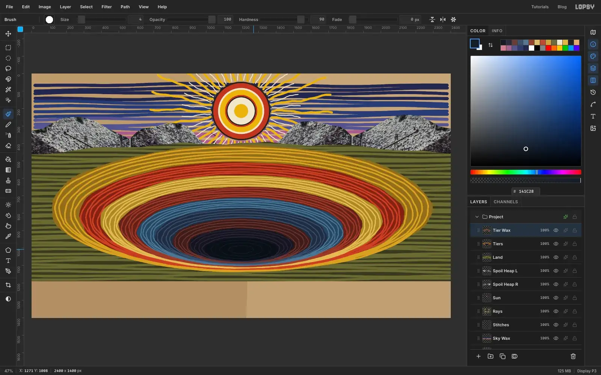

Carry on down the quarry, dropping the Size by about 1 each time:

- band 3: `#DDBB62`, Size **8**, five loops
- band 4: `#94402E`, Size **8**, five loops
- band 5: `#557694`, Size **7**, five loops
- band 6: `#3D4F6C`, Size **6**, four loops
- band 7: `#6B3A33`, Size **5**, four loops
- band 8: `#2E2A3D`, Size **4**, four loops

Finish with three small loops of `#141C28` at Size **4** in the pool at the bottom.

## Draw the lips of the rings and the courses of stone

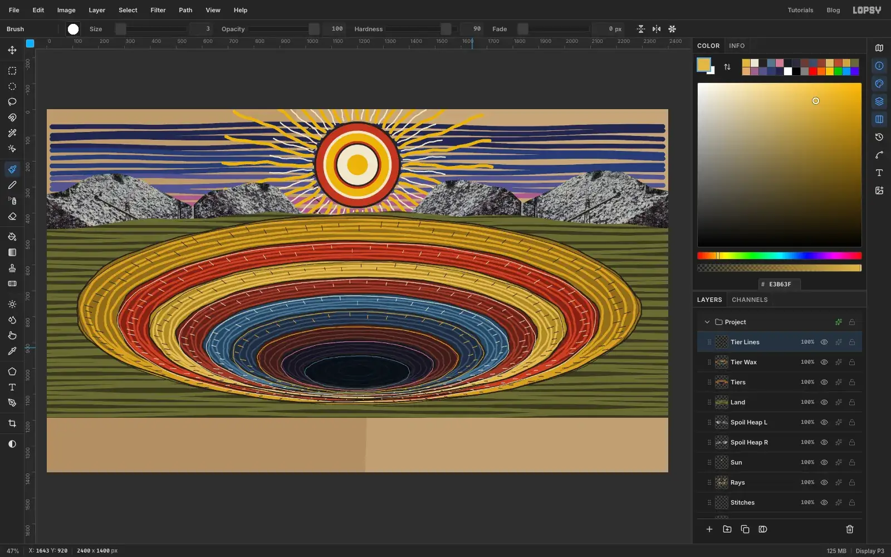

Add a layer called **Tier Lines**. For every oval, trace its edge in crayon at Size **6** in `#26221E`. Then draw a second, thinner line at Size **3**, about 8 px inside it, in the colour that stands out on that band:

- ovals 1 and 3: `#26221E`
- ovals 2, 4 and 5: `#EFE6D0`
- ovals 6 and 7: `#E3B63F`
- oval 8: `#D37B88`
- oval 9: `#557694`

Now add the courses of stone. At Size **3**, draw short ticks across bands 1 to 6, each pointing from the outer edge of its band towards the inner edge and covering about a quarter of the band's width. Use graphite on the yellow bands, mustard on band 6 and cream on the others. Space them all the way round: about 90 on band 1, thinning to about 40 on band 6. This is meant to be tedious. That's the obsessive part of the picture.

## Run three ribbons over the far wall

Add a layer called **Ribbons**. Draw one thick stroke along the top half of each of the first three bands, going through the middle of the band, in one movement:

- **ribbon 1**, Size **51**, `#26221E`: band 1, from about x 235, y 694, up and over to x 2165, y 694
- **ribbon 2**, Size **42**, `#EFE6D0`: band 2, from about x 381, y 735, over to x 2019, y 735
- **ribbon 3**, Size **39**, `#26221E`: band 3, from about x 513, y 761, over to x 1887, y 761

## Preach along the ribbons with text on a path

Each ribbon gets two runs of text, one each side of the middle, because a tower is going to stand in the gap. Every run needs its own path.

Start with the right-hand run of ribbon 3. Click the **Ribbons** row and press [[P]] for the **Pen**. Text starts at a path's first anchor, so always draw **left to right**. For a right-hand run, start at the gap beside the canvas centre and finish at the ribbon's end. For a left-hand run, start at the ribbon's left end and stop at the gap. Follow the ribbon about 11 px below its centre so the capitals sit in the middle of it. Press and drag at each of four anchors, pulling each handle along the curve. Click the **✓** in the options bar to commit the path. Don't press [[Enter]], because that would stroke it with the foreground colour.

Click **Ribbons** again, press [[T]] for the **Text** tool, and set **Font** to **Walter Turncoat**, the **Size**, the text colour, and **Align** to **Left**. Click in the empty sky near the top left, type the run, and press [[Tab]] to commit. Rename the layer as shown below.

With the new text layer still active, choose the newest path in the **Path** dropdown in the options bar, then set **Align** to **Center**. The text jumps onto the curve. Click the **Paths** icon in the strip at the far right, then click the selected path's row to hide its overlay. Don't delete it, since the text depends on it.

Repeat for each run. The gap is measured from the canvas centre, x 1200:

- **Sermon 3R**, Size **26**, `#EFE6D0`, gap 112 px: `HIM TO STOP AND THE LAMPS ARE LIT`
- **Sermon 3L**, Size **26**, `#EFE6D0`, gap 112 px: `NOBODY ASKED HIM TO AND NOBODY TOLD`
- **Sermon 2R**, Size **28**, `#26221E`, gap 96 px: `THAT NEVER ONCE CAME BACK TO FETCH HIM HOME`
- **Sermon 2L**, Size **28**, `#26221E`, gap 96 px: `THIRTY ONE YEARS AND ONE MAN AND ONE TRAIN`
- **Sermon 1R**, Size **34**, `#EFE6D0`, gap 80 px: `AFTER IT WITH ONE HAMMER AND ONE BAD KNEE`
- **Sermon 1L**, Size **34**, `#EFE6D0`, gap 80 px: `HE SAID THE HILL HAD A CITY IN IT SO IN HE WENT`

Text that's longer than its path gets cut off at the end, so if the last letters go missing, make the path longer or the text shorter.

> **Tip:** Align carries over to the next new text, so set it back to **Left** before typing each run.

## Scatter the lamps

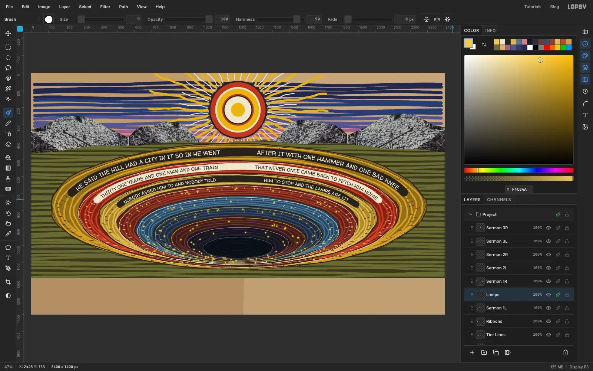

Click the **Sermon 1L** row (the last one you made), then add a layer called **Lamps**. The rest of the sermon stays above the layers from here on, which is fine because nothing else overlaps it.

Pick up the crayon at Size **9** in `#F4C84A` and click, without dragging, to drop single dots across bands 4 to 8. Use about 34 on band 4 and fewer as you go down, around 120 in all. Let them cluster here and there: someone lives down there.

Open the row's effects, tick **Outer Glow**, and set **Size** to **12** and **Opacity** to **85**. Close the drawer.

## Stand derricks along the rim

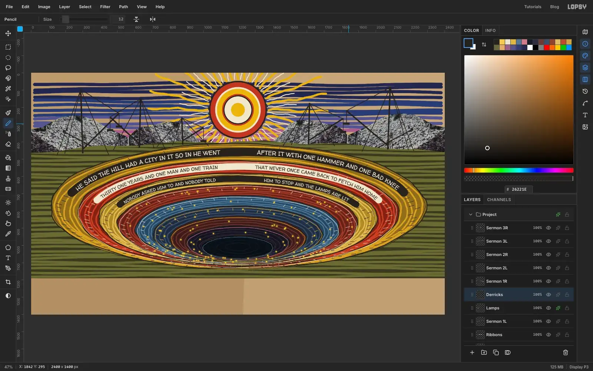

Use the postcard as your reference: quarries are ringed by tall masts with long booms, held up by wires.

Add a layer called **Derricks**. Press [[N]] for the **Pencil**, foreground `#26221E`. You'll draw each line by clicking one end, then holding [[Shift]] and clicking the other.

Put five derricks along the horizon, with their feet at about x 300, 630, 880, 1610 and 2070. Vary the height: the tops reach about y 100, 150, 260, 180 and 85. For each one:

1. **Mast**, Size **8**: from the foot straight up, with a slight lean.
2. **Boom**, Size **6**: from just above the foot, out to one side at a steep angle, ending about 60% of the way up the mast. Point booms in different directions.
3. **Wires**, Size **3**: from the mast top to the boom tip, then straight down 70 px from the boom tip. Add three more wires from the mast top to the ground, spread out about 150 px each side.
4. **Load**, Size **12**: a short horizontal bar hanging on the end of that dropped wire.

## Bore a tunnel and lay the rail

Add a layer called **Tunnel**. Centre the tunnel on band 4 at about x 569, y 850. With the **Elliptical Marquee** (press [[Cmd+D]] first each time), draw and fill five slightly tall ovals, biggest first. These are half-widths; the half-height is about 15% more:

- 72 px: `#26221E`
- 64 px: `#EFE6D0`
- 55 px: `#B4412B`
- 45 px: `#EFE6D0`
- 36 px: `#0B0B10`

With the **Lasso**, select the part of the tunnel that falls below the curve of the band, then press [[Delete]] and [[Cmd+D]]. Following the curve means it won't leave a straight cut across the rings.

Now draw the rail in crayon, starting at the tunnel and running up the band to about x 950, y 690. Use Size **7** in `#26221E`, then repeat the same line 9 px lower at Size **3** in `#EFE6D0`.

## Build one wagon

Add a layer called **Train** and build a wagon somewhere out of the way, down near the pool. You can use the marquee's exact-size dialog for each piece:

- body, `#26221E`: From 1500, 980 to 1592, 1014
- three blocks of stone, `#EFE6D0`: 23 px wide and 18 px tall, sitting on top of the body
- a stripe along the body, `#B4412B`: From 1506, 989 to 1586, 997

Press [[Cmd+D]], pick up the crayon at Size **18** in `#26221E`, and click two wheels under the body, at about x 1518 and x 1574, y 1018.

## Copy the wagon and rotate each one onto the rail

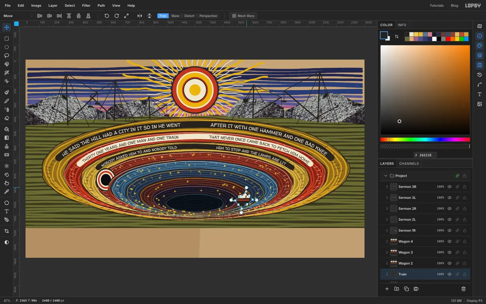

Press [[M]] for the **Rectangular Marquee** and drag around the whole wagon, wheels included. Choose **Edit → Copy**, then **Edit → Paste** three times. Each paste lands on its own new layer, exactly on top of the original. Rename them **Wagon 2**, **Wagon 3** and **Wagon 4**. Press [[Cmd+D]].

For each wagon, starting with **Train**:

1. Click its row.
2. Press [[M]] and drag a marquee around the wagon.
3. Press [[V]] for the **Move** tool and drag the small circle just outside a corner to tilt the wagon until it matches the rail where it's going.
4. Press [[Cmd+D]] to commit the rotation.
5. Drag the wagon onto the rail.

Rotate before you move. Space the wagons evenly up the rail, each one a little more level than the last as the curve flattens towards the top.

## Add the engine and merge the train

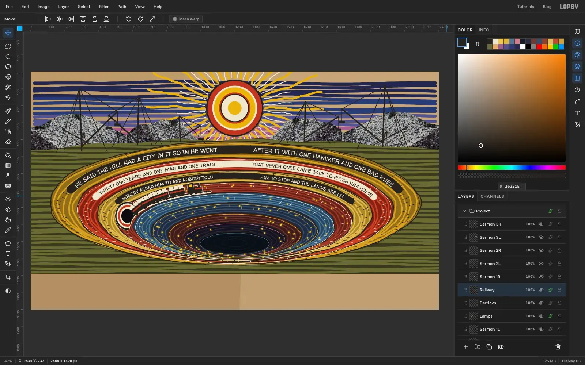

With **Wagon 4** active, add a layer called **Engine**. Near the pool, build it from filled marquee rectangles:

- boiler, `#26221E`, 84 × 30 px
- cab, `#26221E`, 34 × 28 px, on the left end of the boiler
- funnel, `#26221E`, 12 × 26 px, towards the right end of the boiler
- cab window, `#F4C84A`, 18 × 15 px
- stripe, `#B4412B`, 44 × 8 px along the boiler

Add three wheels with the crayon at Size **18** in `#26221E`. Marquee the engine, rotate it, press [[Cmd+D]] and drag it to the head of the train, as you did with the wagons.

Choose **Layer → Merge Down** four times, until the engine and all the wagons are one layer, and rename it **Train**. Merge Down once more to drop it onto the tunnel, and rename the result **Railway**. Open its effects and tick **Stroke**, with **Width** **2** and the colour `#EFE6D0`. That thin line stops the black engine vanishing against the dark bands.

## Spread railways around the quarry

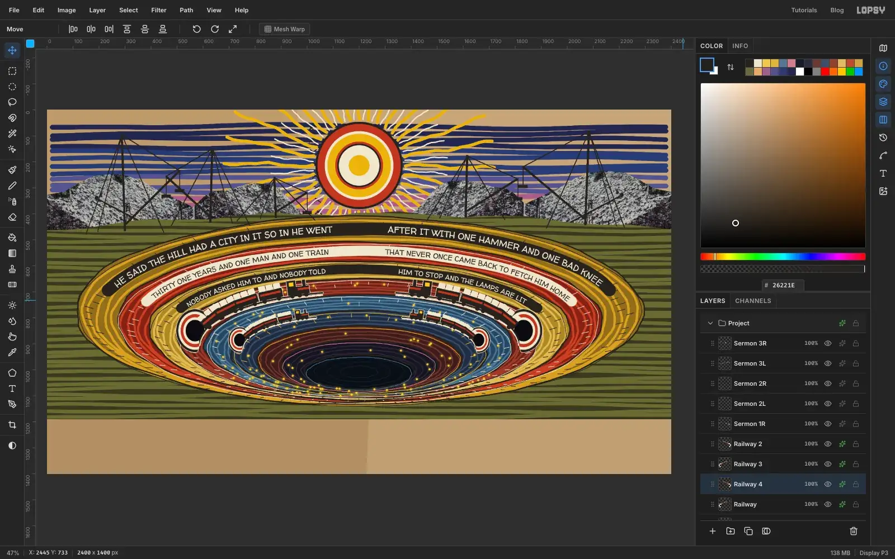

One train isn't obsessive enough. Marquee the whole **Railway** layer, leaving a little room around it, and choose **Edit → Copy**. For each copy below, click the **Railway** row, choose **Edit → Paste**, rename it, then:

- **Railway 2**: choose **Image → Flip Horizontal**, press [[Cmd+D]], and press [[V]] to drag it to the mirrored spot on the right of band 4. Its tunnel should end up as a mirror image of the first one.
- **Railway 3**: press [[Cmd+D]], marquee it, press [[V]], hold [[Cmd]] and drag its bottom-right corner handle inward until it's about 60% of the original size, judging against the first railway. Press [[Cmd+D]], then drag it onto the left of band 6, around 870, 850.
- **Railway 4**: flip it, then scale it the same way, and drag it onto the right of band 6, around 1530, 850.

Give each copy the same cream **Stroke** at Width **2**, since pasted layers don't bring their effects with them.

## Draw the reflection and an arch tile

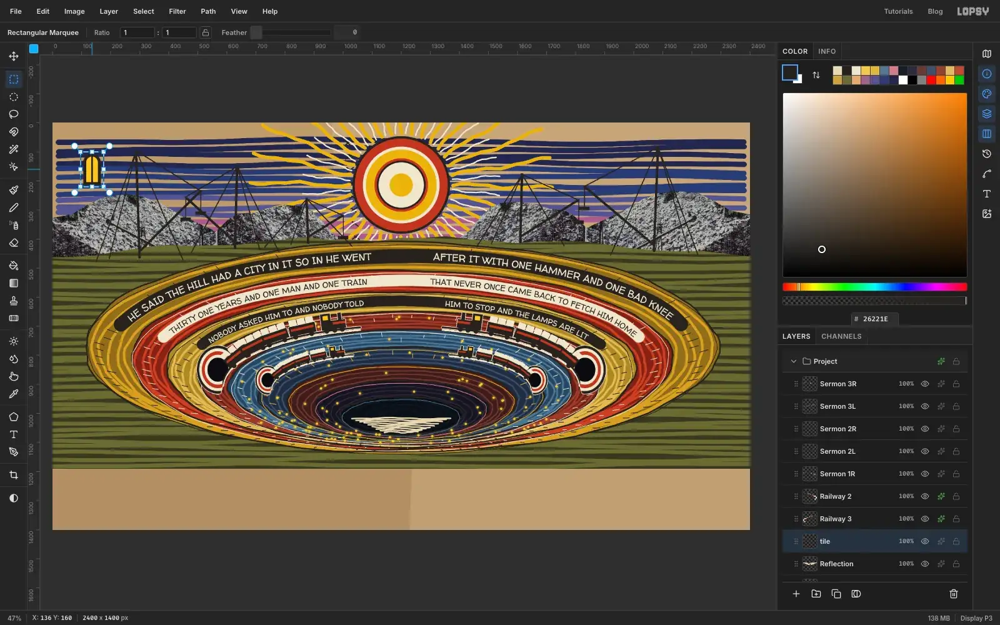

Click **Railway 4** and add a layer called **Reflection**. With the crayon at Size **6** in `#E7D9B4`, draw nine short wobbly lines across the pool, starting at about y 1016, 6 px apart. Make the first about 340 px wide and shorten each one by about 28 px.

Next comes a window for the tower. Add a temporary layer called **tile**, and build one arched window near the top left with the exact-size dialogs, pressing [[Cmd+D]] before each one:

- frame, `#26221E`: an ellipse From 106, 106 to 166, 166, and a rectangle From 106, 136 to 166, 214
- pane, `#F4C84A`: an ellipse From 116, 116 to 156, 156, and a rectangle From 116, 136 to 156, 204
- glazing bar, `#26221E`: a rectangle From 133, 116 to 139, 204

Now select the tile with its margin: a rectangle From 96, 100 to 176, 220. Choose **Edit → Define Pattern**, press [[Cmd+D]], and click **Delete Layer**. The pattern stays available after the layer is gone.

## Stack the tower floors

Click the **Reflection** row and click **New Group**. Rename it **City**. Add a layer inside it called **Floors**.

The tower is eleven drum-shaped floors, built from the bottom. Centre the tower on x 1200. Floor 1 is about 400 px wide and 128 px tall, with its bottom edge bulging down to about y 1050. Each floor above is about 84% as wide and 88% as tall, and overlaps the one below by a little. Lean them very slightly left and right as you go up, because nobody measured this tower. The top floor ends near y 310.

For each floor, set the foreground to the first colour, lasso the shape with a curved top and bottom edge (make floor 1's bottom edge rough), and choose **Edit → Fill**. Keep the selection, pick up the crayon at Size **5**, and switch to the second colour. Hatch down the left side of the floor with short vertical strokes, thinning out towards the right, then add three lines following the floor's curve. The selection keeps everything inside. Press [[Cmd+D]] before you start the next floor.

Colours from the bottom up, fill then hatch:

- floors 1, 5 and 8: `#EFE6D0`, `#C9B892`
- floor 2: `#D8A08F`, `#B47E70`
- floors 3 and 7: `#E3C36F`, `#BC9A47`
- floors 4 and 9: `#A8BBC7`, `#7F97A6`
- floor 6: `#D37B88`, `#A85F6B`
- floor 10: `#E8A96B`, `#BE8347`
- floor 11: `#EFE6D0`, `#C9B892`

## Fill the first row of windows

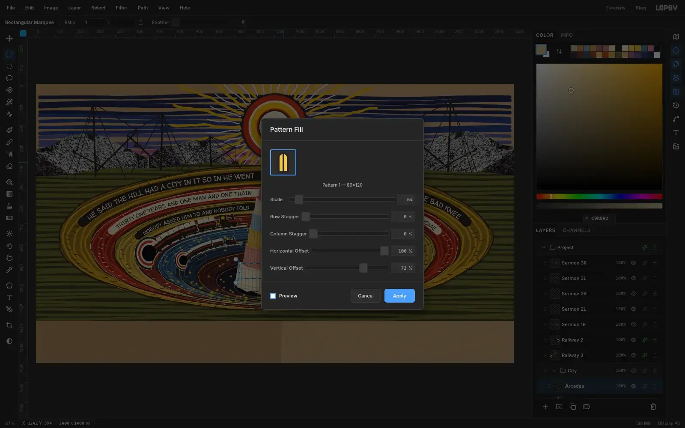

Add a layer called **Arcades**. Press [[M]] and drag a rectangle across floor 1, leaving a small margin at each side. Make it about 60% of the floor's height, starting just below its top edge.

Choose **Edit → Fill with Pattern...** and click your arch tile. Set **Scale** to **64**. Then nudge **Horizontal Offset** and **Vertical Offset** until a clean row of whole arches sits in the rectangle, ticking **Preview** so you can see it. Click **Apply**.

## Repeat the windows up the tower

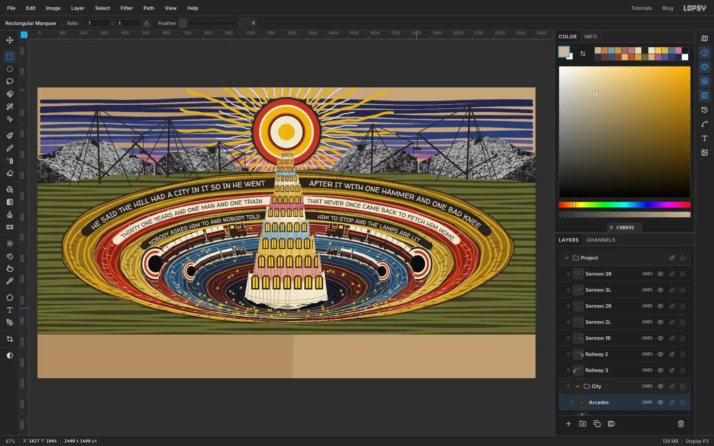

Repeat for every floor: draw the rectangle, choose **Edit → Fill with Pattern...**, click the tile, tick **Preview**, set the Scale, adjust the offsets and Apply. The arches shrink as the floors do. From floor 1 to floor 11, use a Scale of:

**64**, **56**, **50**, **44**, **38**, **34**, **30**, **26**, **23**, **20**, **18**

Press [[Cmd+D]] when you've finished.

## Ink the tower and add the spire

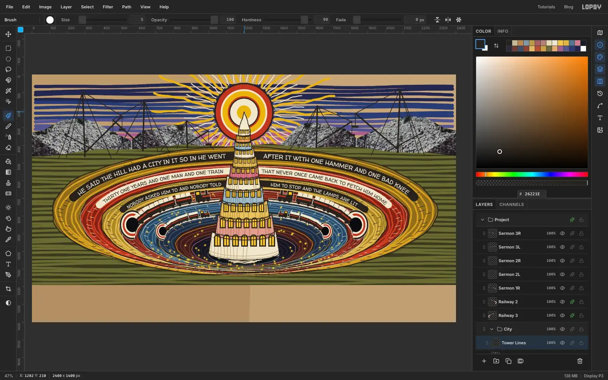

Add a layer called **Tower Lines**. With the crayon at Size **5** in `#26221E`, trace around the top and bottom curves of every floor, and let the outlines sag a little.

For the spire, set the foreground to `#EFE6D0`, and with the **Lasso** draw a tall narrow triangle from the top floor up to about x 1200, y 212, right in the middle of the sun. Choose **Edit → Fill** and press [[Cmd+D]]. Press [[B]] and draw its two long edges in graphite.

## Pile up the rubble and put up the town sign

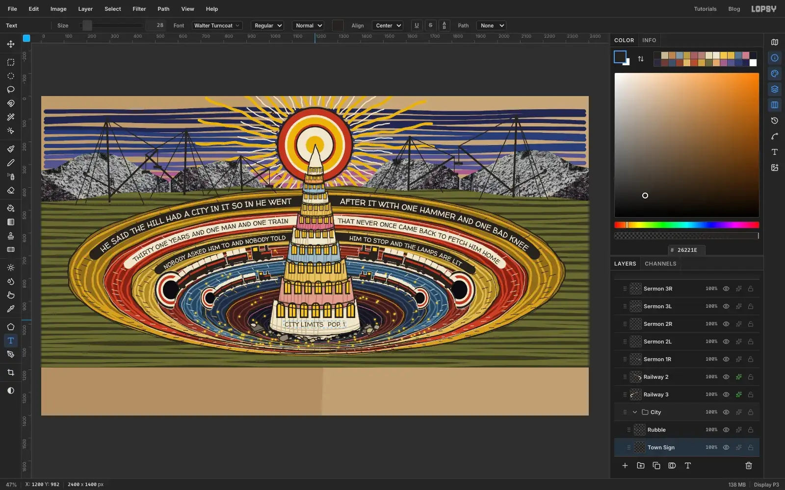

A city carved from a hill leaves mess behind. Add a layer called **Rubble**. For each of about 26 stones around the front of the base, lasso a small uneven shape with four to six sides, mostly small with a few large ones. Fill it with one of `#D8CFB8`, `#A89F8C`, `#8D8676`, `#C6B48C` or `#6E6A5E`, press [[Cmd+D]], then outline it with the crayon at Size **5** in `#26221E`.

Click the **Tower Lines** row. Press [[T]], set the font to **Walter Turncoat**, **Size** to **28**, **Align** to **Center** and the colour to `#26221E`. Click on the cream base, below the first row of windows and at the centre of the tower, at about x 1200, y 982. Type `CITY LIMITS  POP. 1` and press [[Tab]].

It's the best joke in the picture, and it says the whole film.

## Make a grain from noise and clouds

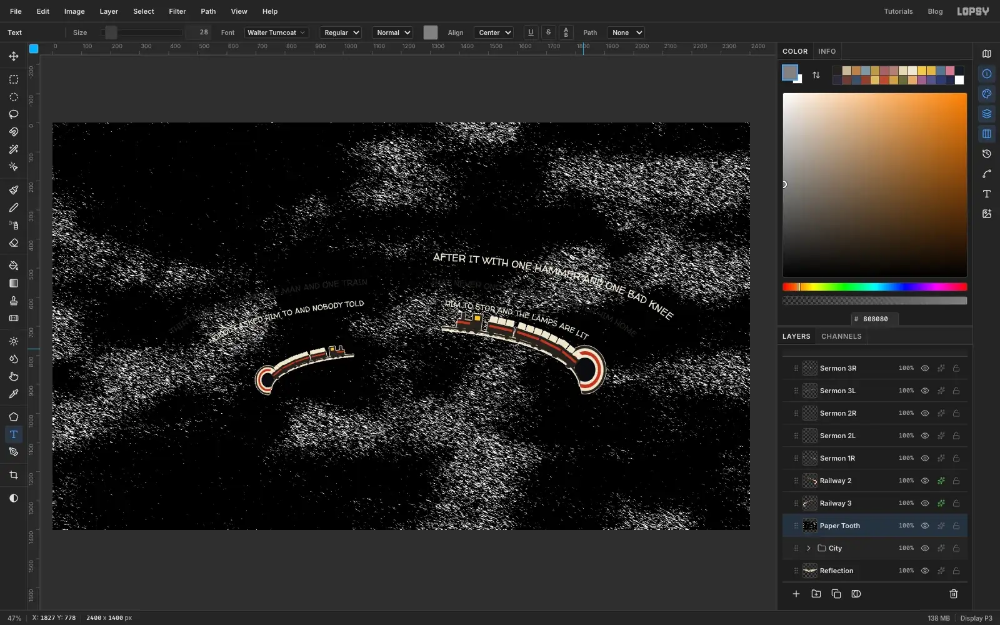

The crayon so far looks too clean. Real wax skips over the rough surface of card, leaving flecks of bare card behind. We'll build that as one layer.

Click the arrow on the **City** group to collapse it, then click its row. Add a layer called **Paper Tooth**. Press [[Cmd+D]], set the foreground to `#808080` and choose **Edit → Fill**. Then apply:

1. **Filter → Add Noise...** with **Amount** **100**.
2. **Filter → Motion Blur...** with **Angle** **24** and **Distance** **10**. That stretches the noise into short strokes.
3. **Filter → Gaussian Blur...** with **Radius** **1**.

An even dusting looks like a filter, so bunch it into patches. Add a layer called **Patches**, fill it with `#808080`, and apply **Filter → Clouds...** with **Scale** **8**. Set this layer's **Opacity** to **5%** using the percentage in its row. Choose **Layer → Merge Down**, and rename the result **Paper Tooth** if it needs it.

Finally apply **Filter → Threshold...** with **Level** **137**. The layer turns black with patches of fine white flecks. Don't worry that it hides your picture.

## Turn the flecks into bare card

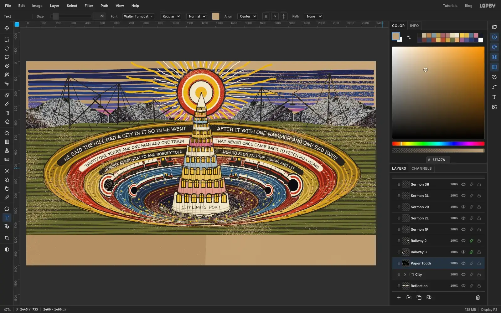

The white flecks need to be card-coloured, and the black needs to disappear.

Add a layer called **Tan**, fill it with `#BFA27A`, open its effects drawer and set **Blend Mode** to **Multiply**. Close the drawer and choose **Layer → Merge Down**. White has become tan, and black stays black.

Now open the merged layer's drawer and set its **Blend Mode** to **Lighten**. Black vanishes, because Lighten keeps whichever is lighter, and nothing underneath is darker than black. The tan flecks only show where the crayon underneath is darker than the card, which is exactly how bare card looks through wax.

## Scrawl in the field

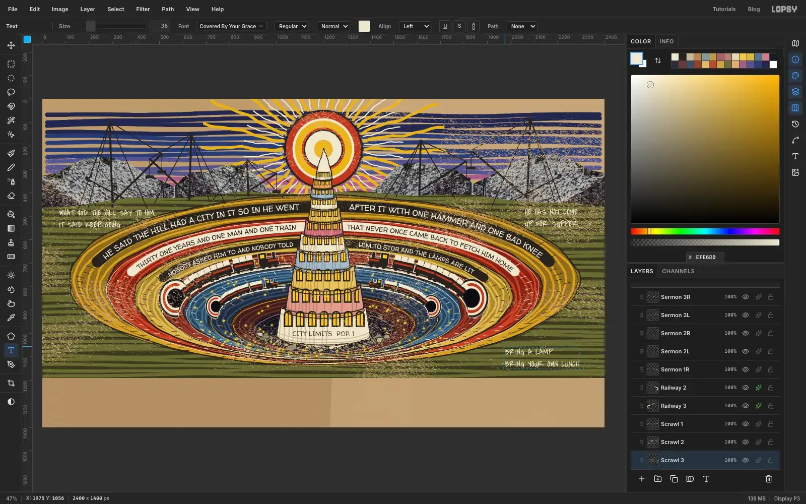

Finster couldn't leave an empty space alone. With **Paper Tooth** active, press [[T]], set the font to **Covered By Your Grace**, **Size** to **36**, **Align** to **Left** and the colour to `#EFE6D0`.

Make three text layers in the green corners, pressing [[Enter]] for the line breaks and [[Tab]] to finish. Click the **Paper Tooth** row before starting each one:

- top left, starting at about x 72, y 462: `WHAT DID THE HILL SAY TO HIM` / `IT SAID KEEP GOING`
- top right, starting at about x 2060, y 458: `HE HAS NOT COME` / `UP FOR SUPPER`
- bottom right, starting at about x 1975, y 1056: `BRING A LAMP` / `BRING YOUR OWN LUNCH`

Check that the lines stay clear of the gold rim and the edge of the canvas.

## Cut out the stonecutter

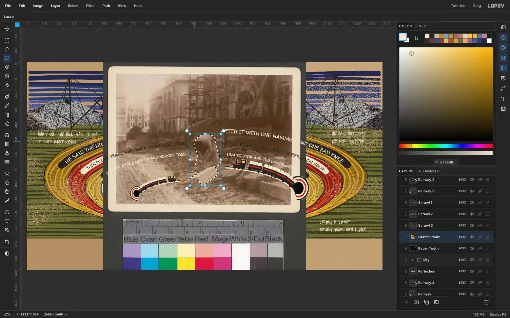

Click the **Paper Tooth** row, then drag **steinhauer.jpg** onto the canvas. It's taller than the document, so it's scaled to fit and centred. Press [[Cmd+D]] and rename the layer **Hermit Photo**.

Press [[L]] and trace the stonecutter closely: over his cap and rounded back, down his hip and rear leg, then around the cut stone block at his feet, and up his front leg and arm to the cap again. Zooming in makes this easier.

Choose **Select → Inverse**, press [[Delete]], then [[Cmd+D]]. Then apply **Filter → Brightness/Contrast...** with **Brightness** **14** and **Contrast** **24** to lift him out of the murk.

## Give him a torn paper edge

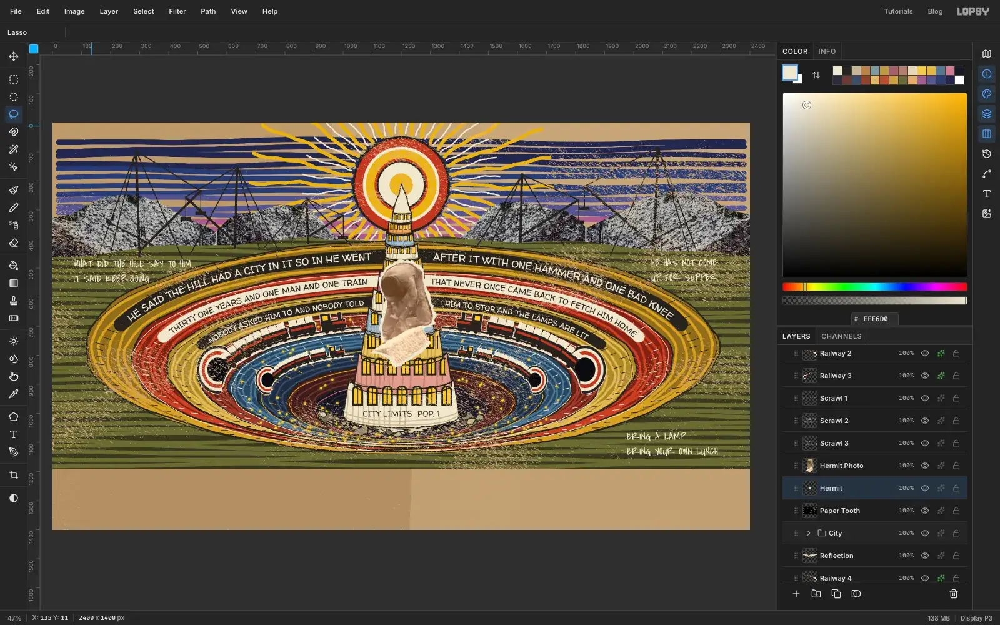

An outline from a layer effect looks too even for a scrap torn out of an old magazine, so tear it for real.

Click the **Paper Tooth** row and add a layer called **Hermit**. It sits below the photo. Set the foreground to `#EFE6D0`, and with the **Lasso** go all the way around the man, between 6 and 15 px outside him, in short jagged moves. Choose **Edit → Fill** and press [[Cmd+D]].

Click the **Hermit Photo** row and choose **Layer → Merge Down**. Rename the merged layer **Hermit**.

## Draw on the photo

The photo is murky, and at small sizes he'd turn into a lump. Ramírez drew straight onto his collage pieces, so you can too.

Pick up the crayon at Size **3**, foreground `#26221E`, with **Hermit** active:

- trace the outline of the man, just inside the photo's edge
- draw a line down his arm from the shoulder to the hands, and one down each leg
- outline the stone block, add a line for the ridge between its two faces, and hatch the lower face with about nine short strokes

Set the foreground to `#EFE6D0` and draw one curved line under his cap, to mark the brim.

Finally, give him a proper hammer. Set the foreground back to `#26221E`. At Size **6**, draw a handle from his hands out to the left, about 60 px long, past the torn edge. At Size **17**, make one short stroke across its end for the head. Add a thin Size **3** cream line down the head so that it stands out.

## Shrink copies of him down the quarry

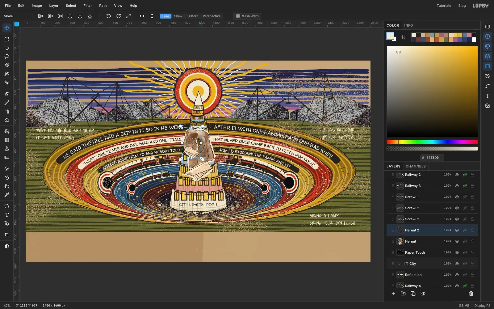

Now make the idea visible: every figure down there is the same man.

Press [[M]] and drag a marquee around the whole cut-out, hammer included. Choose **Edit → Copy**, then **Edit → Paste**. Rename the copy, and if the list below says so, choose **Image → Flip Horizontal**. Press [[Cmd+D]], marquee it again, press [[V]], hold [[Cmd]], and drag the bottom-right corner handle inward to the listed height (the full-size cut-out is about 375 px tall). Press [[Cmd+D]], then drag the copy into place. Click the **Hermit** row before starting the next one.

- **Hermit 2**, flipped, about 210 px tall: on the right of band 1, around 2200, 840
- **Hermit 3**, about 165 px tall: on the left of band 1, around 180, 750
- **Hermit 4**, flipped, about 130 px tall: on the right of band 3, around 1930, 930
- **Hermit 5**, about 105 px tall: on the left of band 4, just under the tunnel, around 570, 940
- **Hermit 6**, flipped, about 80 px tall: on the right of band 5, around 1750, 930
- **Hermit 7**, about 68 px tall: on the left of band 6, around 760, 975

## Put the hermit himself in the foreground

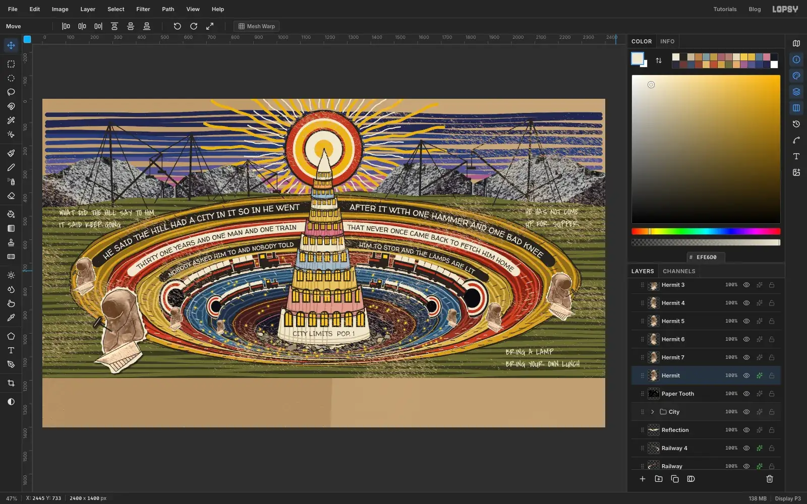

Click the **Hermit** row, press [[V]] and drag the full-size cut-out down to the bottom left, centred at about x 330, y 985, so that the block almost reaches the bottom of the land.

Open its effects, tick **Drop Shadow**, and set **Offset X** to **5**, **Offset Y** to **6**, **Blur** to **5** and **Opacity** to **55**. Having the shadow on him alone lifts him off the page, and keeps the small ones part of the drawing.

## Make a border tile

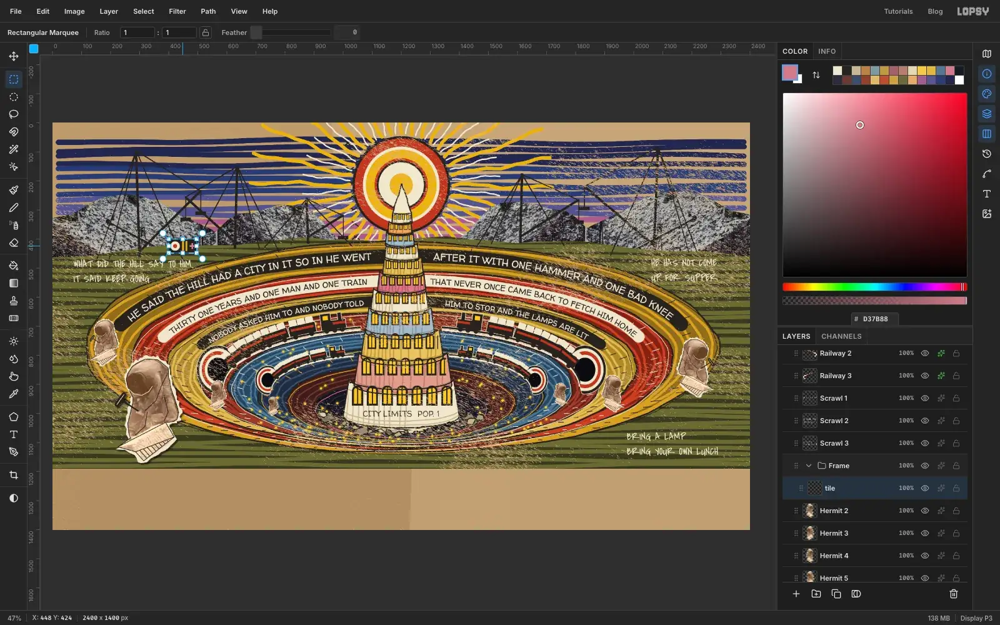

Wölfli framed his sheets in bands of repeating marks, and he drew every one by hand. You'll draw one tile and repeat it.

Click the **Hermit 2** row, which is the top one of the cut-outs. Click **New Group** and rename it **Frame**. Add a temporary layer called **tile**. Build the tile with the exact-size dialogs. You can do this anywhere, since the layer is temporary; here it starts at 400, 400:

- background, `#26221E`: rectangle, 96 × 48 px, From 400, 400 to 496, 448
- bullseye, `#EFE6D0`: ellipse From 406, 408 to 438, 440
- centre, `#B4412B`: ellipse From 415, 417 to 429, 431
- two bars, `#E3B63F`: rectangles From 446, 407 to 452, 441, and From 458, 407 to 464, 441
- cross, `#D37B88`: rectangles From 472, 421 to 490, 427, and From 478, 414 to 484, 434

Select the whole tile (From 400, 400 to 496, 448), choose **Edit → Define Pattern**, press [[Cmd+D]], and click **Delete Layer**.

## Fill the border

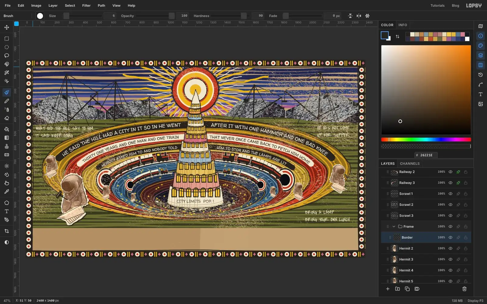

Add a layer called **Border**. For each side, use the exact-size dialog to select the band, then choose **Edit → Fill with Pattern...**, click the new tile, set **Scale** to **100** and the offsets below, and click **Apply**:

- top: From 0, 0 to 2400, 48, offsets 0
- bottom: From 0, 1352 to 2400, 1400, **Vertical Offset** **17** so a whole row of tiles fits
- left: From 0, 48 to 48, 1352, offsets 0
- right: From 2352, 48 to 2400, 1352, **Horizontal Offset** **50** so the bullseyes match the left side

Press [[Cmd+D]]. Pick up the crayon at Size **6** in `#26221E` and draw a wobbly line right round the inside of the border.

## Paste down the title strip

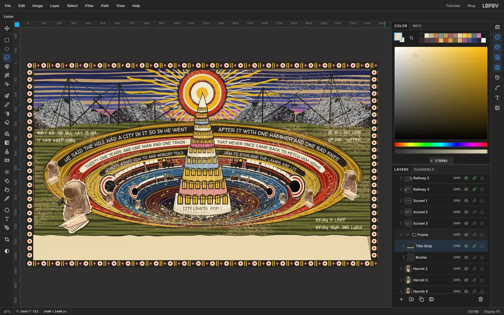

Add a layer called **Title Strip**. Set the foreground to `#E7D9B4` and press [[L]]. Start at the inner edge of the left border and draw a jagged top edge at about y 1186, wandering by 5 px or so, across to the inner edge of the right border. Drop to the top of the bottom border and come back along it. Choose **Edit → Fill** and press [[Cmd+D]].

Open its effects, tick **Drop Shadow**, and set **Offset X** to **0**, **Offset Y** to **-4**, **Blur** to **7** and **Opacity** to **60**. The negative offset throws the shadow upward onto the picture.

## Letter the title by hand

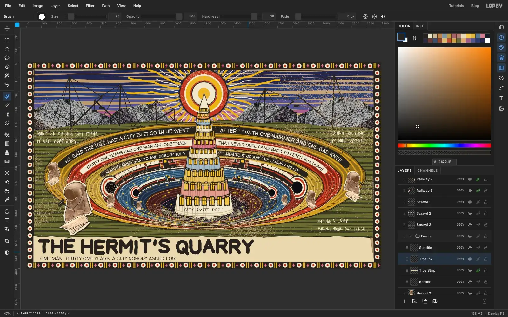

Start with the subtitle, along the bottom of the strip. With **Title Strip** active, press [[T]], set the font to **Walter Turncoat**, **Size** to **32**, **Align** to **Left** and the colour to `#26221E`. Click at about x 92, y 1308, type `ONE MAN. THIRTY ONE YEARS. A CITY NOBODY ASKED FOR.` and press [[Tab]].

Click **Title Strip** again and add a layer called **Title Ink**. A font would look too neat here, so paint the letters yourself. Pick up the crayon at Size **23** in `#26221E` and letter `THE HERMIT'S QUARRY` from about x 86, y 1209. Make the capitals about 78 px tall and 60 px wide, with about 28 px between letters and a bit more between words, one stroke at a time. A slightly wandering baseline and letters that don't quite match are good. Just keep a clear gap between them, and check that the **Q**'s tail stays above the subtitle.

## Colour the letters in wax

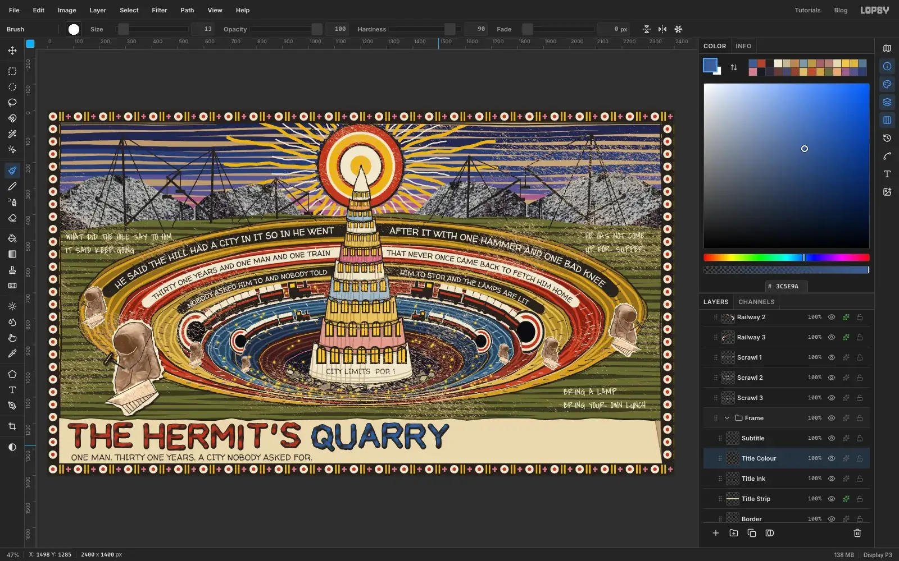

Add a layer called **Title Colour**. Open the **Brushes** window and pick **Hard Round** on the **Presets** tab. On the **Shape** tab set **Size** to **13**, **Hardness** to **90** and **Spacing** to **6**. On the **Texture** tab, choose **Noise**, set the blend mode to **Subtract** and **Scale** to **30**. Close the window.

Now go along each letter again, down the middle of each graphite stroke, twice, with the second pass a pixel or two off the first. Use `#B4412B` for THE HERMIT'S and `#3C5E9A` for QUARRY. The texture leaves the mottled look of crayon, and the graphite shows round the edges as an outline.

> **Tip:** The texture stays on until you pick a preset. Picking **Hard Round** on the **Presets** tab clears it, so do that before you need the plain crayon again.

## Make a colour key from the picture

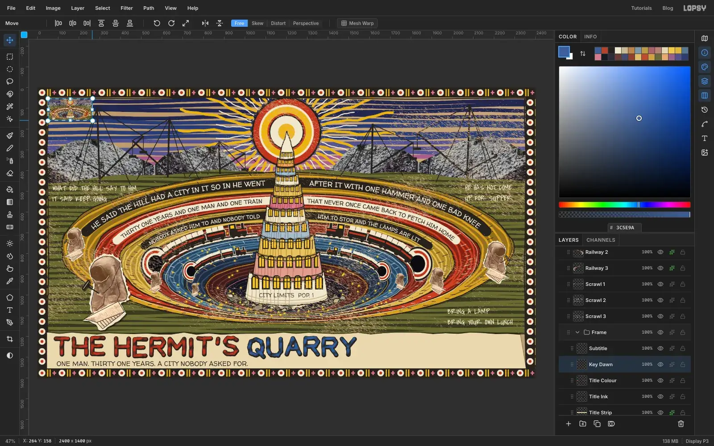

Concept artists test a scene at different times of day in tiny thumbnails called colour keys. Yours come straight from the picture.

With **Title Colour** active, press [[Cmd+D]] and use the marquee's exact-size dialog to select From 52, 54 to 2348, 1180, which is the whole picture inside the border. Choose **Edit → Copy Merged**, then **Edit → Paste**. It lands exactly in place on its own layer. Rename it **Key Dawn**.

With the **Move** tool active, hold [[Cmd]] and drag the bottom-right corner handle up and to the left, until the copy is about 212 px wide. Press [[Cmd+D]].

## Grade the keys for three times of day

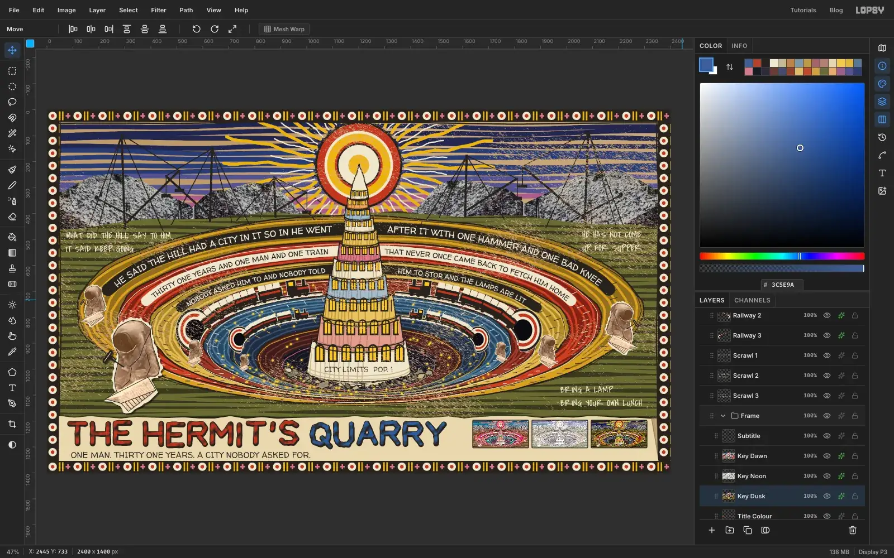

With **Key Dawn** active, apply **Filter → Hue/Saturation...** with **Hue** **-30**, **Saturation** **10** and **Lightness** **10**. Apply **Filter → Unsharp Mask...** with **Amount** **1** and **Radius** **1** to crisp up the tiny picture. Press [[V]] and drag it into the title strip, with its left edge at about x 1640 and its top at about y 1200. Open its effects, tick **Stroke**, and set **Width** to **3** and the colour to `#26221E`.

Make two more keys the same way: click **Title Colour**, select the same region, **Copy Merged**, **Paste**, rename, scale down, filter, **Unsharp Mask**, drag into place and add the **Stroke**. Space them 228 px apart:

- **Key Noon**, left edge at x 1868: **Hue** **0**, **Saturation** **-62**, **Lightness** **36**
- **Key Dusk**, left edge at x 2096: **Hue** **0**, **Saturation** **16**, **Lightness** **-6**

## Label the keys and circle the winner

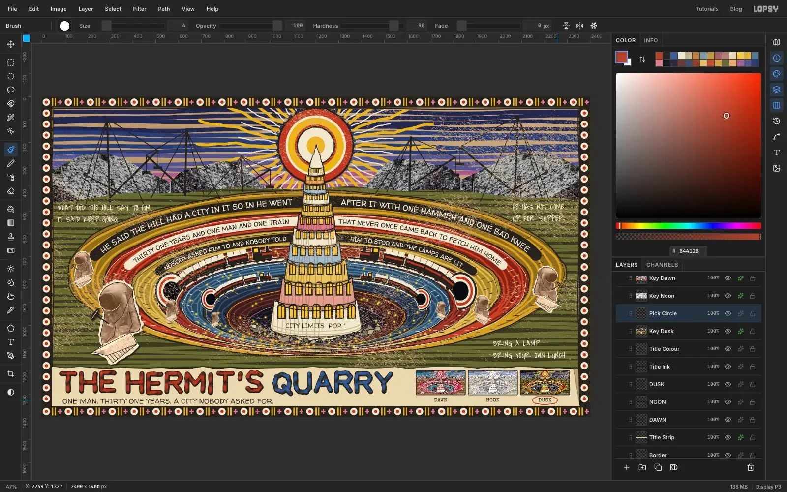

Click the **Title Strip** row and press [[T]]. Set the font to **Special Elite**, **Size** to **24**, **Align** to **Center** and the colour to `#26221E`. Click under the middle of the first key, at about x 1746, y 1312, type `DAWN` and press [[Tab]]. Click **Title Strip** again, and do the same for `NOON` at x 1974 and `DUSK` at x 2202.

Click the **Key Dusk** row and add a layer called **Pick Circle**. Open the **Brushes** window and pick **Hard Round** on the **Presets** tab to clear the texture, then set **Hardness** to **90** and **Spacing** to **6** on the **Shape** tab. Use Size **4** in `#B4412B` to draw one loose loop around DUSK, about 110 px wide and 38 px tall, keeping it clear of the thumbnail above and the border below. Somebody has made a decision.

## Tape on the slate

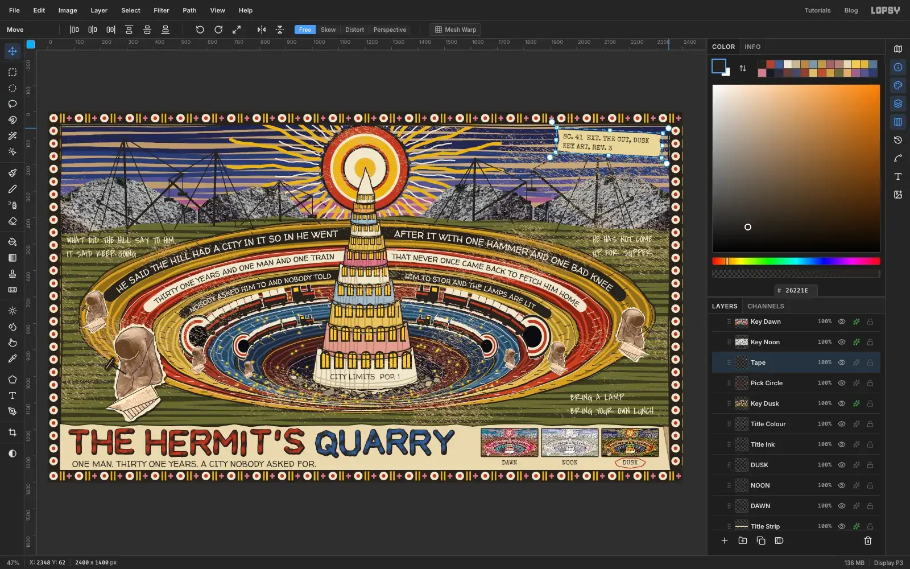

Click the **Pick Circle** row and add a layer called **Tape**. Set the foreground to `#E6D79F`. With the **Lasso**, draw a strip with slightly torn ends across the top right, from about x 1926, y 74 to x 2318, y 158. Choose **Edit → Fill** and press [[Cmd+D]].

With **Tape** still active, press [[T]], set **Special Elite**, **Size** **25**, **Align** **Left** and the colour `#26221E`. Click about 20 px in from the tape's top-left corner and type `SC. 41  EXT. THE CUT, DUSK`. Press [[Enter]], type `KEY ART, REV. 3`, and press [[Tab]].

Click **Rasterize Layer** at the bottom of the Layers panel, then choose **Layer → Merge Down**, and rename the layer **Tape**. Press [[M]] and marquee the strip, leaving a few pixels spare. Press [[V]] and drag the small circle outside a corner to tilt the tape by about 3° clockwise. Press [[Cmd+D]].

Open its effects, tick **Drop Shadow**, and set **Offset X** to **2**, **Offset Y** to **3**, **Blur** to **4** and **Opacity** to **45**.

Save with **File → Save Project**, and export the finished piece with **File → Quick Export PNG**. And if anyone asks who designed the production: the hill did.
