Pennsylvania Dutch *fraktur* is the illuminated folk art that German
settlers painted on birth and marriage certificates from about 1750 to
1850. It has a short list of motifs that come back again and again:

- a heart in the middle
- tulips growing out of it
- a pair of *distelfinks* (stylised goldfinches) facing each other
- strict left–right symmetry
- a handful of bold colours

The same families made patchwork quilts and painted hex-sign stars on
their barns, so the motifs sit naturally with quilt blocks.

In this tutorial you'll combine them on a cover for **Quilters'
Quarterly**, an imaginary folk quilting zine. You'll build it at
**1152 × 1728 px**, a 2:3 zine page. The patchwork blocks are 96 px, six
grid cells, so they tile the border exactly. Along the way you'll use:

- **Define Pattern** and **Fill with Pattern** for the border, the quilting and a calico print
- the **Pen** tool and **Path to Selection** for exact triangles
- **Rotate 90°**, **Flip Horizontal** and rotation handles to mirror and repeat shapes
- **Grow** and **Shrink** to make appliqué stitches, cut into dashes with the **Sunburst** filter
- **Gaussian Blur**, **Emboss**, **Hue/Saturation** and **Add Noise**
- layer groups, the Layers panel's drag-to-reorder, and group rotation
- text in **UnifrakturMaguntia**, **IM Fell English**, **IM Fell English SC** and **Special Elite**, with a different colour on one letter

The palette:

- Muslin `#EDE2C4`, cream `#F6EEDA`, paper `#F8F1DF`
- Turkey red `#B0281F`
- Indigo `#1E3456`
- Mustard `#D69E1E`
- Olive `#4F6B2E`, leaf vein `#7FA55A`
- Ink `#2B1D17`
- Masking tape `#D9C48A`

New layers always appear above whichever layer is selected. Before each
section you'll click a layer at the right place in the stack.

> **Tip:** Several steps use the **Rectangular Marquee**'s exact-corners
> dialog. With nothing selected, click the canvas with the marquee without
> dragging. A dialog opens where you type **From X / Y** and **To X / Y**
> in pixels. Patchwork needs exact sizes, and this is the easiest way to get
> them.

## Fill the muslin and draw a quilting tile

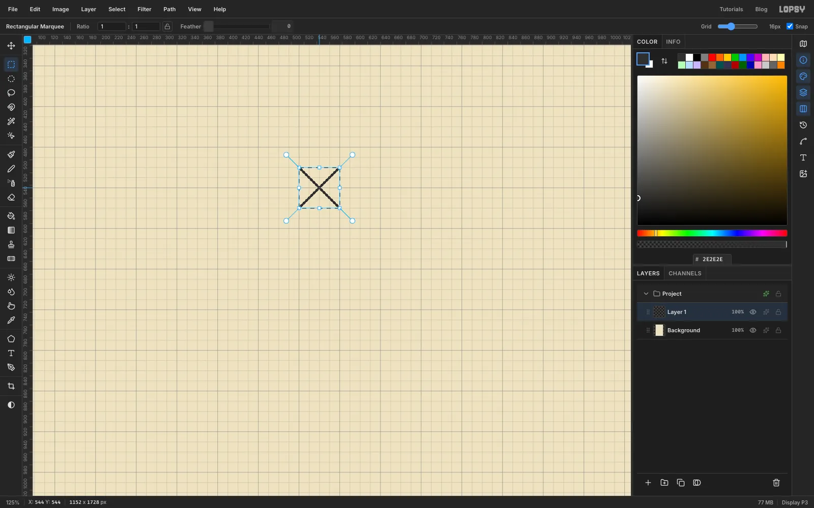

Choose **File → New**, enter **1152 × 1728**, and click **Create**. Click
the *Background* row, set the foreground to muslin `#EDE2C4`, and choose
**Edit → Fill**.

Click *Layer 1*. Turn on **View → Show Grid** (16 px cells) and zoom in a
little above the centre of the page. You'll draw a 64 px tile, four grid
cells wide, from **512, 512** to **576, 576**. Pick the **Pencil**, set
**Size** to **3** and the colour to `#2E2E2E`. Click the tile's top-left
corner and **Shift**-click its bottom-right corner to draw one diagonal.
Then click the top-right corner and **Shift**-click the bottom-left corner
to draw the other.

Select exactly that square with the exact-corners dialog. Choose **Edit → Define Pattern**. Press [[Delete]] to clear
the tile, then deselect with [[Cmd+D]].

## Tile the quilting and give it puff

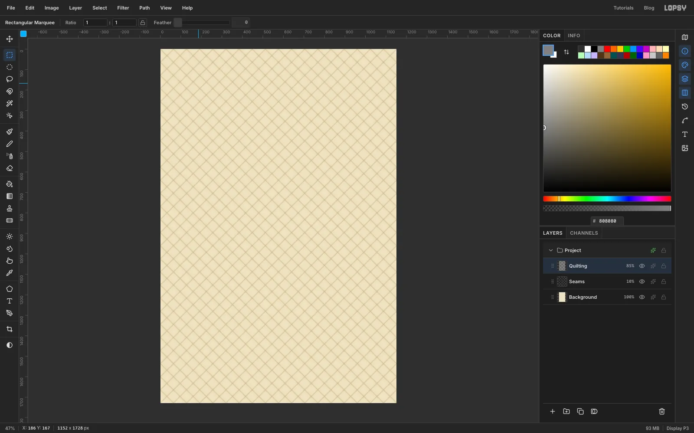

Choose **View → Fit to Screen**. Press [[Cmd+A]], choose **Edit → Fill
with Pattern…**, pick your cross tile, and click **Apply**. The crosses
join up into a diamond lattice. Deselect, rename the layer *Seams*, set its
blend mode to **Multiply** and its opacity to **10%**.

Add a new layer called *Quilting*. Select all, fill it with `#808080`,
and run **Fill with Pattern…** again with the same tile. Deselect. Then
run:

- **Filter → Gaussian Blur…** with **Radius 14**
- **Filter → Emboss…** with **Angle 135**, **Strength 100** and **Pillow Emboss**

Set *Quilting* to **Overlay** at **85%**. The grey disappears and each
diamond looks gently padded, like wadding between two layers of cloth.
Turn the grid off for now.

## Draw a flying-geese block with the Pen

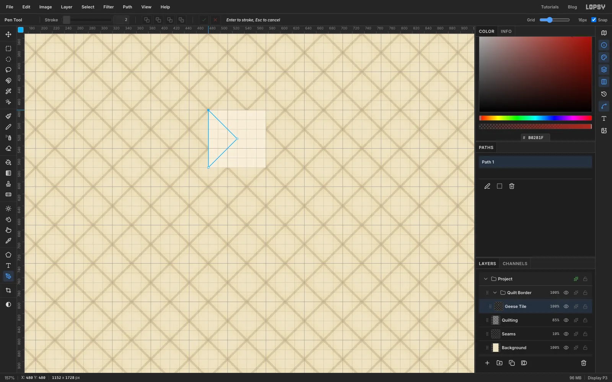

Click *Quilting*, click the **New Group** button, and name the group
*Quilt Border*. Add a layer inside it called *Geese Tile*. Turn the grid back on and zoom in on the same spot as before.

Make a 96 px square from **480, 480** to **576, 576** and fill it with
cream `#F6EEDA`. Deselect. A *flying goose* is a triangle twice as tall as
it is deep. To draw it, pick the **Pen** and click:

1. the square's top-left corner
2. its exact centre
3. its bottom-left corner
4. the first anchor again, to close the path

In the **Paths** panel, click **Path to Selection**, then **Delete Path**
because you won't need the path again. Fill the selection with turkey red
`#B0281F` and deselect.

Draw the second goose the same way, from the middle of the top edge to
the middle of the right edge to the middle of the bottom edge. Fill it
with indigo `#1E3456`.

## Save the block in four directions

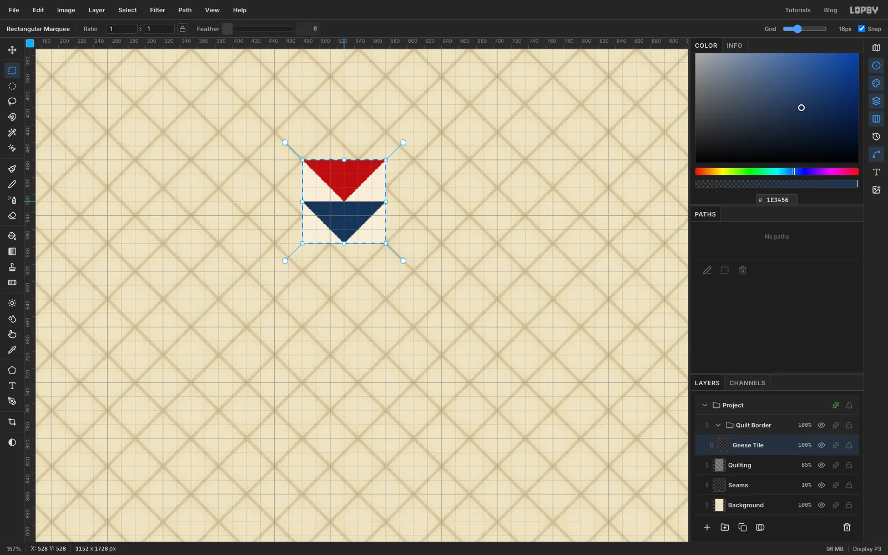

Select the 96 px square again (**480, 480** to **576, 576**) and choose
**Edit → Define Pattern**. That's the first pattern, with geese flying to
the right.

Pick the **Move** tool and click **Rotate 90° CW** in the options bar. The
geese now point down. Deselect, select the same square, and define a second
pattern. Do it twice more so you have four patterns: right, down, left and
up.

## Fill the four border bands

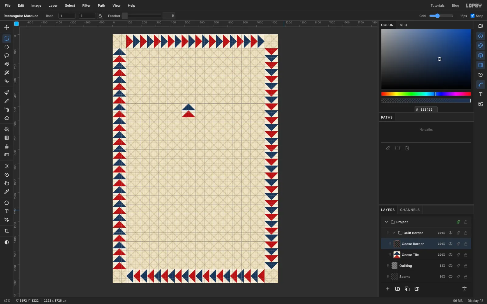

Choose **View → Fit to Screen** and add a layer called *Geese Border*.
Leave the little tile where it is, because you'll reuse that layer.
Make each band with the exact-corners dialog, then fill it with **Fill
with Pattern…** and the matching pattern:

- **Top**: 96, 0 to 1056, 96, with the *right* pattern
- **Right**: 1056, 96 to 1152, 1632, with the *down* pattern
- **Bottom**: 96, 1632 to 1056, 1728, with the *left* pattern
- **Left**: 0, 96 to 96, 1632, with the *up* pattern

Lopsy anchors pattern tiles to the top-left corner of the document. The
bands all start on multiples of 96, so every goose is whole and the
geese fly clockwise around the page.

## Add cornerstone blocks

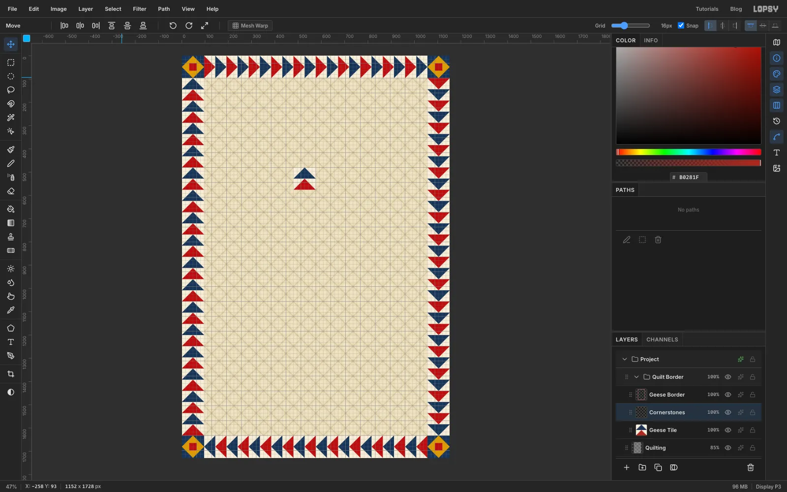

Click *Geese Tile* and add a layer called *Cornerstones*. Zoom into the
middle again. Make the same 96 px square and fill it with indigo.

With the **Pen**, click the middle of each of the four edges and close the
path. Choose **Path to Selection**, delete the path, and fill the diamond
with mustard `#D69E1E`. Fill a 32 px square in the centre (**512, 512**
to **544, 544**) with red. This is a *square in a square* block.

Choose **Fit to Screen**. With the **Move** tool, drag the block into the
top-left corner. With the grid on, it snaps exactly into place. Then copy
it to the other corners:

1. Click **Duplicate Layer**.
2. Drag the copy into the top-right corner.
3. Choose **Layer → Merge Down**.
4. Duplicate the layer again and drag the copy straight down into the
   bottom-left corner. Merge down.
5. Do the same once more for the bottom-right corner.

## Bind the edge and stitch a frame

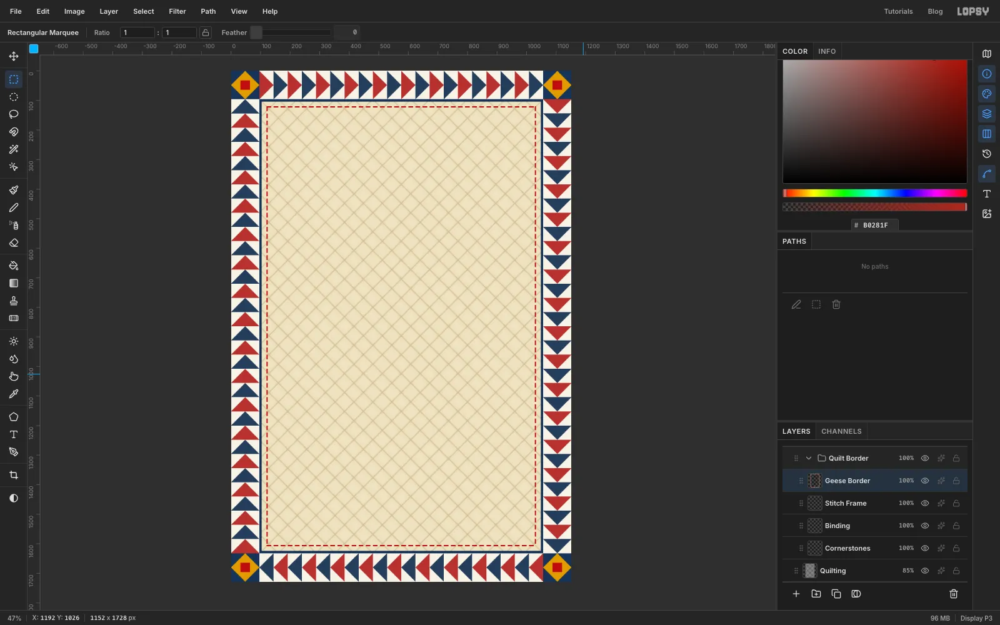

Turn the grid off. Add a layer called *Binding*. Select **96, 96** to
**1056, 1632**, fill it with indigo, then select **104, 104** to **1048,
1624** and press [[Delete]]. That leaves an 8 px navy binding.

Now make a running stitch. Click *Geese Tile*, press [[Cmd+A]], then
[[Delete]] to clear it. Zoom right in and make the dash tile:

1. Fill a 16 × 4 px dash with red: **480, 480** to **496, 484**.
2. Select the dash plus 8 px of empty space after it (**480, 480** to
   **504, 484**) and define a pattern.
3. Click **Rotate 90° CW**, deselect, select the upright dash with its gap
   (**490, 470** to **494, 494**), and define one more pattern.

Click *Binding* and add a layer called *Stitch Frame*. Make four thin
strips, 16 px inside the navy binding, and fill each with **Fill with
Pattern…**:

- **Top**: 120, 120 to 1032, 124, with the horizontal dash
- **Bottom**: 120, 1604 to 1032, 1608, with the horizontal dash
- **Left**: 120, 120 to 124, 1608, with the upright dash
- **Right**: 1028, 120 to 1032, 1608, with the upright dash

Delete the *Geese Tile* layer.

The geese are loud. Click *Geese Border* and run **Filter →
Hue/Saturation…** with **Saturation −25** and **Lightness +3**, so the
masthead will win.

## Cut out a calico heart

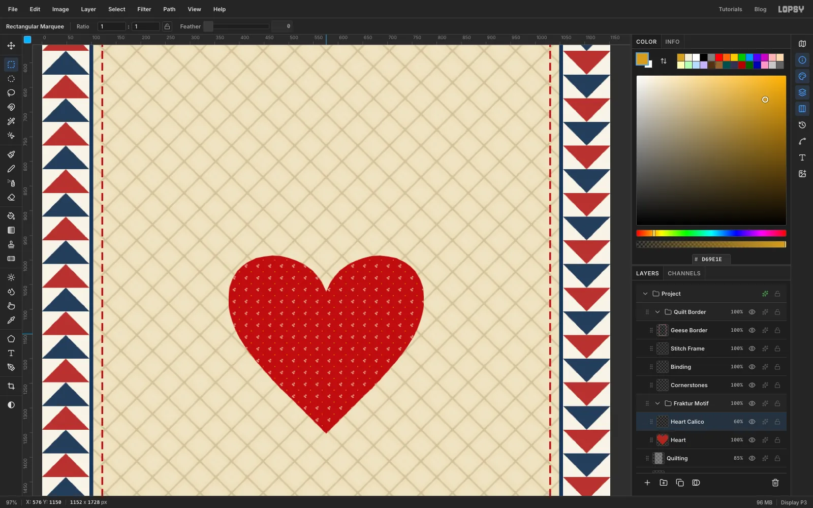

Click *Quilting*, make a **New Group** called *Fraktur Motif*, and add a
layer called *Heart*. With the **Lasso**, draw a plump heart about 400 px
wide, centred left to right. Its lobes top out at about y 995 and its tip
sits at about y 1350. Fill it with turkey red.

Next, make a calico tile. Add a layer called *Calico Tile* and zoom into an
empty spot. Pick the **Brush**, set **Hardness** to **100**, and click
three cream dots in a tiny cluster at **Size 4**. Add one mustard dot at
**Size 3** in the opposite corner. Select a 24 px square around them (for
example **600, 288** to **624, 312**), define a pattern, and delete the
layer.

Click *Heart* and add a layer called *Heart Calico*. [[Cmd]]-click the
*Heart* thumbnail to load the heart as a selection. Run **Fill with
Pattern…** with the calico tile, deselect, and set the opacity to **60%**.

## Set the hex-sign disc and the first diamond

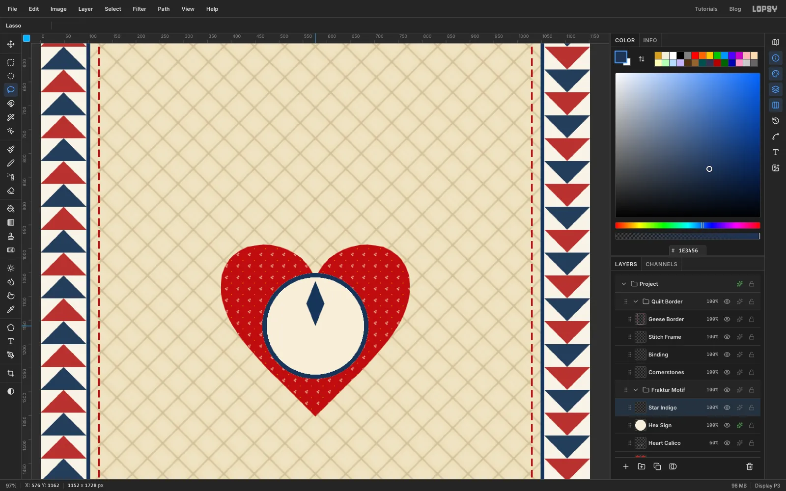

Add a layer called *Hex Sign*. With the **Elliptical Marquee**, drag a
circle 222 px across, centred at **576, 1162**, so it sits low in the heart
and just overlaps its cleft. Fill it with cream. Click the layer's
**Layer effects** button in the Layers panel, turn on **Stroke** with
**Width 9**, indigo, position **Inside**, and close the drawer.

Add a layer called *Star Indigo*. With the **Lasso**, draw a long diamond:

- its sharp 45° point sits at the centre of the disc
- its far tip reaches 94 px straight up
- its two side corners sit halfway up, about 20 px either side

Fill it with indigo. Eight of these will make an eight-point *Lemoyne*
star.

## Turn a gold copy 45°

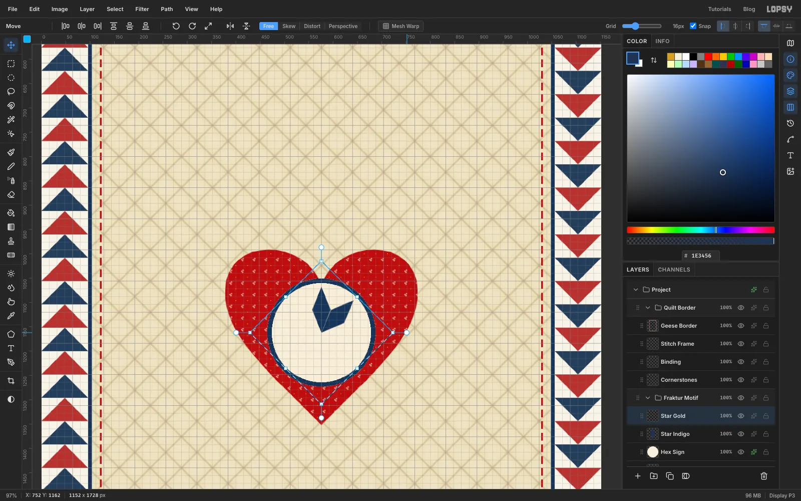

Click **Duplicate Layer** and rename the copy *Star Gold*. Turn on the
grid, because with the grid showing, rotation handles snap in 15° steps.
Select a square centred on the disc, from **472, 1058** to **680, 1266**,
so that its centre is the centre of the star.

With the **Move** tool, drag the corner rotation handle clockwise until the
diamond turns exactly **45°**. Deselect, then turn the grid off again.
[[Cmd]]-click the *Star Gold* thumbnail and fill the selection with
mustard.

## Complete the eight-point star

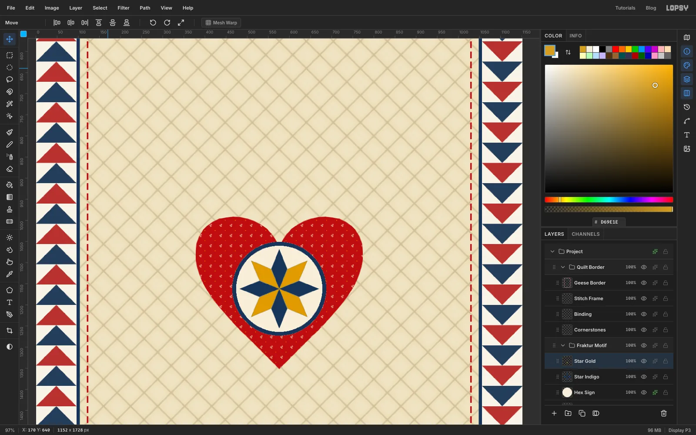

Click *Star Indigo* and copy it round the circle:

1. Click **Duplicate Layer**.
2. Select the same centred square and click **Rotate 90° CW**.
3. Deselect and **Merge Down**. You now have two diamonds.
4. Duplicate again, select the square, and click **Rotate 90° CW**.
5. Select the square **again** and click **Rotate 90° CW** once more.
6. Deselect and merge.

You need to select the square again in step 5 because after a Rotate 90°
click, Lopsy reselects the rotated pixels. The next click would otherwise
turn the diamonds about their own centre instead of the star's centre.

Do the same on *Star Gold*.

## Add two small hearts

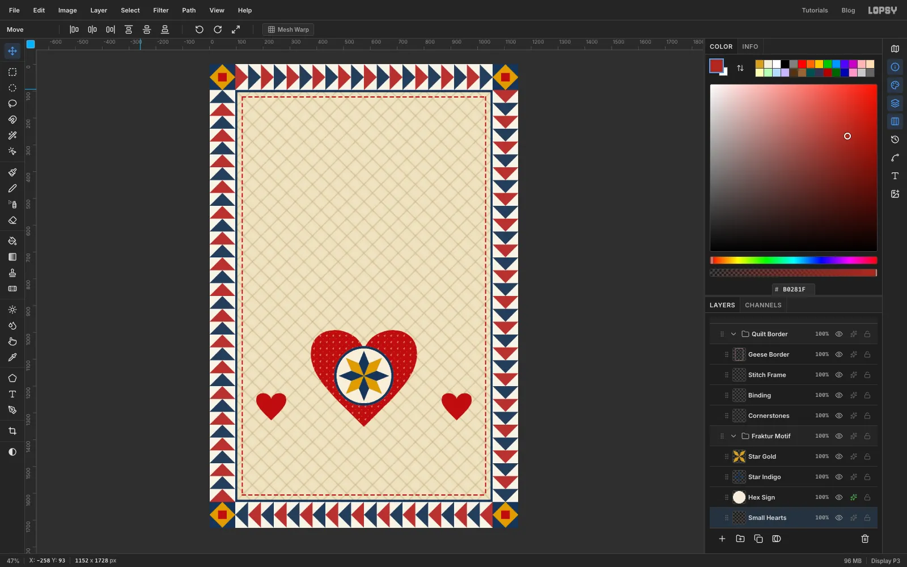

Click *Heart Calico* and add a layer called *Small Hearts*. Lasso a small
heart about 110 px wide on the left, about a fifth of the way across and a
little above the big heart's tip (centred at about **230, 1275**), and fill
it red. Duplicate the layer and drag the copy straight across to the same
spot on the right, 692 px over, so it mirrors the first. The Info panel
shows the position while you drag. Then merge down.

This is the classic fraktur *three-heart* arrangement.

## Draw the left stem behind the heart

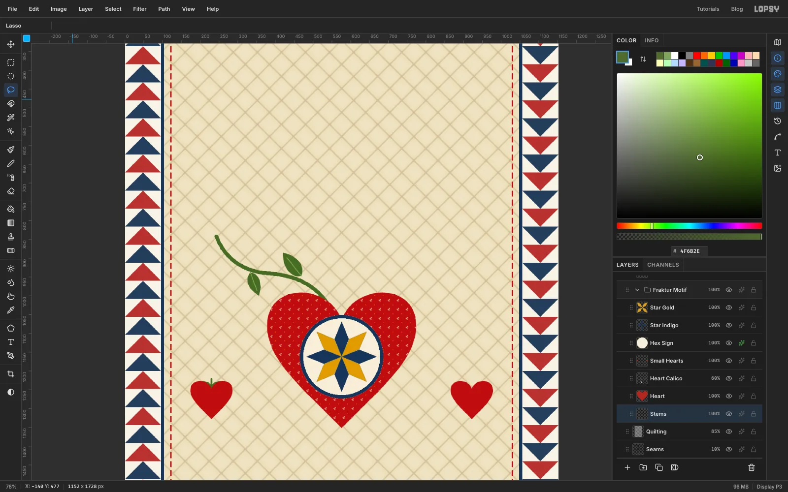

Click *Heart* and add a layer called *Stems*. In the Layers panel, drag
*Stems* by its grip below *Heart*, so stems grow out from behind the heart.

Pick the **Brush** at **Size 11**, **Hardness 100**, in olive `#4F6B2E`.
Drag one smooth stroke out of the heart's cleft. Swing it left along a
gentle S to about 200 px from the left edge, then turn it up to where a
side tulip will sit.

Lasso two leaves on it: one pointing up-left near the heart, one hanging
down further out. Fill them olive. Add a vein to each with a **Size 3**
brush stroke in `#7FA55A`.

Switch back to olive. On the left small heart, click its cleft and
**Shift**-click about 30 px straight above it with the brush at **Size 6**.
Then lasso two tiny leaves on that stem.

## Mirror the stem to the right

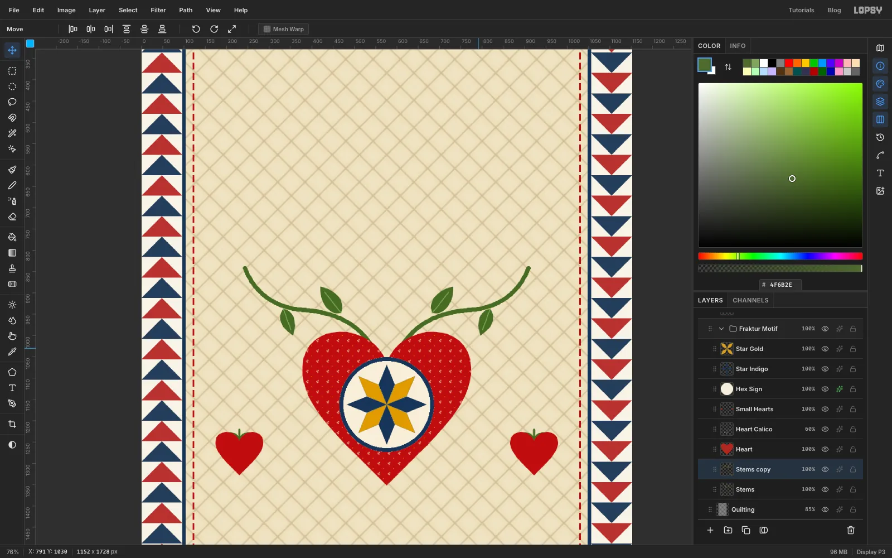

Click **Duplicate Layer**. Select a box around everything you drew on the
left: **150, 760** to **572, 1300**. With the **Move** tool, click **Flip
Horizontal** in the options bar. The copy flips inside the box.

Deselect, then drag the layer to the right by the page width minus the
box's left and right edges. Here that's 1152 − 150 − 572 = **430 px**. The
same rule works for any box: the copy lands as an exact mirror image across
the centre line. Merge down.

## Add the centre stem

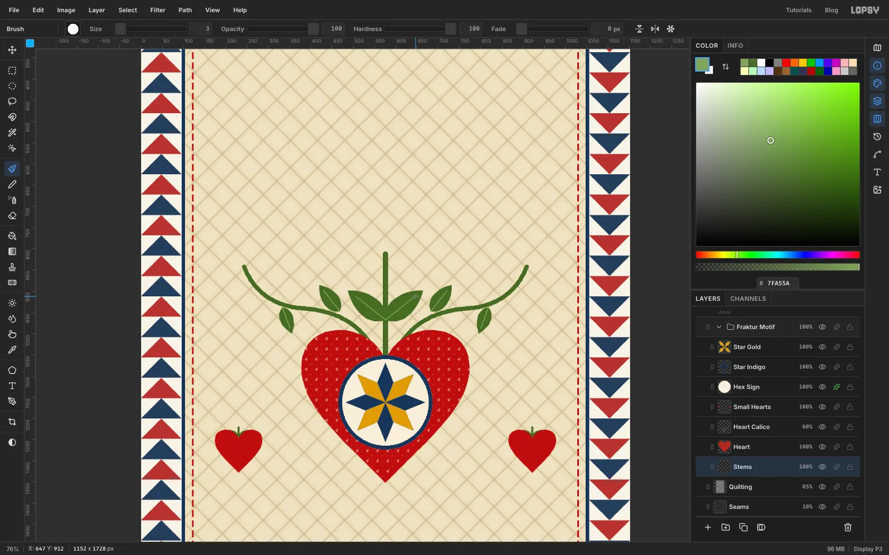

Switch back to olive and set the brush to **Size 13**. Click the heart's
cleft, then **Shift**-click
straight above it, about 260 px higher. Lasso a big pair of leaves halfway
up, one on each side, and add their veins.

## Paint a side tulip and a bud

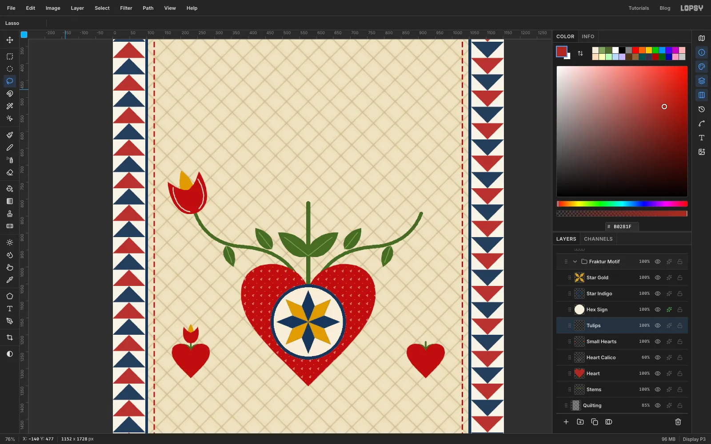

Click *Small Hearts* and add a layer called *Tulips*. A fraktur tulip is
two lasso shapes, built up in this order:

1. With the **Lasso**, draw the pointed mustard centre petal (a flame
   shape) and fill it.
2. Over it, draw the red cup. It has two outer petals that curl out to
   points and a dip in the middle where the flame shows through.

Draw it in place at the top of the left stem, already leaning about 20°
outwards, so you don't need to rotate it afterwards.

With the **Brush** at **Size 4**, **Opacity 90%**, in cream, paint one
curved highlight stroke inside each outer petal.

Draw a tiny version of the tulip, about 55 px tall, on top of the small
heart's stem.

## Mirror the tulips and add the big one

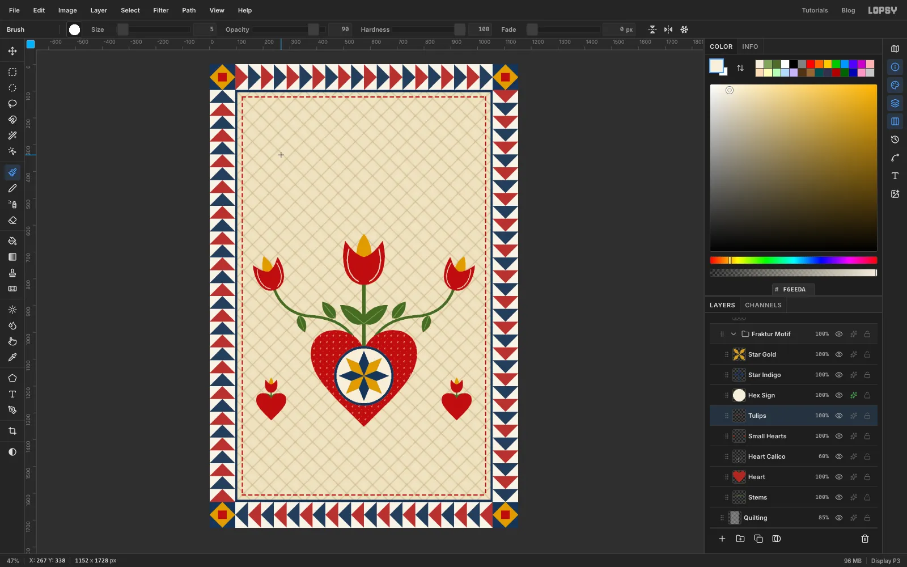

Mirror the side tulip and bud the same way as the stem. Duplicate the
layer and select **110, 650** to **340, 1250**. Click **Flip Horizontal**,
deselect, drag **702 px** right (1152 − 110 − 340), and merge down.

Then draw the big upright tulip on top of the centre stem. It's about
175 px tall, with the same flame, cup and highlight strokes, the
highlights at **Size 5**. Set the brush **Opacity** back to **100%**
afterwards.

## Shape the distelfink's body and tail

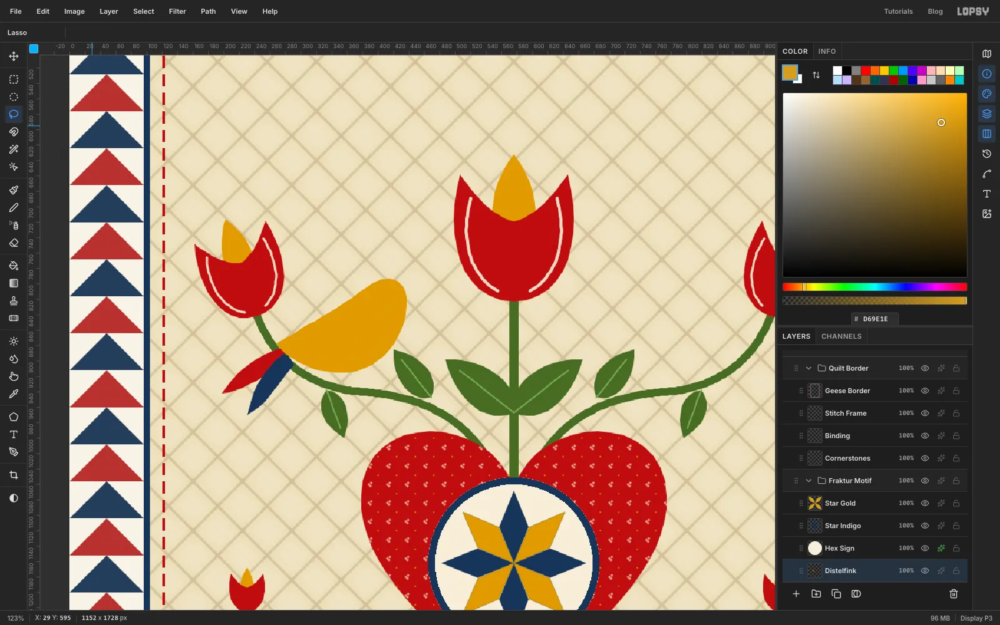

Click *Tulips* and add a layer called *Distelfink*. Zoom in on the left
stem. The bird is about 170 px long from beak to tail and perches midway
along the stem, facing the centre tulip.

With the **Lasso**, draw two long tail feathers. They start at the back of
the body and droop down and back over the stem. Fill the upper one red and
the lower one indigo.

Then lasso the body, a mustard teardrop with a round breast that faces the
centre tulip. Fill it mustard.

## Add the head, crest and wing

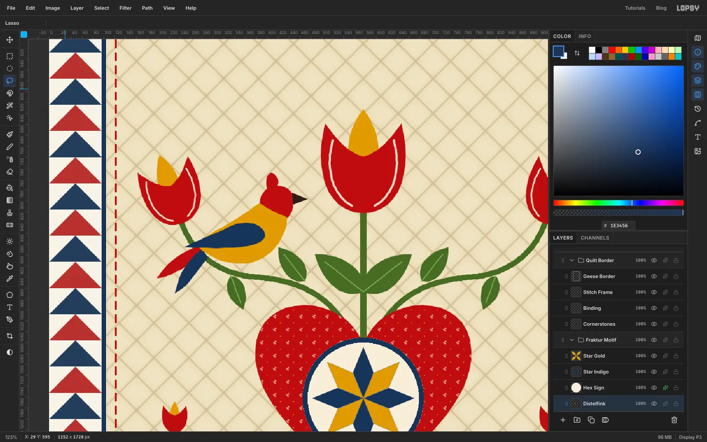

Lasso a round red head on the front of the body. Add a small red crest
that **overlaps** the crown, so it reads as part of the head and not a
separate blob. Then add a little ink `#2B1D17` triangle for the beak. Last,
lasso an indigo almond for the wing. Point it back toward the tail and let
it overlap the body.

## Paint the bird's details and legs

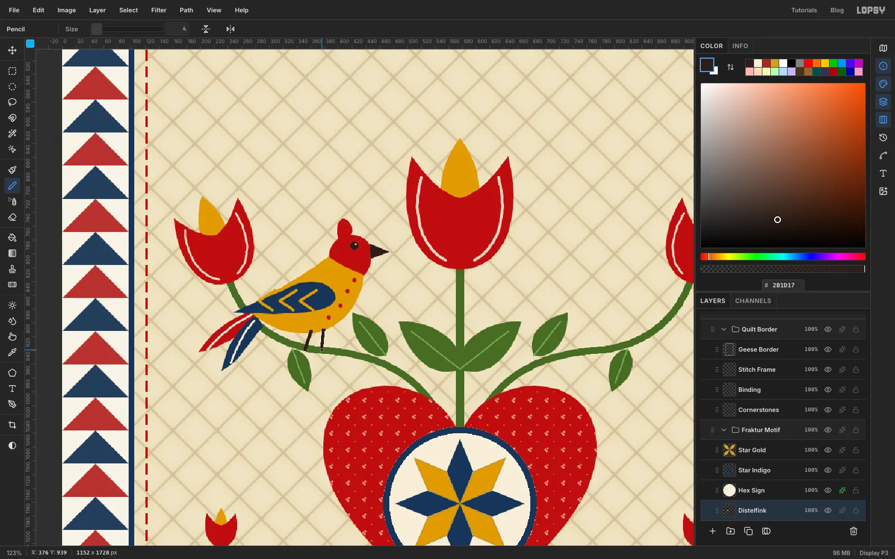

With the **Brush**:

- **Size 5**, mustard: three small chevrons across the wing
- **Size 4**, cream: one line along each tail feather
- **Size 7**, red: a few dots down the breast
- **Size 13**, ink: one click for the eye, then a **Size 4** cream click
  for the highlight

For the legs, pick the **Pencil** at **Size 4** in ink. **Shift**-click two
short lines from the belly down onto the stem.

## Mirror the bird

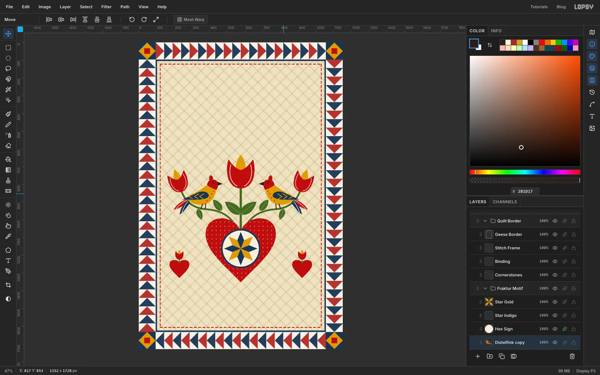

Duplicate the layer, select **180, 715** to **490, 990**, and click **Flip
Horizontal**. Deselect, drag the copy **482 px** right, merge down, and
rename the layer *Distelfinks*.

> **Tip:** Click the *Fraktur Motif* group row and press the arrow keys to
> move the whole motif together. You'll use that later.

## Make the appliqué stitch rings

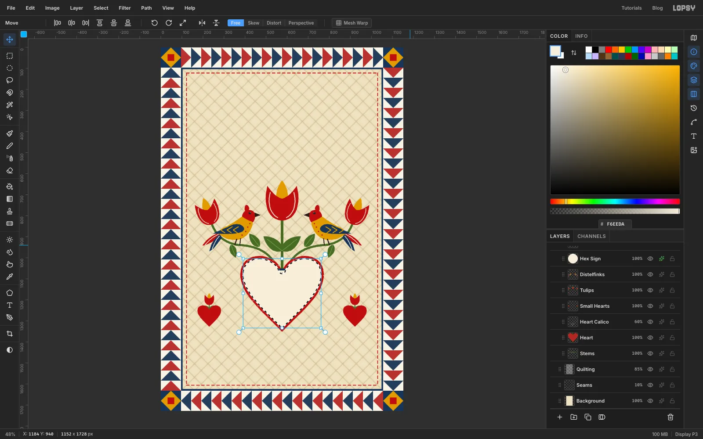

Appliqué pieces are sewn down with a running stitch just inside their
edge. Start each stitch line as a thin ring. Add a layer called
*Stitches* and drag it to the top of the *Fraktur Motif* group.

For the big heart:

1. [[Cmd]]-click the *Heart* thumbnail.
2. Choose **Select → Shrink…** **10**.
3. Fill the selection with cream.
4. Choose **Shrink… 3** again and press [[Delete]].

That leaves a 3 px ring exactly 10 px inside the heart, sharp tip
included.

Do the same for *Small Hearts*, with **Shrink 8**, then **3**.

The disc sits over the heart's ring, so clear that part first:
[[Cmd]]-click *Hex Sign*, **Grow 10**, press [[Delete]]. Then make the
disc's own ring in ink: [[Cmd]]-click *Hex Sign*, **Shrink 18**, fill,
**Shrink 2**, [[Delete]].

## Fan out a Sunburst stitch cutter

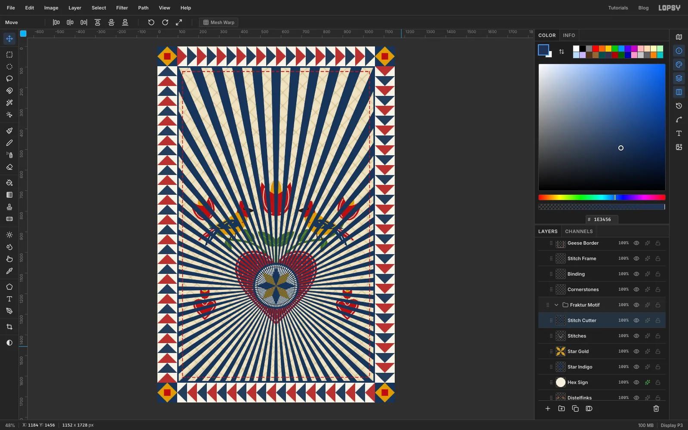

Add a layer called *Stitch Cutter* and set the foreground to any solid
colour. Choose **Filter → Sunburst…** with these settings:

- **Rays 72** and **Width 50**
- **Length 100**
- **Taper**, **Fade** and **Softness** at **0**
- **Center X 50**, **Center Y 68**, so the burst starts in the middle of
  the heart

Width 50 makes each ray as wide as the gap next to it, so the dashes and
gaps come out about equal. The rays cross the ring roughly at right angles,
the way stitches run across a seam.

The disc and the small hearts are smaller, so they need their own,
finer bursts:

1. With the **Elliptical Marquee**, draw a circle just inside the disc,
   press [[Delete]], and run Sunburst with **Rays 40** and **Center Y 67**.
2. Draw a circle about 145 px across round the left small heart, press [[Delete]], and run
   Sunburst with **Rays 20**, **Center X 20** and **Center Y 74**.
3. Repeat for the right small heart with **Center X 80**.

## Cut the rings into running stitches

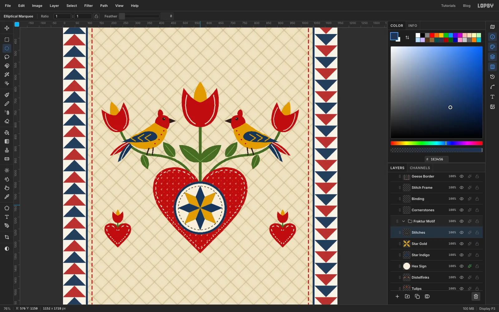

Click *Stitches*, [[Cmd]]-click the *Stitch Cutter* thumbnail, and press
[[Delete]]. Everywhere a ray crossed a ring, the ring is cut, and what's
left is a row of evenly spaced dashes. Deselect and delete the *Stitch
Cutter* layer.

## Add the issue strip

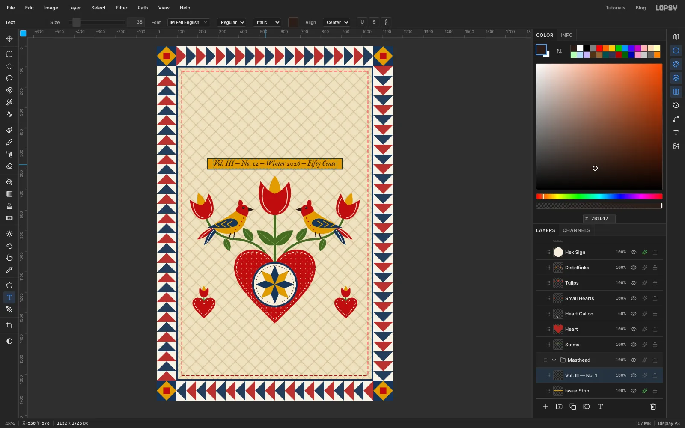

Click *Quilting*, make a **New Group** called *Masthead*, and add a layer
called *Issue Strip*. Select **246, 546** to **906, 602** and fill it
mustard. Give it a **Stroke** effect: **Width 3**, indigo, **Inside**.

Pick the **Text** tool. In the options bar set:

- font **IM Fell English**
- **Size 35**
- style **Italic**
- **Align: Center**
- foreground ink

Where you click is the top of the text's line, and the letters hang a
little below it. Click on the centre line just inside the top of the strip,
and type:

**Vol. III — No. 12 — Winter 2026 — Fifty Cents**

Click the ✓ to commit. If it isn't centred top to bottom, nudge it with
the **Move** tool and the arrow keys.

## Set "Quarterly" with a red initial

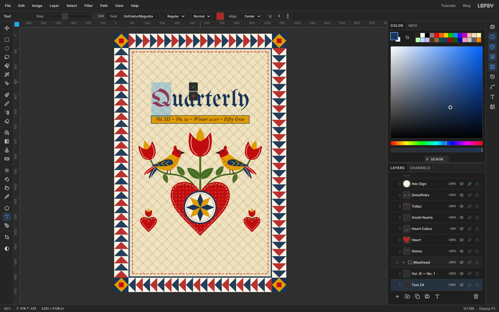

Work up the page from here, so that no new click lands inside an earlier
line of text and edits it.

Click the *Issue Strip* row first. The text options change the selected
text layer, and you don't want to restyle the strip's line. Set the font
to **UnifrakturMaguntia**, **Size 168**, style **Normal**, centred, with
the foreground indigo.

Click the centre line about 220 px above the strip. At this size the
letters start about 40 px below your click, so the tail of the *y* ends up
about 30 px above the strip. Type **Quarterly**.
Press [[Home]], then [[Shift+Right]] to select just the **Q**. Click the
**Text color** swatch and enter red `#B0281F`. Commit.

In fraktur this is called *rubrication*: a red initial letter.

## Set "Quilters'" and the tagline

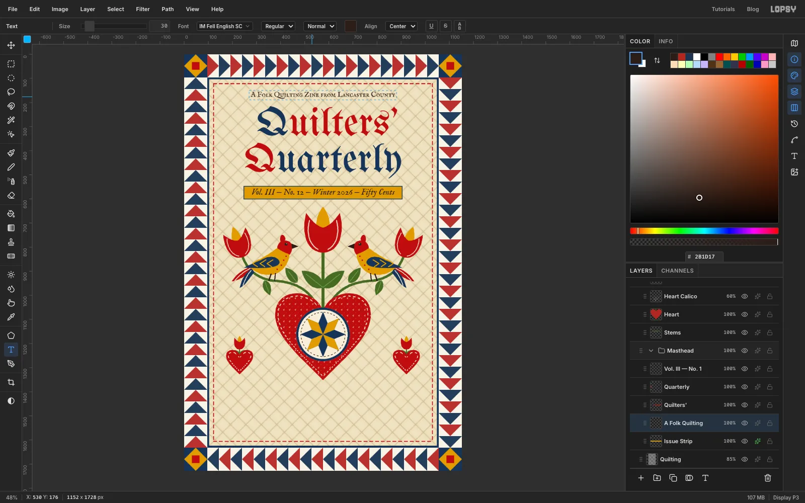

Click *Issue Strip* again and switch the foreground to red. Click about
150 px above where you clicked for *Quarterly* and about 18 px right of
the centre line, and type **Quilters'**. Point text centres on its full width, apostrophe included,
so this nudge centres the word itself.

Select the **Q** and colour it indigo, the opposite of the line below.
Commit.

Click *Issue Strip* once more. Set **IM Fell English SC**, **Size 30**, in
ink, centred, and click about 30 px above *Quilters'* to type **A Folk
Quilting Zine from Lancaster County**. Aim for about 30 px of space
between each line.

## Give the title a sign-painter's shadow

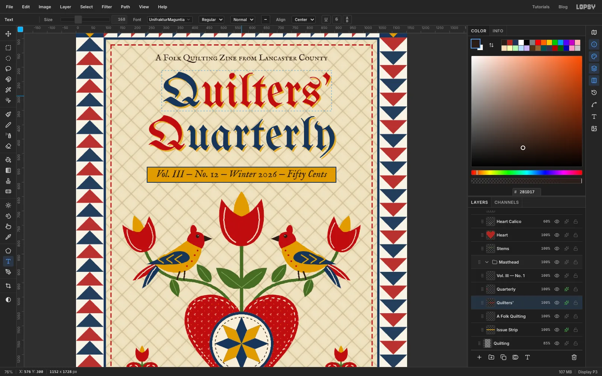

On *Quarterly* and then *Quilters'*, turn on **Drop Shadow** with:

- **Offset X 5** and **Offset Y 5**
- **Blur 0**, **Spread 0** and **Opacity 100%**
- mustard

It reads as a second colour of paint, not a shadow.

## Move the whole motif down

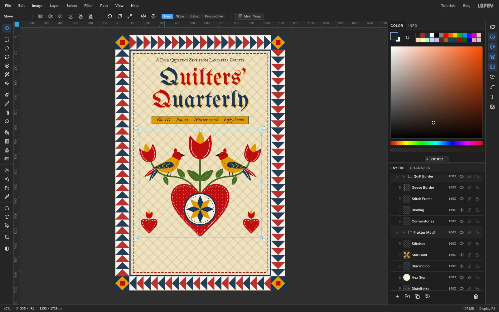

The tulip now crowds the issue strip. Click the *Fraktur Motif* group row,
pick the **Move** tool, and nudge it 16 px down with the arrow keys
([[Shift]] + an arrow moves 10 px at a time). Everything in the group moves
together, and the gap
under the strip is now about 45 px.

## Type the contents slip

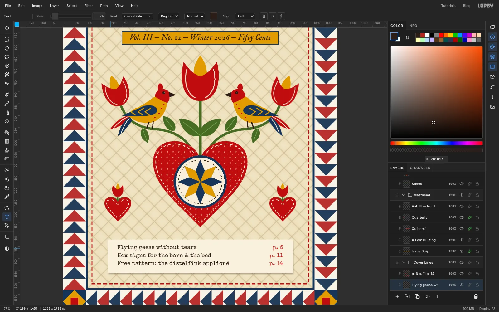

Click *Quilting*, make a **New Group** called *Cover Lines*, and add a
layer called *Cover Slip*. Select **188, 1420** to **964, 1560** and fill
it with paper `#F8F1DF`. Give it a soft **Drop Shadow**: Offset **3 / 5**,
Blur **8**, Opacity **35%**, in ink.

With the **Text** tool, set **Special Elite** at **Size 24**:

1. **Align: Right**, in red, click 40 px in from the slip's right edge and
   about 20 px below its top. Type **p. 6**, **p. 11** and **p. 14** on
   three lines, pressing [[Enter]] between them.
2. Click *Cover Slip* again. **Align: Left**, in ink, click 40 px in from
   the left edge at the same height, and type the article titles on three
   lines:
   - Flying geese without tears
   - Hex signs for the barn & the bed
   - Free pattern: the distelfink appliqué

## Draw dotted leaders

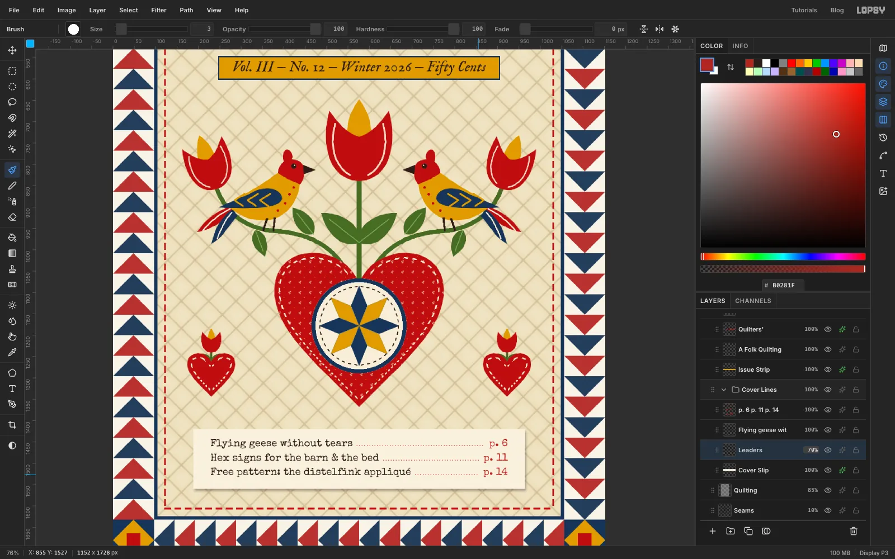

Click *Cover Slip* and add a layer called *Leaders*. Pick the **Brush** at
**Size 3**, open the Brushes panel from the brush-tip thumbnail, and set
**Spacing** to **200%**. Each dab now lands on its own, as a dot.

In red, click just after the end of each title, on its baseline, and
**Shift**-click just before its page number. Set the layer to **70%**.

## Tilt the slip

Click the *Cover Lines* group row and pick the **Move** tool. Handles
appear around the whole slip. Make sure the grid is off, so the rotation
doesn't snap. Drag a corner rotation handle counter-clockwise about
**1.5°**, then press [[Cmd+D]] to commit. The text layers turn with the
paper and stay editable.

## Tape the slip down

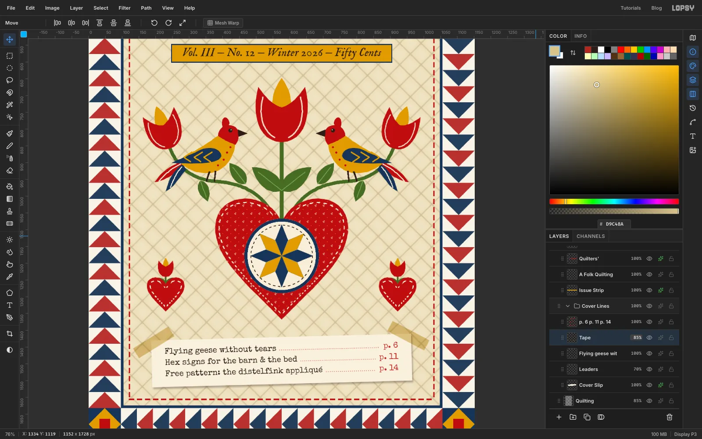

Click the titles layer (*Flying geese wit…* in the panel) and add a layer
called *Tape*. Select a strip about 120 × 35 px centred on the slip's
top-left corner and fill it with `#D9C48A`. Rotate it about 30°
counter-clockwise with the **Move** tool's corner handle, then deselect.
Make a second strip over the top-right corner and turn it about 30°
clockwise. They look better if the angles aren't quite equal.

Set *Tape* to **Multiply** at **85%**, so the paper and quilting show
through like real masking tape.

## Add print grain

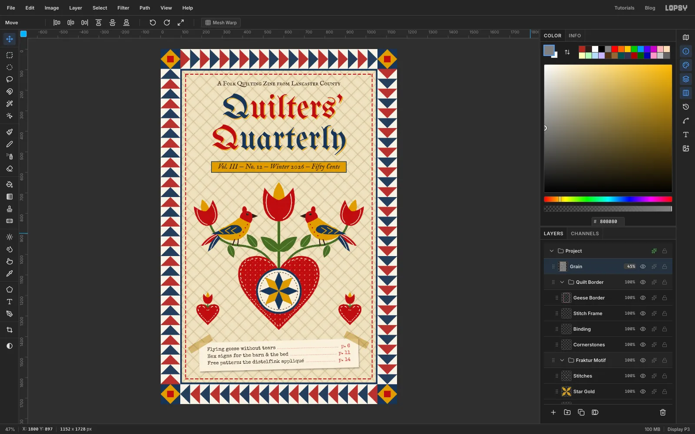

Click *Quilting* and add a layer called *Grain*. Drag it by its grip to
the very top of the stack, above *Quilt Border*. Select all and fill it
with `#808080`, then run **Filter → Add Noise…** with **Amount 70**,
**Mono** and **Uniform**. Set it to **Overlay** at **45%**.

Save with **File → Save Project**, then choose **File → Quick Export
PNG**.
