Multi-layer stencils are how street artists like Shepard Fairey turn a photograph into a few flat colours they can spray fast. Each colour is its own cut-out sheet, called a *plate*. You spray the lightest plate first and the darkest last, and the slightly-off alignment between them is part of the charm.

This poster does the same in Lopsy. A photo of a lynx is split into three plates with **Threshold** and the **Magic Wand**, then sprayed over a yellow wildlife-crossing sign on a concrete wall. The lynx is [Portrait of a Carpathian Lynx](https://commons.wikimedia.org/wiki/File:Portrait_of_a_Carpathian_Lynx.jpg) by Wilfredor on Wikimedia Commons, which is public domain (CC0). To follow along, open its Commons page and download the 1,920 px wide version. Or use any portrait of an animal facing the camera against a darker background.

Along the way you'll use:

- **Add Noise**, **Motion Blur**, **Clouds**, **Gaussian Blur** and **Threshold** to build a concrete texture
- the **grid** with snapping, **ruler guides**, and the **Pencil** for straight lines
- **Define Pattern** and **Fill with Pattern** for board joints and the holes in a sign post
- the **Shape** tool's click-to-size dialog, rotating with [[Cmd]] for 15° steps, and **Select → Shrink** to cut borders
- pasting a photo, scaling it with the **Move** tool, **Desaturate** and **Surface Blur**
- the **Lasso**, an **intersecting** selection, and the **Magic Wand** (with Contiguous off) to turn threshold layers into stencil plates
- **Spray**, soft **Brush** strokes and **Outer Glow** for overspray, plus hand-made paint drips
- live text in **Allerta Stencil** and **Black Ops One**, the **Text** panel's line height, and rotating text
- transforming **two layers at once**, copy and paste, **Merge Down**, and a **layer mask** with a gradient

The palette is concrete greys with safety yellow, a teal and black lynx, and one red accent:

- Concrete `#8E8B84`, seams `#5B5852` / `#B4B0A7`, joints `#6E6A63`
- Tie holes `#34322E`, hole lip `#CFCBC2`, stains `#4F4C46`
- Safety yellow `#F2C230`, yellow haze `#F2C200`, sign black `#161616`
- Post `#6D6A64`, post highlight `#8A8780`, post holes `#202224`
- Cream plate `#EFE6D2`, teal plate `#1E6A66`, black plate `#161616`
- Tag red `#C8402A`, footer cream `#EFE6D2`

> **Tip:** Positions are in document pixels, written `x, y`. The status bar at the bottom shows where the pointer is. When a step says to fill, that's **Edit → Fill**, which fills the selection (or the whole layer if nothing is selected) with the foreground colour. [[Cmd+D]] deselects.

> **Tip:** Blend modes live in the **Blend** dropdown at the top of a layer's effects drawer (the sparkle icon on its row). To change a layer's opacity, click the `100%` readout on its row to open a slider, then drag it.

## Start the concrete wall

1. Open [Lopsy](/). In the **New Document** dialog set **Width** to `1500` and **Height** to `2000`, leave the background white and click **Create**. That's an 18 × 24 poster shape.
2. Double-click **Layer 1** in the Layers panel and rename it `Concrete`.
3. Set the foreground colour to `#8E8B84` and choose **Edit → Fill**.
4. Choose **Filter → Add Noise…**, set **Amount** to `14`, choose **Mono** and **Gaussian**, and click **Apply**.

## Add board-formed grain

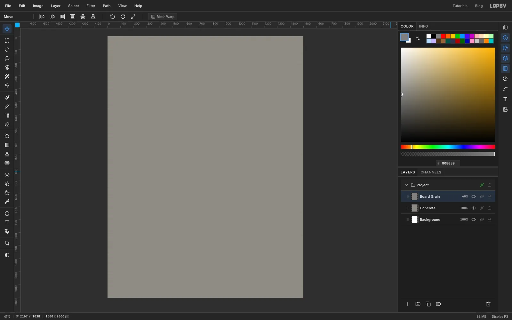

Concrete poured against wooden boards picks up the grain of the wood in long horizontal streaks.

1. Click **Add Layer** and name the layer `Board Grain`.
2. Fill it with mid grey `#808080`.
3. Run **Filter → Add Noise…** with **Amount** `60`, **Mono** and **Uniform**.
4. Run **Filter → Motion Blur…** with **Angle** `0` and **Distance** `90`. The speckles smear into horizontal streaks.
5. Set the layer's blend mode to **Overlay** and its opacity to `40%`.

Overlay ignores mid grey, so only the light and dark streaks show.

## Pit the surface with bugholes

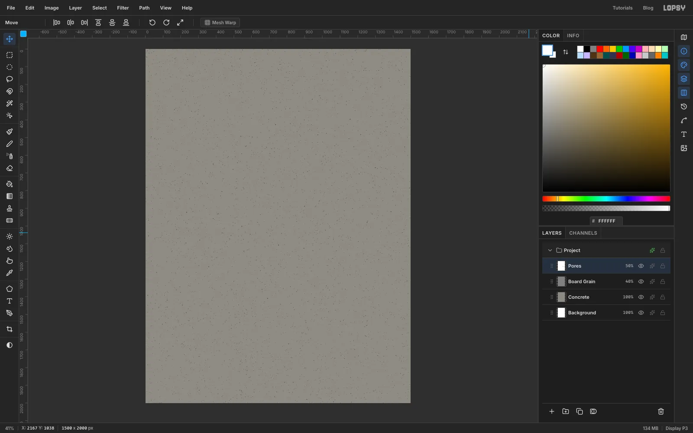

Real concrete has little air bubbles, called bugholes, trapped in its surface.

1. Add a layer called `Pores` and fill it with white.
2. Run **Add Noise** at **Amount** `100` with **Mono** and **Uniform**, then **Filter → Gaussian Blur…** with a **Radius** of `3`. The blur clumps the noise into soft blotches.
3. Run **Filter → Threshold…**. Turn on **Preview** and drag **Level** down until only sparse dark specks are left, mostly a few pixels across. That was around `230` here.
4. Set the layer to **Multiply** at `50%`.

## Mottle the wall with clouds

1. Add a layer called `Mottle`.
2. Run **Filter → Clouds…** with **Scale** `14`.
3. Set it to **Soft Light** at `12%`.

Keep this faint. At higher opacity the clouds look like fog or camouflage instead of concrete.

## Draw the formwork seams

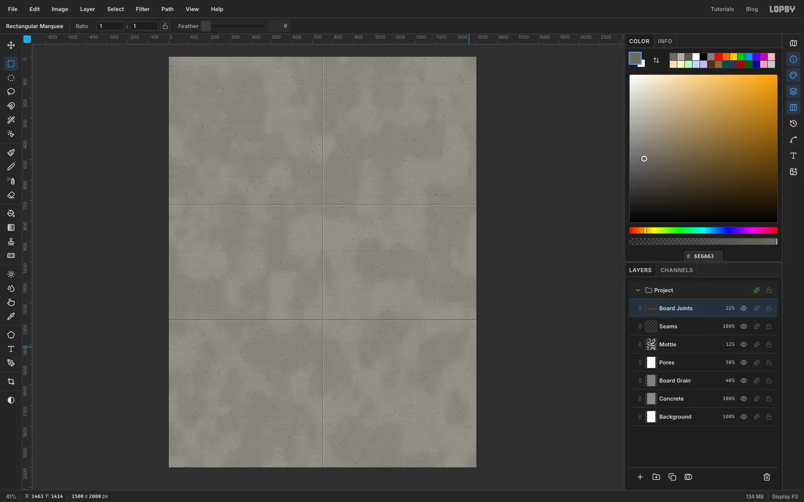

Board-formed walls show a joint wherever two boards met, and a stronger seam at each panel edge.

1. Add a layer called `Seams` and pick the **Pencil**.
2. Set **Size** to `3` and the colour to `#5B5852`. Click once on the left edge of the canvas at `y 720`, then hold [[Shift]] and click on the right edge at the same height. Shift-click draws a straight line from the last click. Do the same at `y 1280`, and draw one vertical seam down the middle at `x 750`.
3. Set **Size** to `2` and the colour to `#B4B0A7`, and draw the same three lines again 3 px lower (or 3 px to the right for the vertical one). The pale line under each dark one reads as a lit edge.
4. Zoom in and watch the **Y** readout in the status bar while you do that, because 3 px is only about one screen pixel at fit-to-screen zoom.
5. Add a layer called `Board Joints`. With the Pencil at size `2` in `#6E6A63`, draw one line across the wall at `y 45`.
6. Turn that line into a repeating tile. With the **Rectangular Marquee**, select a 90 × 90 px square from the top-left corner of the canvas, so the line runs through its middle. Choose **Edit → Define Pattern**.
7. Press [[Cmd+A]] to select the whole canvas, choose **Edit → Fill with Pattern…** and click **Apply**. The line repeats every 90 px down the wall. Deselect and set the layer to `22%`.

## Lay out the tie holes on the grid

The steel ties that hold the formwork together leave neat round holes in rows.

1. Add a layer called `Tie Holes`.
2. Choose **View → Show Grid**. Make sure **Snap** is ticked in the options bar, so the selection corners land on the 16 px grid lines and every hole comes out the same size.
3. Pick the **Elliptical Marquee** and drag a small circle about 32 px across (two grid squares), centred about `125` px in from the left edge at `y 440`.
4. Hold [[Shift]] and drag five more circles: one at the same height `125` px in from the right edge, then a pair at `y 1000` and a pair at `y 1560`. Shift adds each one to the selection. The big box around them is the selection's transform box. Leave it alone.

## Give the holes depth

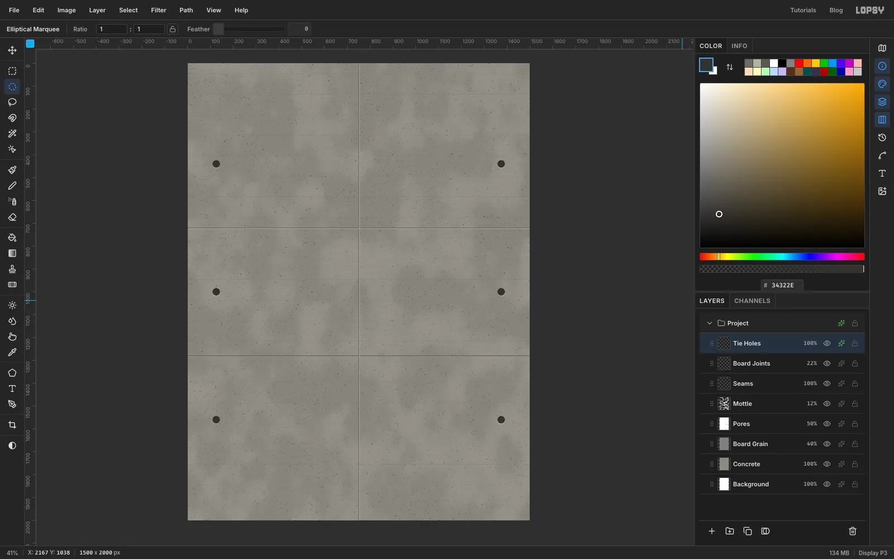

1. Fill the selection with `#34322E` and deselect.
2. Choose **View → Show Grid** again to hide the grid.
3. Open the effects drawer for `Tie Holes`:
   - Tick **Drop Shadow** and set **Offset X** `0`, **Offset Y** `3`, **Blur** `2`, **Opacity** `55` and the colour `#CFCBC2`. A pale "shadow" below the hole reads as light catching its lower lip.
   - Tick **Inner Glow** and set **Size** `7`, **Opacity** `75` and the colour `#111111`, which darkens the inside rim.

## Run water stains down from the ties

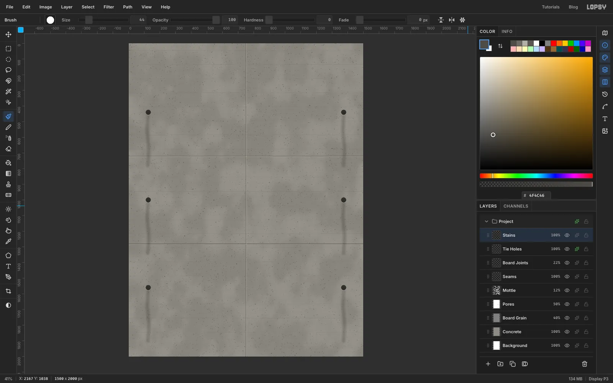

Rain carries rust and grime out of the ties and down the wall.

1. Add a layer called `Stains`.
2. Pick the **Brush** and set **Size** `44`, **Hardness** `0` and **Opacity** `22`. Set the colour to `#4F4C46`.
3. From just under each tie hole, drag down about 340 px with a little wobble.
4. Set the layer to **Multiply**, and put the brush **Opacity** back to `100`.

## Add guides for the sign

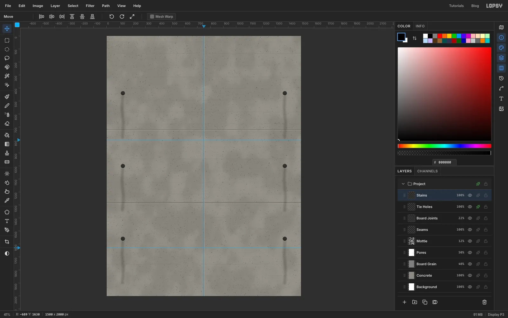

1. Click `Stains` in the Layers panel. Click the top ruler at `750` to drop a vertical guide down the centre of the poster.
2. Click the left ruler at `800` (the middle of the diamond sign) and at `1630` (the middle of the plaque under it).

## Paint the sign post

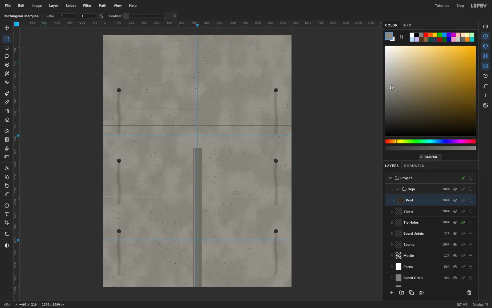

1. With `Stains` still selected, click **New Group** in the Layers panel and name the group `Sign`. Then click **Add Layer** and name the layer `Post`.
2. With the **Rectangular Marquee**, select a 70 px-wide strip centred on the vertical guide, from `y 900` down to the bottom edge. Fill it with `#6D6A64`.
3. Select a 6 px strip just inside the post's left edge and fill it with `#8A8780` as a highlight. Deselect.

## Punch holes in the post with a pattern

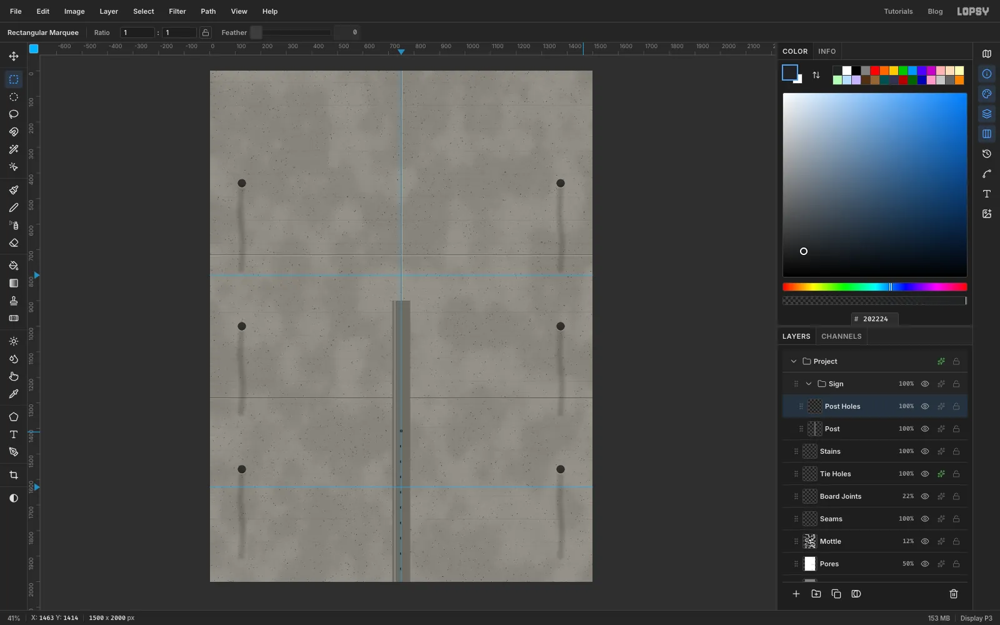

Sign posts are perforated all the way down. Make one hole, turn it into a pattern, then tile it.

1. Add a layer called `Post Holes`. With the **Brush** at **Hardness** `100` and **Size** `12`, click once on the centre guide at `750, 1410` in `#202224`.
2. With the Rectangular Marquee, select a 40 × 60 px box from `720, 1380` to `760, 1440`, with the hole inside it. Choose **Edit → Define Pattern**.
3. Select a 40 px-wide column over the post from `720, 1380` down to the bottom edge. Choose **Edit → Fill with Pattern…**, pick the new hole pattern and click **Apply**. Deselect.

The pattern tiles from the canvas's top-left corner. The tile you defined starts on a multiple of 40 and of 60, so the copies land exactly in line with the first hole, one every 60 px.

## Make a rounded square with the Shape tool

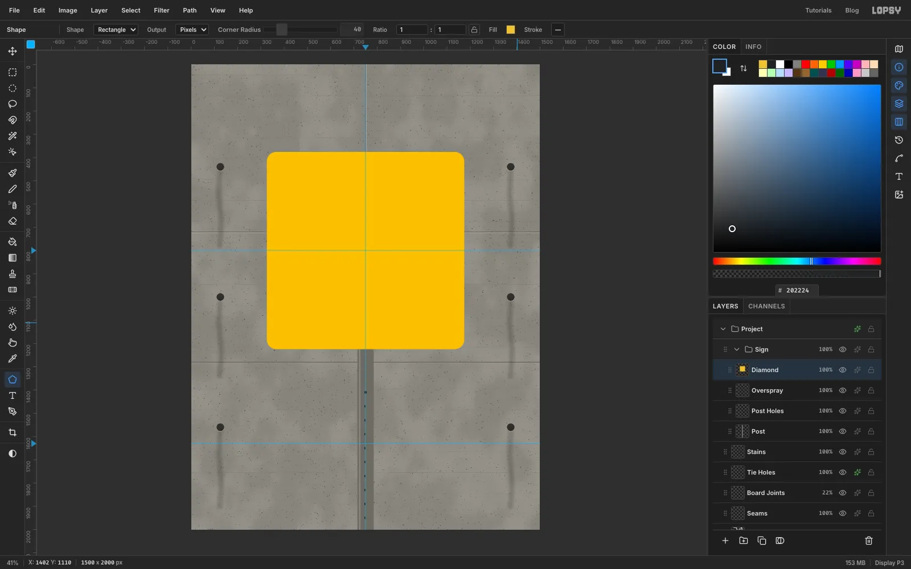

1. Add a layer called `Overspray` and leave it empty for now. Then add a layer called `Diamond`.
2. Pick the **Shape** tool. Set **Shape** to **Rectangle**, **Output** to **Pixels** and **Corner Radius** to `40`. Click the **Fill** swatch and type `F2C230`. If **Stroke** shows a colour, click it and choose **Remove stroke**.
3. Click once where the guides cross at `750, 800` without dragging. The **Shape Size** dialog opens. Enter `848` for both **Width** and **Height** and click **Create**.

The shape is centred on the click. 848 px is chosen so that once it's turned 45° the diamond is 1200 px from point to point.

## Turn it into a diamond

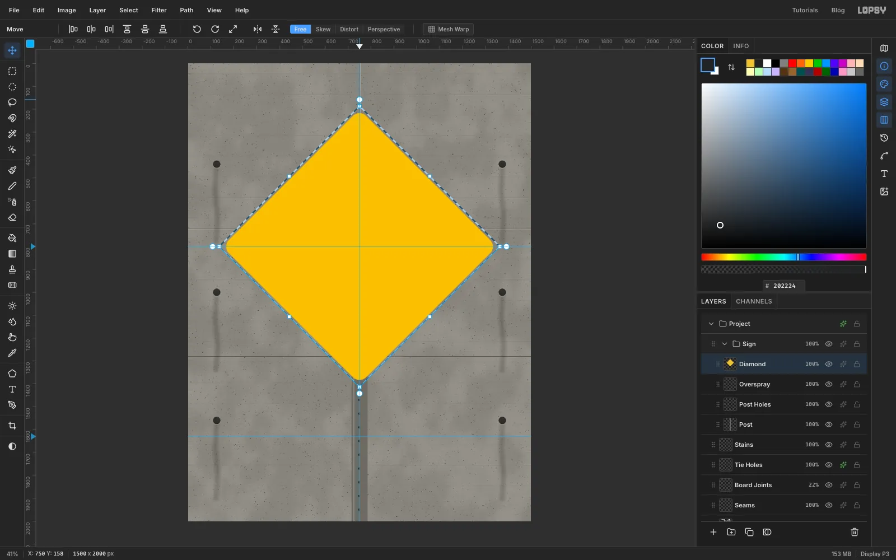

1. With the **Rectangular Marquee**, drag a box just around the square.
2. Pick the **Move** tool. Rotation handles are the round dots just outside each corner of the box.
3. Hold [[Cmd]] and drag the top-left rotation handle clockwise. Cmd snaps the angle to 15° steps, so stop when it clicks to 45°.
4. Press [[Cmd+D]] to commit.

## Cut the black border ring

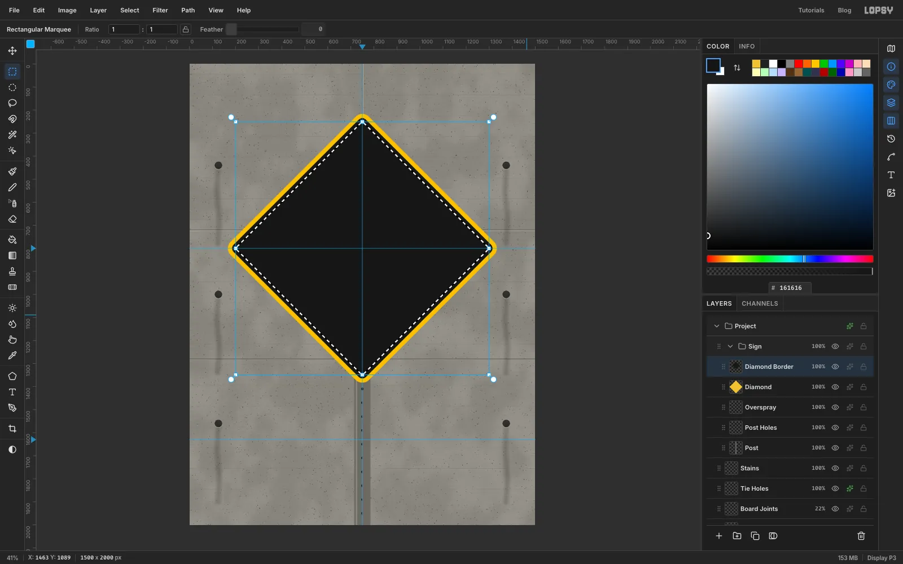

A warning sign has a thin black border set in from its edge.

1. Switch to the **Rectangular Marquee** so the Move tool's handles go away. Hold [[Cmd]] and click the `Diamond` thumbnail to select its shape.
2. Choose **Select → Shrink…**, enter `18` and apply.
3. Add a layer called `Diamond Border` and fill it with `#161616`.
4. Shrink the selection again by `16`. Now the whole shrunken diamond is black with marching ants inset in it. Press [[Delete]] to clear the middle, and deselect.

That leaves a 16 px black ring with an 18 px yellow rim outside it.

## Add the plaque

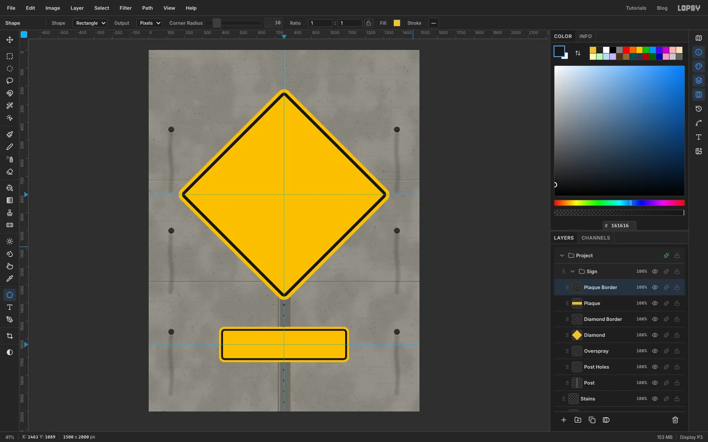

1. Add a layer called `Plaque`. Pick the **Shape** tool, set **Corner Radius** to `30`, and click on the centre guide at `750, 1630`. Make it `720` wide and `196` tall.
2. [[Cmd]]-click the `Plaque` thumbnail and shrink the selection by `12`. Add a layer called `Plaque Border`, fill it with `#161616`, shrink by `10`, press [[Delete]] and deselect.

## Spray the overspray

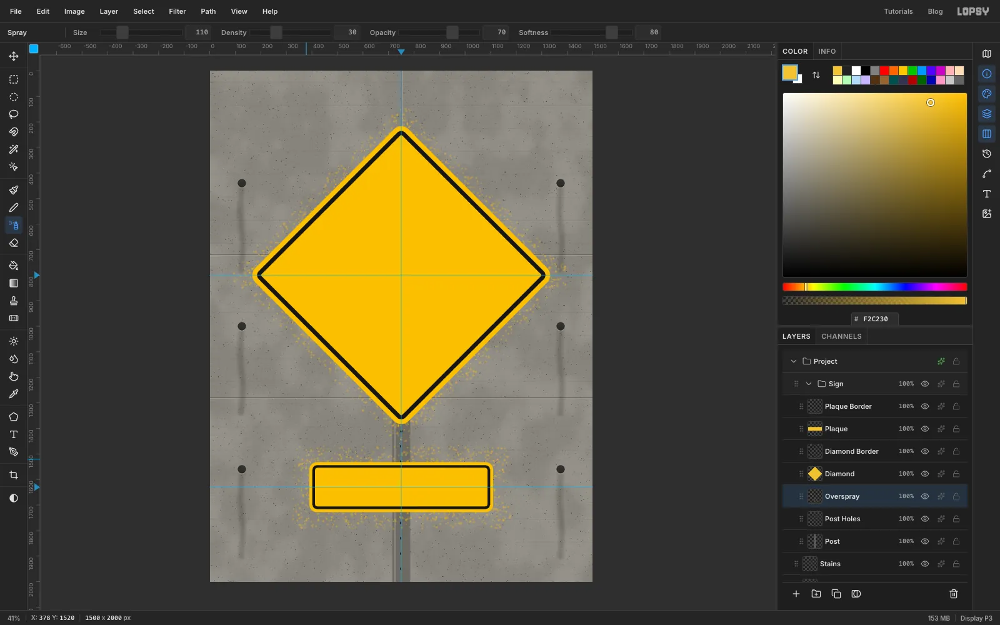

When you spray through a stencil, some paint always drifts under the edge.

1. Click the `Overspray` layer, which sits under the diamond.
2. Pick the **Spray** tool. Set **Size** `110`, **Density** `30`, **Opacity** `70` and **Softness** `80`, and the colour to `#F2C230`.
3. Drag slowly around the outside of the diamond, keeping the cursor just beyond its edge, then do the same around the plaque.

## Soften the edges and add haze

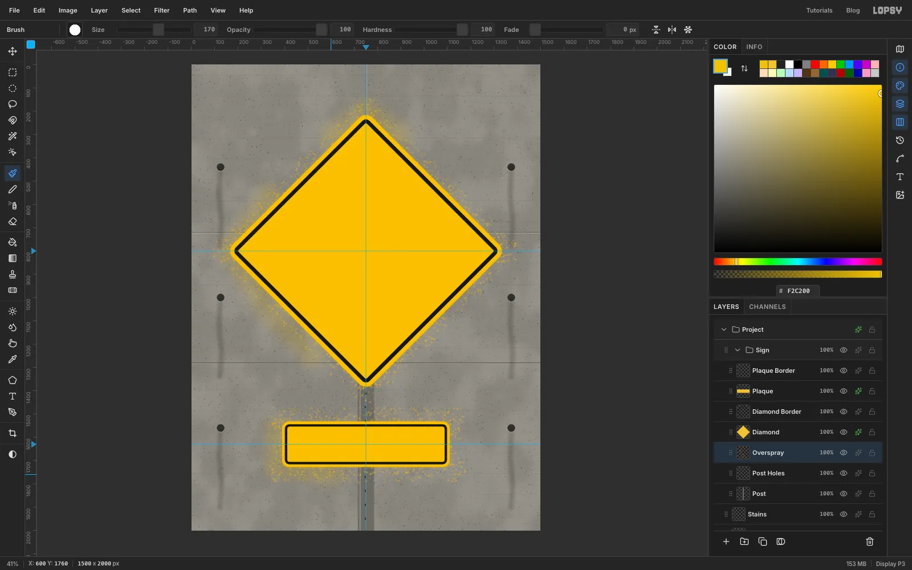

Perfectly crisp edges look like vector art, not paint.

1. Select `Diamond` and run **Add Noise** at **Amount** `7` with **Mono** and **Uniform**. Do the same on `Plaque`.
2. Run **Gaussian Blur** with **Radius** `1` on each of `Post`, `Post Holes`, `Diamond`, `Diamond Border`, `Plaque` and `Plaque Border`.
3. Give `Diamond` and `Plaque` an **Outer Glow** with **Size** `18`, **Opacity** `30` and colour `#F2C200`.
4. Click `Overspray` again. Pick the **Brush** at **Size** `170`, **Hardness** `0` and **Opacity** `14` in `#F2C200`. Sweep a few soft strokes along the left side of the diamond, over its top tip and along the left end of the plaque. Uneven haze looks hand-sprayed.
5. Put the brush back to **Opacity** `100` and **Hardness** `100`.

## Paste in the lynx photo

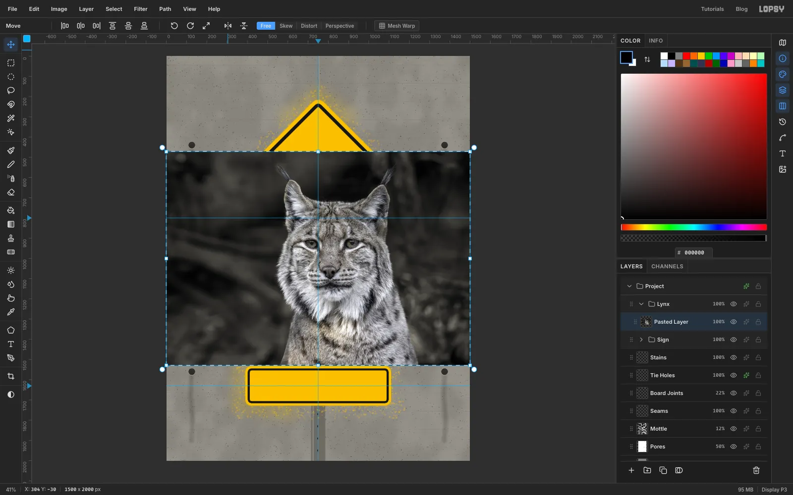

1. Click the arrow on the `Sign` group row to collapse it, then click the `Sign` row. Click **New Group** and name it `Lynx`. With the group collapsed, the new group lands next to `Sign` instead of inside it.
2. Open the lynx photo in another tab, copy the image, and press [[Cmd+V]] in Lopsy.
3. A photo larger than the canvas is shrunk to fit, so it lands across the full width. Rename the new layer `Photo`.

## Scale the photo back up

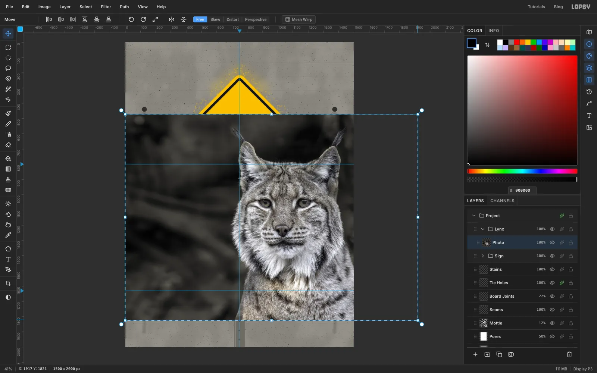

The fitted photo is too small. The lynx's head should nearly fill the diamond.

1. The paste is already selected and the **Move** tool is active. Hold [[Cmd]] and drag the bottom-right corner handle down and to the right until the box's right edge reaches `1920` on the top ruler. That's the photo's original size. Cmd keeps the proportions.
2. Press [[Cmd+D]] to commit.

Part of the photo now hangs off the canvas. That's fine, because Lopsy keeps those pixels.

## Line the lynx up with the sign

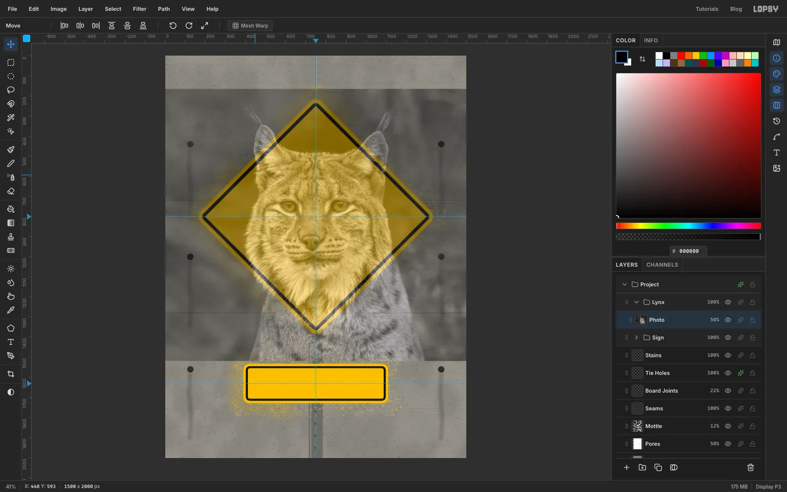

The photo now covers the sign, so make it see-through while you place it.

1. Set the `Photo` layer's opacity to `50%`.
2. Drag the photo with the **Move** tool until the lynx's nose is just left of the centre guide, at about `728, 930`. Its ruff is fuller on the right, so setting the nose a little left centres the head in the diamond. The ear tufts should poke out past the diamond's top edges.
3. Set the opacity back to `100%`.

## Simplify the photo

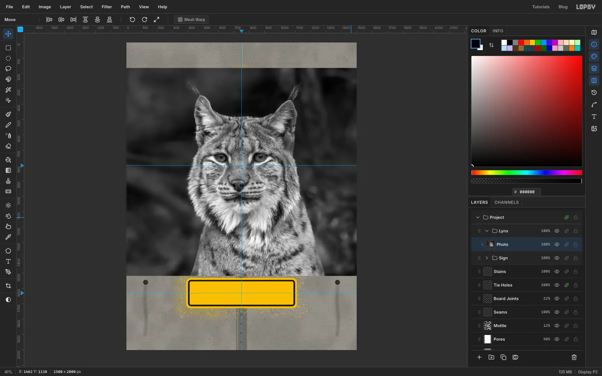

A stencil can't hold every hair. Flatten the colour first, then smooth the detail.

1. Choose **Filter → Desaturate**. This lynx is nearly grey already, but with a colour photo this step matters.
2. Run **Filter → Surface Blur…** with **Radius** `14` and **Threshold** `34`. Surface Blur smooths soft areas but keeps strong edges. At this zoom the change is subtle, but it's what keeps the plates from breaking into specks later.

## Lasso the lynx out of its background

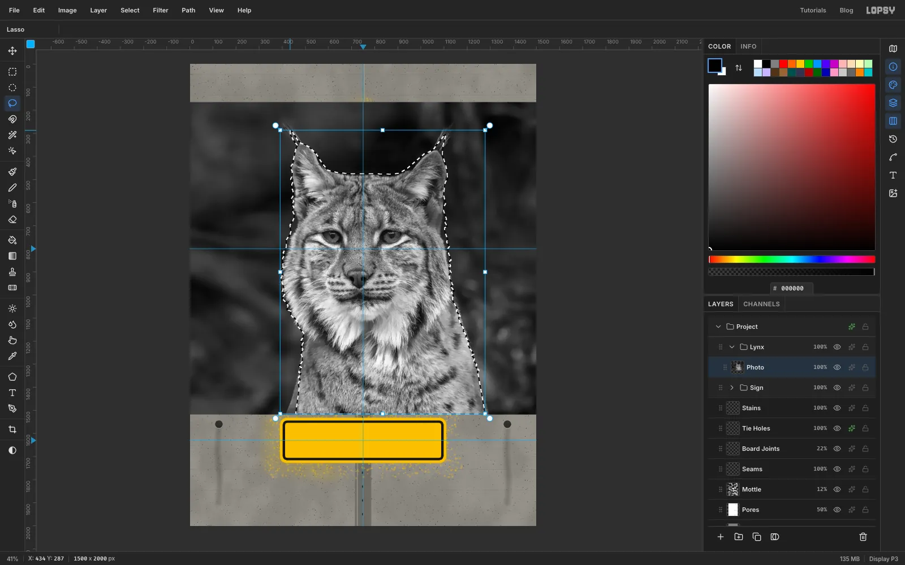

1. Pick the **Lasso**. Start at the tip of the left ear tuft and hold the mouse button down for the whole loop.
2. Go over the left ear, across the top of the head and over the right ear and its tuft.
3. Go down the right cheek to the bottom edge of the photo, along the bottom, and back up the left cheek to where you started, then release.
4. Along the cheeks and ruff, zigzag outwards every 20 px or so to follow the tufts of fur. A smooth line here looks like a cut-out. Zoom in for this part if you need to.
5. Choose **Select → Inverse**, press [[Delete]] and deselect.

## Trim the chest inside the sign

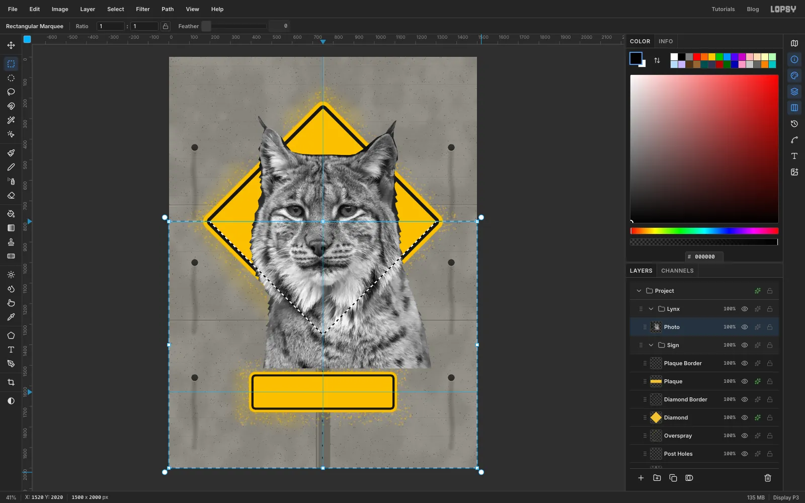

The ears should break out of the top of the sign, but the chest should stay inside the border. Build that shape from the diamond itself.

1. Expand the `Sign` group. Pick the **Rectangular Marquee**, then [[Cmd]]-click the `Diamond` thumbnail.
2. Choose **Select → Shrink…** and enter `34`. That's 18 + 16, so the selection now runs along the inside edge of the black ring.
3. Choose **Select → Inverse** to select everything outside the ring.
4. Hold [[Shift]] and [[Alt]] and drag a marquee from the left edge on the `y 800` guide to past the bottom-right corner of the canvas. Shift+Alt keeps only the overlap, so you're left with the area outside the ring below its widest point.
5. Collapse `Sign`, click `Photo`, press [[Delete]] and deselect.

## Spray the cream base plate

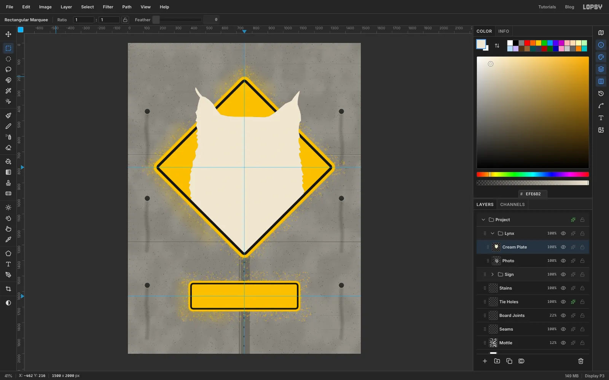

The lightest plate is the whole silhouette.

1. [[Cmd]]-click the `Photo` thumbnail to select the lynx's shape.
2. Click **Add Layer**, name it `Cream Plate`, fill it with `#EFE6D2` and deselect.

## Threshold the mid-tones

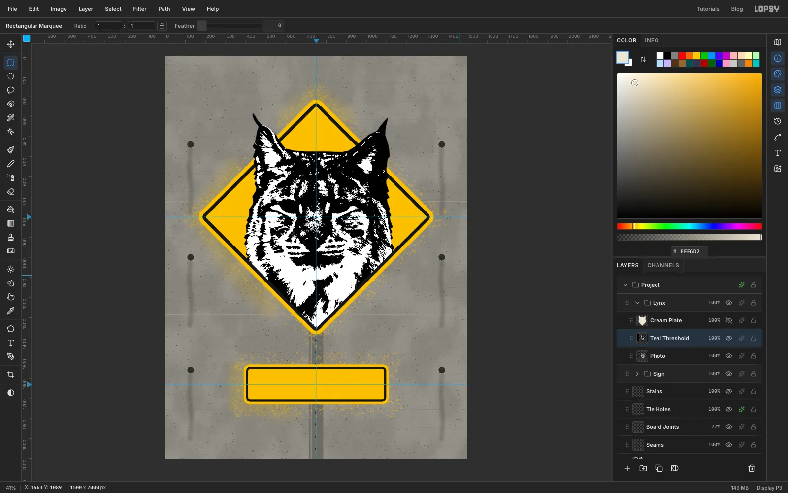

1. Click the eye on `Cream Plate` to hide it for now.
2. Select `Photo` and choose **Layer → Duplicate Layer**. Rename the copy `Teal Threshold`.
3. Run **Filter → Threshold…** with **Level** `144`. Everything darker than that turns black.
4. Run **Gaussian Blur** at **Radius** `3`, then **Threshold** again at **Level** `128`. Blurring and re-thresholding rounds the jagged edges into shapes you could actually cut with a knife.

## Select the black with the Magic Wand

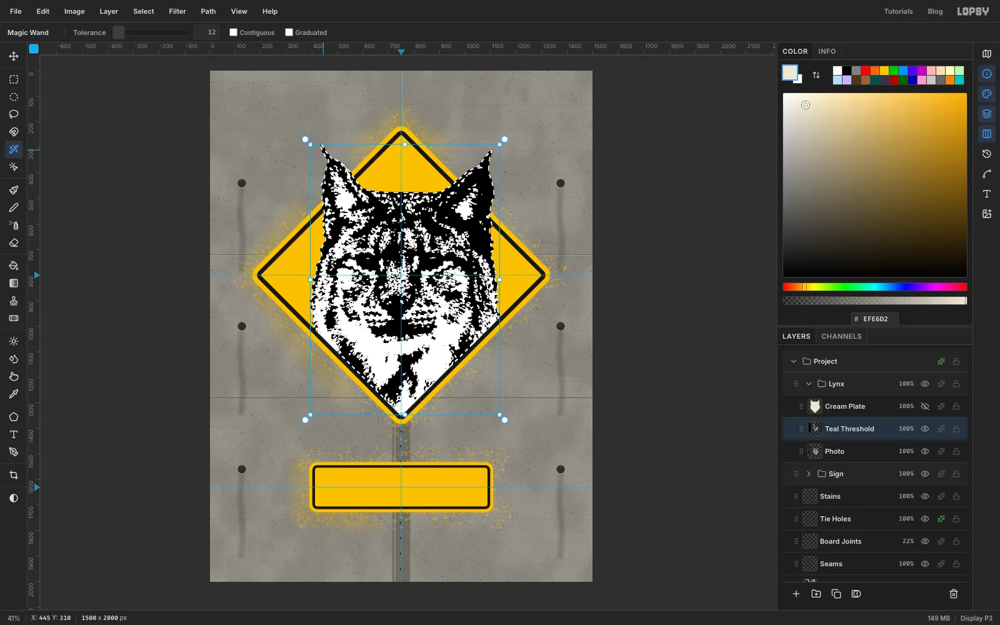

1. Pick the **Magic Wand**. Set **Tolerance** to `12` and untick **Contiguous**, so one click selects every matching pixel on the layer.
2. Click any solid black area of the lynx.
3. Show `Cream Plate` again and click its row. Add a layer called `Teal Plate`, fill it with `#1E6A66` and deselect.
4. Delete the `Teal Threshold` layer with the bin icon at the bottom of the Layers panel.

## Make the black plate

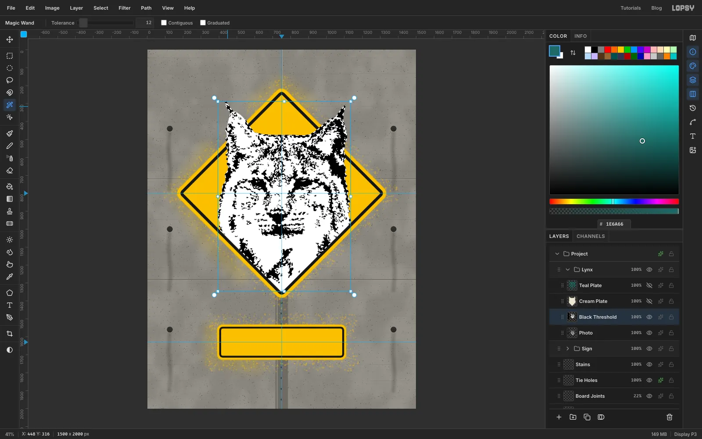

Repeat the last two steps for the shadows.

1. Hide `Cream Plate` and `Teal Plate`.
2. Click `Photo`, choose **Layer → Duplicate Layer**, and name the copy `Black Threshold`.
3. Run **Threshold** at **Level** `99`, **Gaussian Blur** at `3`, then **Threshold** at `128`.
4. Click a black area with the Magic Wand.
5. Show both plates again. Click `Teal Plate` and add a layer called `Black Plate` above it. Fill it with `#161616`, deselect, and delete `Black Threshold`.

## Tidy the cream plate

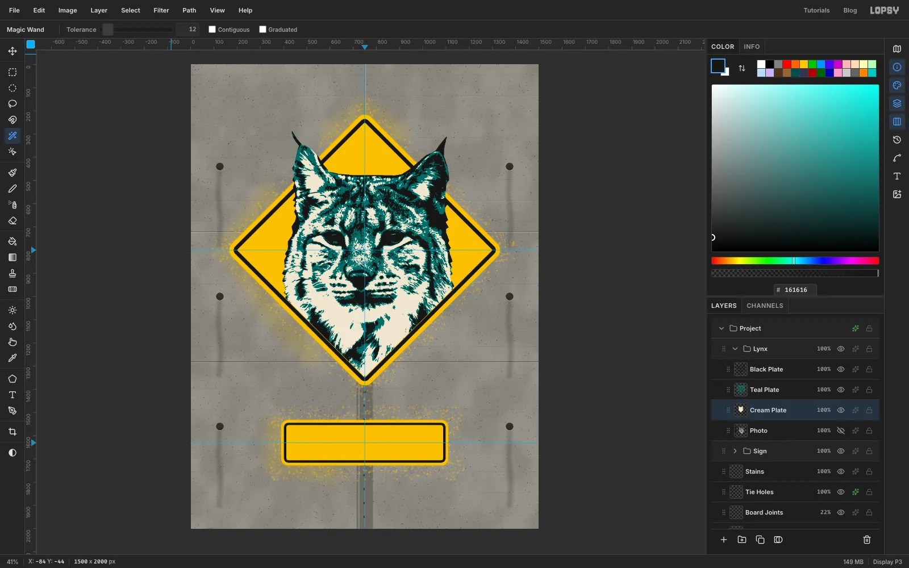

1. Hide the `Photo` layer.
2. Where the darker plates reach the edge of the silhouette, the threshold blur stops them a pixel or two short, which leaves a thin cream rim outlining the head. Trim it:
   - [[Cmd]]-click the `Cream Plate` thumbnail and **Shrink** the selection by `3`.
   - Choose **Select → Inverse**, click `Cream Plate` and press [[Delete]].
   - Deselect.

The plates are now stacked lightest at the bottom and darkest on top, the same order you'd spray real ones.

## Knock the teal plate off register

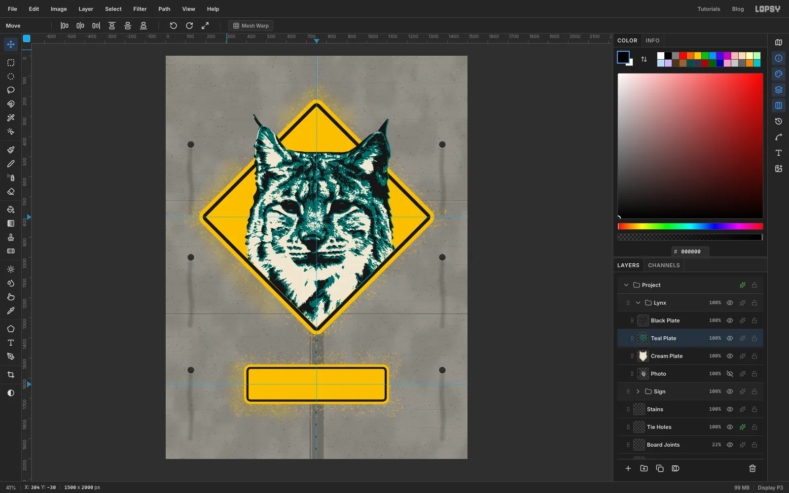

Hand-held stencils never line up perfectly. Click `Teal Plate`, pick the **Move** tool, and press [[Right]] five times and [[Down]] three times. Each arrow press moves the layer by 1 px.

## Letter the plaque

1. Collapse `Lynx` and expand `Sign`, then click `Plaque Border`. The text layer will be created right above it, inside the group.
2. Set the foreground colour to `#161616`. Pick the **Text** tool, then choose **Allerta Stencil** as the font, set **Size** to `116` and **Align** to **Center**.
3. Click on the centre guide just above the middle of the plaque, type `LYNX XING` and press [[Tab]] to commit.
4. With the **Move** tool, use the arrow keys to nudge the text until it sits on the `y 1630` guide. The gaps above and below the letters should match. At the sides you should have about 45 px between the letters and the black border. If the side gaps are much smaller, lower the **Size**.

## Stencil the tagline

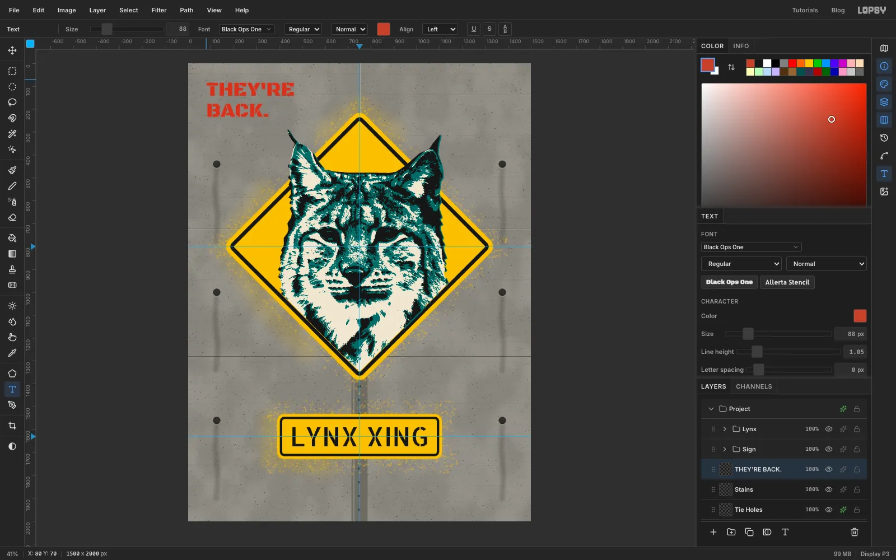

1. Collapse `Sign` and click `Stains`, so the tagline sits on the wall under the sign.
2. Set the foreground colour to `#C8402A`. Pick the **Text** tool, choose **Black Ops One**, set **Size** to `88` and **Align** to **Left**.
3. Click in the top-left corner, near `80, 70`. Type `THEY'RE`, press [[Enter]], type `BACK.` and press [[Tab]].
4. Open the **Text** panel from the right-hand rail and set **Line height** to `1.05` to pull the two lines together.

## Tilt the tagline

1. Pick the **Move** tool. Handles appear around the text's box.
2. Drag the rotation handle outside its top-left corner a little anticlockwise (towards the lower left), about 4°. The text stays live and editable.
3. Press [[Cmd+D]] to commit.

## Set the footer

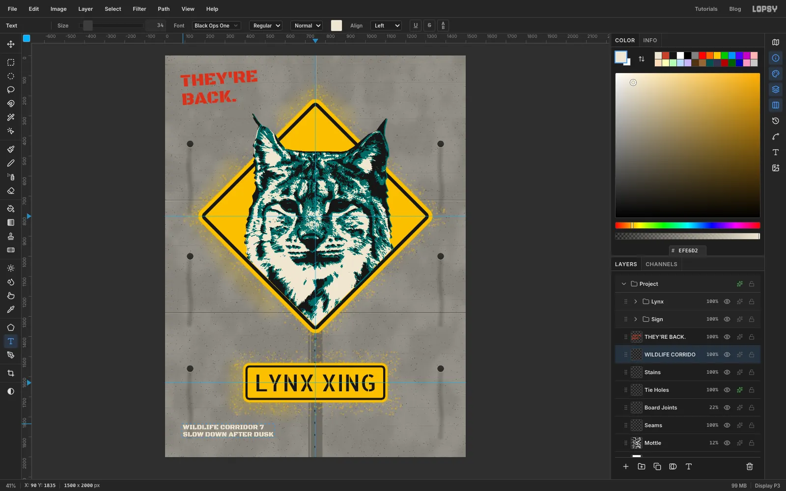

1. Click `Stains` first. With a text layer selected, changing the font or size restyles that layer, so this keeps the tagline safe. It also puts the footer on the wall, under the tagline.
2. Set the foreground colour to `#EFE6D2`. With the **Text** tool, choose **Black Ops One** at **Size** `34`.
3. Click at `90, 1835` and type `WILDLIFE CORRIDOR 7`. Press [[Enter]], type `SLOW DOWN AFTER DUSK` and press [[Tab]].

Its left edge sits about 90 px in from the edge of the canvas, roughly in line with the tagline above.

## Sign it with a tag

Street artists sign with a quick freehand tag, not a font.

1. Click `Stains` and add a layer called `Tag`. Pick the **Brush**, set **Hardness** `70` and **Size** `12`, and use `#C8402A`.
2. In the bottom-right corner, write an `L` in one stroke and an `X` in two. Keep the right side about 90 px from the canvas edge, so it mirrors the footer's margin.
3. Add a layer called `Tag Swoosh`, drop the brush to size `9`, and drag a slightly curved underline under the letters. Keeping it on its own layer means you can redraw the swoosh without touching the letters.
4. Give `Tag` an **Outer Glow** with **Size** `6`, **Opacity** `30` and colour `#C8402A` for a hint of overspray.

## Tilt both tag layers together

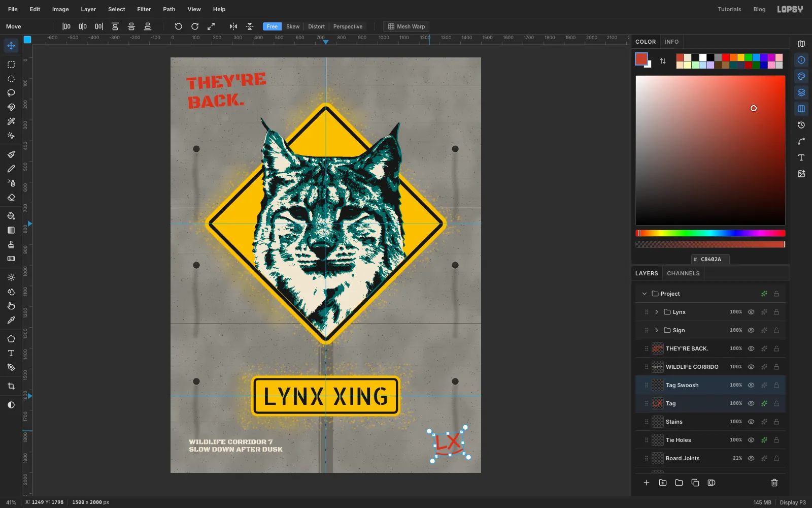

1. Click `Tag Swoosh`, then [[Shift]]-click `Tag` so both rows are highlighted.
2. Pick the **Move** tool. One box now frames both layers.
3. Drag a rotation handle about 6° anticlockwise, then press [[Cmd+D]].

## Draw one paw print

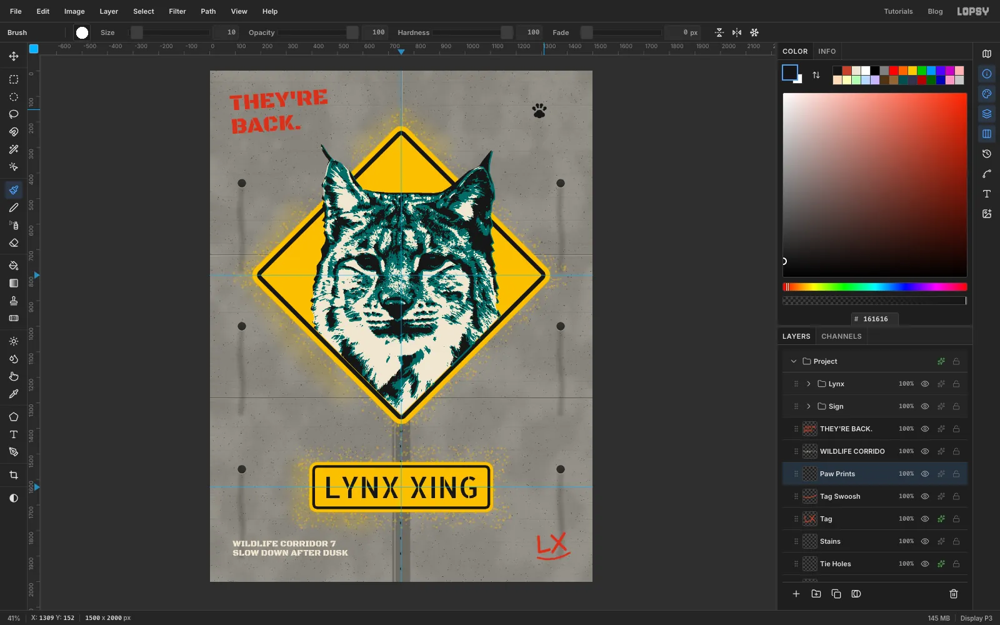

1. Click `Tag Swoosh` and add a layer called `Paw Prints`.
2. Pick the **Brush** at **Hardness** `100` in `#161616`. Work near `1290, 155` in the top-right corner.
3. **Heel pad:** click once at size `28`. Then click at size `20` just below it on each side, and once at size `22` at the bottom middle. That makes the three lobes of a cat's heel pad.
4. **Toes:** above the pad, click four times at size `14` in a gentle arc. Then click once at size `10` just below each toe, towards the pad, to make it a teardrop.

The whole print is about 60 px tall.

## Turn the paw toward the lynx

The trail should walk down the wall towards the lynx's right ear.

1. With the **Rectangular Marquee**, drag a square around the print.
2. Pick the **Move** tool. Hold [[Cmd]] and drag a rotation handle anticlockwise until the toes point down and to the left. Cmd snaps to 15° steps, so stop at 135°.
3. Press [[Cmd+D]].

## Walk a trail and fade it with a mask

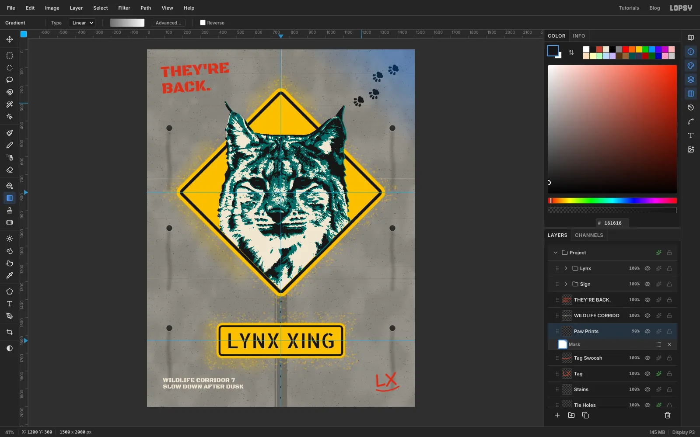

You want four prints in all: the one you drew, one above and to the right of it near the top-right corner, and two below it heading for the lynx's right ear. Alternate them left and right of the line, like real footsteps.

1. Marquee around the print, press [[Cmd+C]] and then [[Cmd+V]]. The copy lands in place on a new layer.
2. Drag the copy with the **Move** tool to its spot. Marquee around it and turn it about 10° either way, so the prints don't look stamped. Press [[Cmd+D]], then [[Cmd+E]] to merge it down into `Paw Prints`.
3. Repeat for the other two copies. Keep the top print about 90 px from the right edge.
4. Run **Gaussian Blur** at `1`, then set `Paw Prints` to **Multiply** at `90%`.
5. Click **Add Mask**, then click the mask thumbnail on the new **Mask** row to edit it.
6. Pick the **Gradient** tool, set the type to **Linear** and click **Advanced…**. Click the left stop under the gradient bar and type `6E6E6E` in the hex field, then click the right stop and type `FFFFFF`. Click **Done**, then drag from the top-right corner down to the print nearest the ear.
7. Click the `Paw Prints` name to stop editing the mask.

The oldest prints fade out, as if the lynx has been walking towards you.

## Let the black plate drip

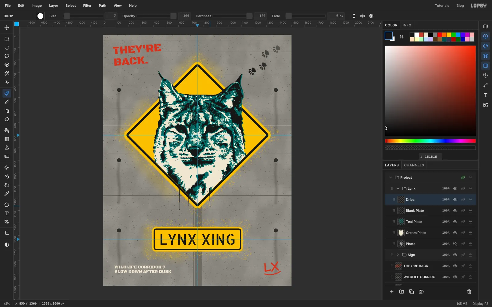

Too much paint on a stencil runs. You'll make three drips, about 200, 90 and 140 px long. Each one starts wide, narrows as it runs, and ends in a bulb.

1. Expand `Lynx`, click `Black Plate`, and add a layer called `Drips`. Use the **Brush** at **Hardness** `100` in `#161616`.
2. Find a spot where the black plate touches the bottom of the cut-out, just inside the border. Click there at **Size** `11`.
3. Make four evenly spaced Shift-clicks straight down to the drip's full length. Step the brush size down before each one: `9`, `7`, `5`, `4`.
4. At the end, click once at size `5` and once at size `7` just below it for the bulb.
5. Repeat for the other two drips.

## Add overspray to the plates

1. Give `Black Plate` an **Outer Glow** with **Size** `10`, **Opacity** `35` and colour `#161616`.
2. Give `Teal Plate` an **Outer Glow** with **Size** `8`, **Opacity** `25` and colour `#1E6A66`.

## Drip the red letters

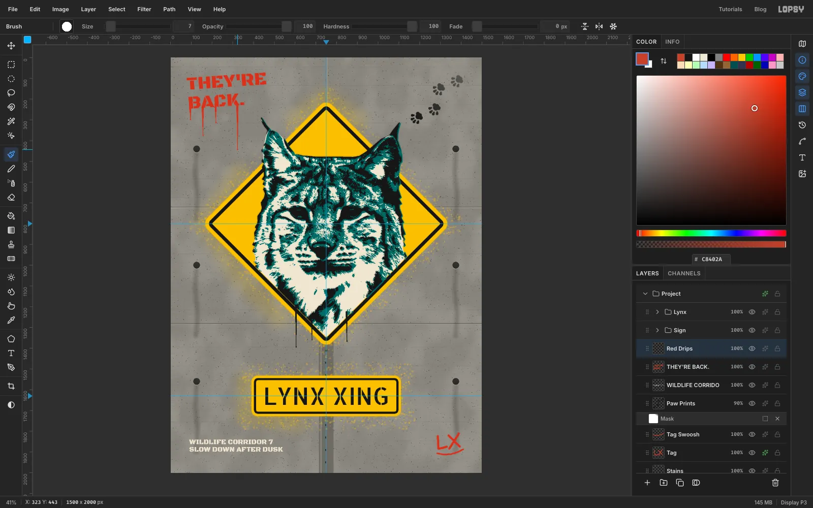

1. Collapse `Lynx`, click the `THEY'RE BACK.` layer and add a layer called `Red Drips` above it.
2. In `#C8402A`, make four drips from the bottoms of the letters in `BACK.` (the B, the A, the C and the K), using the same stepped technique. Start at size `12` where the drip leaves the letter and finish at `4`.
3. Vary the lengths: about 60, 140, 90 and 220 px.

## Finish with grit

1. With `Lynx` still collapsed, click its row and add a layer called `Grit`. It lands above both groups.
2. Fill it with `#808080` and run **Add Noise** at **Amount** `45` with **Mono** and **Gaussian**.
3. Set it to **Overlay** at `35%`.

The fine noise sits over everything, so the paint, the sign and the wall share the same grain.

Save your work with **File → Save Project**, and use **File → Quick Export PNG** to get the finished poster.
