Zines are the magazines people make at the kitchen table. They're cut up, glued down, typed, hand-written, then photocopied or run through a risograph in one or two inks. The look comes from the process. Photos go through the copier and come out as harsh black and white. The second ink never lines up exactly with the black. Bits of tape, labels and scraps sit on the page at odd angles, and the copier adds its own dirt: specks, grain and a dark shadow where the lid didn't close.

In this tutorial you'll make the cover of **Garden Toads**, a naturalist zine, issue 7, *The Night Shift Issue*. It's 1400 × 1980 px, a tall A-series page. The finished cover has:

- a huge **TOADS** masthead with an orange plate printed off register and irregular toner dropout
- a torn orange **garden** strip and two Dymo-style labels
- a real toad photo turned into a two-ink photocopy and cut out with a white paper margin
- a torn black night panel with a halftone-shaded orange moon and stars
- masking tape, typewritten cover lines on paper scraps, a highlighter swipe and a ballpoint note
- a worn rubber stamp, staples, and copier grain, mottle and lid shadow over the whole sheet

The tools you'll use:

- the **Lasso**, both **Marquee** tools with Shift (add) and Alt (subtract), and **Select → Inverse / Grow / Shrink**
- **Edit → Fill**, the **Gradient** tool, the **Brush**, **Spray**, **Eraser** and **Text** tools
- **Filter → Add Noise, Gaussian Blur, Threshold, Halftone, Desaturate** and **Clouds**
- the **Drop Shadow**, **Color Overlay**, **Stroke** and **Inner Glow** effects, and the **Multiply**, **Lighten**, **Soft Light** and **Overlay** blend modes
- **layer masks**, **Merge Down**, **Copy** and **Paste**, the **Move** tool's scale and rotate handles, **guides** and **groups**

The toad is a free photo from Wikimedia Commons: [a common toad eating a worm in a garden near Cologne](https://commons.wikimedia.org/wiki/File:Erdkr%C3%B6te_in_Garten_in_der_N%C3%A4he_von_K%C3%B6ln.jpg) by Dr. Thomas Siems, released into the public domain (CC0). Download it before you start. Any high-contrast animal photo on a dark background works the same way.

The fonts are free Google Fonts from Lopsy's font picker: **Anton** for the masthead and the stamp price, **Permanent Marker** for *garden*, **Rubik Mono One** for the labels, **Special Elite** for the typewritten lines and **Reenie Beanie** for the ballpoint note.

There are only two "inks", toner black and fluoro orange. Everything else is paper or something added by hand afterwards:

- Copy paper `#EEE8D5`, paper scraps `#F7F4EA`
- Toner black `#1C1B19`, Dymo tape `#161618`, Dymo letters `#F4F2EA`
- Fluoro orange `#FF5A1F`
- Masking tape `#E6D9A8`, staples `#A4A39D`
- Ballpoint blue `#2340B8`, highlighter `#F3EE3A`
- Working grey `#808080` (for noise and grain layers)

> **Tip:** Positions are given as `x, y` in document pixels from the top-left corner. Watch the status bar at the bottom left, which shows where the cursor is. Key names are Mac keys. On Windows and Linux, use Ctrl for Cmd.

> **Tip:** "Fill it with `#FF5A1F`" means: type the colour into the Color panel's hex field to make it the foreground colour, then choose **Edit → Fill**. Fill always uses the foreground colour and fills the selection (or the whole layer if nothing is selected).

> **Tip:** To rotate anything in this tutorial, draw a **Rectangular Marquee** ([[M]]) around it, switch to the **Move** tool ([[V]]), and drag one of the round handles just outside the corners. Press [[Enter]] to apply, then [[Cmd+D]] to deselect.

> **Tip:** New layers always appear directly above the layer that's selected. Before you click **+**, click the layer the new one should sit on top of. The steps below tell you which one.

## Set up the paper and guides

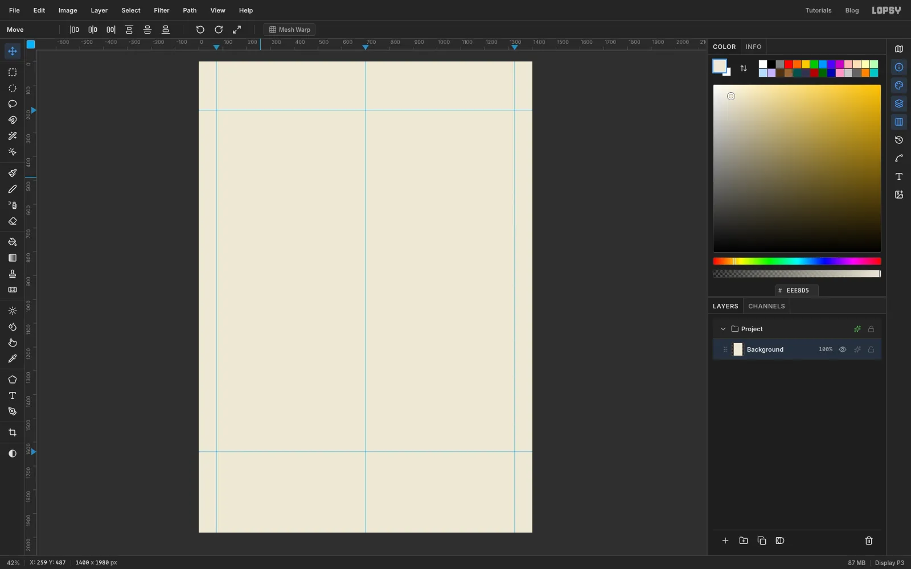

Open [Lopsy](/). In the **New Document** dialog set **Width** to `1400` and **Height** to `1980` and click **Create**.

1. Click the empty `Layer 1` and delete it with the bin button at the bottom of the Layers panel. You'll add layers as you need them.
2. Click **Background**, type `EEE8D5` into the hex field of the Color panel, and choose **Edit → Fill**.
3. Click the top ruler at **74**, **700** and **1326** to drop three vertical guides: the two side margins and the centre line.
4. Click the left ruler at **205** (the top of the masthead) and **1640** (the top of the cover-line area).

## Set the masthead

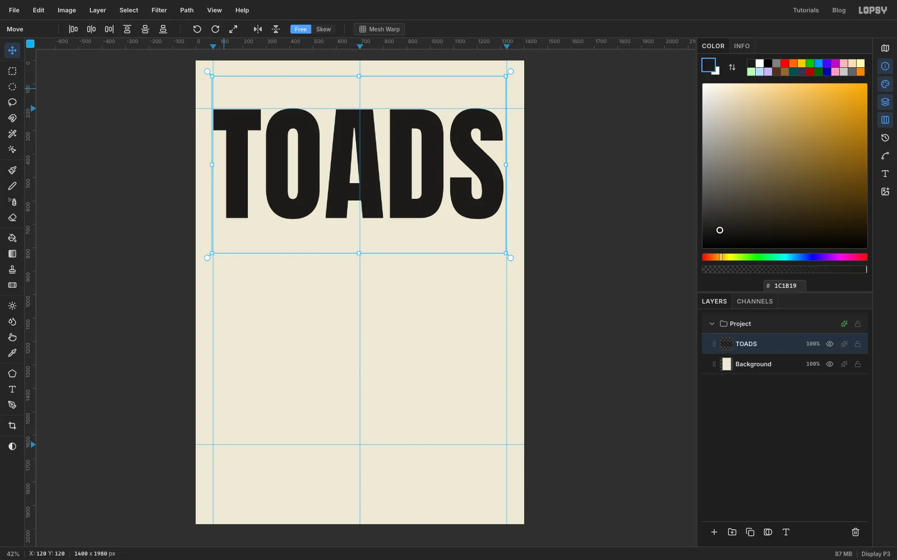

The masthead is one word, set as big as the page allows.

1. Pick the **Text** tool ([[T]]). In the options bar choose **Anton** and set **Size** to `540`. Set the foreground colour to `#1C1B19`.
2. Click in the empty paper near the top of the page and type `TOADS`. Press [[Tab]] to finish.
3. Switch to the **Move** tool ([[V]]) and drag the word until the top of the letters sits on the **205** guide and the T's left edge is on the **74** guide. The S ends just short of the right margin.

## Add the orange plate

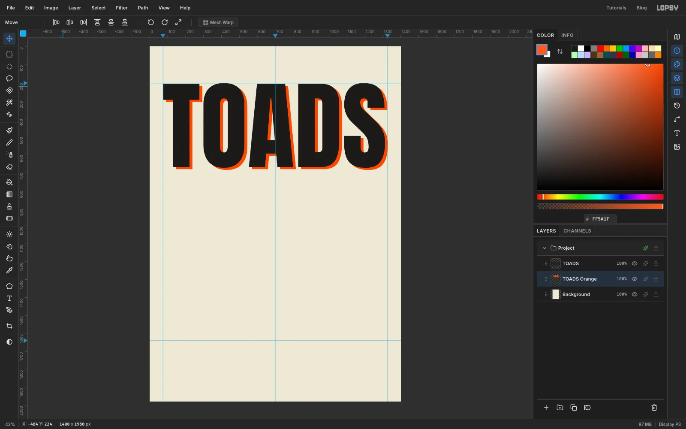

On a riso or a two-colour copier, each ink is a separate pass, and the passes never line up perfectly. Fake that with a second copy of the letters.

1. [[Cmd]]-click the **TOADS** thumbnail in the Layers panel. That loads the letter shapes as a selection.
2. Click **Background**, add a layer with **+**, and name it `TOADS Orange` (double-click a name to rename it).
3. Set the foreground to `#FF5A1F`, choose **Edit → Fill**, and press [[Cmd+D]] to deselect.
4. With the **Move** tool, press [[Shift+Right]] once and [[Right]] six times, then [[Shift+Down]] once and [[Down]] twice. The orange slides 16 px right and 12 px down, under the black.

## Start the toner wear layer

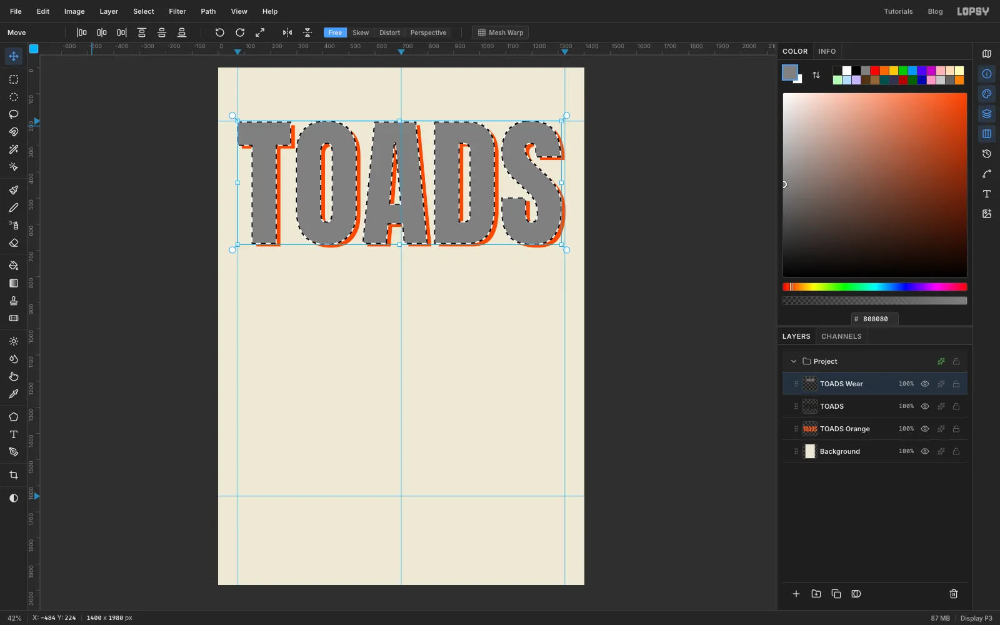

Photocopied black is never solid. The toner drops out in little irregular flecks. You'll build those flecks from noise.

1. [[Cmd]]-click the **TOADS** thumbnail again, then click the **TOADS** layer.
2. Add a layer and name it `TOADS Wear`.
3. Set the foreground to `#808080`, choose **Edit → Fill**, then press [[Cmd+D]].

## Turn noise into toner dropout

Now run three filters on the grey layer:

1. **Filter → Add Noise**: **Amount** `100`, **Mode** **Mono**. The grey turns into salt-and-pepper.
2. **Filter → Gaussian Blur**: **Radius** `4`. The noise softens into blotches.
3. **Filter → Threshold**: **Level** `138`. Only the brightest blotches stay white; everything else turns black.

Open the layer's effects drawer (the **fx** button on its row) and set the blend mode to **Lighten**. The black parts disappear and only the white flecks show. Set the layer's opacity to `88%` so the flecks read as paper, not pure white.

> **Tip:** A higher Threshold level gives fewer flecks, and a bigger blur gives bigger clumps. Spray paint gives round dots, which look digital. This noise-blur-threshold recipe gives the ragged shapes a real copier makes.

## Make the "garden" strip

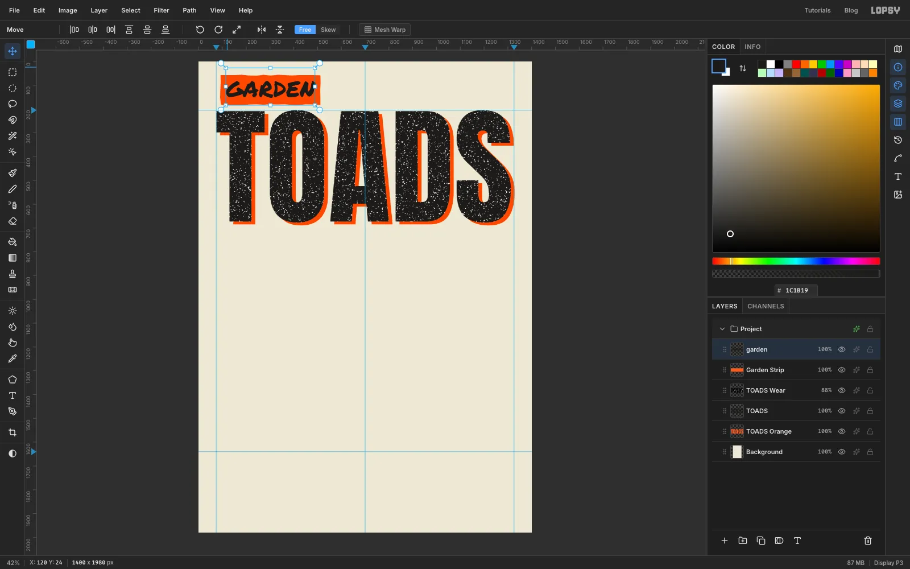

1. Click **TOADS Wear** and add a layer called `Garden Strip`.
2. Pick the **Lasso** ([[L]]) and draw a strip across the top-left corner, from about `92, 58` to `512, 182`. Keep the sides nearly straight with just a little wobble, like paper torn against a ruler.
3. Fill it with `#FF5A1F` and deselect.
4. Pick the **Text** tool, choose **Permanent Marker** at **Size** `112`, set the colour to `#1C1B19`, click in empty paper above the masthead and type `garden`. Permanent Marker only has capitals, so it comes out as GARDEN. Press [[Tab]].
5. Move the word onto the middle of the strip.

## Tilt the strip

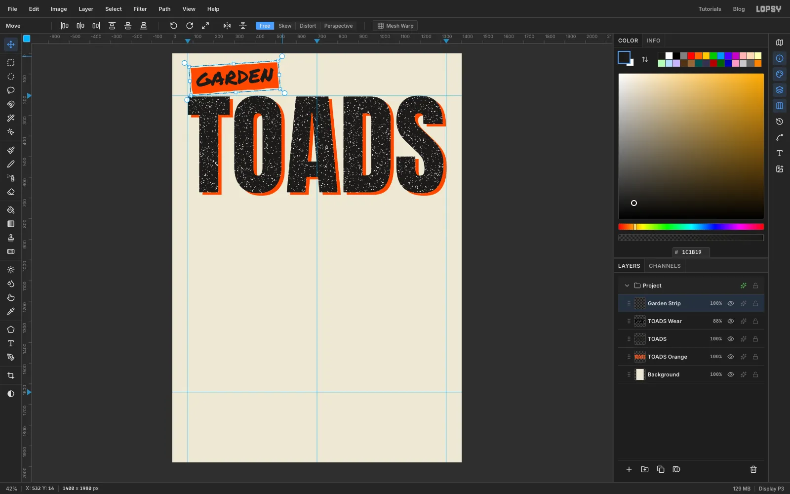

1. With the `garden` text layer selected, choose **Layer → Merge Down**. The word is now part of the strip.
2. Draw a **Rectangular Marquee** ([[M]]) just around the strip.
3. Switch to the **Move** tool. Drag the round handle just outside the top-right corner a little anticlockwise, about **4°**, so the strip rises to the right. Press [[Enter]], then [[Cmd+D]].

## Make a Dymo label for the issue number

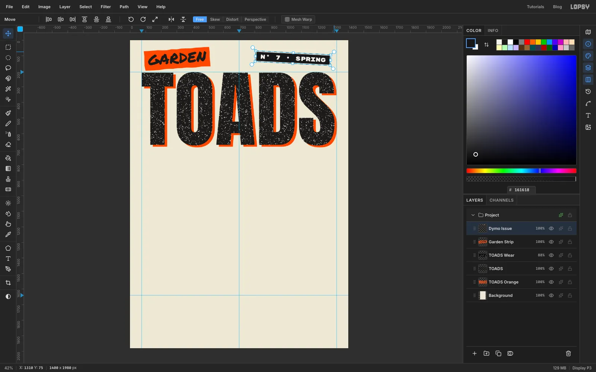

Embossed label-maker tape is a zine favourite. It's white letters on a black strip.

1. Add a layer called `Dymo Issue`.
2. With the **Text** tool, choose **Rubik Mono One** at **Size** `38`, colour `#F4F2EA`. Click in empty paper and type `Nº 7 · SPRING`. Press [[Tab]] and move the text so it's centred at about `1046, 116`, clear of the darker right edge you'll add at the end.
3. Click the **Dymo Issue** layer. Draw a marquee around the text with about 28 px spare at each end and 16 px above and below. Fill it with `#161618` and deselect.
4. Click the text layer and choose **Layer → Merge Down**.
5. Marquee the label and rotate it about **3°** clockwise with the **Move** tool's corner handle. Press [[Enter]] and deselect.
6. In the effects drawer, turn on **Drop Shadow**: **Offset X** `2`, **Offset Y** `3`, **Blur** `0`, **Opacity** `40`. A hard, thin shadow reads as a raised strip on a copy. A soft blur would look like a photograph.

## Tear out the night panel

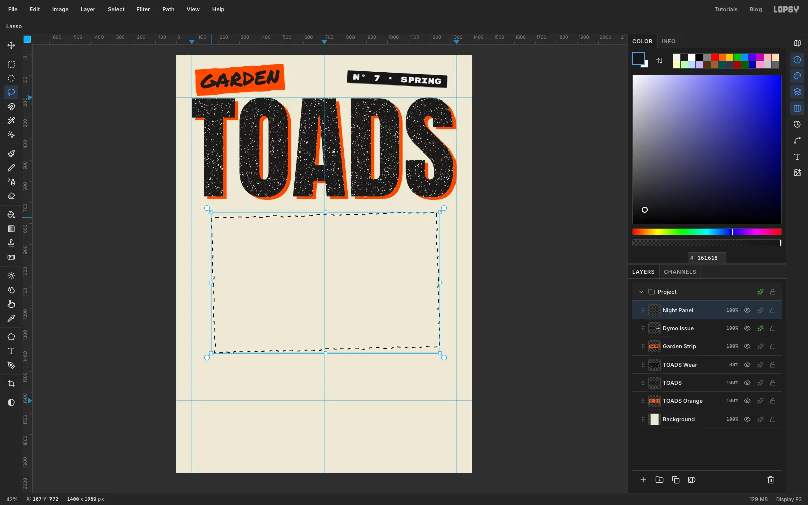

1. Click **Dymo Issue** and add a layer called `Night Panel`.
2. With the **Lasso**, draw a rectangle from about `175, 760` to `1240, 1398`, tilted very slightly anticlockwise. Keep the edges ragged, like paper torn by hand.
3. Fill it with `#1C1B19` and deselect.

## Add the moon

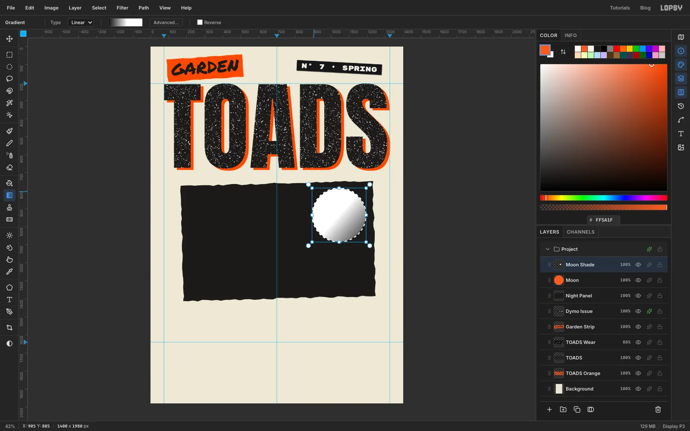

1. Add a layer called `Moon`. With the **Elliptical Marquee**, **click once** on the canvas (don't drag). In the dialog enter **From** `895, 785` and **To** `1195, 1085` and press Enter. That's a 300 px circle near the panel's top-right corner.
2. Fill it with `#FF5A1F`, then run **Filter → Add Noise** with **Amount** `14`, **Mono**, so the ink isn't perfectly flat.
3. Keep the selection and add a layer called `Moon Shade`.
4. Pick the **Gradient** tool from the toolbox (it has no shortcut; [[G]] is the paint bucket), set it to **Linear**, and open **Advanced…**. Make three stops: `#111111` at the left, `#FFFFFF` a little past the middle, and `#FFFFFF` at the right. Click **Done**.
5. Drag from just outside the moon's lower-right edge up to its upper-left. The shading sits on the lower right.

## Halftone the moon's shading

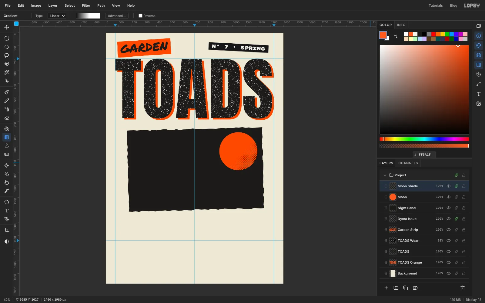

1. Press [[Cmd+D]], then choose **Filter → Halftone**: **Dot Size** `12`, **Angle** `45`, **Softness** `0.5`. White prints nothing, so only the dark side turns into dots.
2. The dots are grey. In the effects drawer turn on **Color Overlay** and set it to `#1C1B19` to make them toner black.

## Spray the stars

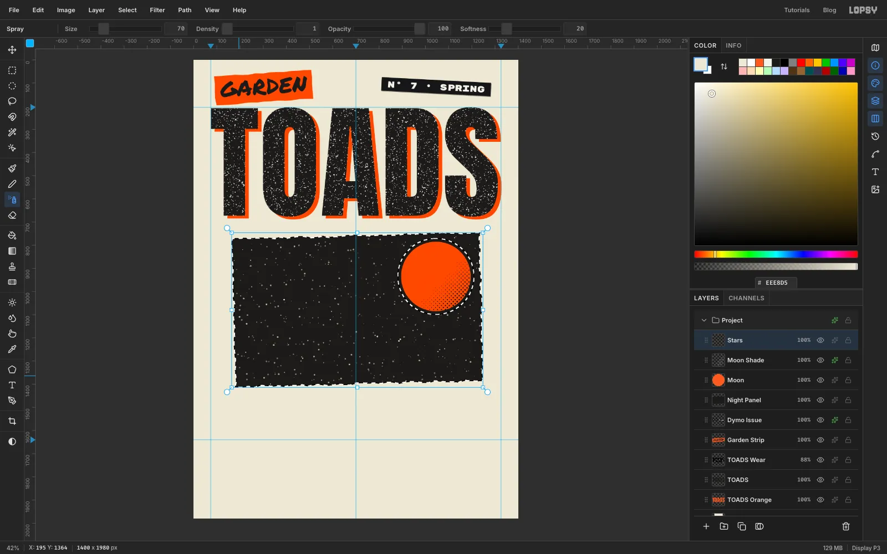

1. [[Cmd]]-click the **Night Panel** thumbnail to select the panel.
2. Pick the **Elliptical Marquee**, hold [[Alt]] and drag a circle a little bigger than the moon over it. That subtracts the moon, so no stars land on it.
3. Add a layer called `Stars`. Set the foreground to `#EEE8D5`.
4. Pick **Spray** ([[J]]) and set **Size** `70`, **Density** `1`, **Softness** `20`, **Opacity** `100`.
5. Zigzag across the panel from top to bottom. The selection keeps every speck inside the panel. Deselect.

## Drop in the toad photo

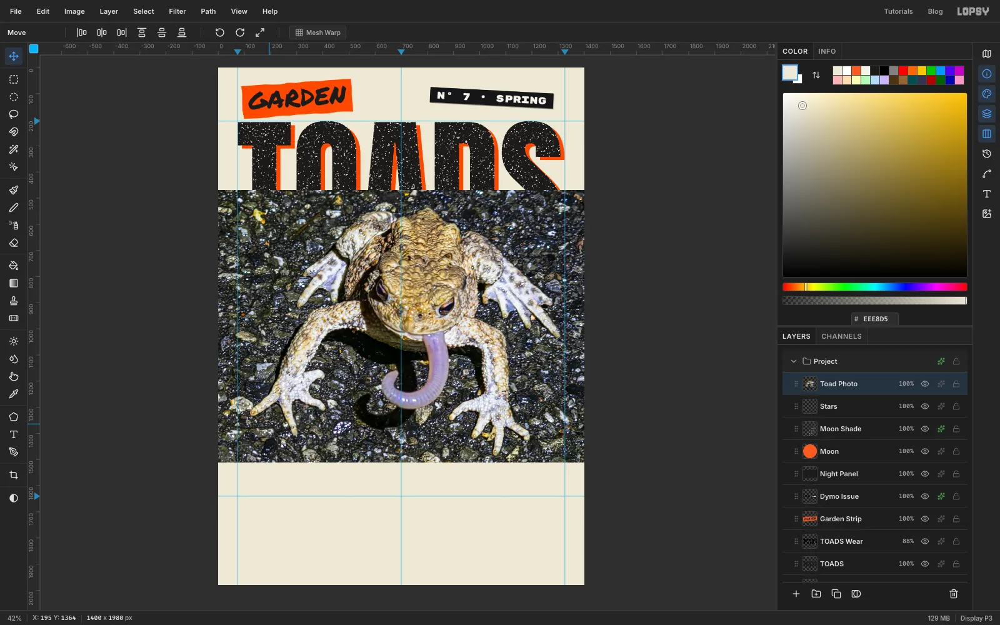

1. Click **Stars**. Drag the downloaded toad photo from your desktop onto the canvas. Lopsy shrinks it to fit the page.
2. Rename the new layer `Toad Photo`. A dropped image arrives selected, so press [[Cmd+D]] first, then choose **Filter → Desaturate**.

## Scale the photo down

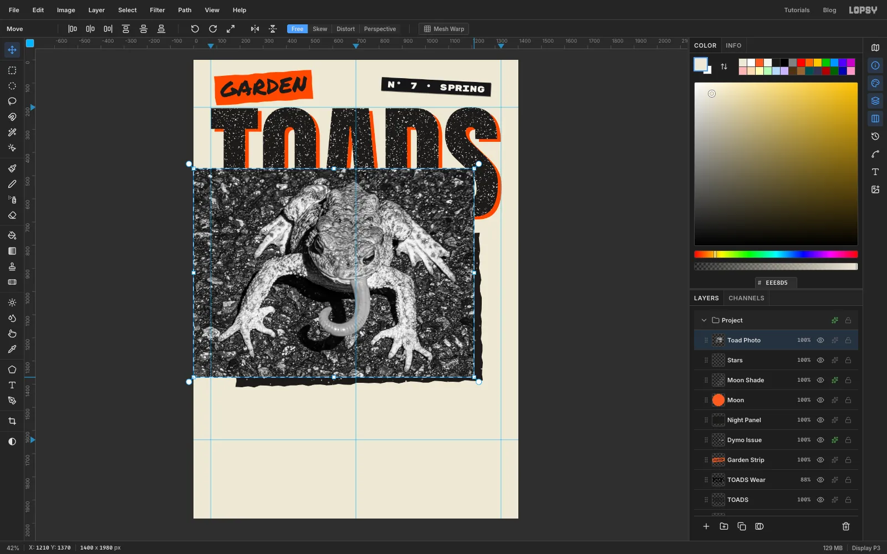

1. Draw a marquee exactly around the photo.
2. With the **Move** tool, hold [[Cmd]] (to keep the proportions) and drag the bottom-right handle inwards until the photo is about `1210` px wide. The photo starts at the left edge of the page, so stop when the cursor's **X** in the status bar reads about `1210`. Press [[Enter]] and deselect.
3. Drag the photo so its centre is at about `745, 1170`. The toad's head should overlap the panel's top edge and its feet should hang below the panel.

## Tilt the photo

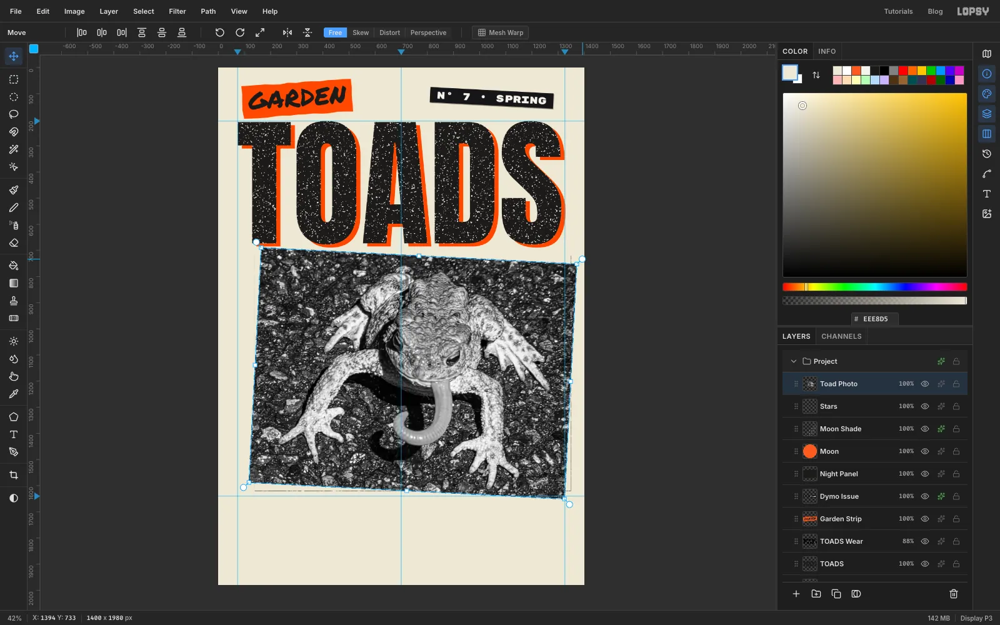

Marquee the photo again and drag the top-right rotation handle about **3°** clockwise. Press [[Enter]] and deselect. A slight tilt makes it feel pasted down by hand.

## Trace the toad

Zoom in so you can see the edges. With the **Lasso**, trace around the toad: the head, the body, the worm hanging from its mouth, both right legs and the left shoulder and forearm, all in one go. Follow the light skin and leave out the dark shadow on the ground.

The left hind leg is separated from the body by shadow, so trace it as a second piece. Hold [[Shift]] as you start the second drag to add it to the selection.

> **Tip:** You don't have to be precise down to every toe. You're cutting this out "with scissors", so a slightly loose line around the feet looks right.

## Cut the toad out

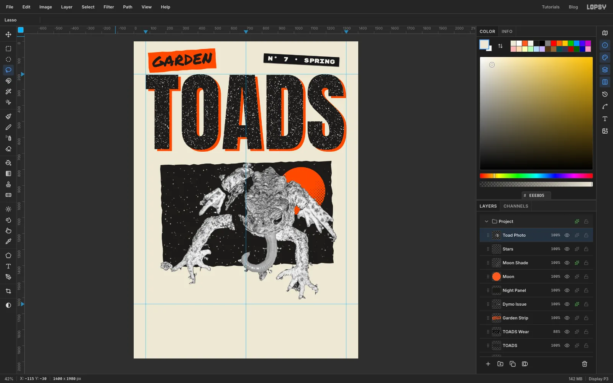

Choose **Select → Inverse**, press [[Delete]] to clear the background, and deselect.

## Add the white scissor margin

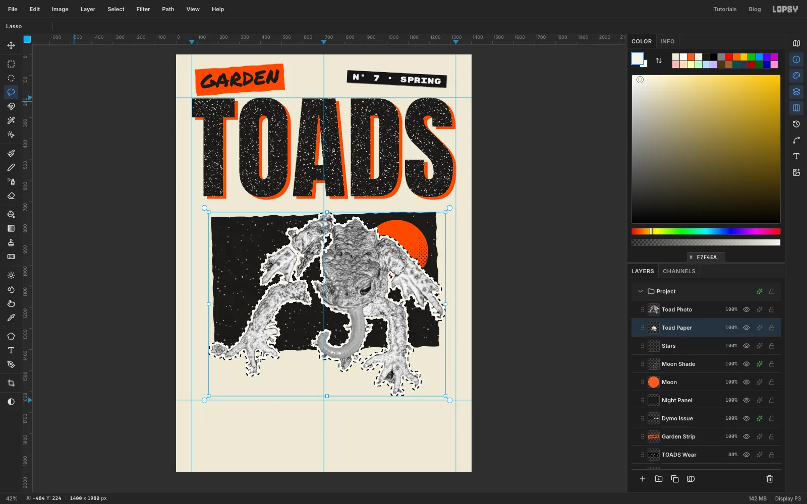

1. [[Cmd]]-click the **Toad Photo** thumbnail, then choose **Select → Grow** and enter `10`.
2. Click **Stars** and add a layer called `Toad Paper`. It sits under the photo.
3. Fill with `#F7F4EA`. The screenshot shows this moment, with the selection still active.
4. Deselect, then turn on **Drop Shadow**: **Offset X** `4`, **Offset Y** `5`, **Blur** `0`, **Opacity** `35`. It's a thin, hard shadow, like a sheet of paper on a copier glass.

## Lay the orange plate under the toad

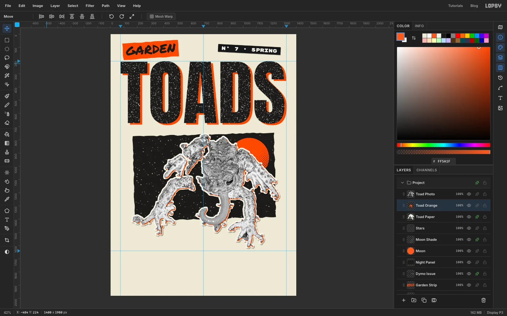

1. [[Cmd]]-click the **Toad Photo** thumbnail again, click **Toad Paper**, and add a layer called `Toad Orange`.
2. Fill it with `#FF5A1F` and deselect.
3. With the **Move** tool, nudge it [[Right]] 5 times and [[Down]] 4 times. Just like the masthead, the second ink is off register.

## Photocopy the toad

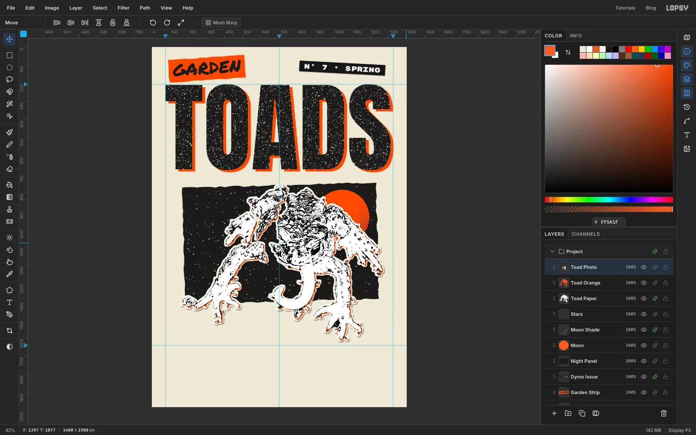

Click **Toad Photo** and choose **Filter → Threshold** with **Level** `132`. A cheap copier does exactly this to a photo. Every tone becomes either toner or bare paper. The warts, the eye and the line of the mouth come out in heavy black.

> **Tip:** Halftone keeps more tonal detail, but on a mid-toned subject like this toad the face turns to mush. Threshold gives a much clearer, more graphic read.

## Print the black over the orange

Set **Toad Photo**'s blend mode to **Multiply**. White multiplies to nothing, so the orange shows through, while black stays black. That's two-ink printing in one click.

## Trace the worm

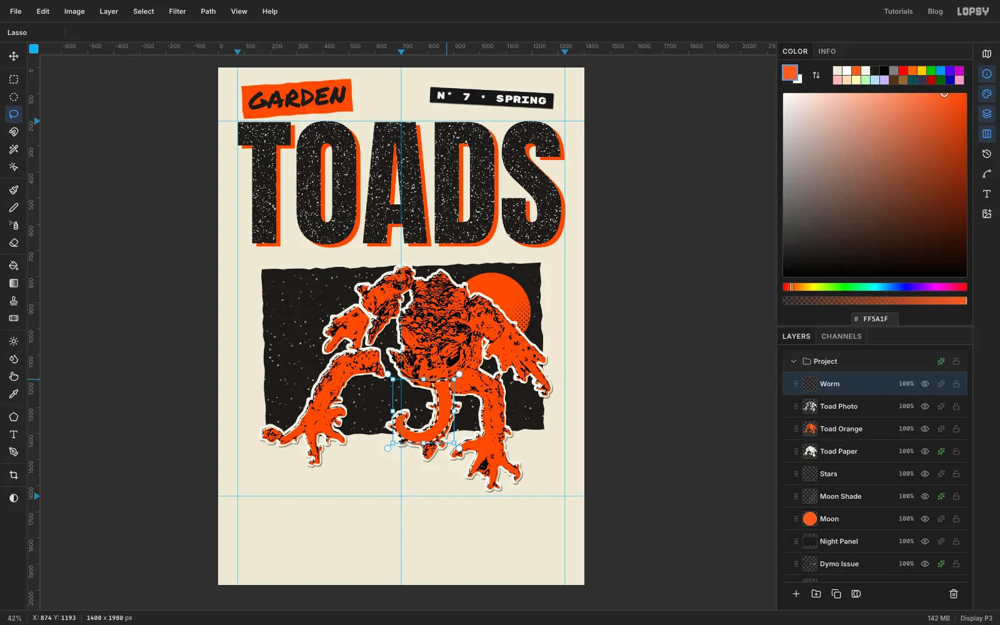

At this point the worm is the same orange as the toad, so it reads like a tail. Give it its own look:

1. Click **Toad Photo** and add a layer called `Worm`.
2. With the **Lasso**, trace around the worm from the mouth, down and round the curl to the tip.
3. Fill with `#F7F4EA`. Keep the selection.

## Finish the worm

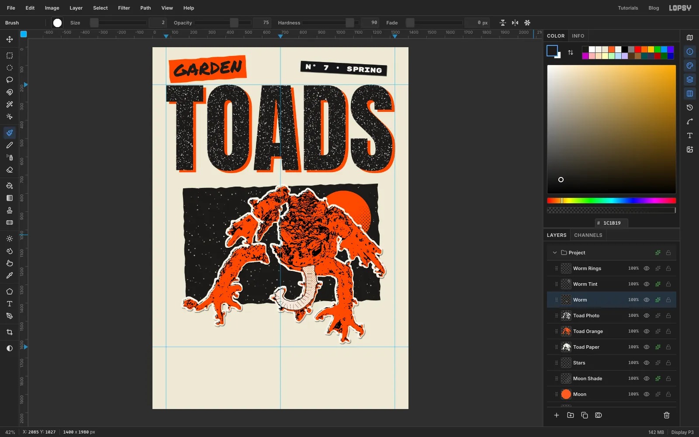

1. Add a layer called `Worm Tint`. With the **Gradient** tool, open **Advanced…**, delete the middle stop left over from the moon, and set the two ends to `#6E6E6E` and `#B4B4B4`. Drag from the mouth to the tip of the tail, then deselect.
2. Choose **Filter → Halftone**: **Dot Size** `7`, **Angle** `45`, **Softness** `0.4`. Turn on **Color Overlay** with `#FF5A1F`. That's an orange tint screen, the way a riso prints a lighter shade of an ink.
3. Add a layer called `Worm Rings`. Pick the **Brush** ([[B]]) at **Size** `2`, **Opacity** `75`, **Hardness** `90`, colour `#1C1B19`. Draw short strokes across the worm about every 18 px. Stop each one a little short of the edges, and vary them slightly.
4. Click the **Worm** layer and turn on **Stroke**: **Width** `3`, colour `#1C1B19`, position **Outside** (the default).

## Label the night panel

Make a second Dymo label the same way as the first, but on orange tape:

1. Click **Stars** so the label ends up under the toad, then add a layer called `Dymo Night Shift`.
2. Type `NIGHT SHIFT ISSUE` in **Rubik Mono One** at **Size** `28`, colour `#F4F2EA`. Move it to the panel's top-left corner, just clear of the toad's shoulder (its centre is at about `326, 848`).
3. Click the **Dymo Night Shift** layer, draw a marquee around the text with about 21 px spare at each end and 12 px above and below, and fill it with `#FF5A1F`. Deselect.
4. Click the text layer, **Merge Down**, rotate the label about **3°** anticlockwise, and add the same hard **Drop Shadow** as before.

## Tape the panel down

1. Click **Worm Rings** and add a layer called `Tape`. The tape sits on top of the toad and the worm.
2. With the **Lasso**, draw a strip about 250 × 64 px across the panel's top-left corner, at roughly 36° so it runs down to the right. Make the two short ends zigzag, like tape torn off the roll.
3. Fill with `#E6D9A8` and deselect. Run **Filter → Add Noise** with **Amount** `10`, **Mono**, for a papery texture, and set the layer's opacity to `82%` so the corner shows through.

## Copy the tape to the opposite corner

1. [[Cmd]]-click the **Tape** thumbnail, press [[Cmd+C]] then [[Cmd+V]]. The copy is pasted in place as a new layer. Rename it `Tape 2`.
2. Drag it with the **Move** tool down to the panel's bottom-right corner, then press [[Cmd+D]].
3. Set its opacity to `82%` too. A pasted copy comes in at 100%.
4. Marquee it and rotate it about **9°** clockwise so the two strips aren't identical. Press [[Enter]] and deselect.

## Type the cover lines on paper scraps

Each cover line is typed, cut out and stuck down separately.

1. Click **Tape 2** and add a layer called `Line Hotel`.
2. With the **Text** tool, choose **Special Elite** at **Size** `42`, colour `#1C1B19`. Click in empty paper near the bottom and type `HOW TO BUILD A TOAD HOTEL  p.4` (two spaces before the page number). Press [[Tab]] and move it so the text starts a little in from the left margin, about 80 px below the cover-line guide (around `110, 1722`). I renamed the text layer `Line Hotel Type` to keep track of it, but the name doesn't matter because it's merged in the next step.
3. Click **Line Hotel**. With the **Lasso**, draw a scrap around the text with about 24 px of paper at each end and 18 px above and below. Use slightly uneven, scissor-cut sides. Fill with `#F7F4EA` and deselect.

## Tilt each scrap

Every scrap gets the same three moves:

1. Click its text layer and choose **Layer → Merge Down**, so the type is part of the scrap.
2. Marquee the scrap and rotate it by about a degree. Press [[Enter]] and deselect.
3. Add a **Drop Shadow**: **Offset X** `3`, **Offset Y** `3`, **Blur** `0`, **Opacity** `30`.

Tilt the hotel line about **1°** anticlockwise. Then make the other two lines the same way as the first, each new layer on top of the previous one, about 80 px further down the page:

- `Line Worms`: `WORMS: A LOVE STORY  p.9`, indented about 30 px more than the others (around `142, 1802`), tilted about **1°** clockwise. That's the one in the screenshot.
- `Line Road`: `WHY DID THE TOAD CROSS THE ROAD?  p.12`, back at the left (around `110, 1882`), tilted about **0.6°** anticlockwise.

The indent and the alternating tilts keep the three scraps from stacking like a neat list.

## Swipe the highlighter

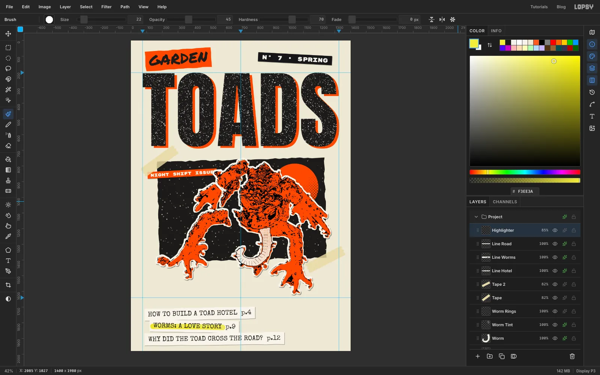

1. Add a layer called `Highlighter` and set the foreground to `#F3EE3A`.
2. Pick the **Brush** at **Size** `36`, **Opacity** `80`, **Hardness** `90`. Click just before the W of WORMS, then [[Shift]]-click about 15 px past the Y of STORY, following the scrap's tilt and sitting a touch below the middle of the letters.
3. Make a second, thinner pass at **Size** `22`, **Opacity** `45`, **Hardness** `70`, starting a little later and ending a little earlier, so the colour is uneven like a real marker.
4. Set the layer to **Multiply** at `85%`, so the type shows through.

## Write the ballpoint note

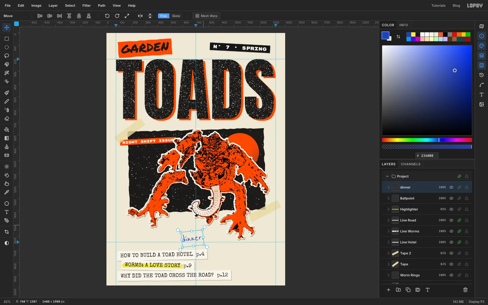

1. Add a layer called `Ballpoint`.
2. With the **Text** tool, choose **Reenie Beanie** at **Size** `84`, colour `#2340B8`. Click in the empty paper between the toad's feet and the cover lines and type `dinner.`. Press [[Tab]] and move it to about `592, 1572`.
3. With the **Move** tool, hover just outside the text's top-right corner until the rotate cursor appears, and drag it about **7°** anticlockwise. Text stays editable when you rotate it this way.

## Draw the arrow

Click the **Ballpoint** layer. With the **Brush** at **Size** `5`, **Opacity** `100`, **Hardness** `90`, draw a slightly curved line from the top of the note up to the underside of the worm's curl. Then add two short strokes at the tip for the arrowhead.

## Build the rubber stamp

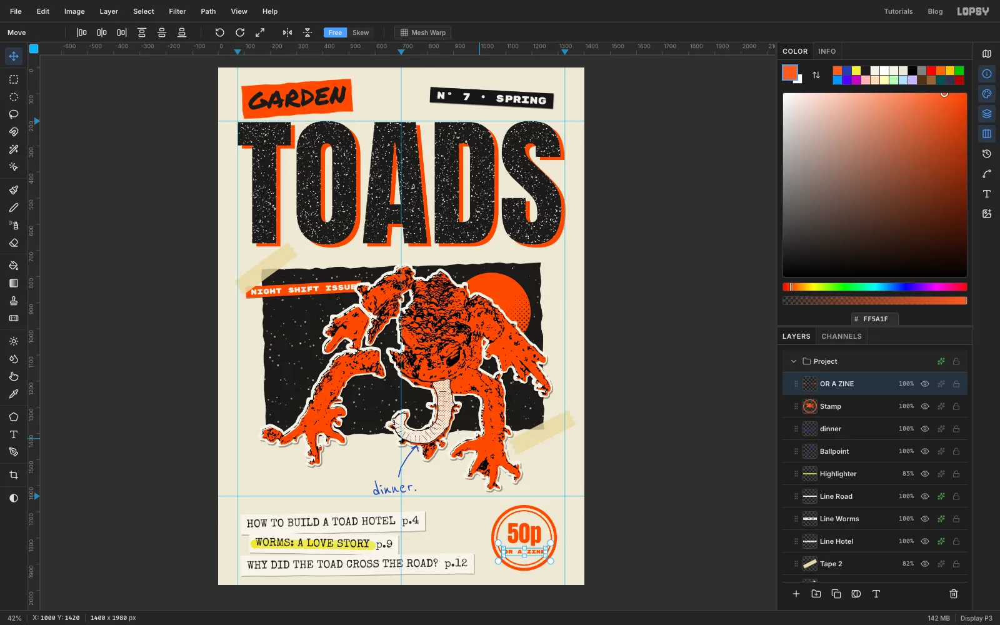

1. Click the **dinner** text layer and add a layer called `Stamp`. With the **Elliptical Marquee**, click once and enter **From** `1044, 1674` and **To** `1296, 1926`.
2. Fill it with `#FF5A1F`.
3. Choose **Select → Shrink**, enter `11`, and press [[Delete]]. That leaves a ring.
4. **Shrink** by `8` again and **Edit → Fill**, then **Shrink** by `5` and press [[Delete]]. Now there's a thin inner ring. Deselect.
5. Type `50p` in **Anton** at **Size** `88` in orange, centre it in the rings just above the middle, and **Merge Down** right away.
6. Type `OR A ZINE` in **Rubik Mono One** at **Size** `21` and centre it under the price. That's the moment in the screenshot.

> **Tip:** Merge the price before you type the second line. With a text layer selected, changing the font or size restyles *that* layer.

## Stamp it at an angle

With the `OR A ZINE` text layer selected, choose **Layer → Merge Down**. Then marquee the stamp and rotate it about **14°** anticlockwise. Press [[Enter]] and deselect.

## Wear the stamp

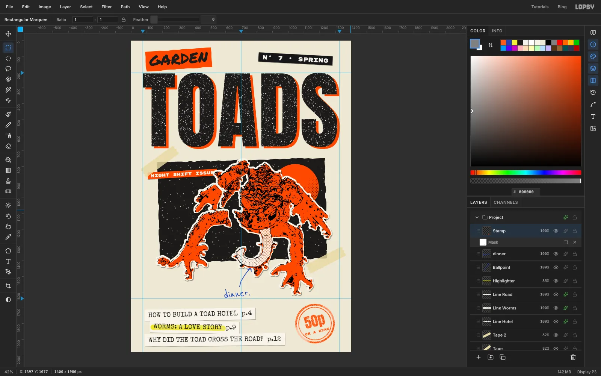

A real stamp never prints evenly.

1. Pick the **Eraser** ([[E]]) at **Size** `46` and **Opacity** `14`. Make one light pass over the upper-right of the outer ring. Then raise the **Opacity** to `30` and make a pass over the lower-left arc, so that side looks ink-starved.
2. Click **Add Mask** at the bottom of the Layers panel, then click the mask thumbnail on the **Stamp** row to edit the mask.
3. Draw a marquee around the stamp, fill it with `#808080`, and deselect.
4. Run **Filter → Add Noise** (**Amount** `100`, **Mono**), **Filter → Gaussian Blur** (**Radius** `1`), and **Filter → Threshold** (**Level** `98`). The mask becomes mostly white with black specks, and each speck knocks a hole in the ink.
5. Click the **Stamp** layer's name to go back to editing the layer itself.

## Add staples and the lid shadow

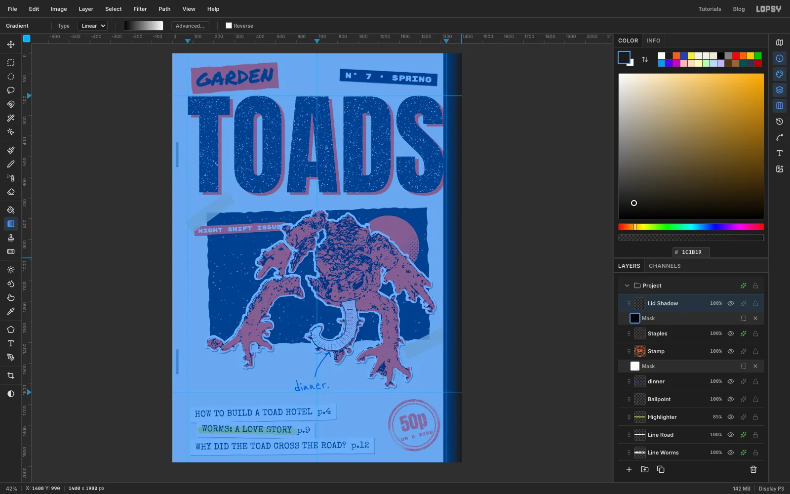

1. Add a layer called `Staples`. Draw two thin upright marquees hugging the left edge, each about 11 × 118 px: one level with the middle of the masthead, and one (hold [[Shift]] to add it) just below the night panel. Fill with `#A4A39D` and deselect. Turn on **Drop Shadow** (**Offset X** `2`, **Offset Y** `2`, **Blur** `2`, **Opacity** `60`) and **Inner Glow** (**Size** `3`, **Opacity** `70`).
2. Add a layer called `Lid Shadow`. Marquee a narrow band about 90 px wide down the whole right edge, fill it with `#1C1B19`, and deselect.
3. Click **Add Mask**, then click the new mask thumbnail. In the **Gradient** tool's **Advanced…** editor, set the two stops to black `#000000` and white `#FFFFFF`. Then drag from just inside the band's left edge to the right edge of the page. The blue overlay shows where the mask hides the layer. Here that's everything left of the band.
4. Click the **Lid Shadow** layer's name to leave the mask. Set the layer to **Multiply** at `42%`.

## Dirty up the copy

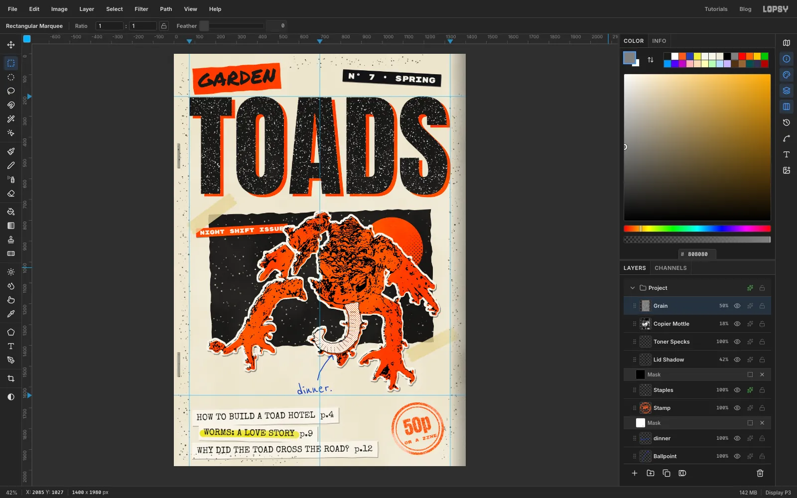

Three layers make it look like it came out of a real copier:

1. **Toner specks:** add a layer called `Toner Specks`. Set the foreground to `#1C1B19` and pick **Spray** at **Size** `60`, **Density** `2`, **Softness** `0`. Drag down the left edge, along the bottom, down the right edge and across the top.
2. **Mottle:** add a layer called `Copier Mottle` and choose **Filter → Clouds** with **Scale** `6`. Set it to **Soft Light** at `18%`. The toner density now varies gently across the page.
3. **Grain:** add a layer called `Grain`. Draw a marquee over the whole page, fill it with `#808080`, deselect, and run **Filter → Add Noise** with **Amount** `70`, **Mono**. Set it to **Overlay** at `50%`.

## Group the layers

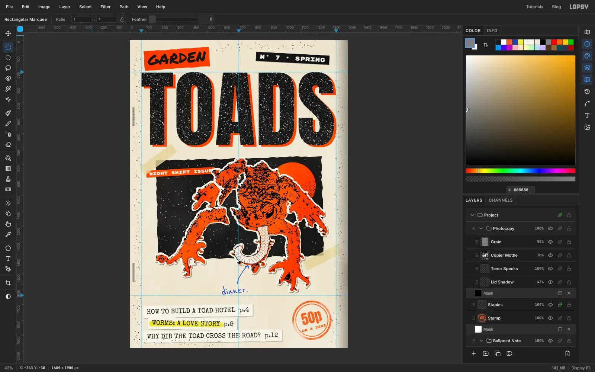

Tidy the stack into groups. For each one, click the bottom layer of the run, [[Shift]]-click the top one, and choose **Layer → Group Layers**. Then rename the group:

- `Masthead`: **TOADS Orange** up to **Dymo Issue**
- `Night Sky`: **Night Panel** up to **Dymo Night Shift**
- `Cut-out Toad`: **Toad Paper** up to **Tape 2**, which takes in the photo, the worm layers and both tapes
- `Cover Lines`: **Line Hotel** up to **Highlighter**
- `Ballpoint Note`: **Ballpoint** and **dinner**
- `Photocopy`: **Lid Shadow** up to **Grain**

## Nudge the cover lines as a block

Click the **Cover Lines** group and drag the scraps up about **12 px** with the **Move** tool. The whole block moves as one, which leaves a comfortable margin at the bottom of the page. If you change your mind, [[Cmd+Z]] puts it back and [[Cmd+Shift+Z]] moves it again.

Finally, choose **View → Show Guides** to hide the guides, then **File → Quick Export PNG** for the finished cover and **File → Save Project** to keep the layers.
