Photomontage is the art of building a new picture from cut-up photographs. Berlin Dada artists like Hannah Höch and John Heartfield did it with scissors, glue and magazines: hard cut edges, mismatched scales, ransom-note lettering and a strong accent colour.

This tutorial uses that language for an iron-on patch about the Flying Dutchman, the ghost ship doomed to sail forever and never make port. You'll turn a photo of a modern tall ship into a glowing X-ray ghost, duotone a moon and a storm wave, spell the title in mismatched cut-paper letters, and finish the patch with a merrowed border on a denim mock-up.

All three photos are public domain, from Wikimedia Commons. On each Commons page, click **Original file** so you get the full size (about 1,400 px wide for the ship and the moon, 1,796 px for the wave). The sizes in the steps assume those originals:

- [USCGC Eagle under sail to Mexico in 2014](https://commons.wikimedia.org/wiki/File:USCGC_Eagle_under_sail_to_Mexico_in_2014.jpg), a US Coast Guard photo of a square-rigged ship against a grey sky
- [Moon nearside LRO](https://commons.wikimedia.org/wiki/File:Moon_nearside_LRO.jpg), NASA's Lunar Reconnaissance Orbiter mosaic of the full moon
- [Wea00800,1](https://commons.wikimedia.org/wiki/File:Wea00800,1.jpg), a NOAA photo of a freak wave rising beside a tanker

Open each photo in your browser or an image viewer, copy it, and paste it into Lopsy when a step asks for it.

Along the way you'll use:

- **Define Pattern** and **Fill with Pattern** for a denim twill, plus **Fibers**, **Add Noise** and **Motion Blur**
- ruler **guides**, **elliptical marquees**, **Select → Inverse**, **Grow** and a radial **Gradient**
- pasting photos, scaling them with the **Move** tool, and the **Lasso** for scissor-cut edges
- **Brightness / Contrast**, **Halftone**, **Desaturate**, **Invert** and the **Clone Stamp** to retouch a photo
- **Group Layers** and a **Gradient Map** adjustment to duotone photos, and a group set to **Lighten**
- live text in nine Google Fonts, rotating a chip and its letter together, and **Drop Shadow** paper shadows
- **Sunburst** rays and merrow stitches, a group **layer mask**, **Emboss**, **Stroke** and **Inner Glow**

The palette is indigo denim, a night-violet print and a single vermilion accent:

- Denim `#1E3556`, twill light `#2C4C7C`, twill dark `#152A4A`
- Night `#15122A` → `#251E4A` → `#4A3D86`, moon rays `#2C2560`
- Duotone `#120F26` → `#4F4186` → `#B7A9C9` → `#F2EAD8`
- Ghost `#000000` → `#E6DCC6` → `#FFF8EC`
- Vermilion `#D8432B`, tape red `#C8372A`, paper `#EFE6D2`
- Merrow `#C23A22`, stitch shade `#7A1E12`, thread highlight `#FF7A5C`
- Tape lettering `#F6EFE2`, greys `#808080` / `#9A9A9A` / `#3A3A3A`
- Shadows `#07060F`, `#0D0B26`, `#050A14`, edge line `#0B0D18`, denim shade `#050A16`

> **Tip:** Positions are in document pixels, written `x, y`. The status bar at the bottom shows where the pointer is. When a step says to fill, that's **Edit → Fill**, which fills the selection (or the whole layer if nothing is selected) with the foreground colour. [[Cmd+D]] deselects, and it also commits a Move-tool transform.

> **Tip:** Blend modes live in the **Blend** dropdown at the top of a layer's effects drawer (the sparkle icon on its row). To change a layer's opacity, click the `100%` readout on its row and drag the slider. A new layer lands just above the active layer, and inside a group when that group is active and expanded.

## Start the denim

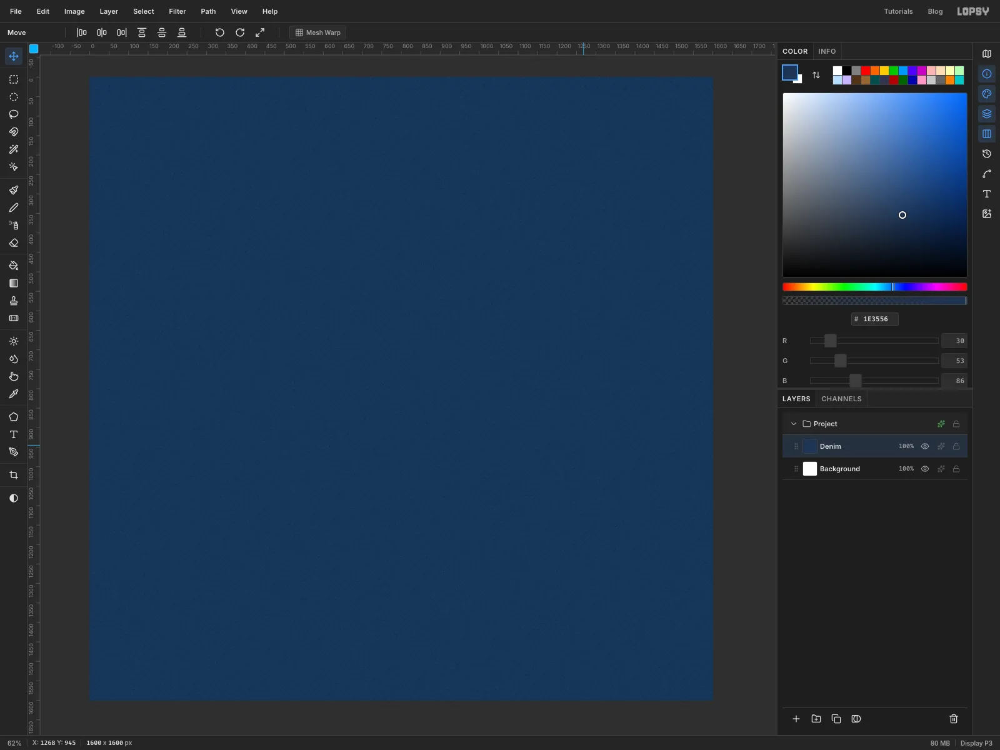

The patch is shown the way a product shot would show it: sewn onto a pair of jeans.

1. In the **New Document** dialog, set **Width** and **Height** to `1600`, leave the background white and click **Create**.
2. Double-click **Layer 1** and rename it `Denim`.
3. Set the foreground colour to `#1E3556` and fill the layer.
4. Run **Filter → Add Noise…** at **Amount** `25` with **Mono** and **Gaussian**.

## Make a twill pattern tile

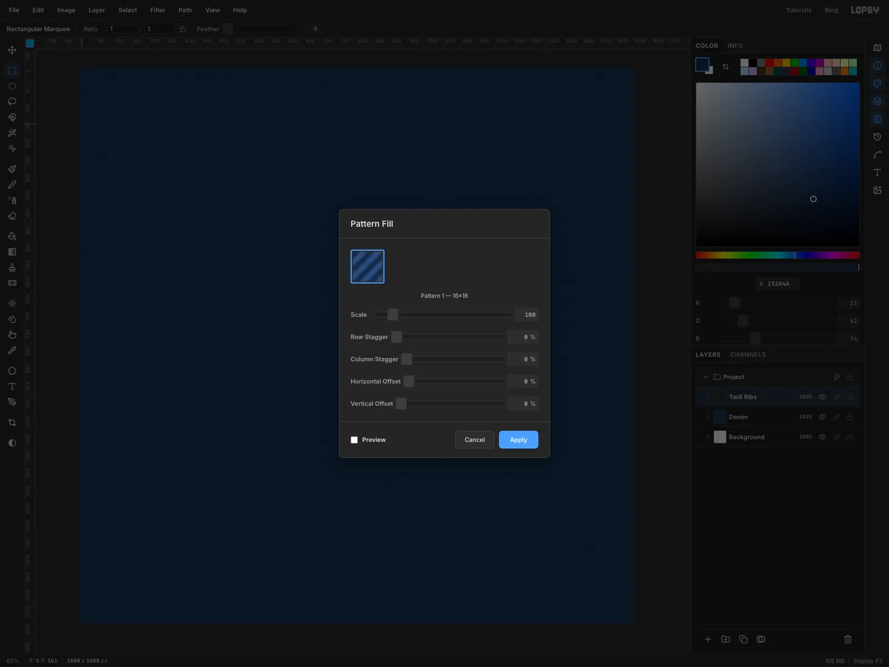

Denim is a twill: its threads cross in fine diagonal ribs. You'll draw one small tile of ribs and repeat it.

1. Click **Add Layer** and name the layer `Twill Ribs`.
2. Zoom well in on an empty spot. With the **Rectangular Marquee**, draw a square about 48 px across, fill it with `#2C4C7C` and deselect.
3. Pick the **Pencil** at **Size** `3` in `#152A4A`. Click just outside the bottom-left of the square and [[Shift]]-click just outside its top-right, so a straight line runs up at 45°. Draw more lines parallel to it, starting every 8 px along the bottom edge, until the whole square is striped.
4. Marquee a 16 × 16 px square in the middle of the stripes and choose **Edit → Define Pattern**.
5. Deselect, then choose **Edit → Fill with Pattern…**. Your new pattern is already chosen in the dialog, so click **Apply**.

Because the stripes repeat every 8 px, any 16 px square tiles seamlessly.

## Blend the twill into the denim

1. Run **Add Noise** at **Amount** `10`, **Mono** and **Gaussian**, so the ribs aren't too perfect.
2. Set **Twill Ribs** to **Overlay**.

## Add slubs to the weave

Real denim yarn is uneven, which gives it vertical streaks called slubs.

1. Add a layer called `Weave` and run **Filter → Fibers…** with **Variance** `20` and **Strength** `64`.
2. Set it to **Soft Light** at `30%` opacity.

## Place the guides

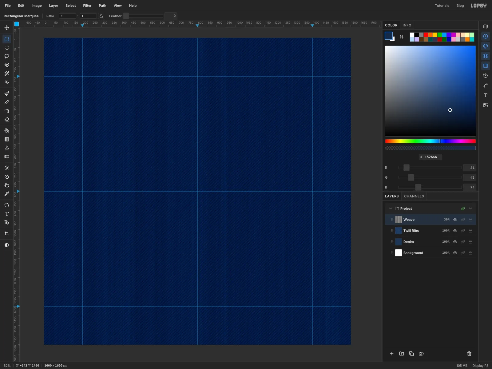

Hold [[Cmd]] and hover the top ruler about an eighth of the way in from the left. With [[Cmd]] held, the readout next to the pointer shows the fraction, so click when it says `1/8`. Do the same at `1/2` and `7/8`, which puts guides at `200`, `800` and `1400`. Repeat on the left ruler.

The centre guides mark the middle of the patch. The outer guides frame its edge.

## Lay down the night sky

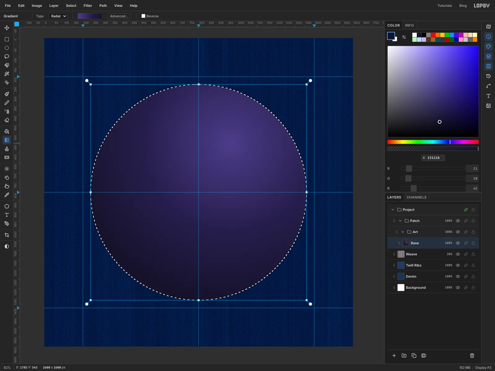

1. Click **Weave**, then click **New Group** and name it `Patch`. With **Patch** active, click **New Group** again and name the new group `Art`. It lands inside Patch.
2. With **Art** active, add a layer called `Base`.
3. With the **Elliptical Marquee**, drag from `240, 240` to `1360, 1360`. That's a 1,120 px circle centred on the guides.
4. Keep the selection. Pick the **Gradient** tool, set **Type** to **Radial**, click **Advanced…** and set three stops: `#4A3D86` at the left, `#251E4A` at 55% and `#15122A` at the right.
5. Drag from `965, 545`, where the moon will go, about 820 px to the right. The gradient fills the circle. Then deselect.

## Cut a red disc

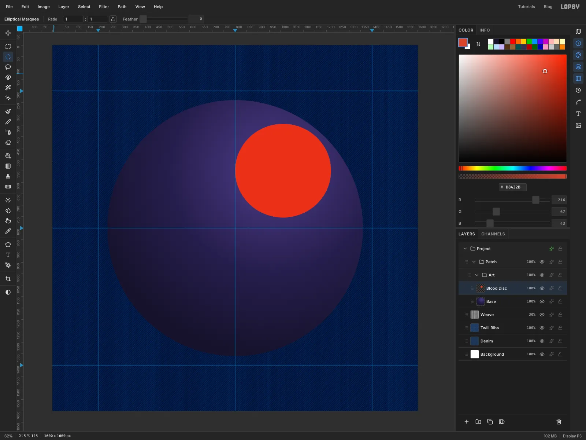

The crescent behind the moon is a flat paper disc. A red moon is an old omen at sea.

1. Add a layer called `Blood Disc`.
2. Drag an elliptical marquee from `800, 344` to `1220, 754` and fill it with `#D8432B`. The start point snaps onto the centre guide, which is where you want it.

## Paste the moon

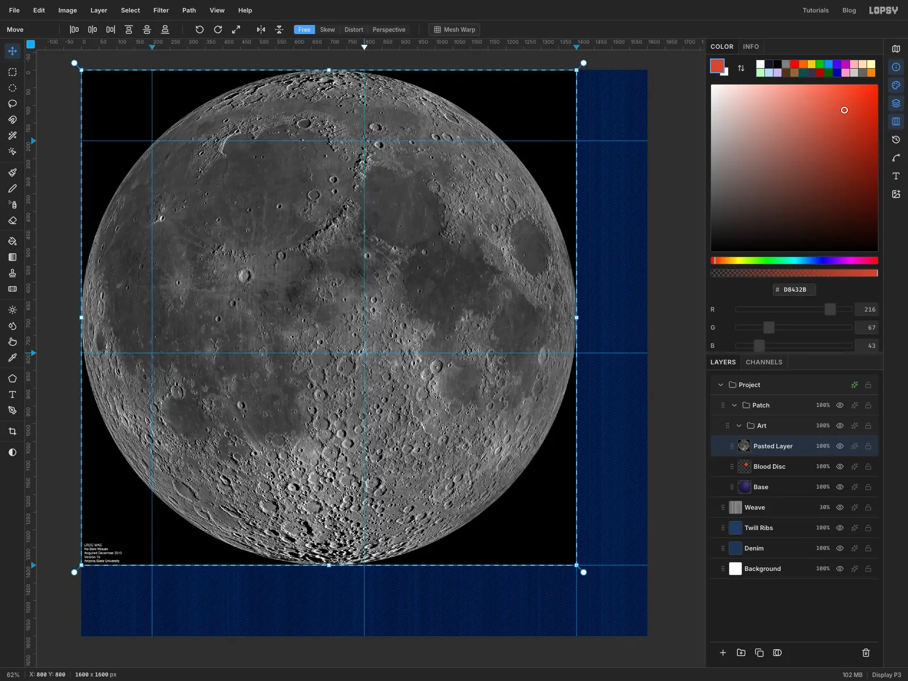

Copy the moon photo and press [[Cmd+V]]. The paste lands at the top-left corner as a new layer. Its pixels are already selected and the **Move** tool is active, so the transform handles are ready to use.

## Shrink and place the moon

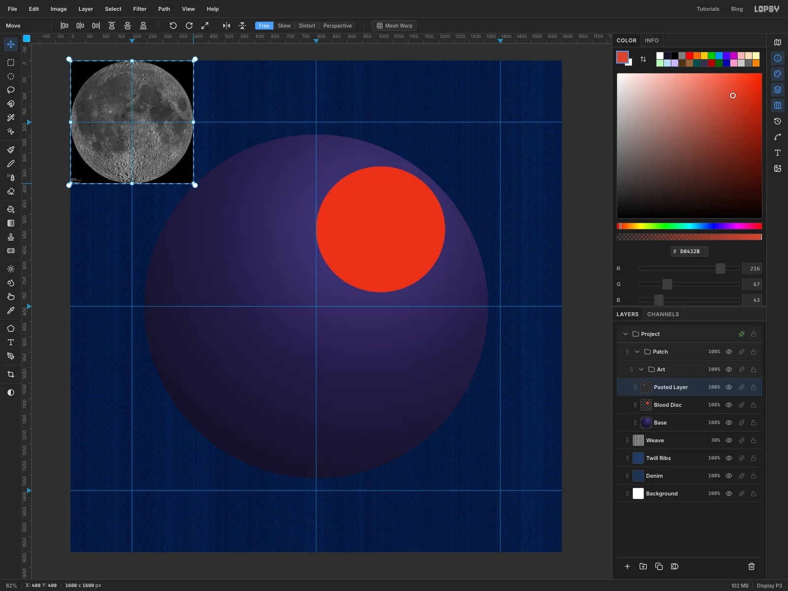

1. Hold [[Cmd]] and drag the bottom-right handle up and to the left until the photo is 400 px wide. [[Cmd]] keeps its proportions. When you're there, the status bar reads about `X: 400 Y: 400` under the pointer.
2. Press [[Cmd+D]] to commit, and rename the layer `Moon`.
3. With the **Move** tool, drag the moon so its centre sits at `965, 545`.

## Trim the moon to a disc

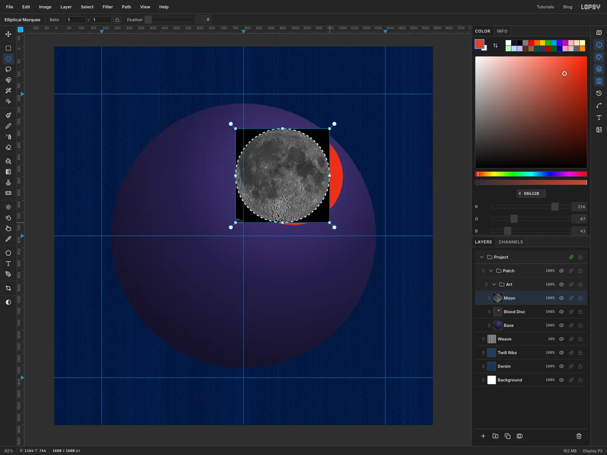

The photo still has black corners and a caption.

1. Drag an elliptical marquee that sits just inside the edge of the moon.
2. Choose **Select → Inverse** and press [[Delete]], then deselect.

The red disc now shows as a crescent along the moon's right side.

## Paste the wave and cut away the tanker

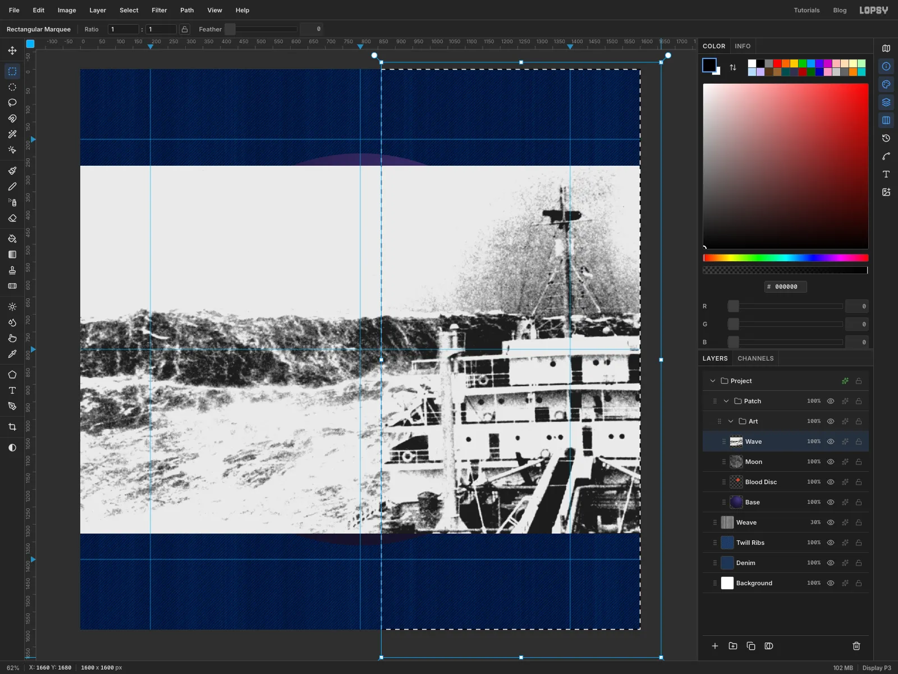

1. With **Moon** active, paste the wave photo. It's wider than the canvas, so Lopsy shrinks it to fit. Press [[Cmd+D]] and rename the layer `Wave`.
2. Marquee everything to the right of `x 860`, from just above the canvas to just below it, and press [[Delete]]. That removes the tanker and keeps the wall of water.

## Scissor-cut the crest

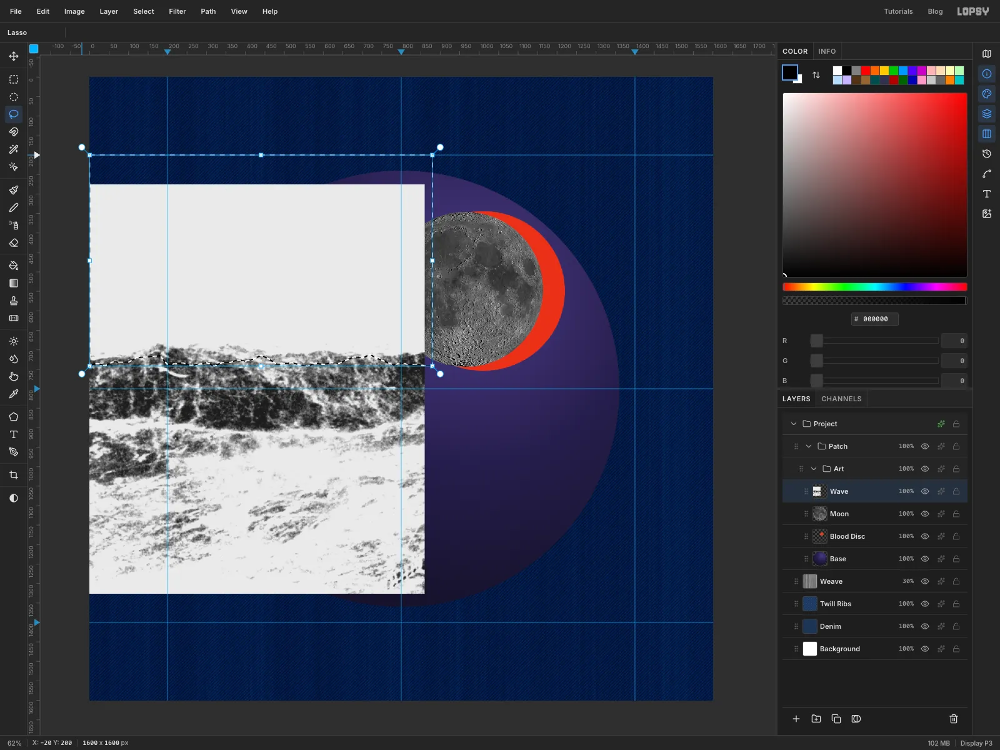

Photomontage edges are cut with scissors, not feathered.

1. With the **Lasso**, draw around the white sky above the wave. Follow the top of the dark water with a few rolling crests: a slow rise, then a steep front, like waves breaking.
2. Press [[Delete]] and deselect.

## Scale and place the wave

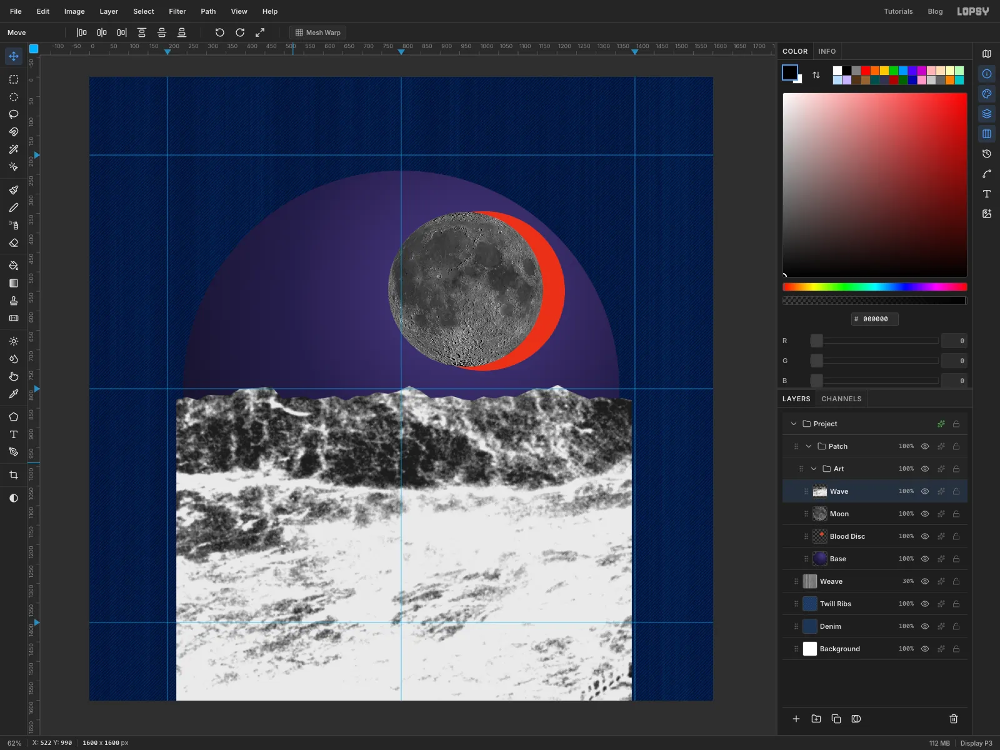

1. Pick the **Move** tool and [[Cmd]]-click the **Wave** thumbnail to select its pixels. Transform handles appear around it.
2. Hold [[Cmd]] and drag the bottom-right handle until the strip is about 1,170 px wide. Commit with [[Cmd+D]].
3. Drag it with the **Move** tool so its left edge is at about `x 222` and the tops of its crests are at about `y 790`.

## Turn the sea into a halftone

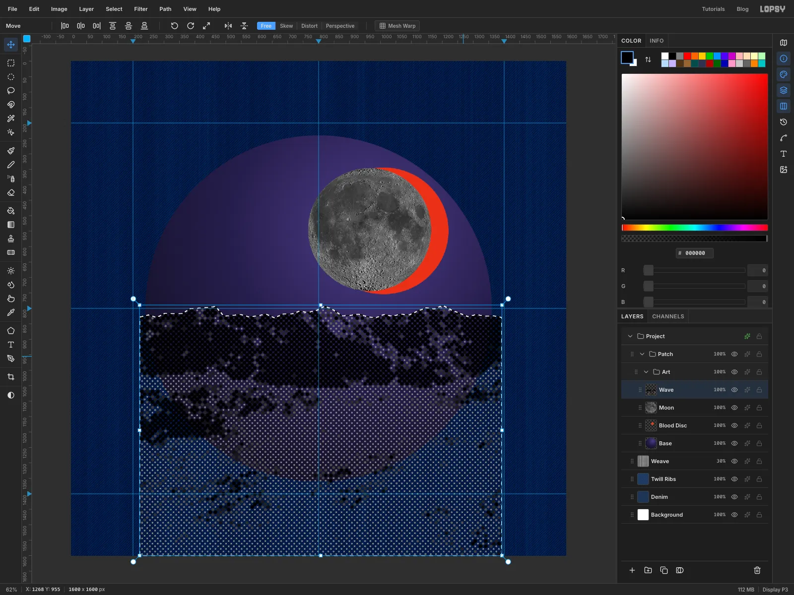

A coarse halftone makes the photo look torn from a newspaper.

1. [[Cmd]]-click the **Wave** thumbnail again.
2. Run **Filter → Brightness/Contrast…** with **Brightness** `-50` and **Contrast** `35`. Darkening first makes the dots big enough to merge into dark water.
3. Run **Filter → Halftone…** with **Dot Size** `12` and **Angle** `45`.

## Back the wave with paper

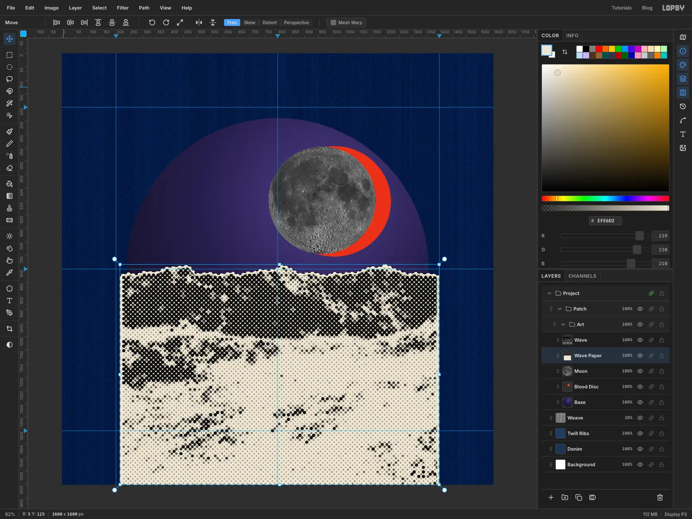

A thin rim of paper around the cut makes it look stuck on.

1. Keep the selection and choose **Select → Grow…** with `7` px.
2. Click **Moon** and add a layer called `Wave Paper`. It lands between the moon and the wave.
3. Fill it with `#EFE6D2` and deselect.

## Tear a strip of deep water

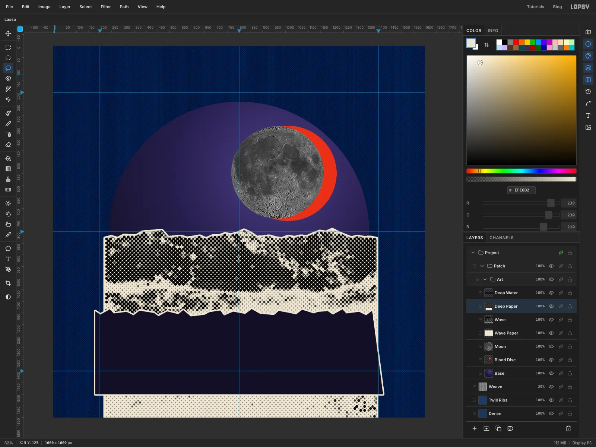

1. Click **Wave** and add a layer called `Deep Water`.
2. With the **Lasso**, tear a strip across the bottom: start at the left around `y 1148`, wobble irregularly to the right edge, with one small notch, then come back around below the patch.
3. Fill it with `#120F26`, then **Grow** the selection by `6` px.
4. Click **Wave**, add a layer called `Deep Paper`, fill it with `#EFE6D2` and deselect.

Keep the tear irregular. If its rhythm matches the wave crest, the two edges look like a repeating pattern.

## Paste and size the ship

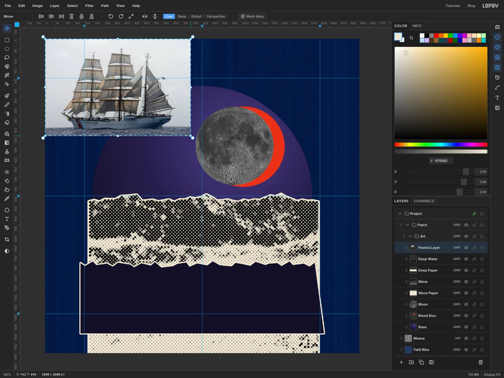

1. Click **Deep Water** and paste the ship photo.
2. [[Cmd]]-drag the bottom-right handle until it's about 741 px wide, a little over half size, and commit with [[Cmd+D]]. The pointer's `X` in the status bar reads about `741`.
3. Rename it `Ghost Ship` and drag it so its top-left corner is at `285, 365`.
4. Run **Filter → Desaturate**.

## Cut off the photo's own sea

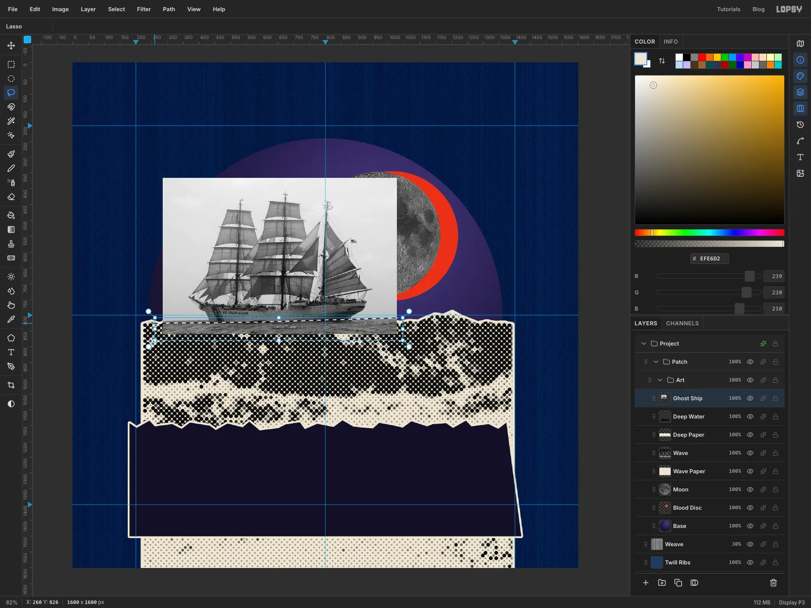

The photo still has a strip of real sea under the hull. With the **Lasso**, trace along the waterline from the bow on the left to the stern on the right, then loop around everything below it. Press [[Delete]] and deselect.

## Clone out the hull markings

The ship carries "U.S. COAST GUARD" lettering and a diagonal racing stripe. A ghost ship shouldn't have either.

1. Pick the **Clone Stamp** at **Size** `14`.
2. [[Alt]]-click clean white hull about 90 px to the right of the lettering. Then drag along the lettering from left to right. The source moves with you, so it paints plain hull and portholes over the words.
3. Set **Size** to `13`, [[Alt]]-click the hull about 150 px to the right of the stripe, and paint short horizontal strokes over the stripe and its emblem, from the top of the hull to the waterline.

## Remove the flag

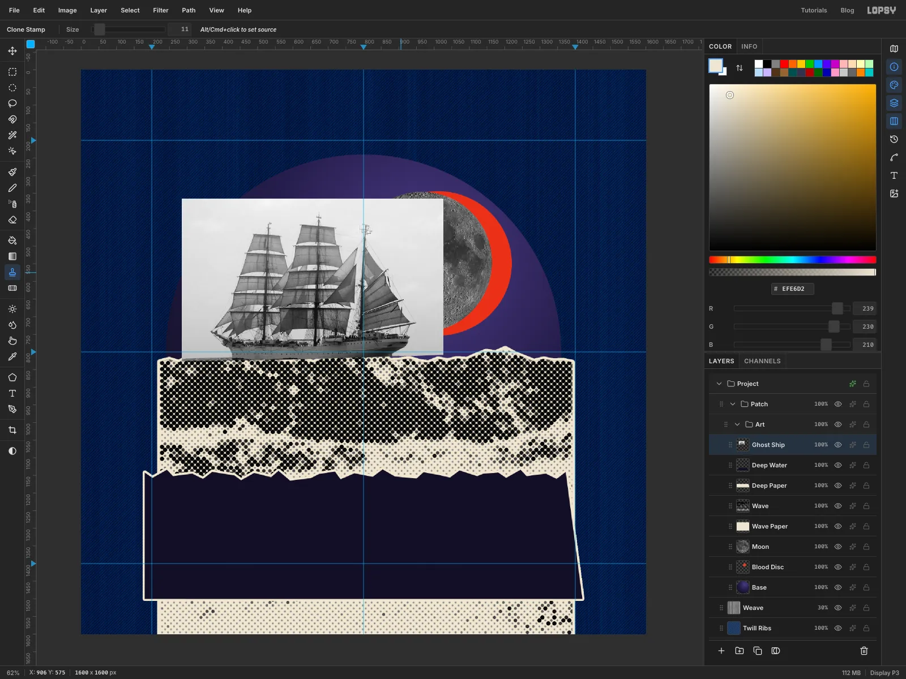

There's a small flag flying from the right-hand (rear) mast. At **Size** `11`, [[Alt]]-click the sky just to its right and paint over it in short strokes.

## Make the X-ray negative

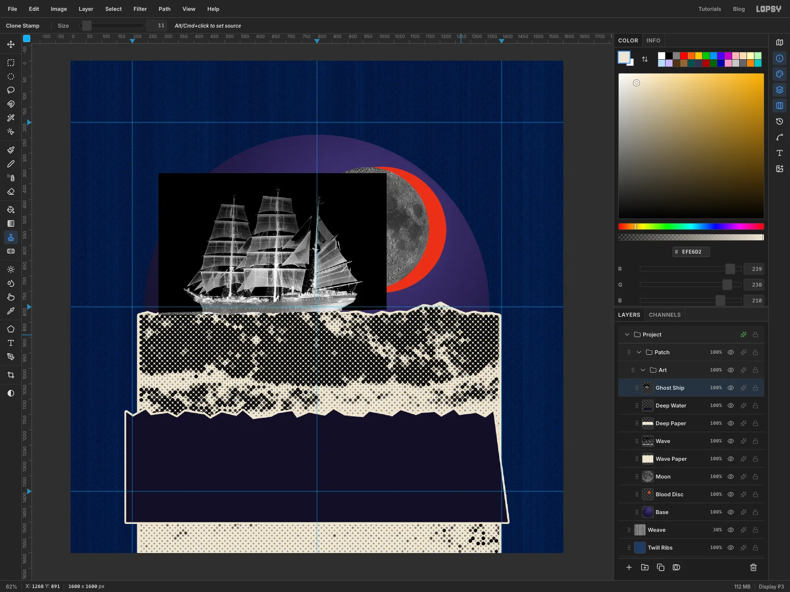

1. Run **Filter → Invert**. Dark ropes and spars turn into glowing white lines, like an X-ray.
2. Run **Brightness/Contrast** with **Brightness** `-20` and **Contrast** `55`. That pushes the inverted grey sky to almost black.

## Screen the ghost into the sky

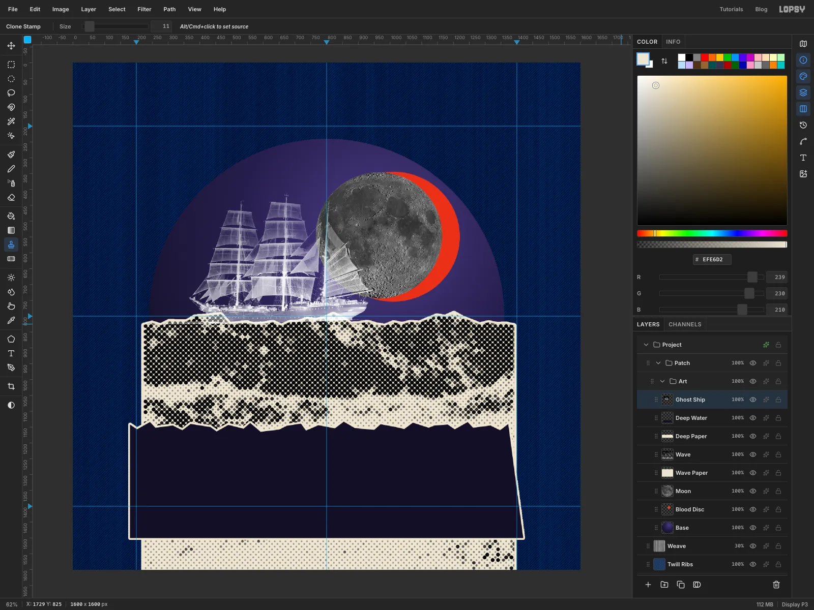

As a temporary preview, set **Ghost Ship** to **Screen**. Black disappears in Screen, so only the glowing ship is left, and you can judge where it sits. You'll swap this for a better method once the photos are grouped.

## Sink the hull behind the wave

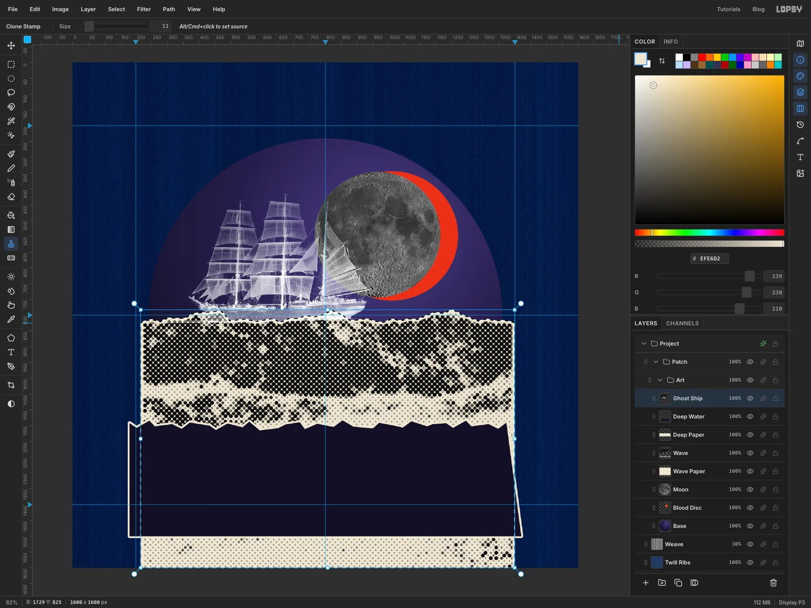

The ship sits above the sea in the layer stack, but it should look as if the waves cover its hull.

1. [[Cmd]]-click the **Wave Paper** thumbnail to load the wave's outline as a selection.
2. Click **Ghost Ship**, press [[Delete]] and deselect.

The crests now cut across the hull, as if the ship sits behind them.

## Group the photos

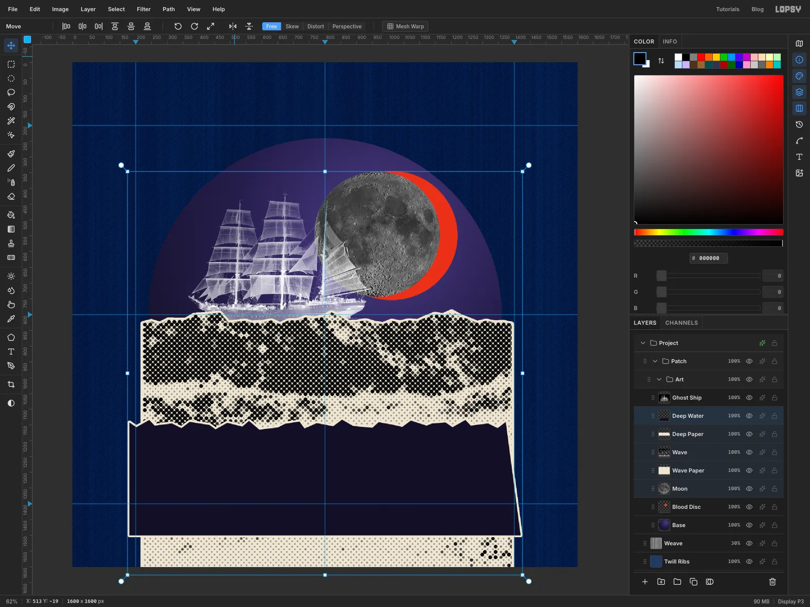

1. Click **Deep Water**, then [[Shift]]-click **Moon** to select the five layers between them.
2. Choose **Layer → Group Layers** and name the group `Montage`.

## Duotone the photos with a gradient map

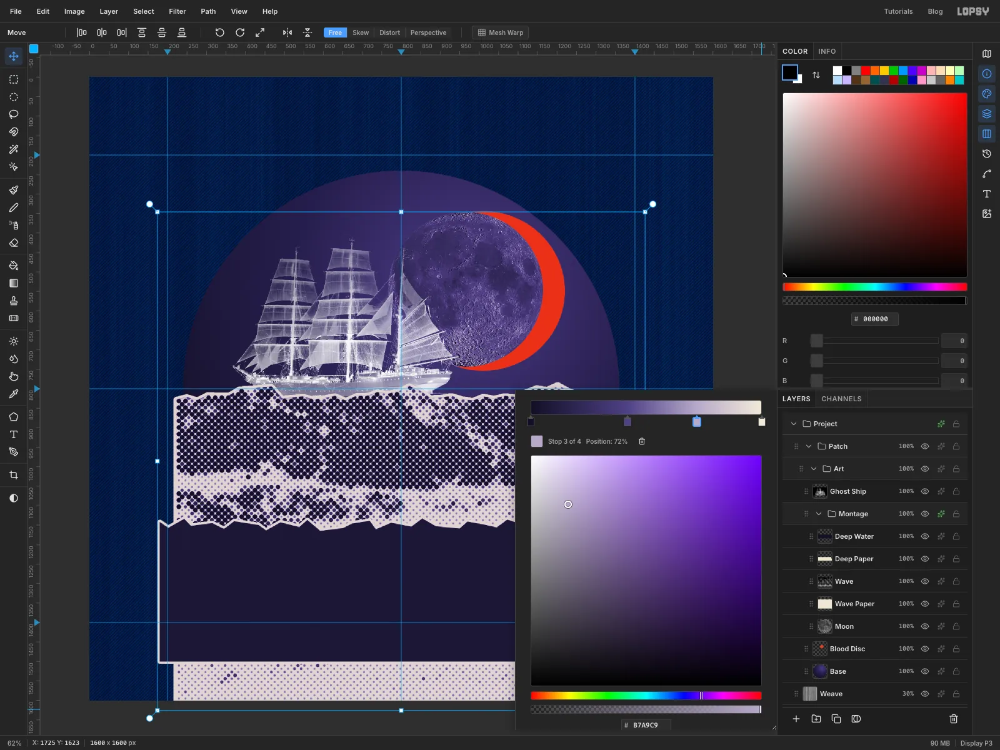

A gradient map replaces each grey with a colour from a ramp, so every photo in the group prints in the same two inks.

1. Open **Montage**'s effects drawer, click **Add Adjustment** and choose **Gradient Map**.
2. Click each end stop and type its colour: `#120F26` on the left and `#F2EAD8` on the right.
3. Click the bar at about 42% to add a stop in `#4F4186`, and at about 72% for `#B7A9C9`.
4. Close the drawer.

## Give the paper cut-outs a shadow

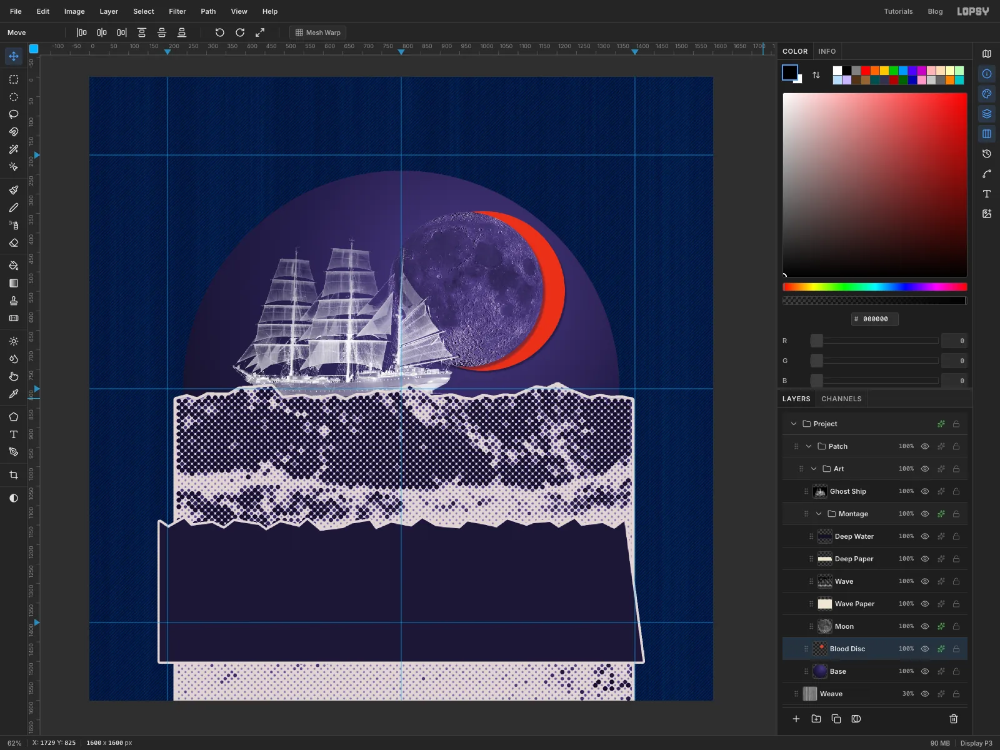

1. Give **Moon** a **Drop Shadow** in `#0D0B26`: **Offset X** `6`, **Offset Y** `7`, **Blur** `6`, **Opacity** `45`.
2. Give **Blood Disc** the same shadow with **Offset X** `4`, **Offset Y** `5` and **Blur** `4`.

## Turn the ghost bone white

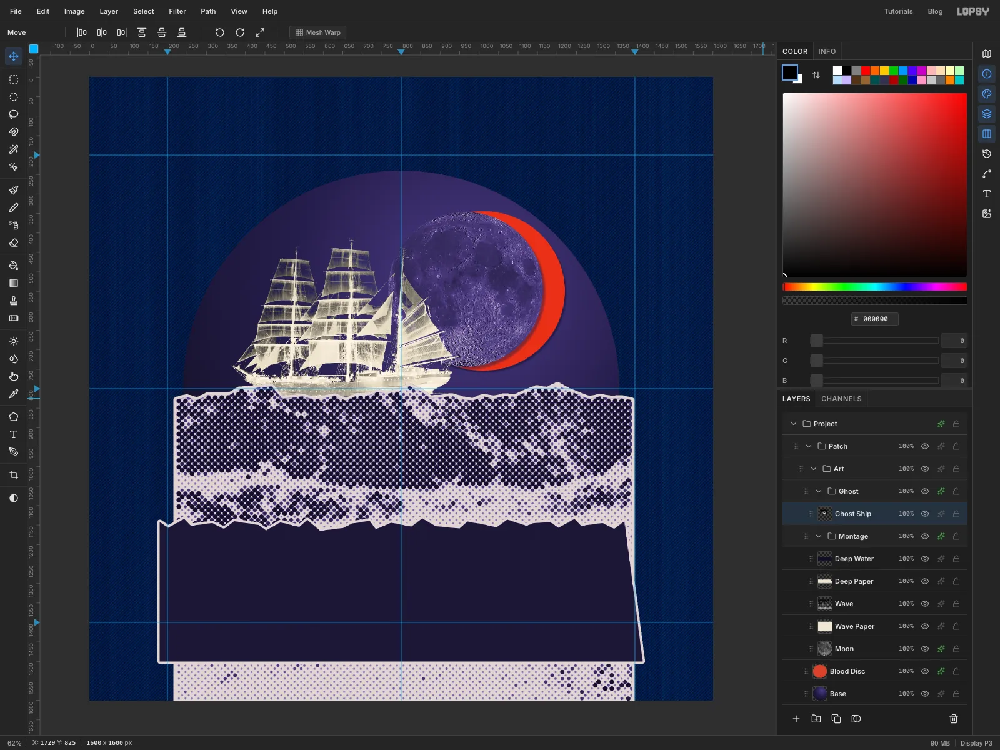

A screened white ship picks up the violet underneath it and goes cold lilac. To make it read as warm bone, give it a group of its own.

1. Click **Ghost Ship** and choose **Layer → Group Layers**. Name the group `Ghost`.
2. In **Ghost**'s drawer, add a **Gradient Map** going from `#000000` through `#E6DCC6` at about 55% to `#FFF8EC`.
3. Set the group's **Blend** to **Lighten**.
4. Set **Ghost Ship** itself back to **Normal**.

The map turns the ship's greys into bone. **Lighten** keeps whichever is lighter, the ship or the sky, so the black sky still disappears.

## Tear a band for the title

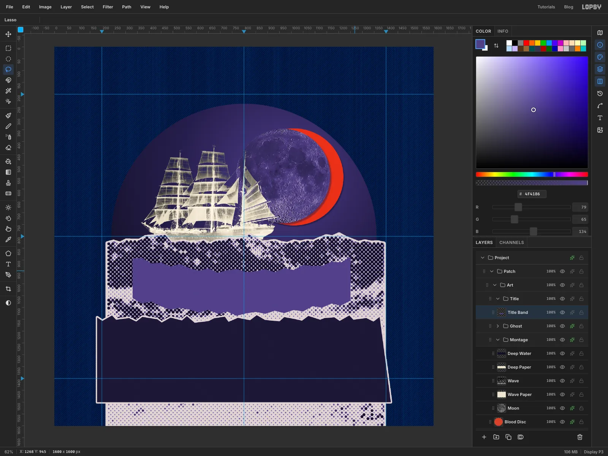

1. Click the collapse arrow on **Ghost**, then click its row and click **New Group**. Name the new group `Title`. Because Ghost is collapsed, the new group sits beside it instead of inside it.
2. Add a layer called `Title Band`.
3. With the **Lasso**, tear a band across the middle of the patch from about `x 330` to `x 1270`. At the centre it runs from about `y 946` to `y 1126`. Let it arch gently, so the ends sit about 60 px higher than the middle.
4. Fill it with `#4F4186`, add **Noise** at `10` (**Mono**, **Gaussian**) for paper grain, and deselect.

## Cut the first letter chip

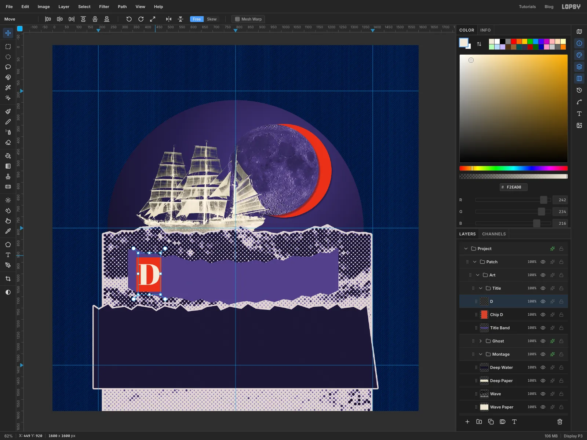

DUTCHMAN is spelled ransom-note style: each letter on its own paper chip, in a different typeface. Start the D at the left end of the band, about `x 366`, and leave about 7 px between chips. Their centres follow the band's arch, so the middle chips sit lowest. The chips, left to right:

- **D**: a 110 × 150 chip in `#D8432B`, with Abril Fatface at 130 in `#F2EAD8`. Tilt it about 5°.
- **U**: a tall, narrow 78 × 176 chip in `#F2EAD8`, with Bebas Neue at 153 in `#120F26`. Tilt it about 10°.
- **T**: a 100 × 130 chip in `#120F26`, with Ultra at 110 in `#F2EAD8`. Barely tilt it the other way.
- **C**: an 88 × 150 chip in `#F2EAD8`, with Anton at 106 in `#D8432B`. Tilt it about 6°.
- **H**: a 112 × 128 chip in `#B7A9C9`, with Alfa Slab One at 105 in `#120F26`. Tilt it about 2° the other way.
- **M**: a short, wide 124 × 134 chip in `#F2EAD8`, with Bungee at 123 in `#120F26`. Leave it straight.
- **A**: a 102 × 150 chip in `#120F26`, with Playfair Display, weight **Black**, at 132 in `#B7A9C9`. Give it a strong tilt the other way, about 11°.
- **N**: a 106 × 138 chip in `#D8432B`, with Archivo Black at 124 in `#120F26`. Tilt it about 4° the other way.

"Tilt" means clockwise, and "the other way" means anticlockwise. For the D:

1. Add a layer called `Chip D`. Marquee the chip, fill it with its colour, and add **Noise** at `12` (**Mono**, **Gaussian**). Deselect.
2. Set the foreground to the letter colour. Pick the **Text** tool and choose the font and size in the options bar. Then click in an empty part of the canvas, type the letter and press [[Tab]].
3. With the **Move** tool, nudge the letter with the arrow keys ([[Shift]] moves 10 px at a time) until it's centred on its chip, with even paper all round.

> **Tip:** Create each letter in empty canvas, away from the letters you've already made, and then move it into place. Clicking near an existing letter with the Text tool edits that letter instead.

## Turn the chip and letter together

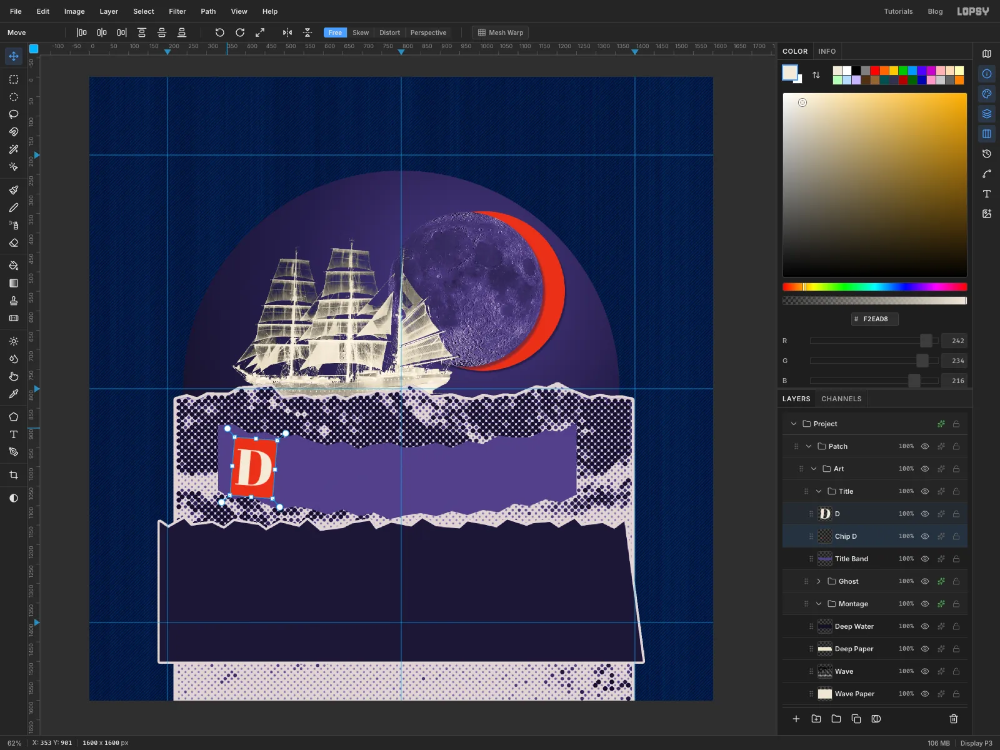

1. Click **Chip D**, then [[Shift]]-click the **D** text layer so both are selected.
2. With the **Move** tool, drag just outside a corner handle to rotate both together by the angle in the list. Press [[Cmd+D]] to commit. The letter stays live text.
3. Give **Chip D** a tight paper shadow: **Drop Shadow** in `#07060F`, **Offset X** `3`, **Offset Y** `4`, **Blur** `2`, **Opacity** `60`.

## Spell out DUTCHMAN

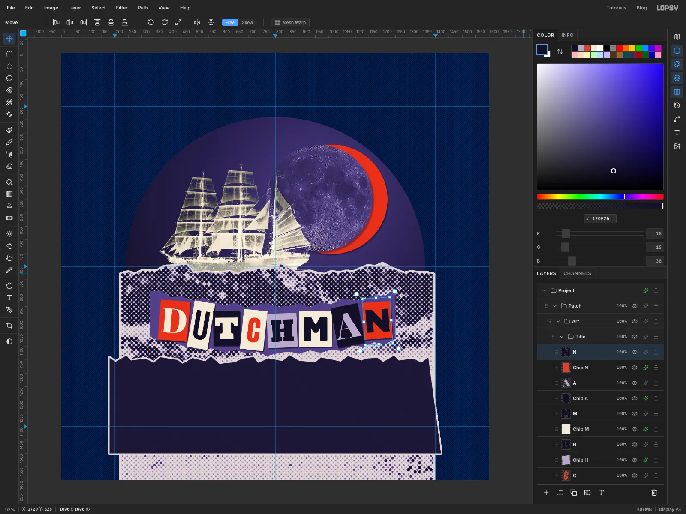

Repeat the last two steps for U, T, C, H, M, A and N, using the list. Make each new chip while the previous letter is active, so the stack stays in order.

The chips overlap their neighbours a little. That's the cut-and-paste look, but keep each letter itself clear of the next chip.

## Add the THE FLYING tape

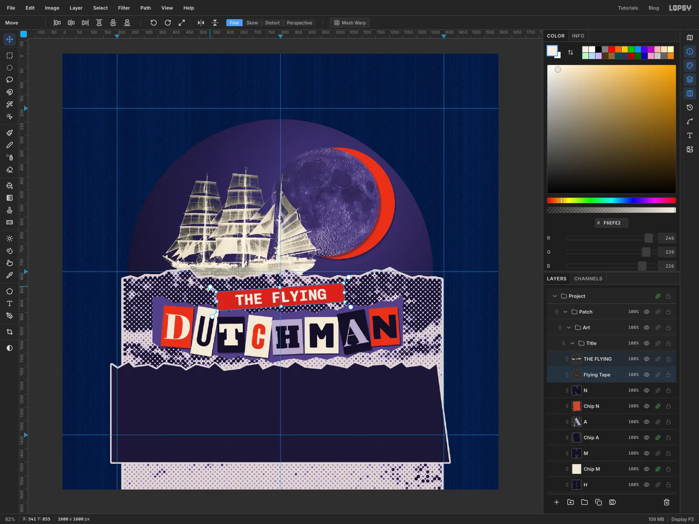

The smaller words go on label-maker tape, another piece of found material.

1. Click the **N** text layer and add a layer called `Flying Tape`. Marquee a 470 × 70 px strip centred on `800, 893`, fill it with `#C8372A`, add **Noise** at `10`, and deselect.
2. Set the foreground to `#F6EFE2`. With the **Text** tool, choose **Chivo Mono**, **Bold**, size `56`. Click in an empty part of the canvas and type `THE FLYING`, then press [[Tab]].
3. Drag the text onto the tape with the **Move** tool, then centre it with the arrow keys.
4. Select the tape and the text together and rotate them about 4° anticlockwise. Commit, then give the tape the same paper shadow as the chips.

## Add the NEVER MAKES PORT tape

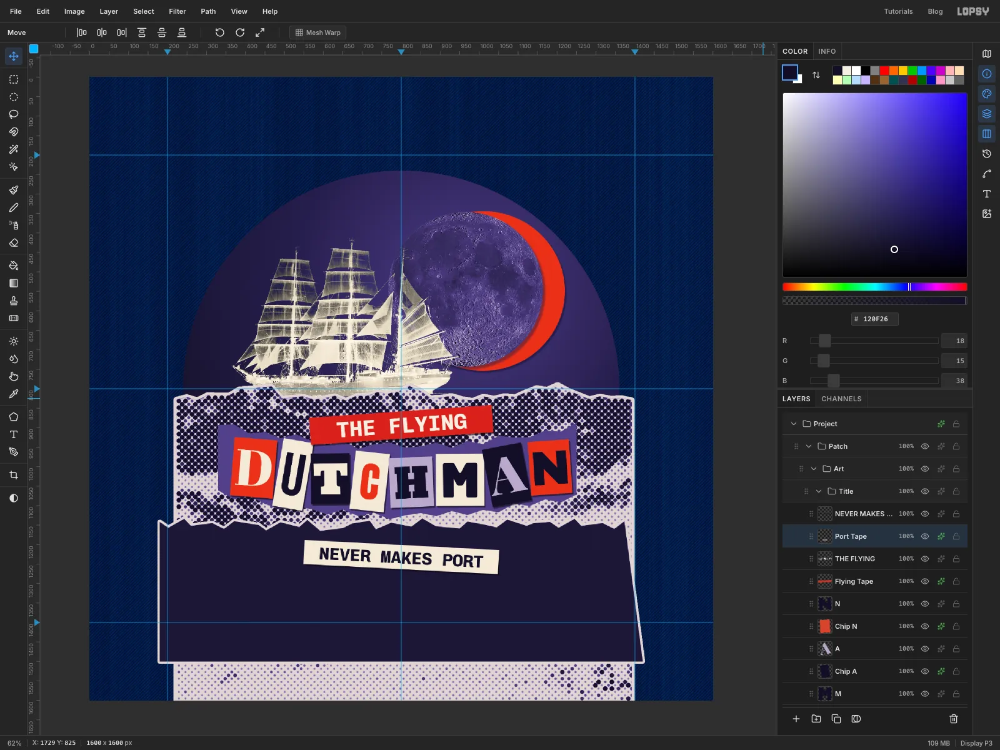

1. Click the **THE FLYING** text layer and add a layer called `Port Tape`. Marquee a 500 × 62 px strip centred on `800, 1232`, fill it with `#F2EAD8`, add **Noise** at `10`, and deselect.
2. Set the foreground to `#120F26`. Choose **Chivo Mono**, **Bold**, size `44`, click in empty canvas, type `NEVER MAKES PORT` and press [[Tab]].
3. Drag the text onto the tape and centre it with the arrow keys.
4. Select the tape and the text together and rotate them about 3° clockwise, so the two tapes lean in opposite directions. Commit, then give **Port Tape** the paper shadow.

## Fan rays out from the moon

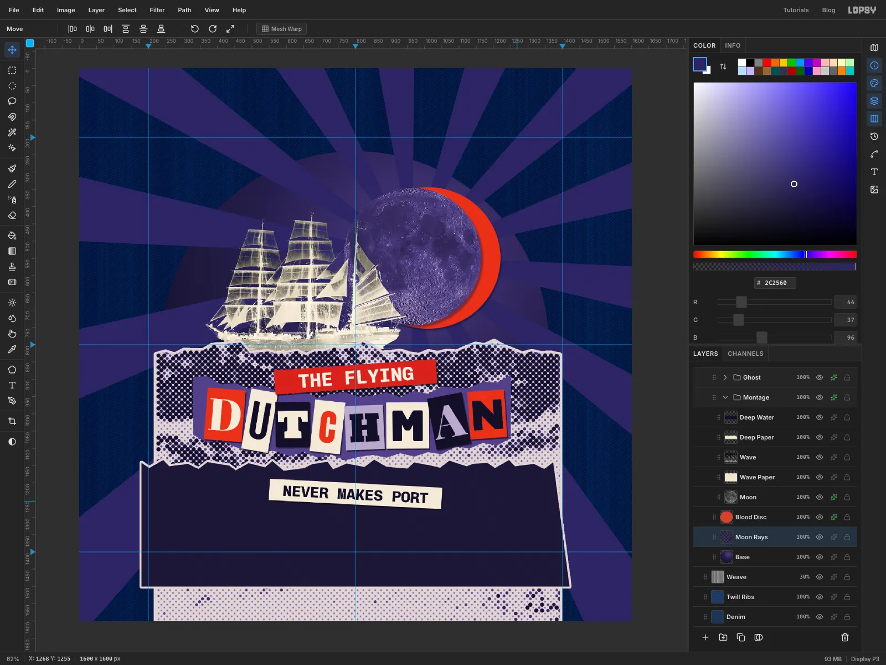

Rays from a single point are a constructivist favourite. Here they fill the empty sky.

1. In the Layers panel, click **Base** inside the **Art** group. Add a layer called `Moon Rays` and set the foreground to `#2C2560`.
2. Run **Filter → Sunburst…** with **Rays** `14`, **Length** `150`, **Width** `42`, **Rotation** `8`, **Center X** `60.3` and **Center Y** `34`. The centre is set as a percentage of the canvas, and these values put it on the moon.

The rays spill past the patch for now. The group mask will trim them.

## Screen a halftone over the sky

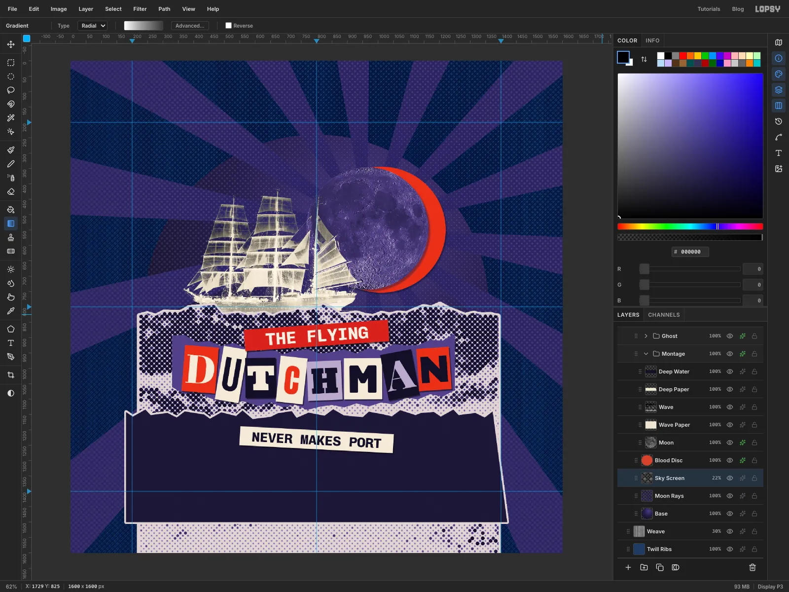

1. Add a layer called `Sky Screen`.
2. Drag a **Radial** gradient from the moon's centre about 900 px outwards, going from `#FFFFFF` through `#9A9A9A` at 45% to `#3A3A3A`.
3. Run **Halftone** with **Dot Size** `12` and **Angle** `45`, the same screen as the sea.
4. Set the layer to **Screen** at `22%`. The black disappears and only the dots remain.

## Mask the art to a circle

1. Click the **Art** group and click **Add Mask**, then click its mask thumbnail to edit the mask.
2. Drag an elliptical marquee from `247, 247` to `1353, 1353`. Choose **Select → Inverse**, set the foreground to black and fill.
3. Deselect, then click the **Art** row to stop editing the mask.

Everything inside **Art** is now trimmed to a circle 1,106 px across.

## Print a twill texture on the patch

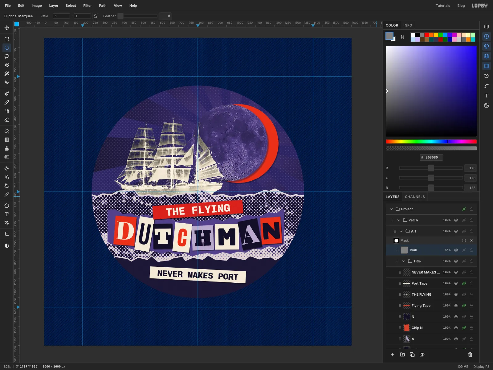

With **Art** active and expanded, add a layer called `Twill`. It lands inside the group, so the mask clips it.

1. Fill it with `#808080`, run **Add Noise** at `50` (**Mono**, **Gaussian**), then **Filter → Motion Blur…** at **Angle** `45` and **Distance** `6`.
2. Set it to **Overlay** at `45%`.

## Lay the merrow ring

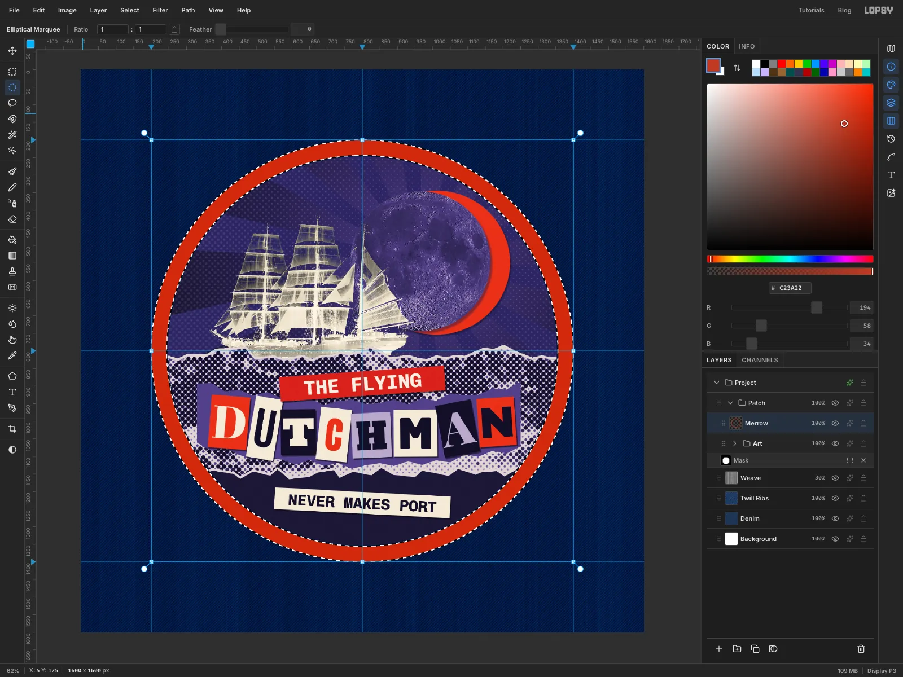

A merrowed edge is the thick overlocked thread wrapped around the rim of a patch.

1. Collapse **Art**, click **Patch**, and add a layer called `Merrow`. It lands at the top of Patch, above the art.
2. Drag an elliptical marquee from the `200` guides to the `1400` guides; both corners snap onto them. Then hold [[Alt]] and drag a second one from `244, 244` to `1356, 1356` to subtract the middle.
3. Fill the ring with `#C23A22`.

## Stitch the merrow

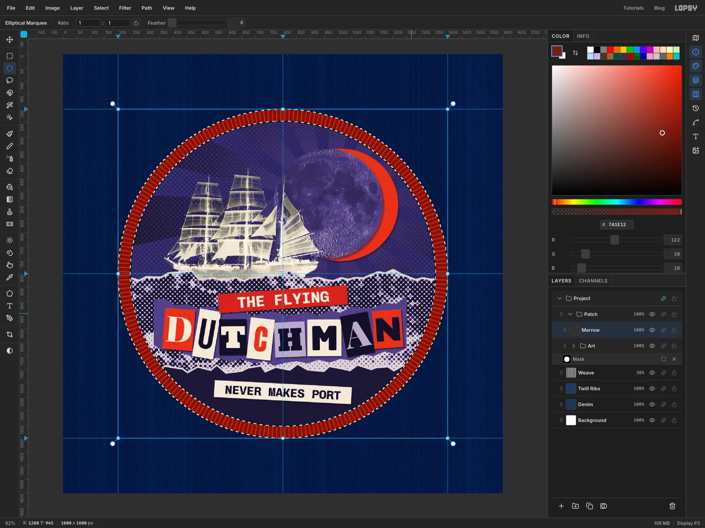

1. Keep the ring selected and set the foreground to `#7A1E12`.
2. Run **Sunburst** with **Rays** `120`, **Length** `150`, **Width** `38` and **Rotation** `0`. Leave **Center X** and **Center Y** at `50`. The rays stay inside the selection, so they become stitches.
3. Run it once more with **Rotation** `1.5`. That puts a second set of stitches between the first, about 15 px apart around the ring.
4. Run **Add Noise** at `14` (**Mono**, **Gaussian**) for thread fuzz, then deselect.

## Finish the border

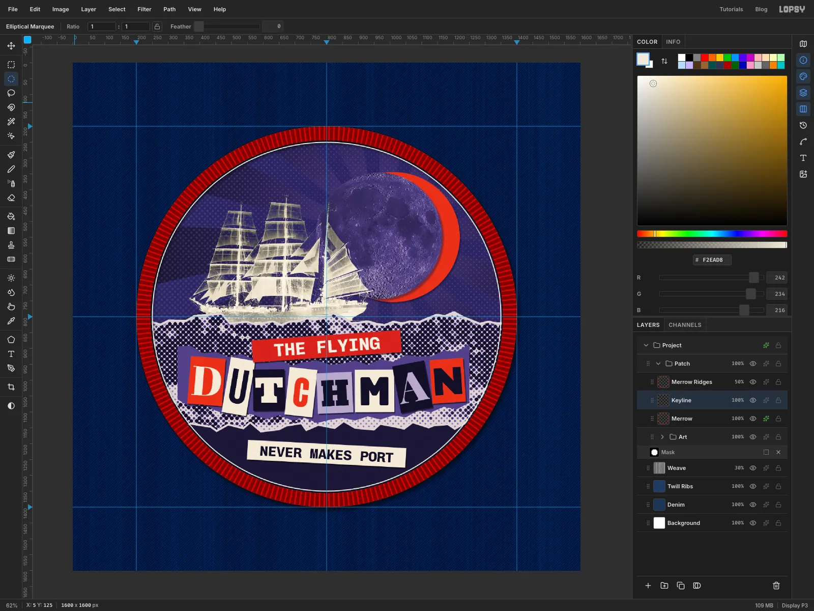

1. Choose **Layer → Duplicate Layer**, rename the copy `Merrow Ridges`, and run **Filter → Emboss…** with **Angle** `135` and **Strength** `15`. Set it to **Overlay** at `50%`. That gives the thread some relief.
2. Back on **Merrow**, add three effects:
   - a **Stroke** in `#0B0D18` with **Width** `2`, for the edge where the patch meets the fabric
   - a **Drop Shadow** in `#050A14` with **Offset X** `6`, **Offset Y** `9`, **Blur** `16` and **Opacity** `80`, so the patch sits up off the denim
   - an **Inner Glow** in `#FF7A5C` at **Size** `5` and **Opacity** `35`, for the sheen on the thread
3. Add a layer called `Keyline`. Marquee a circle from `249, 249` to `1351, 1351`, [[Alt]]-subtract one from `252, 252` to `1348, 1348`, fill the thin ring with `#F2EAD8`, and deselect.

## Shade the denim

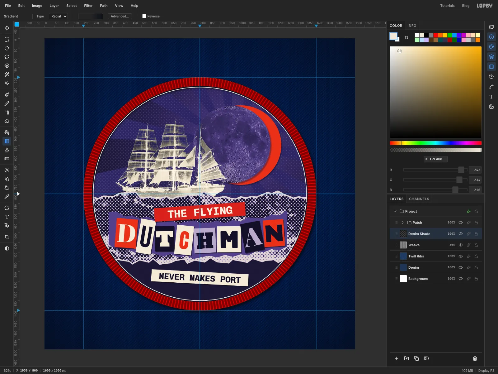

1. Collapse **Patch**, click **Weave**, and add a layer called `Denim Shade`.
2. Set up a **Radial** gradient with three stops, all `#050A16`. In the **Gradient Editor**, drag each stop's **Opacity** bar: 0% for the stops at the start and halfway, and 70% for the stop at the end. Drag it from the centre about 1,150 px outwards.

The corners darken, so the eye goes to the patch.

Save your work with **File → Save Project**, and use **File → Quick Export PNG** to get the finished patch.
