Concept art doesn't have to be painted. A lot of early film design was cut and pasted, and the photographer Jerry Uelsmann made a career from combination prints: several negatives printed onto one sheet so carefully that they look like a single impossible photograph. That's the goal here. If a viewer can spot where one photo stops and the next begins, the illusion falls apart.

Our film is **Polar Jungle**. In 1915 an Antarctic expedition walks into an ice cave and finds a jungle growing inside the iceberg, with their ship already swallowed by it. The frame is built around Herbert Ponting's famous 1911 photo of a grotto in an iceberg, which has two real explorers standing in its mouth. Most of the work isn't the cutting out. It's making one believable light: warm from the door, cold everywhere else.

All of the photos are public domain or CC0, on Wikimedia Commons:

- [Cave in an iceberg](https://commons.wikimedia.org/wiki/File:Cave_in_an_iceberg.jpg), Herbert Ponting, 1911
- ['Endurance' heeled to port by the ice](https://commons.wikimedia.org/wiki/File:%27Endurance%27_heeled_to_port_by_the_ice_RMG_P00004.tiff), Frank Hurley
- [Interior, Palm House, Kew Gardens (DSC03555)](https://commons.wikimedia.org/wiki/File:Interior,_Palm_House_-_Kew_Gardens,_London_-_DSC03555.jpg)
- [Palm House interior, Kew Gardens (DSC03493)](https://commons.wikimedia.org/wiki/File:Palm_House_interior_-_Kew_Gardens,_London_-_DSC03493.jpg)
- [Polar bears on the Beaufort Sea coast](https://commons.wikimedia.org/wiki/File:Polar_bears_on_the_Beaufort_Sea_coast.jpg), US Fish and Wildlife Service
- [Macaw parrot sitting on a tree branch](https://commons.wikimedia.org/wiki/File:Macaw_parrot_sitting_on_a_tree_branch.jpg_.jpg)
- [Bird of paradise flower](https://commons.wikimedia.org/wiki/File:Strelitzia_larger.jpg)

Crop two of them before you start, in any image viewer. Lopsy shrinks a dropped image to fit the canvas, so cropping keeps the detail you need:

- **Cave:** keep the full width and only the band from about 36% to 82% of the way down. You want a wide 16:10 image with the two men in the lower middle.
- **Polar bears:** keep just the left-hand bear, with some ground around it. That's roughly the left 30% of the photo, from 60% to 85% of the way down.

The palette:

- Deep ice `#27384A`, pale ice `#C4D8E6`
- Door light `#FFE2A2`, `#FFC878`, `#FFB860`
- Warm snow `#FFEBC4`, cold floor `#C6D2D9`
- Figures `#D6C4A4`, `#4A3420`
- Letterbox `#04070B`, title `#F4EEDC`, slate `#BFC6B6`

Two habits will save you a lot of trouble. New layers appear directly above the active layer, or inside a group if a group row is active, so check which row is highlighted before you add one. And every layer's **Blend** dropdown lives in its effects drawer, which you open with the effects button on the layer's row.

## Set up the frame and drop in the grotto

1. Choose **File → New**, set **Unit** to **Pixels** and enter **2400 × 1500**.
2. Click **Layer 1** and delete it with the trash button at the bottom of the Layers panel.
3. Click **Background**, set the foreground to black `#000000` and choose **Edit → Fill**.
4. Drag your cropped cave photo onto the canvas. It fills the frame. Press [[Cmd+D]] to clear the selection Lopsy adds to anything you drop.
5. Double-click the new layer's name and call it **Grotto**.

Everything else in this tutorial happens around this one photograph, so spend a minute looking at it. The light comes from the door, and the two men are small. Those are the two things we have to keep true.

## Select the sky with the Magic Wand

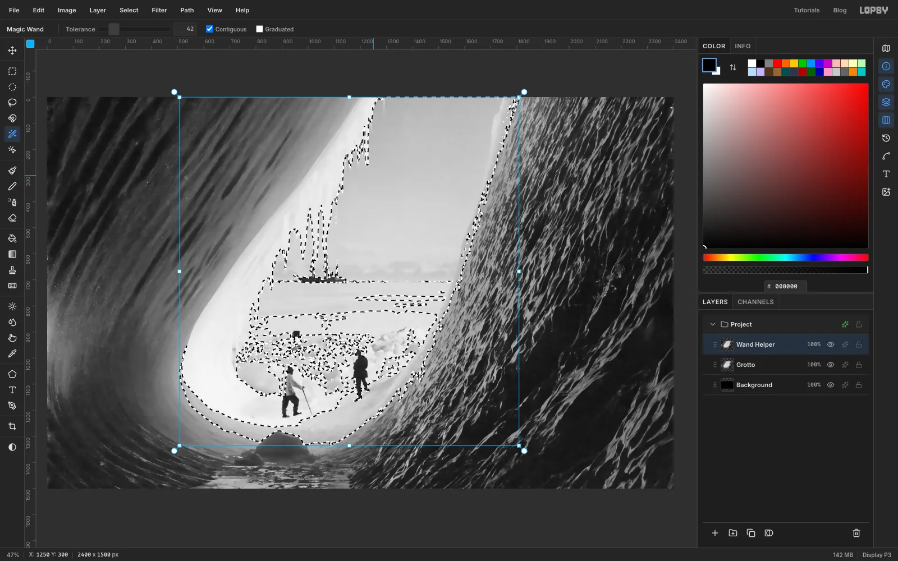

We're going to replace the sky and the far ice with a jungle and keep every icicle. The wand struggles on a 1911 photo because film grain breaks up smooth tones, so we give it a smoothed copy to read.

1. Choose **Layer → Duplicate Layer** and name the copy **Wand Helper**.
2. Run **Filter → Surface Blur…** with **Radius 10** and **Threshold 40**. The grain melts away and the icicle edges stay sharp.
3. Press [[W]] for the Magic Wand. Set **Tolerance 42**, tick **Contiguous** and untick **Graduated**.
4. Click in the middle of the grey sky.

The selection follows the icicles nicely but leaks into the snow below the horizon. We'll fix that next.

## Finish the door shape with the Lasso

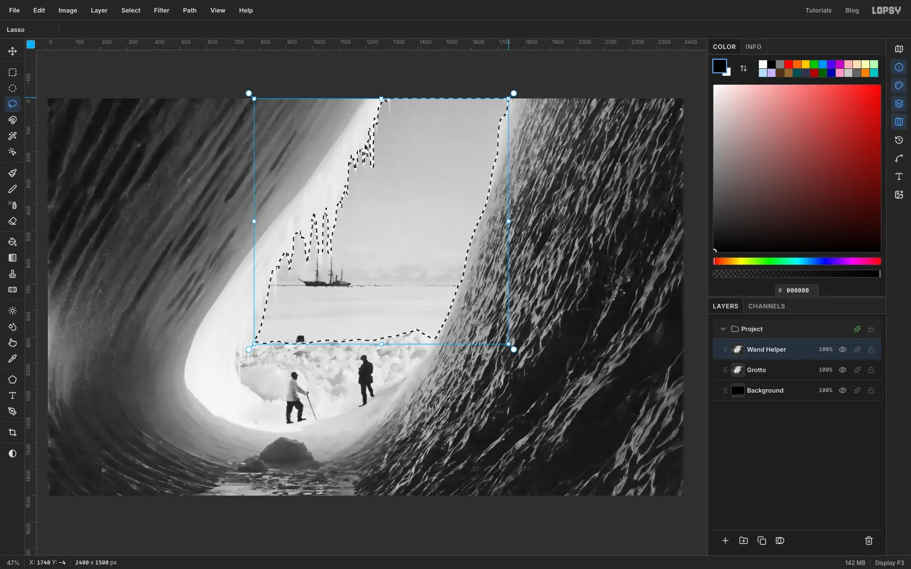

Press [[L]] for the Lasso. Hold [[Shift]] to add to a selection and [[Alt]] to subtract from it. Zoom in for this one.

1. **Add the far ice.** Hold [[Shift]] and draw around the horizon, the mountains, Ponting's ship and the flat snowfield below them. Go down as far as the top of the rubble where the men's snow begins. On the left, trace just outside the tips of the lowest icicles.
2. **Add the gap beside the right wall.** Hold [[Shift]] and fill any unselected strip of sky along the wall.
3. **Remove the leaks below.** Hold [[Alt]] and draw a big shape that follows the top of the snow rubble and then takes in everything below it, including any stray selection in the bright ice on the left.
4. **Clean the right wall.** Hold [[Alt]] again. Draw one smooth, slow line down the edge of the wall from top to bottom, then sweep out to the right across the wall and back to where you started.

Make the rubble line a little lumpy rather than straight, as real drifts are.

## Cut the door

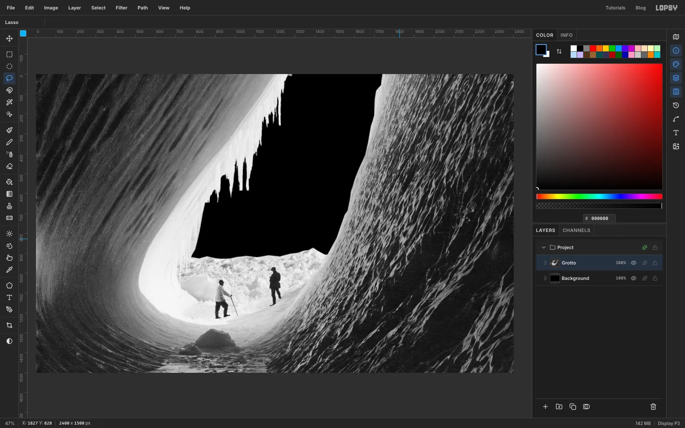

1. Choose **Select → Feather…** and enter **2**. This takes the razor edge off the cut.
2. With **Wand Helper** still active, click the trash button. The helper goes, and the selection stays.
3. Click **Grotto** and press [[Delete]], then [[Cmd+D]].

You're looking through the hole at the black Background. It's the hardest selection in the project, so save your work now with **File → Save Project**.

## Hang the jungle behind the door

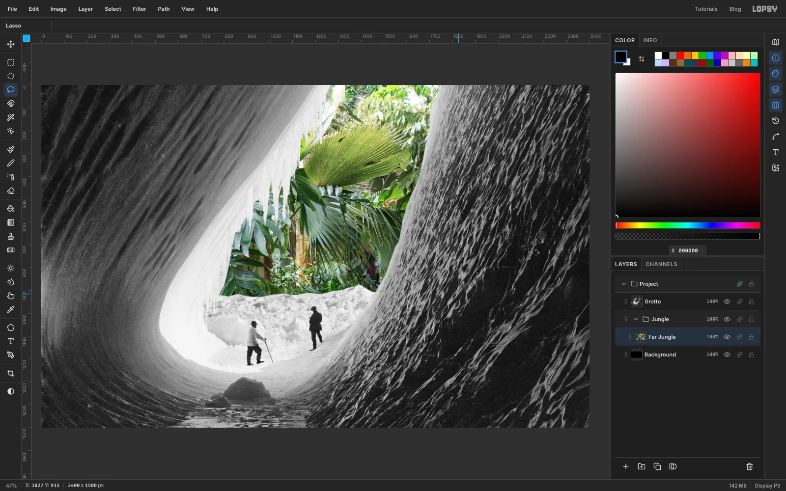

1. Click **Background**, then click the **New Group** button at the bottom of the Layers panel and name the group **Jungle**. It sits above Background and below Grotto.
2. With the group row still active, drag in the Kew photo that shows a path through the plants (DSC03555). It lands inside the group, fitted to the canvas. Press [[Cmd+D]] and name it **Far Jungle**.
3. Run **Filter → Gaussian Blur…** at **Radius 2**. This is the furthest thing in the scene, so it can be slightly soft.
4. The fan palm at the top of the door is very lime. Press [[L]] and draw loosely around the top half of the door. Choose **Select → Feather…** with **40**, then **Filter → Hue/Saturation…** with **Hue -8** and **Saturation -38**. Press [[Cmd+D]].

The path and the pram in the photo end up hidden behind the snow and the right wall, so leave the photo where it landed.

## Fill the door with light

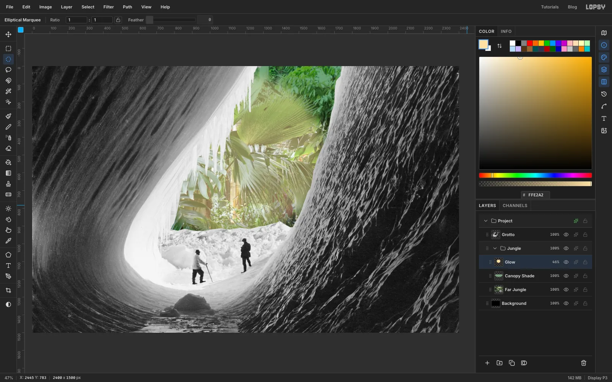

A soft ellipse does most of the lighting in this project, so here's how it works. Click the **Elliptical Marquee** in the toolbox and set **Feather** in the options bar. Then, with nothing selected, click once on the canvas. A dialog opens where you type exact corners. Press [[Enter]] and use **Edit → Fill**. Feather stays set until you change it, and the Lasso and Magic Wand use it too, so each time you finish a batch of ellipses, set it back to **0**. Feather stops getting softer at 63, so that's the value to use for the softest glows.

1. Click **Add Layer** and name it **Canopy Shade**. Set **Feather 63**, enter From **960, -130** To **1880, 350**, and fill with `#7BA57E`. Press [[Cmd+D]]. Set **Blend** to **Multiply**. The top of the door gets a little darker and greener.
2. Add a layer called **Glow**. Set **Feather 63**, enter From **620, 40** To **1640, 960**, and fill with `#FFE2A2`. Press [[Cmd+D]]. Set **Blend** to **Screen**.
3. Click the percentage on the Glow row and drop its opacity to **46%**.
4. Set **Feather** back to **0**.

The jungle now looks hazy and far away, which gives the ship something bright to stand against.

## Bring in the Endurance on Multiply

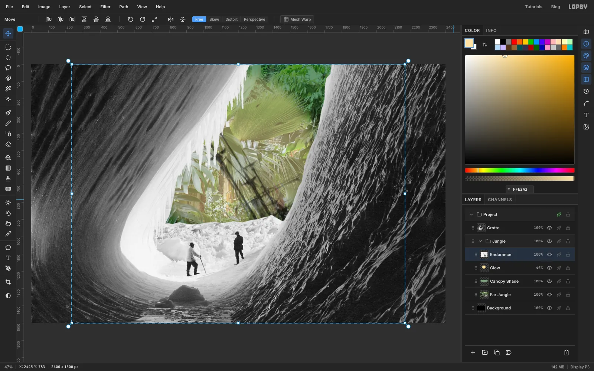

This is the most useful trick in old-school montage. Hurley photographed the ship against almost pure white ice, and on **Multiply** white disappears, which is what happens when you sandwich two negatives. There's no cutting out at all.

1. With **Glow** still active, drag in the Endurance photo and name it **Endurance**.
2. Open its effects drawer and set **Blend** to **Multiply**. Close the drawer.

The masts look too big for now, and they lean the wrong way.

## Flip the ship and scale it down

The cave's rim runs from lower left to upper right. Flipped, the masts run the same way and the two diagonals work together.

1. The dropped image's selection is still live. Choose **Image → Flip Horizontal**.
2. Hover the bottom right corner of the box until the cursor shows a resize arrow, then hold [[Cmd]] and drag inward until the box is about **58%** of its size, close to 1120 px wide.
3. Press [[Cmd+D]] to commit.

The ship may slip out of sight behind the ice as it shrinks. That's fine, because you'll move it next.

## Sink the ship into the door

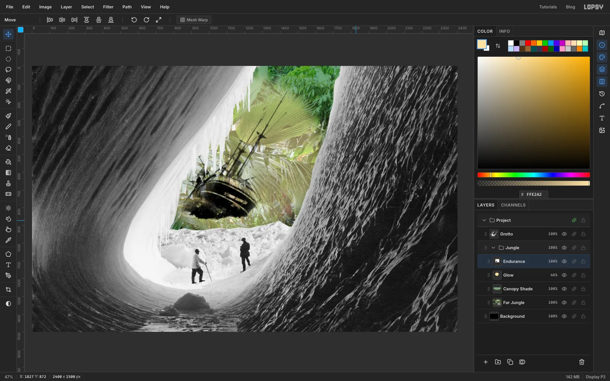

1. Press [[V]] and drag the ship until its hull sits low in the door, just above the snow line, with the bow behind the icicles and the masts rising into the clear part of the opening.
2. Run **Filter → Brightness/Contrast…** with **Contrast 45**, so the hull is dark enough to hold against the glow.

The bottom of the hull fades out where the photo's snow begins. The plants in the next step will hide that.

## Cut the plants from the greenhouse

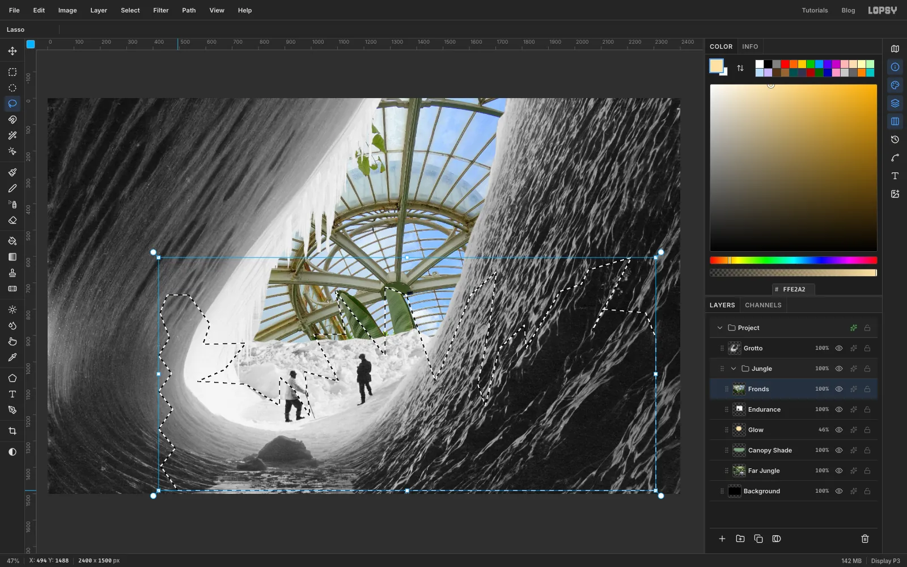

1. Click **Endurance**, drag in the other Kew photo (DSC03493) and press [[Cmd+D]]. Name it **Fronds**.
2. Press [[L]] and draw around the plants in the bottom half of the photo. Follow the tips of the big leaves and fronds and leave the glass roof out. On the left, zigzag down through the dark palm so the edge reads as frond tips, and stay to the right of the white pole.
3. Choose **Select → Inverse** and press [[Delete]], then [[Cmd+D]].
4. Press [[W]], set **Tolerance 60** and untick **Contiguous**. Click a patch of blue glass showing between the leaves, then [[Shift]]-click a white patch. Press [[Delete]] and [[Cmd+D]].

## Scale the plants down

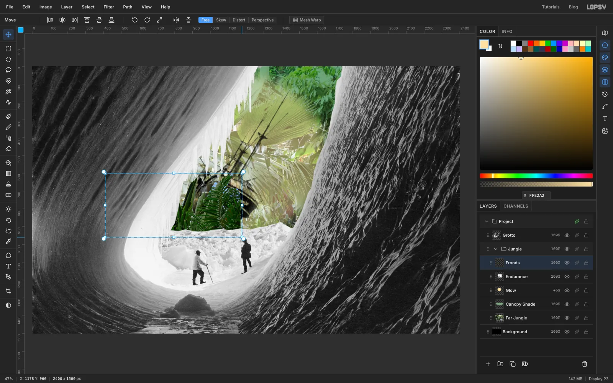

1. Press [[M]] and drag a marquee around all of the plants.
2. Press [[V]]. Hold [[Cmd]] and drag the bottom right corner in until the box is about **40%** of its size.
3. Press [[Cmd+D]].
4. Drag the plants so they sit along the base of the door to the right of centre, with their lower edge hidden behind the snow. The dark palm should overlap the right end of the hull.
5. Run **Filter → Gaussian Blur…** at **Radius 2**, so they share the same softness as the jungle behind them.

## Add a mirrored copy under the hull

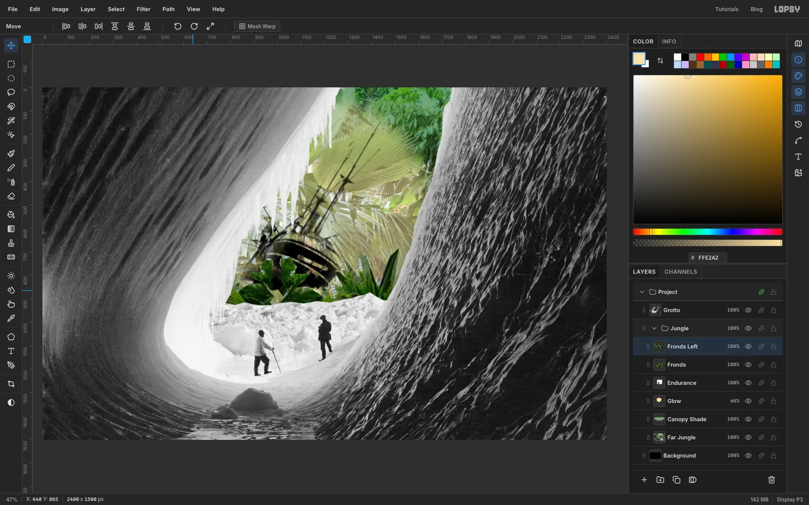

1. Choose **Layer → Duplicate Layer**, name the copy **Fronds Left** and click its row.
2. Choose **Image → Flip Horizontal**.
3. Press [[V]] and drag the copy well to the left, so its palm covers the bottom of the hull.
4. A straight mirror image is obvious, so make the copy smaller. Press [[M]], draw a marquee around the copy, press [[V]] and [[Cmd]]-drag a corner down to about **80%**. Press [[Cmd+D]].
5. Drag it so the bottom stays behind the snow. The two palms shouldn't line up.

## Put air in front of the plants

Add a layer called **Door Haze**. It stays inside the Jungle group, which is what we want. With the Elliptical Marquee at **Feather 63**, enter From **710, 650** To **1570, 950** and fill with `#FFF3D2`. Press [[Cmd+D]] and drop the layer's opacity to **30%**. Set **Feather** back to **0**.

Far things in warm air lose their black, so this haze pushes the sharp foreground plants back into the same space as the ship.

## Group the ice and cool it down

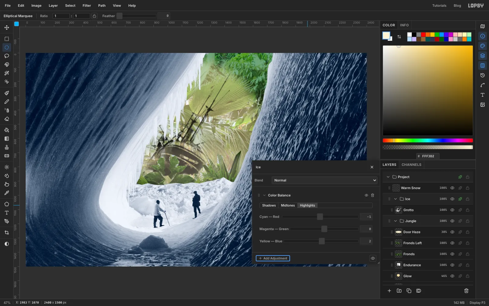

1. Click **Grotto**, click **Add Layer** and name the layer **Warm Snow**. We'll use it later. Adding it now means it sits above the group we're about to make.
2. Click **Grotto** again and choose **Layer → Group Layers**. Name the group **Ice**.
3. Click the group's effects button, then **Add Adjustment → Color Balance**.
4. Use the tabs to enter these **Cyan — Red / Magenta — Green / Yellow — Blue** values: **Shadows -9, -2, 9**. **Midtones -7, -1, 8**. **Highlights -1, 0, 2**.

Small numbers go a long way here. Close the drawer.

## Warm up the jungle and take colour out of the ice

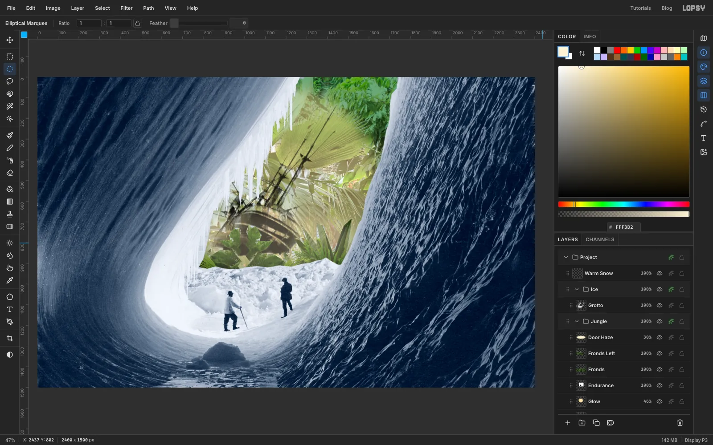

1. Open the **Jungle** group's effects drawer and choose **Add Adjustment → Hue / Saturation**. Enter **Hue -2** and **Saturation 8**. Close the drawer.
2. Open the **Ice** group's drawer and add another **Hue / Saturation** node, with **Saturation -28**. Close the drawer.

Blue that's too rich reads as water, and this picture has to read as ice.

## Calm the walls

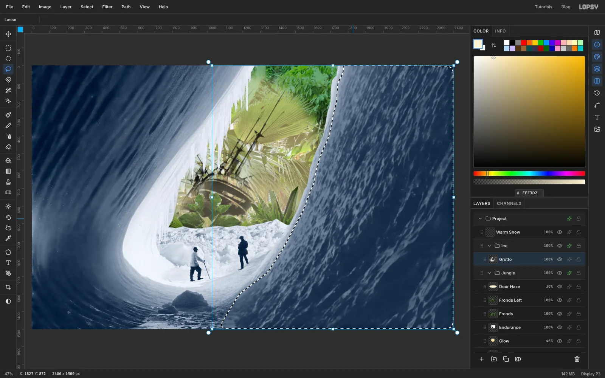

Those beautiful ripples on the right wall are a problem. Next to everything else, they look like the sea.

1. Click **Grotto**. Press [[L]] and lasso the whole right wall, staying just to the right of the door edge and well clear of the snow.
2. Hold [[Shift]] and lasso the left wall the same way, staying out of the bright rim around the door.
3. Choose **Select → Feather…** with **20**, then **Filter → Surface Blur…** with **Radius 14** and **Threshold 70**. Press [[Cmd+D]].
4. Lasso the right wall again. Choose **Select → Feather…** with **40**, then **Filter → Gaussian Blur…** at **Radius 6**, and **Filter → Brightness/Contrast…** with **Brightness -6** and **Contrast -38**.

Leave that last selection live for the next step.

## Paint streaks into the right wall

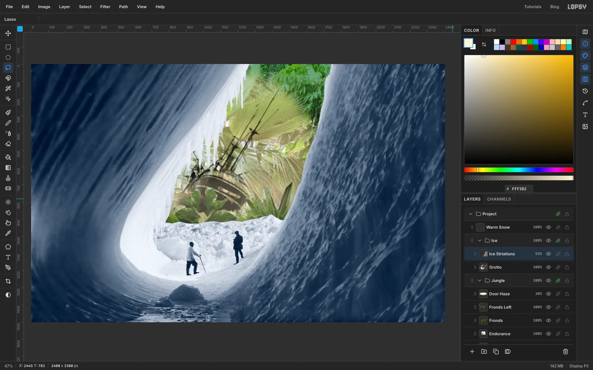

1. Click **Add Layer** and name it **Ice Striations**. It lands in the Ice group, just above Grotto.
2. With the selection still live, run **Filter → Fibers…** with **Variance 28** and **Strength 6**. Press [[Cmd+D]].
3. Run **Filter → Motion Blur…** with **Angle 75** and **Distance 60**, which turns the fibers into long streaks that follow the slope of the wall.
4. Set **Blend** to **Soft Light** and opacity to **55%**.

## Warm the snow

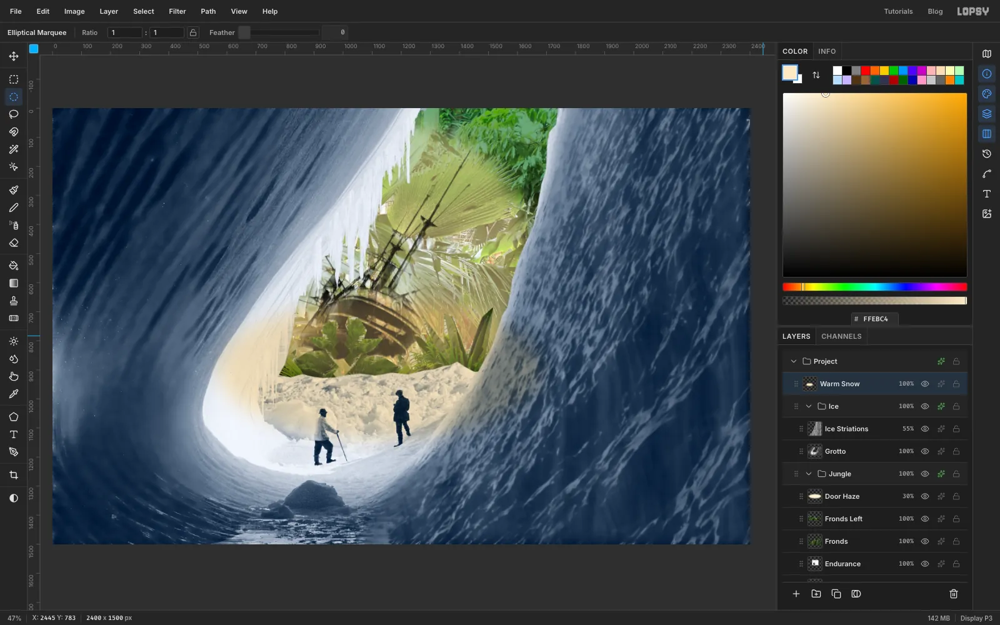

Click **Warm Snow**, the layer we made earlier. With the Elliptical Marquee at **Feather 63**, enter From **570, 660** To **1690, 1140** and fill with `#FFEBC4`. Press [[Cmd+D]], set **Blend** to **Multiply** and set **Feather** back to **0**.

Now the door looks like a light source for the first time. Keep this colour pale. A stronger one turns the snow into a beach.

## Break the walls into planes of ice

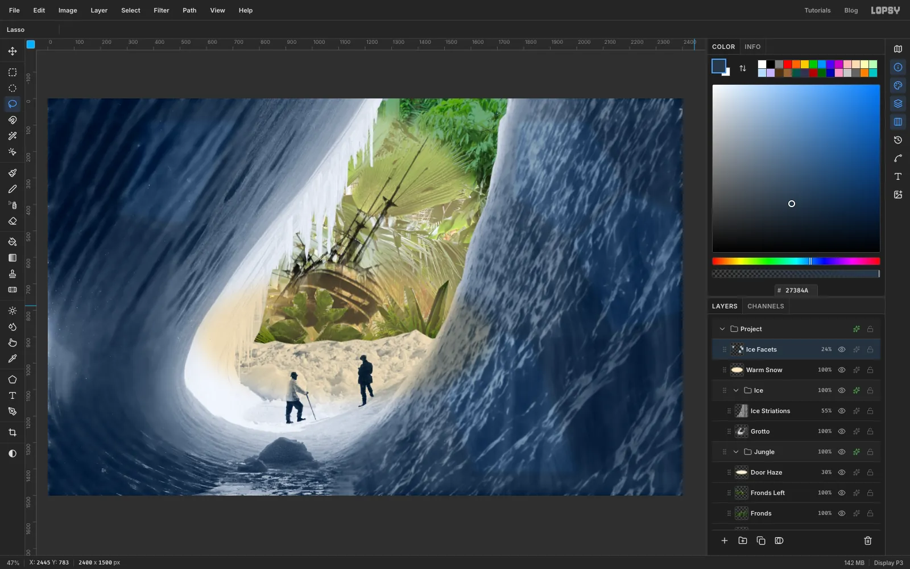

1. Add a layer called **Ice Facets**.
2. With the Lasso, draw a big angular shape on a wall, about 200 to 500 px across, with straight sides. **Select → Feather…** with **14**, fill it, and press [[Cmd+D]].
3. Repeat for about eight shapes, four or five on the right wall and three on the left, placed edge to edge. Alternate the fill between pale `#C4D8E6` and deep `#27384A`. Keep them away from the door and the bright rim.
4. Set **Blend** to **Overlay** and the opacity to **24%**.

## Add a few cracks

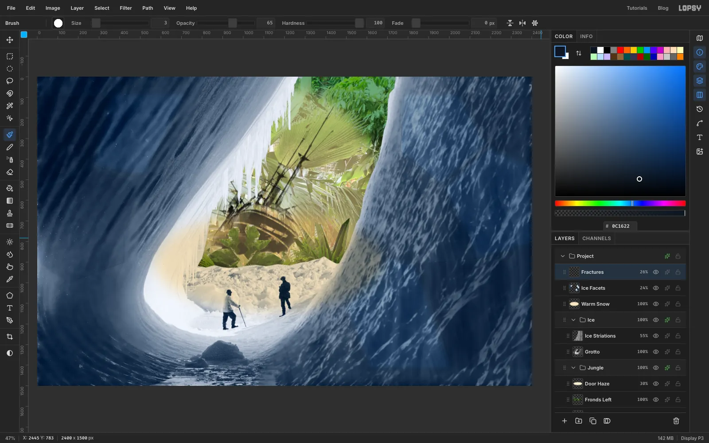

1. Add a layer called **Fractures** and press [[B]] for the Brush.
2. Open the **Brushes** panel from the options bar. On the Shape tab, set **Size 3**, **Hardness 100**, **Opacity 65** and **Spacing 10**, then close the panel.
3. Set the foreground to `#0C1622`. Click where a crack starts, then hold [[Shift]] and click each point along it to draw straight runs.
4. Make about nine short cracks along some of the facet edges. Don't close any shapes, since a closed outline looks like a window pane rather than a fracture.
5. Set **Blend** to **Multiply** and the opacity to **26%**.

## Let the cave fall into darkness

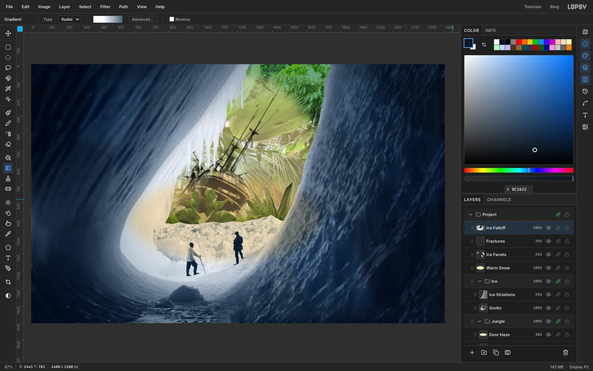

1. Hold [[Cmd]] and click the **Grotto** thumbnail to load its shape as a selection. This keeps the next step off the door.
2. Click **Fractures** and add a layer called **Ice Falloff**.
3. Pick the **Gradient** tool and set **Type** to **Radial**. Click **Advanced…**. Set the left stop to white `#FFFFFF` and the right stop to `#4C6277` by selecting each and typing in the **Hex** field. Then click an empty spot on the handle row about a third of the way along to add a stop, and make that one white too. Click **Done**.
4. Drag from the middle of the snow at the door's base out to the right, nearly to the edge of the canvas.
5. Press [[Cmd+D]] and set **Blend** to **Multiply**.

Now the light has a direction, and the white wedge of ice at the top left falls off instead of looking like a blank sky.

## Let the door light catch the wet ice

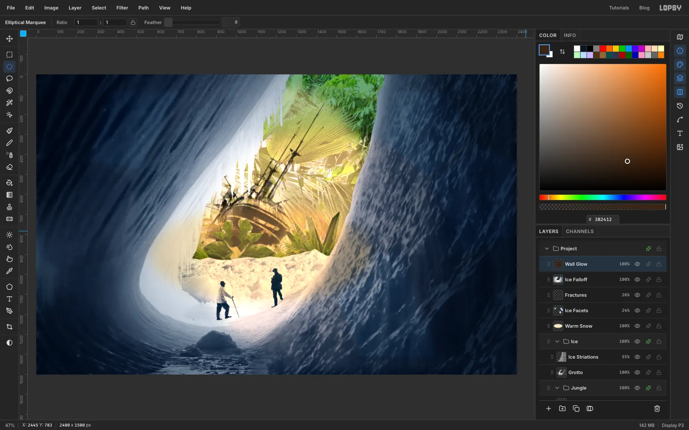

Add a layer called **Wall Glow**. With the Elliptical Marquee at **Feather 63**, enter From **800, 240** To **2040, 1480** and fill with the dark brown `#3B2412`. Press [[Cmd+D]], set **Blend** to **Color Dodge** and set **Feather** back to **0**.

Color Dodge with a dark colour only lifts the bright pixels, so the highlights on the wall pick up the warm light and the shadows between them stay cold.

## Warm the two men

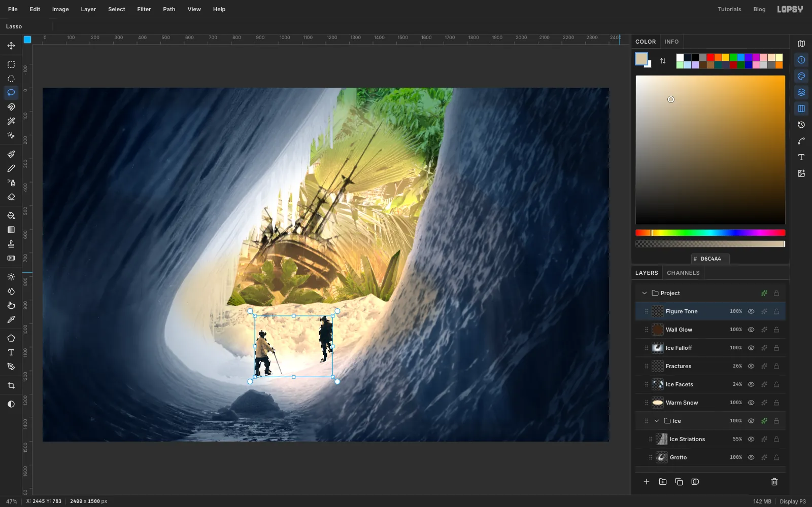

The Ice group's blue also tinted Ponting's two men, which is wrong for people standing in warm light.

1. Add a layer called **Figure Tone**.
2. Zoom in. With the Lasso, trace closely around the man on the left, leaving out his stick. Hold [[Shift]] and trace the man on the right.
3. Choose **Select → Feather…** with **1**, set the foreground to `#D6C4A4` and choose **Edit → Fill**.
4. Set **Blend** to **Multiply**.

Keep the selection live.

## Lift their blacks and add a rim

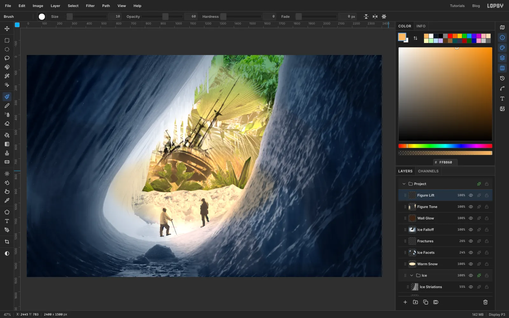

Pure black silhouettes look stuck on, so we'll lift them to a dark brown.

1. Add a layer called **Figure Lift** and fill the live selection with `#4A3420`.
2. Press [[B]]. In the options bar, set **Size 10**, **Hardness 0** and **Opacity 60**. Set the foreground to `#FFB860`.
3. Still inside the selection, stroke once down each man's shoulder and arm on the side toward the door.
4. Press [[Cmd+D]] and set **Blend** to **Screen**.

## Throw their shadows toward us

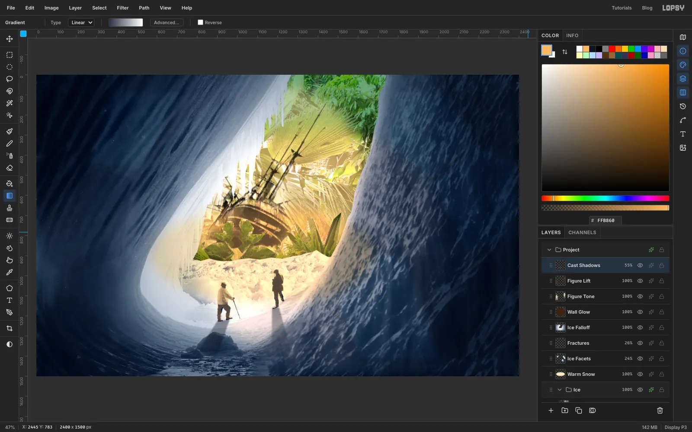

The light is behind the men, so their shadows should fall toward the viewer and fan out slightly from the door.

1. Add a layer called **Cast Shadows**.
2. Press [[L]] and draw a long wedge from the left man's feet, down and slightly to the left, about 220 px long and widening as it goes.
3. Pick the **Gradient** tool and set **Type** to **Linear**. In **Advanced…**, select the middle stop from last time and delete it, then set the two ends to `#2A3040` and white. Drag from his feet to the far end of the wedge.
4. Draw a matching wedge from the right man's feet, going almost straight down, and drag the gradient along it the same way.
5. Press [[Cmd+D]], run **Filter → Gaussian Blur…** at **Radius 9**, set **Blend** to **Multiply** and set the opacity to **55%**.

## Glow around the door

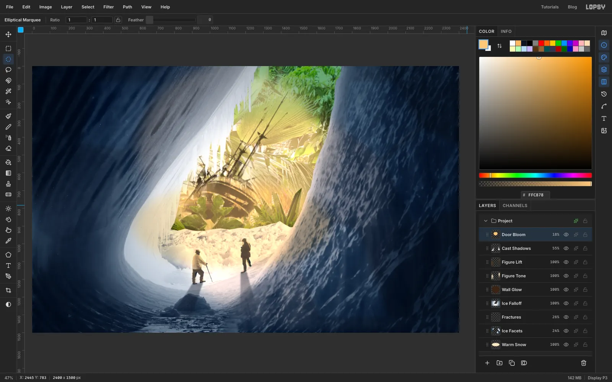

Add a layer called **Door Bloom**. With the Elliptical Marquee at **Feather 63**, enter From **600, -20** To **1720, 980** and fill with `#FFC878`. Press [[Cmd+D]], set **Blend** to **Screen** and set opacity to **18%**.

## Cool the foreground floor

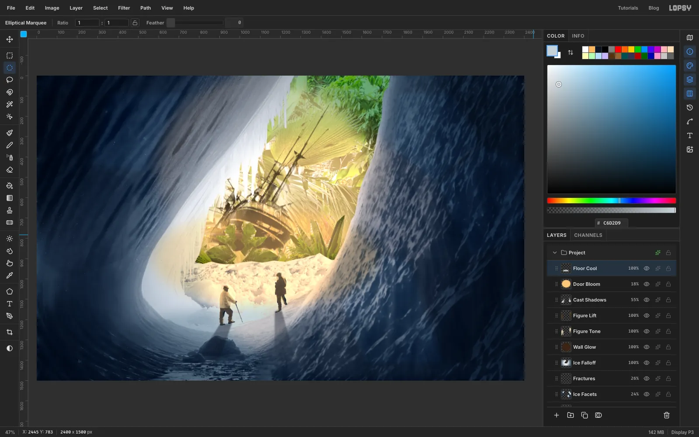

Warm light should die out before it reaches the camera. Add a layer called **Floor Cool**. With the Elliptical Marquee at **Feather 63**, enter From **380, 1130** To **1820, 1590** and fill with `#C6D2D9`. Press [[Cmd+D]] and set **Blend** to **Multiply**.

## Raise some mist off the snow line

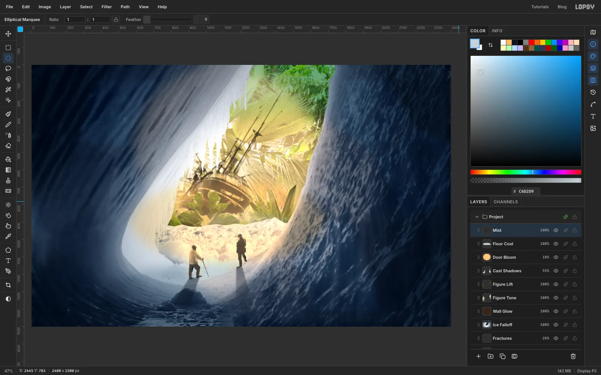

This is where warm air meets cold ice, and it hides the join.

1. Add a layer called **Mist**.
2. With the Elliptical Marquee at **Feather 60**, enter From **720, 830** To **1500, 1000**.
3. Run **Filter → Smoke…** with **Scale 5** and **Turbulence 45**. The smoke is different every time, so click the circular-arrow **Regenerate** button in the dialog if a thick patch lands on the hull.
4. Press [[Cmd+D]] and set **Blend** to **Screen**.
5. Set the marquee's **Feather** back to **0**.

## Cut out the polar bear

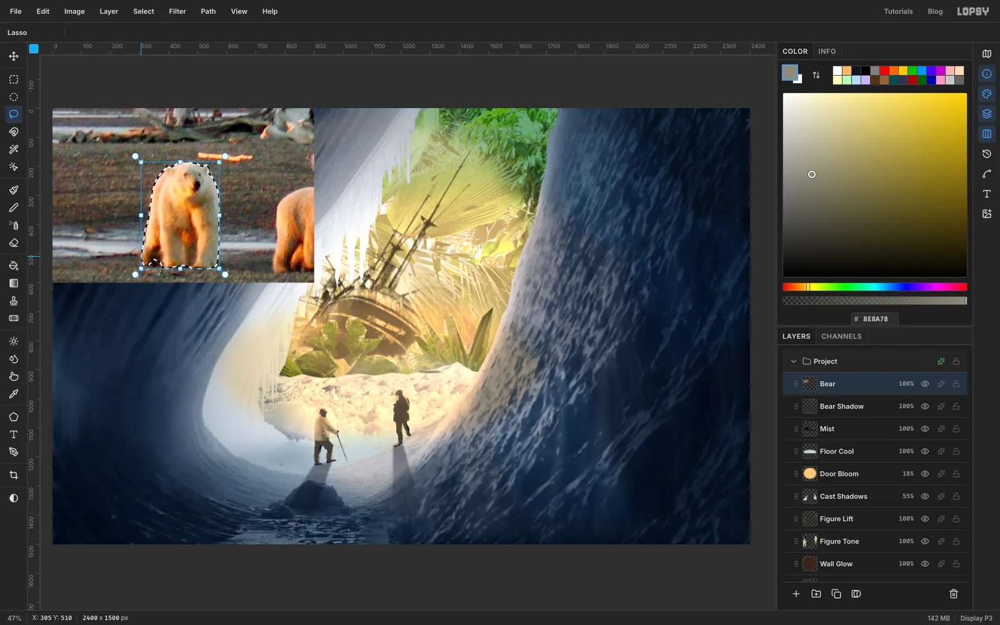

1. Drag in your bear crop and press [[Cmd+D]]. Name it **Bear**. It lands at the top left of the canvas.
2. Press [[L]] and trace around the bear. Its fur is soft, so stay just inside the edge, and follow the feet closely.

## Put the bear in the distance

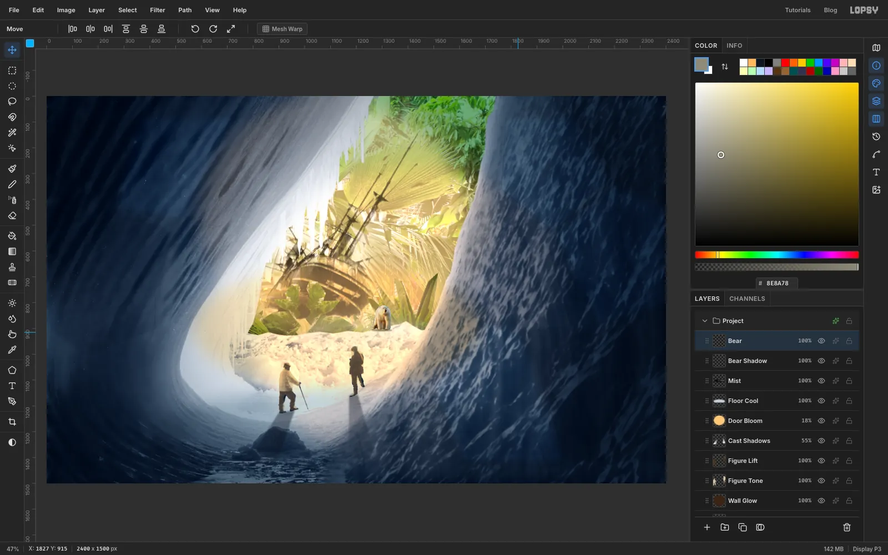

1. Choose **Select → Inverse**, press [[Delete]], then [[Cmd+D]].
2. Press [[M]] and draw a marquee around the bear. Press [[V]], hold [[Cmd]] and drag a corner in until it's about **26%** of its size. It should be about 100 px tall, shorter than the men, because it's further away.
3. Press [[Cmd+D]], then drag the bear to the crest of the snow, right of the men. The dark plants behind it make the white fur stand out.
4. Run **Filter → Hue/Saturation…** with **Hue 6**, **Saturation -30** and **Lightness 2**. The sunset in the original is far too orange for this light.
5. Now a contact shadow. Click **Mist** and add a layer called **Bear Shadow**, which lands just under the bear. Zoom in, set the Elliptical Marquee to **Feather 4** and drag a very thin ellipse under the feet, a little wider than the bear. Fill with `#8E8A78`, press [[Cmd+D]] and set **Blend** to **Multiply**. Set **Feather** back to **0**.

## Settle a low fog on the crest

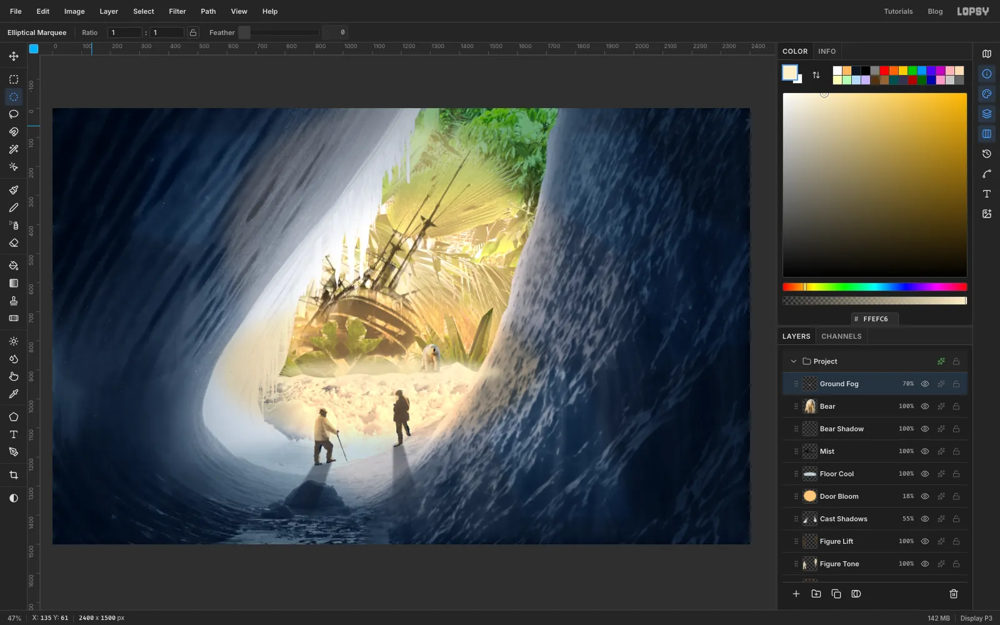

Click **Bear** and add a layer called **Ground Fog**. With the Elliptical Marquee at **Feather 30**, enter From **770, 868** To **1550, 948** and fill with `#FFEFC6`. Press [[Cmd+D]] and drop the opacity to **70%**. Then set **Feather** back to **0**.

The fog blurs the hard snow line and sits over the bear's feet, which helps ground it.

## Cut out the macaw

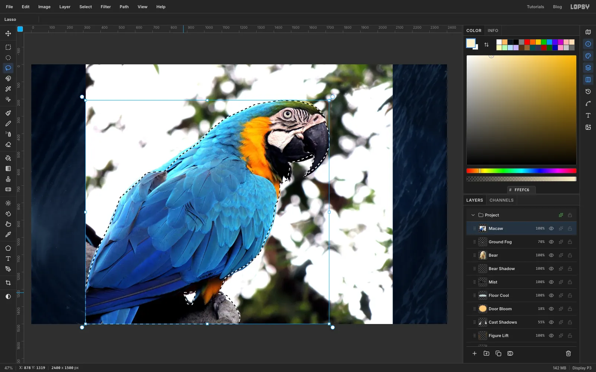

1. Drag in the macaw photo and press [[Cmd+D]]. Name it **Macaw**.
2. Press [[L]] and trace the bird, including the rock it's sitting on. Take care around the hooked beak, and go inside the bright sky showing between the hook and the lower beak.
3. Hold [[Alt]] and lasso out the small patch of sky between the legs and the tail.
4. Choose **Select → Inverse**, press [[Delete]], then [[Cmd+D]].

## Flip and shrink the macaw

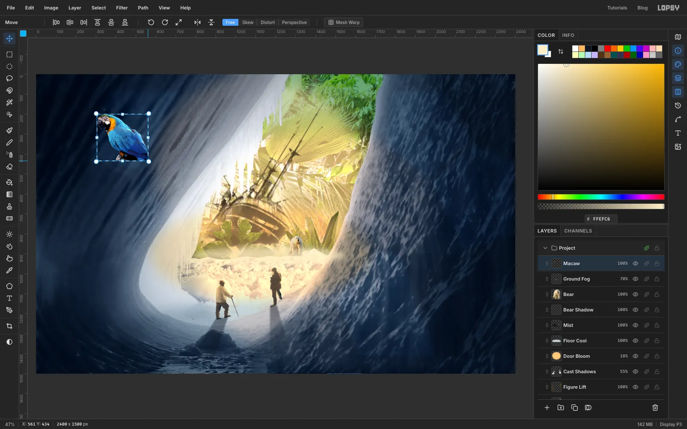

Like the flower later, the macaw is an accent, and if it's big it takes over the frame.

1. Choose **Image → Flip Horizontal**, so the bird looks toward the door.
2. Press [[M]] and draw a marquee around the whole bird and rock. Press [[V]], hold [[Cmd]] and drag the bottom right corner in until it's about **18%** of its size, or roughly 250 px wide.
3. Press [[Cmd+D]].

## Perch the macaw on the door's edge

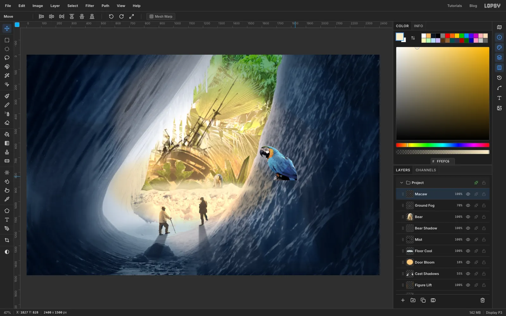

1. Press [[V]] and drag the bird onto the right wall, close to the edge of the door, so its head is level with the top of the ship's hull and its beak almost touches the opening.
2. Run **Filter → Hue/Saturation…** with **Saturation -30**. It's still the most colourful thing in the cold part of the frame.
3. Run **Filter → Gaussian Blur…** at **Radius 2**. Modern digital photos are far sharper than 1911 glass plates, and that gives them away.

## Light the macaw from the door

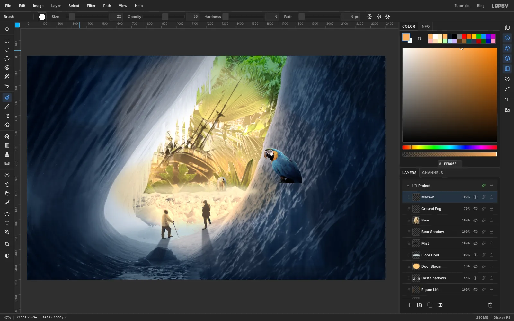

1. Hold [[Cmd]] and click the **Macaw** thumbnail to select the bird.
2. Add a layer. Pick the **Gradient** tool, set **Type** to **Linear** and set stops of white and `#1A2A3A`. Drag from the bird's chest toward its tail. Set **Blend** to **Multiply**, then choose **Layer → Merge Down**. The bird's far side now falls into shadow.
3. Add another layer. Press [[B]]. In the options bar set **Size 22**, **Hardness 0** and **Opacity 55**, and set the foreground to `#FFB060`. With the selection still live, stroke down the beak and chest on the door side.
4. Set **Blend** to **Screen**, then **Merge Down** again. Press [[Cmd+D]].

## Fade the tail and rock with a mask

The tail was cropped in the original photo, so it has a straight cut end. The rock has one too. We'll hide both in shadow.

1. Click **Add Mask** at the bottom of the Layers panel. Then click the white thumbnail on the **Mask** row that appears under the layer, which starts mask editing.
2. Pick the **Gradient** tool, keep **Linear**, and set stops of white and black. Drag a short distance across the back half of the bird, ending just before the cut end of the tail.
3. Press [[B]], set **Size 16**, **Hardness 0** and **Opacity 100**, and paint a short stroke along the bottom of the rock. In a mask, the Brush always hides, whatever the foreground color.
4. Click the layer's row to leave mask editing.
5. Open the effects drawer and turn on **Drop Shadow** with **Offset X 8**, **Offset Y 10**, **Blur 14**, **Opacity 65** and color `#050B14`. Close the drawer. The shadow follows the mask.

## Cut out the flower

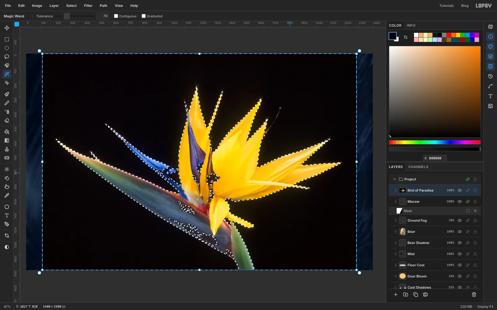

This photo is the easy one, because it was shot on black.

1. Drag in the flower and press [[Cmd+D]]. Name it **Bird of Paradise**.
2. Press [[W]], set **Tolerance 70** and leave **Contiguous** unticked. Click the black.
3. Choose **Select → Grow…** with **3** to catch the dark fringe, then **Select → Feather…** with **1**. Press [[Delete]].
4. Press [[L]] and lasso the thin bright-blue petal on the left, leaving the long grey-green spathe below it. Press [[Delete]] and [[Cmd+D]]. That hard blue pulls the eye off the edge of the frame.

## Scale the flower down

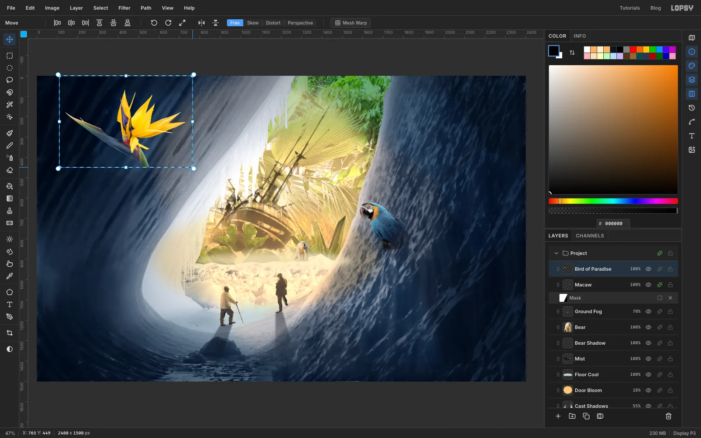

Press [[M]], draw a marquee around the flower, press [[V]], hold [[Cmd]] and drag the bottom right corner in to about **30%**. Press [[Cmd+D]].

## Make the flower a blurred foreground

A soft dark shape in the corner sets the viewer inside the cave, looking past something. Painters call this a *repoussoir*.

1. Press [[V]] and drag the flower into the bottom left corner, far enough that the frame clips it and the stem runs off the bottom.
2. Run **Filter → Hue/Saturation…** with **Hue -4**, **Saturation -36** and **Lightness -26**.
3. Run **Filter → Gaussian Blur…** at **Radius 12**.

## Paint amber onto the lips of the ice

1. Click **Floor Cool** and add a layer called **Amber Spill**. It sits under the bear, the macaw and the flower, so it only touches the cave.
2. Press [[B]] and set **Hardness 0**. Set the foreground to `#FFB860`.
3. With **Size 130** and **Opacity 45**, stroke down the lower half of the right wall, just inside its edge.
4. With **Size 26** and **Opacity 40**, stroke along the top of the rock in the foreground.
5. With **Size 110** and **Opacity 16**, stroke once up the inside of the bright curve on the left.
6. Set **Blend** to **Overlay**.

## Dissolve the door edge in light

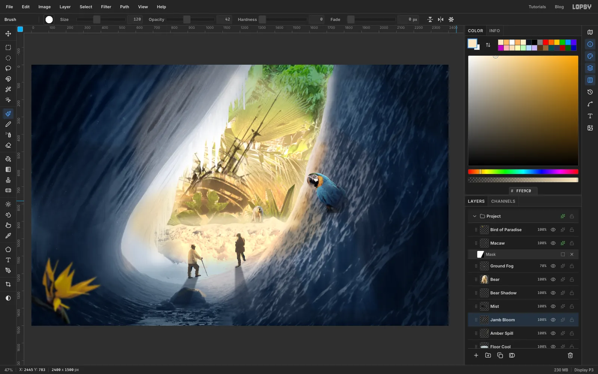

This is the step that makes the montage work. Strong light wraps around edges, so a bloom along the join hides the cut.

1. Add a layer called **Jamb Bloom**.
2. Set the foreground to `#FFE9C0`, with **Size 150**, **Hardness 0** and **Opacity 42**. Stroke once down the whole curtain of icicles, from the top of the frame to the bottom of the bright curve.
3. With **Size 120**, stroke once down the door's right edge.
4. Set **Blend** to **Screen**.

## Add one grain over everything

Seven photos taken a century apart won't look like one print until they share a grain.

1. Click **Bird of Paradise** and add a layer called **Grain**. Set the foreground to `#808080`, check that nothing is selected and choose **Edit → Fill**.
2. Run **Filter → Add Noise…** with **Amount 18** and **Mono**.
3. Set **Blend** to **Overlay** and opacity to **55%**.

## Add the letterbox and the slate

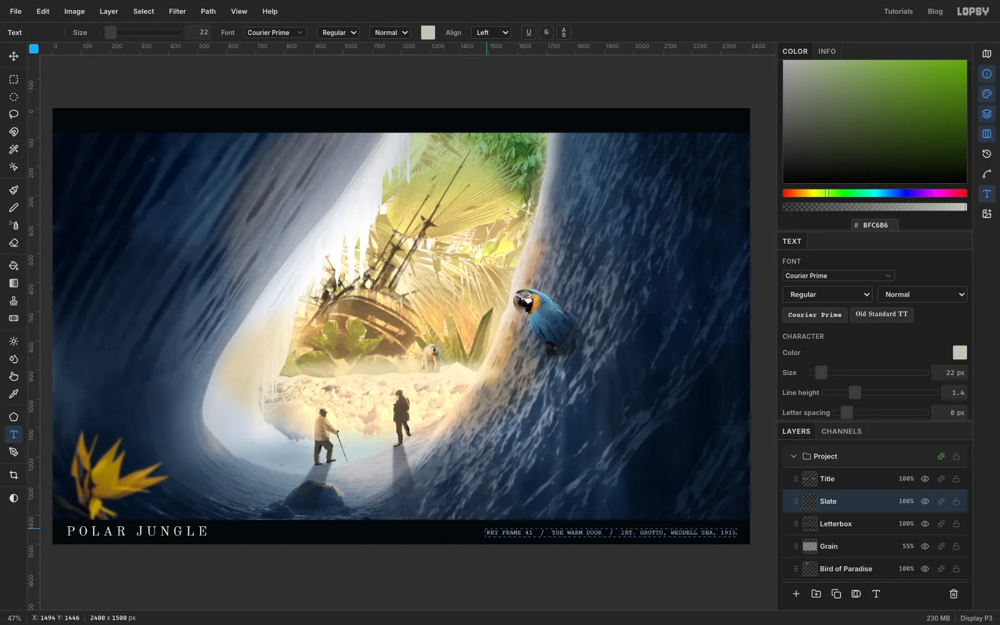

1. Add a layer called **Letterbox**. Press [[M]], check **Feather** is **0** and click once on the canvas. Enter From **0, 0** To **2400, 84**. Set the foreground to `#04070B` and choose **Edit → Fill**. Press [[Cmd+D]] and do the same for From **0, 1416** To **2400, 1500**. Press [[Cmd+D]].
2. Press [[T]]. In the options bar set the font to **Old Standard TT**, **Size 44** and the color to `#F4EEDC`. Click in the bottom bar, 48 px from the left edge. Type **POLAR JUNGLE** and press [[Tab]]. Name the layer **Title**. Open the **Text** panel from the panel buttons on the right edge if it isn't showing, and set **Letter spacing** to **12**.
3. Click the **Letterbox** row, so the next change doesn't restyle the title. In the options bar set **Courier Prime**, **Size 22** and color `#BFC6B6`, then set **Letter spacing** back to **0** in the Text panel.
4. Click in the bar on the right and type **KEY FRAME 41  /  THE WARM DOOR  /  INT. GROTTO, WEDDELL SEA, 1915**. Press [[Tab]] and name the layer **Slate**.
5. Press [[V]] and nudge the line with the arrow keys so it ends 48 px from the right edge and sits level with the middle of the title.

The concept art is the picture, so keep the type small and quiet.

## Grade the whole frame

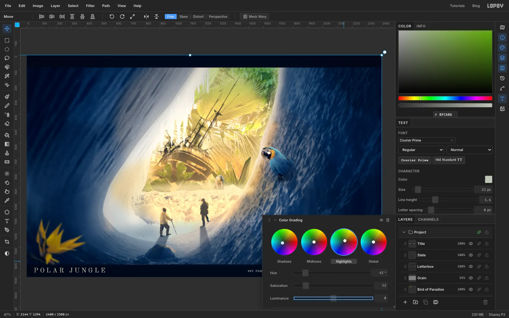

1. Click the **Project** group's effects button and choose **Add Adjustment → Vignette**. Set it to **30**.
2. Choose **Add Adjustment → Color Grading**.
3. Click the **Shadows** tab, then set **Hue 215** and **Saturation 16**.
4. Click the **Highlights** tab, then set **Hue 42** and **Saturation 12**.

Blue shadows and warm highlights across every layer are the last thing that pulls all seven photos into one picture. Close the drawer.

## Export your frame

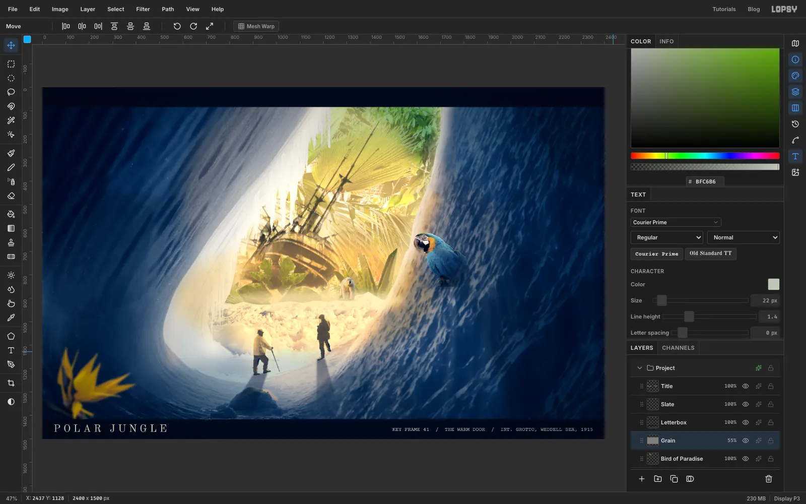

Choose **File → Save Project** to keep your layers, then **File → Quick Export PNG** for the final image.

Before you call it done, shrink the image to thumbnail size and look at it. You should see a glowing door first, then the ship, then the two men. If the macaw or the flower gets your attention before the men do, it's still too strong, so go back and take it down.
