Embroidered patches and pixel art are a natural fit. Machine embroidery
builds a picture from small blocks of thread, and a pixel sprite is already
made of blocks. In this tutorial you'll design **Llama Quest**, an iron-on
patch for a video game that never existed. A llama in an Andean saddle
blanket stands on a cliff at sunset and looks out over a lake towards a
distant castle. Three HP hearts float in the night sky, and a red ribbon
banner carries the title. The finished patch gets a gold merrowed edge, a
cross-stitch texture on every pixel and a soft shadow, and it is sewn onto
an olive canvas backpack.

All the art sits on an **8 px grid**, so one "art pixel" is an 8 × 8 square.
The main trick is a **pixel-snap stencil**. You draw any smooth shape with a
marquee, lasso or Pen. On a hidden black-and-white layer, **Pixelate** and
**Threshold** turn the shape into crisp grid squares, and the **Magic Wand**
picks those squares up again as a selection. You'll use it for the badge,
sun, clouds, mountains, the llama and the embroidered edge.

The llama is traced from a reference photo, the way a sprite artist would:
[Lama 1 by Luc Viatour](https://commons.wikimedia.org/wiki/File:Lama_1_Luc_Viatour.jpg)
(CC BY-SA 3.0), a young llama standing on a hilltop against a clear blue sky.

Along the way you'll use:

- the **grid** with Snap, ruler **guides**, and the marquee's exact-corners dialog
- **Define Pattern** and **Fill with Pattern** for dithering, cross-stitch, satin and seam textures
- **Pixelate**, **Threshold**, **Add Noise** and **Motion Blur**
- the **Magic Wand** (contiguous and not), with [[Shift]] to add and [[Shift]]+[[Alt]] to intersect
- the **Lasso** and **Elliptical Marquee**, **Select → Grow**, **Select → Inverse** and [[Cmd]]-clicking thumbnails
- the **Pencil** at 8 px for stars, faces, patterns and rim light
- the **Paint Bucket** with Contiguous off, to recolour a pattern
- a **group mask**, **New Group**, **Merge Down**, blend modes and opacity
- dropping in a photo, scaling it with the **Move** tool, copy and paste, and **Image → Flip Horizontal**
- **Text** in Jersey 15, a free pixel font, plus **Rasterize Layer**
- **Drop Shadow** and **Image → Canvas Size**

The palette:

- Night sky `#24183F` → `#44205A` → `#7A2A6A` → `#B83D6B` → `#E0645F` → `#F39A62` → `#F8C27E`
- Sun `#FFE7A8`, sun slices `#B83D6B`, stars `#FFF1D0` / `#B9A6D9`, birds `#3A1F44`
- Clouds `#9A5A9E` / `#6A3C82`
- Mountains `#6E4E93`, lit faces `#8E6BB0`, snow `#EEE0F4`, hills `#5E4488`
- Castle `#24183F`, rim `#C2557A`, flag `#C8263B`, windows `#FFE7A8`
- Lake `#3C2A62`, horizon glow `#8A4A7A`, glints `#F39A62`
- Cliff `#3B2433`, lit edge `#8A5560`, cracks `#24141F`, grass `#5C8A4F` / `#8DBF5A`
- Llama coat `#C98A4B` → `#94603A`, rim `#E3AE6E`, cream `#F2E3C6` / `#C9B293`, outline `#2A1622`
- Blanket `#C8263B`, stripes `#F2C14E`, crosses `#2A9D8F`, tassels `#E8547A`, pack `#7A4A2A` / `#4A2C18`
- Banner `#E0485A` / `#C8263B` / `#7E1530`, fold `#5A0F22`, title `#FFF1D0`
- Cream rim light `#FFF6E0`, empty heart `#4A2040`
- Merrow gold `#E2A93B`, backpack canvas `#5B6338`, seam thread `#D9C9A0`

## Make the backpack canvas

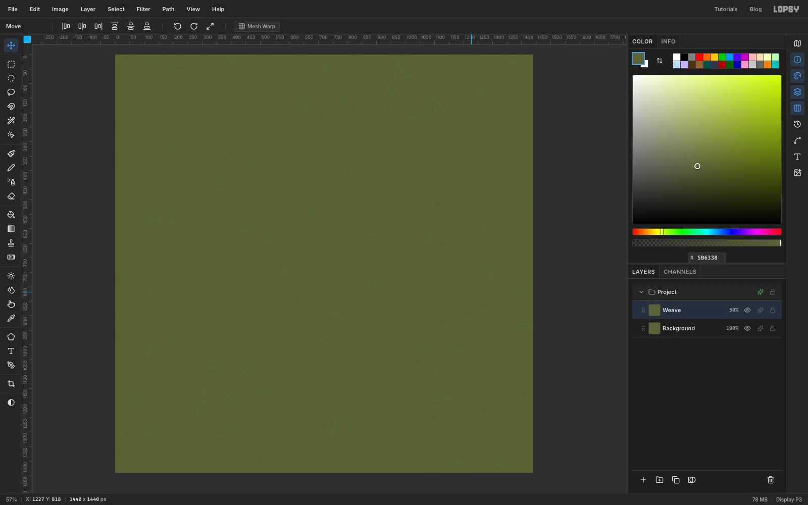

Create a new document **1440 × 1440 px**. It's taller than the patch needs.
You'll trim it at the end, once the patch is finished and you can see
where it sits.

Select the **Background** layer, set the foreground colour to `#5B6338`
and choose **Edit → Fill**. Run **Filter → Add Noise…** with **Amount 30**
and **Mode** set to **Mono**, then **Filter → Motion Blur…** with **Angle
0** and **Distance 10**. The noise stretches into horizontal threads.

Select **Layer 1**, double-click its name and rename it **Weave**. Fill it
with the same olive, add the same noise, and run Motion Blur with **Angle
90** this time. Set the layer's opacity to **50%**. The two sets of streaks
cross like a woven canvas.

## Turn on an 8 px grid and add guides

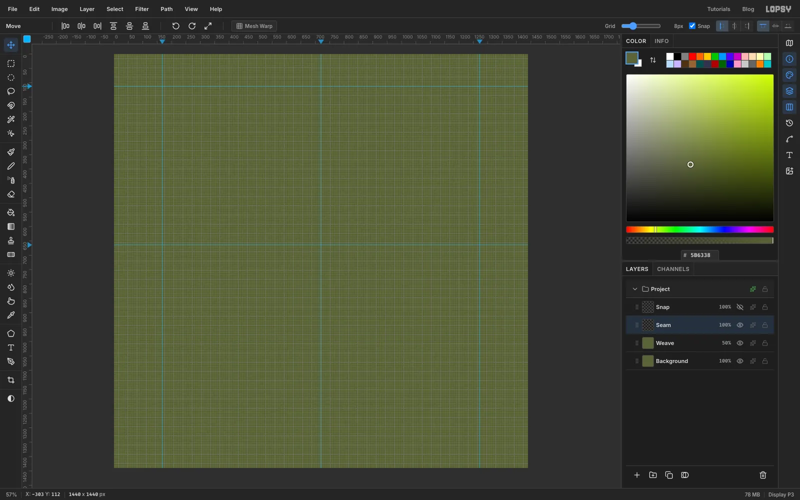

Choose **View → Show Grid**. Drag the **Grid** slider at the right of the
options bar to **8px** and make sure **Snap** is ticked. With snapping on,
marquees land on grid lines.

The badge will be a circle centred at **720, 664** with a radius of
**552 px**. Click the top ruler at **720**, **168** and **1272** to drop
three vertical guides, and the left ruler at **664** and **112** for two
horizontal ones.

Now add two layers you'll need later. Click **Add Layer** and name it
**Snap**, then click its eye to hide it. Select **Weave** and add a layer
called **Seam**. It sits between Weave and Snap.

> **Tip:** Throughout this tutorial, "one pixel" means one 8 × 8 grid
> square. Sizes written in **px** are real document pixels.

## Draw five tiny pattern tiles

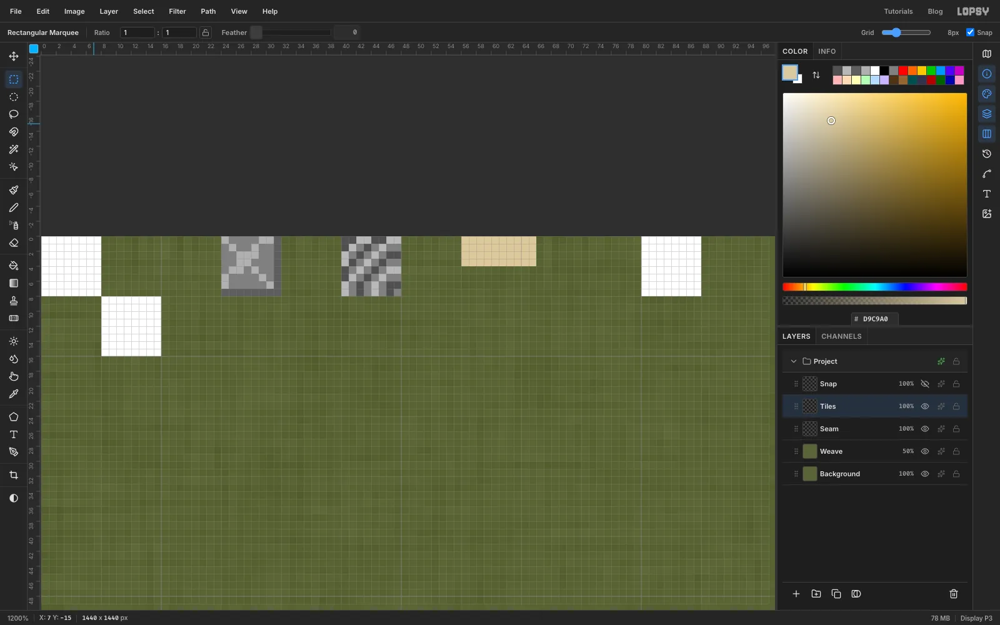

Patterns will give you the dithering, the stitch textures and the seam.
Add a layer called **Tiles** and zoom in on the top-left corner of the
canvas.

Pick the **Rectangular Marquee**. With nothing selected, a single click
opens a dialog where you type exact corners. For each square below, press
[[Cmd+D]], click once, type the corners and use **Edit → Fill**:

1. **Checker**: white squares from **0, 0** to **8, 8** and from **8, 8** to **16, 16**.
2. **Cross-stitch**: a `#808080` square from **24, 0** to **32, 8**. Switch to the **Pencil** at **1 px**. Click one corner of the square and [[Shift]]-click the opposite corner to draw a diagonal in `#B0B0B0`. Draw the other diagonal the same way. Then draw a `#5E5E5E` line down the right edge and along the bottom edge.
3. **Satin**: a `#808080` square from **40, 0** to **48, 8**. Fill it with diagonal Pencil lines running from bottom-left to top-right, alternating `#B8B8B8` and `#505050`, one pixel apart.
4. **Seam dash**: a `#D9C9A0` bar from **56, 0** to **66, 4**.
5. **Sparse dot**: a white square from **80, 0** to **88, 8**.

Now define each tile. Marquee it and choose **Edit → Define Pattern**: the
checker from **0, 0** to **16, 16**, the cross-stitch **24, 0** to **32, 8**,
the satin **40, 0** to **48, 8**, the dash **56, 0** to **72, 4** (the
empty part is the gap between stitches) and the sparse dot **80, 0** to
**96, 16**. Deselect and delete the **Tiles** layer. Patterns stay
available until you close the tab.

## Draw a smooth circle on the Snap layer

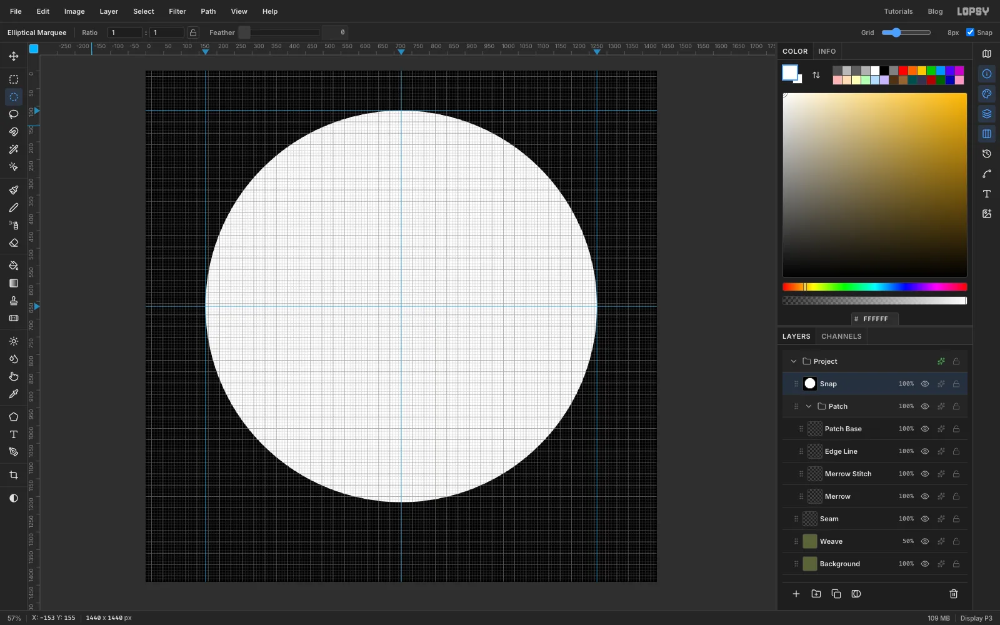

Select **Seam**, click **New Group** in the Layers panel footer and name it
**Patch**. With Patch open, click **Add Layer** four times to make
**Merrow**, **Merrow Stitch**, **Edge Line** and **Patch Base**, from bottom
to top. You'll fill them later.

Now the pixel-snap stencil. Show the **Snap** layer and select it. Set the
foreground to black and choose **Edit → Fill** with nothing selected, so
the whole layer turns black. Pick the **Elliptical Marquee**, click once and
enter **168, 112** to **1272, 1216**. Set the foreground to white and fill.
Deselect.

## Pixelate the circle

Choose **Filter → Pixelate…** and set **Block Size** to **8**. Each grid
square becomes one flat colour: white inside, black outside, and a grey
along the edge that depends on how much of the square the circle covered.

## Threshold it to hard steps

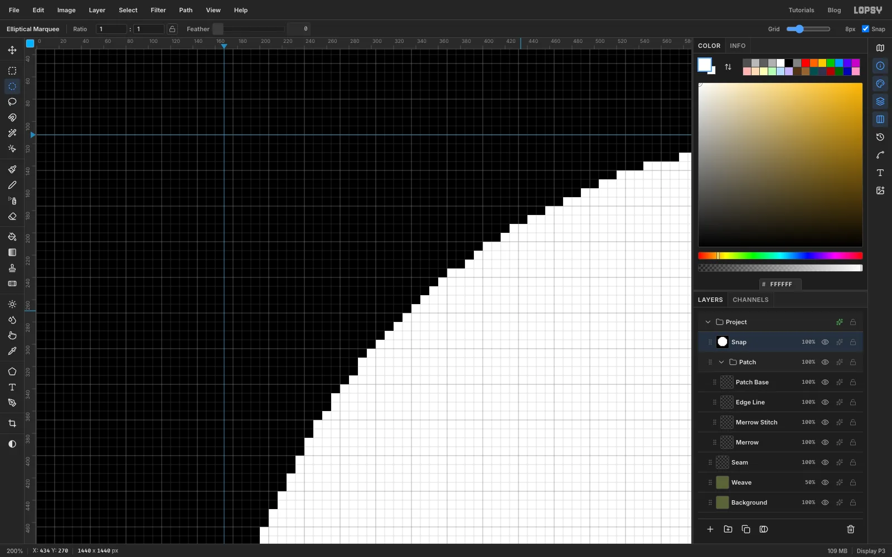

Choose **Filter → Threshold…** and leave **Level** at **128**. Squares
that were more than half white become white, and the rest become black.
The edge is now a pixel-art staircase that sits exactly on the grid.

## Wand the stencil into the badge

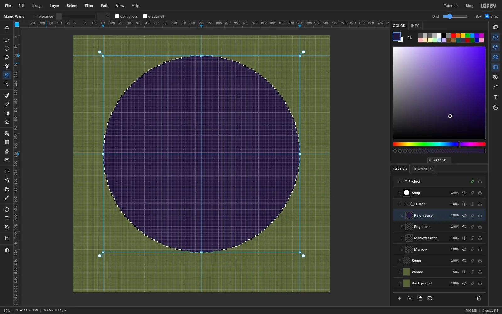

Pick the **Magic Wand**, untick **Contiguous** and set **Tolerance** to
**8**. Click inside the white circle. Hide the Snap layer again, select
**Patch Base**, set the foreground to `#24183F` and fill. Deselect.

That's the pixel-snap stencil. In the rest of this tutorial, **pixel-snap
a shape** means:

1. Deselect ([[Cmd+D]]), select **Snap** (leave it hidden) and fill the whole layer black.
2. Draw the shape with any selection tool. If you build it from another layer (a wand click or a [[Cmd]]-clicked thumbnail), select **Snap** again afterwards. Fill it white.
3. Deselect, run **Pixelate** at 8 and **Threshold** at 128.
4. Click the shape with the **Magic Wand**, **Contiguous** unticked, **Tolerance** 8.
5. Select the layer you're working on, fill, and deselect.

> **Tip:** Snap's pixels stay put while it's hidden, so you can run the
> whole routine without ever seeing it.

## Paint the sky in seven bands

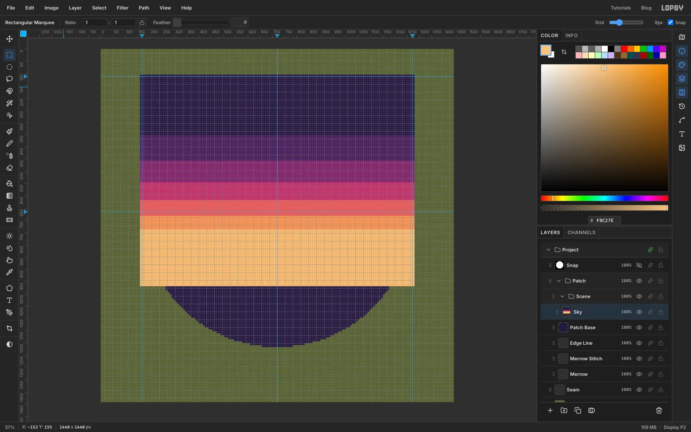

With **Patch Base** selected, click **New Group** and name it **Scene**,
then add a layer called **Sky**. Every band runs from **x 160** to **x
1280**. The edges of the badge will be trimmed later, so overshooting is
fine. Use the exact-corners dialog and fill each band:

- **104 → 352**: `#24183F`
- **352 → 456**: `#44205A`
- **456 → 544**: `#7A2A6A`
- **544 → 616**: `#B83D6B`
- **616 → 680**: `#E0645F`
- **680 → 736**: `#F39A62`
- **736 → 968**: `#F8C27E`

## Fill the band edges with a checkerboard

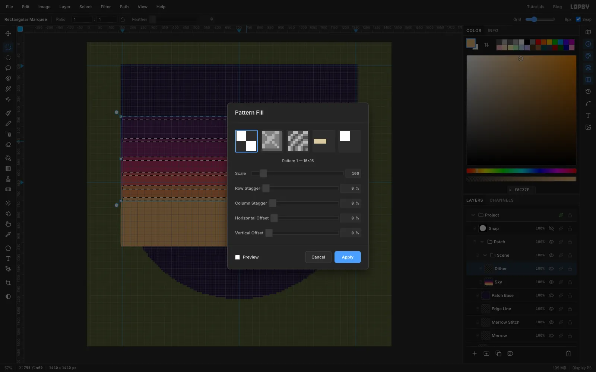

Add a layer called **Dither**. Marquee a 16 px strip along the top of each
band below the first: x **160 → 1280**, from **352 → 368**, then hold
[[Shift]] and drag the strips at **456**, **544**, **616**, **680** and
**736**. Choose **Edit → Fill with Pattern…**, pick the checker and click
**Apply**.

Repeat for the 16 px strip directly under each checker (**368 → 384**,
**472 → 488** and so on), this time with the sparse dot pattern. You now
have two rows of 50% dither and two of 25% at every band edge, all in
white.

## Recolour the dither

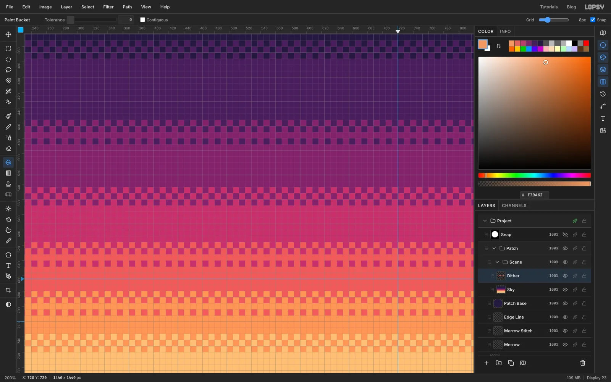

Pick the **Paint Bucket**, untick **Contiguous** and set **Tolerance** to
**0**. For each band edge, marquee the full 32 px of dither (for example
**160, 352** to **1280, 384**), set the foreground to the colour of the
band *above* it and click any white square. Only the white squares inside
the marquee change, so each band appears to melt into the next.

## Mask the scene to the disc

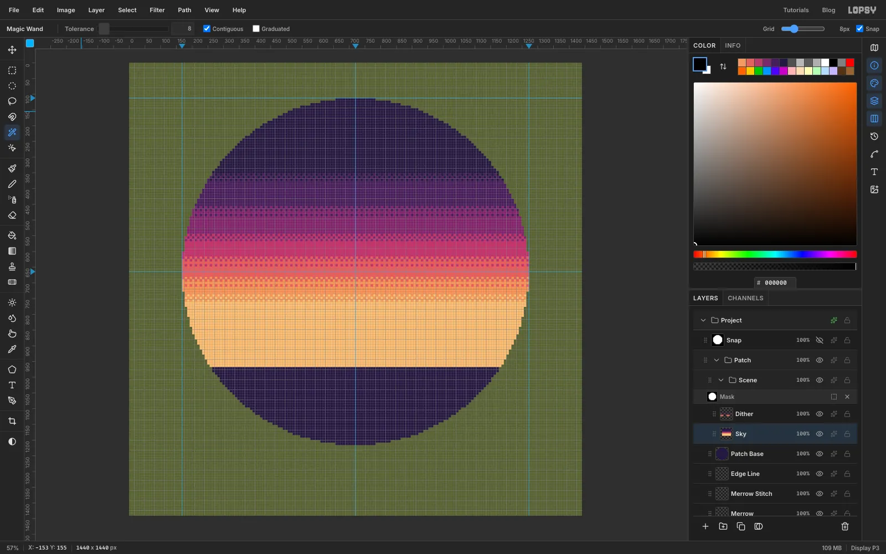

Select **Patch Base** and click the disc with the Magic Wand, this time
with **Contiguous** ticked. Select the **Scene** group and click **Add
Mask**. Choose **Select → Inverse**, click the mask thumbnail ("Edit mask
for Scene"), set the foreground to black and choose **Edit → Fill**.
Deselect. Everything you put in Scene from now on is clipped to the
badge.

## Make a sliced sunset sun

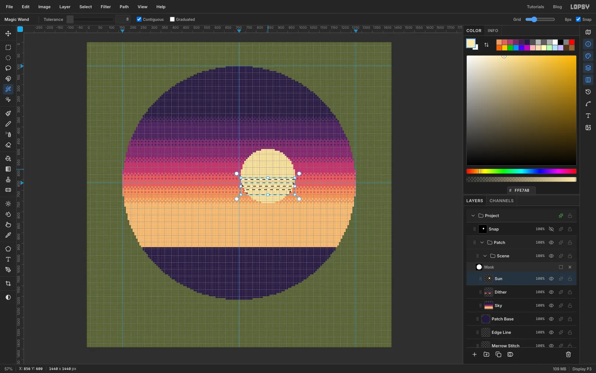

Select **Dither** and add a layer called **Sun**. Pixel-snap a circle from
**728, 504** to **984, 760** and fill it with `#FFE7A8`.

For the classic sliced look, marquee **720, 640 → 992, 648**, then hold
[[Shift]] and add **720, 664 → 992, 680** and **720, 696 → 992, 720**.
Pick the Magic Wand (Contiguous ticked) and [[Shift]]+[[Alt]]-click the
sun, so only the parts of the bands inside the disc stay selected. Fill
with raspberry `#B83D6B` and deselect. The stripes get thicker towards the
horizon, and the sun keeps a clean round edge.

## Pencil the stars and a twinkle

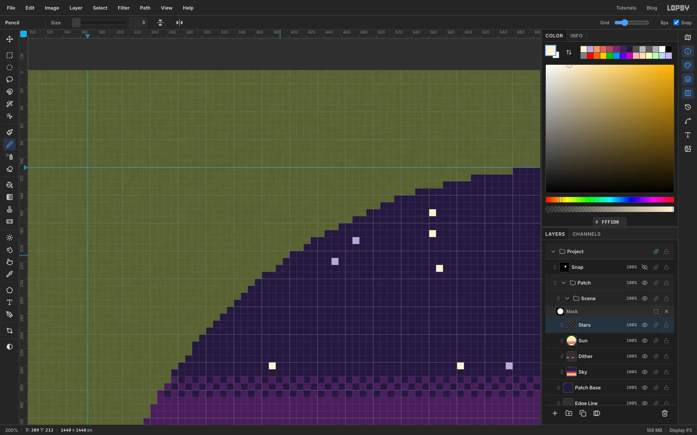

Add a layer called **Stars**. Pick the **Pencil**, set **Size** to **8**
(it's still at 1 px from the tiles) and zoom to **200%**. The 8 px Pencil
paints an 8 × 8 block centred where you click, so aim for the middle of a
grid square. At 200% that's easy to hit, and each star fills exactly one
square. Keep the Pencil at 8 px for the rest of the tutorial. Click about a
dozen stars in `#FFF1D0` across the dark top band. Keep a clear space
around the top centre, where the HP hearts will go. Add ten fainter ones in
`#B9A6D9`.

For a twinkle, click a plus shape five squares tall and five wide, centred
around **388, 196**.

## Copy the twinkle twice

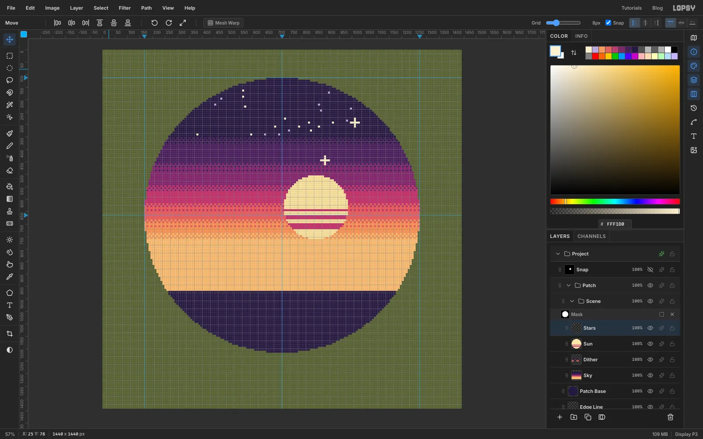

Marquee the twinkle (**368, 176 → 408, 216**) and press [[Cmd+C]], then
[[Cmd+V]]. The copy pastes in place, right on top of the original, on a
new layer. Drag it with the **Move** tool to the upper right, around
**1010, 290**, deselect and choose **Layer → Merge Down**. Press [[Cmd+V]]
again. The second copy also lands on the original. Drag it to just above
the sun, around **890, 445**, and merge it down too.

## Build a cloud from three ellipses

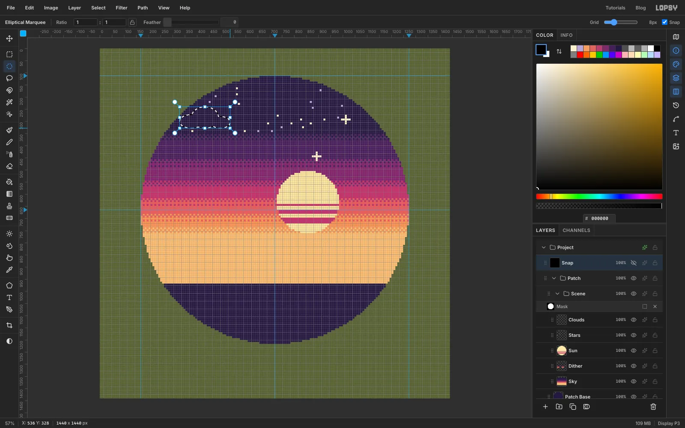

Add a layer called **Clouds** and pixel-snap a cloud. For step 2 of the
routine, draw one ellipse from **328, 272** to **424, 328**, then hold
[[Shift]] and add **376, 240 → 488, 328** and **456, 280 → 536, 328**. All
three share a flat bottom edge. Fill the snapped cloud with `#9A5A9E`.

## Shade its underside

With the **Clouds** layer selected, click the cloud with the contiguous
Magic Wand. Hold [[Shift]]+[[Alt]] and drag a rectangle over its bottom
four rows (**304, 312 → 560, 344**). Only the overlap stays selected.
Fill it with `#6A3C82`.

## Copy, flip and move the cloud

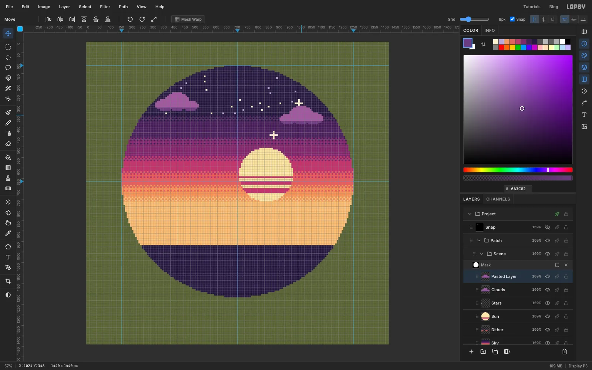

Marquee the cloud (**320, 232 → 544, 336**), copy and paste it, and
deselect. Choose **Image → Flip Horizontal**. On a layer this flips the
pasted cloud in place, so the bumps now face the other way. Drag it to the
right until its left edge sits around **x 920** and its top around **y
304**. Merge it down into Clouds.

## Lasso the far mountain range

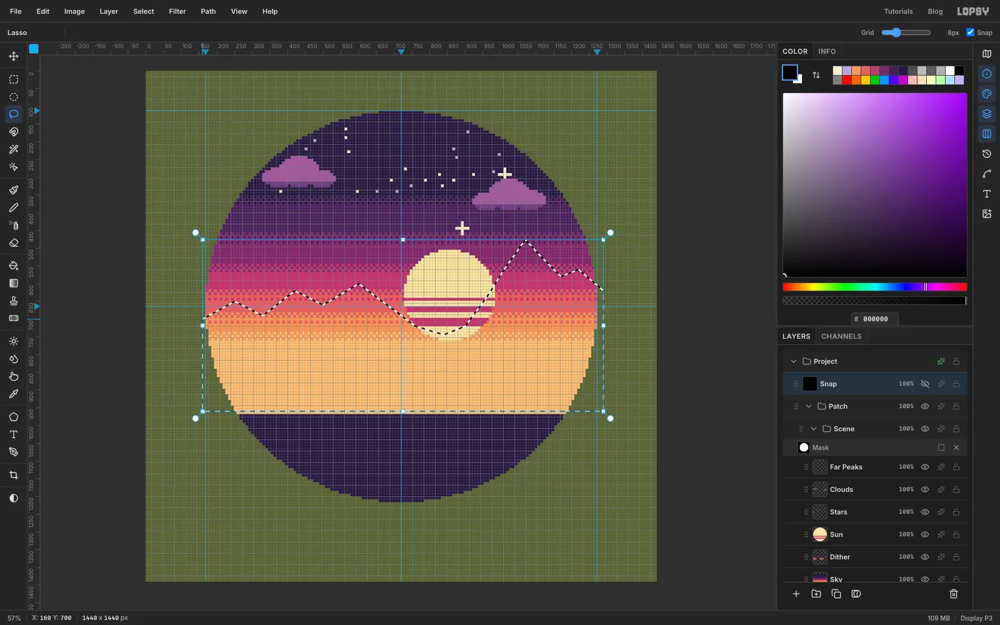

Add a layer called **Far Peaks**. Pixel-snap a mountain range drawn with
the **Lasso**. Start at the left edge of the badge around **y 700**, zig-zag
across through peaks near **600, 600** and **1070, 476**, dip into a
valley under the sun at about **840, 744**, and close the shape well below
the horizon. Pixel-snap smooths out any wobble in your hand. Fill it with
`#6E4E93`.

## Light the faces and add snow

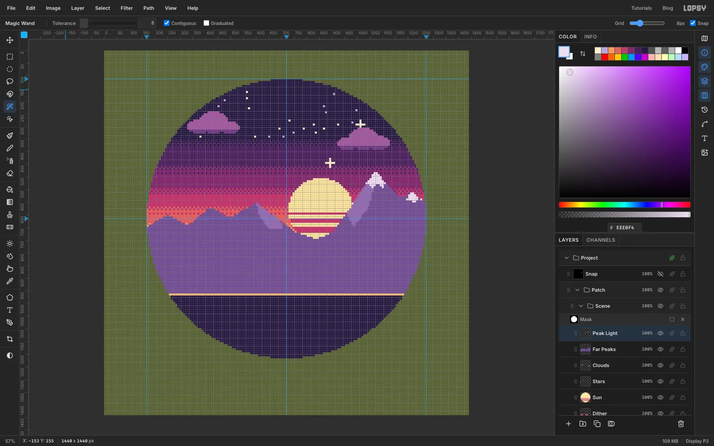

Add a layer called **Peak Light**. The sun sits between the peaks, so the
faces turned towards it catch the light: the west face of the tall right
peak and the east face of the left peak. Light them one at a time:

1. Pixel-snap a lasso over the face, a long triangle from the summit down
   the side that faces the sun. Stop before step 5 of the routine.
2. Select **Far Peaks**, tick **Contiguous** on the Magic Wand and
   [[Shift]]+[[Alt]]-click the range, so the light can't spill off the
   mountain.
3. Select **Peak Light**, fill with `#8E6BB0` and deselect.

Repeat the same three steps on **Peak Light** for two snow caps: small
zig-zag shapes over the tips of the two right-hand peaks, filled with
`#EEE0F4`.

## Build the castle from marquees

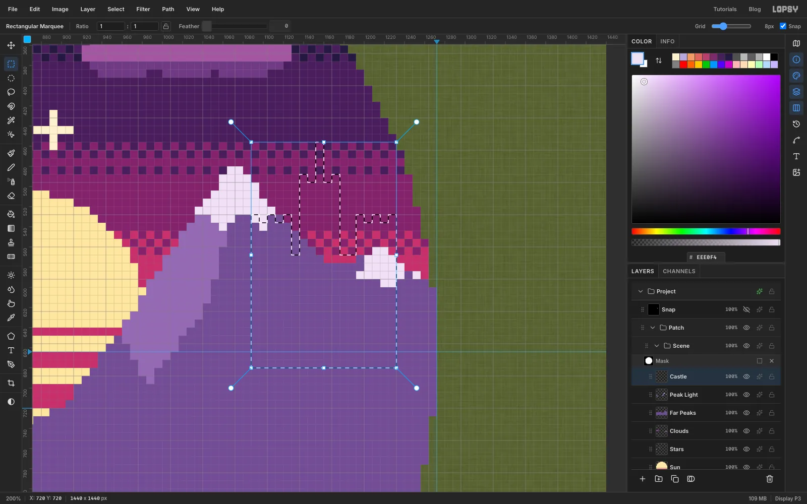

Add a layer called **Castle**. Because Snap is on, every marquee lands on
the grid, so the castle doesn't need a stencil. Draw the keep (**1128, 568
→ 1192, 680**), then hold [[Shift]] and add the left tower (**1088, 536 →
1128, 680**), the right tower (**1192, 536 → 1232, 680**) and the central
tower (**1136, 496 → 1176, 568**). Add three one-square battlements on top
of each tower, with one-square gaps between them, and a one-square
flagpole from **1152, 456** to **1160, 488**. Fill with `#24183F` and
deselect. The
castle stands on the shoulder of the tall peak, roughly level with where
the llama's head will be.

## Add windows, a flag and rim light

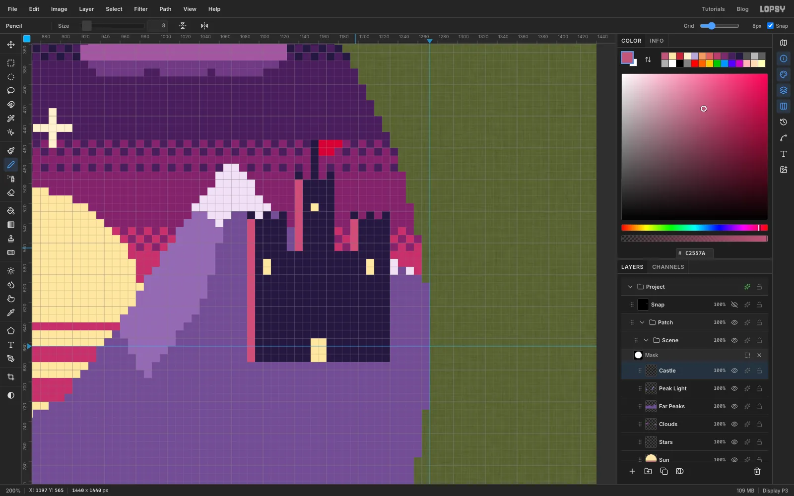

With the 8 px Pencil, click a three-square red flag (`#C8263B`) beside the
top of the pole. Add one tall yellow window (`#FFE7A8`) in each side
tower, a single window high in the central tower, and a lit gateway two
squares wide and three tall at the foot of the keep. The sun is to the
castle's left, so draw a pink rim (`#C2557A`) down the left edge of the
left tower and the central tower. Click the top square and
[[Shift]]-click the bottom one to draw each line.

## Add the lake and the near hills

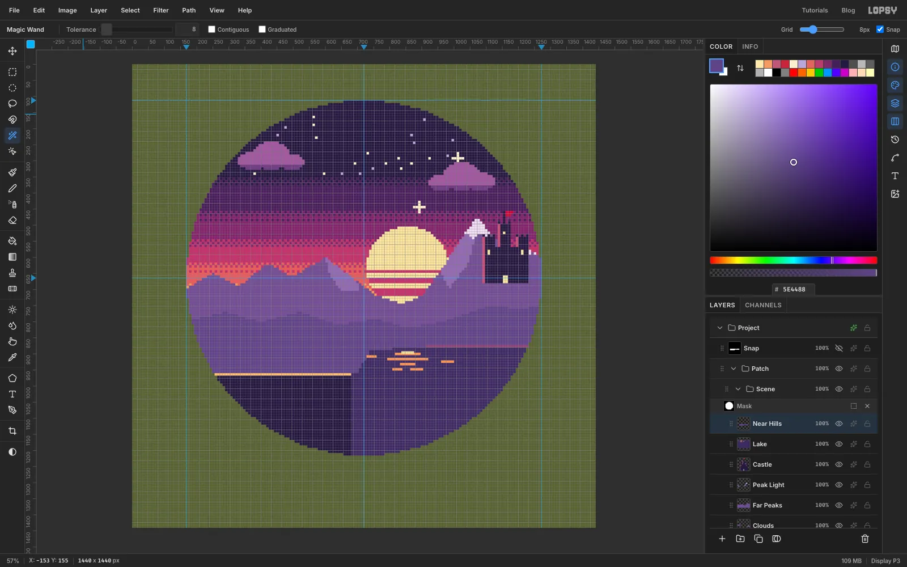

Add a layer called **Lake** and fill **680, 864 → 1288, 1232** with
`#3C2A62`. Fill the top two rows (**680, 864 → 1288, 880**) with
`#8A4A7A` as a horizon glow, and deselect. With the 8 px Pencil, draw short horizontal
dashes of `#F39A62` under the sun, using a click and a [[Shift]]-click for
each. Add one `#FFE7A8` dash at the top for the brightest glint.

Add a layer called **Near Hills**. Pixel-snap a lasso of four or five
low, rounded humps across the whole badge. Their tops sit between **y
744** and **y 820**, and the highest is under the castle. Bring the
lasso's bottom edge back along the lake shore at about **y 872**, and
close it down the left side behind the cliff. Fill with `#5E4488`. The hills are lighter than the lake and
darker than the far peaks, so the three layers of distance stay apart.

## Build the cliff ledge

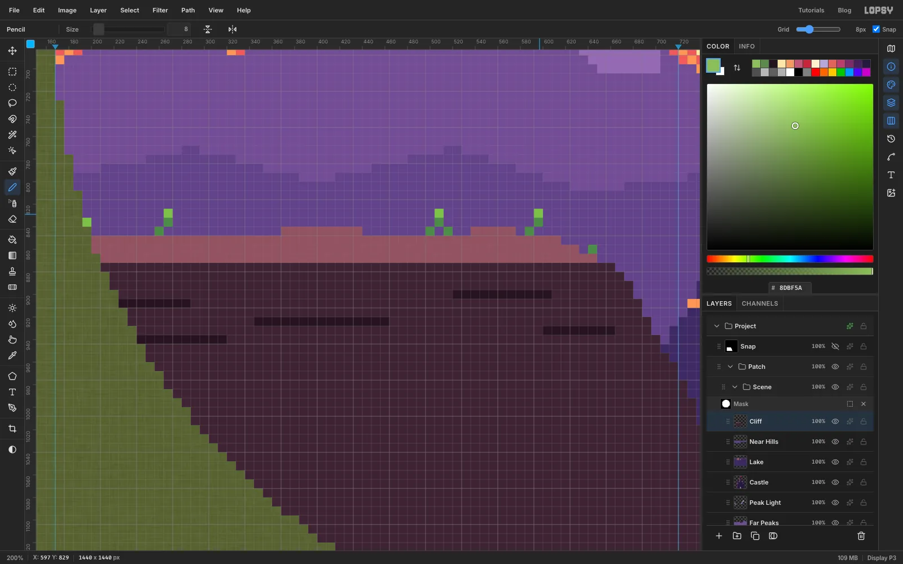

Add a layer called **Cliff**. Pixel-snap a lasso that runs along a ledge
at about **y 845** from the left edge to **x 620**. From there it drops
in a steep diagonal to the bottom of the badge. Fill it with `#3B2433`.

For a lit top, click the cliff with the contiguous Magic Wand,
[[Shift]]+[[Alt]]-drag a marquee over the top few rows (**152, 824 → 728,
872**), fill with `#8A5560` and deselect. Then, with the 8 px Pencil, draw a few
horizontal cracks in `#24141F`, and grass tufts two squares tall in
`#5C8A4F` with `#8DBF5A` tips.

## Drop in the reference photo and scale it

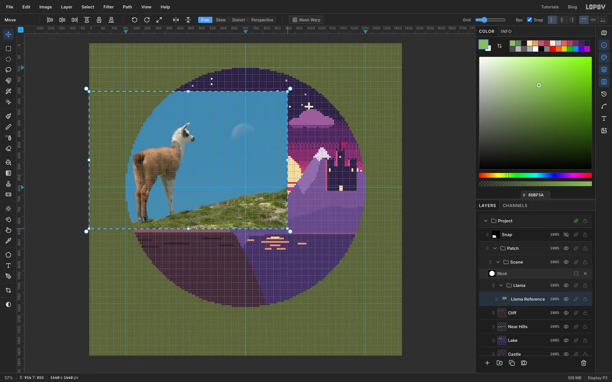

Select **Cliff**, click **New Group** and name it **Llama**. Download the
photo linked at the top of this tutorial and drag the file onto the
canvas. Lopsy shrinks it to fit the canvas and selects it, with the Move
tool active. Rename the layer **Llama Reference**.

Hold [[Cmd]], which keeps the proportions, and drag the bottom-right handle
up and to the left until the photo's right edge reaches about **910** on
the top ruler. The llama is then roughly 450 px tall. Press [[Enter]] to
apply.

## Place it on the ledge

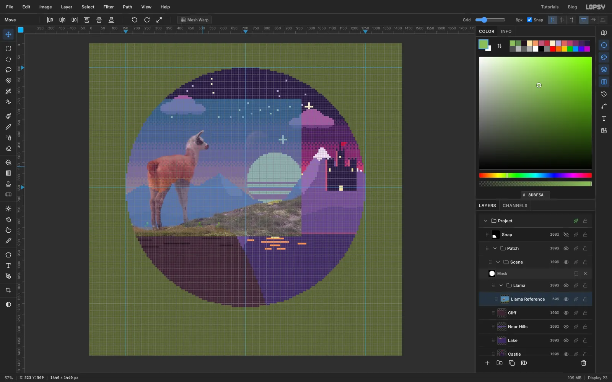

Drag the photo with the Move tool until the llama's back hooves rest on
the ledge and its head is level with the top of the sun (the photo's
top-left corner ends up near **67, 253**). Set the layer's opacity to
**60%** so you can see both the photo and the scene.

## Trace the llama with the Lasso

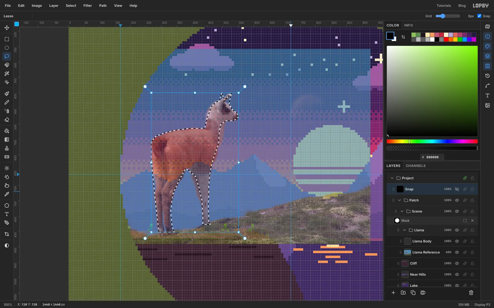

Add a layer called **Llama Body**. Pixel-snap the llama, using the
**Lasso** for step 2. The Lasso is freehand: hold the mouse button down,
drag around the shape and let go to close it. Zoom to 100% and trace just
outside the fur. Start at the top of the rump and go clockwise:

1. Along the back to the base of the neck.
2. Up the back of the neck and around both ears (the far ear peeks out
   behind the near one).
3. Over the forehead to the nose, under the jaw and down the throat and
   chest.
4. Down the front of the front leg to the hoof, back up its inside, across
   the belly, and down and around the hind legs to the rump.

In the photo the front legs overlap and the hind legs stand together, so
trace each pair as one shape. You'll split them with the Pencil later.
You don't need to be precise, because snapping to 8 px squares smooths out
small wobbles. Fill the snapped shape with cream `#F2E3C6`.

## Colour the coat

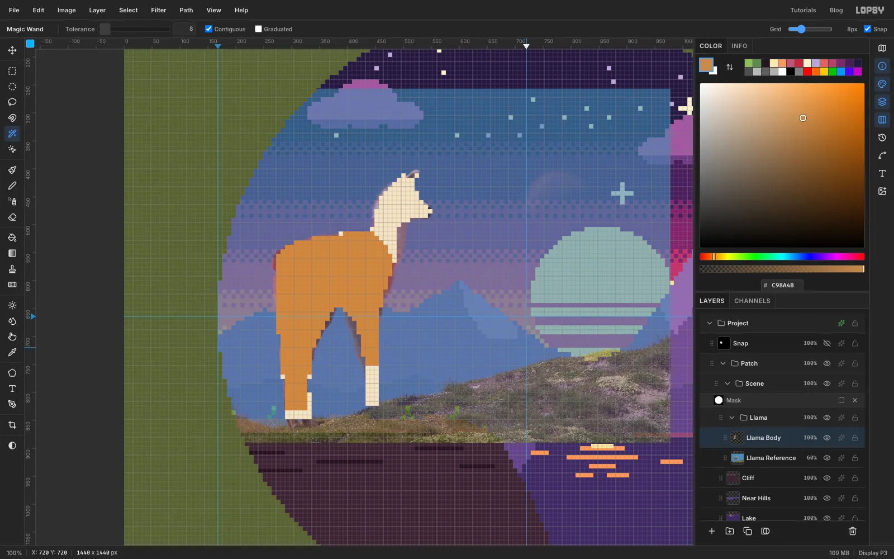

Pixel-snap a second lasso that covers the body, the hind legs and the
front legs, but not the neck and head. On the front legs, stop the lasso
about seven squares above the hooves, so the bottoms of the legs stay
cream as socks. Before filling, select **Llama Body** and
[[Shift]]+[[Alt]]-click the llama with the contiguous Magic Wand, so the
coat stays inside the outline. Fill with `#C98A4B` and deselect. The head,
neck and front socks stay cream.

## Fix the legs and ears with the Pencil

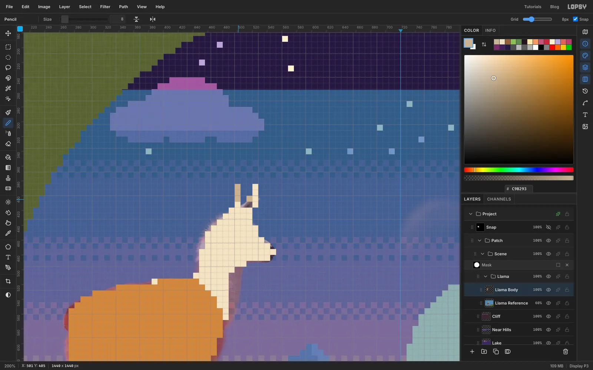

Zoom to 200% and pick the 8 px Pencil. In the photo the ground slopes, so
the front leg stops short of the ledge. Extend it in cream so both pairs of
hooves stand on the rock.

In the photo the far front leg is hidden, so draw it yourself: a column two
squares wide, two squares to the left of the near front leg, running from
the belly down to the ledge. Paint it in shadow tan `#94603A` and its
bottom seven rows in `#C9B293` for the sock. Make the ears one square
taller, and colour the inner edge of the near ear and the whole far ear in
`#C9B293`.

## Shade the belly, rump and far hind leg

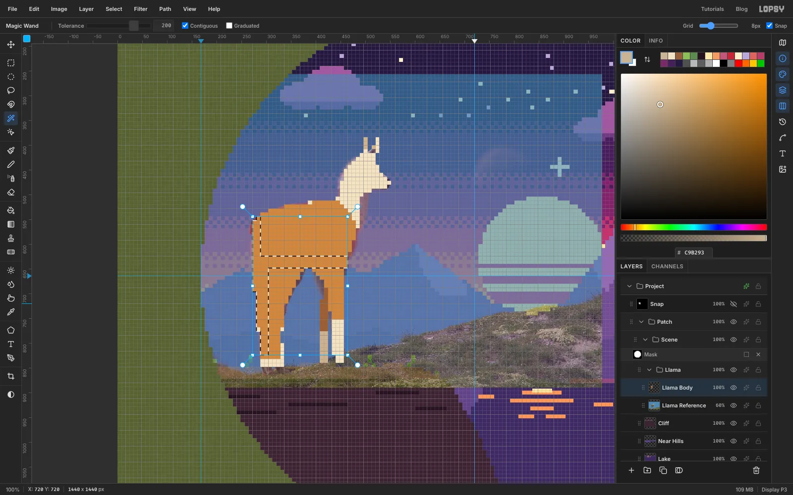

Shading on a grid is just more marquees. Draw a rectangle over the bottom
three rows of the body. [[Shift]]-add a two-square column down the back of
the rump, from the top of the back to the hooves, and a three-square
column over the left half of the hind legs, from the belly to the ledge.
Select **Llama Body** and [[Shift]]+[[Alt]]-click it with the Magic Wand at
**Tolerance 200**, so both the cream and the tan count as part of the
llama. Fill with `#94603A` and deselect.

Now finish the legs with the Pencil:

- Paint the bottom seven rows of the hind legs as socks: cream on the
  right half and `#C9B293` on the shaded left half.
- Draw a one-square line of `#2A1622` down the middle of the hind legs,
  from the belly shade to the ledge. It splits them into a near leg and a
  far leg.
- Finish with a row of `#2A1622` hooves along the bottom of every leg.

## Give it a face and ear tassels

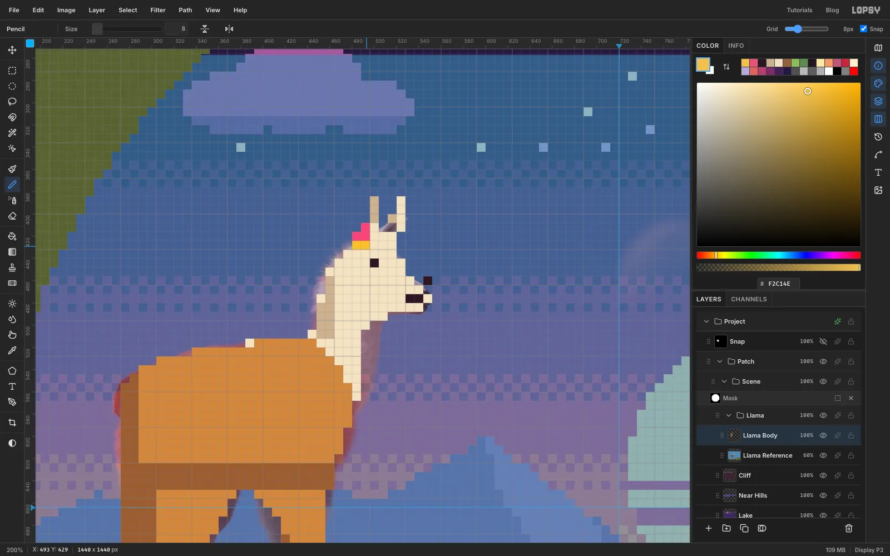

With the Pencil:

- Draw a shadow line one square wide and about seven squares long down the
  back of the neck in `#C9B293`.
- In `#2A1622`, click a one-square eye two squares below the ears and two
  squares in from the back of the head, so it sits in clear cream and
  doesn't touch the outline. Click one square for the nostril at the end of
  the muzzle and two for the mouth underneath.
- Andean llamas often wear coloured yarn tassels in their ears. Click a
  few `#E8547A` squares at the base of the ears and two `#F2C14E` squares
  under them.

## Weave the saddle blanket

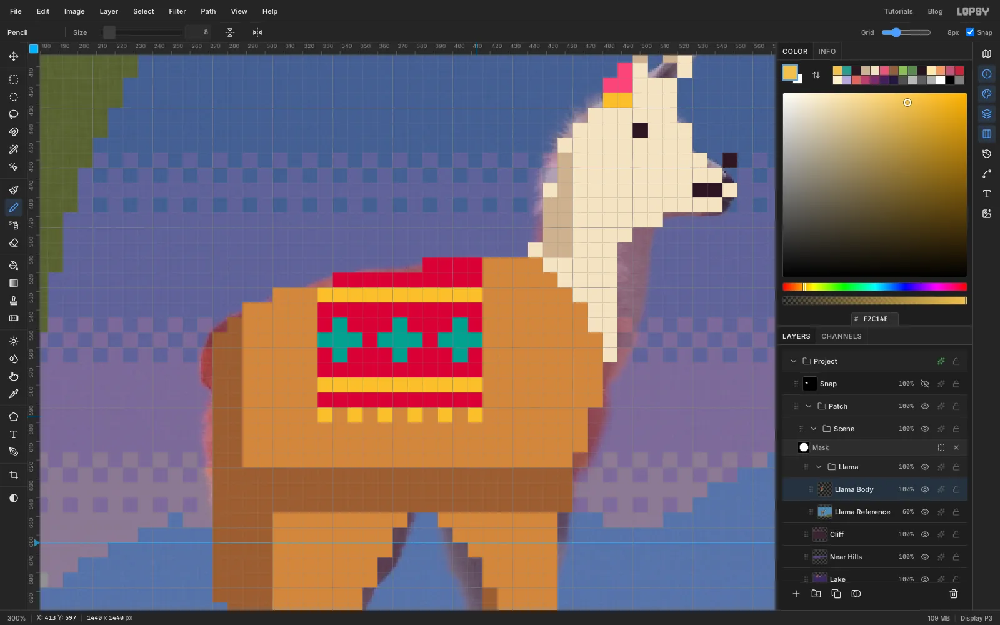

Marquee a block over the middle of the back (**328, 504 → 416, 592**) and
intersect it with the llama using [[Shift]]+[[Alt]] and the Magic Wand.
Fill it with `#C8263B`. The top edge follows the curve of the back.

While the blanket is still selected, use the Pencil to draw a yellow
`#F2C14E` stripe across the third row and the second-to-last row. Draw a
band of three teal `#2A9D8F` crosses across the middle. The selection keeps
every click inside the blanket. Deselect, then click a yellow fringe of
alternate squares just under the bottom edge.

## Add a pack and a pennant

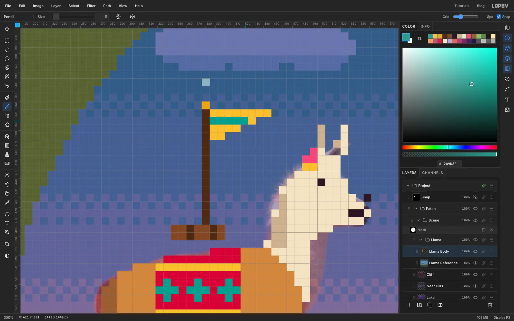

On top of the blanket, draw a pack two rows tall and seven squares wide in
`#7A4A2A`, with two strap columns in `#4A2C18`. Draw a pole straight up from
the pack in `#4A2C18`, about fifteen squares tall: click the bottom square
and [[Shift]]-click the top one. Put a gold `#E2A93B` knob on the top.

The pennant is four rows that get shorter: eight, six, four and two
squares, flying to the right from the top of the pole in `#F2C14E`. Paint
the second row teal.

## Catch the sunset on its edges

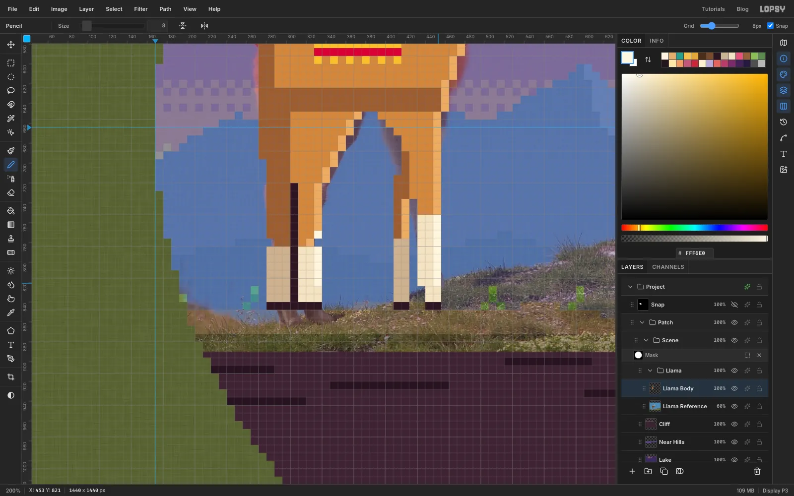

The sun is to the llama's right. Find every square whose right-hand
neighbour is empty: the front of the face, the chest, the back of the
pack and the front edge of each leg. Paint those squares lighter, using
`#E3AE6E` on the tan coat and `#FFF6E0` on the cream. A one-square rim
light like this makes a flat sprite look round.

## Outline the llama

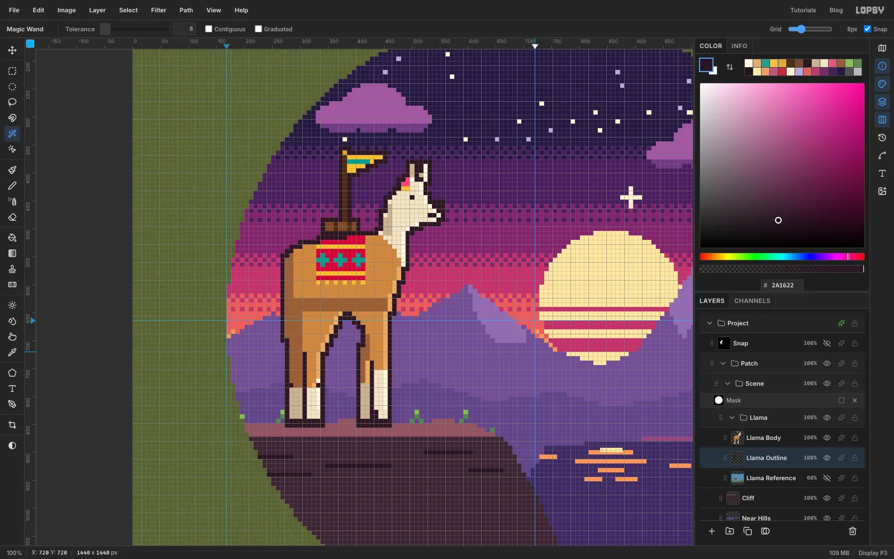

Select **Llama Reference** and add a layer called **Llama Outline**. It
sits under Llama Body. Pixel-snap again, but for step 2 [[Cmd]]-click the
**Llama Body** thumbnail and choose **Select → Grow…** with **8 px**. Fill
the snapped shape with `#2A1622` and deselect. Hide the Llama Reference
layer.

Select the **Llama** group and drag it two squares (16 px) to the right
with the Move tool, so it stands a little further onto the ledge. The
outline, body and hidden photo all move together.

## Add birds over the sun

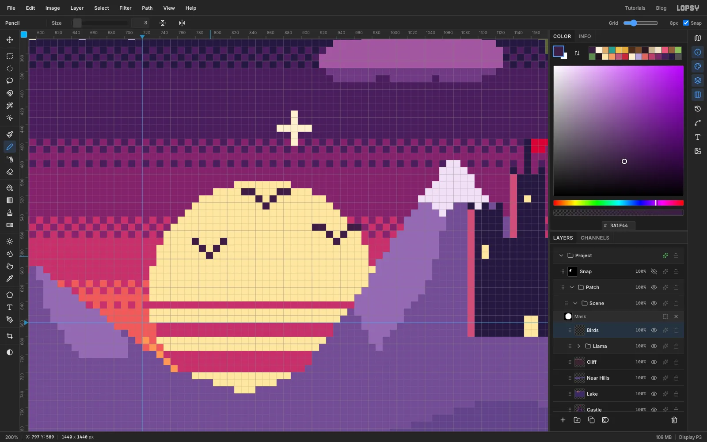

Collapse the **Llama** group and, with it selected, click **Add Layer**.
The new **Birds** layer appears above the group, not inside it. With the
8 px Pencil and `#3A1F44`, draw three small V shapes over the sun: two
seven squares wide, one five squares wide.

## Pencil one HP heart

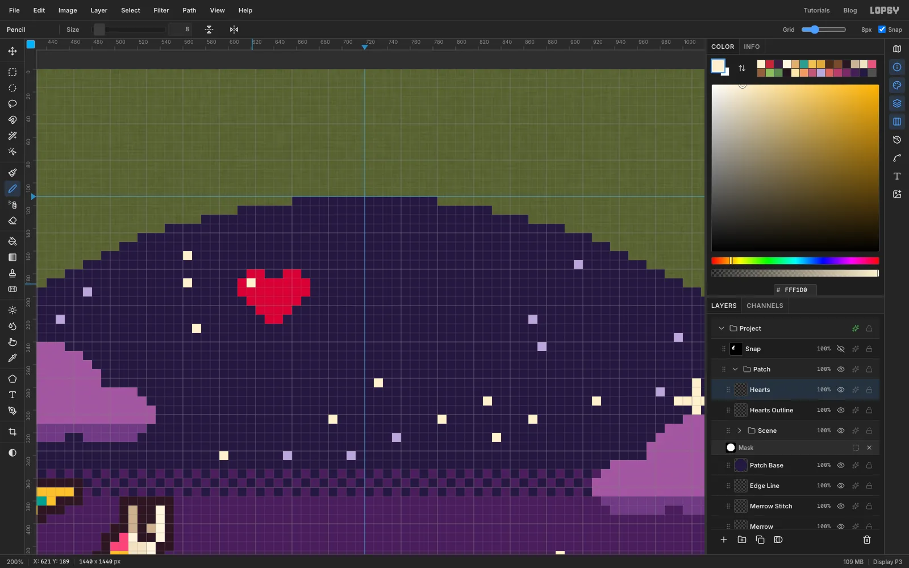

Collapse the **Scene** group, select it and add two layers above it:
**Hearts Outline**, then **Hearts**. On Hearts, draw a heart eight
squares wide and six tall in `#C8263B`, starting at **608, 176**:

1. Skip one square, then two squares, a gap of two, and two squares.
2. Two full rows of eight.
3. Six, then four, then two, each centred.

Click one `#FFF1D0` square in the upper-left lobe for the shine.

## Copy it, empty half, and outline them

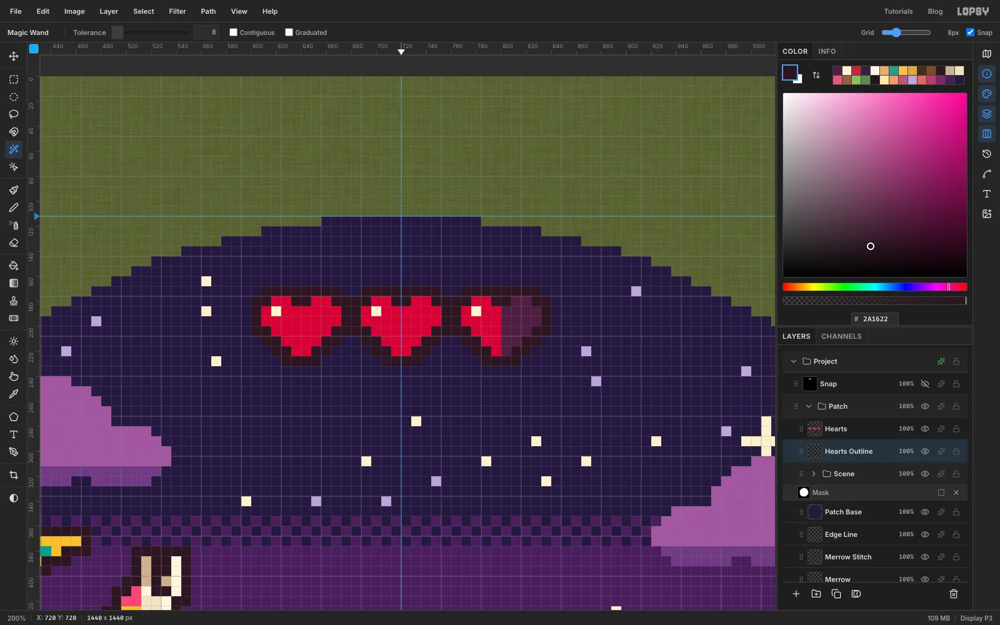

Marquee the heart (**608, 176 → 672, 224**) and copy it. Paste, drag the
copy 80 px to the right and merge it down. Paste again (it lands on the
first heart), drag this copy 160 px to the right and merge it down. To show "two and a half
lives", marquee the right half of the third heart (**800, 176 → 832,
224**). Then click it with the contiguous Paint Bucket in `#4A2040`.

Select **Hearts Outline** and pixel-snap: [[Cmd]]-click the Hearts
thumbnail, **Select → Grow…** by **8 px**, then fill with `#2A1622`.

## Make the ribbon banner

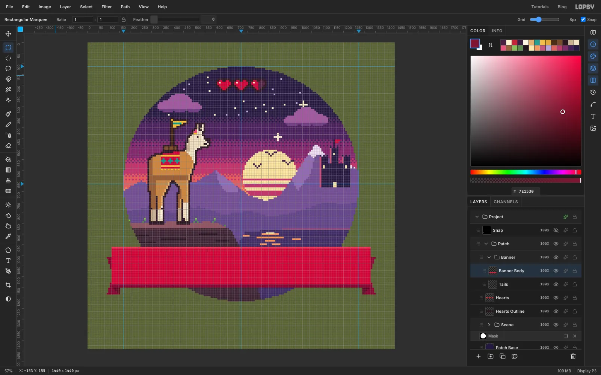

With **Hearts** selected, click **New Group** and name it **Banner**. Add
a layer called **Tails**. Pixel-snap the two tails together. For step 2,
drag the Lasso in straight hops around the left tail: a tall block from
**x 88** to **x 152** and **y 1008** to **y 1184**, with a V cut into its
outer (left) end that reaches in to about **x 120**. Pixel-snap squares off
any wobble in the straight sides. Hold [[Shift]] and lasso the mirror image
on the right, from **x 1288** to **x 1352**. Fill with `#7E1530`.

Pixel-snap the two folds the same way. Each is a small right-angled
triangle under an end of the banner, with corners at **112, 1152**, **152,
1152** and **152, 1184** on the left (and **1328, 1152**, **1288, 1152**,
**1288, 1184** on the right). Fill them with `#5A0F22`.

Add a layer called **Banner Body**. Fill **112, 960 → 1328, 1152** with
`#C8263B`. Fill the top row (**112, 960 → 1328, 968**) with `#E0485A` and
the bottom two rows (**112, 1136 → 1328, 1152**) with `#7E1530`.

## Add diamond studs at the ends

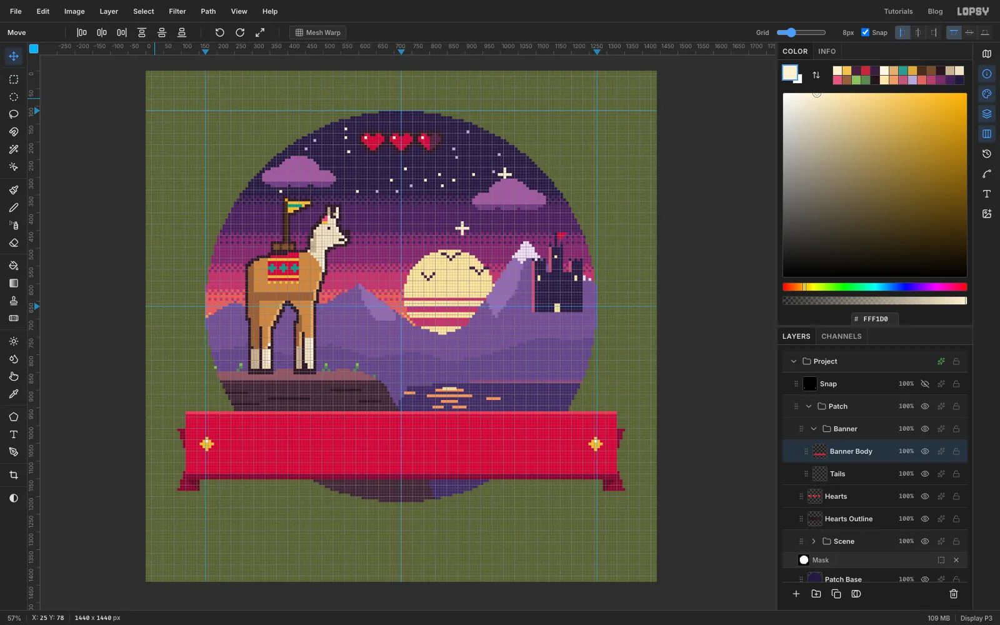

With the Pencil, draw a five-square diamond in `#F2C14E` near the left end
of the banner, centred on **x 172**, with one `#FFF1D0` square for the
shine. Marquee it, copy, paste, choose **Image → Flip Horizontal** and drag
the copy to the same spot at the right end. Merge it down.

## Set the title in a pixel font

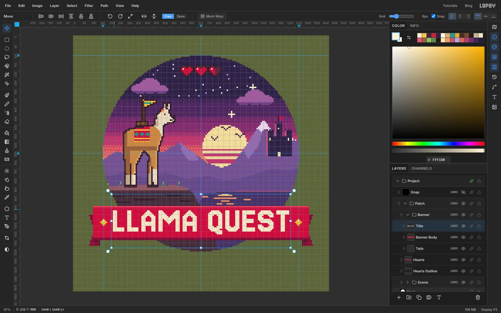

Pick the **Text** tool. Choose **Jersey 15**, set the size to **216 px**
and the colour to `#FFF1D0`. At exactly 216 px, each pixel of the font is
8 document pixels, so the letters line up with the art. Click on the
banner and type **LLAMA QUEST**, then press [[Tab]] to commit. Rename the
new text layer **Title**.

Text lands wherever you clicked, so it's rarely on the grid. With Snap
on, each arrow press moves a layer by a whole grid square. Untick **Snap**
in the options bar for a moment, so the arrows move 1 px a press. With the
Move tool, place the letters so their left edge sits at **x 224** and the
tops of the capitals at **y 984**. That centres the title, with about
112 px of red on each side for the diamonds. Tick **Snap** again
afterwards.

## Give the title a hard shadow

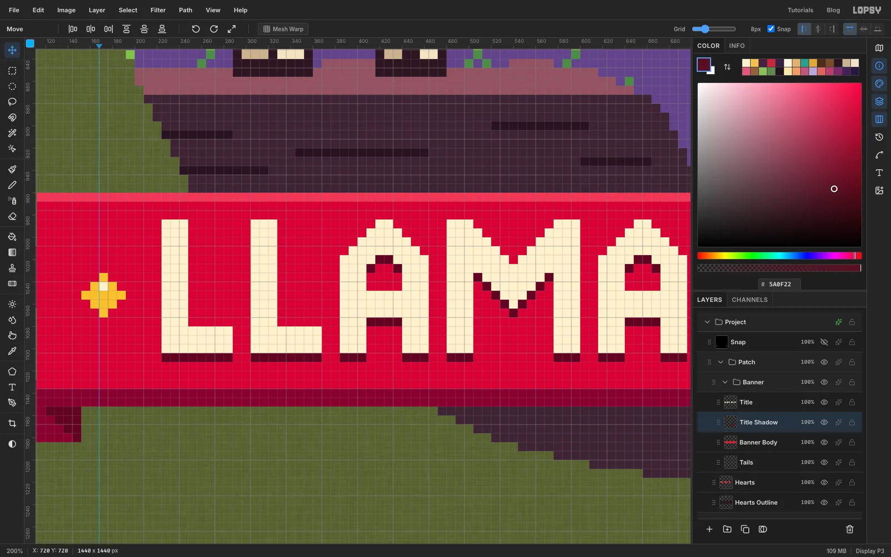

With **Title** selected, click **Rasterize Layer** in the Layers panel
footer. Select **Banner Body**
and add a layer called **Title Shadow**, so it sits between the banner and
the title. [[Cmd]]-click the **Title** thumbnail, select Title Shadow and
fill with `#5A0F22`. Deselect. With Snap back on, select the Move tool and
press the down arrow once. The shadow drops exactly one grid square.

The capitals and their shadow take up **984–1112**. Only the tail of the Q
dips lower, and it still clears the dark shade rows by a square. That leaves
clear red above and below the title, inside the highlight and shade rows.

## Draw a one-pixel edge around the patch

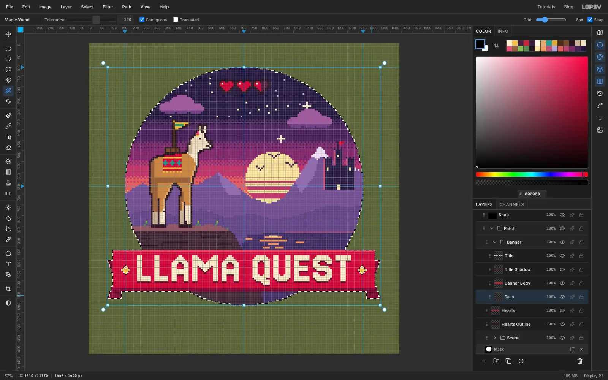

Select **Edge Line** and pixel-snap the whole patch silhouette. For step 2,
use the contiguous Magic Wand at **Tolerance 160**:

1. Select **Patch Base** and click the disc.
2. Select **Banner Body** and [[Shift]]-click the banner.
3. Select **Tails** and [[Shift]]-click each tail.

Then choose **Select → Grow…** by **8 px**. After the snap, fill Edge Line
with `#2A1622`.

## Add the gold merrowed border

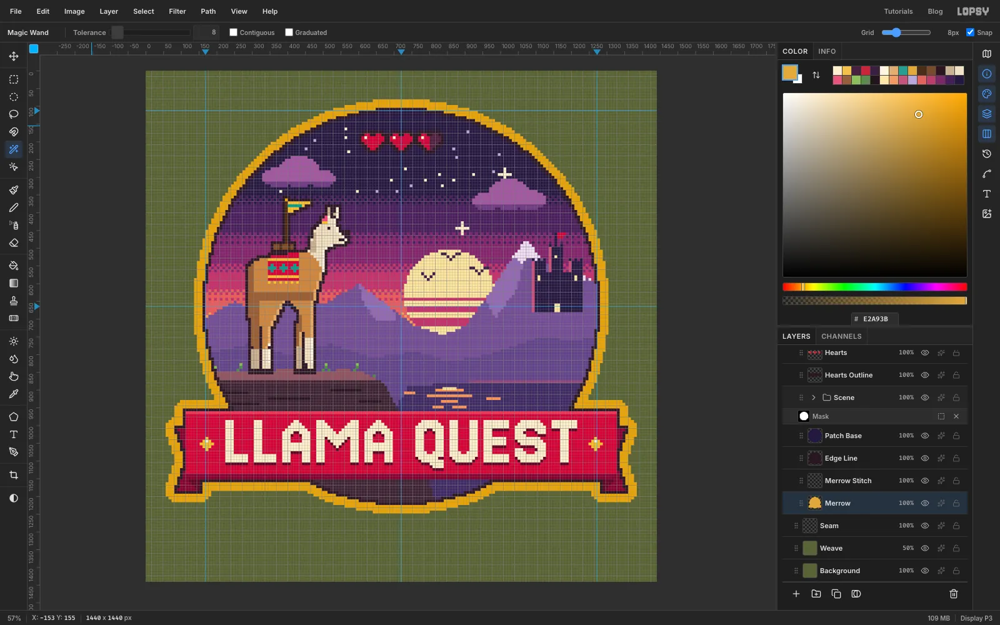

Select **Merrow** and pixel-snap the same silhouette, this time grown by
**32 px**. Fill it with `#E2A93B`. The edge is a soft, stepped curve, like
the rolled stitch of a real merrowed patch.

Open Merrow's **Layer effects** and turn on **Drop Shadow**: **Offset X
6**, **Offset Y 14**, **Blur 18**, **Spread 0**, **Opacity 70%**, colour
`#1A1D0E`. Now the patch looks raised off the canvas.

## Texture the border with satin stitches

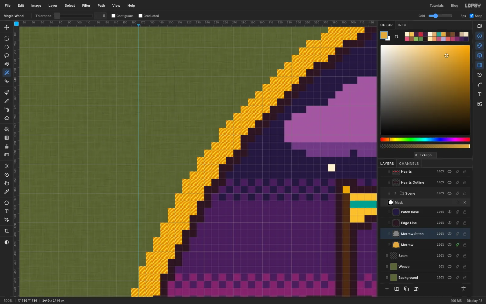

[[Cmd]]-click the **Merrow** thumbnail, select **Merrow Stitch** and
choose **Edit → Fill with Pattern…** with the satin tile. Deselect and set
the layer's blend mode to **Overlay**. The grey stripes lighten and darken
the gold into diagonal stitches.

## Cross-stitch every pixel

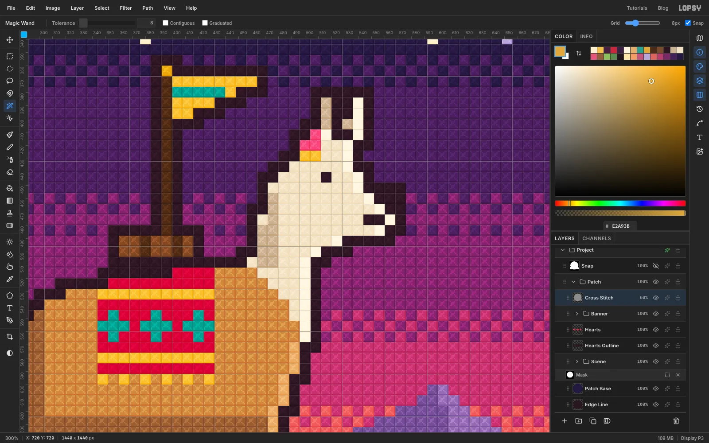

Collapse the **Banner** group, select it and add a layer called **Cross
Stitch**. It's the top layer of the patch. [[Cmd]]-click the **Edge Line**
thumbnail to select the patch, then **Fill with Pattern…** with the
cross-stitch tile. Deselect, set the blend mode to **Overlay** and the
opacity to **60%**.

The 8 px tile lines up with the grid, so every art pixel gets exactly one
X. From a distance it reads as thread texture.

## Trim the canvas

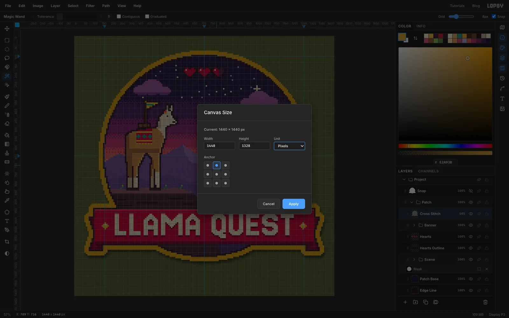

The patch sits high on the canvas, with about 80 px above it and much more
below. Choose **Image → Canvas Size…**, click the top-centre anchor and set
**Height** to **1328**. The extra canvas is trimmed from the bottom, which
leaves the same 80 px of canvas above and below the patch.

## Stitch a seam across the backpack

Select **Seam**. The strips are only 4 px tall, so Snap would collapse a
drag. Use the exact-corners dialog for each one and fill it with **Fill
with Pattern…** using the seam dash: **0, 16 → 1440, 20**, then **0, 32 →
1440, 36**, **0, 1292 → 1440, 1296** and **0, 1308 → 1440, 1312**.
Deselect. Give the layer a small **Drop
Shadow** (**Offset X 1**, **Offset Y 2**, **Blur 2**, **Opacity 60%**,
colour `#1A1D0E`) so the thread sits on top of the cloth.

## Clean up, save and export

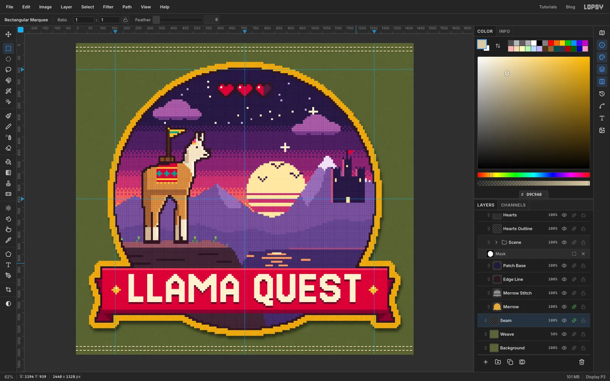

Delete the **Snap** layer. You don't need it any more. Choose **File →
Save Project** to keep a `.lopsy` with every layer, then **File → Quick
Export PNG** for the finished patch.
