Game and animation studios often plan a film's look with pixel-art key
frames. Each one is a single still that fixes the set, the light and the
palette, presented letterboxed with a slate line and a strip of colour
chips.

In this tutorial you'll paint **Sunken Observatory**, key frame 04 of an
imaginary film. A domed observatory stands half drowned in a flooded valley
at blue hour. Its telescope still points at an enormous moon, and a canoe of
four people paddles across the moon's glitter path toward it.

The trick that makes it read as pixel art is that everything sits on one
**8 px grid**. You'll paint the scene with ordinary gradients, selections
and glows. Then you'll stamp the whole picture onto one layer and run
**Pixelate** over it, so every edge, glow and gradient lands on the same
blocks. Along the way you'll dither a sky with noise, mirror the valley into
the water, and build the observatory in a group, then scale it, cut it at
the waterline and reflect it. Last, you'll trace the canoe's crew from a
reference photo.

The canoe reference is *Getting out to fish at dusk* by Khanairobi on
Wikimedia Commons (CC BY-SA 4.0). Any side-on photo of people in a small
boat will do: you only need it for poses.

The palette:

- Sky `#16122E` → `#1E2458` → `#4A3C7C` → `#9A5A86` → `#E99A7A`
- Stars `#E8ECFF`, twinkles `#FFF4D6`
- Moon `#F2E6C8`, shade `#BFAE95`, craters `#DCCDB2`
- Clouds `#5E4F8E`, cloud tops `#A68BBE`
- Far range `#463C78`, cliffs `#17152F`, rim light `#7A68B4`
- Water `#C98A93` → `#7A5A8E` → `#33306A` → `#16122E`
- Glitter `#F6E7C8`, mist `#B9A3D8`, ripples `#C9C2EA`
- Drum `#34356A` → `#7C80B0` → `#B4B8DA`, annex `#3A3B70` → `#8E92BE`
- Dome `#E2E3F2` → `#9A9DC8` → `#3E3F74`, cornice `#24234E`
- Telescope `#7F7AB4`, highlight `#D2CDF0`, shadow `#3A3768`
- Slit `#FFB24A`, windows `#FFC163`, lamp `#FFD27A`, glow `#FF9A3C`
- Silhouettes `#110F28`, wake `#8C7CC4`, fireflies `#FFE08A`
- Letterbox `#07060F`, slate type `#F2E6C8` / `#B7AEE0` / `#6F67A0`, stamp `#E2553C`

## Set up the canvas, the 8 px grid and guides

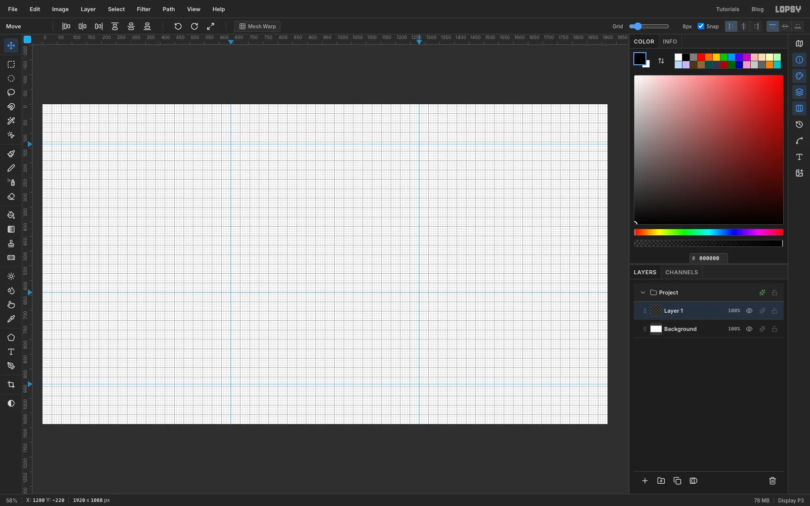

Choose **File → New** and make a **1920 × 1088** document. That's 8 px
taller than full HD on purpose: 1088 is a multiple of 8, and so is half of
it, so the grid's lines run cleanly from edge to edge.

Turn on **View → Show Grid**. In the options bar, drag the **Grid** slider
one step left to **8px** and make sure **Snap** is ticked. Marquees now
lock to 8 px blocks, and every arrow-key nudge moves a layer by one block.

Click the left ruler at **136**, **640** and **952** for horizontal guides.
The first and last mark the letterbox bars, and 640 is the horizon. Click
the top ruler at **640** and **1280** to mark the thirds.

## Dither the sky with noise

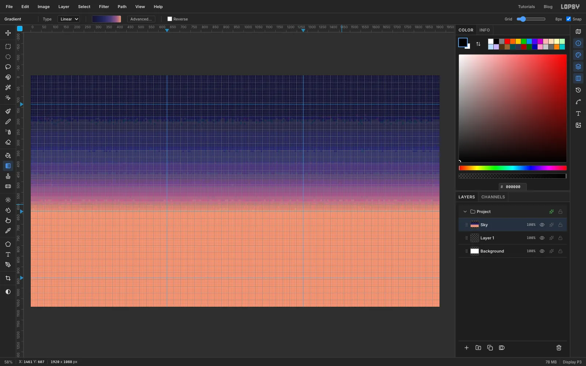

Add a layer called **Sky**. Pick the **Gradient** tool, set it to
**Linear** and open **Advanced…**. Make five stops: `#16122E` at the left,
`#1E2458` at 35%, `#4A3C7C` at 65%, `#9A5A86` at 85% and `#E99A7A` at the
right. Drag straight down from the top guide to the horizon guide.

Now turn that smooth gradient into pixel-art bands:

1. **Filter → Add Noise…**: Amount **20**, **Mono**, **Gaussian**.
2. **Filter → Pixelate…**: Block Size **8**.
3. **Filter → Posterize…**: Levels **16**.

Pixelate averages the noise into 8 px blocks, and Posterize snaps each
block to the nearest band. The blocks near each boundary land on either
side of it, which gives you a ragged, dithered edge instead of a smooth
blend.

> **Tip:** Posterize works on each colour channel separately, so a sky that
> starts on a very dark navy can come out grey or teal. If that happens,
> nudge the first stop toward a more saturated indigo.

## Scatter the stars

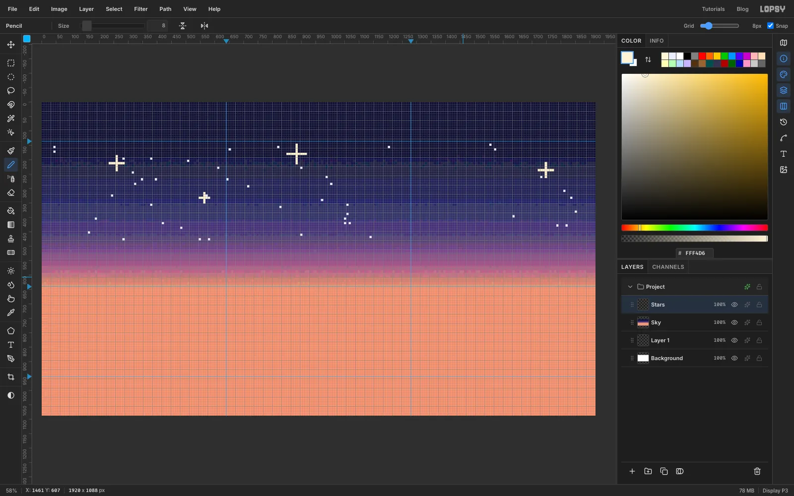

Add a **Stars** layer. Choose the **Pencil**, set **Size 8** and colour
`#E8ECFF`, and click about forty single stars across the sky above the
horizon guide. Leave a clear patch on the upper right, where the moon will go.

Switch to `#FFF4D6` for four bigger twinkles. Click a point, then
**Shift-click** 24–32 px to its right to draw a straight line through it.
Draw a vertical line the same way, so each twinkle is a small plus.

Run **Filter → Pixelate…** at **8** so every star is exactly one block.

## Add a banded moon halo

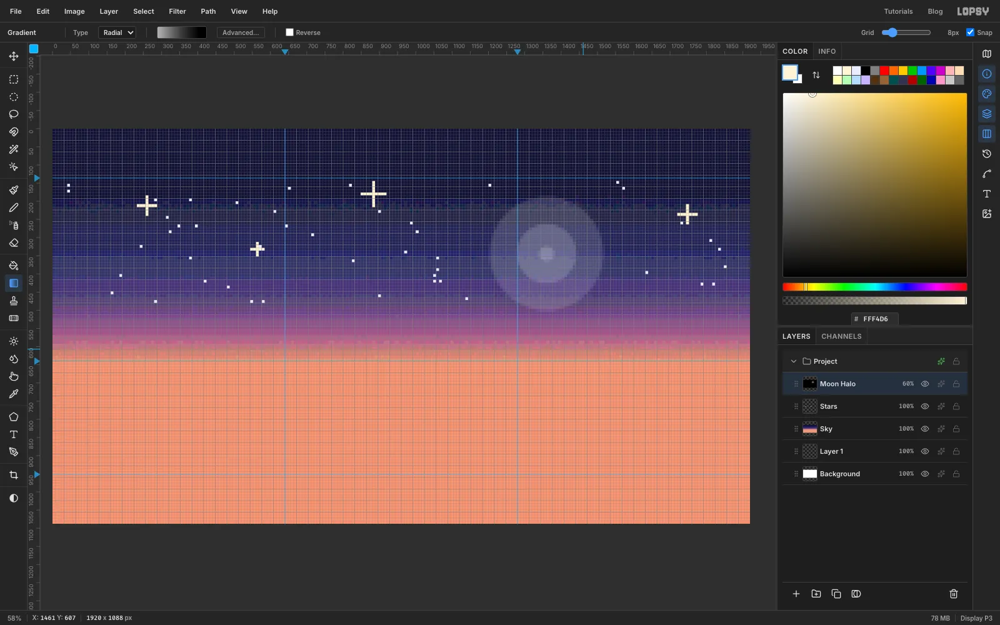

Add a **Moon Halo** layer. Give the Gradient tool a **Radial** gradient
with four stops: `#B4B4B4` at the start, `#383838` at 50%, then black at
85% and at the end. Drag from **1360, 344** (the moon's centre) 240 px to
the right.

In the layer's effects drawer, set the **Blend mode** to **Screen**. Black
then disappears, and the greys lighten the sky. Then:

1. Run **Posterize** at **5** levels to break the glow into rings.
2. Run **Pixelate** at **8**.
3. Drop the layer to **60%** opacity.

Keep the halo's ramp grey on purpose. A coloured ramp posterizes into
rainbow rings, because each channel steps at a different radius.

## Shape the moon and its shadow

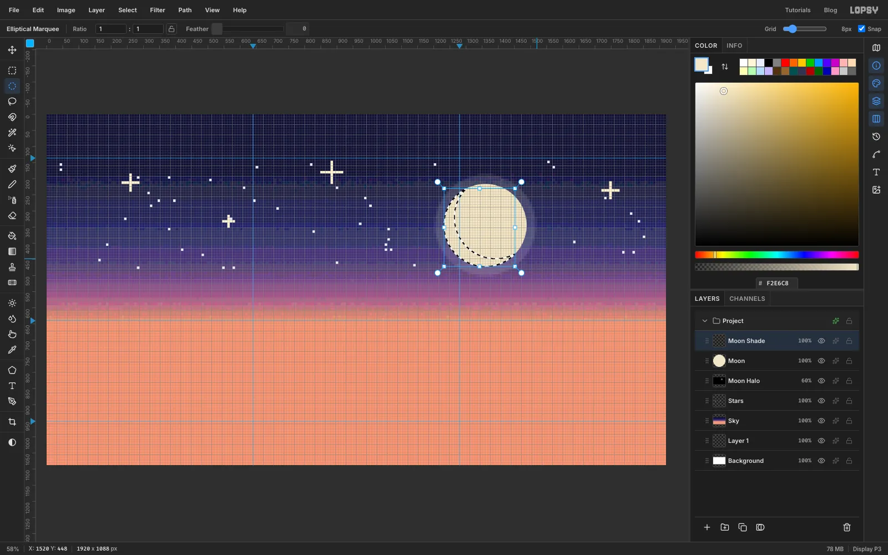

Add a **Moon** layer. Drag an **Elliptical Marquee** from **1232, 216** to
**1488, 472**: a 256 px circle that snaps to the grid. Fill it with
`#F2E6C8` (**Edit → Fill**).

Add a **Moon Shade** layer above it, then **⌘-click** the Moon layer's
thumbnail to load the disc as a selection. Hold **Alt** and drag the same
size circle again, about 32 px to the right and 24 px higher. This
subtracts it and leaves a thin crescent on the lower left. Fill it with
`#BFAE95`.

## Add the craters

Deselect, stay on **Moon Shade** and fill three ellipses with `#DCCDB2`:

- one large crater, about 80 × 64, on the upper left of the disc;
- two small ones, 16 to 24 px across, on the right.

Keep them lopsided. Two craters side by side above a third one reads as a
face straight away.

## Stack the cloud banks

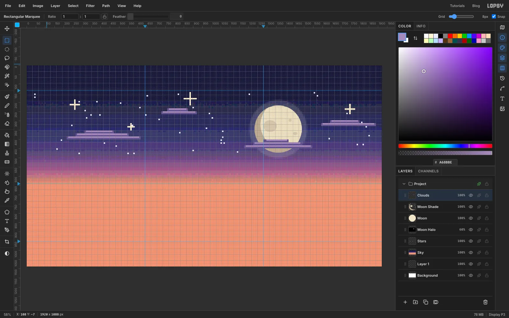

Pixel clouds are just stacked strips. Add a **Clouds** layer. For each
bank:

1. Draw a 16 px-tall **Rectangular Marquee** and fill it with `#5E4F8E`.
2. Draw a narrower strip on top of it, then a narrower one again. Snap
   keeps them on whole blocks.
3. Fill an 8 px strip along the top of each step with `#A68BBE`, set 8 px
   in from both ends, for the moonlit edge.

Put one bank across the bottom third of the moon, a long one on the left,
a thin one on the far right and a small one high in the middle. Set the
layer to **90%**.

## Draw the far range

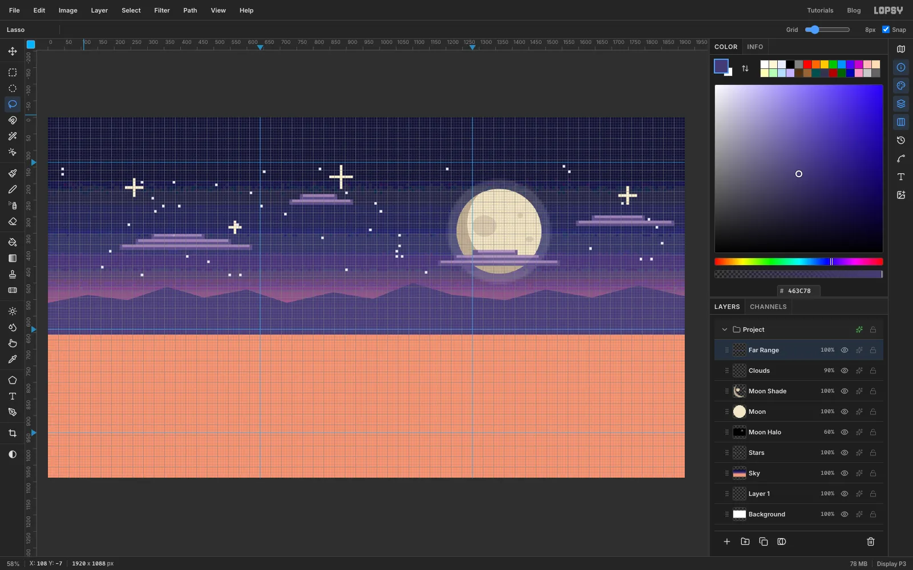

Add a **Far Range** layer. Use the **Lasso** to click a zigzag ridge from
the left edge to the right edge, with peaks between about y 500 and 560.
Then click down below the horizon and back to close the shape. Fill it with
`#463C78`. It's a mid-tone, so it sits back in the haze.

## Frame it with cliffs and rim light

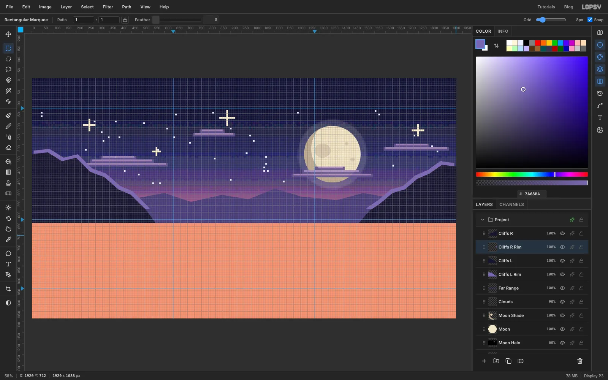

Each cliff gets two layers: a rim layer, with the cliff itself above it.

1. Add **Cliffs L Rim**, then **Cliffs L** on top of it.
2. On **Cliffs L**, lasso a cliff that climbs from the horizon, just left
   of the left-third guide, up to the left edge about halfway up the sky.
   Give it a few ledges on the way. Fill it with `#17152F`.
3. Select **Cliffs L Rim**, **⌘-click** the Cliffs L thumbnail and fill the
   selection with `#7A68B4`. Deselect.
4. With the **Move** tool, press [[→]] once and [[↑]] twice. With Snap on,
   each press is one 8 px block, so a lavender edge peeks out along the
   cliff's top.

Make the right-hand cliff the same way: select **Cliffs L** first, then
add **Cliffs R Rim** and **Cliffs R**. Lasso a mirror image of the left
cliff by eye, from the horizon past the right-third guide up to the right
edge. Nudge its rim [[←]] once and [[↑]] twice.

Because the rim is shifted up, it also peeks out along the foot of each
cliff, just above the water. On each rim layer, marquee everything from
y 592 down and press [[Delete]], so the rims stop at the shoreline.

## Fill the water

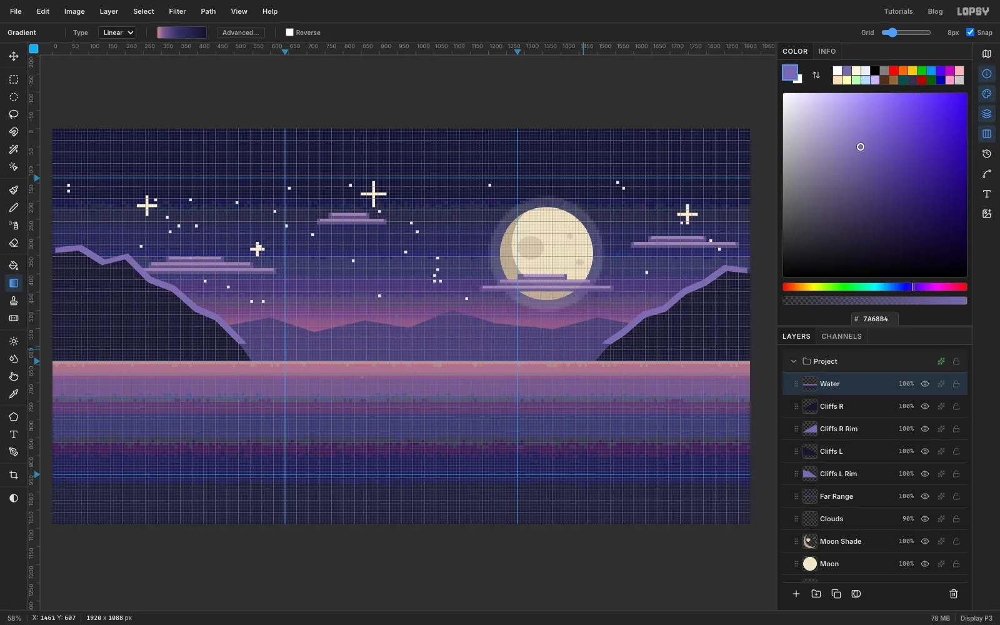

Select **Cliffs R**, add a **Water** layer, and marquee from the horizon
guide to the bottom of the canvas. Fill the selection with a linear
gradient dragged top to bottom, with stops `#C98A93`, `#7A5A8E` at 12%,
`#33306A` at 40% and `#16122E`.

Give it the same treatment as the sky, but with **Add Noise 30**,
**Pixelate 8** and **Posterize 10**. The coarser bands read as calm water.

## Mirror the valley into the water

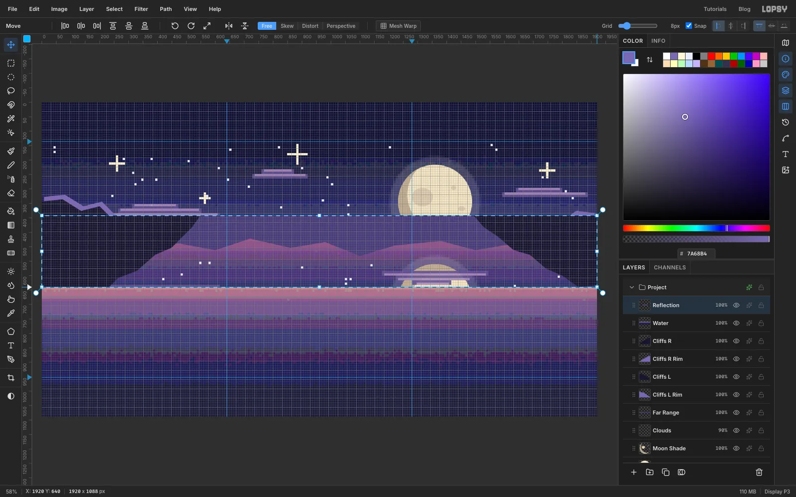

Hide both rim layers with their eye icons first. Bright rim lines mirrored
into the water look like spotlight beams.

Marquee the full width from y **392** down to the horizon. Choose
**Edit → Copy Merged**, show the rims again, deselect and press [[⌘V]]. The
copy lands in place on a new layer. Rename it **Reflection**.

Marquee the same strip again, switch to the **Move** tool and click
**Flip Vertical** in the options bar.

## Hang the reflection under the horizon

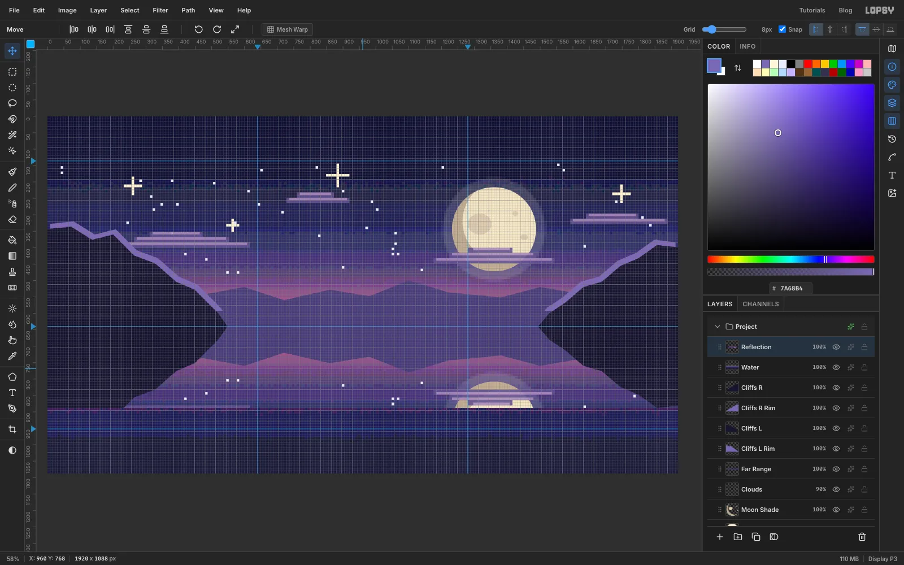

Deselect and drag the layer straight down with the **Move** tool until its
top edge sits on the horizon guide (248 px down). Snap catches the guide.

## Break it into ripples

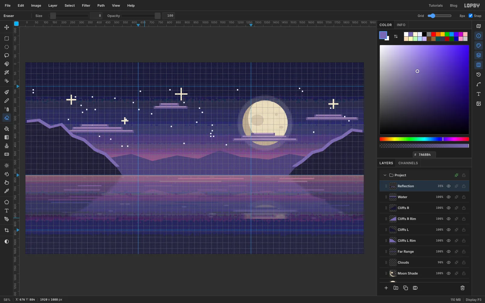

Run **Filter → Motion Blur…** with Angle **0** and Distance **24**, then
set the layer to **35%**.

Pick the **Eraser** at **Size 8**. Click on the reflection and
**Shift-click** further along the same row to erase a straight horizontal
gap. Make three or four gaps of different lengths on every second or third
row, all the way down. The broken lines are what make it read as water.

## Lay the moon's glitter path

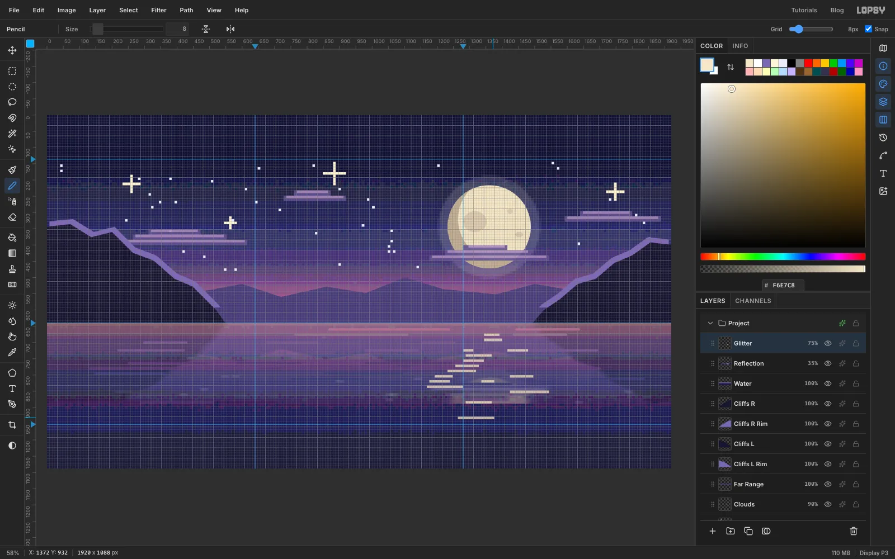

Add a **Glitter** layer. Use the **Pencil** at **8** in `#F6E7C8` and draw
short horizontal dashes with click and **Shift-click**, one row every 16 px,
in a column under the moon.

Near the horizon, keep each row to one short dash. Further down, make the
dashes longer, spread them wider, and sometimes split a row into two
dashes. Skip a row now and then. Set the layer to **75%**.

## Add a band of mist

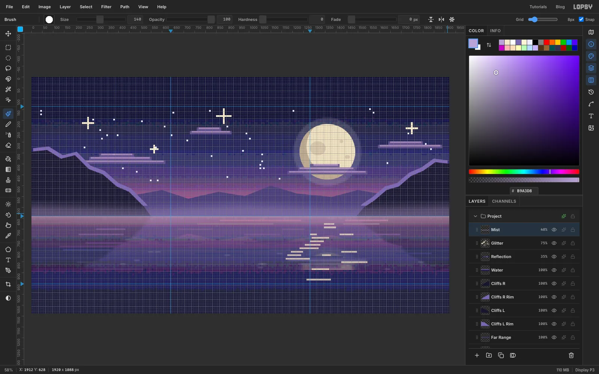

Add a **Mist** layer. Choose the **Brush** at **Size 140** and
**Hardness 0**, with colour `#B9A3D8`. Drag one gently wavy stroke along
the horizon from edge to edge, and set the layer to **40%**. You'll
pixelate it with everything else at the end.

## Start the observatory group

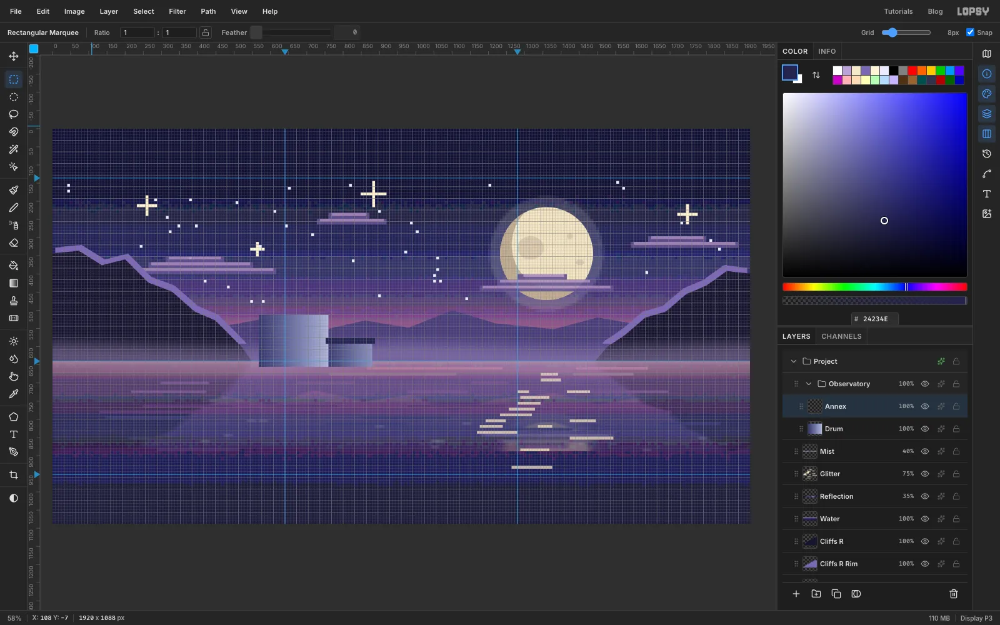

With **Mist** selected, click **New Group** at the bottom of the Layers
panel and name it **Observatory**. New layers now go inside it.

Build it at a small size first. You'll scale it up as one piece later.

1. **Drum:** add a **Drum** layer and marquee **568, 512** to **760, 656**.
   Fill it with a linear gradient dragged left to right: `#34356A`,
   `#7C80B0` at 60%, `#B4B8DA`. The moon is on the right, so that side is
   lit.
2. **Annex:** add an **Annex** layer and marquee **760, 584** to
   **880, 656**. Fill it with `#3A3B70` → `#8E92BE`, dragged left to right.
   Add a 16 px roof strip in `#24234E` that overhangs it by 8 px on each
   side.

## Cut the dome from a circle

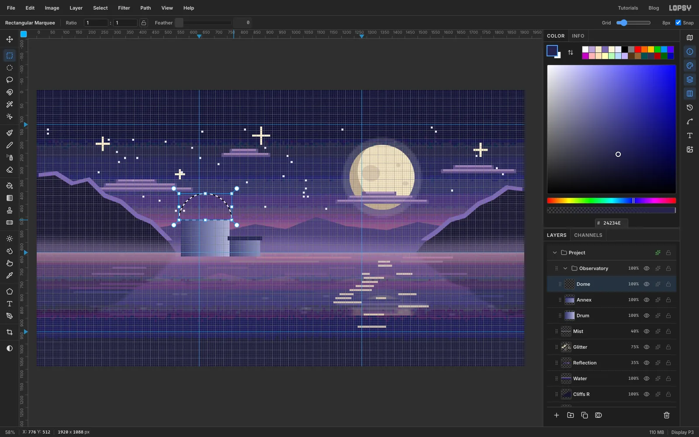

Add a **Dome** layer:

1. Drag an **Elliptical Marquee** for a 208 px circle centred on the top
   of the drum (**664, 512**).
2. Switch to the **Rectangular Marquee**. Hold **Shift** and **Alt** and
   drag a box over the top half of the circle, ending on the drum's top
   edge. That intersects the two selections, so only the dome is left.
3. Fill it with a **Radial** gradient of `#E2E3F2`, `#9A9DC8` at 45% and
   `#3E3F74`. Drag from the upper right of the dome toward the lower left.
4. Deselect. Fill a 16 px **cornice** strip in `#24234E` where the dome
   meets the drum, a little wider than both.

## Light the slit and windows

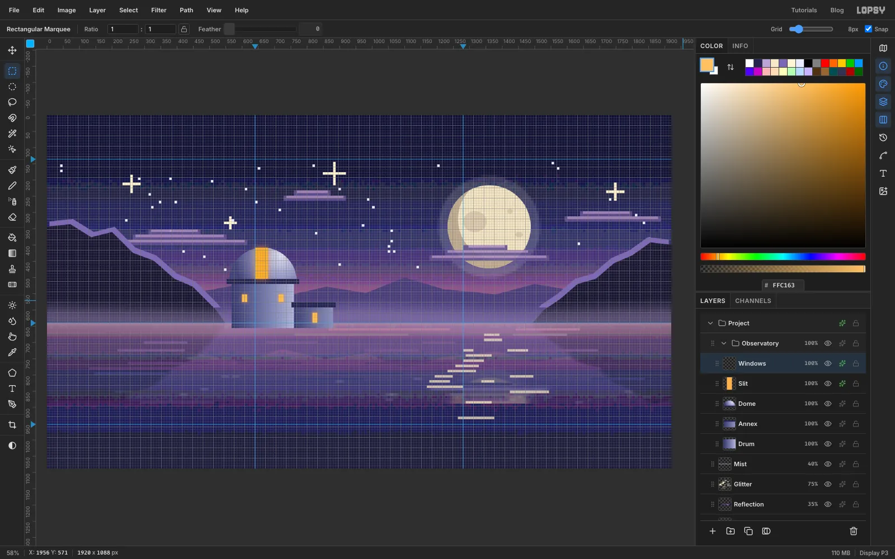

Add a **Slit** layer and fill a 32 × 96 rectangle down the middle of the
dome with `#FFB24A`. In its effects drawer, turn on **Outer Glow** with
colour `#FF9A3C`, **Size 28** and **Opacity 70**.

Add a **Windows** layer. Fill three 16 × 24 windows in `#FFC163`: two on
the drum and one on the annex. Give them an Outer Glow in the same colour
at **Size 16**, **Opacity 60**.

> **Tip:** To try other placements, click the **Observatory** group's row
> and drag with the Move tool. Every layer in it moves together, and one
> [[⌘Z]] puts it all back.

## Scale the whole group up

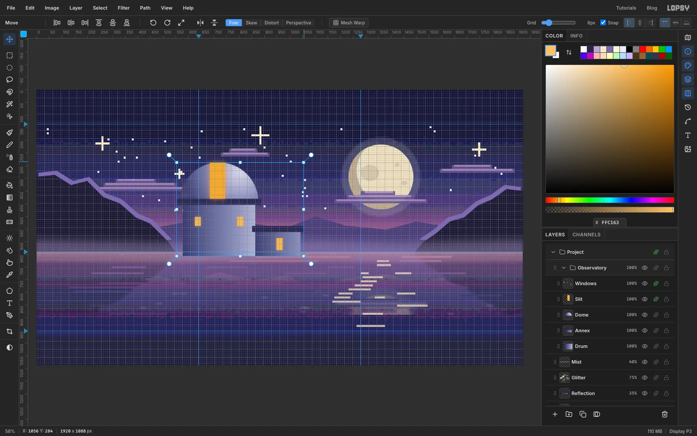

The building is too small to carry the frame. Click the **Observatory**
group's row and switch to the **Move** tool. With no marquee, the transform
box frames every layer in the group.

Hold [[⌘]] and drag the **top-right** handle up and out until the box is
about **150%** as wide. [[⌘]] keeps the scale uniform, and the opposite
corner (bottom left) stays pinned, so the base stays on the horizon. The
transform stays live until you press [[⌘D]] to apply it ([[Enter]] doesn't).

## Bring it forward into the water

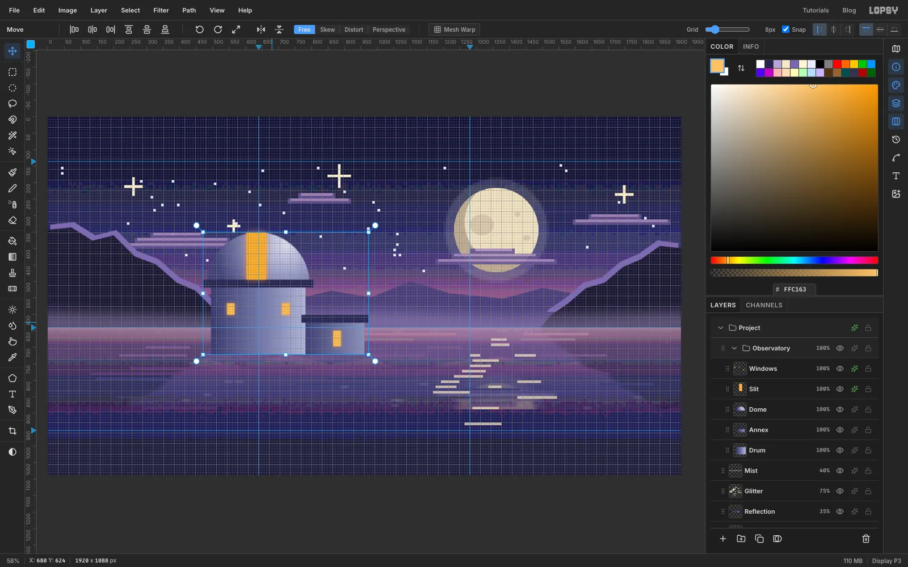

With the group still selected, press [[←]] ten times and [[↓]] eight
times. With Snap on, each press is one 8 px block, so that's 80 px left
and 64 px down. Its base now sits below the horizon, so the building reads
as standing in the flood, not on the far shore. The bottom of the walls will be cut away at the waterline
in a moment.

## Aim the telescope at the moon

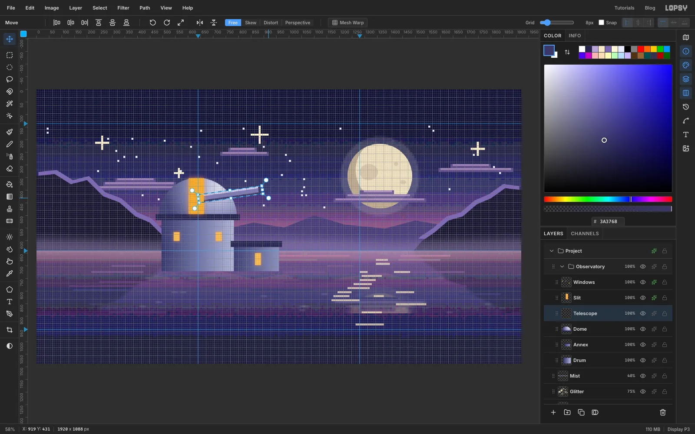

Select **Dome**, add a **Telescope** layer, and fill a 32 × 256 upright
tube in `#7F7AB4`. Put its middle about 100 px right of the slit, level
with the bottom of the slit. When you turn it about its centre, the lower
end swings into the slit. Add an 8 px highlight stripe of
`#D2CDF0` down its left side and an 8 px shadow stripe of `#3A3768` down
its right. Add a 16 px cap of `#3A3768` across the top.

With the marquee still around the tube, **untick Snap**. While the grid
snaps, rotation locks to 15° steps. Use the **Move** tool's corner
rotation handle to turn the tube about **82°** clockwise, until its base
sits in the slit and its tip points at the moon. If the base misses, drag
inside the box to slide the tube into place. Press [[⌘D]], then tick
**Snap** again.

Because the telescope sits **under** the Slit layer, the slit's glow
overlaps its base, as if the light is coming from inside.

## Merge the building into one layer

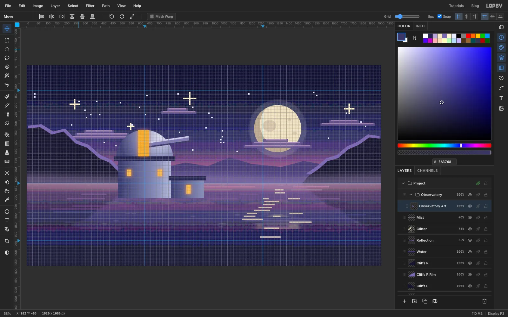

Select **Windows**, the top layer in the group, and choose
**Layer → Merge Down** ([[⌘E]]) until only one layer is left in the group.
That's five merges. Rename
it **Observatory Art**.

Merge Down bakes the upper layer's glow into the pixels. The lower layer's
effects stay live on the merged result. Merging into the effect-free
layers at the bottom of the group is why the telescope doesn't pick up an
amber outline.

## Cut it at the waterline

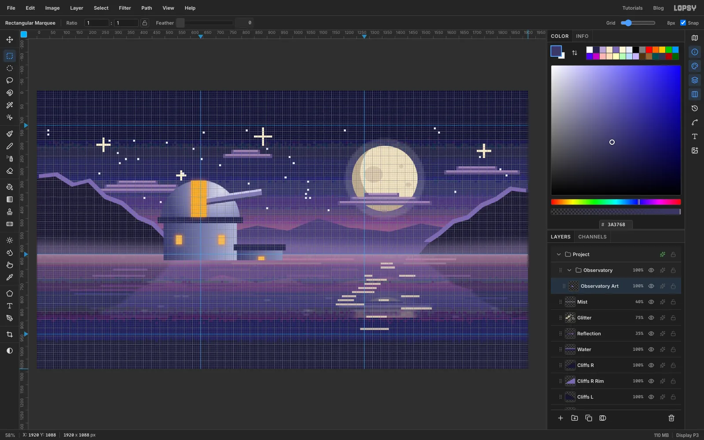

Marquee from y **664** down to the bottom of the canvas, across the full
width, and press [[Delete]]. The annex window is now half under water,
which sells the flood.

## Reflect the observatory

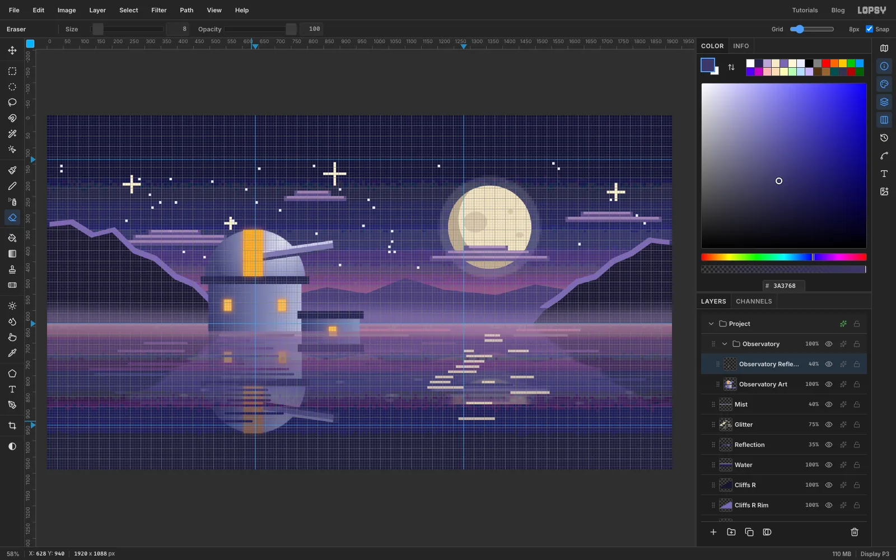

1. Click **Duplicate Layer** and rename the copy **Observatory Reflection**.
2. **⌘-click** its thumbnail, switch to the **Move** tool and click
   **Flip Vertical**.
3. Deselect, then drag the copy straight down until the top of the flipped
   walls touches the cut line, with no gap.
4. Set it to **40%** and erase ripple gaps with the 8 px Eraser, as you did
   for the valley.

## Add ripples at the walls

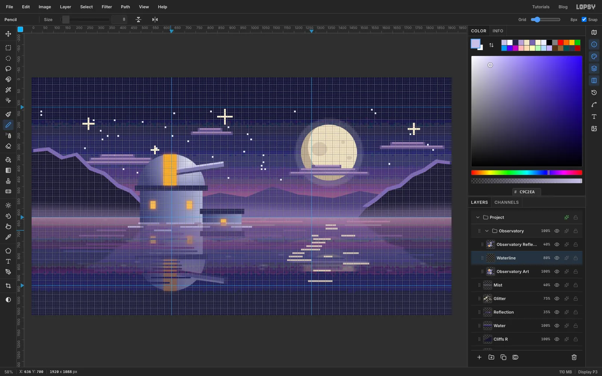

Select **Observatory Art** and add a **Waterline** layer. Use the
**Pencil** at **8** in `#C9C2EA` and draw broken dashes along the
waterline. Leave gaps in them; a solid line would read as a stone ledge.
Add a few shorter dashes 16 px and 32 px below, and set the layer to
**80%**.

## Place the canoe reference

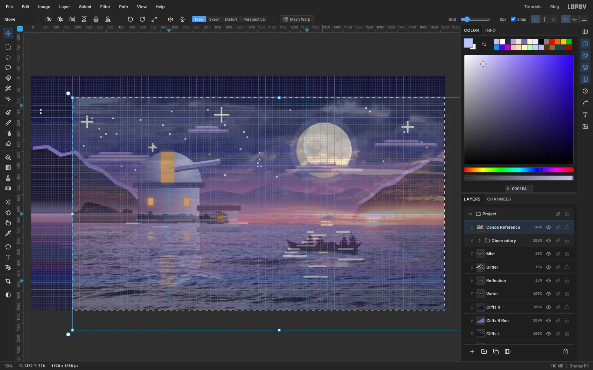

Collapse the **Observatory** group with its arrow and select its row, so
the next layers land above it, not inside it.

Drag the reference photo onto the canvas and name the layer **Canoe
Reference**. Lopsy fits it to the canvas width, so the boat comes in about
360 px long. That's fine at that size. Set the layer to **40%**, then move it
so the boat sits on the moon's glitter path, right of centre. You only need
it for the boat's shape and the crew's poses.

## Trace the hull

Add a **Canoe** layer. With the **Lasso**, click a slim hull over the
photo's boat, drawn a little longer than it, about 430 px from bow to
stern:

- an upswept bow on the left, pointing toward the observatory;
- a straight gunwale 24 px above the keel;
- a smaller lift at the stern.

Fill it with `#110F28`.

## Block in the crew

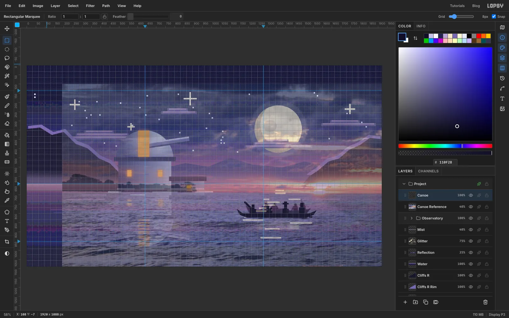

Use rectangular marquees and **Edit → Fill** in `#110F28` for the four
people, using the photo as a guide for spacing. Each one is a torso sitting
on the gunwale with a 16 × 16 head on top, about 88 px apart:

- **Bow passenger:** a 32 × 32 torso.
- **Paddler:** a shorter 32 × 24 torso, with the head set 8 px forward so
  he leans in.
- **Hat:** a 32 × 32 torso, plus a 32 × 8 brim and a 16 × 8 crown on the
  head.
- **Stern paddler:** a taller 32 × 40 torso.

Round each torso's shoulders. Marquee its top-left 8 × 8 block and press
[[Delete]], then do the same for the top-right block.

Now switch to the **Pencil** at **8**. Give the bow passenger a diagonal
arm pointing up at the observatory. Draw the two paddles slanting down to
the water from the paddlers' shoulders, and fill a small 16 × 8 blade at
the end of each, right at the waterline.

When the crew is done, select **Canoe Reference** and click **Delete
Layer**.

## Hang a lantern on the bow

Add a **Lantern** layer. Draw a short pole up from the bow with the 8 px
Pencil in `#110F28`, and fill a 24 × 24 lamp on top in `#FFD27A`. Give it an
**Outer Glow** in `#FF9A3C`, **Size 32**, **Opacity 80**.

The lamp should light something. Switch the Pencil to `#FFB24A` and add a
few blocks of rim light on the bow passenger's front edge and head. Then
draw three short dashes in the water under the lamp for its reflection.
Both are on the Lantern layer, so they pick up its glow too, which is what
you want.

## Reflect the canoe

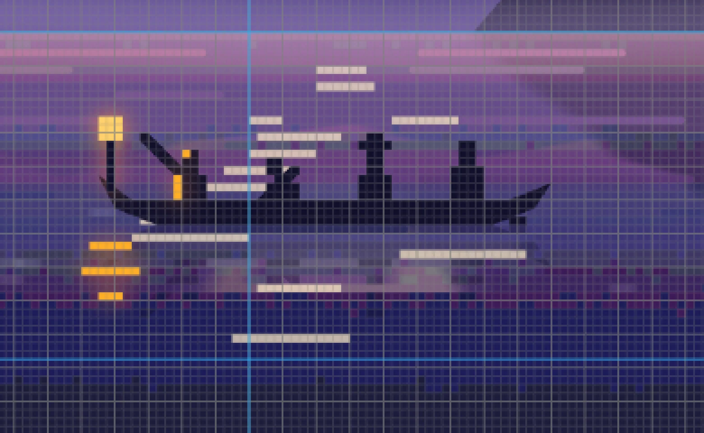

Mirror the canoe the same way as the observatory:

1. Select **Canoe**, click **Duplicate Layer** and name the copy **Canoe
   Reflection**.
2. **⌘-click** its thumbnail and click **Flip Vertical**.
3. Deselect and drag it down until the flipped keel meets the original
   keel, the hull's bottom edge.

The paddle blades dip below the waterline, so their mirror images land on
top of the hull. Marquee everything above the waterline on this layer and
press [[Delete]]. Then set the layer to **35%** and erase a few ripple
gaps.

## Draw the wake

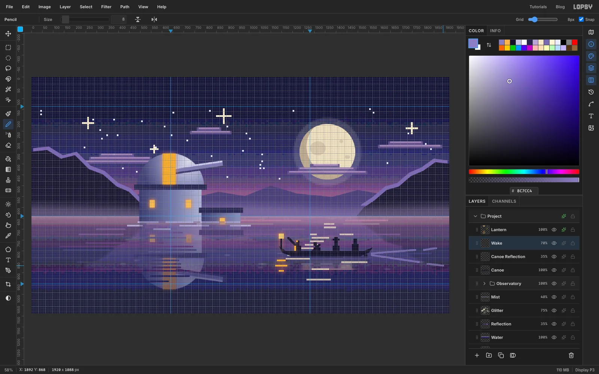

Add a **Wake** layer. With the **Pencil** at **8** in `#8C7CC4`,
**Shift-click** two long lines that spread out from the stern. Add two
shorter broken pieces past their ends. On an 8 px pencil, gentle slopes
come out as neat pixel stair-steps. Set the layer to **70%**.

## Release the fireflies

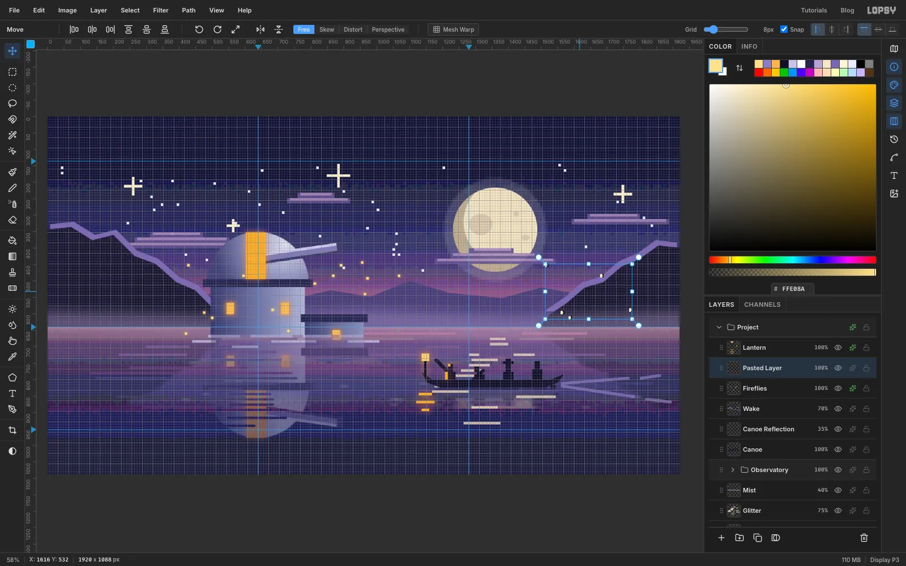

Add a **Fireflies** layer. With the 8 px Pencil in `#FFE08A`, click
fourteen or so single dots around the observatory, then give the layer an
**Outer Glow** in `#FFC163` at **Size 14**, **Opacity 75**.

To scatter a second swarm without redrawing it:

1. Marquee one cluster and press [[⌘C]], [[⌘D]], then [[⌘V]]. The copy
   pastes in place on a new layer.
2. Drag it across to the right-hand shore.
3. Choose **Layer → Merge Down** to fold it back into Fireflies.

## Run the pixel pass

This is the step that makes the painting pixel art.

1. Select **Lantern**, the top layer of the scene, and press [[⌘A]].
2. Choose **Edit → Copy Merged**, press [[⌘D]], then [[⌘V]]. Name the new
   layer **Pixel Pass**.
3. Run **Filter → Pixelate…** at **8**.
4. Run **Posterize** at **16** levels.

The stamp has no transparent pixels, so Pixelate turns all of it into
clean 8 × 8 blocks. That includes the soft glows, the mist and the
anti-aliased curves. Posterize then puts the dome, the halo and the mist
in stepped bands.

The layers underneath stay intact. If you change something, hide the
Pixel Pass, fix it, and make a new stamp.

## Add the letterbox bars

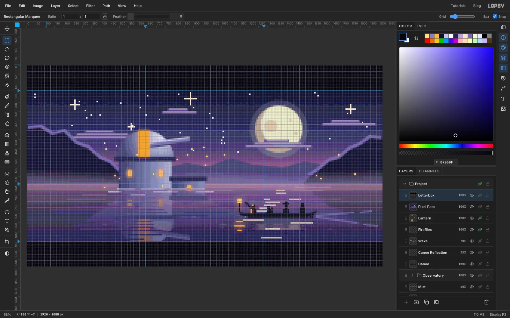

Add a **Letterbox** layer above the Pixel Pass. Fill the top bar (from the
top edge down to the 136 guide) and the bottom bar (from the 952 guide to
the bottom edge) with `#07060F`.

## Set the slate in Silkscreen

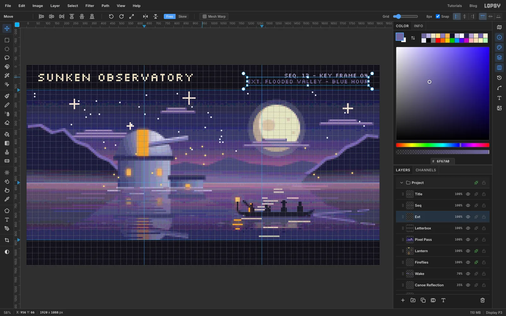

**Silkscreen** is a pixel font drawn on an 8-unit grid. At **Size 64**,
each of its pixels is exactly 8 px, so the title matches the picture. At
**Size 32**, its pixels are half a block, which suits small captions.

Pick the **Text** tool and choose **Silkscreen** in the options bar's font
menu. Before each new piece of type, select **Letterbox**, so the Text tool
doesn't restyle the text you just made. Then click in the bar and type.
Rename each layer as you go (**Title**, **Seq**, **Ext**). Use the Regular
weight for all of these:

- **SUNKEN OBSERVATORY:** Size 64, `#F2E6C8`.
- **SEQ. 12 - KEY FRAME 04:** Size 32, `#B7AEE0`.
- **EXT. FLOODED VALLEY - BLUE HOUR:** Size 32, `#6F67A0`.

Switch to the **Move** tool and untick **Snap**, so the arrow keys move
1 px at a time. Line each one up:

- **Title:** its left edge on x 64 and the top of its capitals on y 48, so
  it's centred in the 136 px bar.
- **Slate lines:** their right edges on x 1856. Put the first line's caps
  level with the title's at y 48, and the second line at y 80.

## Lay out the colour key

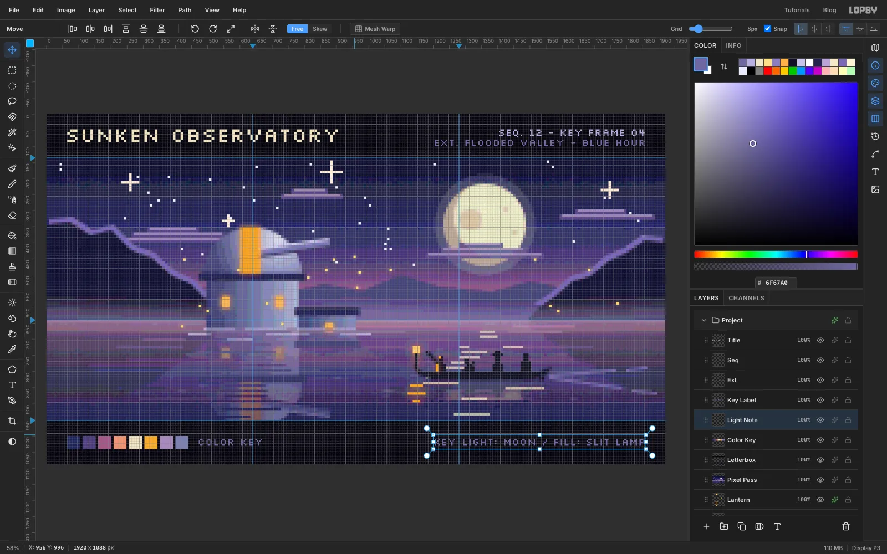

Tick **Snap** again and add a **Color Key** layer. Fill eight 40 × 40
chips at y 1000, the first at x 64 and one every 48 px. Use these colours:
`#1E2458`, `#4A3C7C`, `#9A5A86`, `#E99A7A`, `#F2E6C8`, `#FFB24A`,
`#A68BBE` and `#7C80B0`. Leave the near-black colours out, because a chip
in them would vanish on the bar.

Add **COLOR KEY** (Size 32, `#6F67A0`) 32 px after the last chip, as a
layer named **Key Label**. Add **KEY LIGHT: MOON / FILL: SLIT LAMP** in the
same style, ending on x 1856, as **Light Note**.
Give both the same vertical centre as the chips.

## Stamp it approved

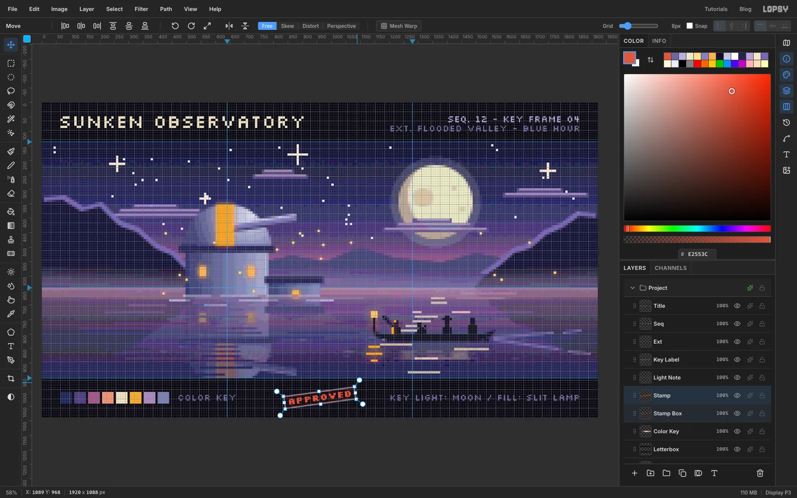

1. Add **APPROVED** in Silkscreen at **Size 32**, `#E2553C`, and rename
   the layer **Stamp**. Set its **Font weight** to **Bold** (700), then
   nudge it so it's centred on **960, 1020**.
2. Select **Color Key** and add a **Stamp Box** layer, which lands under
   the word. Fill a rectangle 16 px wider than the word on each side and
   12 px taller top and bottom with `#E2553C`.
3. Marquee the inside, 4 px in from each edge, and press [[Delete]] to
   leave a frame.
4. Click **Stamp**, then **Shift-click** **Stamp Box** to select both.
   Switch to the **Move** tool, untick **Snap**, and drag the corner
   rotation handle about **8°** anticlockwise. Both layers turn together
   about one centre, and the word stays live, editable text.
5. Press [[⌘D]] to finish.

## Save and export

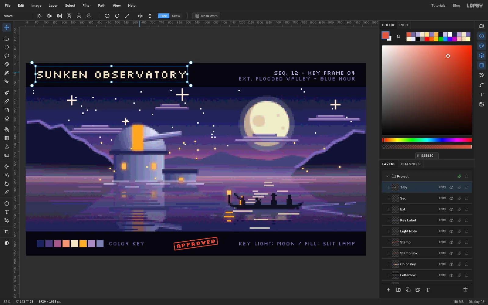

Hide the grid (**View → Show Grid**) and the guides (**View → Show
Guides**) to look at the frame clean. Then save the layered project with
**File → Save Project** and export with **File → Quick Export PNG**.
