In the villages around Łowicz in central Poland, people decorated their homes with **wycinanki**: paper cuts made with sheep shears. A Łowicz cut starts with a symmetric black shape. Smaller pieces of coloured paper are glued on top, each one a little smaller than the one under it, so every colour ends up with a thin black edge. Roosters, tulips and a tree of life are the favourite subjects.

In this tutorial you'll build that look in Lopsy as a flyer for **Babcia's Naleśniki**, a made-up stall selling Polish crêpes (*naleśniki*) and pierogi at a Saturday farmers' market. The flyer is 1200 × 1700 px, a little narrower than letter size.

The main lesson is how to fake cut paper. Each colour sits on its own layer. To get the black base, you load the colour pieces as one selection, **grow** it a few pixels and fill it with black on a layer underneath. A soft **Drop Shadow** then lifts each sheet off the one below. On the way you'll get a lot of mileage out of **symmetry**:

- **Radial Symmetry** turns a single brush click into 32 scallops, a ring of petals or a whole flower
- the **Eraser** follows the same symmetry, so one click punches a full ring of lace holes
- **mirror symmetry** paints both halves of the tree of life at once
- for the second rooster you **duplicate the group** and **flip** it

The tools you'll use:

- **guides**, the **grid** with snapping, and the Elliptical Marquee's exact-size dialog
- the **Brush** with Radial Symmetry, mirror symmetry and **Taper**, plus the **Eraser** and **Pencil**-style Shift-click lines
- the **Reference** drawer and a dropped-in photo, scaled and moved with the Move tool
- the **Pen** tool and **Path to Selection**, the **Lasso** with add and intersect
- **Select → Grow**, **Shrink** and **Inverse**, plus [[Cmd]]-click on a layer thumbnail to load its shape
- **Copy**, **Paste**, **Flip Horizontal** and **Flip Vertical**, **Merge Down**, and **Image → Flip Horizontal** on a group
- **Edit → Define Pattern** and **Fill with Pattern…**
- the filters **Add Noise** and **Gaussian Blur**, the **Overlay** blend mode, and the **Drop Shadow** and **Color Overlay** effects
- live text in **Courgette**, **Bevan** and **Fjalla One**, rotated with the Move tool's handle

The palette:

- Paper `#EDE0C2`, inner disc `#F8EBCF`, black paper `#1B1512`
- Magenta `#D02A6C`, red `#D8342C`, vermilion `#E0532E`
- Emerald `#1E8A52`, leaf green `#2E9E4F`
- Cobalt `#2B4AA6`, marigold `#F2B21B`
- Grain grey `#808080` (only used for the texture layer)

> **Tip:** On a wide-gamut (Display P3) screen, Lopsy reads typed hex codes as P3 colours, which look a little more saturated than the same codes on an sRGB screen. The flyer was made in a P3 session.

> **Note:** Shortcuts are written for a Mac. On Windows use [[Ctrl]] wherever it says [[Cmd]].

## Set up the paper and two guides

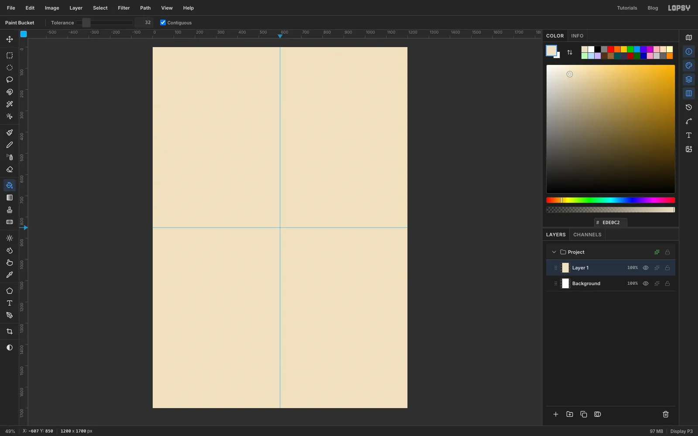

Choose **File → New** and make a document **1200** wide and **1700** high, in pixels.

Click *Layer 1*, set the foreground to `#EDE0C2`, pick the **Paint Bucket** and click the canvas to fill it. You'll rename this layer *Paper* in a moment.

Make sure the rulers are showing (**View → Show Rulers**). Click the top ruler at **600** to drop a vertical guide down the middle, and click the left ruler at **850** for a horizontal guide. Where they cross is the centre of the medallion, and every symmetric piece in this flyer hangs off that point.

## Cut the black medallion

Click **Add Layer** and name it *Medallion*.

Pick the **Elliptical Marquee** and click once on the canvas without dragging. A dialog opens where you can type exact corners. Enter **From 208, 458** and **To 992, 1242**. That's a circle with a radius of 392 px around the guide crossing.

Set the foreground to `#1B1512` and choose **Edit → Fill**. Press [[Cmd+D]] to deselect.

## Scallop the edge with Radial Symmetry

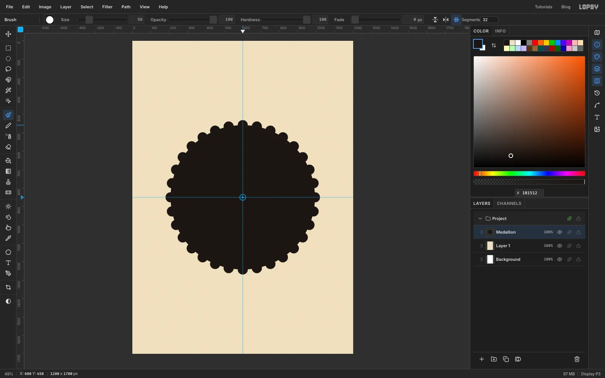

Pick the **Brush** and set **Size 56**, **Hardness 100** and **Opacity 100**.

In the options bar, click the snowflake button (**Radial Symmetry**) and set **Segments** to **32**. [[Cmd]]-click the guide crossing to move the symmetry centre there.

Now click once on the top edge of the circle, where the vertical guide meets it. Lopsy repeats that one dab 32 times around the centre, and the circle gets a scalloped edge.

## Punch lace holes with the Eraser

Radial symmetry works for the **Eraser** too, so one click punches a full ring of holes.

Pick the **Eraser** and set **Size 15**. Click just above the circle's top edge, in the middle of the top scallop (about 13 px above the edge). You get a hole in every scallop.

Set the Eraser to **Size 8**. Click on the black about 75 px in from the scallops, halfway between the top scallop's hole and the next hole to the right. That makes a second, finer ring of holes. The cream disc will cover the middle later, so these holes end up just outside its rim.

Click the snowflake button again to turn Radial Symmetry off.

## Paint a ring of petals

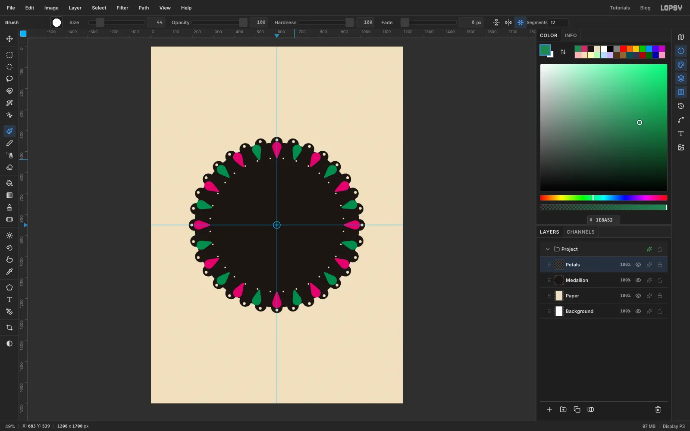

Click *Layer 1* and rename it *Paper*. Click *Medallion*, then **Add Layer**, and name the new layer *Petals*.

Pick the **Brush** with **Size 44**. Open the brush presets (click the brush tip at the left of the options bar), go to the **Shape** tab and set **Taper** to **62**. Taper is a distance in pixels: the brush shrinks to a point over that length of stroke. Set it a little longer than the stroke you're about to draw and the stroke starts fat and ends in a point. Close the panel.

Turn **Radial Symmetry** back on with **Segments 12**. The centre is still on the guide crossing.

Set the foreground to `#D02A6C`. Start on the centre guide at the top of the black ring, just inside the scallops, and drag about 52 px straight down towards the centre. You get twelve pink teardrops.

Set the foreground to `#1E8A52` and draw the same stroke again, this time starting halfway between the top pink petal and the one to its right, and aiming at the centre. The green petals land between the pink ones.

## Dot the petals and lay the cream disc

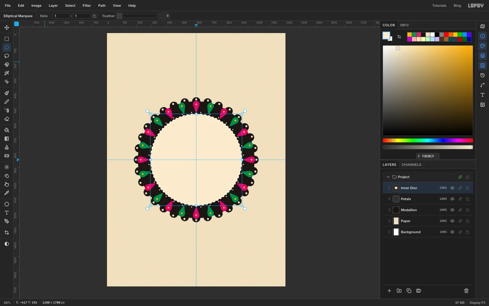

Open the brush presets and set **Taper** back to **0**. Set **Size 13**, **Segments 24**, and the foreground to `#F2B21B`. Click once near the fat end of the top petal. Every petal gets a yellow eye.

Turn Radial Symmetry off. Click **Add Layer** and name it *Inner Disc*. Click once with the **Elliptical Marquee** and enter **From 292, 542** **To 908, 1158**. Fill it with `#F8EBCF` and deselect.

The disc is a lighter, warmer cream than the paper, so it reads as a separate sheet glued on top.

## Look at a real rooster

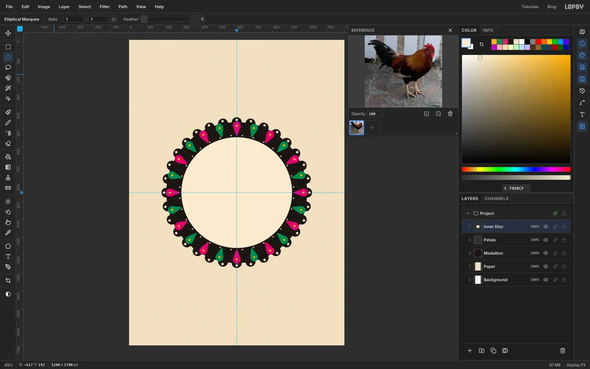

Folk roosters are stylised, but they still need the right proportions: a big chest, a short back, a high tail and strong legs. Draw from a photo, not from memory.

Open the **Reference** drawer from the right-hand toolbar and load a side-on rooster photo. This one is *Rooster in Key West, Florida* from Wikimedia Commons, released under CC0. It was cropped to the bird before loading. Keep the drawer open while you draw.

## Drop the photo in and scale it down

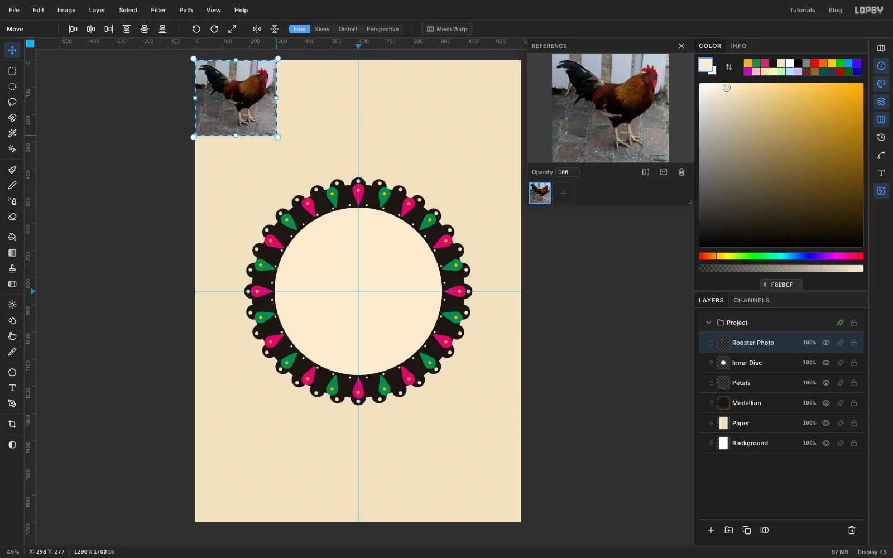

To trace the photo, you need it on the canvas too. Click *Inner Disc*, then drag the photo file from your desktop onto the canvas. It lands as a new layer in the top-left corner with its pixels selected and the **Move** tool active.

Hold [[Cmd]] and drag the bottom-right corner handle up and to the left until the photo is about **31%** of its size. Holding [[Cmd]] keeps the proportions. For this crop that's about 298 × 277 px.

## Place the photo where the left rooster stands

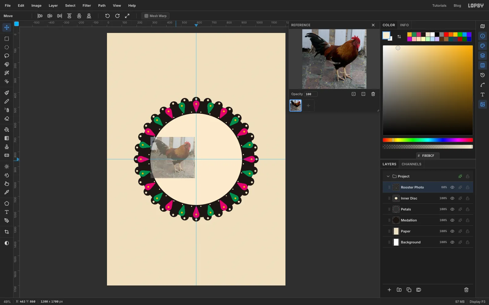

Drag the photo into the left half of the disc so the rooster's beak stops about 35 px short of the centre guide. Its top-left corner lands at about (293, 700). Press [[Cmd+D]].

Rename the layer *Rooster Photo* and lower its opacity to **60%** with the opacity button on its row. That makes it easier to see your shapes on top.

## Fan out the tail feathers

Zoom in on the rooster: press [[Cmd+=]] a few times (to about 200%) and hold [[Space]] to drag it into view.

Make sure *Rooster Photo* is active, click **New Group** in the Layers panel and name it *Rooster L*. Every rooster layer goes inside this group:

- **Base:** click **Add Layer** and name it *Base*. It stays empty for now and will become the black paper under the bird.
- **Legs:** add a layer called *Legs*. Use the **Brush** at **Size 9** in marigold `#F2B21B`. Click at the top of each leg in the photo, [[Shift]]-click the ankle, then from the ankle Shift-click out three toes.
- **Tail:** add a layer called *Tail*. Each feather is a tapered stroke. Start it at the feather's tip and drag in to the root, the point where the tail meets the back.

Paint the tail in three passes:

1. **Green feathers:** **Size 40**, **Taper 100**, emerald `#1E8A52`. Paint five strokes about 86 px long, fanning from pointing left to pointing up and to the right.
2. **Pink feathers:** paint one in each of the four gaps between the green ones, and paint each one twice. First in black `#1B1512` at **Size 40**, **Taper 90**, then in magenta `#D02A6C` at **Size 34**, **Taper 84**, along the same line. The pink is wide enough to cover most of the green, so only the green's rounded tips show past it, like a scalloped edge. The black shows as a thin outline around each pink feather, just like layered paper.
3. **Quills:** a thin yellow line along each of the five green feathers' lines. Paint each one in black at **Size 17** first, then in marigold at **Size 11**, from about 80 px out to 20 px from the root.

Set **Taper** back to **0** when you're done.

## Trace the body with the Pen

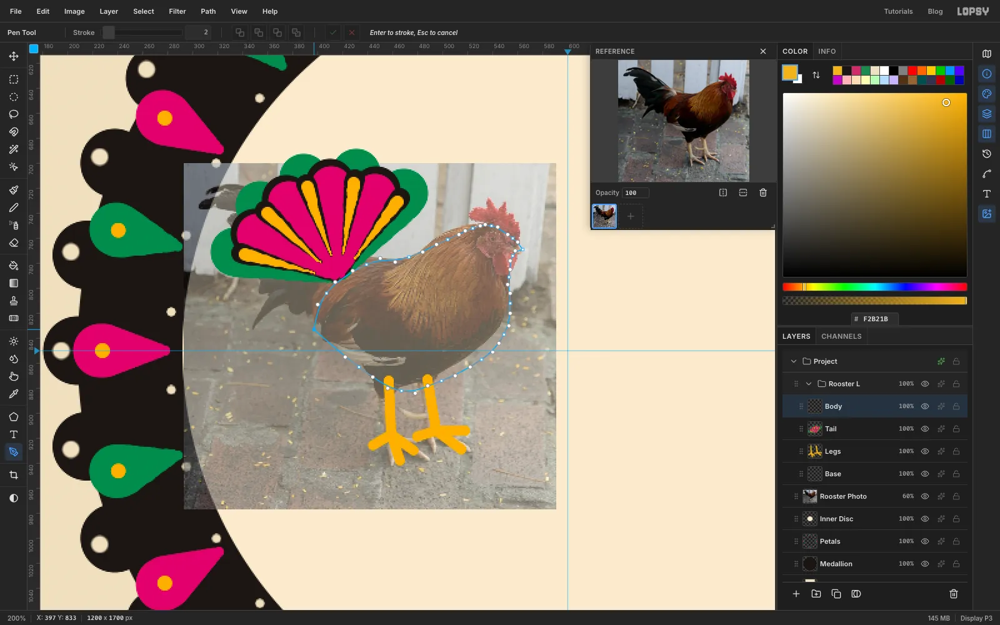

Add a layer called *Body*. Pick the **Pen** tool and trace the bird's silhouette over the photo, leaving out the tail and legs.

Start at the tip of the beak with a plain click, so it's a sharp corner. Then work clockwise: under the beak, down the throat and full chest, along the round belly, and up to a sharp corner where the tail joins. Come back along the back and neck to the top of the head. Drag each of those anchors a little to pull out curve handles, and click the first anchor to close the path.

Open the **Paths** panel, click **Path to Selection**, then **Delete Path**. Fill with cobalt `#2B4AA6` and deselect.

## Cut a zigzag neck cape

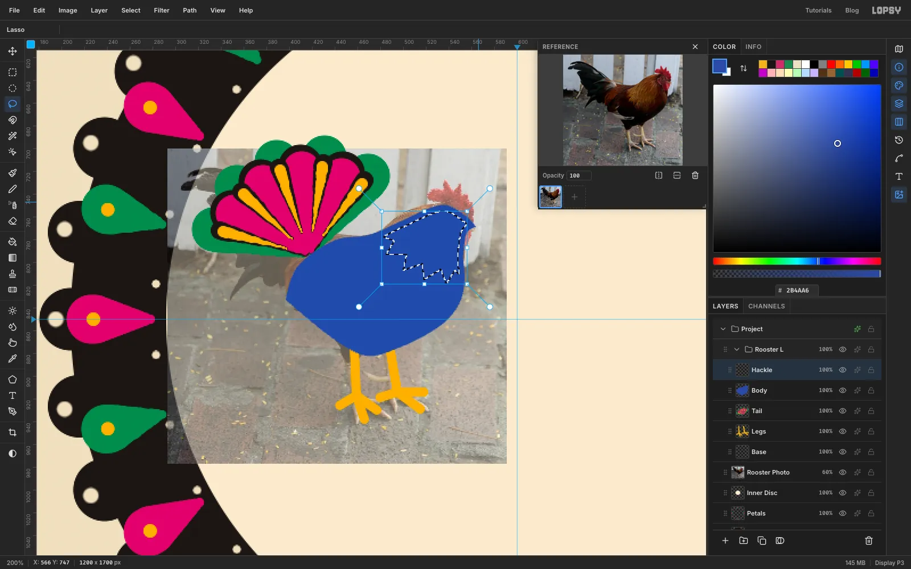

The neck feathers (the hackle) are a yellow cape with a zigzag edge.

Add a layer called *Hackle*. [[Cmd]]-click the *Body* thumbnail to load the body's shape as a selection, then choose **Select → Shrink…** and enter **5** px. Shrinking keeps a cobalt rim around the yellow.

Pick the **Lasso**, hold [[Shift]]+[[Alt]] (intersect), and draw a loose shape around the head and neck. Give its lower edge sharp zigzag points across the shoulders and chest. Only the overlap of the two selections stays selected. Fill with marigold `#F2B21B` and deselect.

## Add the wing, comb, beak and eye

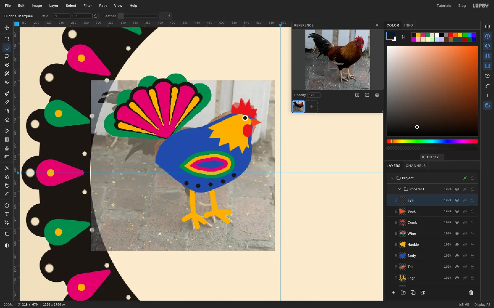

Add a layer called *Wing*. With the **Pen**, draw a teardrop over the wing, pointing back at the tail, and turn it into a selection. Fill it with emerald. Then make the layers:

- **Shrink 6**, fill marigold
- **Shrink 5**, fill magenta
- **Shrink 5**, fill cobalt

Deselect. With the Brush at **Size 8** in black, click five cut dots in a gentle curve along the belly under the wing.

Add a layer called *Comb*. Pen the comb's five points in red `#D8342C`, with plain clicks for the points, turn the path into a selection and fill it. Then add the wattle on the same layer: drag a small **Elliptical Marquee**, about 15 × 21 px, over the photo's wattle under the beak, fill it red and deselect.

Add a *Beak* layer, **Lasso** a small triangle over the photo's beak, and fill it with vermilion `#E0532E`.

Add an *Eye* layer. Drag a 10 px circle with the **Elliptical Marquee** over the photo's eye (hold [[Shift]] to keep it round) and fill it with cream `#F8EBCF`. Drag a 6 px circle in the middle of it, fill it black and deselect.

## Glue everything onto black paper

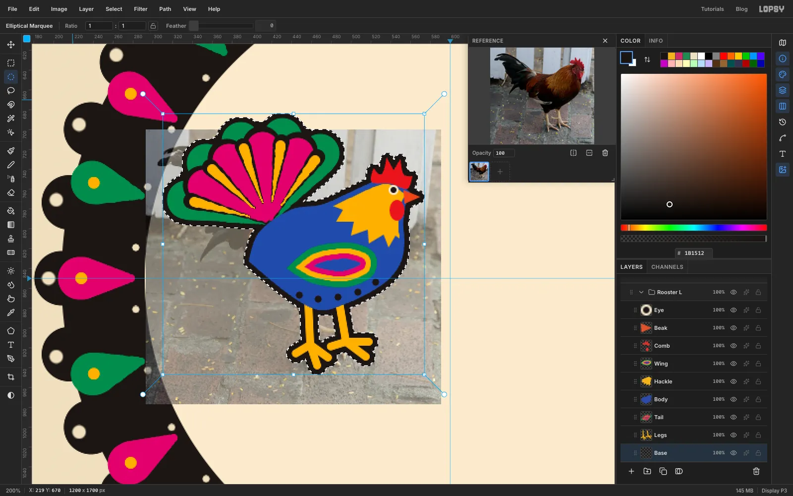

This is the step that makes it look like cut paper.

Click the empty *Base* layer. [[Cmd]]-click the *Body* thumbnail. Then [[Cmd]]+[[Shift]]-click the *Tail*, *Legs*, *Comb* and *Beak* thumbnails to add each one to the selection.

Choose **Select → Grow…** with **5** px, fill with black `#1B1512` and deselect. Every piece now sits on one black sheet that's a little bigger than the colour on top.

## Lift the rooster off the page

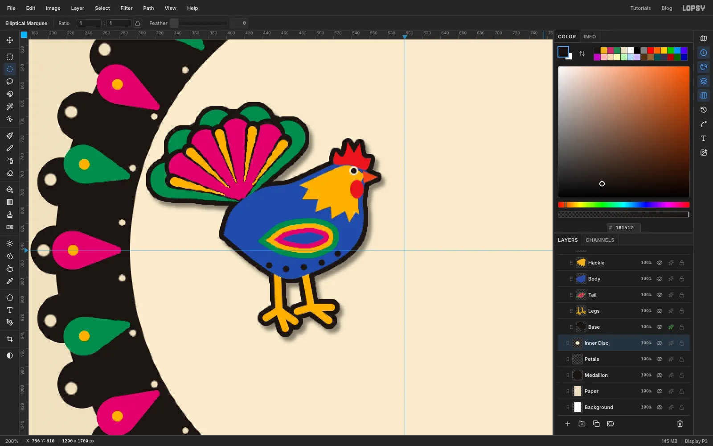

With *Base* still active, open its effects (the sparkle button on its row) and turn on **Drop Shadow**: **Offset X 4**, **Offset Y 5**, **Blur 6**, **Opacity 45**.

Select *Rooster Photo* and click **Delete Layer**. Close the Reference drawer, and choose **View → Fit to Screen**.

## Flip a copy of the group

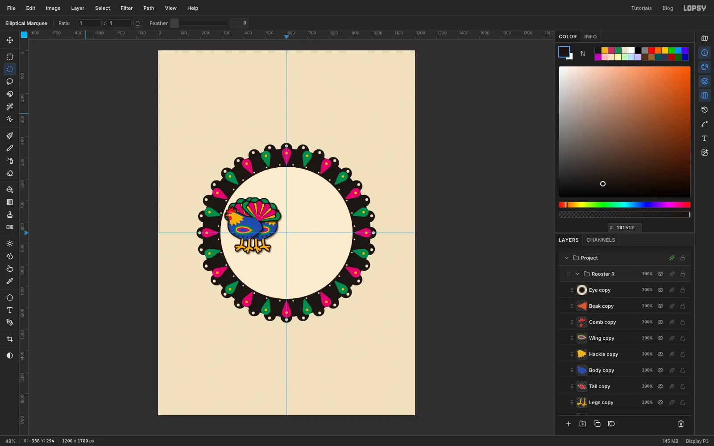

Collapse the *Rooster L* group and click its row. Click **Duplicate Layer** and rename the copy *Rooster R*.

Choose **Image → Flip Horizontal**. With a group active, every layer inside it flips as a unit, in place, so the copy now faces left on top of the original.

## Slide it across the centre guide

Pick the **Move** tool and drag the *Rooster R* group straight to the right, about 317 px, until the two beaks are the same distance from the centre guide. Finish with the arrow keys so the two birds are exact mirror images.

## Grow the tree of life with mirror symmetry

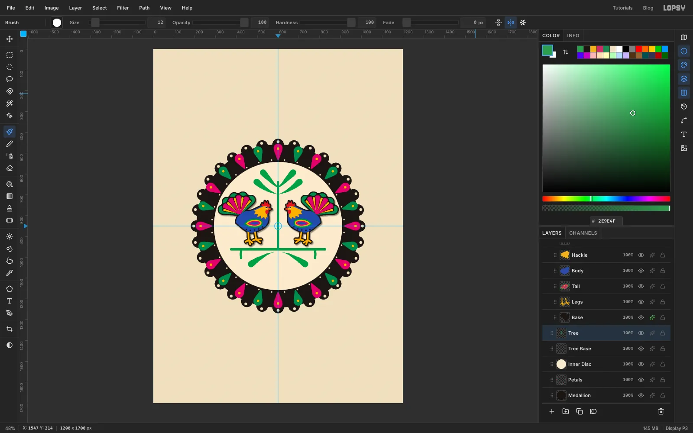

Click *Inner Disc*, then **Add Layer** twice. Name the first *Tree Base* and the second *Tree*, so the tree sits under both roosters.

Pick the **Brush** at **Size 11** in leaf green `#2E9E4F`. In the options bar, click the mirror button labelled **Symmetry Vertical**, then [[Cmd]]-click on the centre guide to put the mirror line there. Anything you paint on one side now appears on the other.

- **Stem:** click on the centre guide a little above the roosters' combs and [[Shift]]-click straight below, just under their feet.
- **Branch:** at **Size 13**, click a little left of the left rooster's tail, level with its feet, and Shift-click the centre guide. The roosters now stand on it.
- **Leaves:** at **Size 31** with **Taper 118**, draw two leaves from their fat tips in to the stem above the roosters. Draw one more drooping down from the base of the stem.
- **Hanging stems:** at **Size 12** with no taper, draw a short stem down from the end of the branch.

Click four marigold dots up the stem at **Size 9**, then turn **Symmetry Vertical** off.

## Hang two little flowers and pen the top tulip

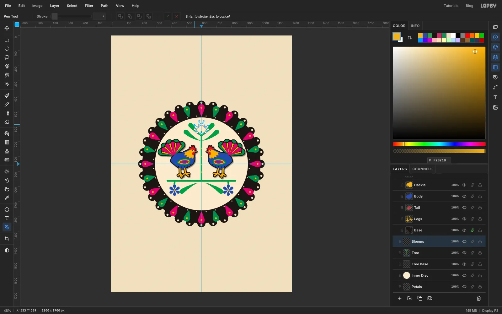

On the same *Tree* layer, turn on **Radial Symmetry** with **Segments 6** and [[Cmd]]-click at the bottom of the left hanging stem to centre it there. With **Size 20**, **Taper 26** and cobalt `#2B4AA6`, drag one stroke from about 28 px above that point in towards it. That's a whole six-petal flower. Turn Radial Symmetry off, set **Taper** to **0**, and click a marigold centre at **Size 12**. Repeat at the bottom of the right hanging stem.

Add a layer called *Blooms*. With the **Pen**, draw the top tulip over the end of the stem: plain clicks for its five points, and a smooth curve for its rounded base.

## Layer the blooms colour inside colour

Turn the tulip path into a selection, fill it red, then **Shrink 7** and fill it marigold. Deselect.

Lasso a heart below the branch and fill it magenta. **Shrink 7** and fill marigold, then **Shrink 7** again and fill red.

On the left side only, Pen a small cobalt bud hanging from the drooping leaf (**Shrink 5**, marigold inside). Pen a small magenta tulip at the end of the upper-left leaf (**Shrink 5**, marigold inside).

## Copy, paste and flip the side blooms

Pen tools don't use symmetry, so mirror these two by hand.

Draw a **Rectangular Marquee** around the small left tulip, press [[Cmd+C]] and then [[Cmd+V]]. The copy pastes in place on a new layer, already selected, and Lopsy switches to the **Move** tool. Click **Flip Horizontal** in the options bar.

## Slide the copies across and merge them

Drag the flipped tulip straight across to the matching spot on the right, deselect, and press [[Cmd+E]] to **Merge Down** into *Blooms*. Do the same with the cobalt bud.

## Give the tree its black paper

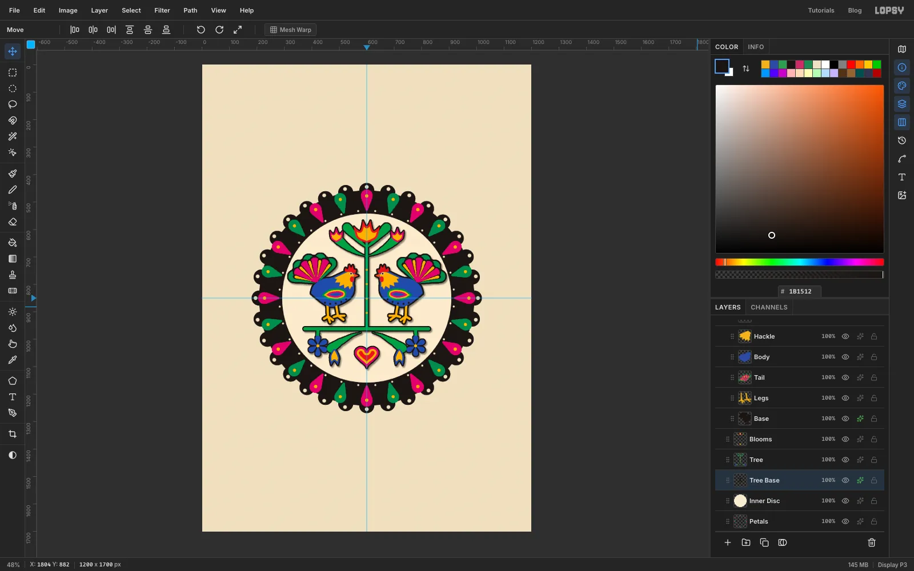

Click *Tree Base*. [[Cmd]]-click the *Tree* thumbnail, [[Cmd]]+[[Shift]]-click the *Blooms* thumbnail, **Grow 4**, fill black and deselect.

Add the same **Drop Shadow** as the roosters: **Offset X 4**, **Offset Y 5**, **Blur 6**, **Opacity 45**.

## Set the headline

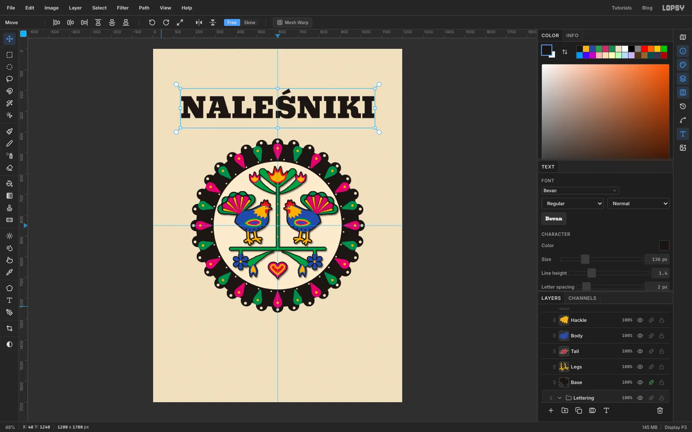

Click *Blooms*, then **New Group** and name it *Lettering*. Add a raster layer called *Ribbon* inside it. New type is created above whichever layer is active, so click *Ribbon* before each new line of text.

Pick the **Text** tool with **Bevan**, size **136**, colour `#1B1512`. Click in an empty margin and type **NALEŚNIKI**. If your keyboard has no **Ś**, type the word elsewhere and paste it. Press [[Tab]] to commit, name the layer *Nalesniki*, and set **Letter spacing** to **2** in the Text panel. With the **Move** tool, centre it on the middle guide, with its middle about 260 px from the top. That leaves room for the script above it and a border later.

## Add the script, tagline and menu

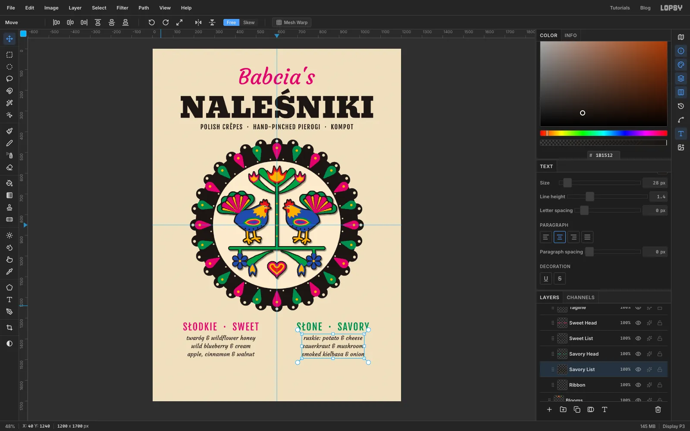

Click *Ribbon* before each of these, and name each layer as you commit it:

- **Babcia's** in **Courgette 104**, magenta `#D02A6C`, centred above the headline. Name it *Babcias*.
- **POLISH CRÊPES · HAND-PINCHED PIEROGI · KOMPOT** in **Fjalla One 30**, black, letter spacing **3**, centred under the headline. Name it *Tagline*.

For the menu, set the Text panel's alignment to **Align center**. A centred point-text block is centred on the spot you click.

- **SŁODKIE · SWEET** in **Fjalla One 46**, magenta, letter spacing **4**, centred 270 px left of the guide (x 330), about 50 px below the medallion. Name it *Sweet Head*.
- the sweet list in **Courgette 28**, black, three lines (twaróg & wildflower honey / wild blueberry & cream / apple, cinnamon & walnut), under that heading. Name it *Sweet List*.
- **SŁONE · SAVORY** and the savoury list (ruskie: potato & cheese / sauerkraut & mushroom / smoked kiełbasa & onion) the same way, centred at x 870, with the heading in emerald. Name them *Savory Head* and *Savory List*.

Press [[Enter]] between list lines, and [[Tab]] to commit each layer.

## Shadow the headline with a second sheet

Click *Nalesniki* and rename it *Nalesniki Shadow*. Click **Duplicate Layer** and name the copy *Nalesniki*.

Click *Nalesniki Shadow*, open its effects and turn on **Color Overlay** with `#E0532E`. With the **Move** tool, press the right arrow key **7** times and the down arrow key **7** times. It looks like a vermilion sheet under the black letters.

## Tilt the script

Click *Babcias* and press [[Cmd+D]] to make sure nothing is selected. With the **Move** tool, the live text shows its own transform box. Drag the round rotation handle just outside the top-right corner up and to the left, around the box's centre, until the script tilts about **5°** and rises to the right. The text stays editable.

## Snap the ribbon to the grid

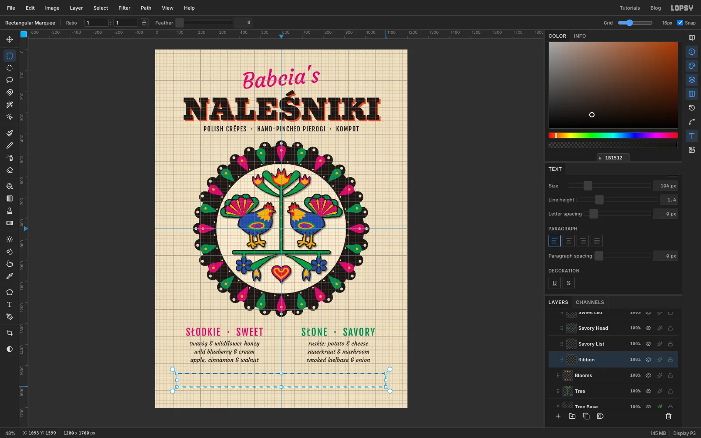

Choose **View → Show Grid**. The grid is 16 px by default and centred on the document, and showing it turns snapping on.

Click *Ribbon*. With the **Rectangular Marquee**, drag across the flyer below the menu, starting about 100 px in from the left edge and ending about 100 px in from the right. Make it about 60 px tall. The corners snap to the grid. Here they landed on 104 and 1096 across and 1538 and 1602 down: a band 64 px tall, centred on the page. Set the foreground to black `#1B1512`, fill, and deselect. Then hide the grid with **View → Show Grid** again.

## Notch the ribbon ends

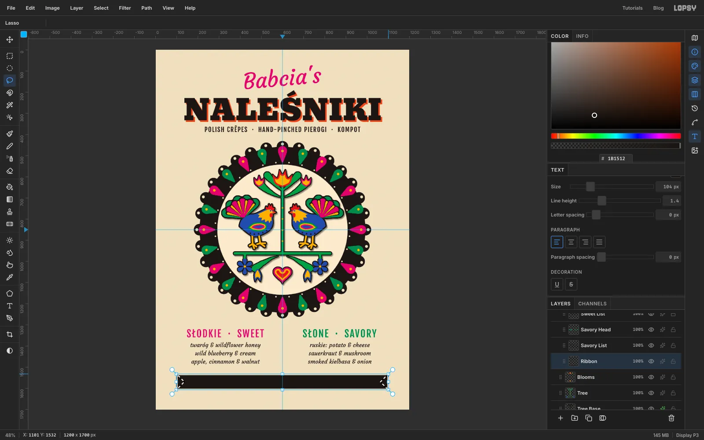

Pick the **Lasso** and draw a triangle at the left end of the ribbon: from just above the top-left corner, in to a point 32 px inside the ribbon at its middle, and out to just below the bottom-left corner. Hold [[Shift]] and draw the mirror-image triangle at the right end to add it.

Press [[Delete]] and deselect. The ribbon now has swallowtail ends.

## Set the date on the ribbon

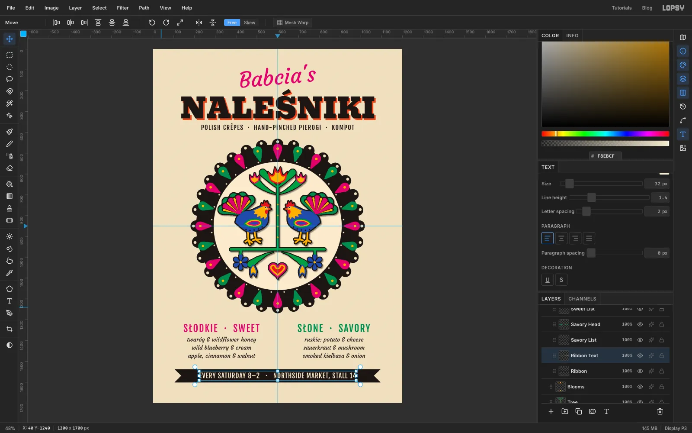

Click *Ribbon* and pick the **Text** tool (the alignment can stay on center). With **Fjalla One 32** in the inner-disc cream `#F8EBCF`, click in an empty margin and type **EVERY SATURDAY 8–2 · NORTHSIDE MARKET, STALL 14**, with three spaces each side of the dot. Commit, name it *Ribbon Text*, and set **Letter spacing** to **2**.

Centre it on the ribbon with the **Move** tool and arrow keys. Leave the same gap above and below the capitals, and about 85 px between the text and each notch.

## Draw one pattern tile

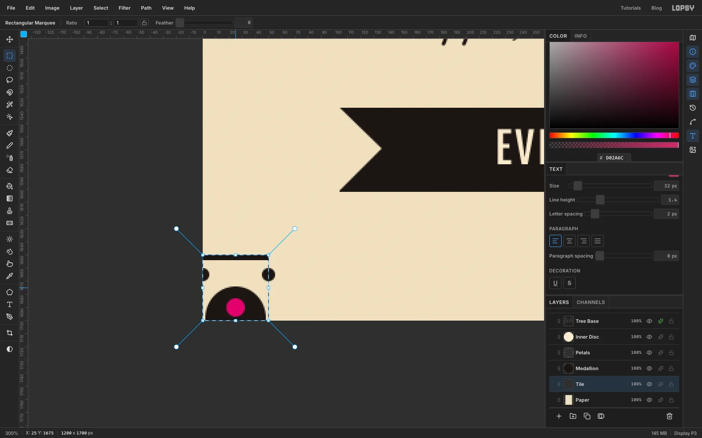

Zoom right in on the bottom-left corner (about 300%). Click *Paper* and add a layer called *Tile*. You'll draw one 50 × 50 px tile in the corner, from (0, 1650) to (50, 1700).

Use the marquees' click-for-dialog: with nothing selected, click once and type the corners. After each fill, press [[Cmd+D]], because the dialog only opens when nothing is selected.

- **Black rule:** set the foreground to black. **Rectangular Marquee** from (0, 1650) to (50, 1654). Fill, deselect.
- **Scallop:** **Elliptical Marquee** from (2, 1674) to (48, 1722). It runs off the bottom of the canvas, so only its top half shows. Fill, deselect.
- **Half dots:** small ellipses centred on the tile's left and right edges, from (−5, 1660) to (5, 1670) and from (45, 1660) to (55, 1670). Fill each, deselect.
- **Magenta dot:** set the foreground to magenta. Ellipse from (18, 1683) to (32, 1697). Fill, deselect.

Draw a **Rectangular Marquee** around exactly the tile, (0, 1650) to (50, 1700), and choose **Edit → Define Pattern**. The two half dots join up when tiles sit side by side.

## Fill the border with the pattern

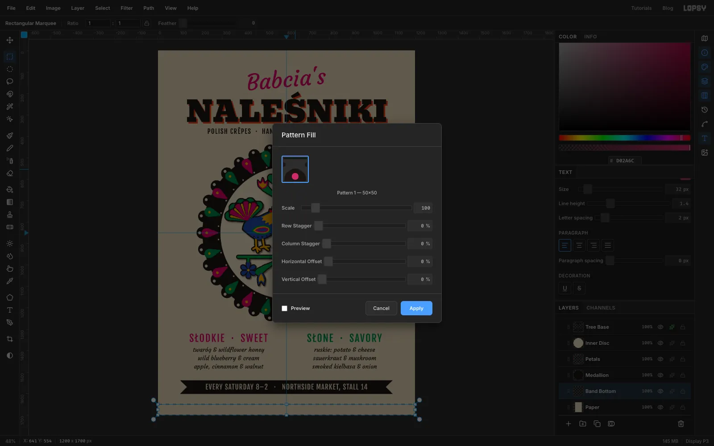

Deselect, choose **View → Fit to Screen**, and delete the *Tile* layer.

Click *Paper*, add a layer called *Band Bottom*, and select the bottom 50 px: (0, 1650) to (1200, 1700). Choose **Edit → Fill with Pattern…**, click your tile in the pattern grid, and click **Apply**. Tiles are counted from the top-left of the document. 1650 is a multiple of 50, so the band starts exactly on a tile edge.

## Copy the border to the top and flip it

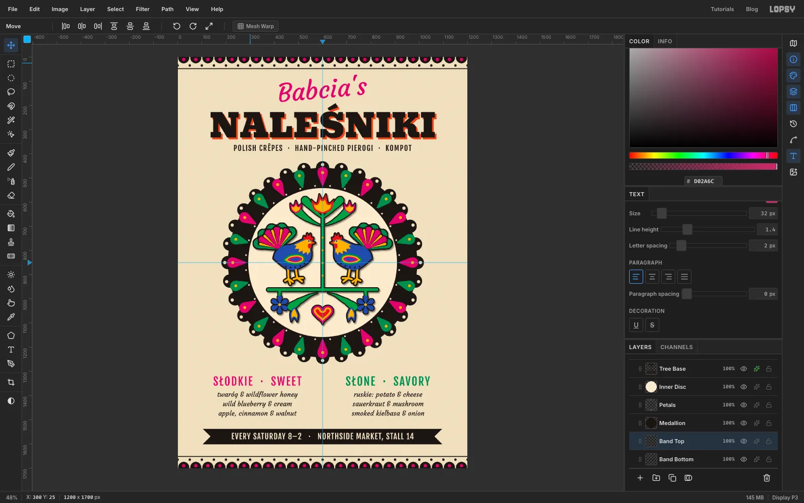

Keep the band selected, press [[Cmd+C]] and [[Cmd+V]], and rename the pasted layer *Band Top*. The paste is already selected and the **Move** tool is active, so click **Flip Vertical** in the options bar.

Drag the flipped band straight up to the top edge and nudge it with the arrow keys until it sits exactly at y 0.

## Dot the inside of the disc

Click *Inner Disc* and add a layer called *Dot Ring*.

Pick the **Brush** at **Size 10** in magenta. Turn on **Radial Symmetry** with **Segments 32** and [[Cmd]]-click the guide crossing to centre it. Click once on the centre guide, 18 px inside the top edge of the cream disc.

Switch to **Size 7** in emerald and click halfway between the top pink dot and the next one to the right, at the same distance from the centre. Turn Radial Symmetry off.

## Add a paper grain

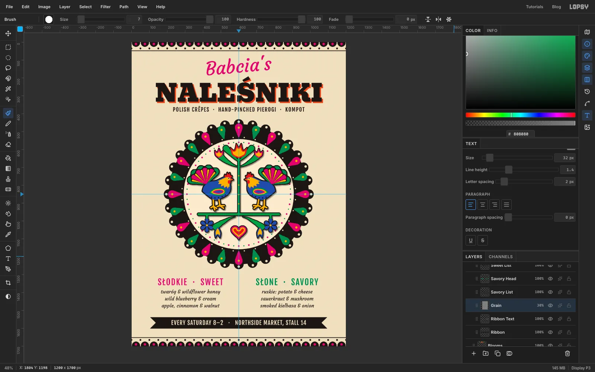

Click *Ribbon Text* and add a layer called *Grain*. It lands just above the ribbon, below the rest of the type and below the two rooster groups. That keeps the lettering and the roosters crisp while the grain shows on the paper, the disc and the medallion. Set the foreground to `#808080` and choose **Edit → Fill**.

Choose **Filter → Add Noise…** with **Amount 45**, **Mono** and **Gaussian**. Then choose **Filter → Gaussian Blur…** with **Radius 1** to soften the specks into a paper-like grain.

Open the layer's effects (the sparkle button) and set **Blend** to **Overlay**, then lower the layer's opacity to **30%**. Overlay leaves mid-grey invisible, so only the light and dark specks show. They show most on the cream paper and hardly at all on the black.

## Shadow the medallion and add the finishing sprigs

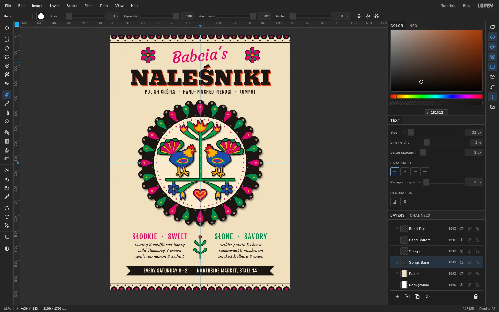

Click *Medallion* and give it a bigger, softer **Drop Shadow**: **Offset X 6**, **Offset Y 8**, **Blur 12**, **Opacity 40**. It's the largest sheet, so it should sit highest off the page.

Click *Paper* and add two layers, *Sprigs Base* and *Sprigs*. On *Sprigs*, paint a little flower either side of the script, level with it and about 250 px in from each edge. For each one, turn on **Radial Symmetry** with **Segments 6** and [[Cmd]]-click the flower's centre:

- a magenta stroke at **Size 24**, **Taper 34**, from 40 px above the centre in to it
- a green stroke at **Size 14**, **Taper 24**, between two pink petals
- turn symmetry off, set **Taper** to **0**, and click a marigold centre dot at **Size 16**

Between the menu columns, turn on **Symmetry Vertical** and [[Cmd]]-click the centre guide. Draw a **Size 6** green stem from level with the headings down to level with the last menu line. Add two pairs of leaves at **Size 16**, **Taper 44**. Turn symmetry off, set **Taper** to **0**, and click a red **Size 18** bud on top.

Finally click *Sprigs Base*, [[Cmd]]-click the *Sprigs* thumbnail, **Grow 3**, and fill black, so these little pieces are cut paper too.

Choose **File → Save Project** to keep every layer, then **File → Quick Export PNG** for a copy to print.
