Pop art took the cheapest printing in America and put it on gallery walls. Roy Lichtenstein painted comic-book dots by hand, and Andy Warhol silkscreened the same image again and again in loud, slightly misaligned colours. Those habits still make a great logo: thick black outlines, a few flat inks and one big idea you can read from across the street.

In this tutorial you'll make a logo sheet for a made-up all-day toast counter, **Electric Toast**. The sheet is laid out like a comic page. The top panel holds the main logo, where a shocked slice of toast gets hit by lightning. Four small panels below repeat the mascot Warhol-style.

The mascot is the key to the whole page. You'll build it as three separate layers, called **colour**, **cheeks** and **ink**, just as a screen printer would split it into separate screens. That's what makes the Warhol panels quick: copy the group, shift the colour layer's hue, and nudge the ink out of register.

Along the way you'll use:
- **Filter → Halftone** on gradients for dots that swell and fade.
- **Color Overlay** plus **Rasterize Layer Style** to turn those dots into one flat ink.
- The **Pen** tool, with **Path to Selection**, for the burst and the bolt.
- **Select → Grow** and **Shrink** for the crust and the outline.
- **Shift+Alt intersect** selections for the teeth and tongue.
- **Define Pattern** and **Fill with Pattern** for dotted backgrounds.
- **Duplicate**, **scale** and **rotate** on whole groups.
- **Mesh Warp** to arch the lettering.

There is one free Google Font, **Bangers**, used for all the lettering. If the letters first appear in a plain font, give it a moment to download before you carry on.

The palette is the primary colours of cheap comic printing, plus the toast:

- Ink `#111014`, paper `#FFF4DC`
- Process red `#E8202A`
- Process cyan `#0FA3E0`
- Process yellow `#FFD500`
- Crust `#E8791E`, crumb `#FFEDBE`, toasted dots `#D9631A`
- Hot pink `#FF3D9A`, violet `#5B2BD6` (for the Warhol panels)

The numbers below are the ones I used on a **2400 × 2400 px** page. Shapes you draw by hand won't match them exactly, and that's fine. The status bar at the bottom left shows the pointer's X and Y, which is handy for measuring. Hold [[Cmd]] and scroll to zoom at the pointer, and press [[Cmd+0]] to fit the page again. Zoom in whenever the work gets small.

## Set up the page and its guides

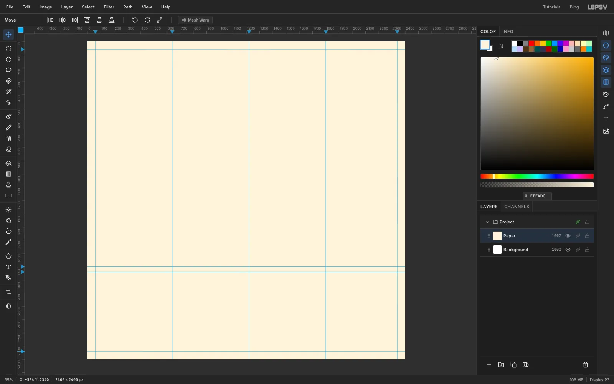

The layout comes first, because everything else has to fit inside it.

1. Create a **2400 × 2400 px** document. It starts with a `Background` layer and a `Layer 1`.
2. Double-click `Layer 1` and rename it `Paper`. Set the foreground colour to `#FFF4DC` and choose **Edit → Fill**.
3. Click the top ruler to add vertical guides at **60**, **640**, **1220**, **1800** and **2340**.
4. Click the left ruler to add horizontal guides at **60**, **1700**, **1740** and **2340**.

The ruler shows the position beside the pointer, and being a few pixels off is fine because the frames will cover the difference. That gives a big panel on top and the left edges of four small panels below. Each small panel is 540 px wide with a 40 px gap between panels, which you'll set exactly when you draw the frames.

## Lay a gradient for the sky

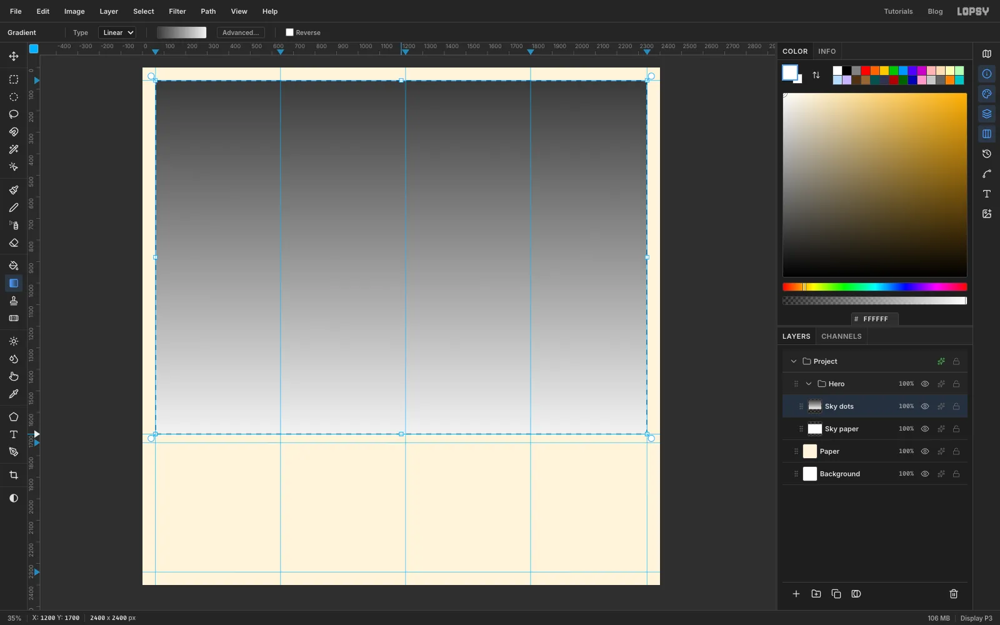

Ben-Day dots look best when they swell and shrink. To get that, you make the dots from a gradient.

1. With `Paper` selected, click **New Group** at the bottom of the Layers panel and name it `Hero`. Click **Add Layer** and name the new layer `Sky paper`.
2. Press [[M]] for the Rectangular Marquee and drag from guide to guide around the top panel. The marquee's edges snap to the guides. Set the foreground to white and choose **Edit → Fill**. Press [[Cmd+D]] to deselect.
3. Add another layer called `Sky dots` and marquee the same panel.
4. Pick the **Gradient** tool, set it to **Linear** and click **Advanced…**. Set two stops, `#3A3A3A` on the left and `#F2F2F2` on the right. To set a stop, click its handle and type the colour into the hex field. Click **Done**.
5. Drag from the top of the panel to the bottom.

## Turn the gradient into dots

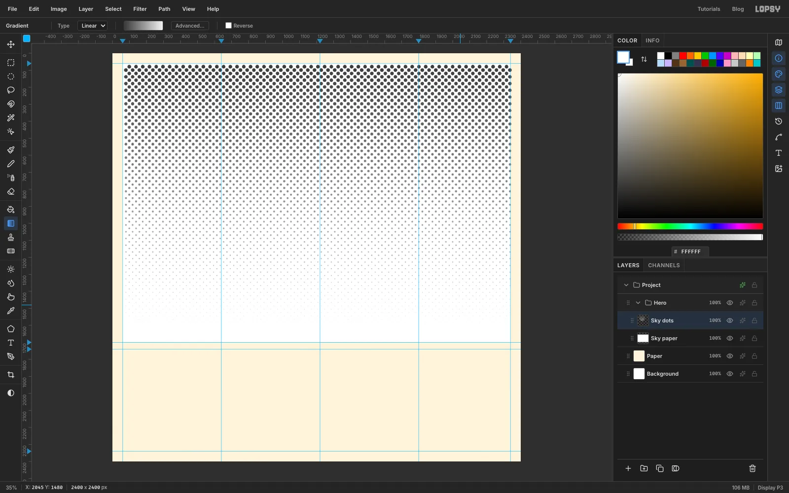

Press [[Cmd+D]], then choose **Filter → Halftone**. Use **Dot Size** `28`, **Density** `1`, **Angle** `45` and **Softness** `1`.

Dark areas become big dots and pale ones become tiny dots. The gaps between dots are transparent, so the white `Sky paper` layer shows through.

## Print the dots in cyan

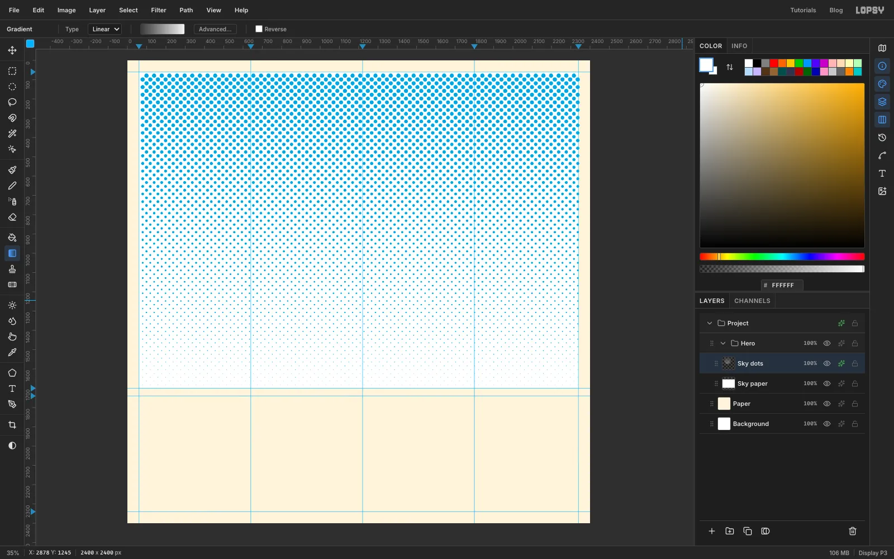

Click the effects button on the `Sky dots` row. Enable **Color Overlay** and set the colour to `#0FA3E0`. Close the drawer.

The bottom of the panel stays pale on purpose, because the wordmark goes there and it needs a calm background.

## Draw the comic frames

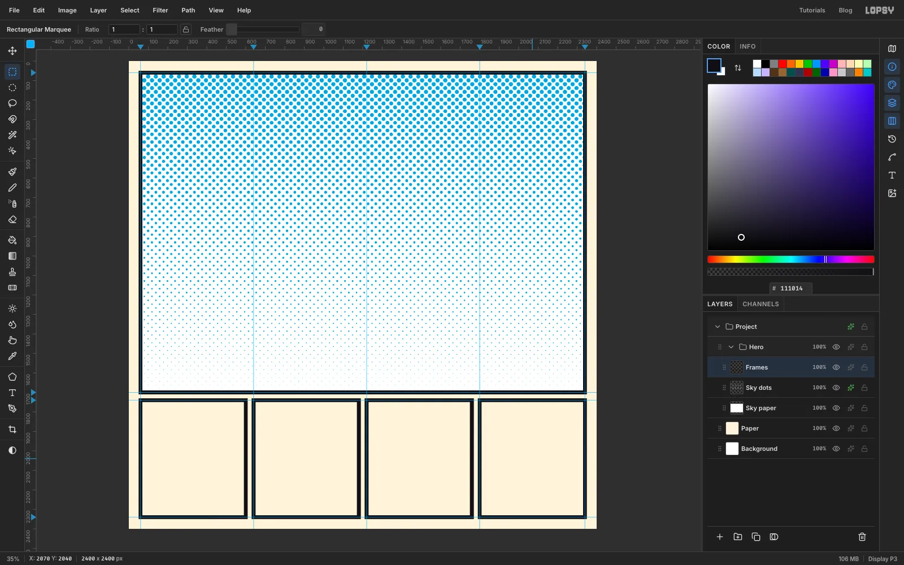

Frames need to be exact, so use the marquee's corner dialog. Clicking once with the marquee, without dragging, opens a box where you can type the corners.

1. Add a layer called `Frames`, set the foreground to `#111014` and press [[M]].
2. Click once with the marquee and enter a rectangle **10 px outside** a panel on every side. Press [[Enter]], choose **Edit → Fill**, then press [[Cmd+D]]. The dialog only opens when nothing is selected.
3. Click once again and enter a rectangle **10 px inside** the same panel. Press [[Enter]], then [[Delete]], then [[Cmd+D]]. You now have a 20 px frame.
4. Do this for all five panels:
   - The top panel runs from 60, 60 to 2340, 1700.
   - The small panels all run from y 1740 to y 2340, with x from 60 to 600, 640 to 1180, 1220 to 1760 and 1800 to 2340.

## Pen a comic explosion

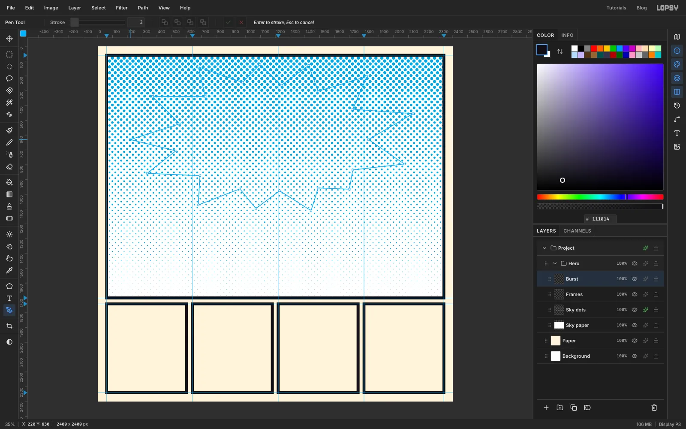

A comic burst looks explosive when its spikes are uneven. A regular star looks like a price sticker.

1. Add a layer called `Burst`.
2. Press [[P]] for the Pen and click around the middle of the panel, going back and forth between a long point and a short valley. I used 13 of each.
3. Make the left and right points the longest, reaching almost to the panel's sides. Keep the top and bottom points shorter, so the whole burst is wider than it is tall.
4. Leave the lower part of the panel empty for the wordmark.
5. Click the first anchor to close the path.

## Fill the burst and outline it

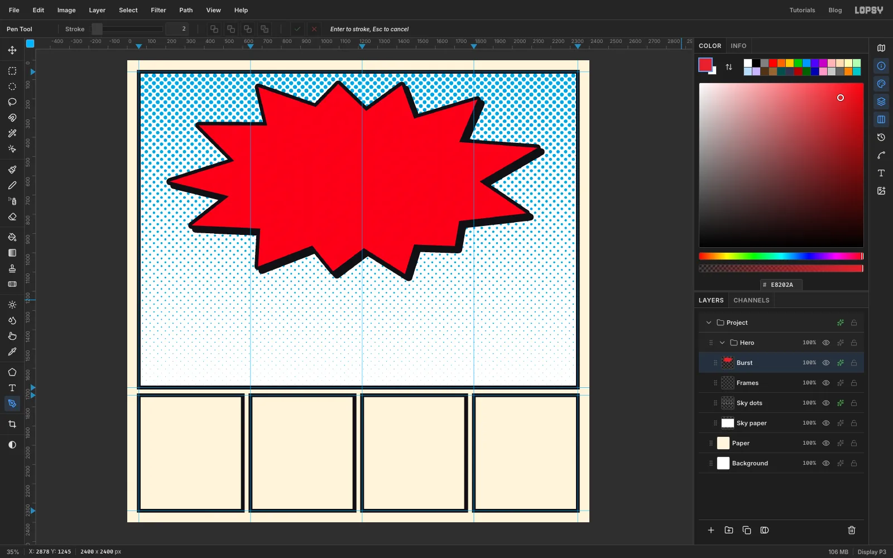

1. Open the **Paths** panel from the icon strip at the far right and click **Path to Selection**, then **Delete Path**.
2. Set the foreground to `#E8202A`, choose **Edit → Fill** and press [[Cmd+D]].
3. Open the layer's effects. Enable **Stroke**, with Width `18` and colour `#111014`.
4. Click **Rasterize Layer Style** at the bottom of the drawer. This bakes the outline into the layer.
5. Enable **Drop Shadow** with Offset X and Y both `20`, Blur `1`, Opacity `100` and colour `#111014`. Close the drawer.

Baking makes the outline part of the layer's pixels, so the red and black now behave as one shape.

## Add a cyan core

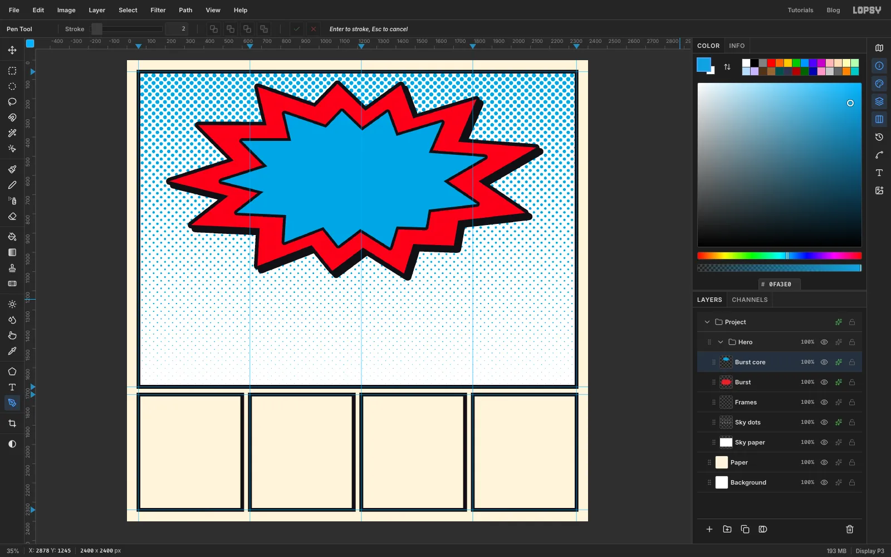

Add a layer called `Burst core`. Press [[P]] and draw a second burst inside the first, with the same rhythm at about 70 % of the size. Close it, then use **Path to Selection** and **Delete Path** as before.

Fill it with `#0FA3E0`, press [[Cmd+D]], and give it a **Stroke** of Width `14` in `#111014`. This one doesn't need a shadow. Close the drawer.

Cyan is the opposite of the orange crust you're about to draw, so the toast will stand out. It also leaves yellow free for the bolt.

## Pen the lightning bolt's outline

I drew the bolt's outline as its own path, because a Stroke effect rounds the corners and a lightning bolt should be sharp.

1. Add a layer called `Bolt`.
2. Press [[P]]. Click twice on the grey pasteboard just above the page, near the right side, for the bolt's wide top edge. The pasteboard strip is narrow, so zoom out a little if you need to: a click on the ruler would add a guide instead.
3. From the second anchor, work down the bolt's right-hand side: a slant down and to the left, a small step back to the right, another slant, another step, then one long run to a sharp tip.
4. Put the tip well inside the burst, near the centre-right. The toast will hide it, so the bolt seems to land on the slice.
5. Come back up the left-hand side with the same zigzag, stopping below the first anchor. That's 11 anchors in all.
6. Click the first anchor to close the path, then use **Path to Selection** and **Delete Path**.

## Fill the bolt

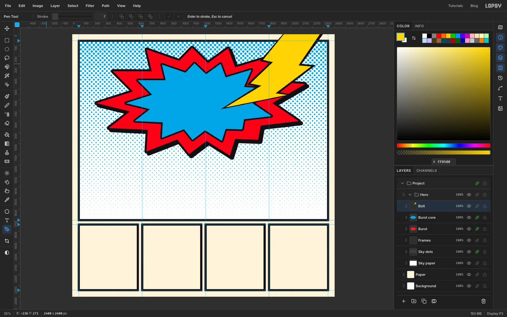

1. Fill the selection with `#111014` and press [[Cmd+D]].
2. Zoom in to about 50 %, press [[P]] again and click the same zigzag about **16 px inside** the black shape. Keep the top two anchors up on the pasteboard, like the first time. Close it, then use **Path to Selection** and **Delete Path**.
3. Fill with `#FFD500` and press [[Cmd+D]].

Breaking the frame on purpose is a classic comic trick. Commit to it: a bolt that only just touches the frame looks like a mistake.

## Give the bolt a shadow

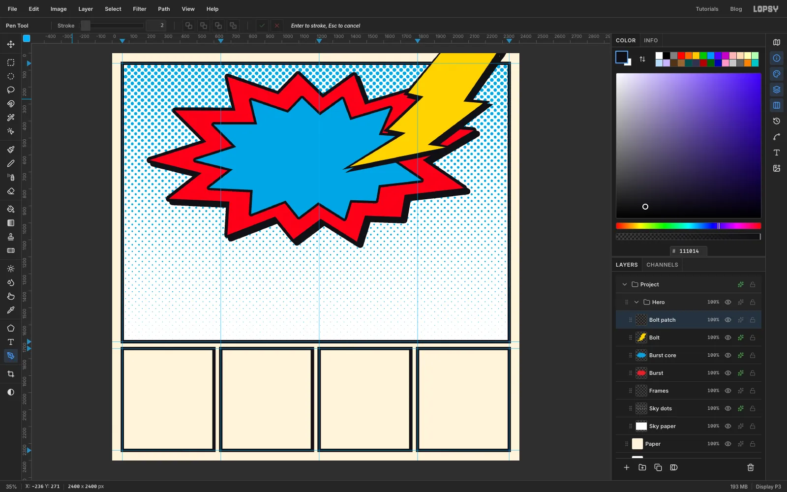

On `Bolt`, enable **Drop Shadow** with Offset X and Y both `18`, Blur `1`, Opacity `100` and colour `#111014`. Close the drawer.

Zoom in where the bolt leaves the page. The shadow stops 18 px below the top edge, because it's an offset copy of a layer that ends at the page edge. To finish it off, add a layer called `Bolt patch` and Pen a four-point shape that continues the shadow's slant up to the page edge. Use **Path to Selection** and **Delete Path**, fill with `#111014`, then press [[Cmd+D]] and [[Cmd+0]].

Then collapse the `Hero` group.

## Build the loaf from two shapes

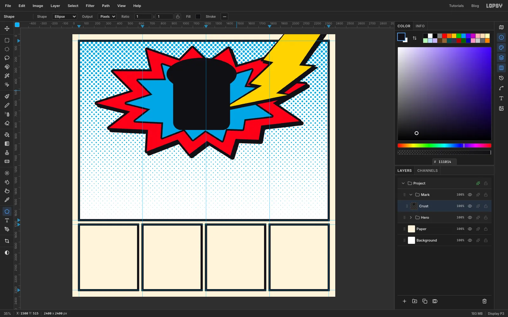

The slice of toast is just a rounded square with a wide oval on top.

1. Click the `Hero` row, click **New Group** and name it `Mark`. Add a layer called `Crust`.
2. Press [[U]] for the Shape tool, with **Output** set to pixels. Choose **Rectangle** and set **Corner Radius** to `70`.
3. Shapes grow from where you press. Press just below the centre of the burst and drag out to a box of about **520 × 520 px**. Hold [[Cmd]] to keep it square.
4. Switch the Shape to **Ellipse**. Press near the top of the square and drag out to about **640 × 300 px**, so it overhangs the square on both sides. That overhang is the muffin-top of a slice of bread.

The fill colour doesn't matter, because you're about to replace it.

## Colour the crust and crumb

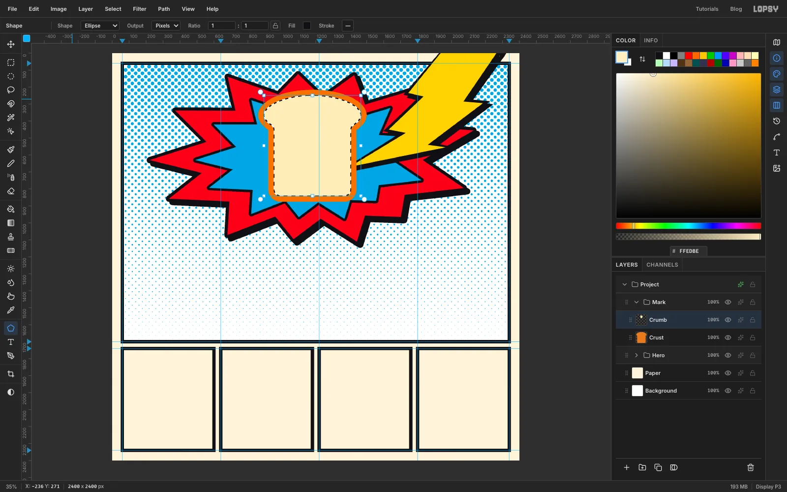

1. [[Cmd]]-click the `Crust` thumbnail in the Layers panel to select its shape.
2. Fill with `#E8791E`.
3. Choose **Select → Shrink** and enter `34`.
4. Add a layer called `Crumb` and fill the selection with `#FFEDBE`. Keep the selection active.

## Add a toasted patch

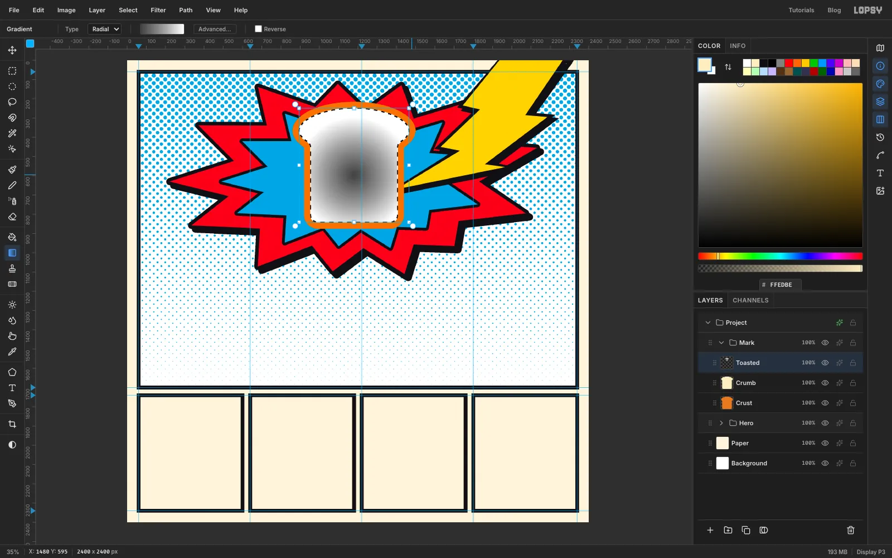

The toasted look comes from the same trick as the sky.

1. Add a layer called `Toasted`. The crumb selection is still active, so the gradient will stay inside the bread.
2. Pick the **Gradient** tool and set it to **Radial**. In **Advanced…**, set three stops: `#404040` on the left, `#A0A0A0` just past the middle and `#FFFFFF` on the right. Click an empty spot on the handle row to add the middle stop, then drag it into place.
3. Drag from the middle of the slice out towards its side edge.

## Print the toast marks as flat dots

1. Press [[Cmd+D]] and run **Filter → Halftone** with **Dot Size** `20`, **Density** `1`, **Angle** `45` and **Softness** `1`.
2. Open the effects drawer, enable **Color Overlay** with `#D9631A`, then click **Rasterize Layer Style**. Close the drawer.
3. Choose **Layer → Merge Down** to merge the dots into `Crumb`.
4. Choose **Layer → Merge Down** again to merge `Crumb` into `Crust`.
5. Rename the result `Mark colour`.

Color Overlay gives each dot one flat ink. If you fill grey dots with a colour instead, the soft edges turn muddy.

## Dot the cheeks by hand

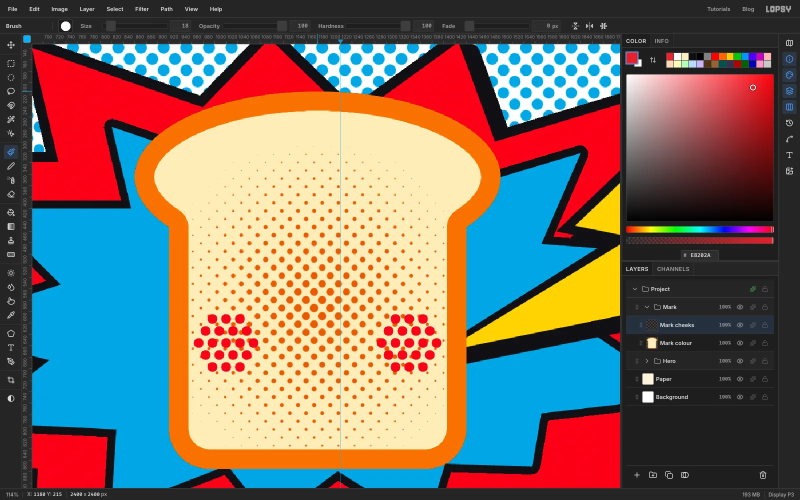

A marquee full of dots would slice some of them in half, so place whole dots with the Brush.

1. Zoom in on the slice and add a layer called `Mark cheeks`. Keeping the cheeks on their own layer lets you recolour them later.
2. Set the foreground to `#E8202A`, press [[B]] for the Brush, and set **Size** `18` and **Hardness** `100`.
3. Click once for each dot. Make five rows of **3, 4, 5, 4 and 3** dots, about 24 px apart, with each row offset by half a step like a honeycomb.
4. Do the same on the other cheek, low on the slice and well inside the crust.

## Outline the slice in ink

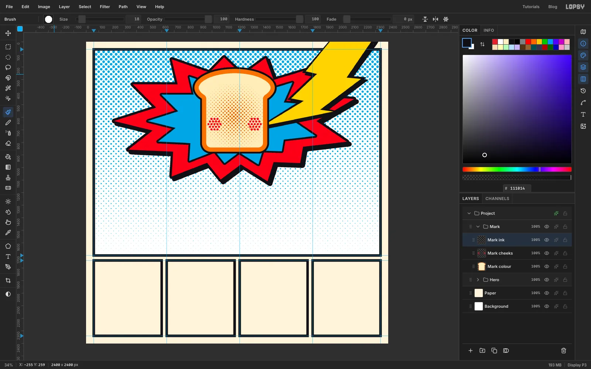

1. Add a layer called `Mark ink`.
2. [[Cmd]]-click the `Mark colour` thumbnail and choose **Select → Grow** with `14`.
3. Set the foreground to `#111014` and choose **Edit → Fill**. The slice is now covered by a black shape on this layer.
4. [[Cmd]]-click the `Mark colour` thumbnail again and press [[Delete]]. That removes the middle from `Mark ink`, leaving a 14 px outline. `Mark colour` itself isn't touched, because [[Cmd]]-clicking a thumbnail doesn't change the active layer.
5. Press [[Cmd+D]].

## Draw the eyes

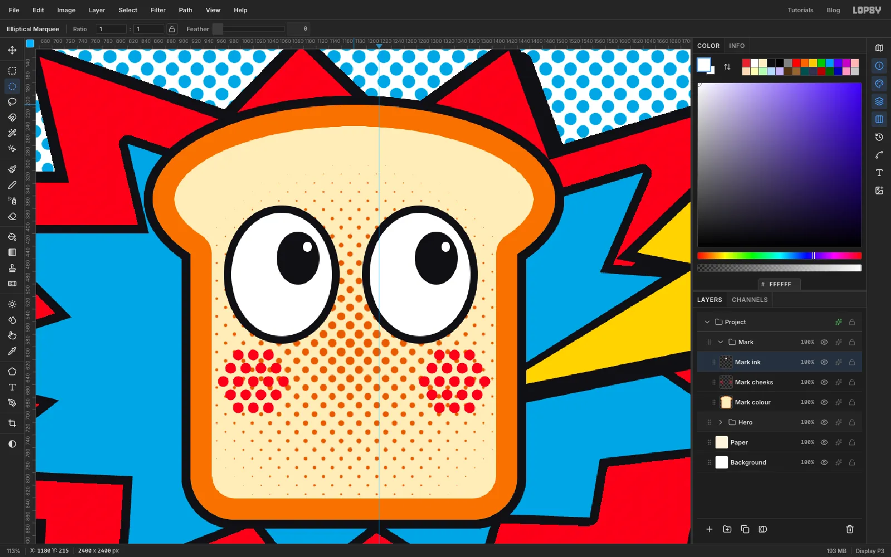

The joke is in the eyes: the toast is looking up at what's about to hit it. Stay on `Mark ink` for all of this, zoomed in on the slice. Draw each eye with the **Elliptical Marquee**, whose icon sits below the Rectangular Marquee in the toolbox, and **Edit → Fill**, pressing [[Cmd+D]] between fills.

1. Fill a tall oval, about **184 × 220 px**, with `#111014`, high on the slice and left of centre.
2. Fill a slightly smaller oval, about **160 × 196 px**, with white, centred on the first one.
3. Fill a pupil, about **68 × 84 px**, with `#111014`. Place it up and to the right inside the eye, towards the bolt.
4. Fill a tiny white highlight near the top right of the pupil.
5. Repeat for the second eye, right of centre, leaving only a small gap between the two eyes.

## Select the teeth

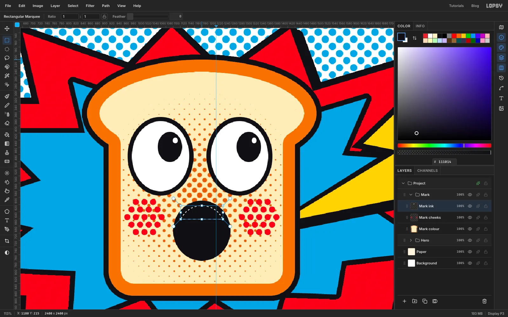

A plain red oval on a face reads as a clown's nose. A dark mouth with teeth and a tongue reads as a shout.

1. With the **Elliptical Marquee**, fill an oval of about **160 × 168 px** with `#111014`, centred low on the slice below the eyes. Press [[Cmd+D]].
2. Draw a slightly smaller oval, about **132 × 140 px**, inside it. Leave the selection active.
3. Press [[M]] for the Rectangular Marquee. Hold [[Shift+Alt]] before you press, then drag a wide, shallow box across the top of the oval. Shift+Alt **intersects**, so only the part inside both shapes stays selected.

## Add the teeth, tongue and brows

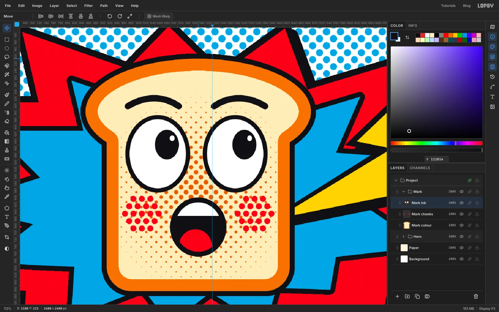

1. Fill the band with white and press [[Cmd+D]].
2. Switch back to the **Elliptical Marquee** and draw the same inner oval again. Then hold [[Shift+Alt]] and drag a smaller oval across the bottom of the mouth, starting about halfway down and running past the bottom edge.
3. Fill with `#E8202A` and press [[Cmd+D]].
4. Set the foreground to `#111014`. Press [[P]] for the Pen and set **Stroke** to `18`.
5. The brows sit above the eyes, just inside the crust. Press and drag at the inner end of one eyebrow, drawing the handle up and outwards. Press and drag again at the outer end, then press [[Enter]] to stroke the path.
6. In the Paths panel, click **Delete Path** so the next click starts a fresh path. Repeat for the other brow.
7. Collapse the `Mark` group.

## Make the dotted panel backgrounds

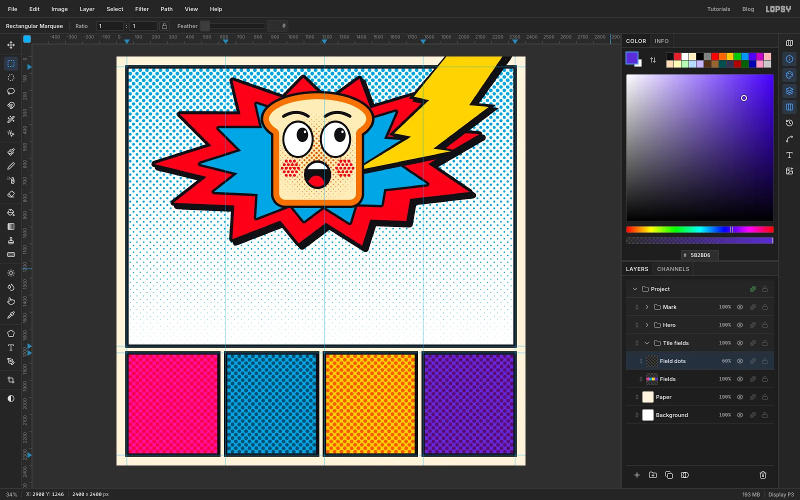

Now for the Warhol panels. Start by making one dot tile that you can reuse.

1. Select `Paper` and add a temporary layer. Set the foreground to `#E8202A`.
2. The tile is too small to draw by eye, so use the corner dialog again. Inside one of the empty small panels, use the **Elliptical Marquee** to fill a 22 px dot centred on each corner of a **40 × 40 px** square, pressing [[Cmd+D]] after each. For a corner at 400, 2000, that's 389, 1989 to 411, 2011. Add one more dot in the centre of the square.
3. Press [[M]], click once and enter the square itself, 400, 2000 to 440, 2040. Choose **Edit → Define Pattern**. Press [[Cmd+D]] and delete the temporary layer.
4. Select `Paper`, click **New Group** and name it `Tile fields`. Add a layer called `Fields`.
5. Fill each small panel with one colour, from left to right: `#FF3D9A`, `#0FA3E0`, `#FFD500`, `#5B2BD6`. Click once with the marquee and use the same small-panel rectangles you used for the frames, pressing [[Cmd+D]] after each fill. The frames sit on a higher layer and cover the edges.
6. Add a layer called `Field dots`. Click once with the marquee, enter each small panel's rectangle in turn, choose **Edit → Fill with Pattern…**, pick your tile and click **Apply**. Press [[Cmd+D]] between panels.
7. In the effects drawer, set this layer's blend mode to **Multiply** and close the drawer. Set its opacity to **60 %** in the layer row. Collapse the group.

## Scale a copy of the mascot

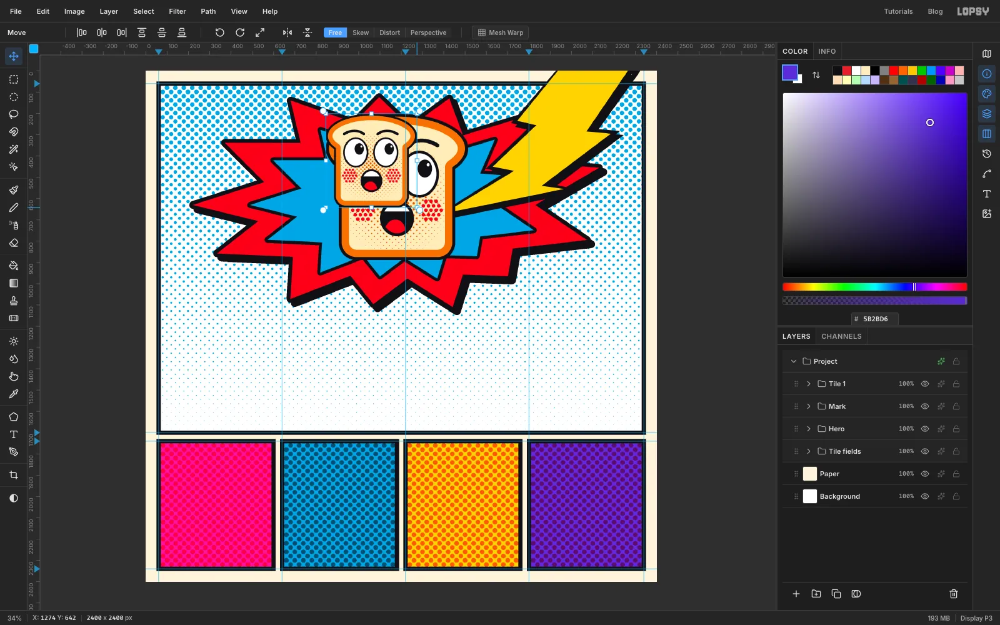

1. Select the `Mark` group and click **Duplicate Layer**. Name the copy `Tile 1`.
2. Press [[Cmd+D]] to make sure nothing is selected, then press [[V]] for the Move tool. Transform handles appear around the whole group.
3. Hold [[Cmd]] and drag the bottom-right corner inwards, until the slice is a little narrower than a small panel, about **64 %** of its size. [[Cmd]] keeps the proportions. At fit-to-screen zoom the corner is a small target, so hover until the cursor becomes a diagonal arrow.
4. Press [[Esc]] to commit the scale.

Working on the group means all three layers scale together and stay lined up.

## Move the copy into the first panel

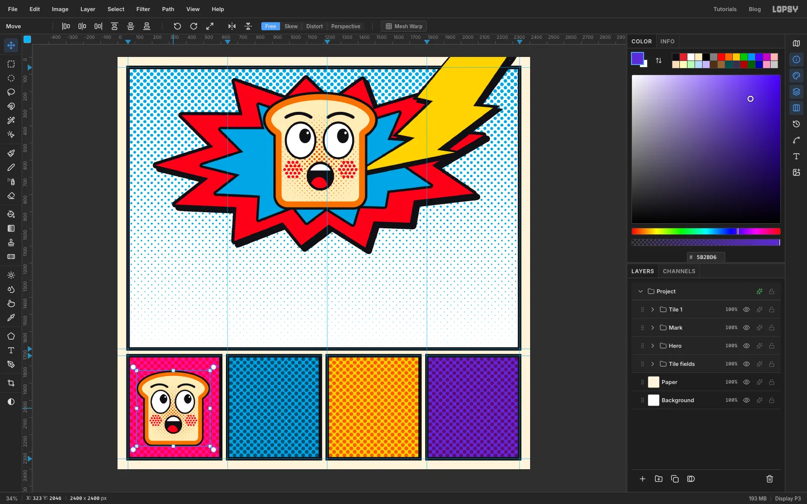

Drag the group down into the first small panel and centre it by eye. Leave a little more room on its right and top, because you'll offset the ink in that direction soon. Then collapse the group.

## Repeat it across the row

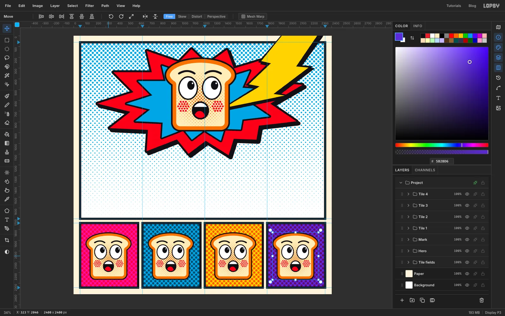

1. Select `Tile 1`, click **Duplicate Layer** and name the copy `Tile 2`.
2. Press [[Cmd+D]] and [[V]], then press [[Shift]]+[[→]] 58 times. Each press moves the group 10 px, so that's exactly 580 px, the distance from one panel to the next.
3. Do the same for `Tile 3` and `Tile 4`, always duplicating the most recent one.

The mascots land in exactly the same spot in every panel.

## Recolour the four tiles

Expand each tile group and make these three changes. It helps to rename the layers `T1 colour`, `T1 cheeks` and `T1 ink` as you go.

1. **Colour:** select the tile's colour layer and run **Filter → Hue/Saturation**. Use Saturation `100` and Lightness `-22` on all four, with **Hue** set to:
   - Tile 1: `180`
   - Tile 2: `-40`
   - Tile 3: `-100`
   - Tile 4: `60`
2. **Cheeks:** on the cheeks layer, enable **Color Overlay**. Use `#FFD500` on tiles 1 to 3 and `#FF3D9A` on tile 4. Close the drawer.
3. **Ink:** select the ink layer, press [[V]], and nudge it **14 px right and 12 px up** with the arrow keys. [[Shift]]+arrow moves 10 px at a time.

Use the same offset on all four. When the misregistration is identical everywhere, it reads as a printing style and not as an accident. Collapse each group when you're done.

## Tilt the main mascot

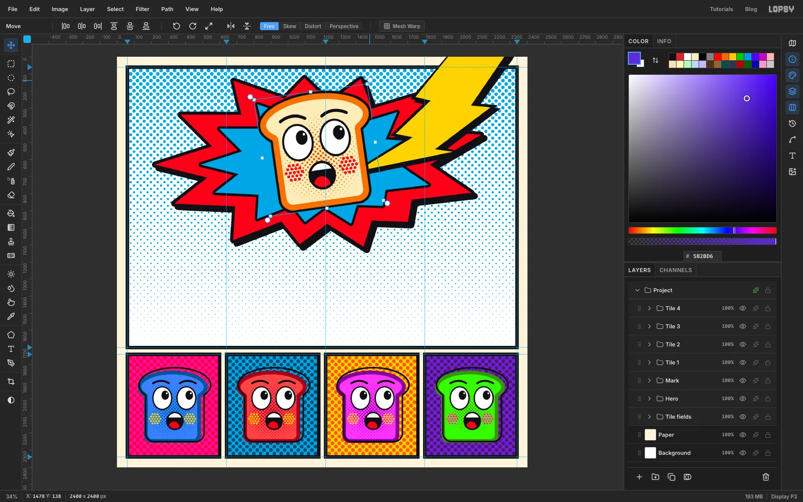

A slice that's standing straight looks calm, and this one has just been hit by lightning.

1. Select the `Mark` group and press [[Cmd+D]]. Press [[V]] for the Move tool.
2. Hover just outside the top-right corner of the handles until the cursor changes to the rotate cursor.
3. Drag anticlockwise by about **8°**, then press [[Esc]] to commit.

## Draw the speech balloon

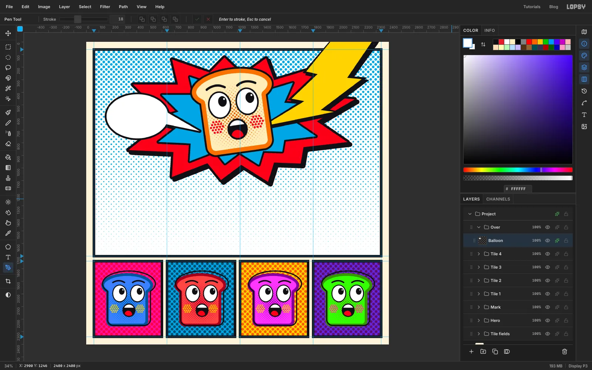

1. Select the `Tile 4` group while it's collapsed, click **New Group**, and name it `Over`. Add a layer called `Balloon`.
2. Set the foreground to white. With the **Elliptical Marquee**, fill an oval of about **490 × 350 px** at the left of the panel, overlapping the burst's left-hand points. Press [[Cmd+D]].
3. Press [[P]] and click three anchors for a tail: two on the balloon's right side, and a tip pointing at the toast's mouth. Stop short of the crust. Click the first anchor to close the path.
4. Use **Path to Selection** and **Delete Path**, fill with white, and press [[Cmd+D]].
5. Enable **Stroke** with Width `14` in `#111014`. It wraps around the oval and tail as one shape. Close the drawer.

## Letter ZAP! in the balloon

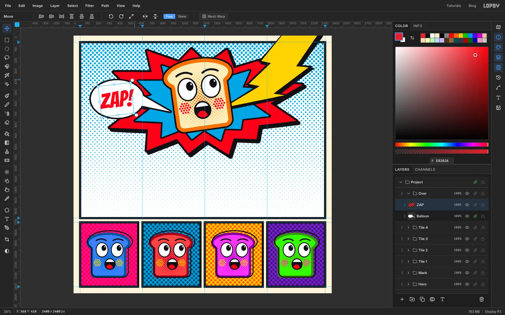

1. With `Balloon` selected, set the foreground to `#E8202A`.
2. Press [[T]] for the Text tool, choose **Bangers** and set **Size** to `205`.
3. Click inside the balloon, type `ZAP!` and press [[Tab]] to finish.
4. Press [[V]], hover just outside a top corner of the text's box, and rotate it about **7°** anticlockwise. Press [[Esc]].
5. Nudge it with the arrow keys until the margins are even on both sides. Nothing should touch the outline, especially the exclamation mark.

## Add the caption boxes

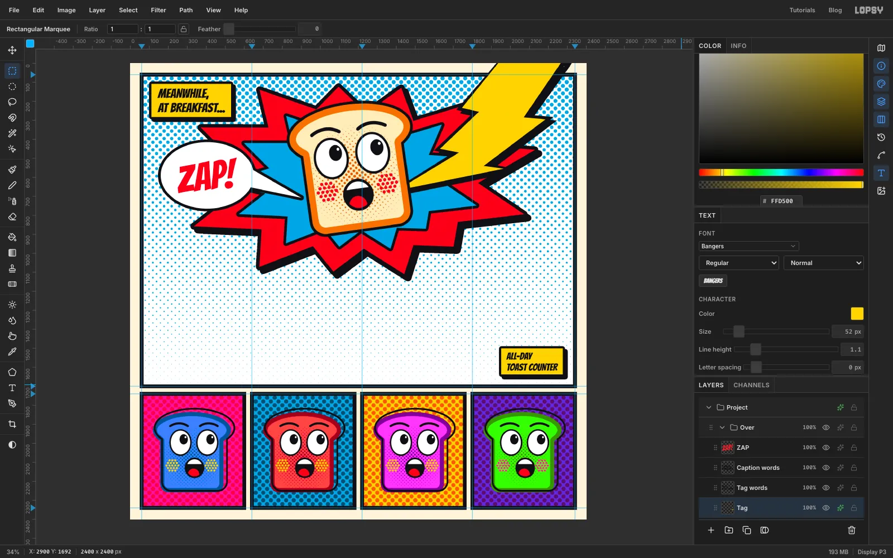

Comics use yellow boxes for the narrator's voice. These two sit in opposite corners and balance each other.

1. With `Balloon` selected, add a layer called `Caption`.
2. Set the foreground to `#111014`, press [[T]] and set **Size** to `68`. Click near the top-left corner of the panel and type `MEANWHILE,`, then press [[Enter]] and type `AT BREAKFAST...`. Press [[Tab]].
3. In the **Text** panel, set **Line height** to `1.1`.
4. Select the `Caption` layer. Press [[M]] and marquee a box around the text, with about **32 px** of space at the sides and **24 px** above and below. Fill it with `#FFD500` and press [[Cmd+D]].
5. Enable **Stroke** at Width `12` in `#111014`, click **Rasterize Layer Style**, then enable **Drop Shadow** with both offsets `14`, Blur `1`, Opacity `100` and colour `#111014`. Close the drawer.
6. Do the same for a `Tag` layer at the bottom right, with `ALL-DAY` and `TOAST COUNTER` at Size `52`. Use about **26 px** of space at the sides and **20 px** above and below.

Try to leave the same gap between each box and its nearest frame corner, so the two boxes look like a pair.

## Add sparks at the strike

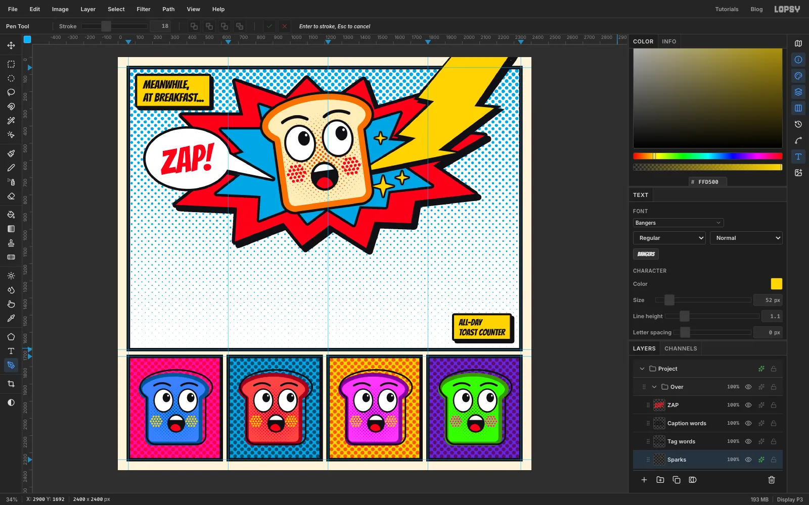

1. With `Tag` selected, add a layer called `Sparks`. Zoom in, because these tiny shapes need room for the clicks.
2. Press [[P]] and draw a four-pointed star with eight clicks, alternating long tips and tight valleys. Click the first anchor to close the path. Use **Path to Selection** and **Delete Path**, fill with `#FFD500`, and press [[Cmd+D]].
3. Make three of these, in different sizes, on the cyan around the bolt's tip.
4. Enable **Stroke** at Width `9` in `#111014`. Close the drawer.

## Scatter some crumbs

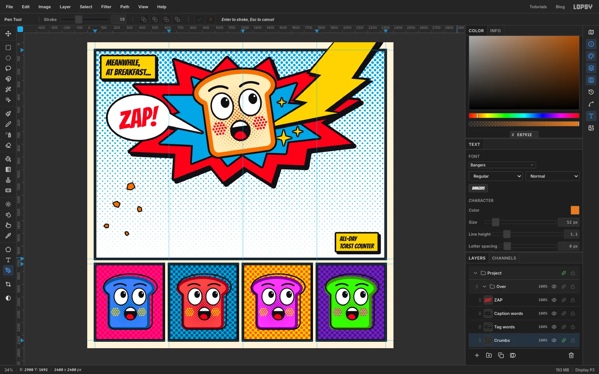

The bottom left of the panel is empty, and some flying crumbs add a small joke there.

1. Add a layer called `Crumbs`.
2. Zoom in and Pen five small, lumpy shapes with five clicks each, getting smaller as they fall away from the toast. Use **Path to Selection** and **Delete Path** on each, fill with `#E8791E`, and press [[Cmd+D]].
3. Enable **Stroke** at Width `8` in `#111014`. Close the drawer.
4. Collapse the `Over` group.

## Type the main word

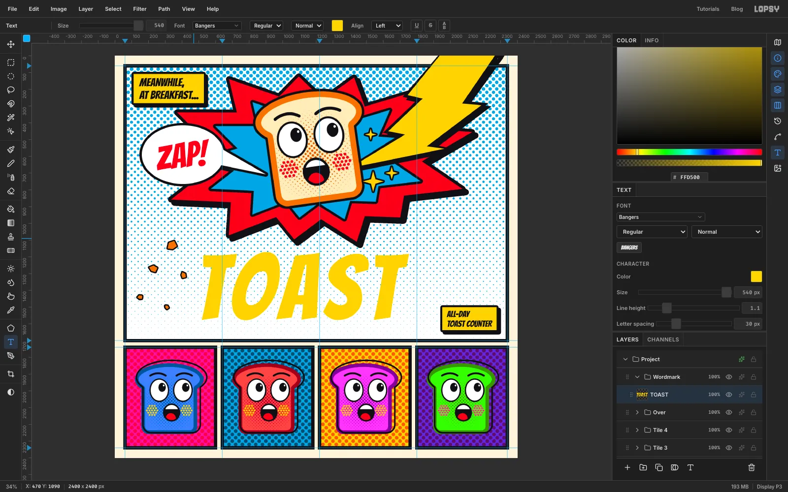

1. Select the `Over` group, click **New Group** and name it `Wordmark`.
2. Set the foreground to `#FFD500`, press [[T]] and type `540` into the **Size** box. The slider stops at 500, but the box goes higher.
3. Text starts where you click, so click about a fifth of the way across the page, just below the burst. Type `TOAST`, then press [[Tab]].
4. In the **Text** panel, set **Letter spacing** to `30`.
5. Click **Rasterize Layer** at the bottom of the Layers panel. Mesh Warp only works on pixels.

## Arch the letters with Mesh Warp

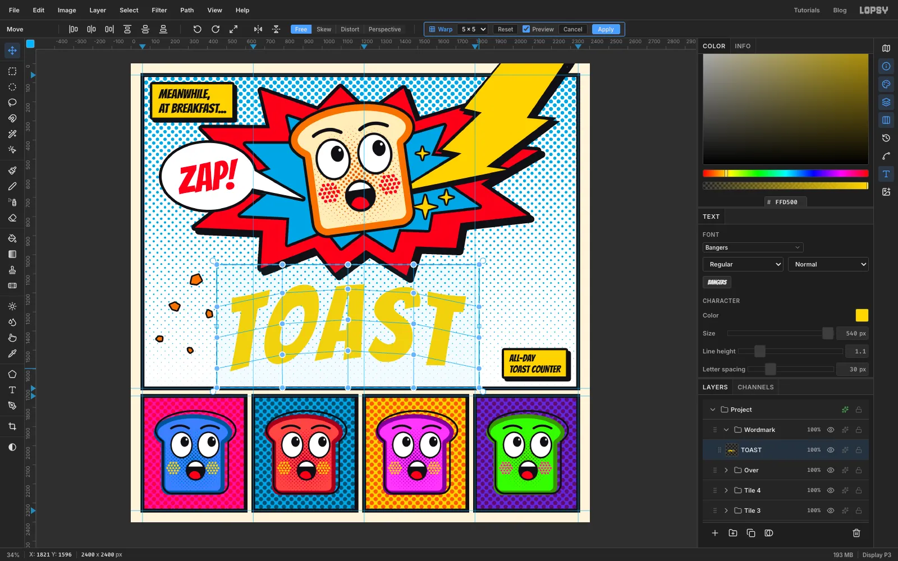

1. Press [[M]] and marquee around the word. Leave about **70 px** spare at the sides and **120 px** above and below, because handles on the outer edge of the warp box can't move outside it.
2. Press [[V]] and click **Mesh Warp** in the options bar. Set the grid to **5 × 5**.
3. Leave the top and bottom rows of handles alone. On each of the three middle rows, drag the handles straight up or down:
   - The two end handles go down by about 60 px.
   - The two handles next to them go up by about 12 px.
   - The centre handle goes up by about 33 px.
4. Tick **Preview** to check the shape, then click **Apply** and press [[Cmd+D]].

## Lay a gradient over the letters

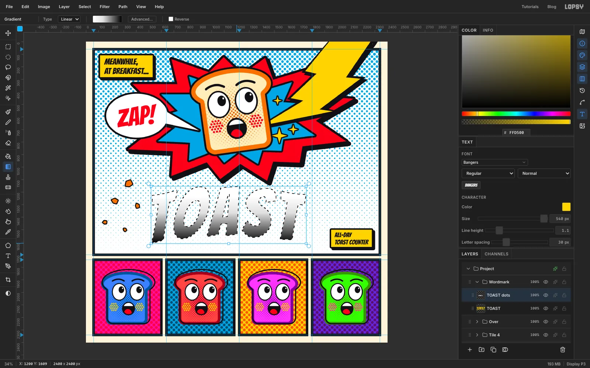

1. [[Cmd]]-click the `TOAST` thumbnail to select the letters.
2. Add a layer called `TOAST dots`.
3. Pick the **Gradient** tool, set it to **Linear**, and in **Advanced…** set three stops: `#FFFFFF` on the left, `#E0E0E0` about a third of the way along and `#000000` on the right.
4. Drag from just below the top of the letters to their bottom edge.

The top of each letter stays clean and the feet get the heaviest dots, as if the word is toasting from below.

## Print the dots in red

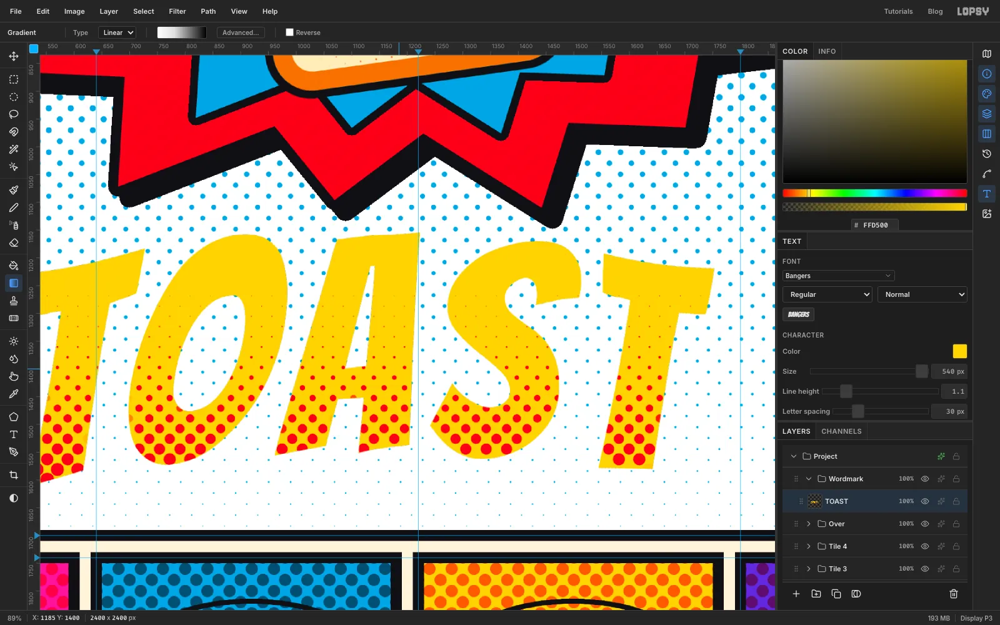

1. Press [[Cmd+D]] and run **Filter → Halftone** with **Dot Size** `26`, **Density** `1`, **Angle** `45` and **Softness** `1`.
2. Dots near the edges can hang outside the letters. [[Cmd]]-click the `TOAST` thumbnail, choose **Select → Inverse**, press [[Delete]], then press [[Cmd+D]].
3. Enable **Color Overlay** with `#E8202A`, click **Rasterize Layer Style**, and close the drawer.
4. Choose **Layer → Merge Down** to merge the dots into `TOAST`.

## Tilt and outline TOAST

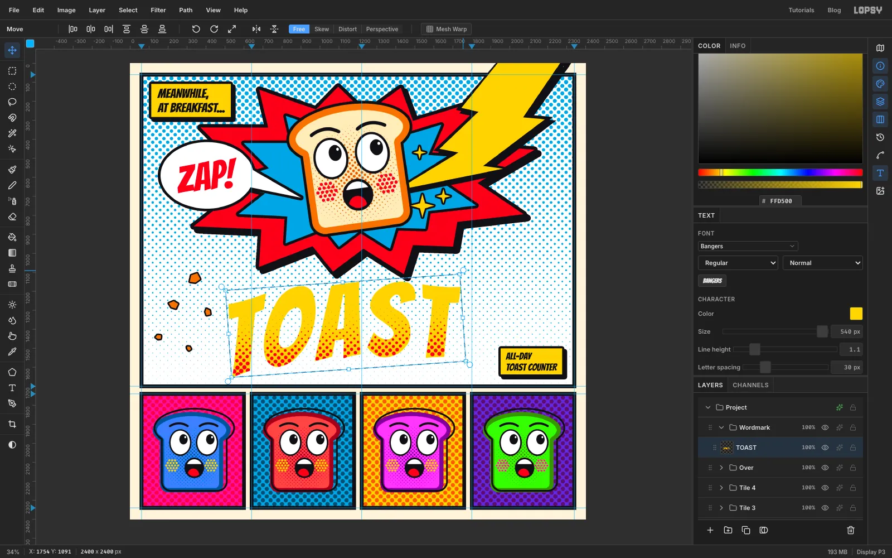

1. Press [[M]] and marquee tightly around the word. Press [[V]], hover just outside the top-right corner and rotate about **4°** anticlockwise.
2. Press [[Cmd+D]] to commit, then drag the word into position. Centre it under the burst and leave about **60 px** of clear space between its lowest point and the frame, including room for the shadow you're about to add.
3. Enable **Stroke** at Width `16` in `#111014`, click **Rasterize Layer Style**, then enable **Drop Shadow** with both offsets `18`, Blur `1`, Opacity `100` and colour `#111014`. Close the drawer.

## Letter ELECTRIC

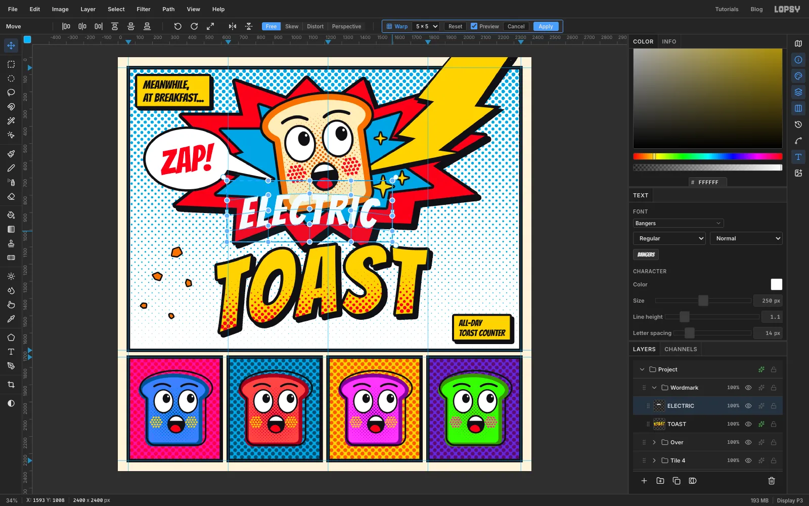

1. Select the `TOAST` layer. Set the foreground to white, press [[T]] and set **Size** to `250`. Click in the middle of the burst and type `ELECTRIC`, then press [[Tab]].
2. In the **Text** panel, set **Letter spacing** to `14`.
3. Click **Rasterize Layer**.
4. Press [[M]] and marquee around the word, leaving about 70 px at the sides and 90 px above and below. Press [[V]] and use **Mesh Warp** at **5 × 5** with the same pattern on the middle rows, but gentler: ends down about 26 px, next handles up about 5 px, centre up about 14 px. Apply it and press [[Cmd+D]].
5. Press [[M]], marquee tightly around the word, press [[V]] and rotate it about **4°** anticlockwise to match TOAST. Press [[Cmd+D]].
6. Drag it so its bottom edge just overlaps the top of TOAST, with both words centred on the same line.

## Pen a slab behind ELECTRIC

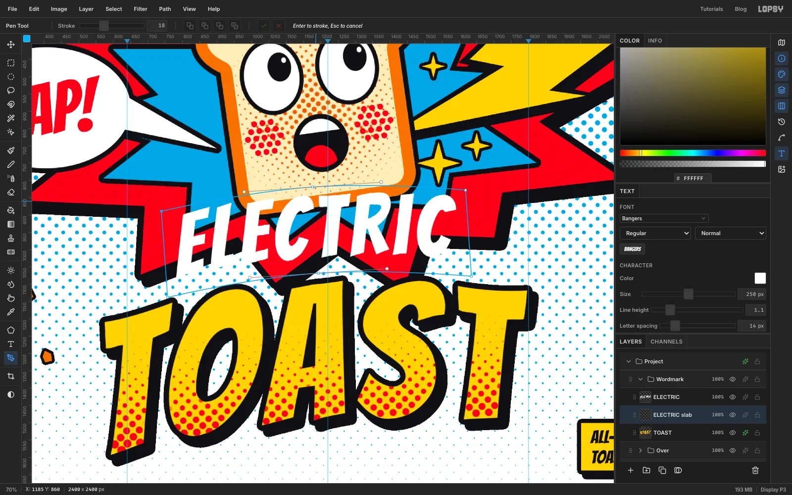

White letters on a busy burst won't read, and scraps of colour would show through the gaps. A solid black slab solves both problems.

1. Select `TOAST` and add a layer called `ELECTRIC slab`. It lands between the two words.
2. Press [[P]] and click the slab's top-left corner, about **36 px** outside the word.
3. Press and drag at the top centre, pulling the handle to the right, so the top edge arches over the letters.
4. Click the top-right corner, then the bottom-right corner.
5. Press and drag at the bottom centre, pulling the handle to the left.
6. Click the bottom-left corner, then click the first anchor to close the path.

Follow the slant of the word, and let the slab's bottom edge overlap the tops of the TOAST letters.

## Fill the slab

Use **Path to Selection** and **Delete Path**, fill with `#111014`, and press [[Cmd+D]].

The slab now locks the mascot and both words into a single unit, which you could lift straight off this page and use on its own as the logo. Check that the mouth still has some space above the slab. If it doesn't, move `ELECTRIC` and the slab down a little.

## Finish the sheet

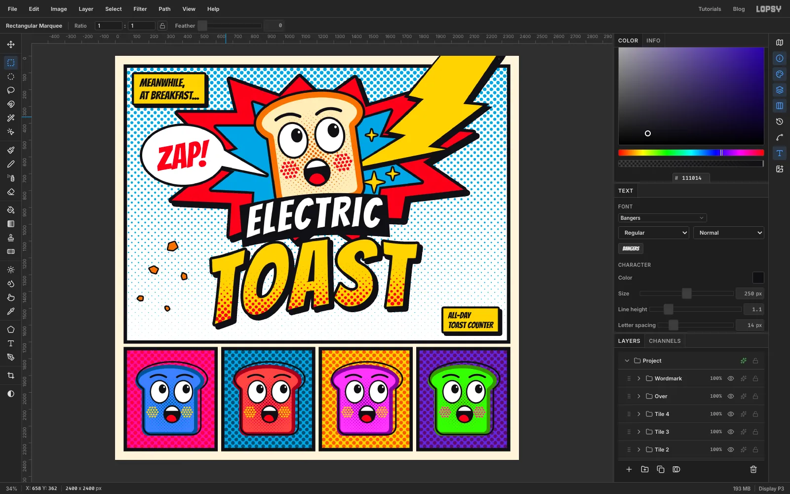

1. Collapse the `Wordmark` group and choose **View → Show Guides** to turn the guides off.
2. Step back and check the page at a small size. The slice and the wordmark should still read when the page is only a couple of hundred pixels wide.

Export with **File → Quick Export PNG** and save your work with **File → Save Project**.

To try another colourway later, expand a `Tile` group and run **Hue/Saturation** again on its colour layer. The ink stays black because it's on its own layer, just like changing one screen on a silkscreen press.
