In the early 1960s, Andy Warhol started making paintings with commercial silkscreens. He'd blow a photo up into a stark black-and-white stencil, then print it over flat blocks of colour that he'd painted by hand. The colour never quite lined up with the black, and that slightly-off look became the signature of pop art. Roy Lichtenstein borrowed from comics instead: thick outlines, speech balloons, and the **Ben-Day dots** that cheap printers used for shading.

This tutorial puts both ideas on the cover of a made-up 1964 nature magazine, *Fauna Illustrated*. An ordinary green iguana becomes a cyan screen print with a pink cheek and an orange crest, and it talks back from a comic balloon. The page is **1700 × 2200 px**, a standard magazine shape.

You'll need one photo from Wikimedia Commons: [Green Iguana iguana head 2.jpg](https://commons.wikimedia.org/wiki/File:Green_Iguana_iguana_head_2.jpg) by campos33 (via Pixabay), released under **CC0**. It shows an iguana in profile, facing right, with its big round cheek scale and spiky crest. Download the **1920 px** wide version.

The tools you'll use:

- ruler guides, the **Paint Bucket**, the **Gradient** tool and the **Halftone** filter
- dropping in a photo, and scaling it from a corner handle
- the **Pen** tool with **Path to Selection**, and **Select → Inverse** and **Feather**
- **Desaturate**, **Brightness/Contrast**, **Gaussian Blur** and **Threshold**
- the **Magic Wand** with Contiguous off, and the **Lasso**
- the **Multiply** and **Overlay** blend modes, and layer opacity
- layer effects: **Stroke**, **Drop Shadow** and **Color Overlay**
- live text in **Archivo Black**, **Bebas Neue**, **Anton**, **Bangers** and **IBM Plex Mono**
- **Duplicate Layer**, **Merge Down**, **Group Layers**, and rotating a group
- the **Pencil** with [[Shift]]-click lines, and **Add Noise**

The palette is cheap process ink:

- Ground yellow `#FFDD1F`, dot magenta `#EE2A7B`
- Iguana cyan `#19B5D6`, cheek pink `#FF4FA0`, eye yellow `#FFE600`, crest orange `#FF7A1A`
- Red `#E2231A`, shadow-dot navy `#1A2A6C`
- Ink `#111111`, paper white `#FFFFFF`, grain grey `#808080`

> **Tip:** On a wide-gamut (Display P3) screen, Lopsy reads typed hex codes as P3 colours. These codes were picked on one, so on an sRGB screen they come out a touch duller.

> **Note:** Shortcuts are written for a Mac. On Windows, use [[Ctrl]] for keyboard shortcuts and for clicking a layer thumbnail. Where this tutorial holds [[Cmd]] while dragging a handle, use the [[Win]] key.

## Set up the page and guides

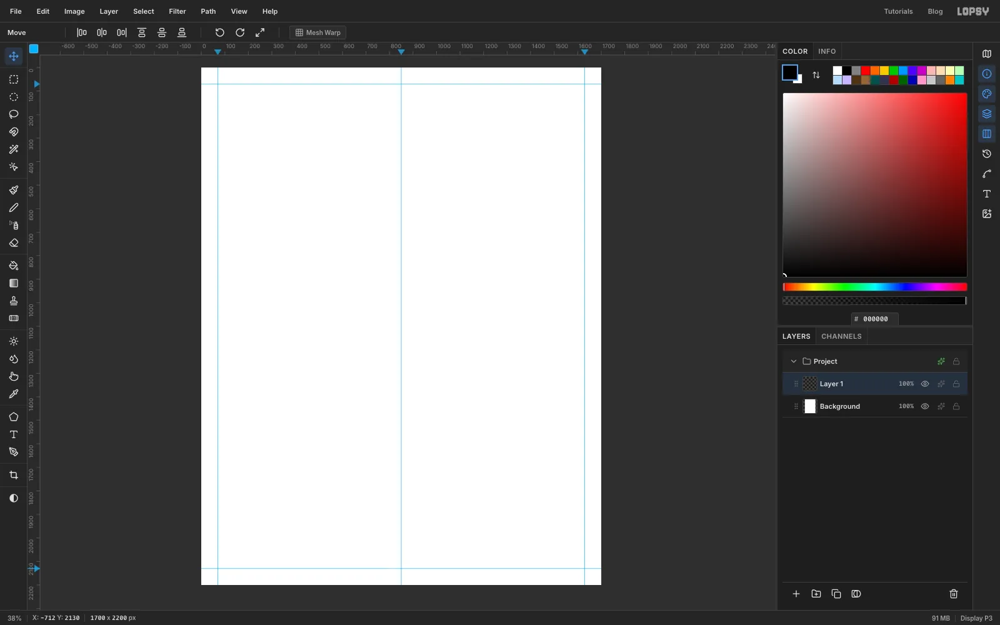

Choose **File → New**, and make a document **1700** × **2200** px with a White background.

Add guides by clicking on the rulers. A click on the top ruler drops a vertical guide, and a click on the left ruler drops a horizontal one. Put vertical guides at **70**, **850** and **1630**, and horizontal guides at **70** and **2130**. That gives you a 70 px margin all round and a centre line for the masthead.

## Fill the yellow ground

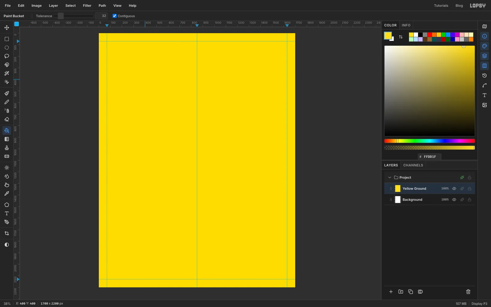

Click *Layer 1* in the Layers panel and double-click its name to rename it *Yellow Ground*.

Set the foreground colour to `#FFDD1F` in the Color panel. Pick the **Paint Bucket** (G) and click anywhere on the page. The empty layer fills edge to edge.

## Paint a gradient for the dots

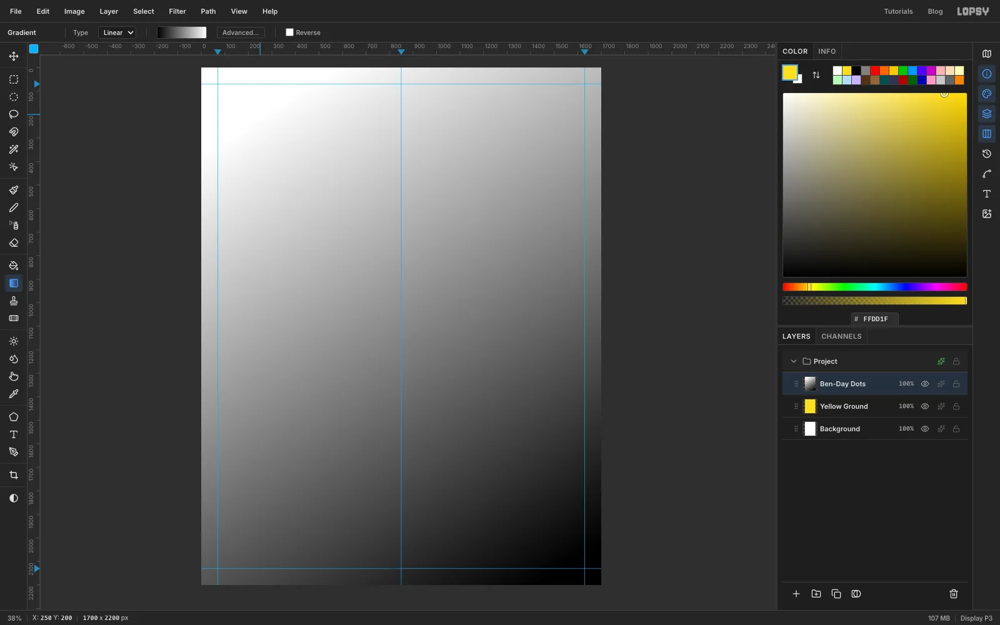

Ben-Day dots in a real comic are all the same size. Here they'll grow toward one corner, which gives the flat background some movement. The **Halftone** filter makes dots from a layer's darkness, so start with a gradient.

Click **Add Layer** at the bottom of the Layers panel and name the new layer *Ben-Day Dots*. Pick the **Gradient** tool from the toolbox (it has no shortcut). In the options bar, set Type to **Linear** and click **Advanced…**. In the Gradient Editor, click the left stop and set it to black `#000000`, then click the right stop and set it to white `#FFFFFF`. Click **Done**.

Drag from near the bottom-right corner of the page up to near the top-left corner.

## Turn it into Ben-Day dots

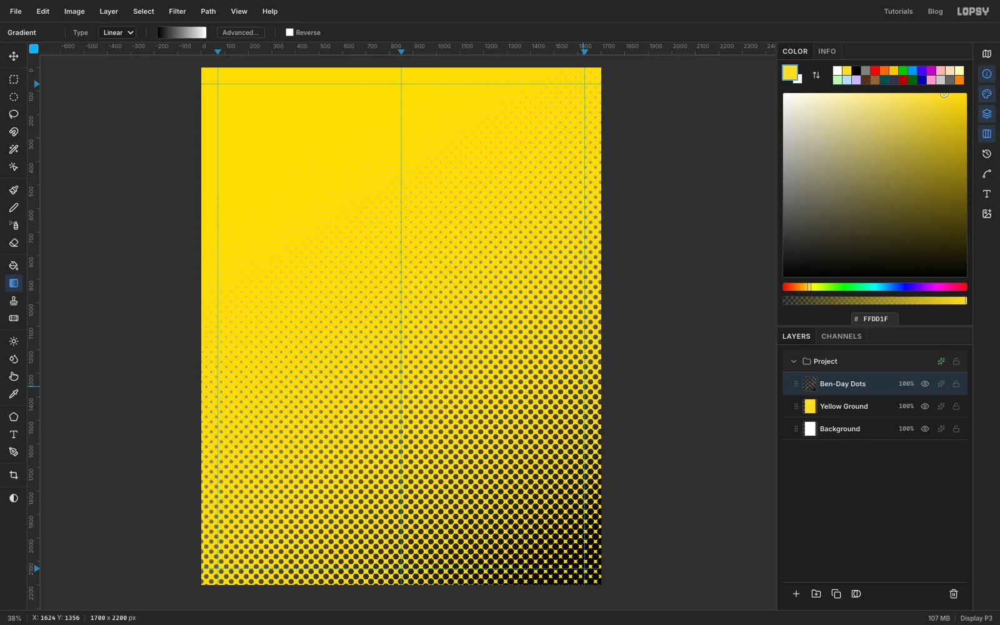

Choose **Filter → Halftone…** and set:

- Dot Size `30`
- Density `1`
- Angle `45`
- Softness `0.4`

Click **Apply**. Dark areas become big dots, and pure white prints nothing, so the dots fade out toward the top left. The gaps between dots are transparent, so the yellow shows through.

## Colour the dots magenta

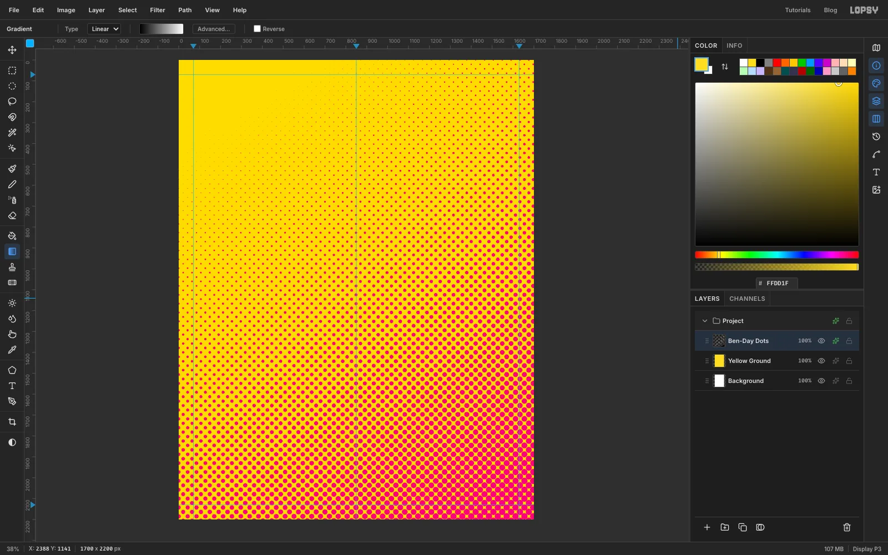

Click the effects button on the *Ben-Day Dots* row to open the effects drawer. Turn on **Color Overlay**, click its colour swatch and enter `#EE2A7B`. Close the drawer.

A Color Overlay keeps the dots editable. If you want a different colour later, you only change the swatch.

## Drop in the iguana photo

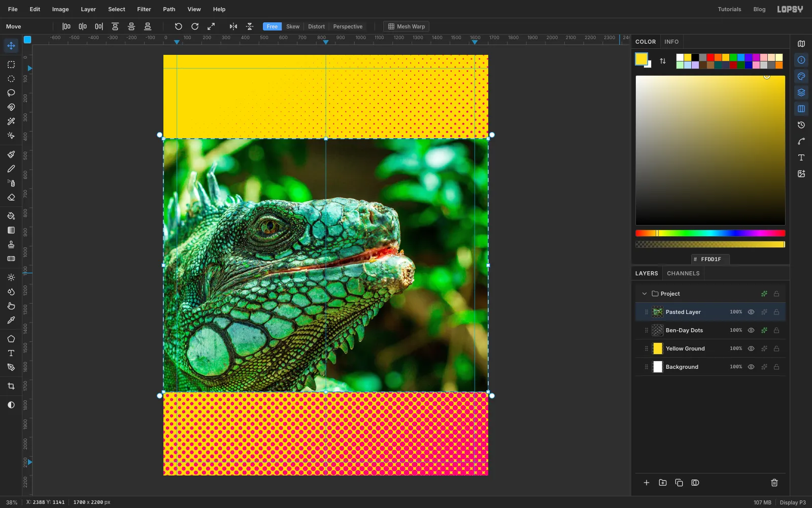

Drag the downloaded photo from your desktop onto the canvas. Lopsy puts it on a new layer, shrinks it to fit the page width, selects it and switches to the **Move** tool, so the transform handles are already showing.

## Scale the photo up

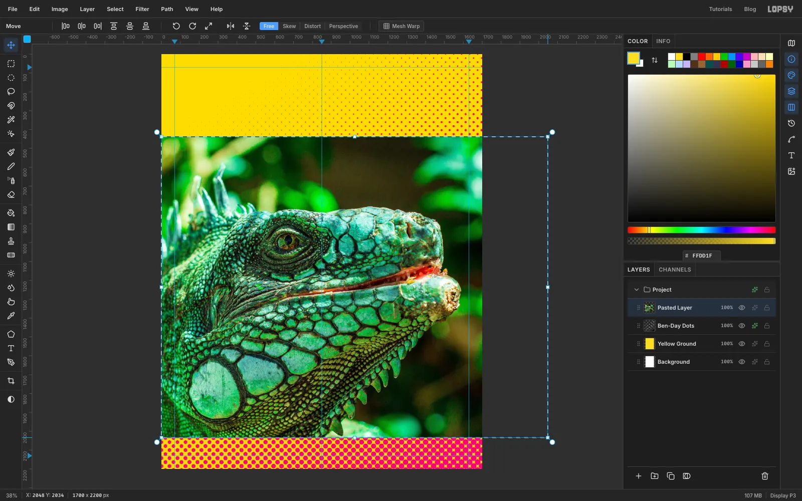

The head needs to be bigger than the page. Hold [[Cmd]] and drag the bottom-right handle down and to the right until its right edge reaches about **2050** on the top ruler, with the left edge still at 0. That's about 1.2× its fitted size. [[Cmd]] keeps the proportions locked. Most of what goes off the right edge is leafy background, so it doesn't matter.

## Place the photo

Press [[Cmd+D]] to drop the selection. With the **Move** tool, drag the photo down and a little to the left, until its bottom edge meets the bottom of the page and the tip of the snout sits about 200 px in from the right edge. The left edge of the photo should hang about 100 px off the page.

Rename the layer *Iguana Photo*.

## Trace the head with the Pen

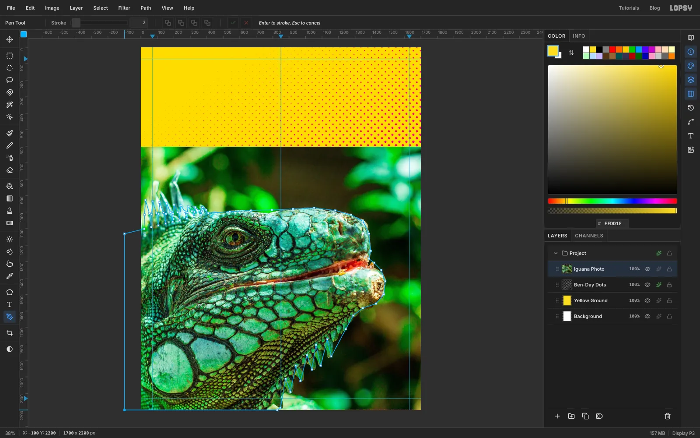

Zoom out until you can see some grey pasteboard to the left of and below the page, because part of the path runs off the page. Pick the **Pen** tool (P). You'll click corner points around the head. Don't drag, because a plain click makes a sharp corner.

Start in the pasteboard below the bottom-left corner of the page and go clockwise. Go up, off the page, to the back of the neck, which meets the left edge about halfway down the photo.

Don't follow the photo's crest along the back of the neck. Its spines are ragged and blurry, and clean triangles read better in print. Draw **nine spines** of your own between the left edge and the brow, about 45 px apart:

- Start the first spine about 20 px in from the left edge and make it about 170 px tall.
- Make each one a little shorter than the last, down to about 40 px at the brow.
- Lean each tip slightly back toward the tail.
- Put an extra point halfway up the front edge of each spine, a few pixels out, so the edge bows a little.

Then carry on across the top of the head, round the snout, under the chin, and down the jagged spines of the dewlap. Finish along the bottom of the page and click the first point to close the path. That's about 70 clicks in all.

## Turn the path into a selection

Open the **Paths** panel from the right-hand toolbar. With the new path selected, click **Path to Selection**, then **Delete Path**. You won't need the path again.

## Delete the background

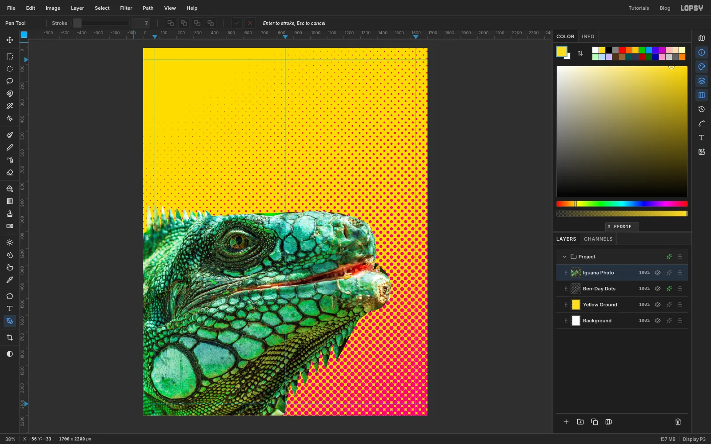

Choose **Select → Inverse**, press [[Delete]], then press [[Cmd+D]].

The cut-out doesn't need to be perfect. The colour plates and a thick outline will go on top, and they hide small wobbles.

## Prepare the ink layer

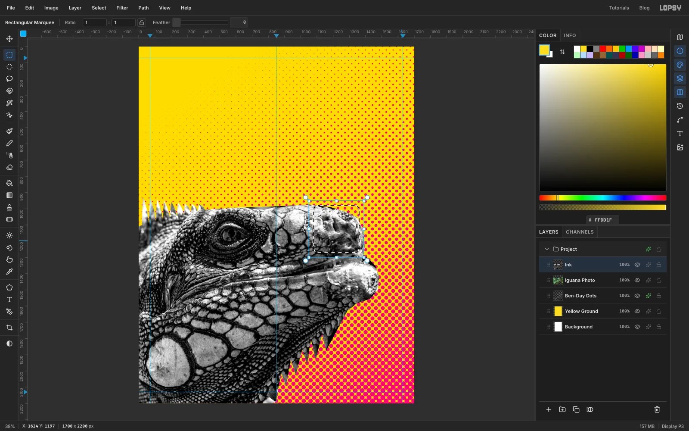

The black "ink" is a stark black-and-white copy of the photo.

1. Choose **Layer → Duplicate Layer** and rename the copy *Ink*.
2. Choose **Filter → Desaturate**.
3. Choose **Filter → Brightness/Contrast…**, set Contrast to `35` and click **Apply**.
4. Choose **Filter → Gaussian Blur…**, set Radius to `2` and click **Apply**. The slight blur stops the next step from turning every speck of skin texture into a black dot.

The top of the snout is darker in the photo than the rest of the head, and it clots into solid black. Lighten it first. Pick the **Rectangular Marquee** (M) and drag a box over the top of the snout, from just in front of the eye to the nostril and from the top of the head down to the mouth. That's about 280 × 290 px. Choose **Select → Feather…**, set `30` and click **Apply**, so the change blends in.

Choose **Filter → Brightness/Contrast…** again. Set Brightness to `10` and Contrast back to `0`, and click **Apply**. Then press [[Cmd+D]].

## Threshold the ink

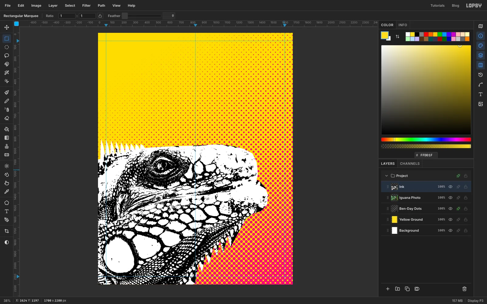

Choose **Filter → Threshold…**, set Level to `60` and click **Apply**.

Everything is now pure black or pure white. The lines between the scales become a black net, and the scales themselves go white. This is the stencil that gets printed in black.

## Select the white with the Magic Wand

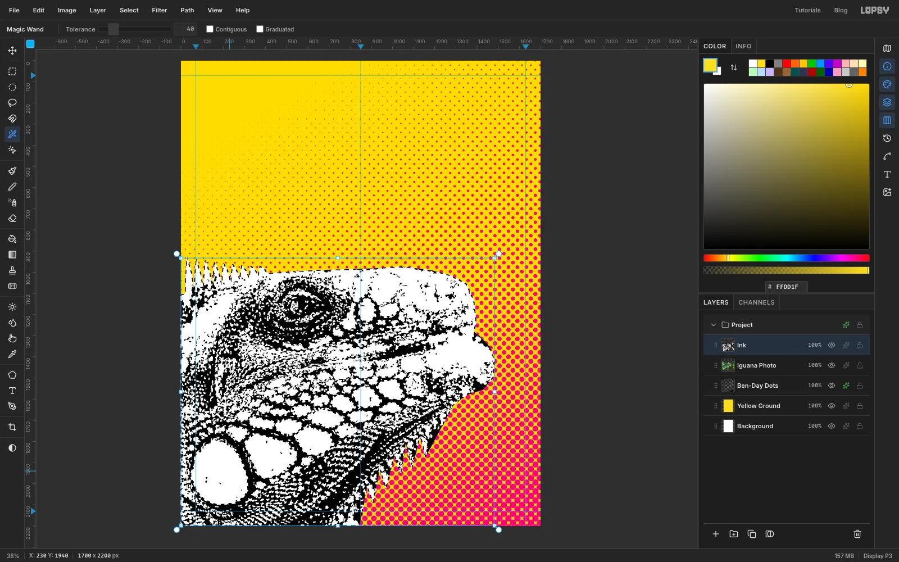

The white parts need to become transparent so the colour can show through.

Pick the **Magic Wand** (W). In the options bar, untick **Contiguous** and set Tolerance to `40`. Click the big white cheek scale. With Contiguous off, every white pixel on the layer is selected, not only the ones touching the cheek.

Press [[Delete]], then [[Cmd+D]].

## Clear the photo's crest out of the ink

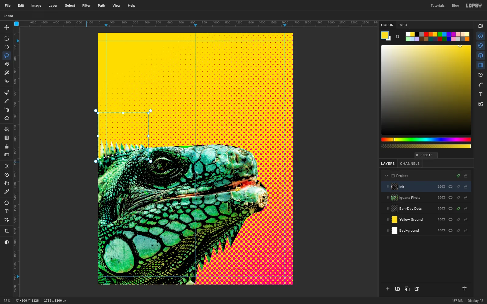

The ink still holds the photo's own spikes and bits of leaf inside the new spines. Those spines should print as flat colour.

Pick the **Lasso** (L) and drag a loop around the crest area. Run it along the base line of the spines, up past their tips and back round. Press [[Delete]], then [[Cmd+D]].

## Multiply the ink and hide the photo

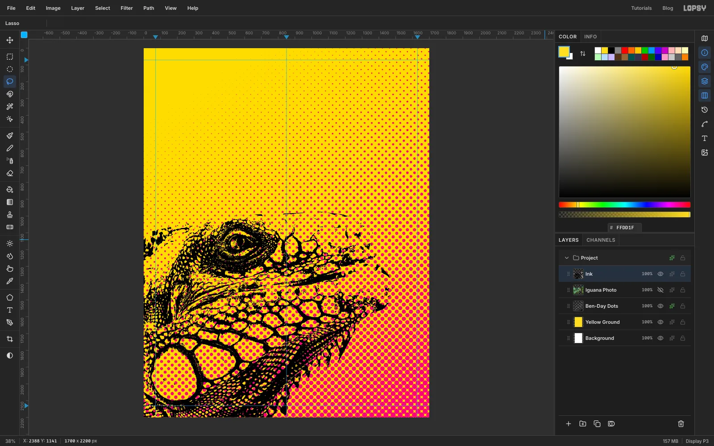

Open the effects drawer for *Ink* and set the blend mode to **Multiply**, so the black always prints over whatever is under it. Close the drawer.

Click the eye on *Iguana Photo* to hide it. Keep the layer: its shape is your cut-out mask for the next steps.

## Fill the cyan colour plate

Click *Iguana Photo* so new layers land just above it. Click **Add Layer** and name the layer *Colour Plate*.

[[Cmd]]-click the *Iguana Photo* thumbnail. That selects the shape of the cut-out. Set the foreground colour to cyan `#19B5D6`, choose **Edit → Fill**, and press [[Cmd+D]].

Warhol never printed iguanas green, and neither should you. Cyan sits well against the yellow and magenta.

## Lasso in the spot colours

Click **Add Layer** and name it *Spots*. Fill each of these with the **Lasso** (L): drag a loop, set the foreground colour, choose **Edit → Fill**, then press [[Cmd+D]] before the next one.

- **Cheek:** a slightly tilted oval over the big round cheek scale, in pink `#FF4FA0`.
- **Eye:** a smaller oval over the eye, in yellow `#FFE600`.
- **Crest:** a band covering all nine spines, with its bottom edge running along their bases, in orange `#FF7A1A`.

Draw loosely. Warhol painted his colour blocks by hand, and it's fine if they go outside the lines. You'll trim the overspill next.

## Trim the spots and merge them

[[Cmd]]-click the *Iguana Photo* thumbnail again, choose **Select → Inverse**, and press [[Delete]]. That clears everything outside the head. Press [[Cmd+D]].

With *Spots* still active, choose **Layer → Merge Down**. The spots join *Colour Plate*, so all the colour moves as one print.

## Knock the colour off register

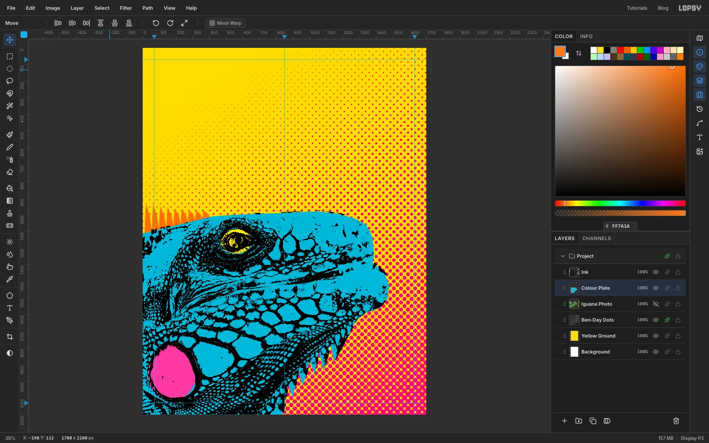

This is the step that makes it look screen printed. Pick the **Move** tool (V) and, with *Colour Plate* active, nudge it about **8 px** left and **6 px** down with the arrow keys.

The colour now sits about 10 px off the black, the way a hand-pulled print slips between passes. Keep it small. Much more than this, and it reads as a mistake.

## Outline the colour plate

Open the effects drawer for *Colour Plate*. Turn on **Stroke**, set Width to `9`, set Position to **outside**, and set the colour to `#111111`. Close the drawer.

That thick line is pure Lichtenstein. It also tidies up the edges of the cut-out.

## Add navy shadow dots

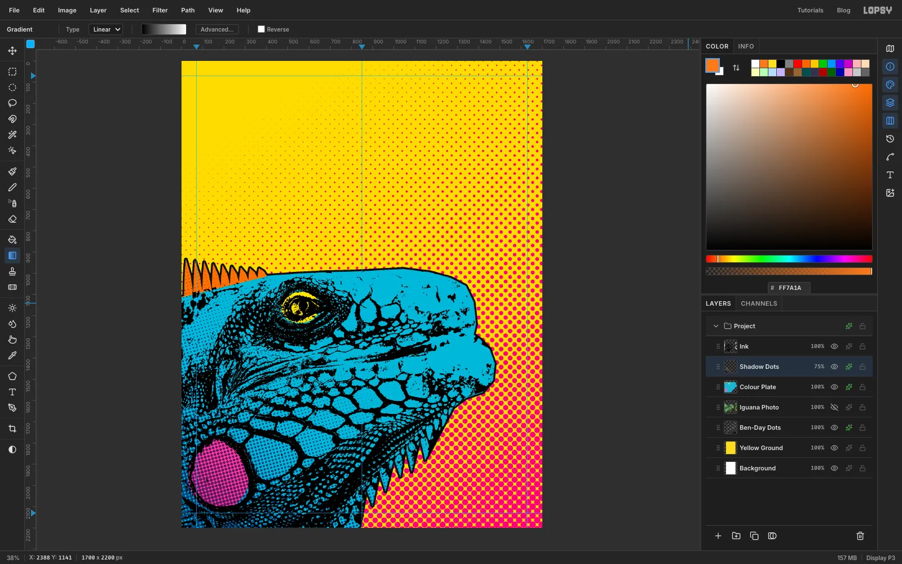

Comic printers shaded with dots too. Click **Add Layer** and name it *Shadow Dots*. It lands above *Colour Plate*. [[Cmd]]-click the *Colour Plate* thumbnail to select the head.

Pick the **Gradient** tool. The black-to-white stops from earlier are still set. Drag from the bottom-left corner of the page up and right to the middle of the jaw.

Choose **Filter → Halftone…** and set Dot Size `16`, Density `1`, Angle `15` and Softness `0.4`. Click **Apply**, then press [[Cmd+D]]. The different angle from the background dots stops the two screens fighting.

In the effects drawer, turn on **Color Overlay** with navy `#1A2A6C`, and set the blend mode to **Multiply**. Close the drawer. Then click the **100%** on the layer's row and set it to **75%**.

## Draw the mouth with the Pen

The red of the mouth needs to sit on top of the ink, so nothing breaks it up. Click *Ink*, click **Add Layer**, and name the new layer *Mouth*.

Pick the **Pen** (P). Follow the dark lip line in the ink, from the corner of the mouth to just behind the snout tip, with about 8 corner clicks along the top edge. Come back along the bottom edge with another 8. Keep it about 8 px tall at the hinge, widen it to about 30 px just behind the snout, and bring it to a point at the tip. It should curve with the jaw. A straight wedge reads as a red stick. Click the first point to close the path.

## Fill the mouth

In the **Paths** panel, click **Path to Selection**, then **Delete Path**. Set the foreground colour to red `#E2231A`, choose **Edit → Fill**, and press [[Cmd+D]].

In the effects drawer, turn on **Stroke** with Width `3`, Position **outside**, colour `#111111`. Close the drawer.

## Group the iguana

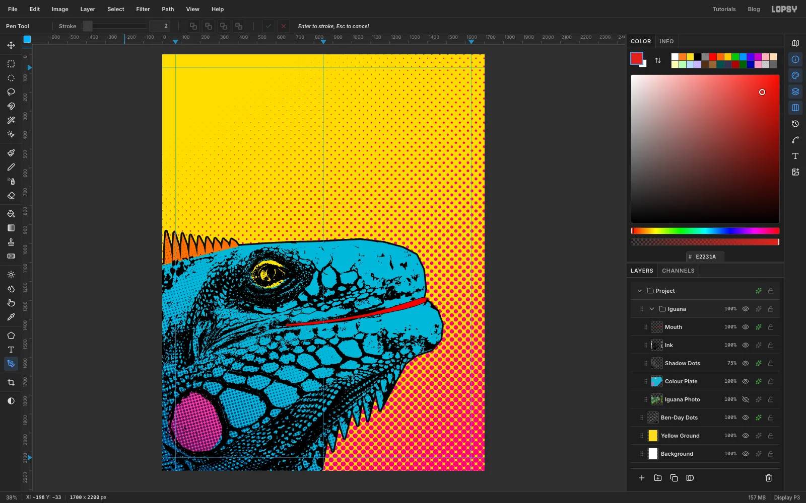

Click *Mouth*, then [[Shift]]-click *Iguana Photo* to select all five layers. Choose **Layer → Group Layers** and name the group *Iguana*.

Click the arrow on the group's row to collapse it. With the group collapsed and active, new layers go above it, not inside it, which is what you want for all the type.

## Draw the masthead bars

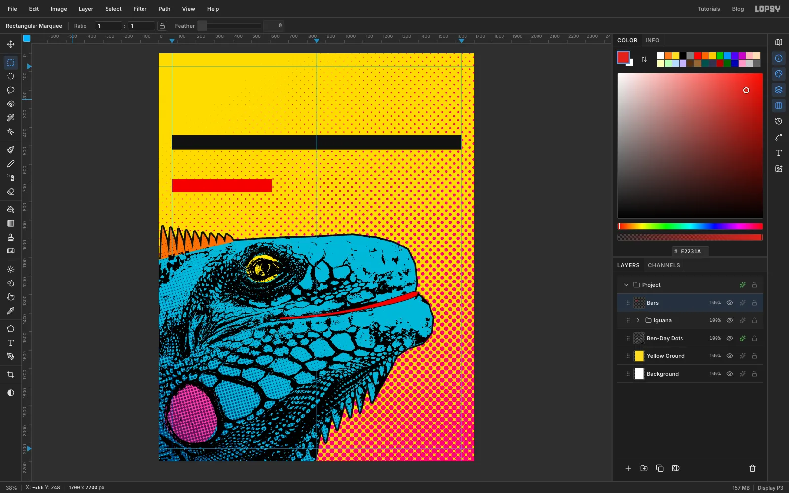

With *Iguana* active, click **Add Layer** and name it *Bars*.

These need exact sizes, so use the marquee's dialog. Pick the **Rectangular Marquee** (M) and, with nothing selected, click once on the page without dragging. In the dialog that opens, enter From `70`, `440` and To `1630`, `520`, and confirm. That's a band from margin to margin, 80 px tall. Set the foreground colour to `#111111`, choose **Edit → Fill**, and press [[Cmd+D]].

Click once again and enter From `70`, `680` and To `608`, `748`. That bar is 538 px wide, the same width as the headline you'll set above it. Set the foreground to red `#E2231A`, fill it, then press [[Cmd+D]].

## Set the cover lines

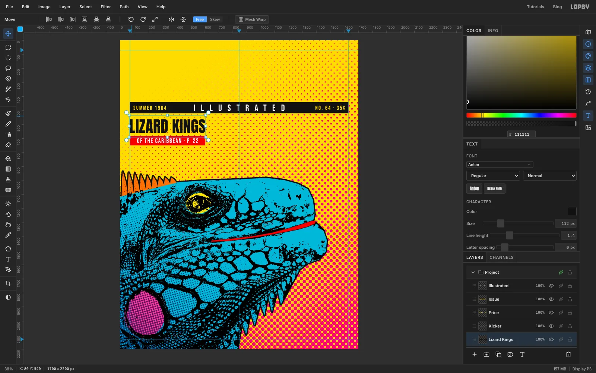

A click inside an existing text's box edits that text instead of starting a new one, and the box reaches well below the letters. So always click in an empty spot, and set any text that will sit *under* another one first. That's why the kicker in the red bar comes before LIZARD KINGS. Before each new text, click the *Bars* row, because with a text layer active, changing the font would restyle that layer.

Pick the **Text** tool (T). For each line, set the font, size and colour in the options bar, click on the page, type, and press [[Tab]] to finish. Set **Letter spacing** in the **Text** panel. Rename each text layer as you go (the names below are the ones in the screenshots). Then, with the **Move** tool, drag the text close to its spot and finish with the arrow keys: [[Shift]]+arrow moves 10 px, a plain arrow 1 px.

1. `ILLUSTRATED` (*Illustrated*): **Bebas Neue**, size `64`, white `#FFFFFF`, letter spacing `40`. Centre it on the middle guide and inside the black band.
2. `SUMMER 1964` (*Issue*): Bebas Neue, size `40`, yellow `#FFDD1F`, letter spacing `6`. Put it 26 px in from the band's left end, centred top to bottom.
3. `No. 64 · 35¢` (*Price*): the same settings. Copy the dot and cent sign from this page and paste them with [[Cmd+V]]. End it 26 px in from the band's right end.
4. `OF THE CARIBBEAN · P. 22` (*Kicker*): Bebas Neue, size `46`, white, letter spacing `4`. Centre it in the red bar.
5. `LIZARD KINGS` (*Lizard Kings*): **Anton**, size `112`, ink `#111111`, letter spacing `0`. Put its left edge on the margin guide, with the bottom of the letters about 20 px above the red bar. Its right edge should land almost exactly on the end of the bar.

## Set the FAUNA masthead

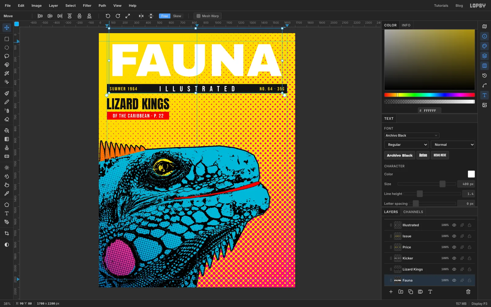

Click *Bars*, then set **Archivo Black**, size `400`, white, letter spacing `0`. Click in the top-left of the page, type `FAUNA`, press [[Tab]], and name the layer *Fauna*.

Nudge it so it's centred on the middle guide, with the tops of the letters about 26 px below the top margin guide. It should run almost margin to margin.

## Give the masthead a comic outline

Open the effects drawer for *Fauna*:

- **Stroke:** Width `10`, Position **outside**, colour `#111111`.
- **Drop Shadow:** colour red `#E2231A`, Offset X `18`, Offset Y `18`, Blur `0`, Spread `10`, Opacity `100`.

A Blur of 0 gives a hard-edged shadow, like a second colour printed slightly off. The text stays live, so you can still change the wording.

## Build the speech balloon

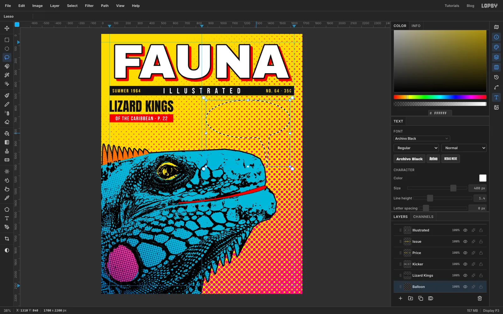

Click *Fauna*, click **Add Layer**, and name the layer *Balloon*.

Pick the **Elliptical Marquee** and drag an oval in the empty space right of the cover lines. Start it about 40 px below the black band, just right of the centre guide, and stop about 35 px short of the right margin guide. Make it roughly 320 px tall, a bit less than half as tall as it is wide.

Now add the tail. Pick the **Lasso**, hold [[Shift]] so the loop adds to the oval, and drag a thin, slightly curved spike. Start it inside the bottom of the oval and bring it down to a point just above the nostril, about 25 px clear of the snout.

## Fill and type the balloon

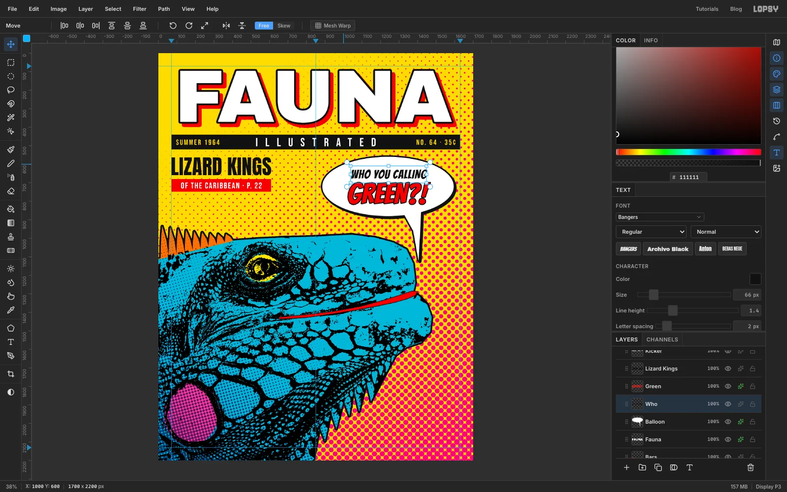

Set the foreground to white `#FFFFFF`, choose **Edit → Fill**, and press [[Cmd+D]]. In the effects drawer, turn on **Stroke** (Width `8`, **outside**, `#111111`) and a **Drop Shadow** in `#111111` with Offset X and Y `8`, Blur `0` and Opacity `100`.

Set the lettering bottom-up again, clicking *Balloon* first each time:

1. `GREEN?!` (*Green*): **Bangers**, size `150`, red `#E2231A`, letter spacing `2`. Give it its own **Stroke** effect: Width `5`, **outside**, `#111111`.
2. `WHO YOU CALLING` (*Who*): Bangers, size `66`, ink `#111111`, letter spacing `2`.

Centre both lines on the oval, nudging them about 6 px right of its true centre so they balance the shadow. Leave about 20 px between the two lines. Check that both clear the curve of the outline comfortably at their ends.

## Draw a starburst

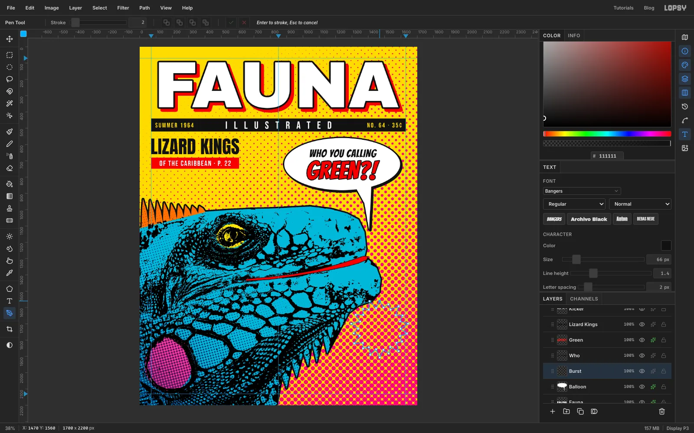

Click *Balloon*, click **Add Layer**, and name it *Burst*.

With the **Pen** (P), click corner points round a circle, alternating between an outer ring about 170 px from the centre and an inner ring about 132 px out. That's 36 clicks for 18 points. Vary a few of the outer points by 5 or 10 px so it looks hand cut. Centre it in the open dots right of the chin, so only one point touches the dewlap spines and there's still room for a barcode below. Close the path, then click **Path to Selection** and **Delete Path** in the Paths panel.

## Give the burst two rings

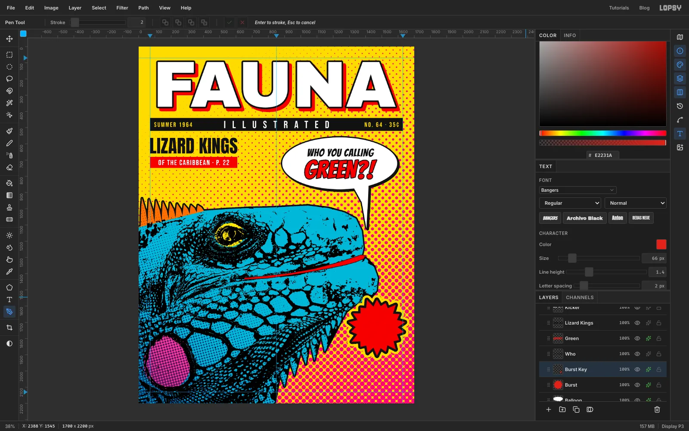

Set the foreground to red `#E2231A`, choose **Edit → Fill**, and press [[Cmd+D]].

You want a black edge with a yellow ring outside it, so it pops off the magenta dots. A layer only has one Stroke, so use two layers:

1. On *Burst*, turn on **Stroke** with Width `28`, **outside**, in yellow `#FFDD1F`.
2. Choose **Layer → Duplicate Layer** and rename the copy *Burst Key*. It lands exactly on top of the original.
3. On *Burst Key*, change the Stroke colour to `#111111` and the Width to `14`.

The black stroke covers the inner half of the yellow, leaving a yellow ring outside.

## Letter the burst

Click *Burst Key* before each text:

1. `COLD-BLOODED!` (*Cold Blooded*): Bangers, size `40`, white, letter spacing `2`.
2. `100%` (*100%*): Bangers, size `112`, yellow `#FFDD1F`, letter spacing `2`, with a **Stroke** of Width `5`, **outside**, `#111111`.

Centre both on the burst, with about 12 px between them.

## Group and tilt the sticker

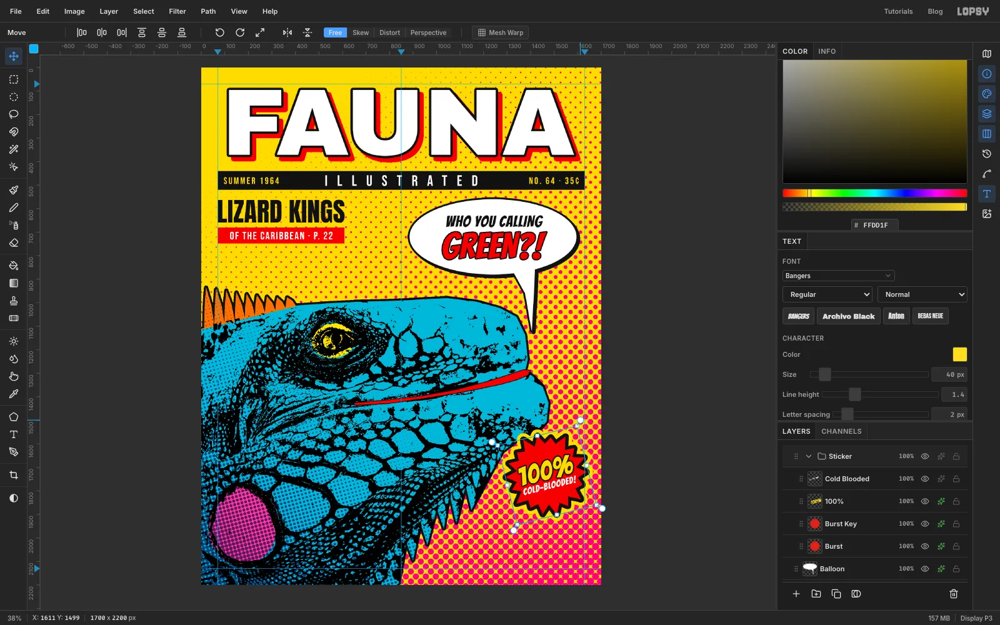

Click *Cold Blooded*, then [[Shift]]-click *Burst* to select the four layers. Choose **Layer → Group Layers** and name the group *Sticker*.

With the **Move** tool and the group active, drag the round rotation handle outside the top-right corner anticlockwise, about **14°**. That's enough for the 100% to climb at a jaunty slant without looking like it's falling over. The burst, both strokes and the live text all turn together.

## Add a barcode

Collapse *Sticker*, keep it active, click **Add Layer**, and name the layer *Barcode*.

With the **Rectangular Marquee**, click once and enter From `1412`, `1968` and To `1630`, `2130`. That's a box flush with the right and bottom margin guides. Fill it with white `#FFFFFF` and press [[Cmd+D]].

Pick the **Pencil** (N) with ink `#111111` as the foreground. Draw each bar as a straight line: click at the top, then [[Shift]]-click at the bottom. Fill the width of the box with about two dozen bars of mixed widths, switching the Pencil Size between `3`, `6` and `8`, with 3–4 px gaps and a small margin at each side. Run them from just under the top of the box to about two thirds of the way down. Make the first two, middle two and last two bars about **12 px** longer. Those are the guard bars, and they're what make it read as a real barcode.

Click *Barcode*, then set `0 41964 00064 2` in **IBM Plex Mono**, size `16`, ink `#111111`, letter spacing `0`, centred under the bars. Name it *Barcode Digits*.

## Put halftone dots in the masthead

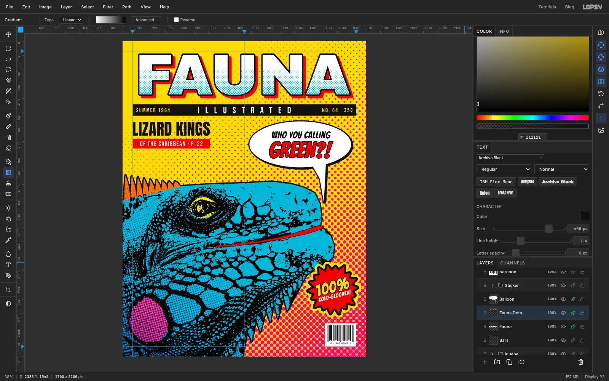

Click *Fauna*, click **Add Layer**, and name it *Fauna Dots*. [[Cmd]]-click the *Fauna* thumbnail to select the letter shapes.

Pick the **Gradient** tool. Click **Advanced…** and swap the stops, white on the left and black on the right, then click **Done**. Drag from just inside the top of the letters straight down to about 45 px below them.

Run **Filter → Halftone…** with Dot Size `12`, Density `1`, Angle `45` and Softness `0.4`, and click **Apply**. Press [[Cmd+D]], and give the layer a **Color Overlay** in cyan `#19B5D6`. The masthead now picks up the same dots as the iguana.

## Add paper grain and export

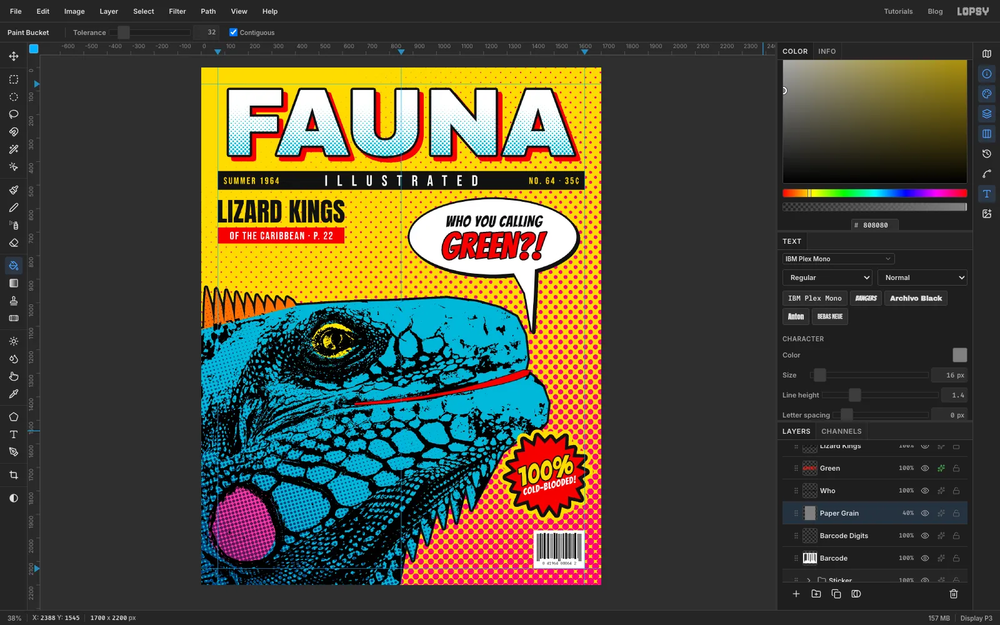

Click the topmost layer in the panel, click **Add Layer**, and name it *Paper Grain*. Fill it with mid grey `#808080` using the **Paint Bucket**.

Choose **Filter → Add Noise…**, set Amount to `18`, click **Mono**, and click **Apply**. In the effects drawer, set the blend mode to **Overlay**, then click the **100%** on its row and set it to **40%**. Mid grey vanishes in Overlay, so only the speckle is left. It takes the edge off the flat colour, as if the cover had been printed on cheap stock.

Zoom in and check:

- No text should touch the edge of its band, bar, balloon or burst.
- The balloon tail should point at the snout without touching it.
- The barcode should sit flush with both margins.

Save with **File → Save Project**, then **File → Quick Export PNG**.

> **Tip:** To make your own issue, swap the photo for any animal in profile. Keep the Threshold level low enough that the scales or fur become lines, not black blobs, and pick the colour plate from whichever process colour isn't the animal's real one.
