Post-modern design arrived in the late 1970s and 1980s as a reaction against the clean Swiss grid. Architects like Michael Graves put cartoon columns and pediments on office blocks. The Memphis group covered furniture in squiggles and confetti. Designers like April Greiman and Wolfgang Weingart layered type on tilted planes, airbrushed soft gradients and let early computer dot patterns show. It was playful, a bit ironic and very colourful.

In this tutorial you'll use that language to build a logo identity sheet for **Yuppie Quiche**, a made-up 1980s brunch bistro. The joke at the heart of the mark is architectural. A slice of quiche becomes a classical pediment, a fried egg becomes its round window, and the whole thing stands on a column that rests on the word QUICHE. The sheet is 1600 × 1200 px. The primary logo is on the left. On the right are three cards for the monogram, a secondary mark and the palette.

The tools you'll use:

- **guides**, the **Rectangular** and **Elliptical Marquee** (including their exact-corner dialog), and the **grid** with **Snap**
- the **Halftone** and **Add Noise** filters and a radial **Gradient**
- the **Pen** tool, **Path to Selection** and Enter-to-stroke
- the **Pencil**, **Brush**, **Spray**, **Eraser** and **Shape** tools
- **Select → Shrink**, and [[Cmd]]-clicking a thumbnail to load a layer's shape
- **Copy**, **Copy Merged**, **Paste**, and the Move tool's rotate and scale handles, on pixels and on live text
- the **Multiply** blend mode, groups, and the **Drop Shadow** and **Stroke** layer effects
- live text in **Abril Fatface**, **Rubik Mono One** and **Space Mono**

The palette:

- Paper `#F1EADC`, cream `#FFFBF2`, ink `#1B1A1F`
- Dot grid grey `#8A8478`
- Airbrush `#F2928A` → `#B9A7E6` → `#A6DCC8`
- Teal `#23968C`, lilac `#B9A7E6`, mint `#A6DCC8`
- Coral pink `#F2928A`
- Column vermilion `#DC6E4E` / `#A84E36`
- Custard `#F7CD5A`, crust `#C7843A` / `#9C5F26`, spinach `#4C8B47`
- Yolk `#FFA51F`

> **Tip:** On a wide-gamut (Display P3) screen, Lopsy reads typed hex codes as P3 colours. These codes were picked as P3 values, so they match the finished sheet. On an sRGB screen they come out a touch duller.

> **Note:** Shortcuts are written for a Mac. On Windows use [[Ctrl]] wherever it says [[Cmd]].

> **Tip:** When a step gives a position like **(560, 150)**, read it off the **X / Y** readout at the bottom left of the window. It shows where your cursor is in document pixels.

## Set up the sheet and block in the dot grid

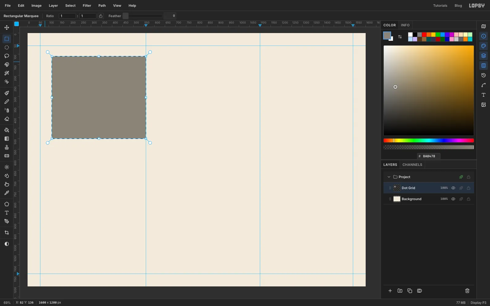

Choose **File → New**, keep the units on **Pixels**, and make the document **1600** wide and **1200** high.

Click the top ruler to drop vertical guides at **60**, **560**, **1100** and **1540**. Then click the left ruler at **60** and **1140**. The outer guides are the sheet's margins. The guide at 560 is the centre line of the logo, and 1100 is where the cards start.

Click *Background*, set the foreground colour to `#F1EADC` and choose **Edit → Fill**.

Click *Layer 1* and rename it *Dot Grid*. Pick the **Rectangular Marquee** and click once on the canvas without dragging. That opens a small dialog where you can type exact corners. Enter **From 115, 110** and **To 560, 500**, then fill the selection with `#8A8478`.

## Turn the block into a halftone dot grid

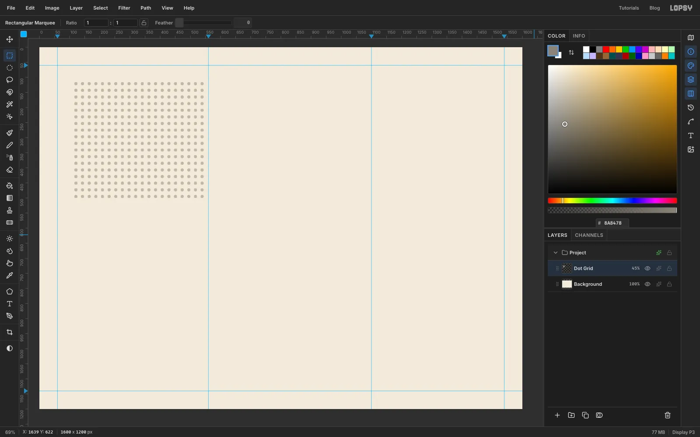

Keep the selection and choose **Filter → Halftone…**. Set **Dot Size 22**, **Density 1**, **Angle 0** and **Softness 0.4**, then click **Apply**. A flat mid-grey turns into an even grid of round dots, a nod to the bitmap patterns of the first Macintosh.

Press [[Cmd+D]] to deselect. Open the layer's effects (the ✦ button on its row), set **Blend** to **Multiply**, and lower the layer's opacity to **45%** so the dots print softly on the paper.

## Airbrush a gradient disc

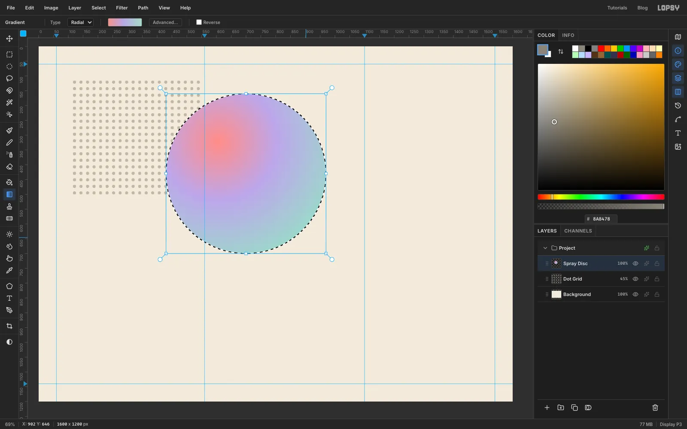

Click **Add Layer** and name it *Spray Disc*. Pick the **Elliptical Marquee**, click once to open its dialog and enter **From 430, 160** **To 970, 700**. That's a 540 px circle that overlaps the right side of the dot grid.

Pick the **Gradient** tool, set it to **Radial** and open **Advanced…**. Make three stops: `#F2928A` at the left end, `#B9A7E6` at 45% and `#A6DCC8` at the right end. Click **Done**.

Drag from a point inside the upper-left part of the disc, about a third of the way in from its edge, to just outside its lower-right edge. The coral hot spot sits off-centre, like an airbrushed highlight.

## Add airbrush grain

Real airbrush work is never perfectly smooth. With the selection still active, choose **Filter → Add Noise…**, set **Amount 10**, click **Mono** and **Gaussian**, and apply. Press [[Cmd+D]].

## Tilt a teal slab across the composition

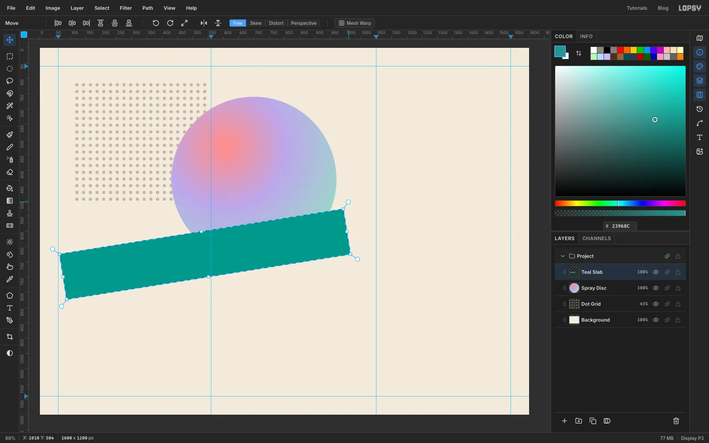

Click **Add Layer** and name it *Teal Slab*. Use the Rectangular Marquee dialog for **From 70, 600** **To 1010, 750** and fill it with `#23968C`.

Press [[V]] for the Move tool. Grab the round rotation handle just outside the top-right corner of the selection and drag it upward, turning the slab about **9°** anticlockwise, until its right end sits roughly 150 px higher than its left. Release, press [[Enter]] to commit the rotation, and press [[Cmd+D]].

Tilted planes are the signature of New Wave typography, and this slab will carry the word YUPPIE.

## Cross it with a second translucent plane

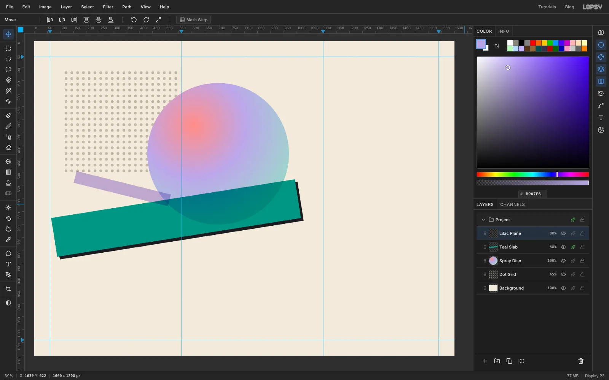

With *Teal Slab* active, open its effects. Set **Blend** to **Multiply** and the opacity to **88%**, so the disc shows through where they overlap. Tick **Drop Shadow** and set **Offset X 10**, **Offset Y 10**, **Blur 0**, **Spread 0**, **Opacity 100**, with the colour `#1B1A1F`. A blur of 0 gives the flat, offset shadow that runs through the whole sheet. From here on, a shadow written as **6 / 6** means Offset X 6 and Offset Y 6, with Spread left at 0.

Click **Add Layer** and name it *Lilac Plane*. Select **From 150, 540** **To 520, 586**, fill with `#B9A7E6`, and press [[V]]. This time drag the top-right rotation handle downward to turn the bar **14°** clockwise. Press [[Enter]], then [[Cmd+D]]. Set its **Blend** to **Multiply** and opacity to **80%**.

## Build a fluted column

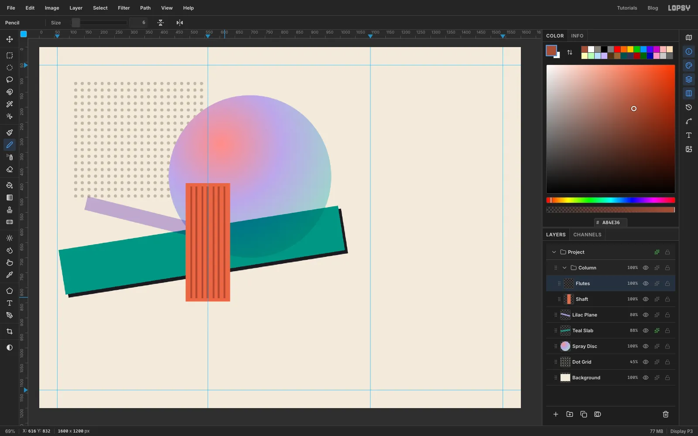

Click **New Group** in the Layers panel and name the group *Column*. With the group selected, click **Add Layer** so the new layer goes inside it, and name it *Shaft*. Select **From 486, 452** **To 634, 846** and fill with `#DC6E4E`. Deselect.

Add another layer called *Flutes*. Pick the **Pencil**, set **Size 6** and the colour to `#A84E36`. For each flute, click near the top of the shaft, hold [[Shift]] and click near the bottom. That draws a perfectly straight vertical line. Put the middle flute on the centre guide, then three more on each side about 18 px apart, so the outer ones land near X 505 and 615. Stop each line about 14 px short of the top and bottom of the shaft.

## Add the plinth, capital and volutes

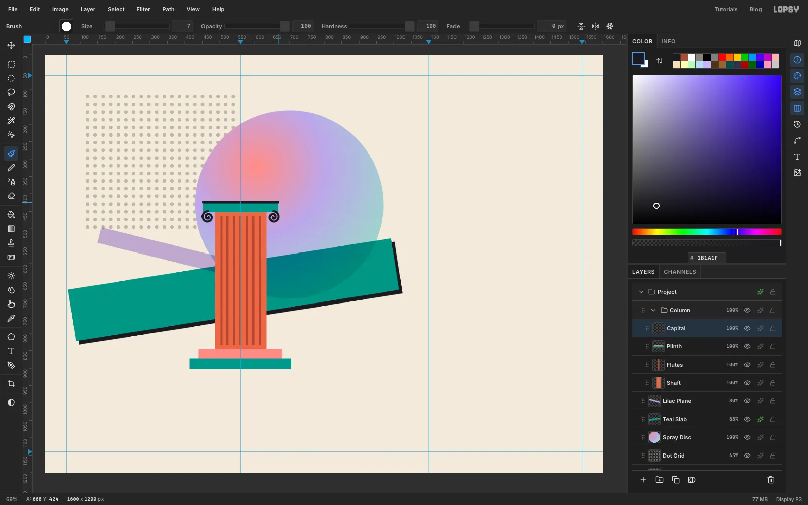

Add a layer called *Plinth*. Select **From 440, 846** **To 680, 872** and fill with `#F2928A`. Then select **From 414, 872** **To 706, 902** and fill with `#23968C`. That gives you a stepped base, pink over teal.

Add a layer called *Capital*. Select **From 452, 424** **To 668, 452** and fill with `#23968C`. Deselect.

The Ionic volutes are two hand-drawn spirals. Pick the **Brush** with **Size 7** and **Hardness 100**, and set the colour to `#1B1A1F`. At each end of the capital, start a stroke at the capital's bottom edge and wind it inward, about one and three-quarter turns, ending near the middle of a spiral roughly 35 px across. Curl the left one anticlockwise and the right one clockwise so they mirror each other. Finish with a crisp line along the top of the capital: click its top-left corner, then [[Shift]]-click its top-right corner.

> **Tip:** Spirals are fiddly. If one comes out lopsided, press [[Cmd+Z]] and try again. Undo and redo step cleanly through each stroke, so you can go back several steps and forward again without losing anything.

## Give the column a hard shadow

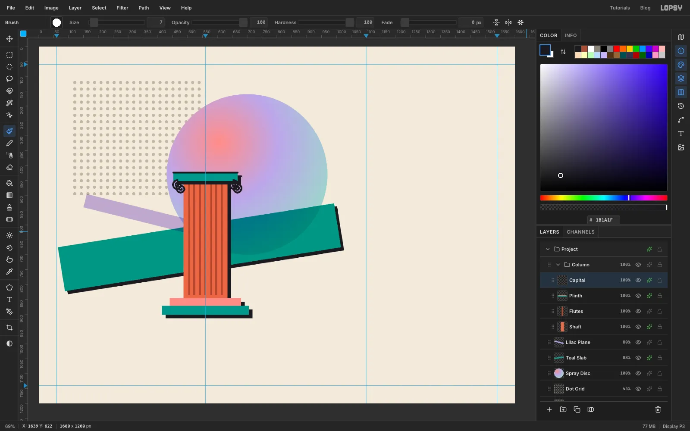

Layer effects go on layers, not on groups, so give each of the three solid parts its own shadow. Click *Shaft*, open its effects and tick **Drop Shadow** with **Offset X 12**, **Offset Y 12**, **Blur 0**, **Spread 0**, **Opacity 100** and colour `#1B1A1F`. Do the same for *Plinth* and *Capital*. Leave *Flutes* without one.

## Draw the quiche pediment with the Pen

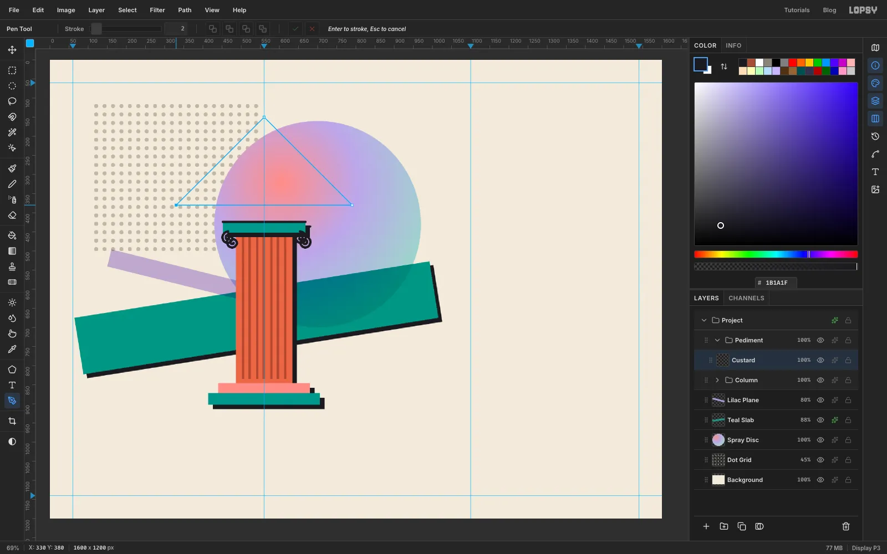

Click the *Column* group's arrow to collapse it. With the group row selected, click **New Group** and name it *Pediment*. Then **Add Layer** inside it and name it *Custard*.

Pick the **Pen** tool. Click once at about **(330, 380)** for the left corner, just above the capital and well to its left. Click once on the centre guide at **(560, 150)** for the apex, a little below the top of the dot grid. Click once at **(790, 380)** for the right corner, level with the first, and click the first point again to close the triangle. Single clicks give sharp corners, and the two slopes come out at 45°.

## Fill the custard and dot in the filling

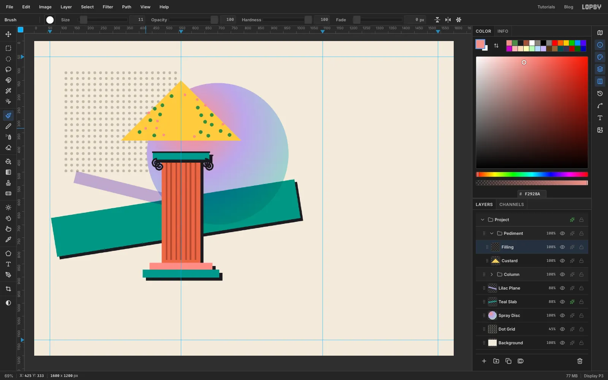

Open the **Paths** panel and click **Path to Selection**, then **Delete Path**. Fill the selection with `#F7CD5A` and deselect.

Add a layer called *Filling*. Pick the **Brush** with **Size 15** and colour `#4C8B47`, and click about sixteen spinach flecks around the triangle. Switch to **Size 11** and `#F2928A` and click about ten pinker flecks of ham in the gaps. Keep the flecks off the middle, where the egg will go, and away from the edges.

## Make the scalloped crust

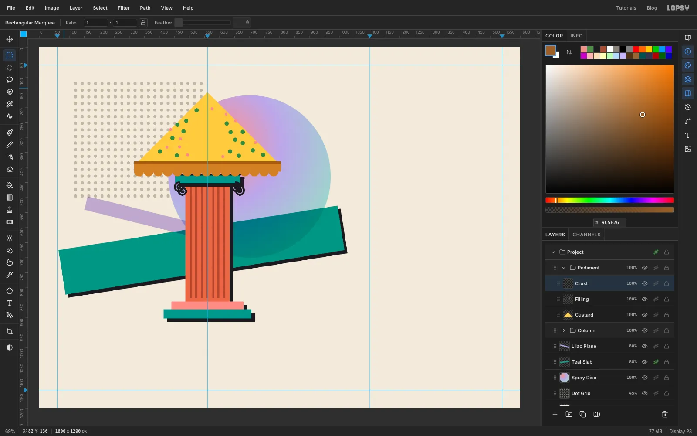

Add a layer called *Crust*. Select **From 316, 380** **To 804, 414** and fill with `#C7843A`.

Now the scallops. Use the Elliptical Marquee dialog to make a small circle, 32 px across, centred on the bottom edge of the crust at its left end: **From 316, 398** **To 348, 430**. Fill it with `#C7843A`. Then repeat along the edge, moving both X values right by 32 each time. The From X values run 316, 348, 380 and so on up to 764, and each To X is 32 more. That's fifteen circles. The last one stops 8 px short of the band's right end, which is fine.

Finally, select a thin strip along the top of the crust, **From 316, 380** **To 804, 387**, and fill it with the darker `#9C5F26` for a toasted edge. Deselect.

## Trace a wobbly fried egg

A perfect circle here reads as an eye. A fried egg needs a lumpy edge. Add a layer called *Fried Egg* and pick the **Pen**.

Work your way around the middle of the triangle, on the centre guide about 150 px below the apex. Press and drag at each of eight points to pull out smooth handles, making a shape about 110 px across and a little wider than it is tall. Then nudge two or three of the points in or out by 5–10 px so the edge wobbles. Close the path on the first point.

## Fill the egg and add the yolk

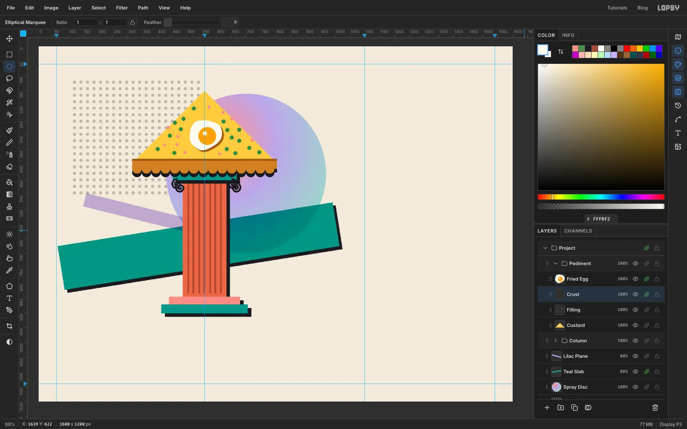

Click **Path to Selection** and **Delete Path** in the Paths panel, and fill with `#FFFBF2`.

Make the yolk a little off-centre. Use the Elliptical Marquee dialog for **From 539, 273** **To 599, 333** and fill with `#FFA51F`. Add a tiny highlight near its upper left, **From 554, 287** **To 568, 301**, filled with `#FFFBF2`. Deselect.

Give *Fried Egg* a **Drop Shadow** of **6 / 6**, **Blur 0**, **Opacity 100**, in the crust brown `#9C5F26`, so it sits on the custard.

Then click *Crust* and give it a **Drop Shadow** with **Offset X 0** and **Offset Y 12**, **Blur 0**, **Opacity 100**, in `#1B1A1F`. Dropping it straight down turns the scallops' shadow into a second row of black dentils.

## Stroke two Memphis squiggles

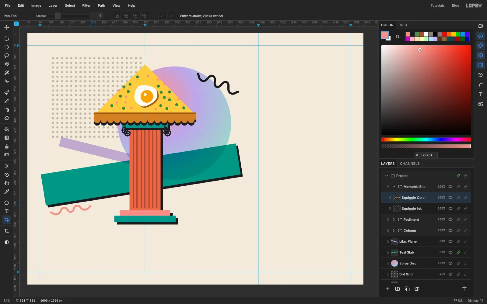

Collapse *Pediment*, select its row and click **New Group**. Name it *Memphis Bits* and add a layer inside it called *Squiggle Ink*.

Pick the **Pen**, set its **Stroke** to **10** in the options bar, and set the foreground colour to `#1B1A1F`. Start just above the upper-right edge of the disc, around **(812, 196)**, and make a wave of three humps heading down and to the right, about 210 px long. Use seven points about 35 px apart along that line: the start, then crests and troughs alternating about 20 px either side of it, and the end back on it. Press and drag at each point, pulling the handles along the direction of the wave so the curves stay round. Press [[Enter]] to stroke the path in the foreground colour, then delete the path in the Paths panel.

Add a layer called *Squiggle Coral*, set **Stroke 9** and `#F2928A`, and draw a smaller wave in the gap under the left end of the teal slab. Make it about 190 px long, running parallel to the slab. Stroke it with [[Enter]] and delete the path.

## Copy and spin a triangle of confetti

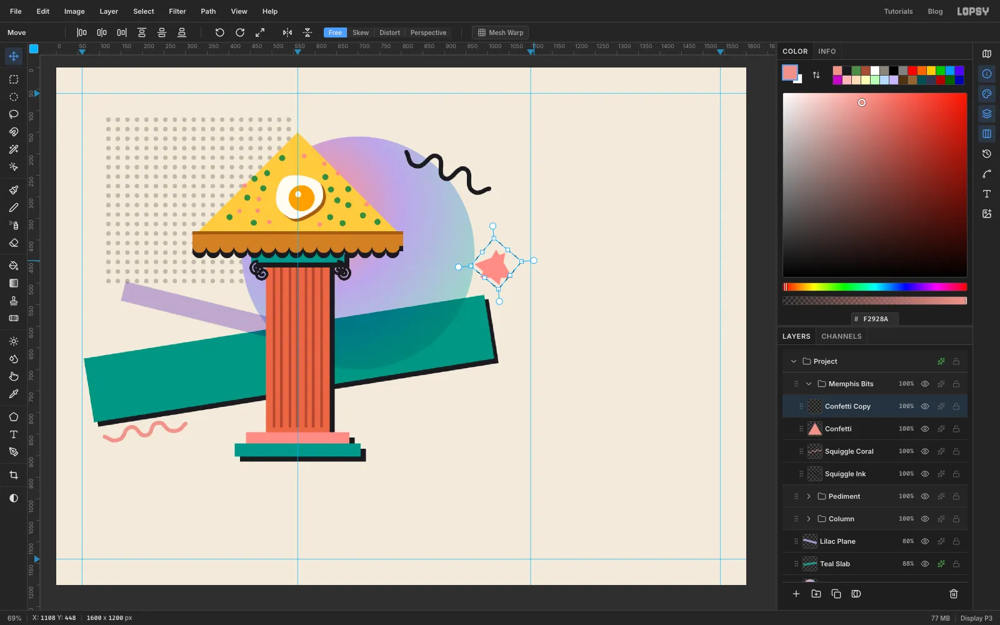

Add a layer called *Confetti*. Pick the **Shape** tool, choose **Polygon** with **Sides 3** and **Output: Pixels**, set the fill to `#F2928A` and remove any stroke. Shapes grow from the centre, so press at about **(1020, 455)**, just above the slab's raised right corner and overlapping the edge of the disc, and drag out about 38 px.

Draw a marquee around the triangle with a little room to spare and press [[Cmd+C]], then [[Cmd+V]]. The copy pastes in place on a new layer. Rename it *Confetti Copy*.

A paste selects what it pasted and switches to the Move tool, so the copy already has handles. Drag the top-right rotation handle clockwise about **40°**, press [[Enter]], and press [[Cmd+D]].

## Move the copy into a confetti cluster

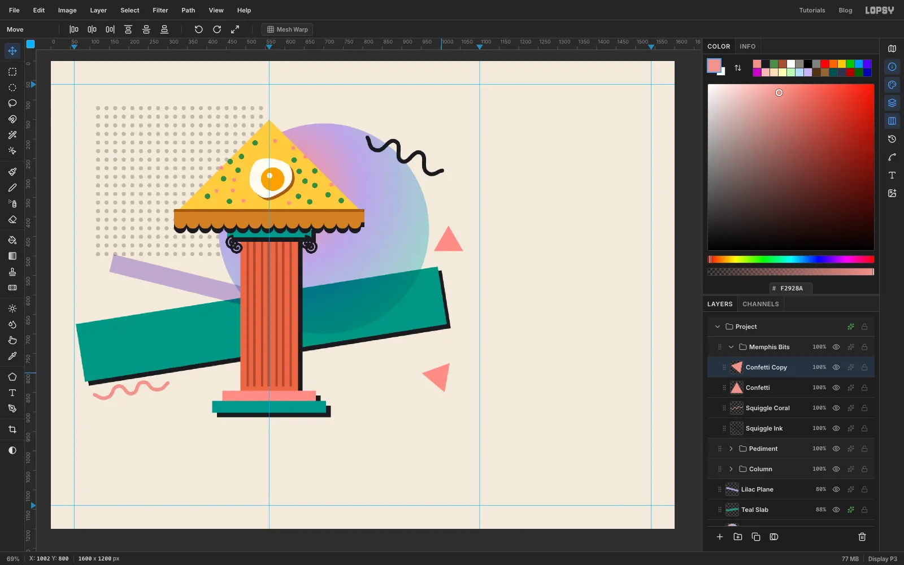

With the Move tool still active, drag the rotated copy down below the right end of the teal slab, to about **(1000, 800)**. The two triangles now bracket the slab's right end instead of floating at random.

## Cut a ring with Shrink

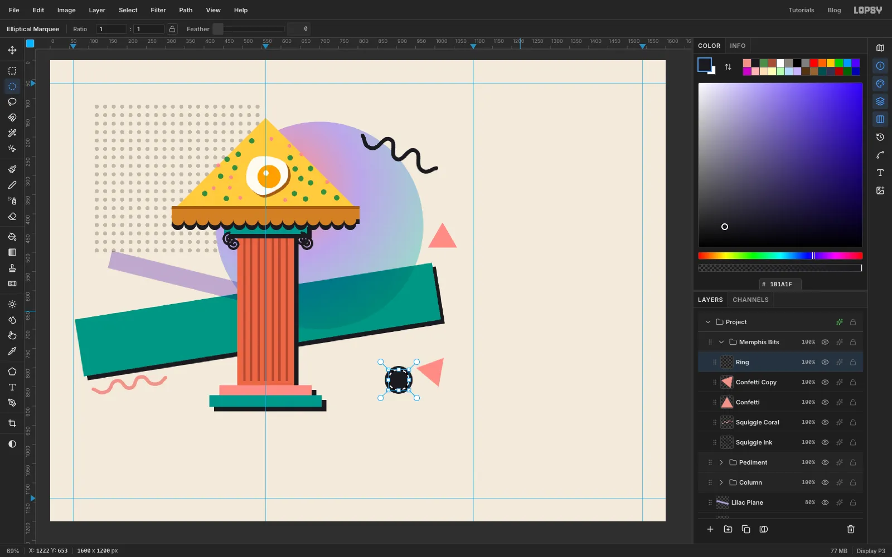

Add a layer called *Ring*. Use the Elliptical Marquee dialog for **From 870, 796** **To 942, 868**, just left of the lower triangle, and fill with `#1B1A1F`.

Choose **Select → Shrink…** and shrink by **9** px. Press [[Delete]] to clear the middle, which leaves a 9 px black ring. Deselect.

## Spray speckle inside the disc

Add a layer called *Airbrush Speckle*. [[Cmd]]-click the *Spray Disc* thumbnail in the Layers panel to load the disc as a selection, then click the *Airbrush Speckle* row again so you paint on the new layer.

Pick the **Spray** tool and set **Size 70**, **Density 30**, **Opacity 75** and **Softness 0**. With `#23968C`, spray in one slow sweep up the lower-right edge of the disc. Switch to `#F2928A` and continue up the upper-right edge. The selection keeps every dot inside the disc. Deselect.

## Set the QUICHE wordmark

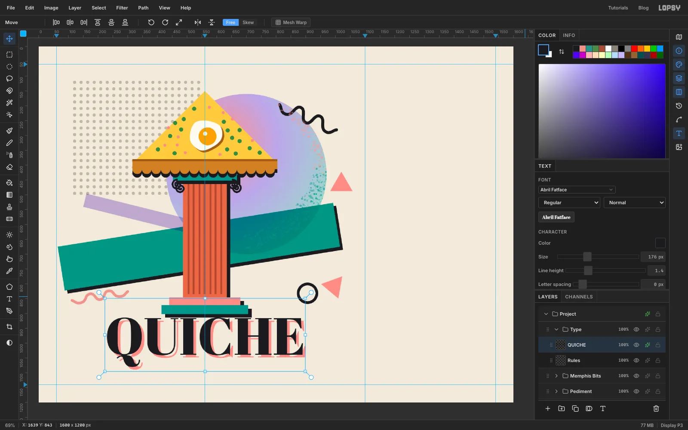

Collapse *Memphis Bits*, select its row and click **New Group**. Name it *Type* and add a plain layer inside it called *Rules*. You'll draw a rule on it later, and it gives new text a raster layer to start from.

Pick the **Text** tool, set **Align** to **Left**, choose **Abril Fatface** at size **176**, and set the colour to `#1B1A1F`. Click in the empty space below the plinth, type **QUICHE** and press [[Tab]] to commit.

Switch to the Move tool and nudge the word with the arrow keys ([[Shift]] moves 10 px) until it's centred on the centre guide and the tops of the flat capitals sit right on the bottom of the plinth's shadow. The column now stands on the wordmark.

Open its effects and add a **Drop Shadow** of **9 / 9**, **Blur 0**, **Opacity 100**, in `#F2928A`. It reads like a print misregistration, and the text stays live and editable.

## Rotate YUPPIE onto the slab

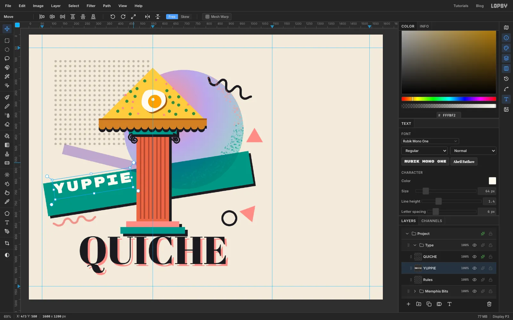

Click *Rules* first, so the next text doesn't restyle QUICHE. Choose **Rubik Mono One** at size **64** in `#FFFBF2`. Click in empty space on the left, type **YUPPIE** and press [[Tab]]. In the **Text** panel, set **Letter spacing** to **6**.

Press [[V]]. Live text gets its own transform handles, no selection needed. Drag the top-right rotation handle upward until the word turns about **9°** anticlockwise and its baseline runs parallel to the slab's edges. Release. The text is still editable.

## Seat YUPPIE and give it a shadow

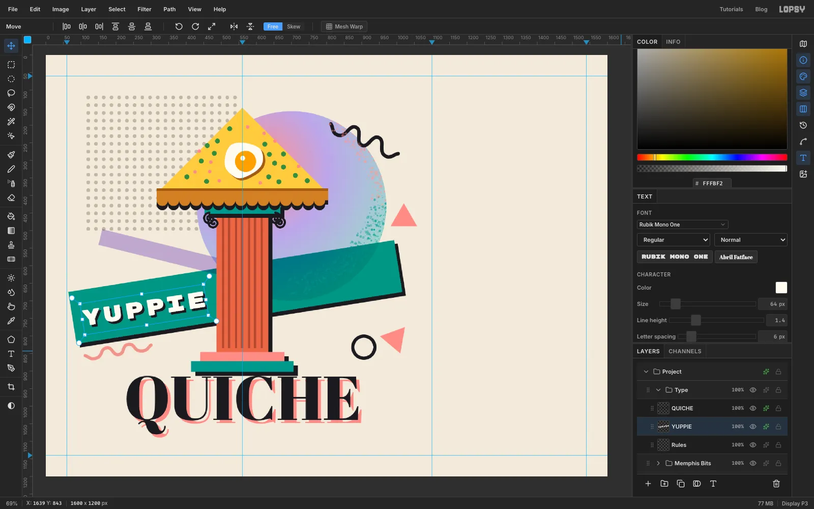

Nudge YUPPIE with the arrow keys until it sits in the middle of the slab's left end, with about the same gap (roughly 30 px) to the slab's end and to the column. Then give it a **Drop Shadow** of **6 / 6**, **Blur 0**, **Opacity 100**, in `#1B1A1F`.

## Add the tagline and a stair-step rule

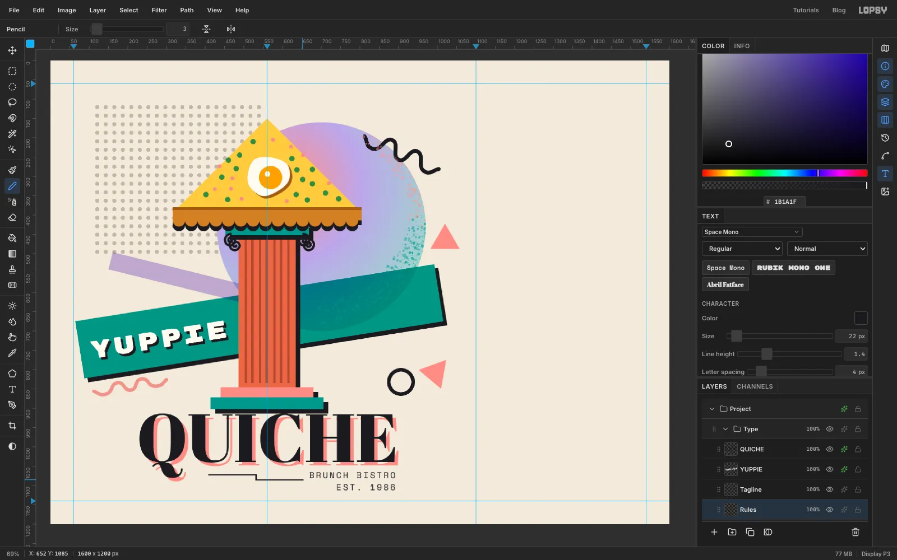

Click *Rules* again. With the Text tool, set **Align** to **Right**, choose **Space Mono** at size **22** in `#1B1A1F`, and click in empty space below the wordmark. Type **BRUNCH BISTRO**, press [[Return]], type **EST. 1986** and press [[Tab]]. Rename the layer *Tagline* and set **Letter spacing** to **4**. Nudge the block so its right edge lines up with the right edge of the E, and its top sits just below the baseline of QUICHE.

The Text tool will keep **Right** for the next text you type. Click *Rules* and set **Align** back to **Left** now. Do it with *Rules* selected, not the tagline: changing Align while a text layer is selected restyles that layer.

Weingart loved stepped rules. Pick the **Pencil** at **Size 3**. Click under the U, level with the middle of BRUNCH BISTRO, then [[Shift]]-click halfway to the tagline. [[Shift]]-click 12 px straight down, then [[Shift]]-click just short of the tagline's left edge.

## Lay out the three cards

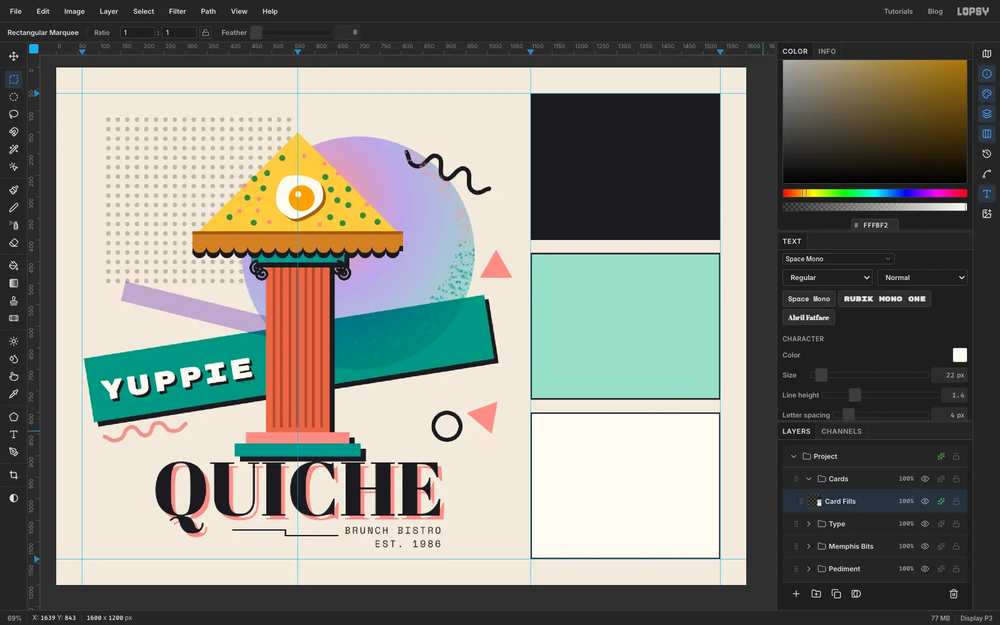

Collapse *Type*, select its row and click **New Group**. Name it *Cards* and add a layer called *Card Fills*.

Using the Rectangular Marquee dialog, fill **From 1100, 60** **To 1540, 400** with `#1B1A1F`, **From 1100, 430** **To 1540, 770** with `#A6DCC8`, and **From 1100, 800** **To 1540, 1140** with `#FFFBF2`. Deselect.

Open the layer's effects, tick **Stroke**, set **Width 3** and the colour `#1B1A1F`, and choose **inside**. Every card now has a crisp keyline that doesn't spill past the margins.

## Build the monogram

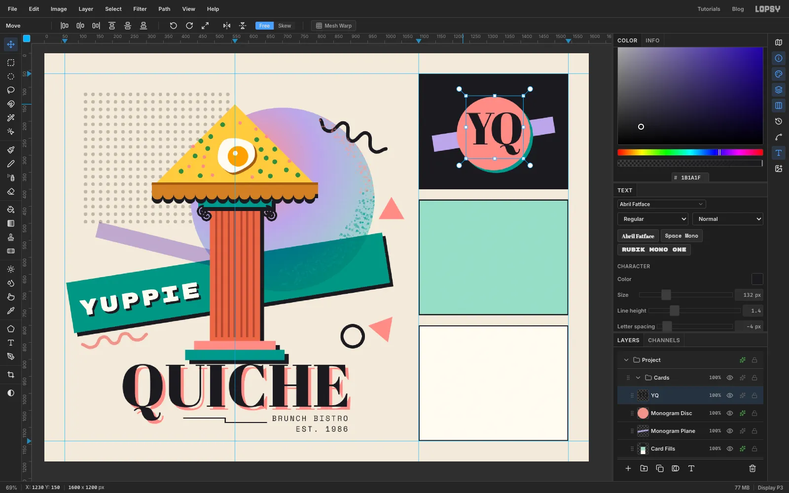

Add a layer called *Monogram Plane*. Select **From 1140, 214** **To 1500, 262**, fill with `#B9A7E6`, press [[V]] and rotate it **9°** anticlockwise, like the slab. Press [[Enter]] and deselect.

Add a layer called *Monogram Disc*. Use the Elliptical Marquee dialog for **From 1212, 128** **To 1428, 344**, fill with `#F2928A` and deselect. Give it a **Drop Shadow** of **8 / 8**, **Blur 0**, **Opacity 100**, in teal `#23968C`.

With the Text tool on **Align: Left**, choose **Abril Fatface** at **132** in `#1B1A1F` and type **YQ** in the empty part of the card. Set **Letter spacing** to **−4** to pull the letters together, then nudge the pair until it's centred on the disc. Let the tail of the Q drop out of the circle.

## Copy Merged just the pediment

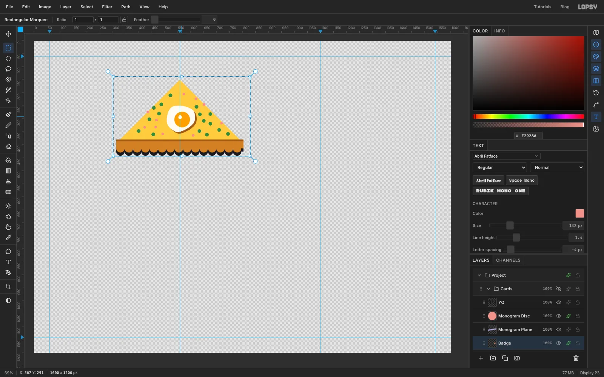

The secondary mark is a simplified version of the logo: the pediment alone.

First make the badge it will sit on, so the pasted copy lands above it. Click *Card Fills* and add a layer called *Badge*. Make a circle **From 1198, 494** **To 1442, 738** in the mint card, fill it with `#F2928A`, deselect, and give it a **Drop Shadow** of **10 / 10**, **Blur 0**, **Opacity 100**, in `#1B1A1F`.

Now hide everything except the pediment: click the eye icons of *Background*, *Dot Grid*, *Spray Disc*, *Teal Slab*, *Lilac Plane*, and the *Column*, *Memphis Bits*, *Type* and *Cards* groups. The badge disappears too, because it's inside *Cards*. Draw a marquee **From 304, 138** **To 830, 444** around the pediment and its shadows, and choose **Edit → Copy Merged**. Then turn all the eyes back on and deselect.

## Paste and scale the mark

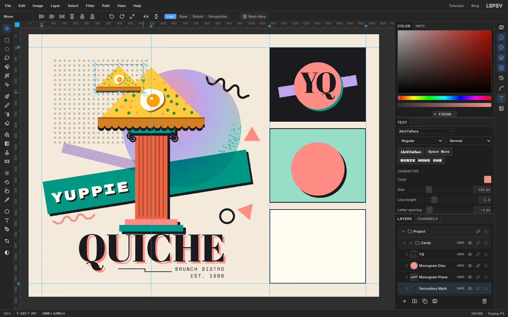

Click *Badge* and press [[Cmd+V]]. The merged copy pastes in place on a new layer. Rename it *Secondary Mark*.

Like every paste, it arrives selected with the Move tool active and handles around it. Hold [[Cmd]] to keep the proportions, then drag the bottom-right corner handle up and to the left until the copy is about **42%** of its size, around 220 px wide. Press [[Enter]] and deselect.

## Centre the mark on its badge

Drag the small pediment onto the coral badge and centre it, a few pixels above the middle so the crust's dentils have room. At this size the egg and flecks still read, which is the test of a good secondary mark.

## Snap a palette strip to the grid

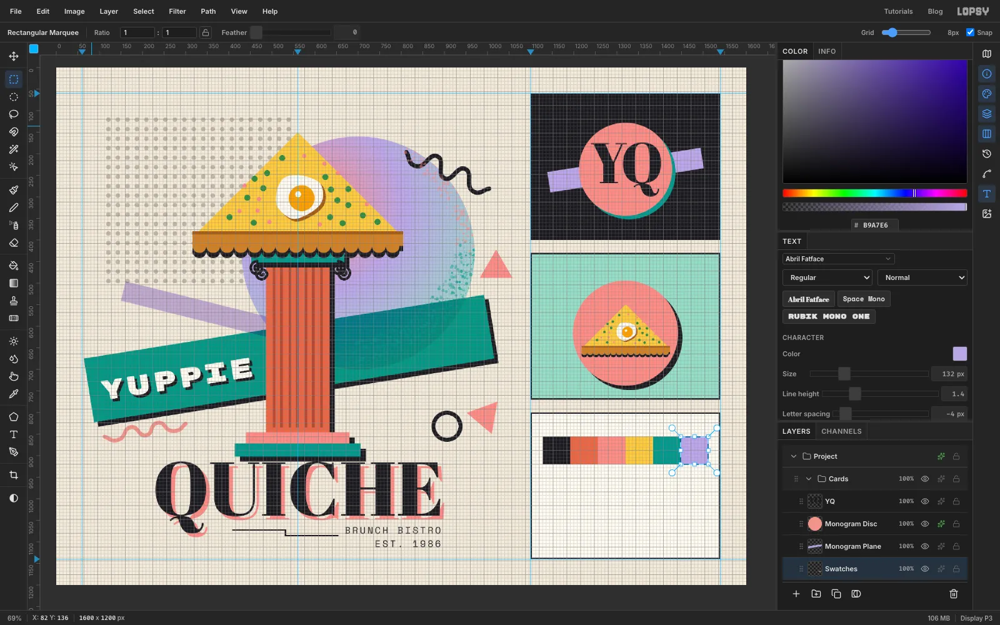

Add a layer called *Swatches*. Choose **View → Show Grid**, set the grid size to **8 px** in the options bar, and make sure **Snap** is ticked.

With the Rectangular Marquee, drag six squares edge to edge across the cream card. Each one is 64 px, eight grid cells. Start the row 28 px in from the card's left edge, so both ends have the same margin, and 56 px below its top, which leaves room for the label. Fill them in turn with `#1B1A1F`, `#DC6E4E`, `#F2928A`, `#F7CD5A`, `#23968C` and `#B9A7E6`. The grid snap makes each square land exactly against the last. Deselect and turn the grid off again with **View → Show Grid**.

## Label the cards and set the type specimens

Click *Card Fills*. With the Text tool on **Align: Left**, choose **Space Mono** at **15**. Type **MONOGRAM** in `#FFFBF2` near the top-left corner of the black card, 28 px in from its left edge, and set **Letter spacing** to **3**. Click *Card Fills* again before each new label. Add **SECONDARY MARK** and **PALETTE + TYPE** in `#1B1A1F` at the same spot on the other two cards.

Under the swatches, click *Swatches* before each line and set one specimen per font, all aligned to the same 28 px margin. Rename them *Spec Abril*, *Spec Rubik* and *Spec Space* as you go:

- **Aa Abril Fatface** in Abril Fatface, size 34, `#1B1A1F`
- **AA RUBIK MONO** in Rubik Mono One, size 22, `#23968C`, letter spacing 2
- **Aa Space Mono 0123456789** in Space Mono, size 18, `#1B1A1F`

## Fade the dot grid and add paper grain

Click *Dot Grid* and pick the **Eraser** with **Size 180** and **Opacity 30**. Make a slow pass down the grid's right edge, where it meets the disc, then a short pass across its lower-right corner, and one more right in that corner. The passes overlap, so the dots thin out toward the disc instead of stopping in a hard line.

Finally, click *Background* and run **Filter → Add Noise…** at **Amount 4**, **Mono**, **Gaussian** for a faint paper grain.

Choose **File → Save Project** to keep every layer and the live text, then **File → Export…** for a PNG to send to the client.
