Soviet propaganda posters run on a few strict rules. One heroic figure,
seen from below and looking straight at you. A sunburst behind it. Slogans
on bands that climb the page at a steep angle. Three inks at most: red,
black and the cream of the paper. Swap the steelworker for a reindeer and
the slogan for a season's greeting, and the same grammar makes a very
good Christmas card.

In this tutorial you'll make **Reindeer Heroes**, a 5 × 7 inch card at
1500 × 2100 px. You'll cut a bull reindeer out of a photo and posterize it
into three inks with a **Gradient Map** on its group. Then you'll draw the
diagonal bands with the **Pen** tool and rotate the type onto them with the
transform handles snapped to 15°. A silhouette of Santa's team flies
across the halo: you'll build it from a second photo with Flip, scale,
rotate and Duplicate. You'll finish with a rubber stamp, halftone dots and
paper grain.

The photos are both public domain. The hero is *Bull Caribou*
(7956361274) by Denali National Park on Wikimedia Commons. Reindeer and
caribou are the same species. Before you start, resize it to
**1400 × 2100**. The team is *Caribou* (48750430768) by the US Fish and
Wildlife Service, resized to **1500** px wide. Any front-on reindeer photo
and any side-on photo of one trotting will do.

The palette:

- Paper `#EAE1C9`
- Poster red `#AA3F32`
- Oxblood `#702A24`
- Ink `#1E1B19`
- Gold `#CCA259`
- Gradient Map greys `#000000` / `#646464` / `#FFFFFF` (for painting inside the Hero group)

## Set up the canvas and guides

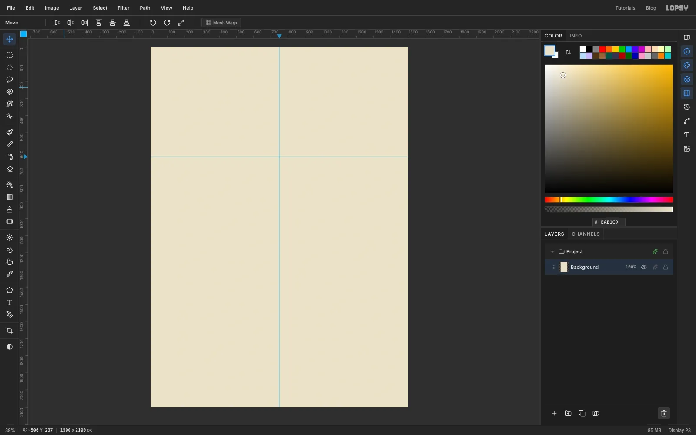

Choose **File → New**, make a **1500 × 2100** document and click
**Create**. Click the top ruler at **750** to drop a vertical guide down
the middle. Everything in the card is symmetrical about it. Click the left
ruler at **640** for a horizontal guide through the centre of the halo.

Select the **Background** layer, set the foreground colour to paper
`#EAE1C9` in the Color panel and choose **Edit → Fill**. Delete the empty
**Layer 1** with the trash button at the bottom of the Layers panel.

## Paint the two-colour sunburst

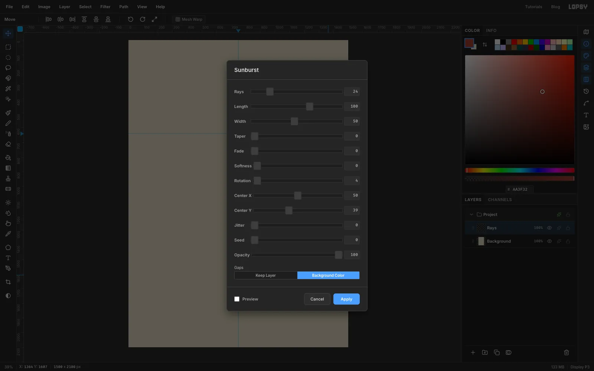

Click **Add Layer** and rename the new layer **Rays** by double-clicking
its name. Set the foreground to paper `#EAE1C9`, press [[X]] to swap it
into the background colour, then set the foreground to poster red
`#AA3F32`.

Choose **Filter → Sunburst…** and set **Rays** 24, **Width** 50,
**Center X** 50, **Center Y** 39 and **Rotation** 4. Under **Gaps**, pick
**Background Color**, so the gaps between the rays are filled with paper
instead of staying transparent. Click **Apply**. The centre of the burst
sits just below the halo, where the reindeer's head will be.

## Draw the gold halo

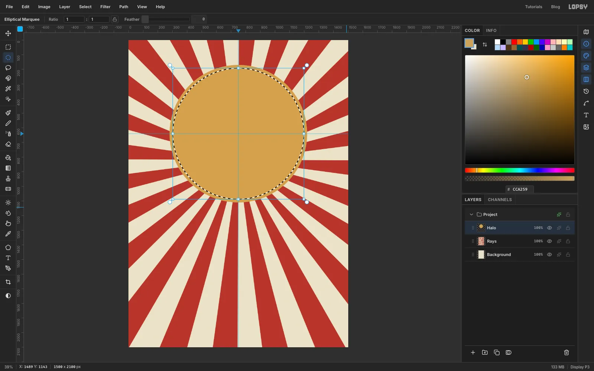

Add a layer called **Halo** and set the foreground to gold `#CCA259`.
Pick the **Elliptical Marquee** and click once on the canvas without
dragging. That opens the **Elliptical Selection** dialog, where you can type
exact corners. Enter From **280, 170** and To **1220, 1110** for a 940 px
circle centred where the two guides cross, and click **Select**. Choose
**Edit → Fill**.

Choose **Select → Shrink…**, enter **22** and click **Apply**. Set the
foreground to paper and fill again. That leaves a 22 px gold ring around a
cream disc. Press [[Cmd+D]] to deselect.

## Bring in the reindeer photo

Click the **Halo** layer so the photo lands above it, then drag the
1400 × 2100 photo file from your desktop onto the canvas. It arrives as a
new layer at the top-left corner, already selected. Rename it **Bull** and
press [[Cmd+D]].

## Smooth the fur into flat planes

A posterized photo looks like noise unless the tones are already broad,
flat areas. With **Bull** selected, choose **Filter → Surface Blur…**, set
**Radius** 10 and **Threshold** 40 and click **Apply**. Then choose
**Filter → Gaussian Blur…** with **Radius** 3.

Do this before you cut the animal out. Blurring a cut-out softens its
edge, but here the background is still there, so the outline stays crisp.

## Trace the reindeer with the Lasso

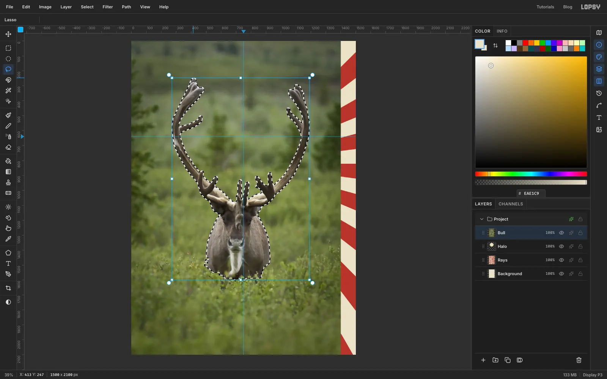

Pick the **Lasso** (L) and trace around the reindeer: up and over each
antler tine, around the ears, and down both sides of the neck. Zoom in
for the tines. The willows hide the chest, so where the neck disappears
into them, about 1600 px down, cut straight across. A band will cover
that edge later.

## Cut away the background

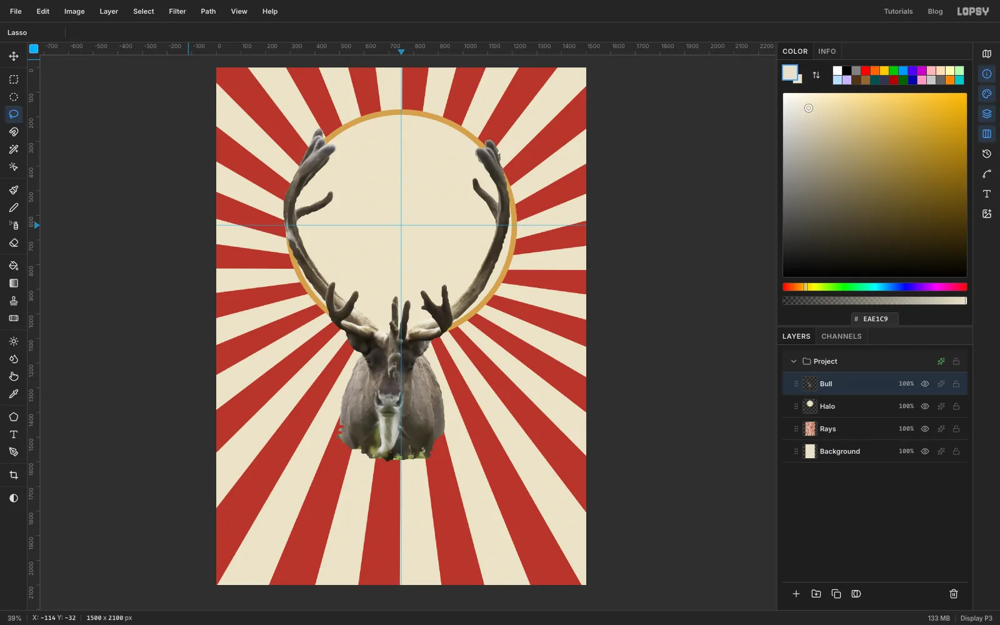

Choose **Select → Inverse** and press [[Delete]]. Then press [[Cmd+D]].
The reindeer now stands in front of the sunburst, and its antlers already
frame the halo.

## Scale the reindeer up

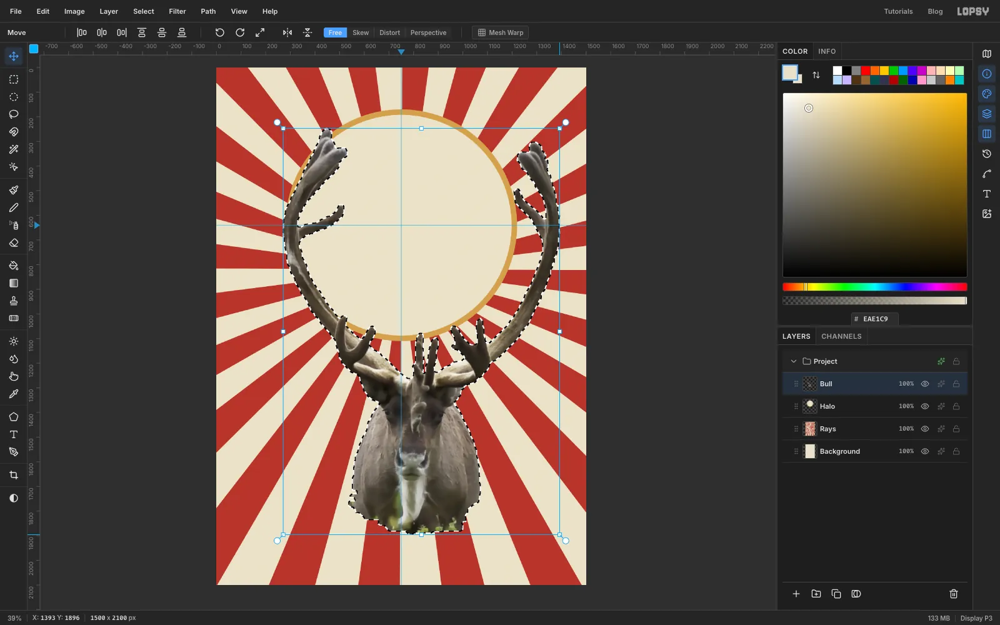

[[Cmd]]-click the **Bull** thumbnail in the Layers panel to select its
pixels, and switch to the **Move** tool (V). Transform handles appear
around the selection. Hold [[Cmd]] so the scale stays uniform and drag the
bottom-right corner handle down and to the right until the reindeer is
about 22% bigger, roughly 1120 px wide. Press [[Cmd+D]] to commit the
scale.

## Centre it under the halo

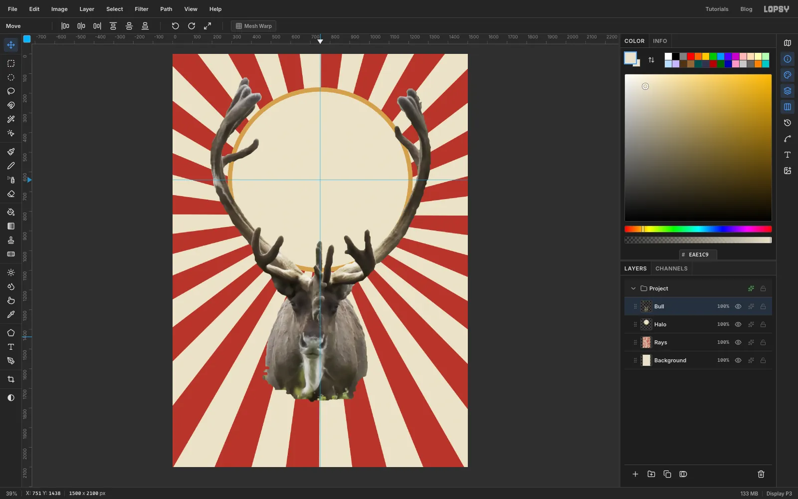

With the **Move** tool, drag the reindeer until its face sits on the
vertical guide and the antler tips are about 120 px from the top of the
canvas. The antlers should break out past the gold ring on both sides.
The ring frames the head instead of trapping it.

## Continue the chest under the photo

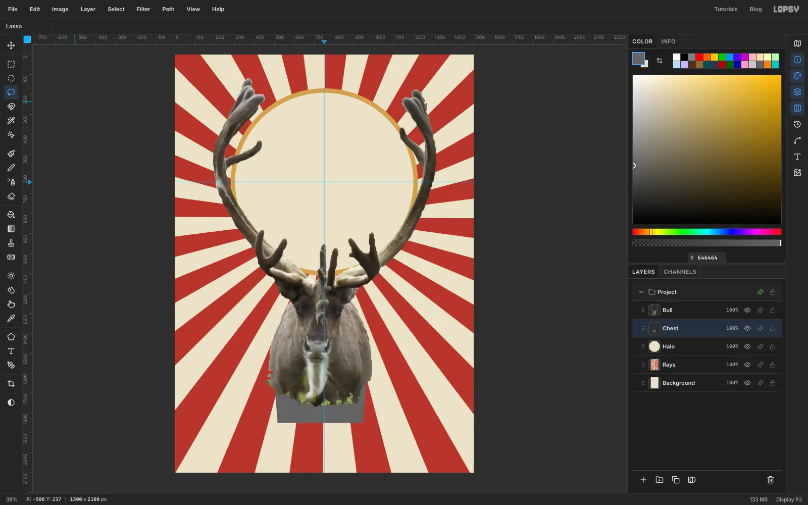

The willows left the bottom of the chest ragged. Click the **Halo** layer
and add a layer called **Chest**, so it sits under **Bull**. With the
**Lasso**, draw a tapering shape that follows both sides of the neck from
about 1440 px down to about 1850 px. Fill it with mid grey `#646464`.

Grey isn't a mistake. The next step maps every grey to an ink, and this
grey falls in the oxblood range.

## Posterize the hero with a Gradient Map

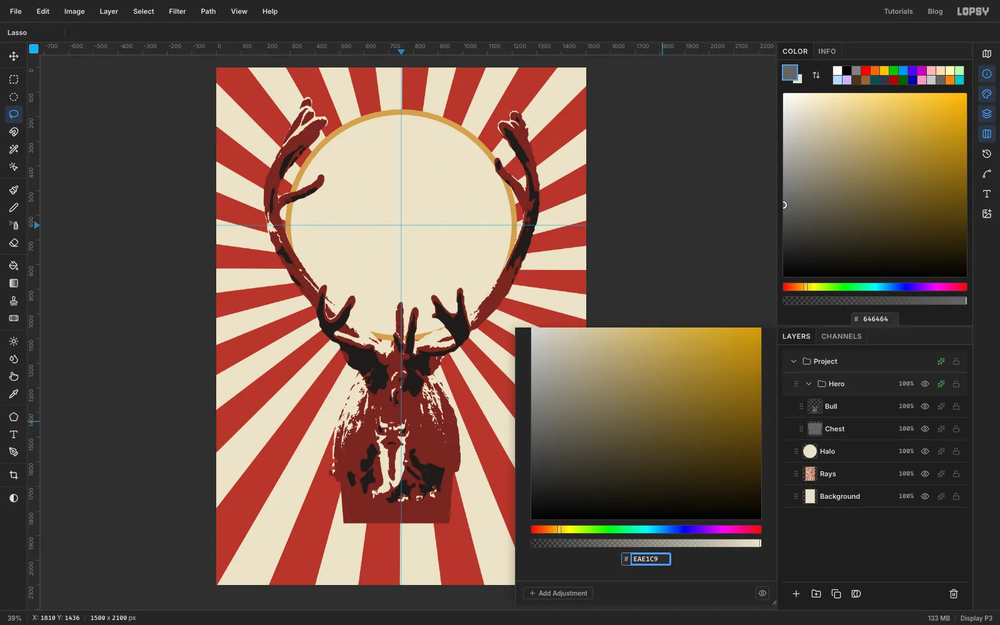

Click **Bull**, [[Shift]]-click **Chest** and choose **Layer → Group
Layers**. Rename the group **Hero**. Click the group's effects button (✦)
to open the drawer, click **Add Adjustment** and choose **Gradient Map**.
Expand the node.

A Gradient Map recolours each pixel by its brightness. Pairs of stops
placed close together make hard steps, and hard steps make a three-ink
print. Click the first stop and type ink `#1E1B19` into its **Hex**
field, then click the last stop and type paper `#EAE1C9`. Click the bar
just above the stop handles to add four more stops. A new stop appears
where you click and its **Position** readout shows the percentage, so drag
it until the readout matches, then type its colour:

- **22%**: ink `#1E1B19`
- **23%**: oxblood `#702A24`
- **56%**: oxblood `#702A24`
- **57%**: paper `#EAE1C9`

The darkest fifth of the photo prints as ink, the middle as oxblood and
the highlights as paper. Close the drawer.

## Flatten the face into planes

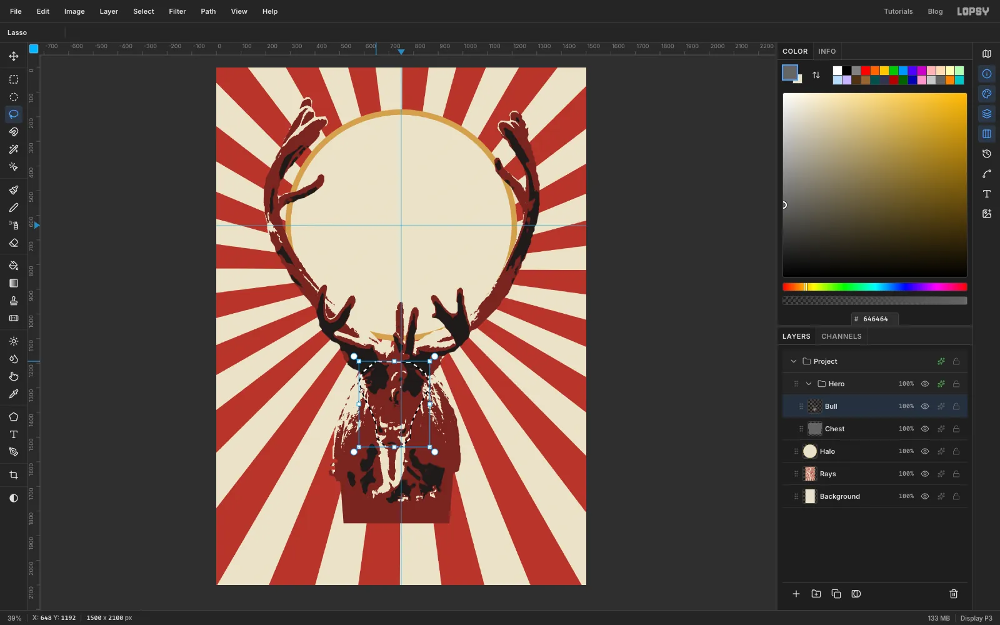

The face still has too many small islands of tone. Expand the **Hero**
group and click **Bull**. With the **Lasso**, select the face from the
forehead between the ears down to the chin. Apply **Surface Blur** again,
with **Radius** 16 and **Threshold** 35. Press [[Cmd+D]].

Now pick **Dodge** (O). Set **Exposure** 25 and **Size** 22, and drag one
stroke down the bridge of the nose. Change **Size** to 40 and drag across
the muzzle. Switch **Mode** to **Burn**, set **Exposure** 40 and **Size**
24, and click once on each eye. Then set **Size** 16 and click once on
each nostril. Because the Gradient Map has hard steps, these gentle
nudges become clean shapes rather than shading.

## Ink the antlers

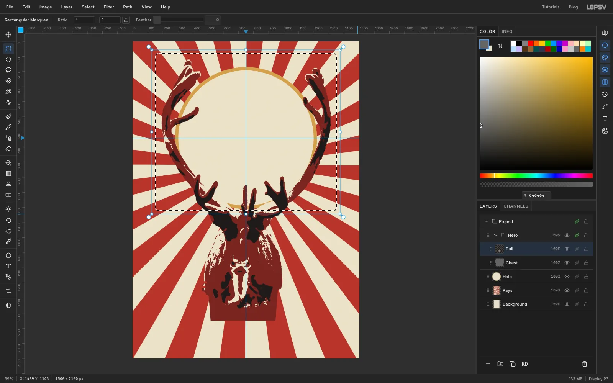

The outer antlers came out red with paper flecks, while the brow tines
are ink, so they read as two racks. Draw a **Rectangular Marquee** over
the whole rack, from just above and left of the left antler tip to just
right of the right one, and down to just above the ears
(about 1120 px). Choose **Select → Feather…** and enter **24**. The
feather blends the edit into the head, so no seam shows.

Apply **Gaussian Blur** with **Radius** 3 to smooth the beams. Then
choose **Filter → Brightness/Contrast…** with **Brightness** −30 and
**Contrast** 25. The whole rack turns ink with a thin oxblood rim on its
lit side. Press [[Cmd+D]].

## Calm the neck and paint the eyes

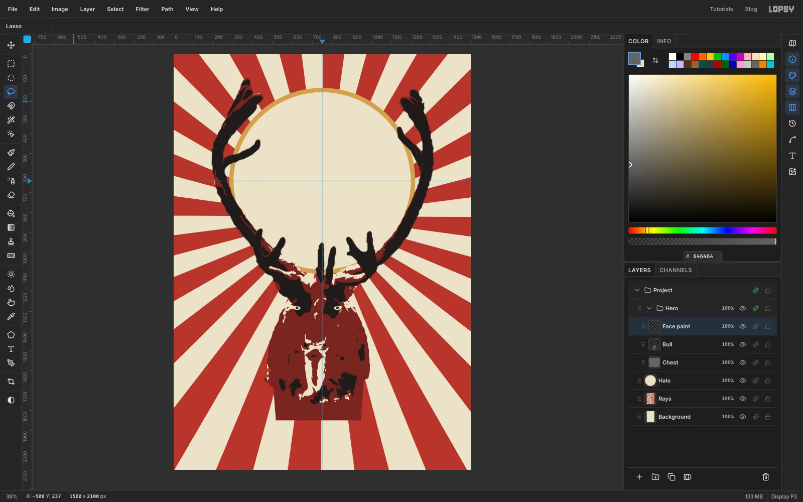

The fur on both sides of the neck is still speckled with paper. Lasso
the left side of the neck, then [[Shift]]-drag a second lasso around the
right side to add it. **Feather** the selection 20, apply **Surface
Blur** (14 / 40) and **Brightness/Contrast** with **Brightness** −14.
Press [[Cmd+D]].

With **Bull** still active, add a layer called **Face paint**. It lands inside the
group, so the Gradient Map turns white into paper, mid grey into oxblood
and black into ink. For each eye:

1. Lasso an almond about 40 × 22 px and fill it white.
2. Use the **Elliptical Marquee** to make a 14 px circle in the middle and fill it black.
3. With a 5 px hard **Brush**, click a white catchlight just above and inside the pupil.

Keep the two eyes on one level line, about 1280 px down and 210 px apart.

Last, lasso the soft dark blots on either side of the beard and fill
them with `#646464` so the chin ends cleanly.

## Draw the black band with the Pen

Collapse the **Hero** group, click it, and add a layer called **Band**.
A slope of 15° rises 0.27 px for every pixel across, so over 1500 px it
climbs about 400 px.

Pick the **Pen** (P) and click four corners, starting at the left-most
point:

1. Just off the left edge, about **1770** px down.
2. Just off the right edge, about **1350** px down.
3. 250 px below that.
4. 250 px below the first point.

Click the first anchor again to close the path. Open the **Paths**
panel, click **Path to Selection**, and fill the selection with ink
`#1E1B19`. Press [[Cmd+D]].

## Add the paper footer and the oxblood band

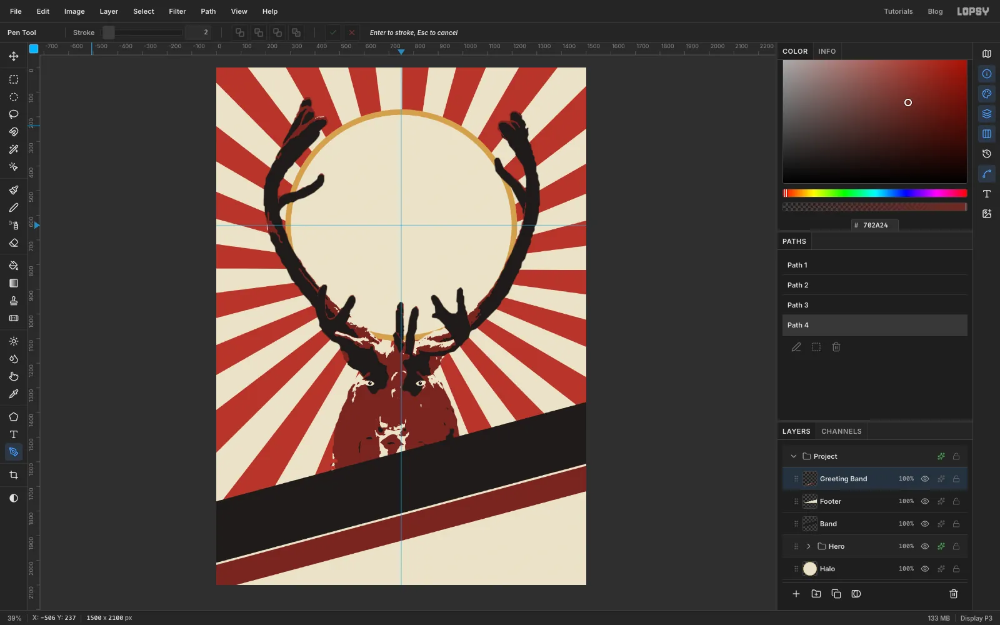

Add a layer called **Footer**. Pen a shape whose top edge runs 110 px
below the black band and whose bottom corners sit below the canvas, then
fill it with paper. The rays now stop at the greeting, so they don't
break into flat-topped blocks along the bottom edge.

Add a layer called **Greeting Band**. Pen a 120 px band directly under
the black one and fill it with paper. Then Pen a second band 8 px inside
it, top and bottom, and fill that with oxblood `#702A24`. That leaves a
cream keyline that separates the two bands.

> **Tip:** start each new path at least 30 px away from the corners of the last one. A first click right on a selected path's anchor edits that path instead of starting a new one.

## Type the headline and rotate it

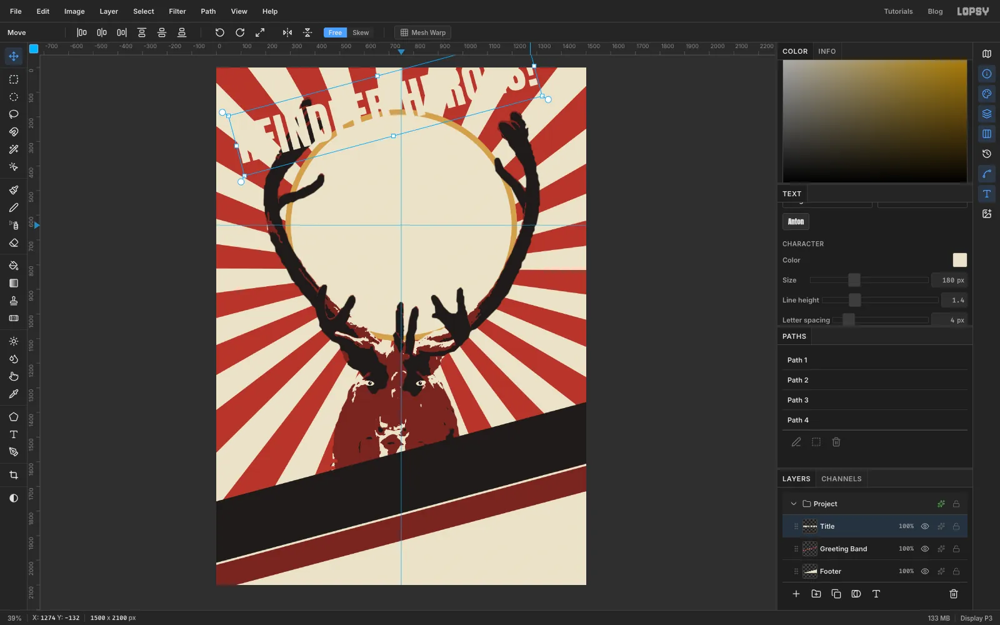

Click the **Greeting Band** layer first. Changing the text options while
a text layer is active restyles that layer, and a raster layer keeps
them neutral. Pick the **Text** tool (T), set **Size** to 180, choose
**Anton** in the font browser and set the foreground to paper. Click near
the top-left corner, in empty canvas, type **REINDEER HEROES!** and press
[[Tab]] to commit. The layer is named after its text, so double-click the
name and rename it **Title**. In the **Text** panel, set **Letter spacing**
to 4.

Switch to the **Move** tool. Hover just outside the box's top-right
corner until the cursor turns into the rotate crosshair. Hold [[Cmd]] and
drag counter-clockwise. The angle snaps in 15° steps: release at the first
snap, −15°. That's counter-clockwise, so the right end rises. Every −15° in
this tutorial means the same turn, and it matches the band's slope
exactly.

## Seat the headline on the band

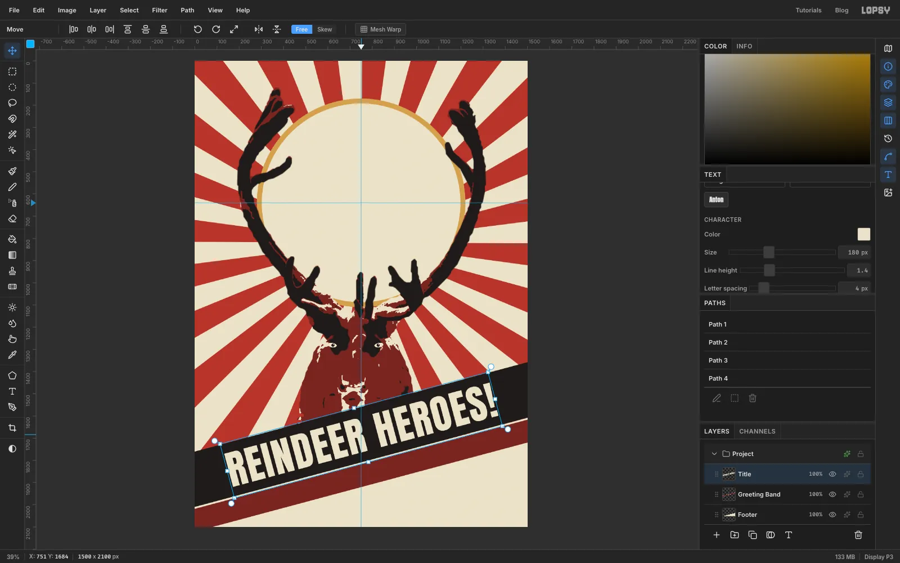

Drag the headline down onto the black band, centred on the vertical
guide. Nudge it with the arrow keys until the space above the letters
matches the space below them, about 40 px each side, and the "!" sits
well clear of the right edge.

## Set the greeting line

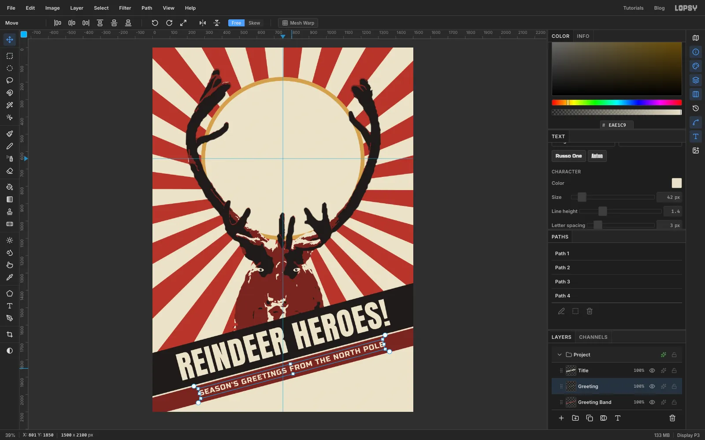

Click **Greeting Band** again. Make a second text layer in empty canvas:
**Russo One** at 42 px in paper, reading **SEASON'S GREETINGS FROM THE
NORTH POLE**. Rename it **Greeting** and set **Letter spacing** to 3.
Rotate it −15° with [[Cmd]] held, the
same way. Then move it onto the oxblood band, about 50 px right of
centre. The band is low on the left, and the shift keeps the first S
well above the trim.

## Make a reindeer silhouette

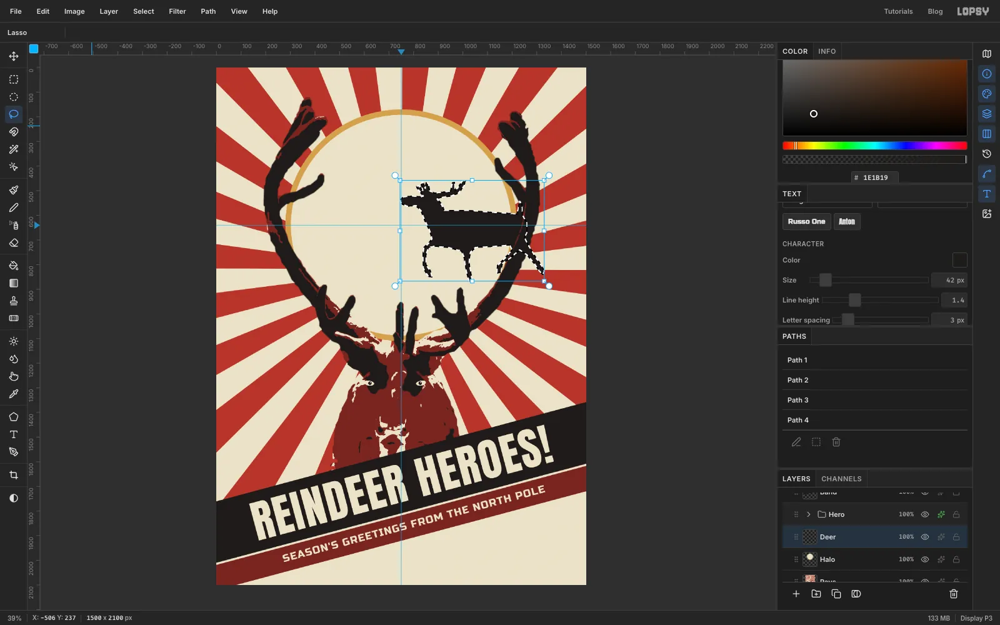

Click **Halo** and drop in the trotting caribou photo. It lands at the
top-left, 1500 px wide. Rename the layer **Deer**. Lasso around the
animal: nose, antlers, back, tail, and each of the four legs down to the
hooves. Leave out the water splashing around them. Choose **Select →
Inverse**, press [[Delete]], then [[Cmd+D]].

[[Cmd]]-click the **Deer** thumbnail and choose **Edit → Fill** with ink.
The photo becomes a solid silhouette.

## Flip it and shrink it

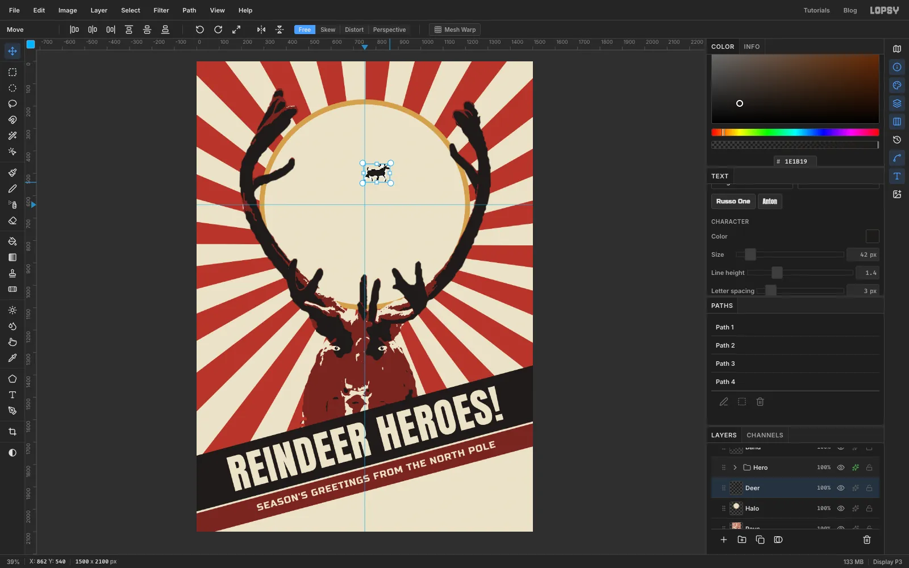

With the pixels still selected, switch to the **Move** tool and click
**Flip Horizontal** in the options bar, so the reindeer runs to the
right. Press [[Cmd+D]]. Flip first, so the −15° tilt you add next still
climbs to the right.

[[Cmd]]-click the thumbnail again, hold [[Cmd]] and drag the bottom-right
corner handle in until the deer is about a fifth of its size, roughly
117 px wide. Press [[Cmd+D]].

## Tilt it onto the flight line

[[Cmd]]-click the thumbnail once more and rotate the deer −15° with
[[Cmd]] held, so it climbs at the same angle as the bands. Press
[[Cmd+D]]. Drag it to the right-hand side of the halo, about 580 px
down. This is the lead reindeer.

## Build the team with Duplicate

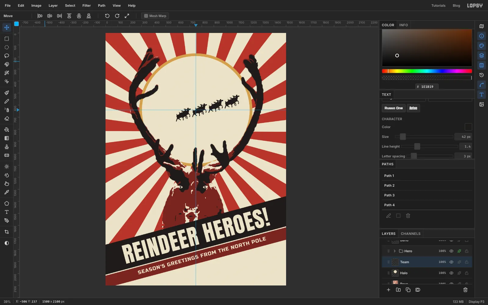

Choose **Layer → Duplicate Layer**, then click the copy's row in the
Layers panel so only the copy moves. With the **Move** tool, drag it a
little right and up, about 20 px each way, so the second deer runs
half a step beside the leader. Choose **Layer → Merge Down** and
rename the result **Team**. That's one pair.

Duplicate **Team**, click the copy, and drag it 135 px left and 36 px
down along the flight line. Merge it down: two pairs. Duplicate again,
drag the copy 270 px left and 72 px down, and merge: four pairs.

The legs are only a pixel or two thick at this size. [[Cmd]]-click the
**Team** thumbnail, choose **Select → Grow…** with **1**, and fill with
ink to thicken them.

## Draw Santa's sleigh

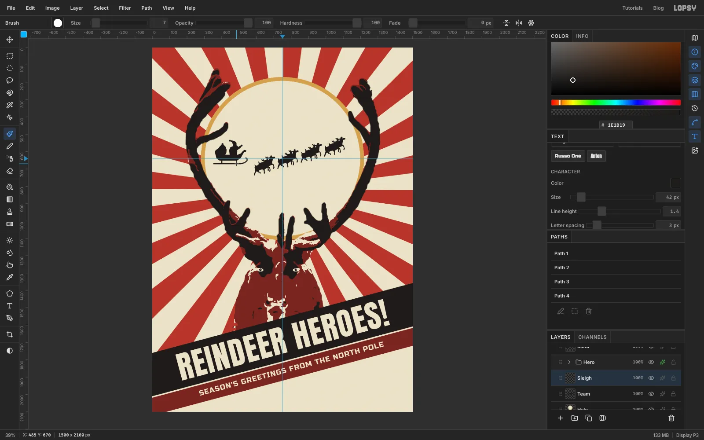

Add a layer called **Sleigh** above **Team** and draw it level in empty
space on the left of the halo, about 190 px long and 130 px tall. Set the
foreground to ink and fill each part with the **Lasso** and **Edit →
Fill** (use the **Elliptical Marquee** for the round bits):

- The sleigh body, about 180 × 70 px, with a high back on the left and a scrolled front.
- A lumpy sack about 50 px wide, tied at the top, in the back of the sleigh.
- Santa's body, about 45 px wide, with a 22 px round head on top.
- A floppy hat with a 10 px pom-pom drooping back.
- One arm raised forward with a small round mitten, to hold the reins.

Then pick the **Brush** (B) and set **Size** 7 and **Hardness** 100 in
the options bar. Click the back of the runner and [[Shift]]-click along
it to the curl at the front, then add two short struts the same way.

## Tilt the sleigh and add the reins

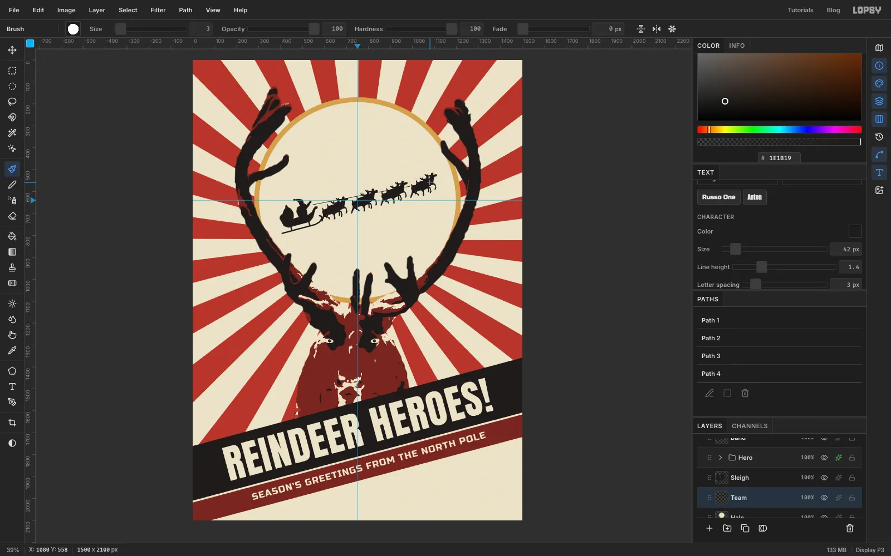

[[Cmd]]-click the **Sleigh** thumbnail and rotate it −15° with [[Cmd]]
held, then press [[Cmd+D]]. Drag it in behind the last pair, leaving a
clear gap from the left antler.

For the reins, set the Brush to **Size** 3, click the **Team** layer,
click on Santa's mitten and [[Shift]]-click on the chest of the lead pair.
The line disappears into the ink bodies and shows in the gaps between
the pairs, like a harness.

## Hang the gold star

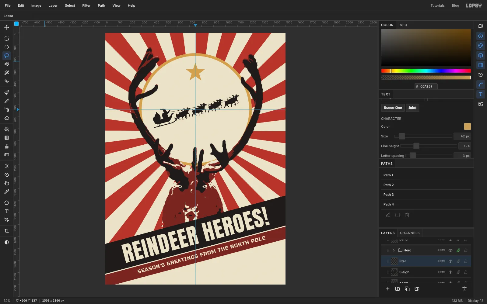

Click **Sleigh** and add a layer called **Star**, so the star sits next to
the sleigh in the stack. At the top of the halo, centred on the
guide about 330 px down, make a five-pointed star about 166 px across.
Either drag the **Lasso** in straight strokes between its ten points, or
click them with the **Pen** and use **Path to Selection**. Fill it with
gold.

## Cut the tab for the lead-in

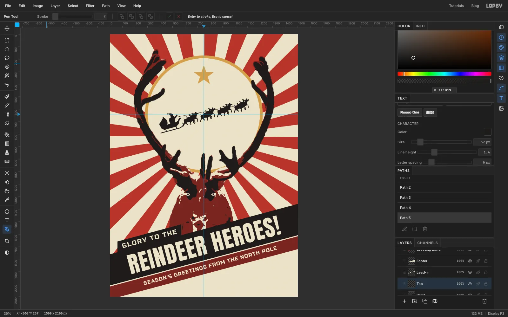

Click **Band**, set the foreground back to paper and make another text
layer: **GLORY TO THE** in **Russo One** at 52 px. Rename it **Lead-in** and
set **Letter spacing** to 6. Rotate it −15° and move it above the left end
of the black band.

Click **Band** again and add a layer called **Tab**. It goes between the
band and the lead-in. Pen a parallelogram around the text, with about
36 px of margin at each end. Its top edge runs parallel to the band, 86
px above it, and its bottom edge dips 4 px into the band. Fill it with
ink. The tab and the band read as one shape.

## Draw the stamp frame on the grid

Choose **View → Show Grid**. **Snap** switches on with it. Click the
**Greeting** text layer, then click **Add Layer** and call the new layer
**Stamp**. With the **Rectangular Marquee**, drag a box about 31 grid
cells wide and 5 tall (roughly 500 × 84 px) in the paper footer at the
bottom right. Its corners snap to the grid lines. Fill it with poster
red.

Choose **Select → Shrink…** with **6** and press [[Delete]] to leave a
red frame. Press [[Cmd+D]], then turn the grid off with **View → Show
Grid**.

## Letter the stamp and wear it down

Make a text layer with **DELIVERED ON TIME** in **Rubik Distressed** at
36 px in poster red, **Letter spacing** 4, and centre it in the frame.
With the text active, choose **Layer → Merge Down** to merge it into
**Stamp**.

A real rubber stamp never prints evenly. Pick the **Eraser** (E) and
click 20 or so small dabs, 6 to 14 px, along the frame and through the
letters. Add three 20 px breaks in the frame.

## Tilt the stamp against the bands

Switch to the **Move** tool (V), [[Cmd]]-click the **Stamp** thumbnail and
drag its rotation handle about
8° **clockwise**, this time without [[Cmd]], so the angle isn't snapped.
A stamp that runs against the bands reads as a hand-pressed mark, not
another band. Press [[Cmd+D]].

## Fill the halo with a gradient

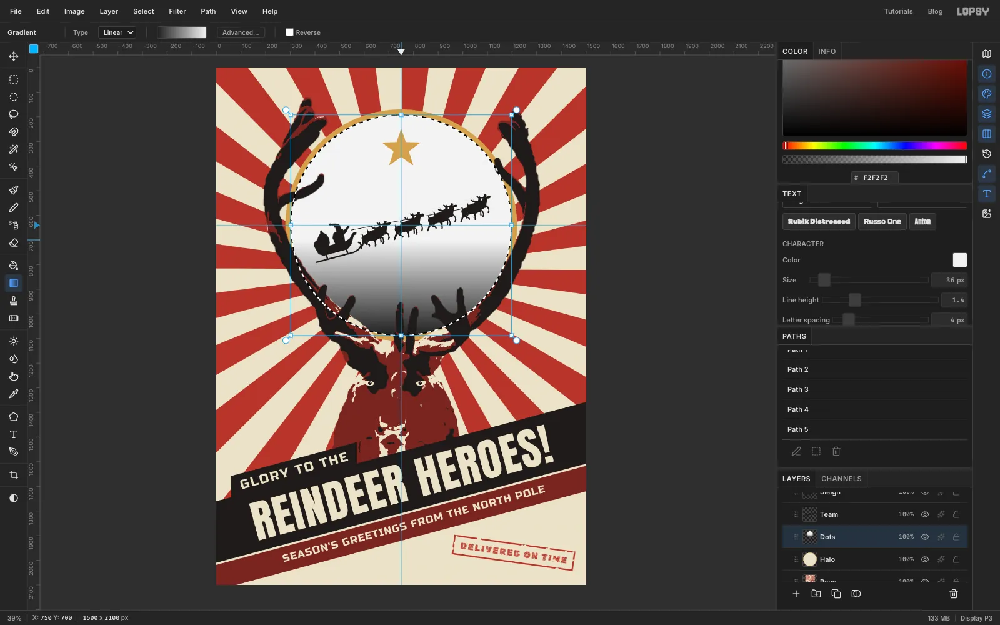

Click **Halo** and add a layer called **Dots**. Click once with the
**Elliptical Marquee** and type From **302, 192** To **1198, 1088** to
select the cream inside of the halo. Fill it with
`#F2F2F2`. Pick the **Gradient** tool and open **Advanced…**. Set two
stops, `#202020` at the left and `#F2F2F2` at the right, and click
**Done**. Drag from the bottom of the halo straight up to about 60 px
below its centre.

## Turn it into gold halftone dots

Choose **Filter → Halftone…** with **Dot Size** 18, **Density** 1,
**Angle** 45 and **Softness** 1. Click **Apply**. Dark tones become big
dots and the near-white top becomes pin-prick dots, so marquee
everything above the middle of the halo and press [[Delete]]. Press
[[Cmd+D]].

Open the layer's effects (✦), enable **Color Overlay** and set it to
gold. Then pick the **Eraser** at **Size** 110 and drag once along the
bottom of the sleigh. The Eraser's edge is soft, so the dots fade out
under the runner instead of crowding it.

## Copy and paste the sparkles

Add a layer called **Sparkle** above **Star**. Lasso a four-pointed
sparkle with pinched sides, about 52 px across, to the upper left of the
star. Fill it with gold.

[[Cmd]]-click its thumbnail and press [[Cmd+C]], then [[Cmd+V]]. The copy
pastes in place on a new layer. Drag it to the right of the star. Click
the **Sparkle** row again before the next copy, because Copy reads the
active layer, not the one whose thumbnail you clicked. Paste a third
sparkle, scale it to 60% with a [[Cmd]]-drag on a corner handle, and
drag it below the star's right arm. Press [[Cmd+D]].

Click the top sparkle layer and choose **Layer → Merge Down** twice.
Rename the result **Sparkles**.

## Give the type a misregistered red

Click **Title**, open its effects and enable **Drop Shadow**: colour
poster red, **Offset X** 7, **Offset Y** 7, **Blur** 1 and **Opacity**
100. Give **Lead-in** the same shadow with offsets of 3. It reads as a
red plate printed slightly out of register with the cream one.

> **Tip:** use Blur 1 rather than 0 for hard shadows. It looks the same and leaves no light seam along anti-aliased edges.

## Group the night sky

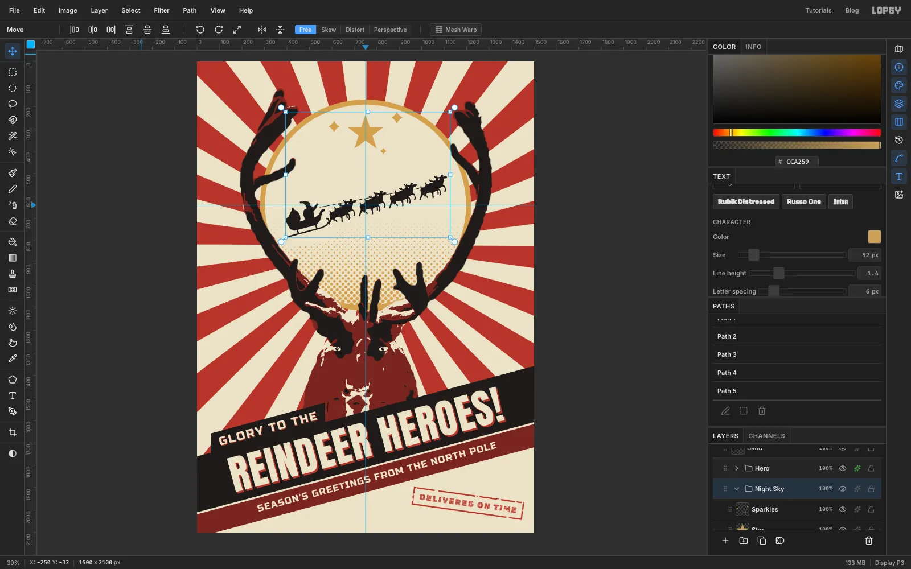

Click **Team**, [[Shift]]-click **Sparkles** (that range takes in Team,
Sleigh, Star and Sparkles), choose **Layer → Group Layers** and rename the
group **Night Sky**. The whole flight now moves as one. To try a
placement, switch to the **Move** tool and press [[Shift+Up]] to raise it
10 px. Here it sat better where it was, so [[Cmd+Z]] puts it back exactly.

## Add paper grain

Click **Title** so the new layer lands at the top of the stack, and add a
layer called **Grain**. Fill it with mid grey `#808080`. Choose **Filter
→ Add Noise…** with **Amount** 40, **Mono** and **Gaussian**. Set its
blend mode to **Overlay** in the effects drawer and its opacity to
**45%**.

Overlay leaves mid grey invisible, so only the noise shows: a fine tooth
over the ink, like a cheap litho print. Save the project with **File →
Save Project**, then **File → Quick Export PNG** for the card.
