Propaganda posters from the 1930s, whether Soviet or the American WPA, have a look that's easy to spot:

- a radiating sunburst behind one heroic subject
- a few flat inks, printed one colour at a time, never quite lined up
- heavy condensed slogans on a slant
- ribbons, stars and a firm ink frame

The look came from the process. Screen printing handles flat shapes well and fine detail badly, so photos were broken down into a handful of solid tones.

In this tutorial you'll borrow all of it for something less serious: the autumn issue of **CRUMB**, an imaginary bread magazine, announcing the **Yeast Empire**. That's the sourdough revival, treated as a revolution. You'll turn an ordinary photo of hands holding a loaf into a four-ink screen print, then build the masthead, slogans and cover furniture around it.

The cover is 1200 × 1560 px, a typical magazine proportion.

You'll need one photo from Wikimedia Commons: **Man holding bread (Unsplash).jpg** by Kate Remmer, released under **CC0**, so you can use it freely. It shows two hands offering a round loaf wrapped in a linen cloth against a dark shirt. Download the 1920 px version.

The tools you'll use:

- **Filter → Sunburst**, **Add Noise**, **Oil Paint**, **Gaussian Blur**, **Threshold** and **Halftone**
- the **Lasso**, **Magic Wand** and the **Rectangular** and **Elliptical Marquee** with their exact-size dialog
- **Select → Shrink / Grow / Inverse**, and [[Shift]] / [[Alt]] to add, subtract and intersect selections
- [[Cmd]]-click on a layer thumbnail to load its shape as a selection
- the **Pen** tool for score lines, finger lines and stars, and the **Pencil** with [[Shift]]-click for straight rules
- **Copy**, **paste in place**, **Duplicate Layer**, **Merge Down** and **Group Layers**
- live text in **Alfa Slab One**, **Anton** and **Oswald**, including rotating live text with the transform handles
- layer effects: **Stroke**, **Drop Shadow** and **Color Overlay**, plus the **Multiply** blend mode

The palette is five inks on cream paper:

- Paper `#EFE2C4`, cream ink `#F6EBD2`
- Ochre `#E2A33A`
- Brick red `#B8312A`
- Ink black `#22262A`
- Teal `#1F5560` / `#2B6E7A` (the two ray colours)

> **Tip:** On a wide-gamut (Display P3) screen, Lopsy reads typed hex codes as P3 colours. These codes were picked as P3 values, so they match the finished cover. On an sRGB screen they come out a touch duller.

> **Note:** Shortcuts are written for a Mac. On Windows use [[Ctrl]] wherever it says [[Cmd]].

## Set up the paper and guides

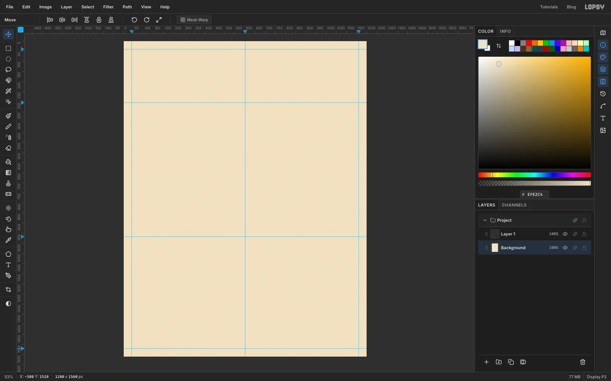

Choose **File → New**, keep the units on **Pixels**, and make the document **1200** wide and **1560** high.

Click *Background*, set the foreground to paper `#EFE2C4`, and choose **Edit → Fill**.

Click the top ruler to drop vertical guides at **40**, **600** and **1160**. Click the left ruler to drop horizontal guides at **40**, **304**, **967** and **1520**. The outer guides mark a 40 px paper border, and the box from y 304 down to 1520 is the picture panel. The guide at 967 is where the sun's centre will go.

## Fill the panel with a sunburst

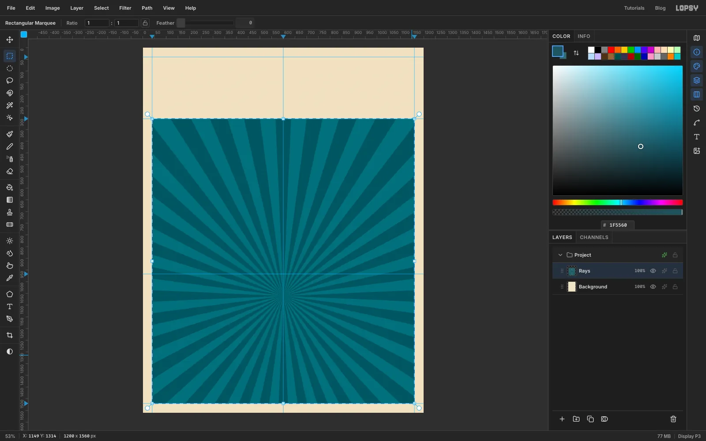

Rename *Layer 1* to *Rays*. Set the foreground to teal `#2B6E7A`, press [[X]] to swap it into the background swatch, then set the foreground to deep teal `#1F5560`.

Pick the **Rectangular Marquee** and click once on the canvas without dragging. The exact-size dialog opens. Set **From** to **40, 304** and **To** to **1160, 1520**, and press [[Enter]].

Choose **Filter → Sunburst…** and set:

- **Rays 36**, **Length 150**, **Width 50**
- **Center X 50**, **Center Y 68**, so the rays meet low in the panel, behind where the loaf will go
- **Gaps** to **Background Color**, so the gaps between the rays fill with the lighter teal

Click **Apply**. The two-tone burst stays inside the marquee.

## Rough up the ink and draw a keyline

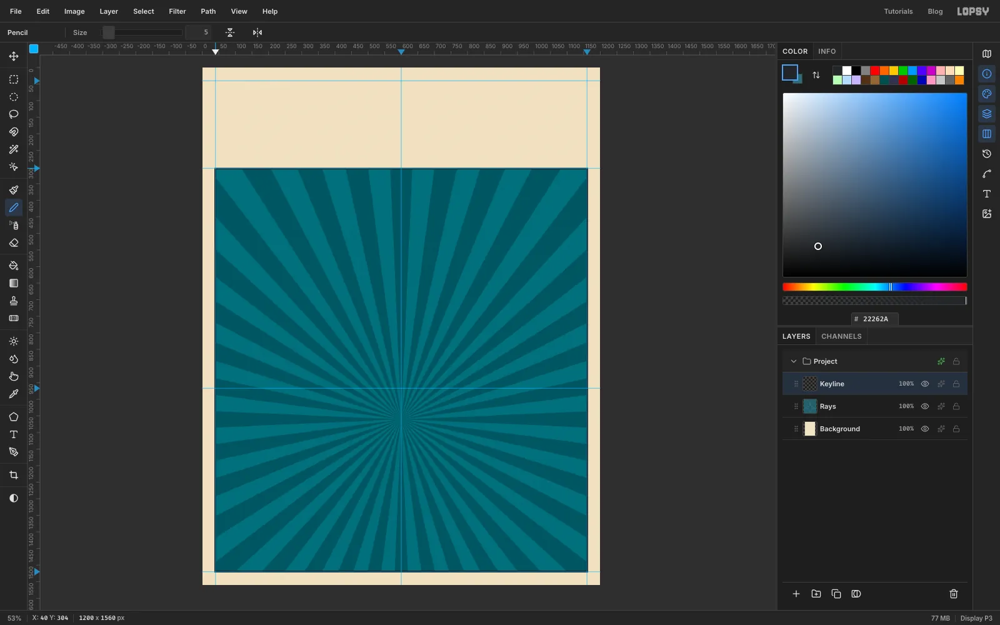

Press [[Cmd+D]]. Choose **Filter → Add Noise…**, set **Amount 6**, **Mono** and **Gaussian**, and apply it. That faint mottle stops the teal looking like flat vector fill.

Add a layer called *Keyline*. Pick the **Pencil**, set **Size** to **5**, and set the foreground to ink `#22262A`. Click the panel's top-left corner, then hold [[Shift]] and click the top-right, bottom-right and bottom-left corners, and finally the top-left again. [[Shift]]-clicking draws a straight line from the last point, so you get a crisp frame in five clicks.

## Build the sun disc with Shrink

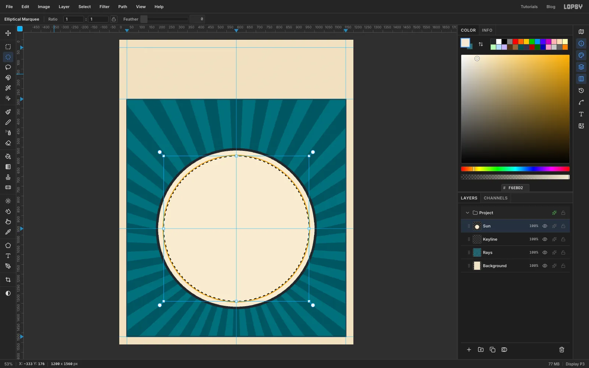

Add a layer called *Sun*. Pick the **Elliptical Marquee** and click once on the canvas to open the exact-size dialog. Set **From** to **188, 555** and **To** to **1012, 1379**. That's a 412 px radius circle centred on the sun guide.

Build the rings from the outside in. After each fill, shrink the same selection with **Select → Shrink…**:

1. Fill with ink `#22262A`.
2. **Shrink 12**, fill with cream `#F6EBD2`.
3. **Shrink 22**, fill with ochre `#E2A33A`.
4. **Shrink 6**, fill with cream `#F6EBD2` again.

You end up with a dark rim and a thin ochre ring just inside it. Deselect.

## Drop in the bread photo

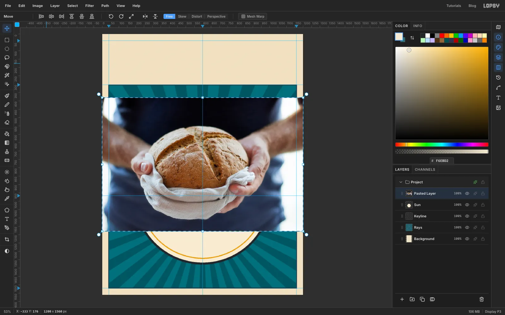

Drag the downloaded photo from your Downloads folder onto the canvas. It's wider than the cover, so Lopsy shrinks it to fit the width (1200 × 800) and centres it. The new layer is already selected and the **Move** tool is active. Rename the layer *Photo*.

## Move the photo down

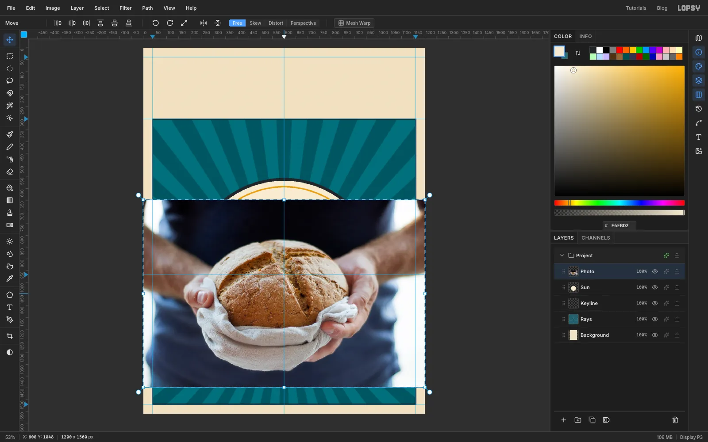

Drag the photo straight down until its top edge is at about **y 648**. The loaf should sit low in the sun, with the top of the disc showing above it like a sunrise. Press [[Cmd+D]] to deselect, which also sets the photo down.

## Trace the hands and loaf with the Lasso

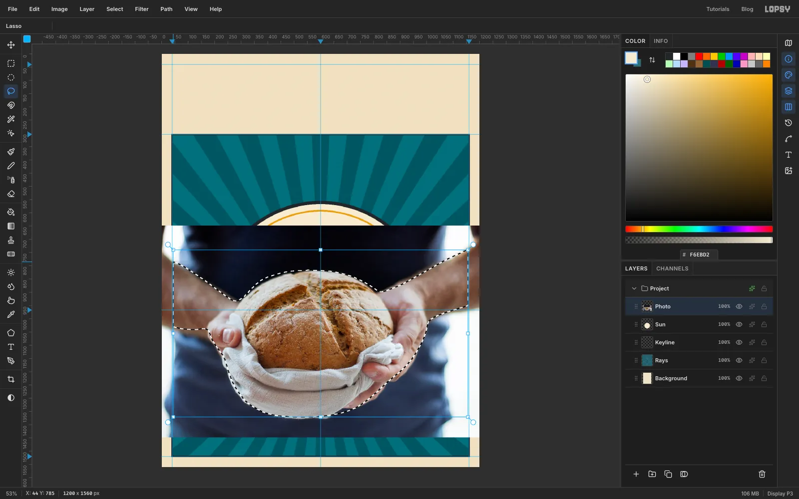

Pick the **Lasso** and trace the shape you want to keep: both forearms, both hands, the loaf and the cloth around it.

- Start on the left panel edge at the top of the left forearm.
- Follow the top of the arm in to the wrist.
- Run round the dome of the loaf, then along the top of the right forearm out to the right panel edge.
- Come straight down the panel edge, back in under the right forearm, and round the right hand and thumb.
- Follow the bottom of the cloth across to the left, up round the left hand, and back out under the left forearm to the panel edge.

Cut the arms off straight at the panel's left and right edges, not at the canvas edge. Then the hands reach in from the frame instead of spilling over the paper border.

Take it slowly round the curves. Every corner you leave in the lasso turns into a visible facet once the outline gets an ink stroke.

## Delete the background

Choose **Select → Inverse** and press [[Delete]]. The dark shirt and the bright window behind it disappear. Deselect.

## Lay down the cream plate and soften the photo

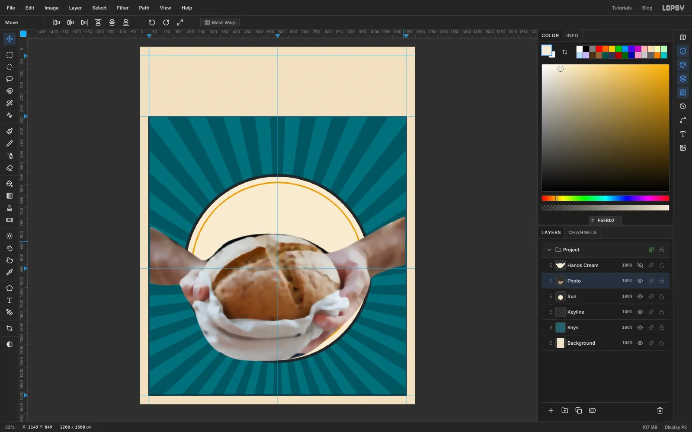

A screen print starts with the lightest ink as a solid base:

1. [[Cmd]]-click the *Photo* thumbnail to load its shape as a selection.
2. Click **Add Layer**, name the layer *Hands Cream*, and fill the selection with cream `#F6EBD2`.
3. Deselect.

The other inks will come from the photo, but a raw photo breaks into thousands of specks. Simplify it first:

1. Hide *Hands Cream* with its eye button, and click *Photo*.
2. Run **Filter → Oil Paint…** with **Radius 8**.
3. Run **Filter → Gaussian Blur…** with **Radius 4**.

The skin, crust and cloth melt into smooth patches. Show *Hands Cream* again.

## Separate the ochre shading and select the loaf

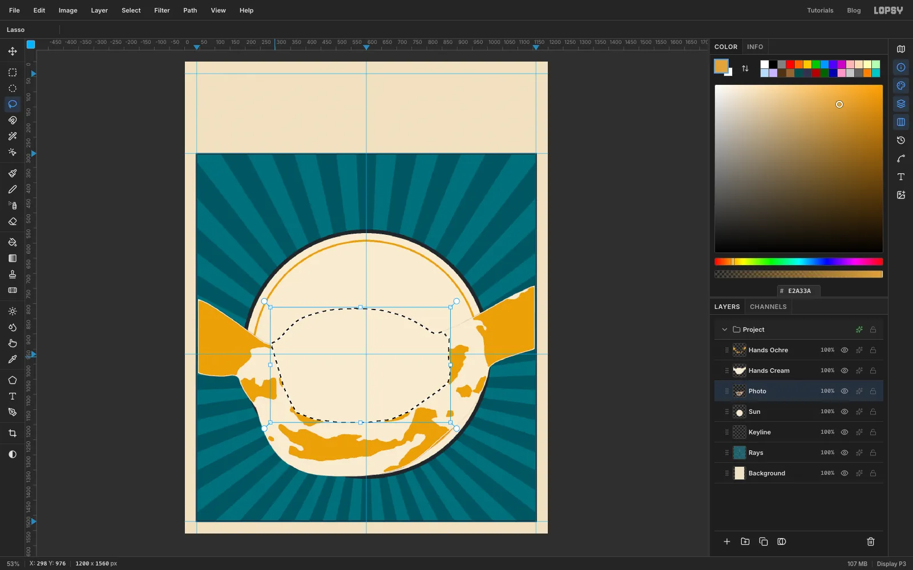

Each ink is a **Threshold** copy of the photo, picked up with the **Magic Wand**:

1. Click *Photo* and choose **Layer → Duplicate Layer**. Run **Filter → Threshold…** at **150** on the copy. Everything darker than 150 turns black.
2. The copy sits under *Hands Cream*, so hide *Hands Cream* for a moment to see it. Pick the **Magic Wand**, turn **Contiguous** off, set **Tolerance** to **8**, and click any black area. Every black pixel is selected. Show *Hands Cream* again.
3. The loaf will get its own treatment, so hold [[Alt]] and lasso round the loaf to take it out of the selection.
4. Choose **Select → Shrink…** **3**, then **Select → Grow…** **3**. Shrinking deletes any island smaller than 6 px, and growing puts the big shapes back. This is the cheapest way to get rid of speckle.
5. Click *Hands Cream*, add a layer called *Hands Ochre*, fill with ochre `#E2A33A`, and deselect. Click the threshold copy and delete it.

Now select the loaf on its own. Click *Photo*, [[Cmd]]-click its thumbnail, then hold [[Shift]]+[[Alt]] and lasso round the loaf. That keeps only the part inside both shapes. Let the lasso run a little above the top of the loaf, so the selection reaches the cut-out edge.

## Gild the loaf and shade it with halftone

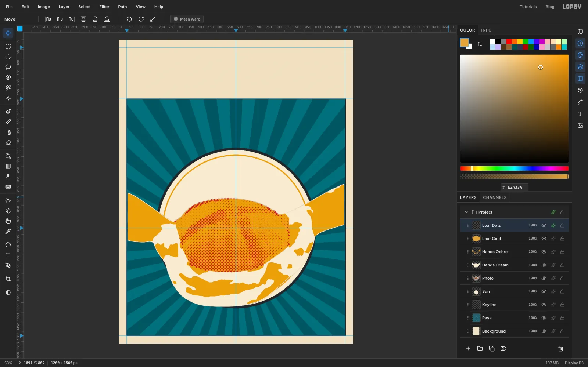

With the loaf selected, click *Hands Ochre*, add a layer called *Loaf Gold*, and fill it with ochre `#E2A33A`.

Flat threshold blobs on a round loaf tend to read as a face, so shade it with dots instead:

1. Click *Photo*, [[Cmd]]-click the *Loaf Gold* thumbnail, and press [[Cmd+C]].
2. Click *Loaf Gold* and press [[Cmd+V]]. The copy pastes in place, directly above the gold. Rename it *Loaf Dots* and deselect.
3. Run **Filter → Halftone…** with **Dot Size 11**, **Angle 45** and **Softness 0.5**. Dark crust gets big dots, flour gets tiny ones.
4. Open the layer's effects with the sparkle button on its row, turn on **Color Overlay**, and set it to brick red `#B8312A`.

The loaf now has a rounded, printed form.

## Add the brick and ink plates

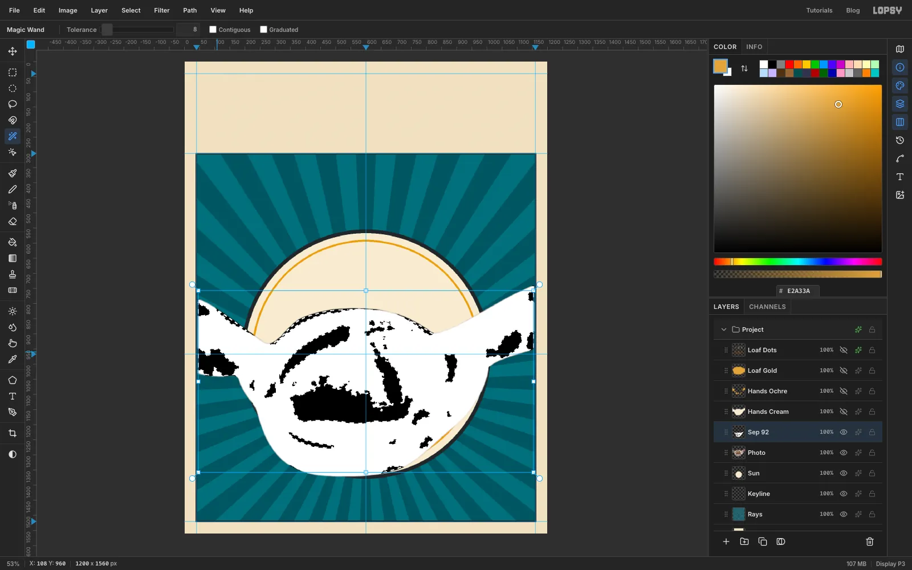

The two darker inks only go on the hands and cloth. Use the same routine as the ochre plate:

1. Click *Photo*, choose **Layer → Duplicate Layer**, and run **Threshold…** at **92**.
2. Hide *Hands Cream*, *Hands Ochre*, *Loaf Gold* and *Loaf Dots* so you can see the copy. With the **Magic Wand** (Contiguous still off), click a black area. Show the layers again.
3. Hold [[Alt]] and lasso round the loaf to take it out. Then **Shrink 3** and **Grow 3**.
4. Click *Loaf Dots*, add a layer called *Hands Brick*, fill with brick red `#B8312A`, and deselect. Click the threshold copy and delete it.

Repeat for the darkest ink. Click *Photo*, duplicate it, and run **Threshold 58**. Hide the ink layers again, wand-click black, and show them. [[Alt]]-lasso the loaf out, then **Shrink 2** and **Grow 2**. Click *Hands Brick*, add *Hands Ink*, fill with ink `#22262A`, and delete the threshold copy.

## Draw the score cuts and fingers

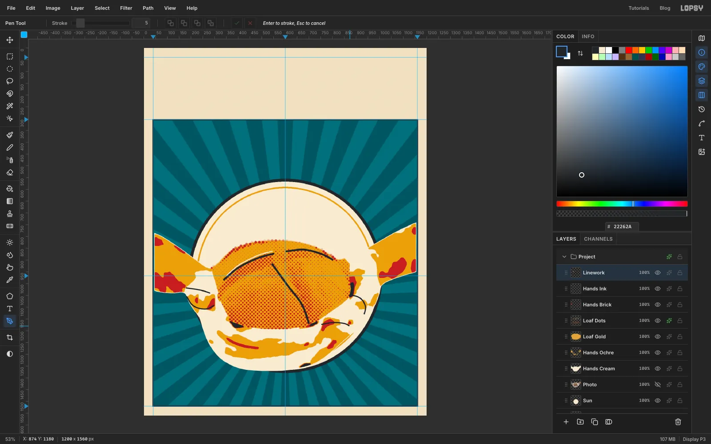

A threshold can't find an edge inside a flat colour, so draw the important ones by hand. Click *Hands Ink* and add a layer called *Linework*. Pick the **Pen**, set the options-bar **Stroke** to **8**, and set the foreground to ink.

Draw each line with three or four points. **Drag** a little as you place each point so it pulls out curve handles, because a plain click makes a sharp corner. Then press [[Enter]], which strokes the open path with the foreground colour.

- The loaf's three score cuts: a long curve across the top left, a shorter one across the top right, and the diagonal slash down the middle.
- Switch to cream and **Stroke 4**. Draw a thin highlight just above the top-left cut, where the crust lifts.
- Back in ink at **Stroke 5**: the line under the left index finger and the one above it, the curl of the right index finger, and the top edge of the right thumb.

Delete each finished path from the **Paths** panel so its outline doesn't clutter the canvas. Finally, hide *Photo*.

## Group the hero and outline it

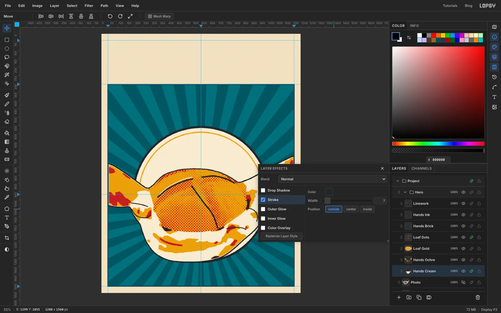

Click *Hands Cream*, [[Shift]]-click *Linework*, and choose **Layer → Group Layers**. Rename the group *Hero*.

Click *Hands Cream* inside the group and open its effects. Turn on **Stroke**, set **Width** to **7**, set the colour to ink `#22262A`, and choose the **outside** position. The base plate carries the outline, so the whole silhouette gets one clean contour.

Then knock two plates out of register, the way a hurried screen printer would. Pick the **Move** tool, click each of these layers in turn, and nudge it with the arrow keys:

- *Hands Ink* and *Linework*: 3 px right and 2 px down
- *Loaf Gold* and *Hands Ochre*: 2 px right and 1 px down

## Shade the sun with a gradient

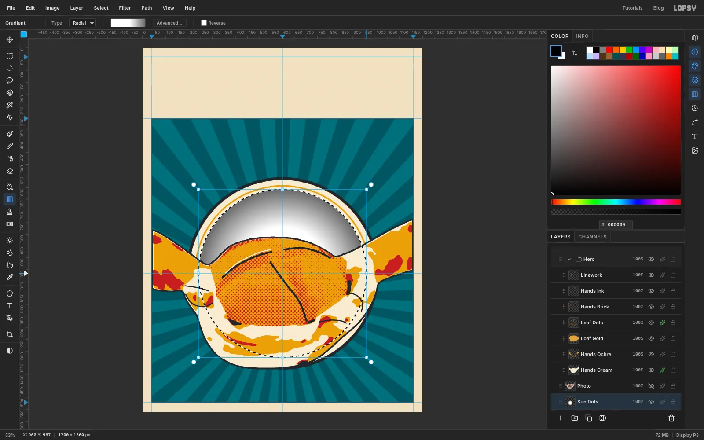

Click *Sun* and add a layer above it called *Sun Dots*. Open the Elliptical Marquee's exact-size dialog and set **From** to **240, 607** and **To** to **960, 1327**. That's a circle just inside the cream disc within the ochre ring.

Pick the **Gradient** tool, set it to **Radial**, and open **Advanced…**. Add three stops: white `#FFFFFF` at the left end, white again at about **55%**, and grey `#6A6A6A` at the right end.

Drag from the sun's centre straight out to the right edge of the selection. Deselect.

## Turn it into halftone dots

Run **Filter → Halftone…** with **Dot Size 14**, **Angle 45** and **Softness 0.6**. White prints nothing, so the dots only appear towards the rim, getting bigger as the grey gets darker.

Open the layer's effects and add a **Color Overlay** in ochre `#E2A33A`. The sun now glows from the edge in.

## Set the masthead

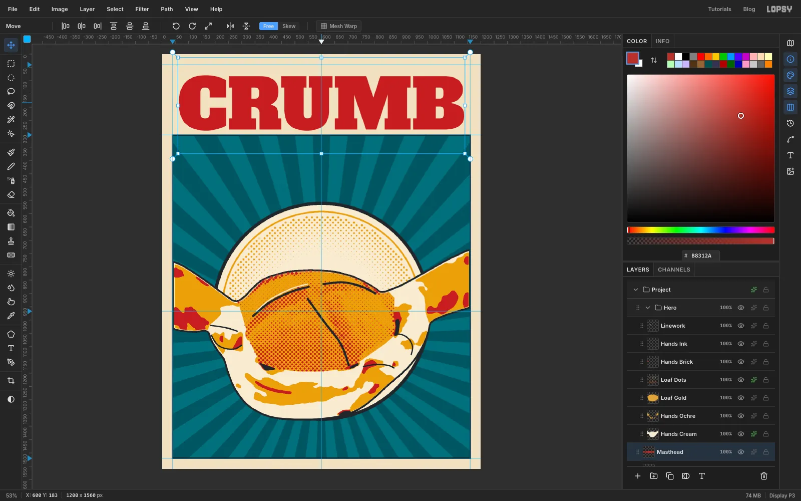

Click *Photo* (a raster layer) before you start typing. If a text layer is active, changing the text options restyles that layer instead of the new one.

Pick the **Text** tool. Choose **Alfa Slab One**, size **258**, colour brick red `#B8312A`, and click in an empty part of the panel. Type `CRUMB` and press [[Tab]] to commit.

Drag it with the **Move** tool so it's centred on the middle guide, with the tops of the letters at about **y 80**. At this size the masthead runs almost the full width of the panel below it. That leaves about 18 px of paper between the bottom of the letters and the panel's top edge.

## Add the strap line and issue line

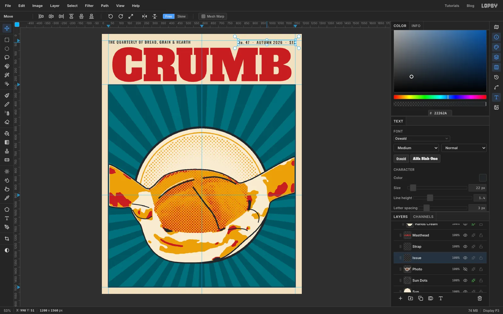

Click *Photo* again, then switch to **Oswald**, weight **Medium**, size **22**, in ink. Type `THE QUARTERLY OF BREAD, GRAIN & HEARTH` somewhere empty and commit it. In the **Text** panel set **Letter spacing** to **3**.

Click *Photo* once more and make a second line the same way: `No. 47  ·  AUTUMN 2026  ·  $12`.

Move the strap line so its left edge sits on the 40 px guide, and the issue line so its right edge sits on the 1160 guide. Put both on the same baseline, with their centres at about **y 50**, between the top guide and the masthead.

## Rotate the headline

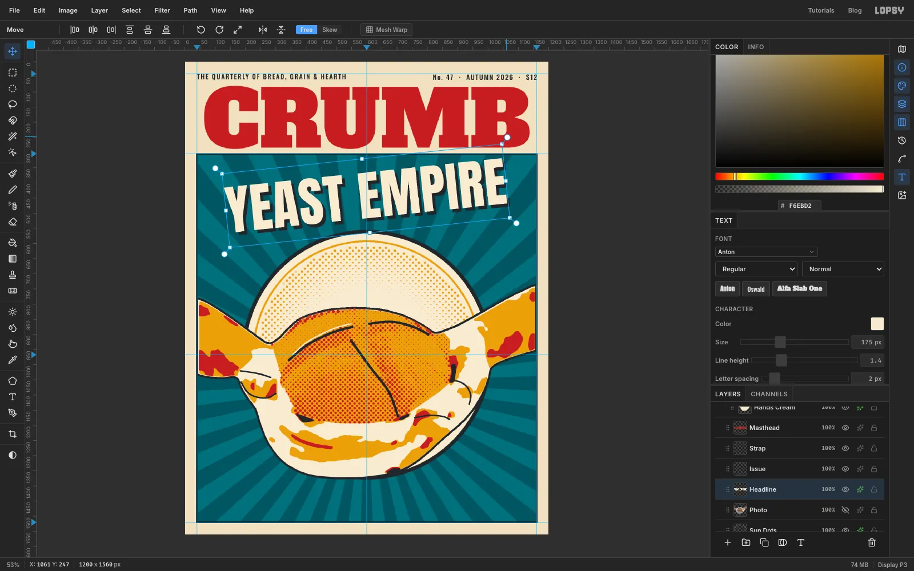

Click *Photo*. Set **Anton** at size **175** in cream `#F6EBD2`, type `YEAST EMPIRE`, commit, and set **Letter spacing** to **2**.

Open the layer's effects and add a **Drop Shadow**: **Offset X 10**, **Offset Y 10**, **Blur 0**, **Spread 0**, **Opacity 100**, colour ink `#22262A`. A shadow with no blur reads as a second, offset print run.

Centre the headline at about **y 440**. With the **Move** tool still active, grab the round rotation handle just outside its top-right corner. Drag it upwards until the right end of the line sits about 90 px higher than the left, roughly **6°**. It's still live text, so you can fix a typo later.

## Cut the ribbon

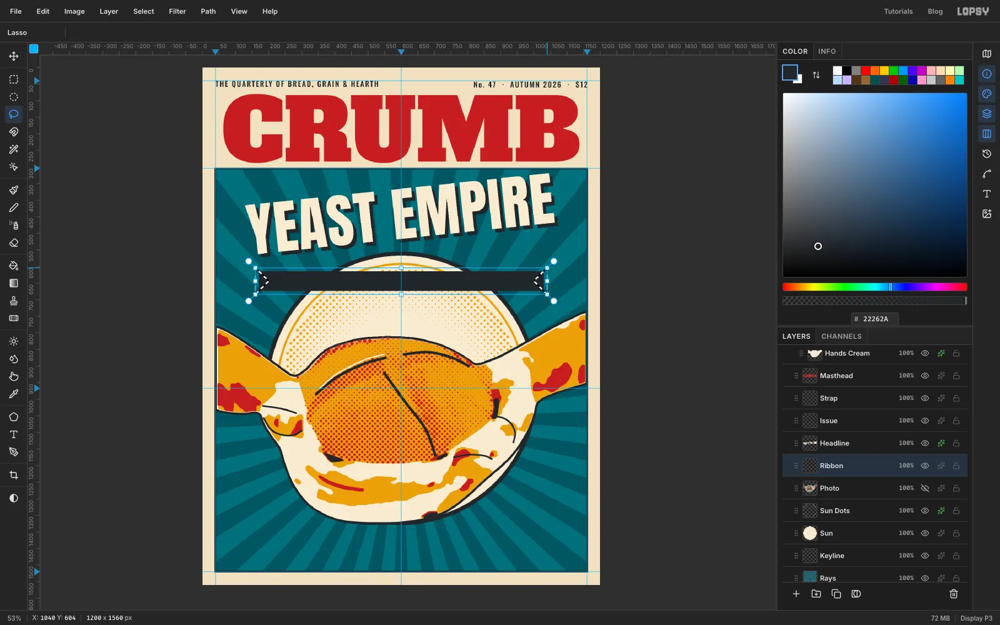

Click *Photo* and add a layer called *Ribbon*. Use the Rectangular Marquee's dialog to select **170, 614** to **1030, 674**, fill with ink, and deselect.

For swallowtail ends, lasso a small triangle that starts just outside the left end, points about 30 px into the bar at its middle, and comes back out. Hold [[Shift]] and lasso the same shape at the right end. Press [[Delete]] and deselect.

## Letter the ribbon and tilt it

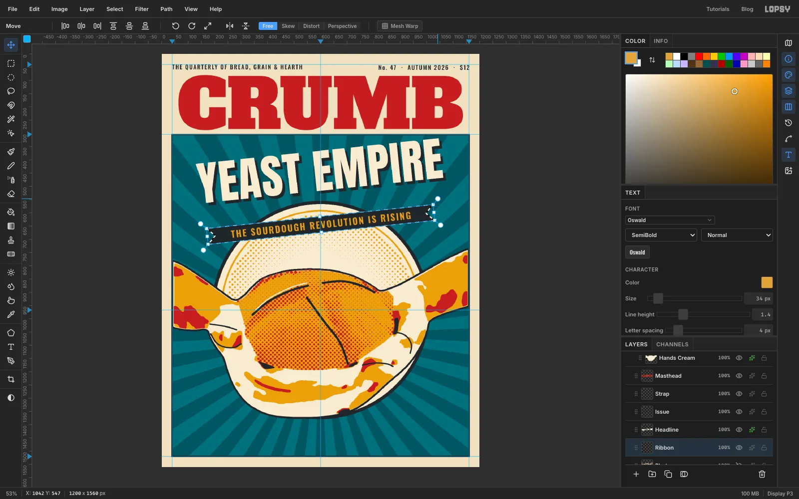

With *Ribbon* active, set **Oswald SemiBold**, size **34**, in ochre `#E2A33A`. Type `THE SOURDOUGH REVOLUTION IS RISING` in an empty spot, commit it, and set **Letter spacing** to **4**. Move it so it's centred on the ribbon.

With the text layer active, click the **Rasterize Layer** button (the **T** icon) at the bottom of the Layers panel, then choose **Layer → Merge Down**. The words are now part of the ribbon.

[[Cmd]]-click the *Ribbon* thumbnail to select its shape, so the transform handles wrap the ribbon. Switch to the **Move** tool and drag the top-right rotation handle up by the same 6° as the headline: the right end climbs about 90 px. Press [[Enter]] to apply, then [[Cmd+D]]. The ribbon now crosses the top of the sun.

## Add the slogan banner

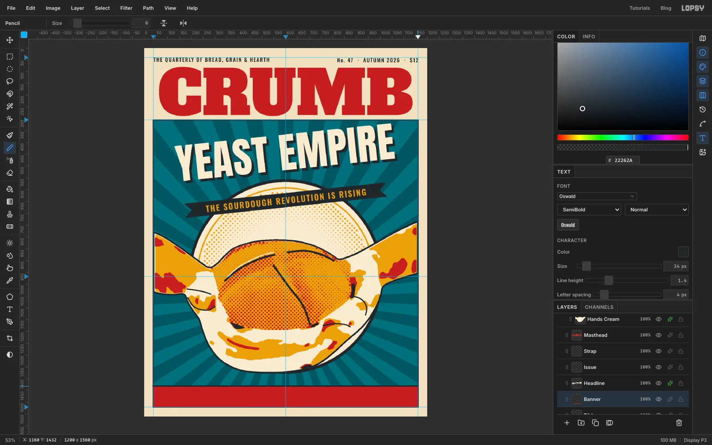

Click *Ribbon* and add a layer called *Banner*. Select **40, 1430** to **1160, 1520** and fill it with brick red `#B8312A`. Deselect.

Pick the **Pencil** at **Size 6** in ink. Click the banner's top-left corner, then [[Shift]]-click its top-right corner for a straight rule along the top.

## Set the slogan and draw a star

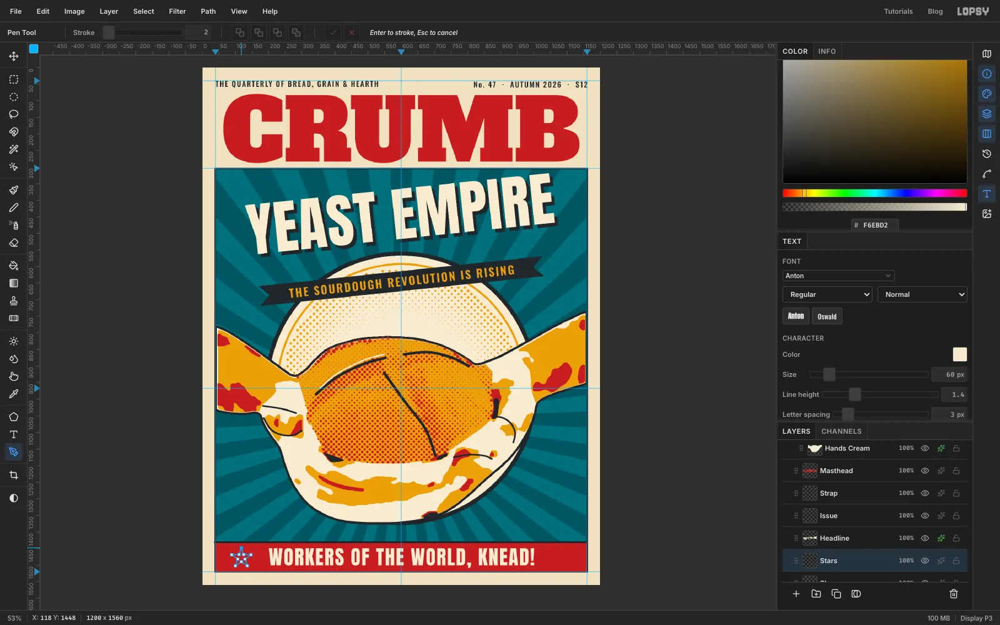

With *Banner* active, set **Anton**, size **60**, in cream. Type `WORKERS OF THE WORLD, KNEAD!`, commit it, set **Letter spacing** to **3**, and centre it in the banner.

Click the slogan layer and add a layer called *Stars*. Zoom in on the left end of the banner. Pick the **Pen** and make a five-pointed star about 60 px across with ten plain clicks (no dragging, so every point is a sharp corner):

- Put the five tips where 12, half past 2, 5, 7 and half past 9 would be on a clock face, 30 px from the centre.
- Put an inner corner between each pair of tips, about 12 px from the centre.

Click the first point again to close the path.

## Copy the star across

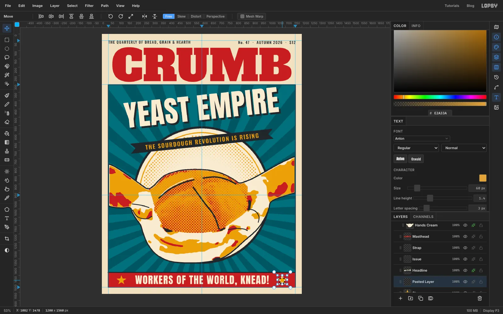

In the **Paths** panel, click **Path to Selection**, then delete the path. Fill the selection with ochre `#E2A33A`.

Press [[Cmd+C]] and [[Cmd+V]]. The copy pastes in place as a new layer with the Move tool ready. Drag it straight across to the banner's right end, the same distance in from the edge as the first star. Deselect, then **Layer → Merge Down** to put both stars on one layer.

## Add the cover-line and barcode boxes

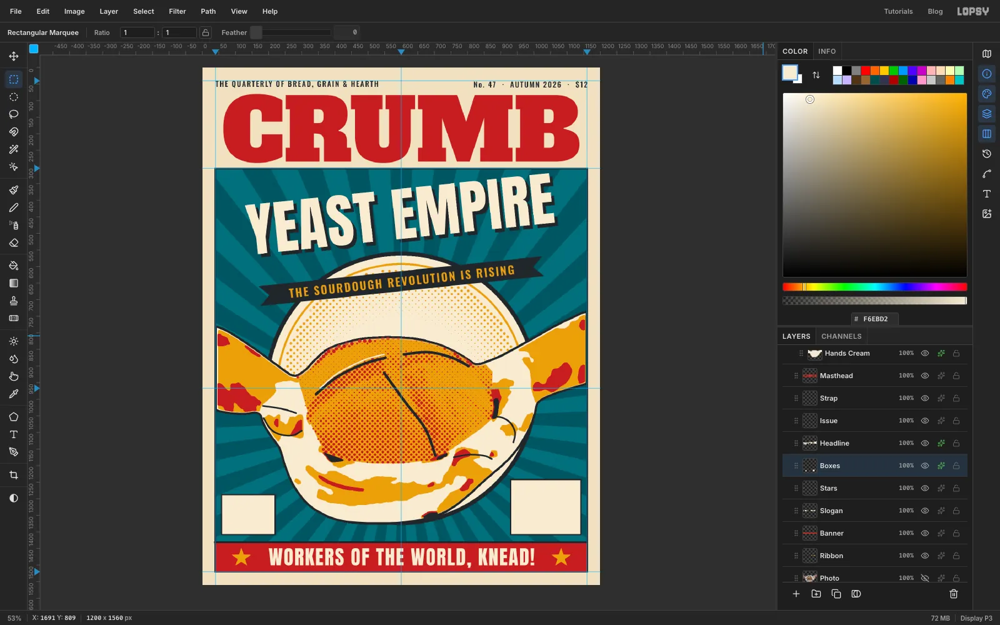

Click *Stars* and add a layer called *Boxes*. Use the marquee dialog twice, filling each selection with cream `#F6EBD2`:

- **928, 1240** to **1144, 1410** for the contents box
- **56, 1286** to **222, 1410** for the barcode

The outer sides sit 16 px inside the keyline, and both bottoms line up 20 px above the banner. Deselect. Give the layer a **Stroke** effect: **Width 4**, ink, **inside**.

## Fill the boxes

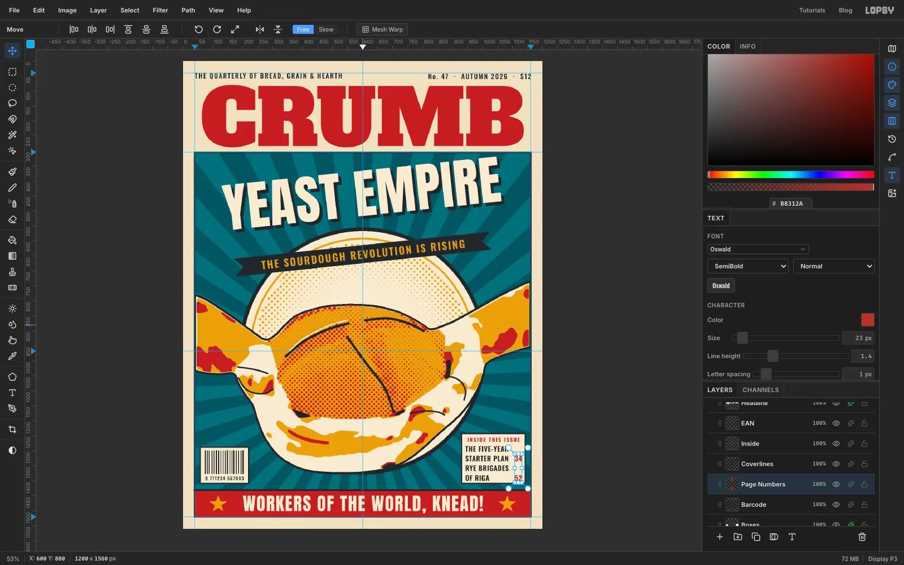

**Barcode:** add a layer called *Barcode*. With the **Pencil** in ink, draw about 18 vertical bars across the middle of the box, in irregular clusters 2–5 px apart. For each bar, click near the top and [[Shift]]-click near the bottom, changing **Size** between 2, 3 and 4 as you go. Leave room underneath, then add `9 771234 567003` in **Oswald Medium 15** with letter spacing 2, centred under the bars.

**Cover lines:** remember to click *Barcode* before each new piece of text. Type each piece in an empty spot, then move it into the box:

- `INSIDE THIS ISSUE` in **Oswald Bold 17**, brick red, letter spacing 3, centred near the top.
- The titles in **Oswald SemiBold 23**, ink, letter spacing 1, on four lines (press [[Enter]] between them): THE FIVE-YEAR / STARTER PLAN / RYE BRIGADES / OF RIGA. Line them up 14 px in from the box's left edge.
- The page numbers as a separate text in the same font, brick red, with **Align** set to **Right**. Type an empty first line, then `34`, another empty line, then `52`. Move it so its right edge is 14 px in from the box's right edge, with `34` level with STARTER PLAN and `52` level with OF RIGA.

## Print it on grainy paper

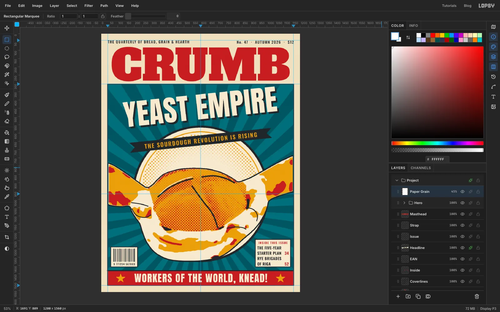

Click *Hands Ink* inside the group and add a layer called *Paper Grain*. Fill it with white `#FFFFFF`. Run **Filter → Add Noise…** at **Amount 55**, **Mono** and **Gaussian**.

Open its effects, set the blend mode to **Multiply**, and set the layer's opacity to **45%**. Multiply drops the white out and leaves only the dark specks.

New layers land inside the active group, so drag the *Paper Grain* row up above the *Hero* group in the Layers panel. Now the grain sits over the whole cover. Collapse *Hero*.

Save with **File → Save Project**, and export with **File → Quick Export PNG**.

> **Tip:** Try the same separation routine on your own photos. Soften with Oil Paint, take three or four Threshold copies, wand them with Contiguous off, Shrink and Grow to clean up, then fill each with one ink. It works on anything with a clear subject and simple lighting.
