The San Francisco ballroom posters of 1966–68 had a few signature tricks.
Wes Wilson's lettering swelled to fill whatever shape it sat in. Victor
Moscoso put saturated colours of the same lightness side by side so the edge
between them seemed to vibrate. And liquid light shows, oil and dye swirled
on an overhead projector, put moving colour behind the bands.

In this tutorial you'll put those ideas on a back print for an imaginary
1967 band, the **Venusian Grasshoppers**. A Smoke render folded through
**Kaleidoscope** stands in for the light show. A real grasshopper photo
becomes a two-colour poster print. Its name arches around an orange ring in
magenta, a pair that buzzes. The print is **1500 × 1800 px** on a deep
aubergine shirt colour.

Along the way you'll use:

- **Sunburst**, **Smoke**, **Posterize** and **Kaleidoscope** for the background and medallion
- exact **Elliptical Marquee** circles, **Select → Inverse** and **Edit → Fill**
- **Gradient Map** adjustments on groups to recolour a pattern and a photo
- a pasted photo cut out with the **Magic Wand**, then **Desaturate**, **Brightness/Contrast** and **Surface Blur**
- corner-handle scaling, rotation and a move, with undo and redo to check them
- the **Eraser**, and two rasterized **Stroke** outlines
- the **Pen** tool and text on a path, in **Kavoon** and **Righteous**
- the **Brush** with **Radial Symmetry** for a dot ring and a daisy, plus an Option-drag copy
- **Add Noise** and **Threshold** for patchy print wear

The palette:

- Tee aubergine `#2A0E33`, ray violet `#4E2560`
- Medallion `#2A0F45` → `#4B1F8A` → `#7A2FB0`
- Title band orange `#FF7A1F`, magenta `#F2318F`, shadow violet `#5A2DD8`
- Grasshopper `#14104A` → `#19C3B5` → `#FFF0C8`
- Lime `#B9F227`, cream `#FFF0C8`

> **Tip:** Positions are in document pixels, written `x, y`. The status bar
> at the bottom shows where the pointer is. New layers appear above the
> selected layer. If the selected row is an *expanded* group, the new layer
> goes inside it, so collapse each group when you've finished with it. To
> name a layer or group, double-click its name in the Layers panel.

> **Tip:** For an exact circle, pick the **Elliptical Marquee**, make sure
> nothing is selected ([[Cmd+D]]), and click the canvas once without
> dragging. A dialog asks for the **From X / Y** and **To X / Y** corners of
> the box the circle sits in. Every circle in this design is centred on
> `750, 900`.

## Set up the tee canvas and guides

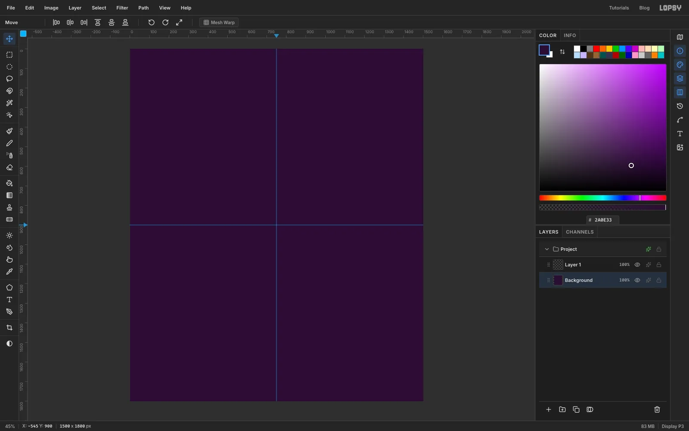

Choose **File → New**, enter **1500 × 1800** and click **Create**. A new
document comes with an empty *Layer 1* above the *Background*. Leave it
there, because it becomes the title band later.

Click the *Background* row, set the foreground colour to tee aubergine
`#2A0E33` and choose **Edit → Fill**. Then click the top ruler at `750` and
the left ruler at `900` to drop two guides that cross at the centre of the
design.

## Add faint sunburst rays

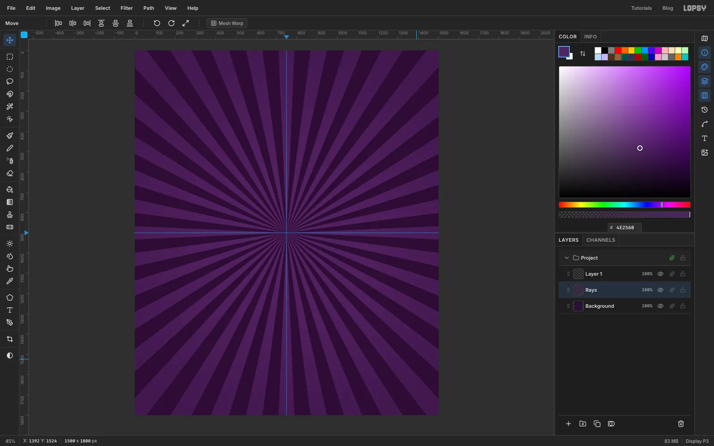

With *Background* still selected, click **Add Layer** and name the new
layer *Rays*. Set the foreground to `#4E2560`, a purple only a little
lighter than the shirt.

Choose **Filter → Sunburst…** and set **Rays** to 36, **Length** to 100,
**Width** to 50 and **Fade** to 45. Leave the centre at 50 / 50 and click
**Apply**. The rays fill the corners with a slow pulse, but stay quiet
enough not to compete with the badge.

## Render a liquid light show with Smoke

Click **Add Layer** again and name it *Light Show*. Choose
**Filter → Smoke…**, set **Scale** to 8 and **Turbulence** to 90, and click
**Apply**.

Then choose **Filter → Brightness/Contrast…** and set **Contrast** to 40.
That pushes the clouds towards black and white, so the bands in the next step
spread across the full range. Smoke is random, so your clouds will differ
from the screenshot. If yours come out mostly dark, undo and run Smoke again.

## Posterize the smoke into bands

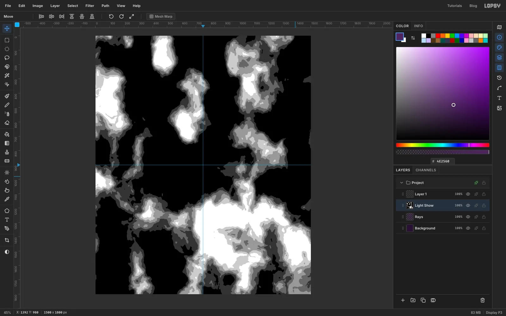

Choose **Filter → Gaussian Blur…** with a **Radius** of 6. That rounds off
the wispy edges so the bands look like blobs of oil, not smoke.

Then choose **Filter → Posterize…** with **Levels** set to 6. The grey
gradients snap into six flat bands, like dye floating on water.

## Fold it with Kaleidoscope

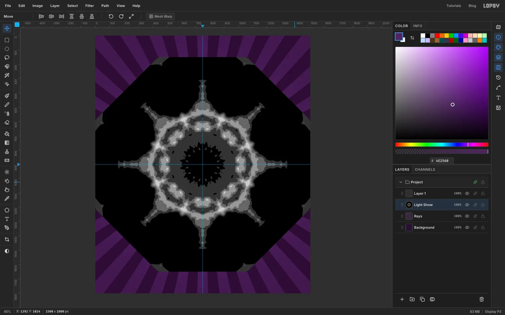

Choose **Filter → Kaleidoscope…**, set **Segments** to 8 and **Rotation** to 0,
and click **Apply**. One wedge of the smoke is mirrored eight ways around
the centre of the canvas, which turns random blobs into a symmetrical
mandala.

The corners outside the octagon are left empty, which doesn't matter
because you'll keep only a circle from the middle. Finish with a
**Gaussian Blur** of 3 to soften the mirror seams.

## Cut out the medallion

Pick the **Elliptical Marquee**, click the canvas once, and enter **From**
`298, 448` and **To** `1202, 1352`. That's a circle with a radius of 452
around the centre.

Choose **Select → Inverse**, press [[Delete]] and then [[Cmd+D]]. Only the
round medallion remains.

## Colour the medallion with a Gradient Map

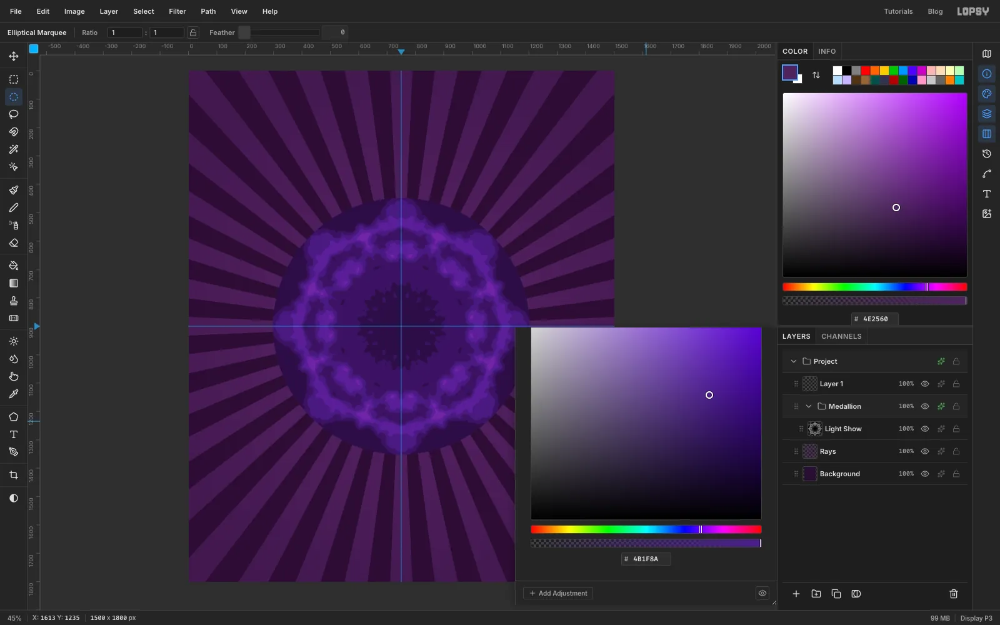

With *Light Show* selected, choose **Layer → Group Layers** and name the
group *Medallion*. Click the sparkle icon on the group's row to open its
drawer. Click **Add Adjustment** and choose **Gradient Map**.

The map starts black to white. Click the left stop and type `2A0F45` into
the hex field, then click the right stop and type `7A2FB0`. Click the
gradient bar halfway between them to add a third stop, and make it
`4B1F8A`.

Keep these values close together. The medallion is a backdrop, and the
grasshopper should be the only detail inside the ring. Close the drawer and
collapse the group.

## Build the orange title band

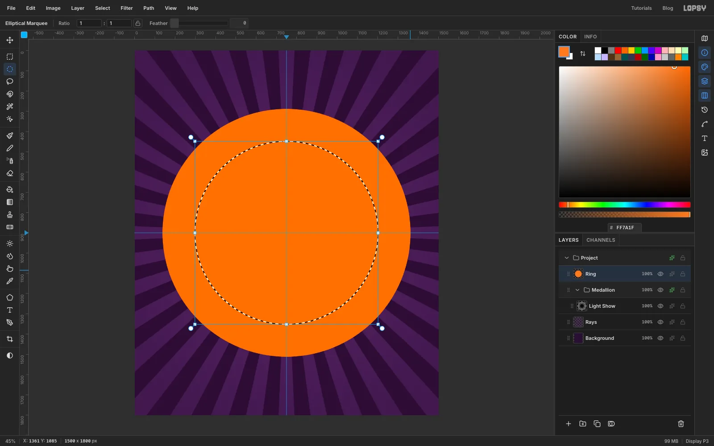

Click *Layer 1*, double-click its name and rename it *Ring*. Make an exact
circle from `138, 288` to `1362, 1512`, set the foreground to orange
`#FF7A1F` and choose **Edit → Fill**.

Then make a second exact circle from `298, 448` to `1202, 1352`, the same
size as the medallion, and press [[Delete]]. That leaves an orange band 160
pixels wide around the medallion. Press [[Cmd+D]].

## Ring the badge with dots

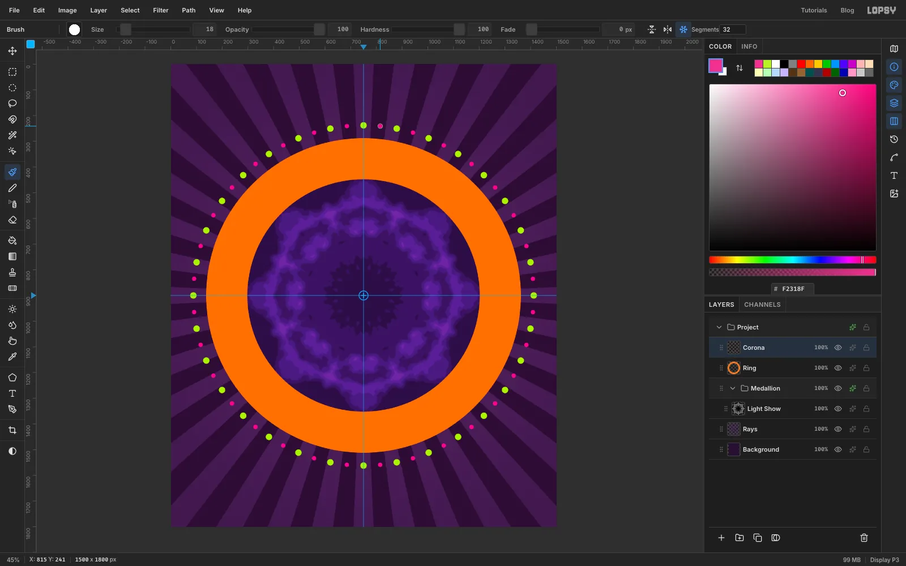

Click **Add Layer** and name it *Corona*. Choose the **Brush**, set **Size**
to 26 and **Hardness** to 100, then click **Radial Symmetry** in the options
bar and set **Segments** to 32. The symmetry centre starts at the middle of
the canvas, which is where you want it.

Set the foreground to lime `#B9F227` and click once at `750, 238`, straight
above the centre. That one click paints 32 dots in a perfect ring.

Now set the foreground to magenta `#F2318F` and the **Size** to 18. Click once
at `815, 241`, halfway between the first two lime dots. The small magenta
dots fill the gaps, and the two sizes stop the ring looking mechanical.
Click **Radial Symmetry** again to turn it off.

## Paste in the grasshopper photo

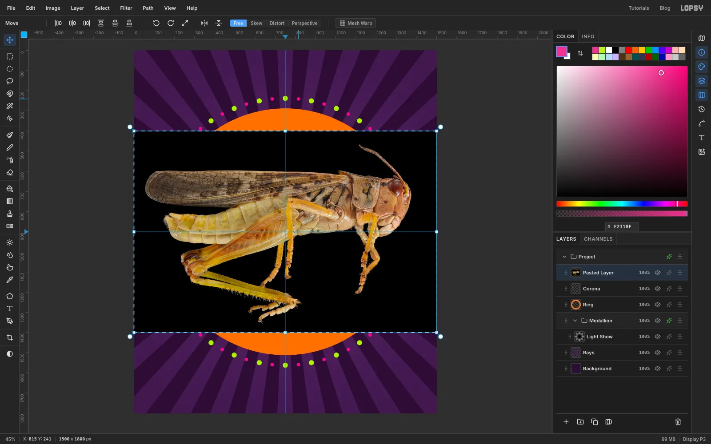

This design uses a public-domain specimen photo of a clear-winged
grasshopper by Alyssa Canova for the National Park Service:
[Camnula pellucida (side view)](https://commons.wikimedia.org/wiki/File:Camnula_pellucida_(side_view)_(48882157876).jpg)
on Wikimedia Commons. On the Commons page, click the image to open the
full-size original. Right-click it and choose **Copy Image**, then click the
*Corona* row in Lopsy and press [[Cmd+V]]. Copy the original, not the small
preview, or the positions in the next steps won't line up.

Lopsy shrinks a large paste to fit the canvas, so the photo lands 1500
pixels wide and centred, from y `400` to `1400`. Rename the layer
*Grasshopper*.

## Cut it out with the Magic Wand

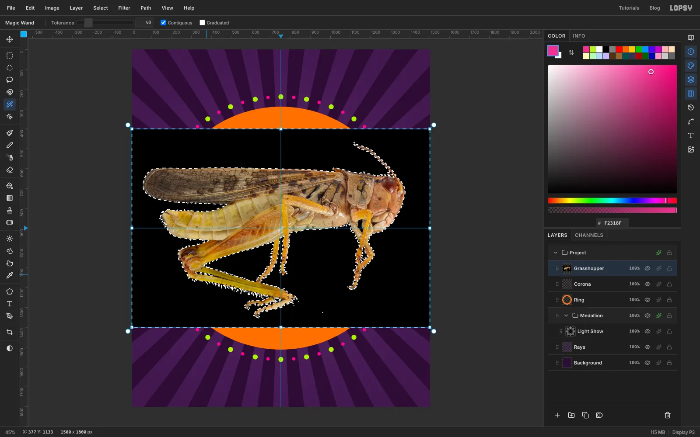

Choose the **Magic Wand**, set **Tolerance** to 40 and make sure
**Contiguous** is ticked. Click the black backdrop near the photo's top-left
corner, at about `30, 430`.

The backdrop is also trapped in three pockets between the legs. Hold
[[Shift]] and click each one to add it:

- under the belly at `571, 1075`
- between the front legs at `1167, 1037`
- behind the long hind shin at `377, 1133`

Press [[Delete]] to remove the black, then [[Cmd+D]].

## Give the photo a poster-print look

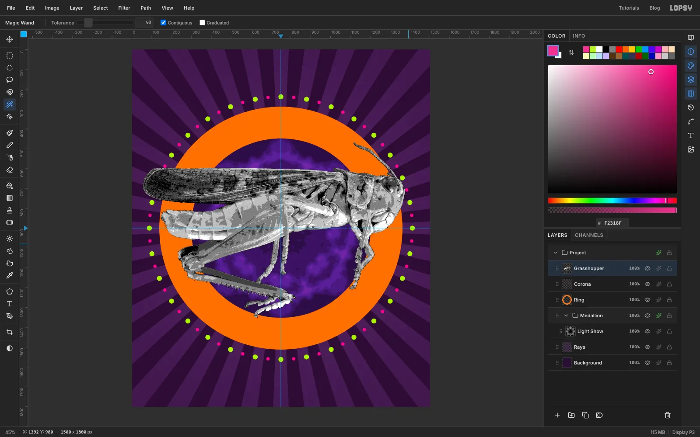

Psychedelic posters treated photos as high-contrast prints rather than
continuous tone. With *Grasshopper* selected, run these filters:

1. **Filter → Desaturate**.
2. **Filter → Brightness/Contrast…** with **Brightness** 10 and **Contrast** 70.
3. **Filter → Surface Blur…** with **Radius** 8 and **Threshold** 40. This
   smooths the texture inside each area but keeps the edges sharp.
4. **Filter → Posterize…** with **Levels** at 5.

## Recolour it teal with a second Gradient Map

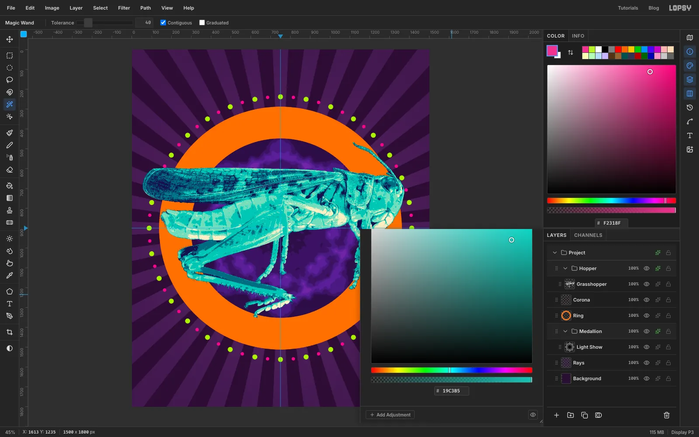

Choose **Layer → Group Layers** and name the group *Hopper*. Open the
group's drawer, choose **Add Adjustment → Gradient Map**, and set the stops
to navy `#14104A` on the left and cream `#FFF0C8` on the right. Add teal
`#19C3B5` in the middle.

Teal sits across the colour wheel from the orange ring and well above the
dark medallion in lightness, so the bug stands out against both.

## Scale the grasshopper down

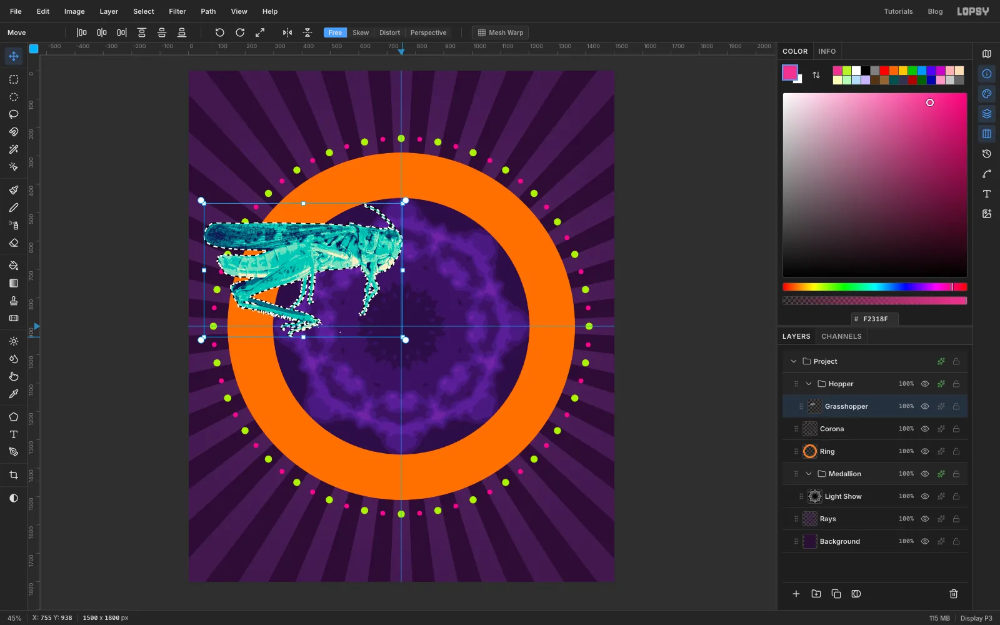

Leave the *Hopper* group expanded and [[Cmd]]-click the *Grasshopper*
layer's thumbnail. That selects the insect's outline, and transform handles
appear around it once you pick the **Move** tool.

Hold [[Cmd]] to keep the proportions, then drag the **bottom-right** handle
up and to the left until the box's right edge reaches about `755` on the top
ruler. The box is now about 700 px wide, a little over half the pasted
size.

## Tilt it into a leap

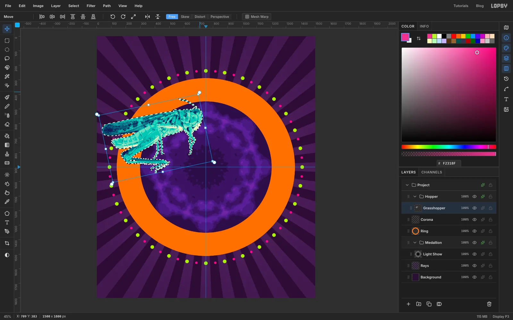

Just outside the **top-right** corner of the box is a small white circle,
the rotation handle. Drag it anticlockwise about 12°, so the head lifts and
the grasshopper looks ready to jump.

## Centre it and commit

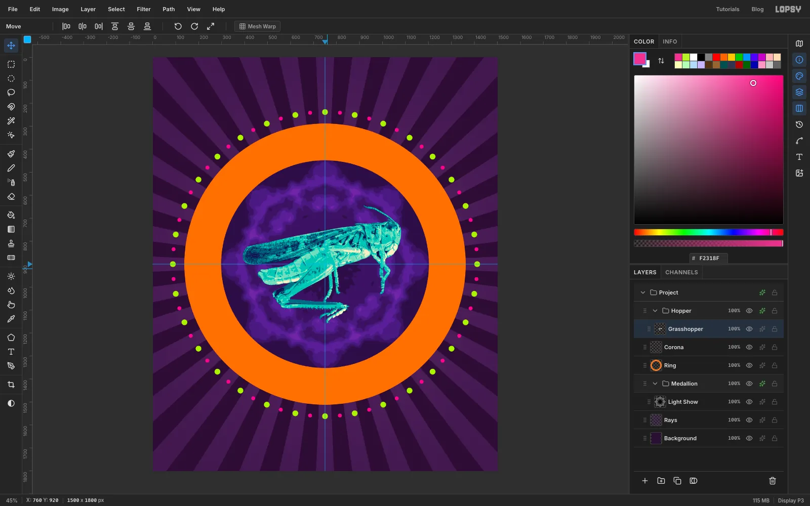

Drag from the middle of the box to move the grasshopper into the
medallion. Its centre should land at about `760, 920`, a touch right of and
below the guides, which balances the long wing on the left. Press [[Cmd+D]]
to commit the transform.

> **Tip:** Want to compare? Press [[Cmd+Z]] three times to step back through
> the move, the rotation and the scale, then [[Cmd+Shift+Z]] three times to
> bring them all back exactly.

## Erase stray specks

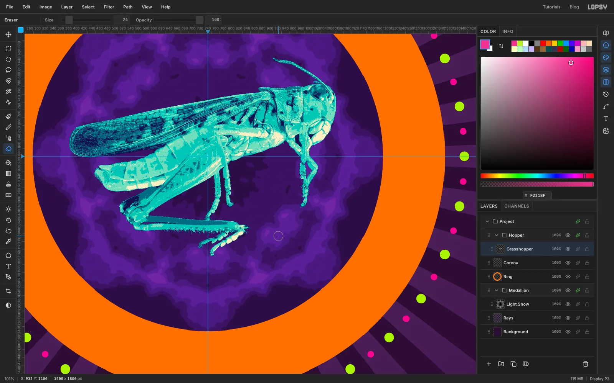

A Magic Wand cut can leave a stray pixel or two floating in the
background. You'll outline the grasshopper next, and the outline would turn
each speck into a small ring.

Zoom in with [[Cmd]] and the scroll wheel and look around the legs. In this
photo there's one speck at about `932, 1106`. Choose the **Eraser**, set
**Size** to 24 and click each speck away.

## Outline the grasshopper twice

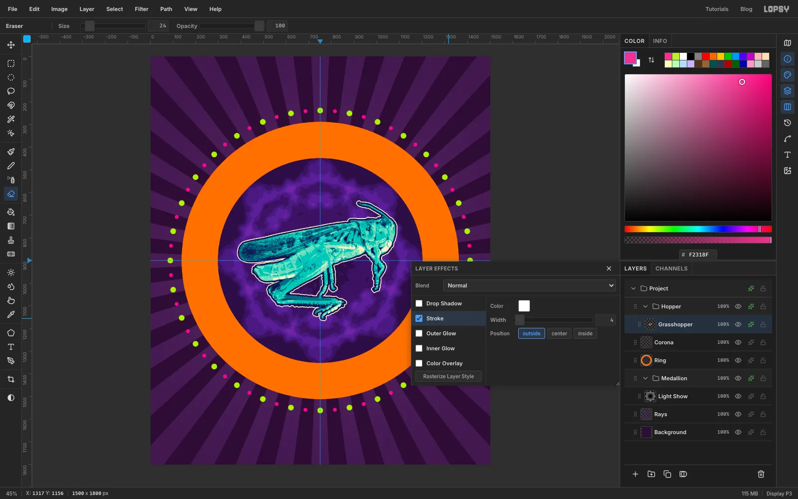

Open the *Grasshopper* layer's effects drawer. Turn on **Stroke**, set
**Width** to 6, set the colour to black and leave it **outside**. The group's
Gradient Map turns black into navy. Click **Rasterize Layer Style** to bake
it in.

A layer has only one Stroke, so baking the first one frees it for a
second. Turn **Stroke** on again with **Width** 4 in white. The map turns it
cream. Click **Rasterize Layer Style** again. Navy then cream separates the
bug cleanly from the purple behind it.

## Draw the top arc with the Pen

Close the drawer, collapse the *Hopper* group and click its row, so new
layers land above it. Choose the **Pen** tool. Each anchor below is a
press-and-drag: press on the first point, drag to the second and release.
The first and last anchors sit on the horizontal guide, and the middle one
sits on the vertical guide.

1. Press at `262, 900` and drag up to `262, 630`.
2. Press at `750, 412` and drag right to `1020, 412`.
3. Press at `1238, 900` and drag down to `1238, 1170`.

Click the ✓ **Commit path** button in the options bar. You now have *Path 1*,
a smooth half circle with a radius of 488, just inside the middle of the
band.

## Set VENUSIAN on the arc

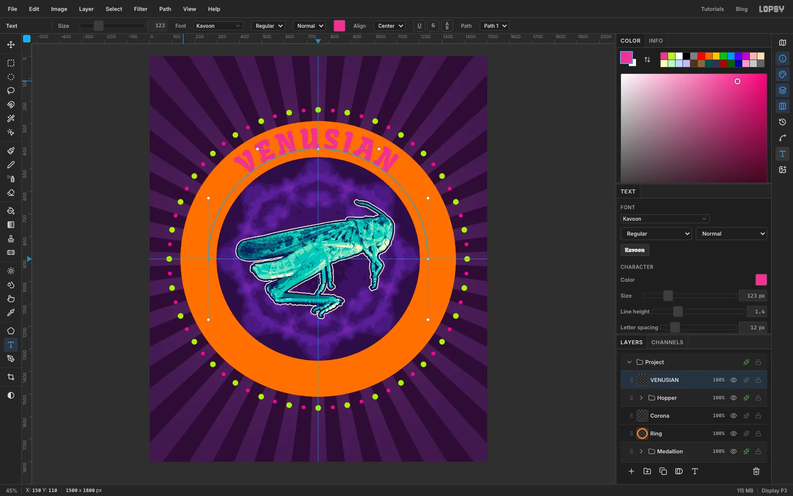

Click the *Hopper* row again. Text options restyle whichever text layer is
selected, so always start from a non-text row. Choose the **Text** tool,
pick **Kavoon** as the font, set **Size** to 123 and **Align** to
**Center**, and set the foreground to magenta `#F2318F`.

Click an empty spot near the top-left corner, type `VENUSIAN` and press
[[Tab]]. In the options bar, set **Path** to *Path 1*. The word jumps onto
the arc, centred over the top. In the **Text** panel, set
**Letter spacing** to 12 so the letters breathe.

## Curve GRASSHOPPERS under the bottom

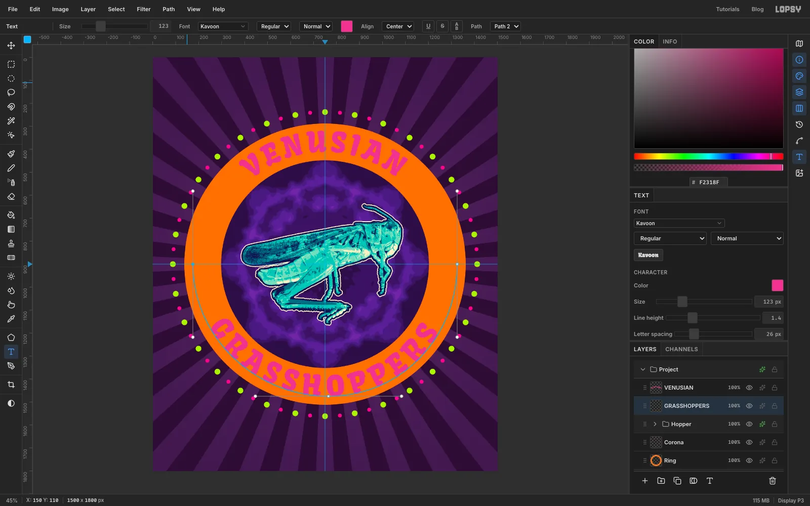

The bottom arc runs from left to right *under* the centre. Text sits on the
left-hand side of a path's direction, so the letters stand inside the
ring and read the right way up. With the **Pen**:

1. Press at `175, 900` on the horizontal guide and drag down to `175, 1218`.
2. Press at `750, 1475` on the vertical guide and drag right to `1068, 1475`.
3. Press at `1325, 900` and drag up to `1325, 582`.

Commit it as *Path 2*, a half circle with a radius of 575. The path stays
selected, so with the **Pen** still active, drag the bottom anchor about
15 px to the right, to `765, 1475`. Centred on a perfectly level arc,
Kavoon's wide G and S make the word sit a little left of 6 o'clock, and the
nudge brings it back to the middle.

Click the *Hopper* row, keep the Text settings from the last step, click an
empty spot, type `GRASSHOPPERS` and press [[Tab]]. Bind it to *Path 2* and
set **Letter spacing** to 26. Letters on the inside of a curve crowd
together at their tops, so the bottom word needs more spacing to look as
open as the top one.

## Give the title a hard shadow

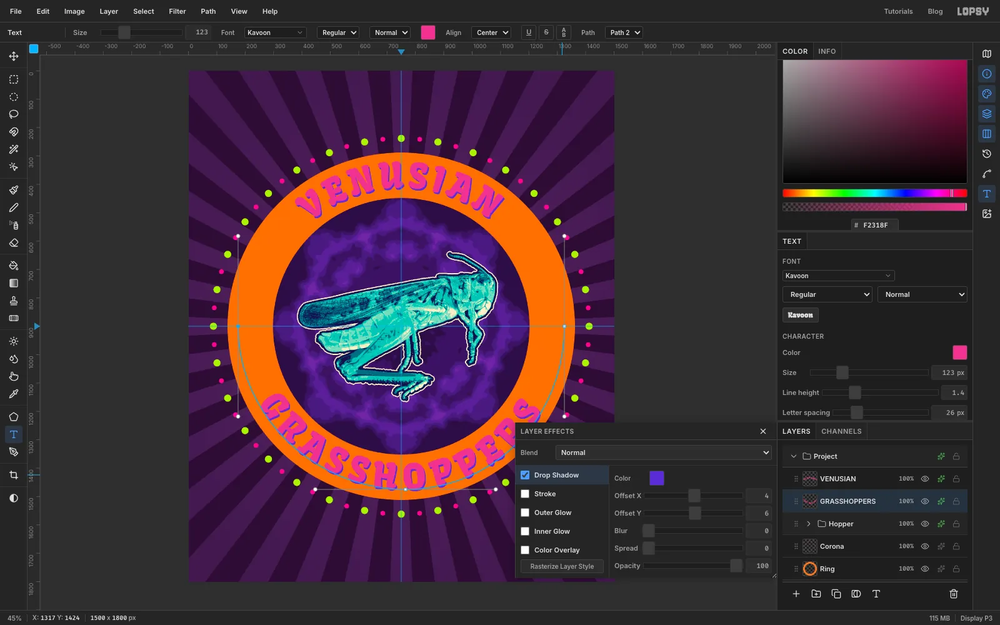

Select *VENUSIAN*, open its drawer and turn on **Drop Shadow**. Set
**Offset X** to 4, **Offset Y** to 6, **Blur** to 0 and **Opacity** to 100,
and set the colour to violet `#5A2DD8`. Do the same for *GRASSHOPPERS*.

Hot magenta on orange is a pair that buzzes, the way Moscoso's lettering
did. The crisp violet shadow keeps it readable.

## Paint a daisy with radial symmetry

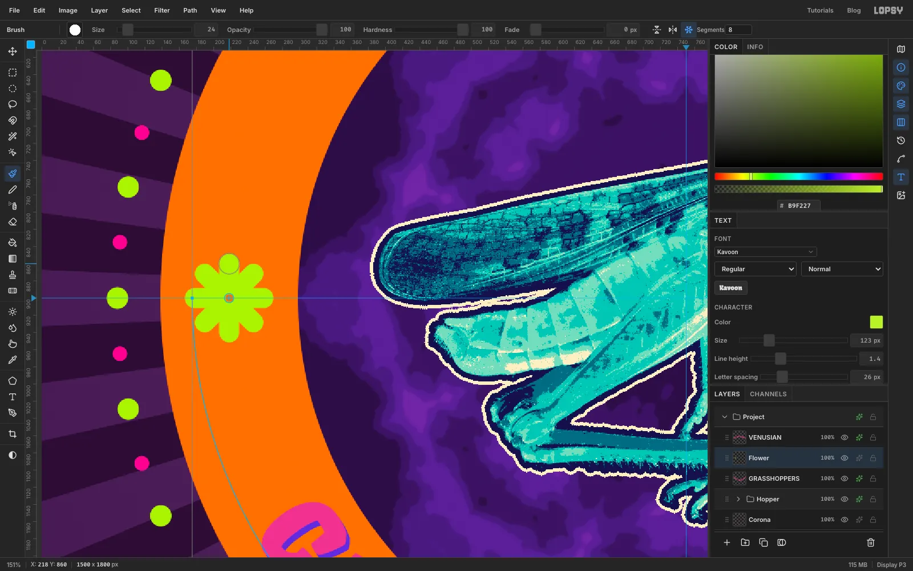

Click **Add Layer** and name it *Flower*. The daisy is small, so zoom in
on the band at 9 o'clock first, with [[Cmd]] and the scroll wheel. Choose
the **Brush**, turn on **Radial Symmetry** and set **Segments** to 8. While
symmetry is on, [[Cmd]]-click moves the symmetry centre, so [[Cmd]]-click at
`218, 900`, in the middle of the band.

Set the foreground to lime, **Size** to 24 and **Hardness** to 100. Click at
`218, 884`, then [[Shift]]-click at `218, 860`. That one straight stroke is
mirrored into eight round-ended petals.

For the centre, click once at `218, 900` in magenta at **Size** 22, then
again in cream at **Size** 8. Turn **Radial Symmetry** off.

## Outline the daisy and copy it across

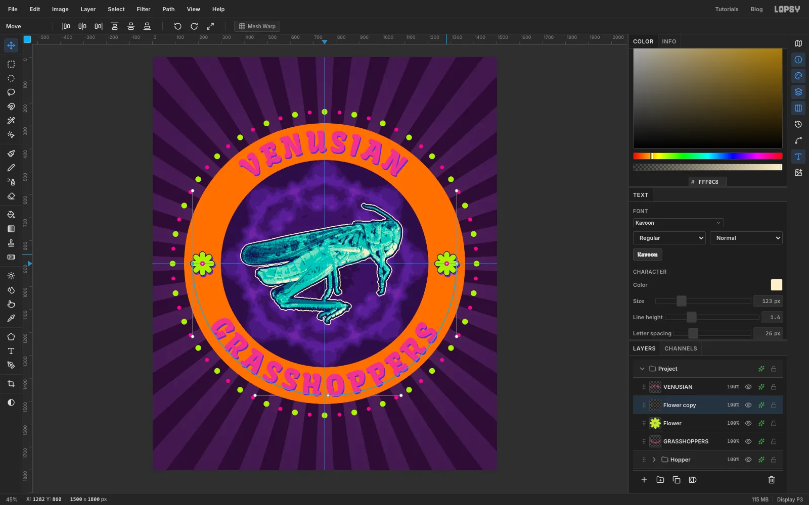

Lime on orange is loud but has no edge, so give the flower a dark outline.
In its drawer, add a **Stroke** of **Width** 3 in `#2A0F45`, and the same
violet **Drop Shadow** as the title (4, 6, Blur 0). Zoom back out with
**View → Fit to Screen**.

Choose the **Move** tool, hold [[Option]] and drag the daisy straight across
to the 3 o'clock side, to `1282, 900`. Option-drag duplicates the layer,
effects and all, and moves the copy. Rename it *Flower R*.

## Group the type and ornaments

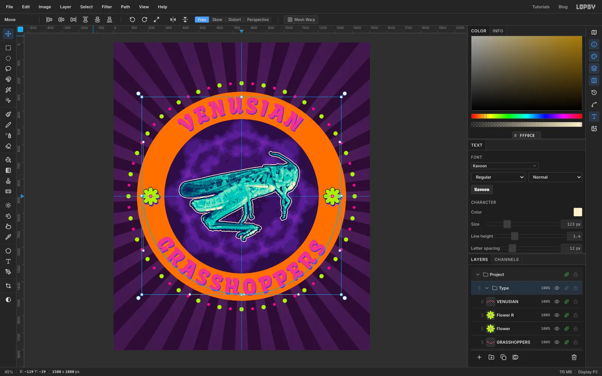

Click the *VENUSIAN* row, then [[Shift]]-click *GRASSHOPPERS*. Shift-click
selects everything between the two rows, which here is both words and both
flowers. Choose **Layer → Group Layers** and name the group
*Type*.

The whole set now moves as one. Press the down arrow once with the **Move**
tool to try it, then [[Cmd+Z]] to put it back. Collapse the group.

## Make a print-wear texture

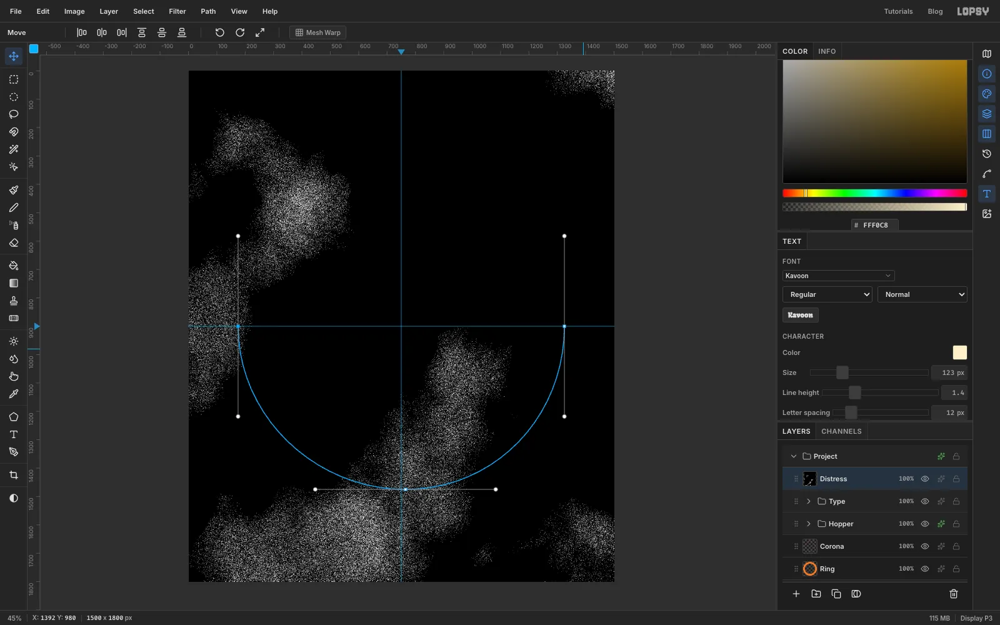

Real screen prints wear unevenly, so the texture needs to be patchy. With
*Type* selected, click **Add Layer** and name it *Distress*.

1. **Filter → Smoke…** with **Scale** 3 and **Turbulence** 40, for big soft patches.
2. **Filter → Brightness/Contrast…** with **Contrast** −75. The clouds fade
   to a soft grey with lighter and darker patches.
3. **Filter → Add Noise…** with **Amount** 100 and **Mono**.
4. **Filter → Gaussian Blur…** with **Radius** 1, so specks clump slightly.
5. **Filter → Threshold…**. Raise **Level** until the white thins to a
   light scatter like the screenshot, around 160.

The white specks gather wherever the smoke was brightest.

## Knock the wear out in the shirt colour

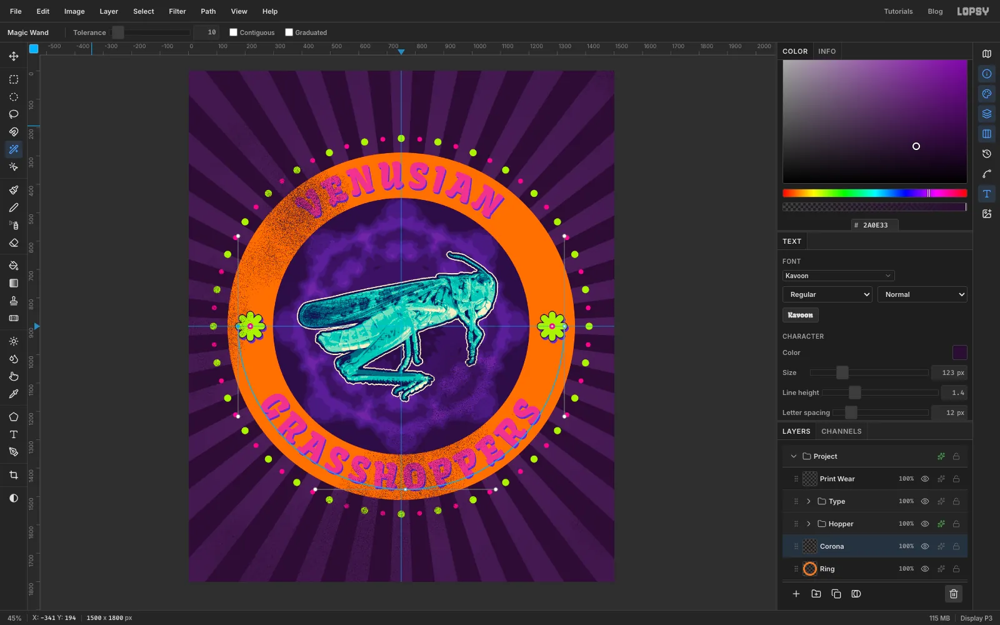

Choose the **Magic Wand**, set **Tolerance** to 10 and untick
**Contiguous**. Click any black area of *Distress*, then choose
**Select → Inverse**. Now only the white specks are selected.

Click **Add Layer**, name it *Print Wear*, set the foreground to tee
aubergine `#2A0E33` and choose **Edit → Fill**. Press [[Cmd+D]]. Then select
the *Distress* layer and click **Delete Layer**. The specks show the shirt
through the ink, as if the print had been washed a few dozen times.

## Add crisp cream keylines

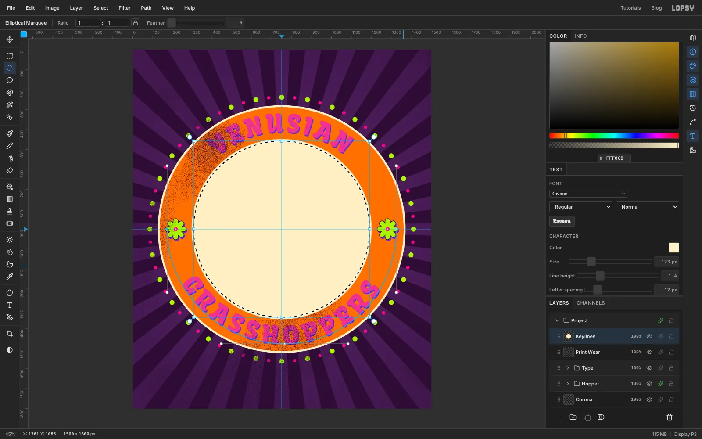

Keylines go on top of the wear so they stay clean. Click *Print Wear*, add a
layer named *Keylines* and set the foreground to cream `#FFF0C8`.

1. Circle `128, 278` → `1372, 1522`, then **Edit → Fill**.
2. Circle `138, 288` → `1362, 1512`, then press [[Delete]]. That leaves a
   10 px outer keyline.
3. Circle `298, 448` → `1202, 1352`, then **Edit → Fill**. The cream disc
   hides the medallion for a moment.
4. Circle `308, 458` → `1192, 1342`, then press [[Delete]] to open it back
   up, leaving a 10 px inner keyline.

Press [[Cmd+D]]. The two thin cream rings frame the band.

## Set the venue and tour lines

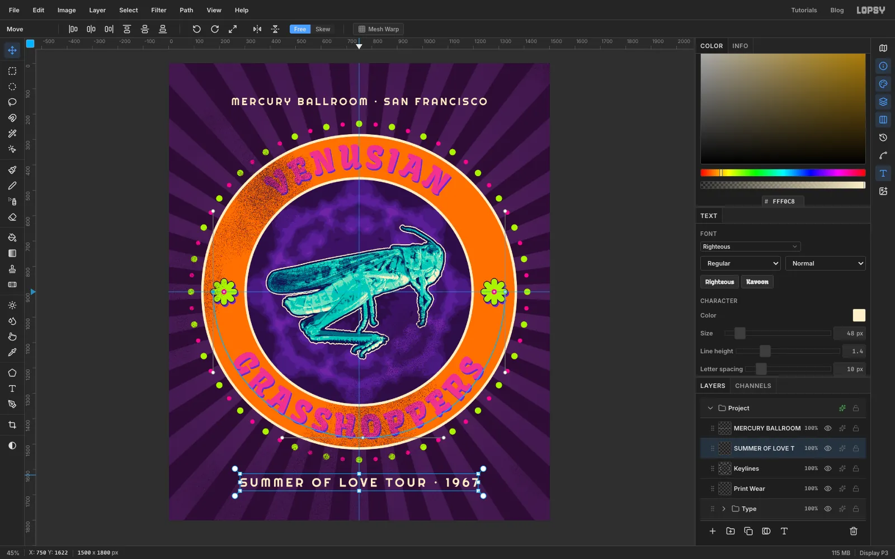

Click *Keylines* so the text lands on top. Choose the **Text** tool, pick
**Righteous** at **Size** 40 with **Align** set to **Center**, and set the
foreground to cream. Click at `750, 125`, type
`MERCURY BALLROOM · SAN FRANCISCO` and press [[Tab]]. Set
**Letter spacing** to 8. With the **Move** tool, nudge it with the arrow keys
until the line's centre sits at `750, 150`.

Click *Keylines* again, so the next settings don't restyle the venue line,
and choose the **Text** tool again. Set **Size** to 48, click at
`750, 1622`, type `SUMMER OF LOVE TOUR · 1967`, press [[Tab]] and set
**Letter spacing** to 10. Nudge it to centre on `750, 1650`. The two lines
sit the same distance from the top and bottom edges and run to about the
same width, so the badge is framed evenly.

Save the project with **File → Save Project**, and export the print with
**File → Quick Export PNG**.
