On the Equator, the sun is up for about twelve hours every day of the year. At the North Pole it's up for half the year and down for the other half. Everywhere in between swings back and forth, and the swing grows the further north you go. In this tutorial you'll turn those swings into **Daylight Oscillations**, a 1600 × 2000 px poster in the style of the 1960s San Francisco concert posters: wavy lettering, swirling rays, and colours that vibrate against each other.

It's also a real chart, so a few things are fixed:

- The **centre is the North Pole** and the **rim is the Equator**. Distance from the centre is the distance from the Pole, so the 60°N circle is a third of the way out and the 30°N circle is two thirds of the way out.
- The **angle is the day of the year**. January 1 points straight down, and the year runs clockwise, up the left side through spring, across the top in summer and down the right side in autumn.
- The **colour is the hours of daylight**, in twelve classes of two hours each: 0–2 h, 2–4 h and so on up to 22–24 h.

You don't have to compute the chart yourself. The step **Get the data disc** below has a 1000 × 1000 px grey disc for you to save made from the CBM day-length model (Forsythe and others, 1995). Each two-hour class is painted in one flat grey, from `#0B0B0B` for 0–2 h up to `#F4F4F4` for 22–24 h, in twelve even steps. You'll colour it inside Lopsy with a **Gradient Map**, so every class gets exactly one colour. If you want to chart something else, any grey image with flat steps works the same way.

Along the way you'll use:

- **guides**, the marquees' **exact-corners dialog**, **Edit → Fill** and **Select → Shrink**
- **Sunburst**, **Liquify** (Twirl), **Find Edges**, **Gaussian Blur**, **Threshold**, **Invert** and **Add Noise**
- a **group** with a **Gradient Map** adjustment, and the **Multiply** and **Overlay** blend modes
- the **Pen** tool for a wavy panel edge, a sparkle and two text paths, plus **Path to Selection** in the Paths panel
- the **Brush** with **Radial Symmetry**, and the **Pencil** with [[Shift]]-click lines
- **Stroke** and **Drop Shadow** effects, and **Merge Down**
- copy and paste, scaling with [[Cmd]]-drag and rotating with the **Move** tool's rotate handle
- text in **Sonsie One** and **IBM Plex Mono**, set on paths and rotated

The palette:

- Night `#0B0A3D`, cobalt rays `#2140FF`, ray outline `#FF2E88`
- Daylight classes `#12002A` → `#44108F` → `#7322C4` → `#A835D8` → `#D21FB0` → `#F2165A` → `#FF7A0A` → `#FFB000` → `#FFE000` → `#C4F01E` → `#9AFFD8` → `#F8FFF2`
- Rim cream `#FFF1CF`, ink `#16022E`

> **Tip:** Positions are written as `x, y` in document pixels. The status bar at the bottom of the window shows where the cursor is, so you can hover to find a spot. Key names are Mac keys. On Windows and Linux, use Ctrl for Cmd. Every circle in this poster is centred on the Pole at **800, 1100**.

## Set up the page and guides

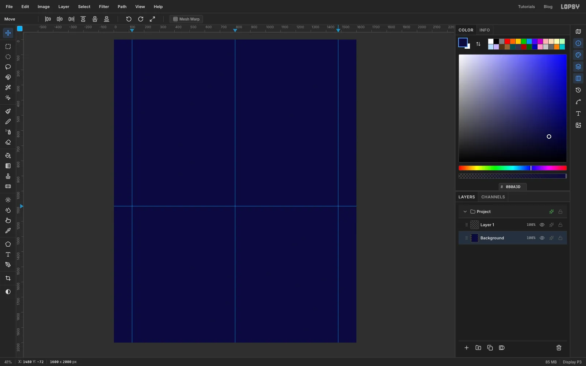

Choose **File → New**, set the size to **1600 × 2000** px and click **Create**. The document starts with a white `Background` and an empty `Layer 1`. You'll use `Layer 1` later, so leave it where it is.

Click the `Background` row in the Layers panel. Set the foreground colour to `#0B0A3D` in the Color panel's hex field and choose **Edit → Fill**.

Now drop four guides. Click the top ruler at **800** for the centre line, and at **120** and **1480** for the side margins. Click the left ruler at **1100**. That horizontal guide runs through the Pole.

## Paint the sunburst

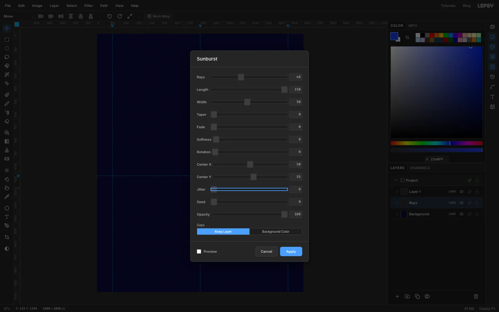

Click **Add Layer** at the bottom of the Layers panel and double-click the new layer's name to rename it `Rays`. Set the foreground to `#2140FF`.

Choose **Filter → Sunburst…**. Sunburst paints in the foreground colour. Set these values and leave everything else at its default:

- **Rays** `48`
- **Length** `150`, so the rays reach every corner
- **Width** `50`
- **Center Y** `55`. The burst then starts 55% of the way down the page, which is the Pole at y 1100.

Click **Apply**. You now have cobalt rays on night blue, all pointing at the Pole.

## Twist the rays into eddies with Liquify

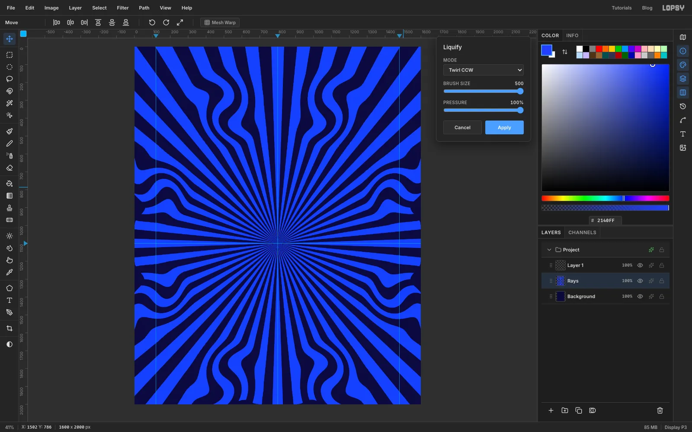

With `Rays` still selected, choose **Filter → Liquify…**. Set **Mode** to **Twirl CW**, **Brush Size** to `500` and **Pressure** to `100`.

You'll make eight eddies, evenly spaced round an oval just outside where the chart will go. The odd ones twist clockwise and the even ones anticlockwise. Twirl only works while the pointer is moving, so at each point press the mouse button and wiggle it in tiny circles on the spot for under a second, then let go.

With **Twirl CW**, twist at the four points that start at lower right and go round clockwise: about **1500, 1415** (right, low), **510, 1860** (bottom left), **100, 785** (left, high) and **1090, 340** (top right). Click **Apply**.

Open **Filter → Liquify…** again and set **Mode** to **Twirl CCW**, with the same size and pressure. Twist at the four points in between: **1090, 1860**, **100, 1415**, **510, 340** and **1500, 785**. Click **Apply**.

Alternating the direction makes each eddy turn against its neighbours. That's what gives the background its paisley, poured-paint look.

> **Tip:** Keep each twist short. A long one keeps turning and starts to break the stripe edges into jagged steps near the edge of the brush. If that happens, press [[Cmd+Z]] and try again with less wiggling.

## Add the halo rings

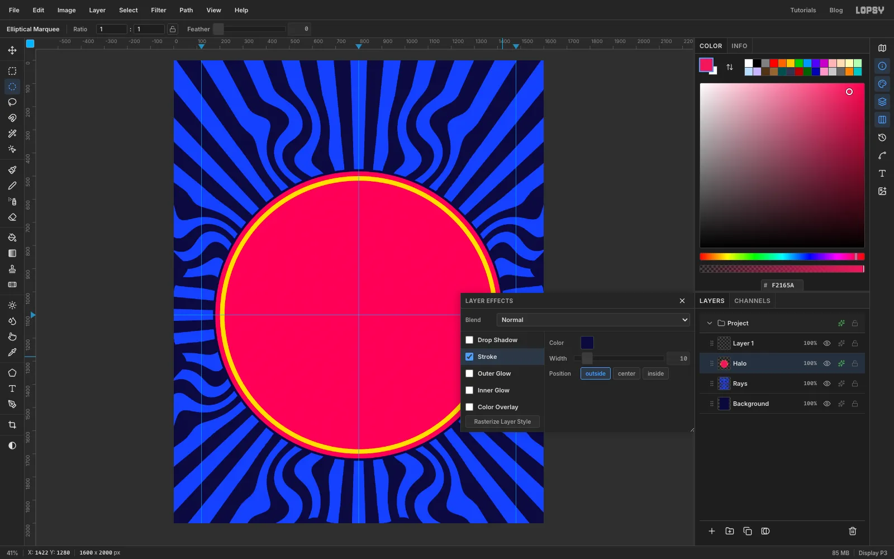

Click **Add Layer** and name it `Halo`. You'll fill three circles, biggest first, each one on top of the last.

Press [[Cmd+D]] so nothing is selected, pick the **Elliptical Marquee** and click once on the canvas without dragging. The **exact-corners dialog** opens. Type the corners of each circle, press [[Enter]], set the colour and choose **Edit → Fill**:

1. **From** 180, 480 **to** 1420, 1720, filled with `#F2165A`
2. **From** 200, 500 **to** 1400, 1700, filled with `#FFE000`
3. **From** 220, 520 **to** 1380, 1680, filled with `#F2165A`

Before each new circle, press [[Cmd+D]] and click once again. The dialog only opens when nothing is selected.

Press [[Cmd+D]]. Click the **✦** button on the `Halo` row to open the effects drawer. Tick **Stroke** and set **Width** to `10`, the colour to `#0B0A3D` and the position to **outside**. That gives you a hard night-blue gap between the rings and the rays. Close the drawer.

## Draw the wavy footer panel with the Pen

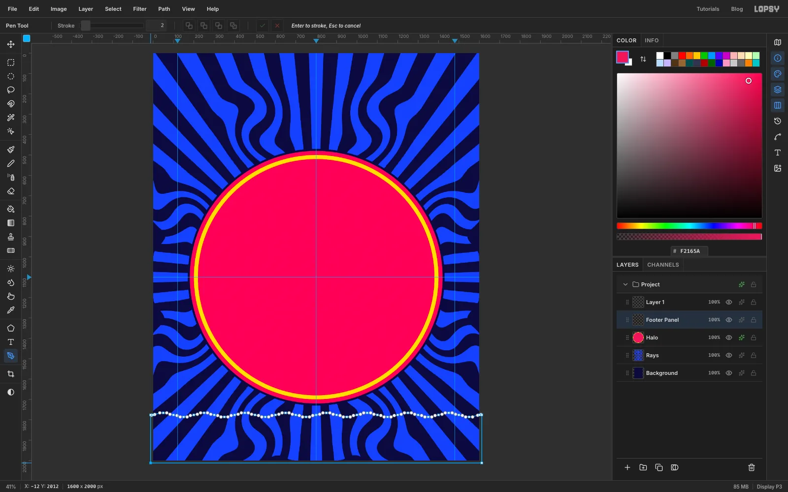

Click **Add Layer** and name it `Footer Panel`. The bottom of the poster is a night-blue panel with a wavy top edge, drawn with the **Pen** tool (**P**).

1. Click just off the canvas, below and left of the bottom-left corner, at about **−12, 2012**.
2. Click just off the left edge at **−12, 1776**.
3. Now drag out smooth anchors across the page. Start at **0, 1776** and place one every **50 px**, dragging each about **17 px** to the right as you place it. The heights repeat in this order: **1776**, crest **1766**, **1776**, trough **1786**. That's 33 anchors and eight gentle waves, each 200 px long, ending at **1600, 1776**.
4. Click off the right edge at **1612, 1776**, then below the bottom-right corner at **1612, 2012**.
5. Click the first anchor to close the path.

Open the **Paths** panel and click **Path to Selection**, then **Delete Path**. Set the foreground to `#0B0A3D` and choose **Edit → Fill**. Press [[Cmd+D]].

Open the effects drawer for `Footer Panel`, tick **Stroke** and set **Width** to `7` and the colour to `#FF7A0A`. The orange line follows the wave only. The panel's other edges are off the canvas, so their stroke never shows. That's why you started and ended the path outside it.

## Lay down the cream rim

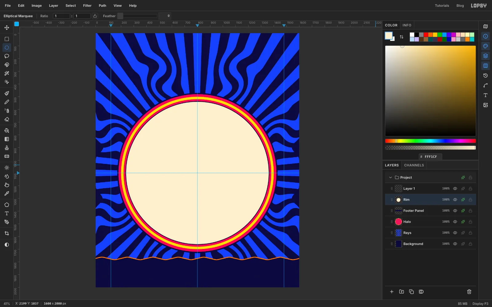

Click **Add Layer** and name it `Rim`. Use the exact-corners dialog again for a circle **from 240, 540 to 1360, 1660** (radius 560). Fill it with `#FFF1CF` and press [[Cmd+D]].

Open the effects drawer and add a **Stroke** of **Width** `5` in `#16022E`. Close the drawer. The data disc will cover the middle, so only a 60 px cream band will show, and that's where the month names go.

## Get the data disc

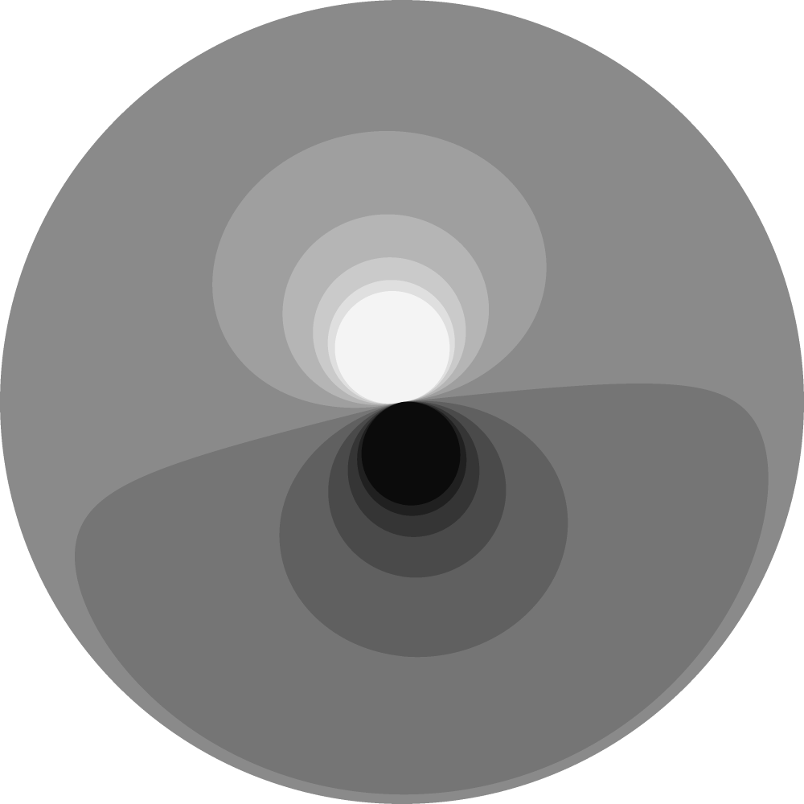

This is the chart's data. Right-click the image above, choose **Save Image As…** and save it as `daylight-data-disc.png`. It's exactly 1000 × 1000 px with a transparent background outside the circle.

You can see the shape of the story already. The pale lobe above the centre is the long summer days near the Pole, and the dark lobe below it is the winter dark. Everything else is shades of 10 to 14 hours.

## Drop in the data disc

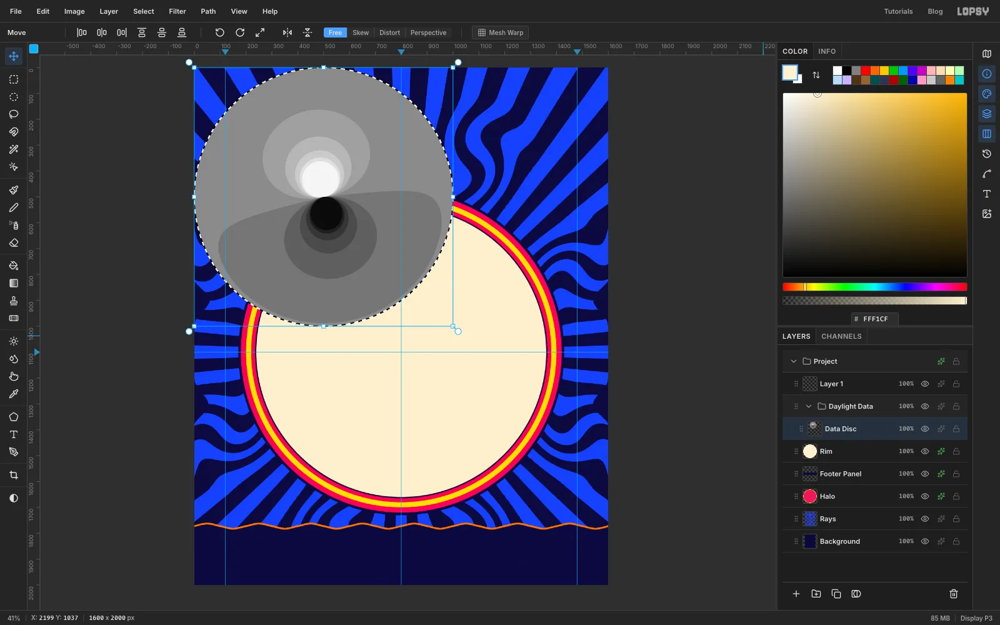

With `Rim` selected, click **New Group** at the bottom of the Layers panel and name the group `Daylight Data`. Everything you put in this group will be coloured by one Gradient Map.

Drag `daylight-data-disc.png` from your desktop onto the canvas. It arrives as a new layer inside the group, at the top-left corner, with its transform box showing. Rename it `Data Disc`.

## Centre the disc on the Pole

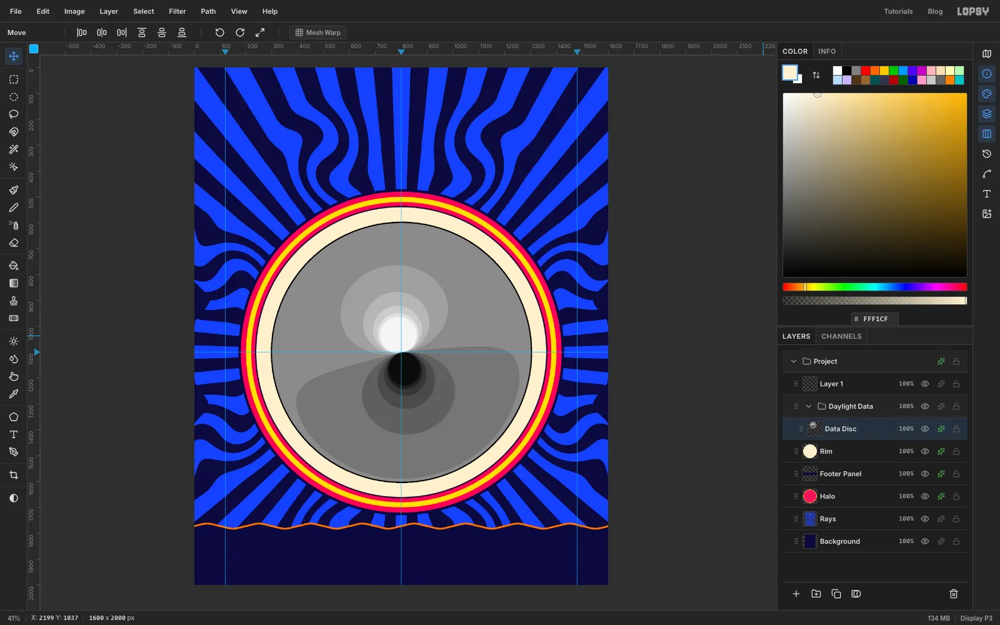

Press [[Cmd+D]] to drop the transform box and switch to the **Move** tool (**V**). The disc is 1000 px across, so its top-left corner belongs at **300, 600**, with its centre on the crossing of the 800 and 1100 guides. Drag it close, then use the arrow keys to land it. [[Shift]]+arrow moves 10 px and a plain arrow moves 1 px. When it's right, the cream band around it is the same width all the way round.

Open the effects drawer and give `Data Disc` a **Stroke** of **Width** `5` in black. Close the drawer.

You can already read the story in grey. The pale lobe above the Pole is the midnight sun in summer, and the dark lobe below it is the polar night in winter.

## Colour the classes with a Gradient Map

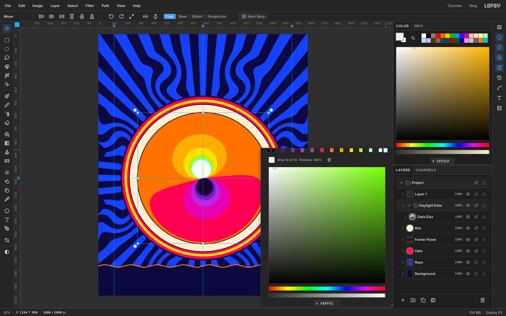

Click the **✦** button on the `Daylight Data` group row. For a group, the drawer shows adjustments instead of effects. Click **Add Adjustment → Gradient Map**. It starts as black to white.

Each grey in the disc sits in the middle of its class, so put one stop at the middle of each class. **First click all twelve positions on the bar**, then colour them. If you click a hex field first, the drawer can scroll and the bar clicks miss. The readout under the bar shows each stop's position as you click. Aim for:

**4%, 12.5%, 21%, 29%, 37.5%, 46%, 54%, 62.5%, 71%, 79%, 87.5% and 96%**

Then click each stop handle from left to right and type its colour into the hex field:

- the end stop at 0%, and the stop at 4%: `#12002A`
- 12.5% `#44108F`, 21% `#7322C4`, 29% `#A835D8`, 37.5% `#D21FB0`, 46% `#F2165A`
- 54% `#FF7A0A`, 62.5% `#FFB000`, 71% `#FFE000`, 79% `#C4F01E`, 87.5% `#9AFFD8`
- the stop at 96%, and the end stop at 100%: `#F8FFF2`

Close the drawer. The disc turns into a glowing eye: an orange top half (12–14 h), a hot-pink bottom half (10–12 h), a white sun above the Pole and a violet night below it.

## Copy the data for the keylines

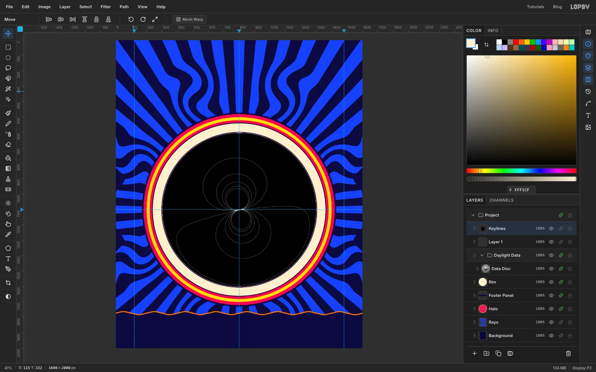

The bands need black outlines, like the inked keylines of a screen-printed poster. You'll make them from a copy of the grey data, outside the group so the Gradient Map doesn't touch them.

[[Cmd]]-click the `Data Disc` thumbnail to select its shape. Then click the `Data Disc` row and press [[Cmd+C]]. Click `Layer 1`, which sits above the group, and press [[Cmd+V]]. The paste lands in place, above `Layer 1`. Rename it `Keylines` and press [[Cmd+D]].

Choose **Filter → Find Edges**. It runs immediately and turns the disc black, with a thin light line wherever two greys meet.

## Turn the edges into ink

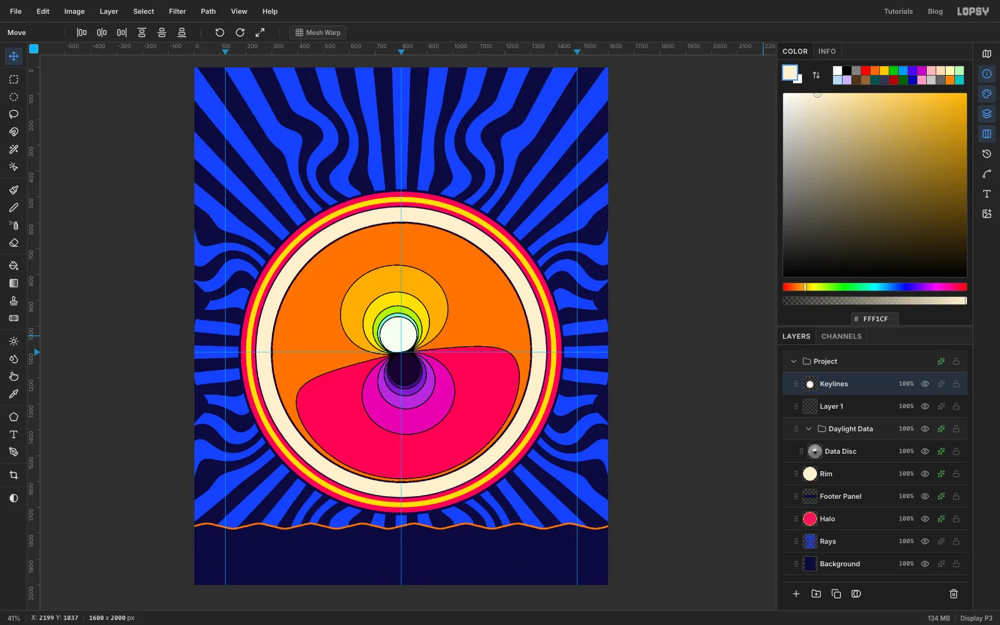

Still on `Keylines`:

1. **Filter → Gaussian Blur…**, **Radius** `3`. This spreads the hairlines out.
2. **Filter → Threshold…**, **Level** `22`. Every line becomes solid white, about 3 px wide.
3. **Filter → Invert**. You now have black lines on white.
4. Open the effects drawer and set the layer's **Blend** to **Multiply**. White disappears in Multiply, so only the black lines remain.

Close the drawer.

## Draw the latitude rings

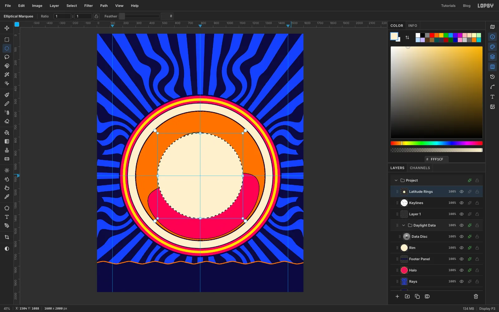

Click **Add Layer** and name it `Latitude Rings`. Use the exact-corners dialog for a circle **from 467, 767 to 1133, 1433** (radius 333, which is 30°N). Fill it with `#FFF1CF`.

Choose **Select → Shrink…**, type `3` and click **Apply**, then press [[Delete]]. You're left with a 3 px ring.

Press [[Cmd+D]] and do the same for 60°N, the smaller circle **from 633, 933 to 967, 1267** (radius 167). Press [[Cmd+D]] and set the layer's opacity to `80`% with the opacity control on its row.

## Draw the month spokes with Radial Symmetry

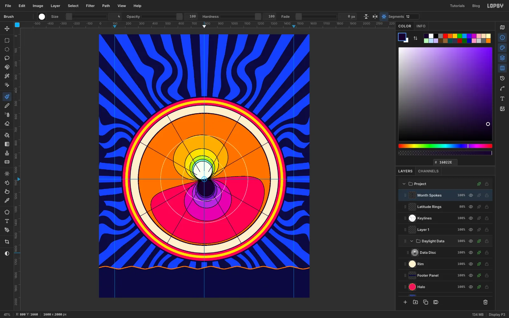

Click **Add Layer** and name it `Month Spokes`. Pick the **Brush** (**B**) and set **Size** `4`, **Hardness** `100` and **Opacity** `100`. Set the foreground to `#16022E`.

In the Brush options bar, click **Radial Symmetry** and set **Segments** to `12`. [[Cmd]]-click the Pole (800, 1100) to move the symmetry centre there.

Now draw one spoke. Click just below the Pole at **800, 1164**, then [[Shift]]-click at the bottom of the rim, **800, 1660**. The symmetry paints the other eleven. Each spoke marks a twelfth of the year, starting from January 1 at the bottom.

Click **Radial Symmetry** again to turn it off.

## Clear the Pole

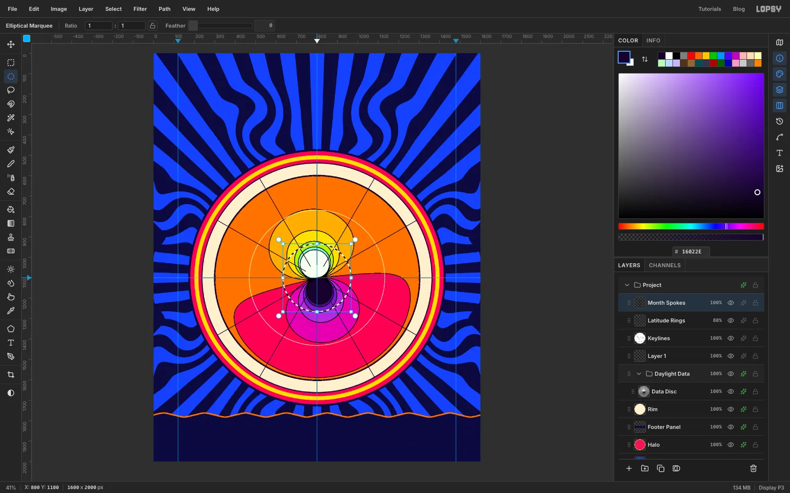

The spokes crowd the polar lobes, so stop them at the 60°N ring. With `Month Spokes` selected, make a circle **from 633, 933 to 967, 1267** with the exact-corners dialog and press [[Delete]]. Press [[Cmd+D]] and set the layer's opacity to `55`%.

All the keylines meet at the Pole, so clean that up too:

1. Press [[Cmd+D]], click `Keylines`, make a circle **from 782, 1082 to 818, 1118** and press [[Delete]].
2. Press [[Cmd+D]] and click `Latitude Rings`. Fill a circle **from 790, 1090 to 810, 1110** with `#16022E`.
3. Press [[Cmd+D]] again and fill a smaller circle **from 793, 1093 to 807, 1107** with `#FFF1CF`.

Press [[Cmd+D]]. You now have a small cream dot with a dark ring marking the Pole.

## Set the month names and turn them to the rim

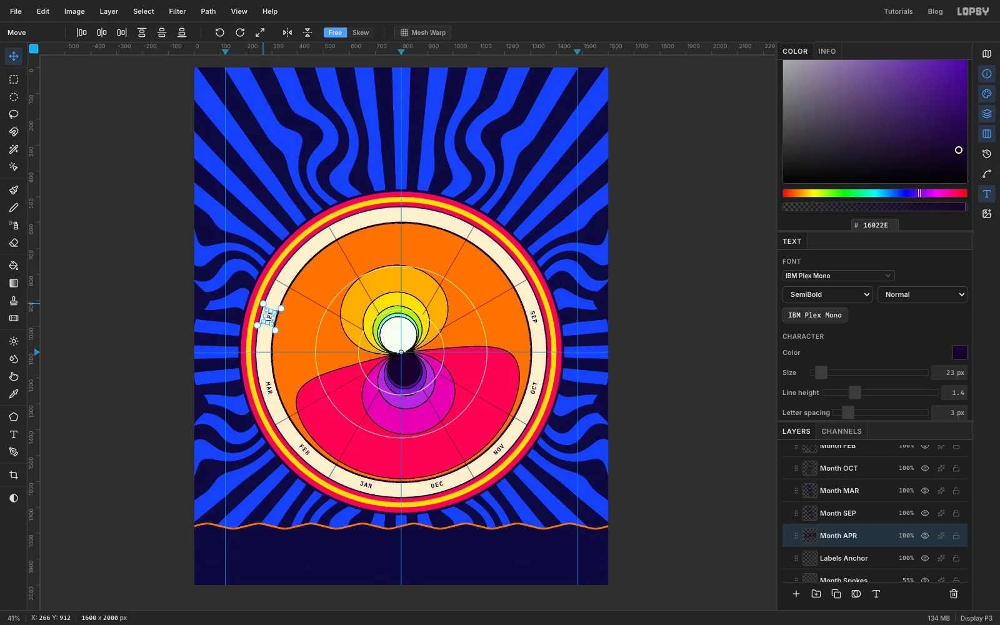

Click `Month Spokes`, then **Add Layer**, and name the new layer `Labels Anchor`. New text always lands just above the selected layer, so click `Labels Anchor` before you create each label in the rest of the tutorial.

Pick the **Text** tool (**T**). Choose **IBM Plex Mono**, weight **SemiBold**, size `23`, colour `#16022E`, and set **Letter spacing** to `3` in the Text panel.

Each month sits between two spokes, halfway across the cream band. JAN sits just left of the bottom spoke, and the months run clockwise from there. Click on empty canvas near each spot, type the name and press [[Tab]] to finish. Then switch to the **Move** tool and nudge it with the arrow keys until it's centred in its wedge. If you want exact centres, they are:

- JAN 663, 1612 · FEB 425, 1475 · MAR 288, 1237 · APR 288, 963 · MAY 425, 725 · JUN 663, 588
- JUL 937, 588 · AUG 1175, 725 · SEP 1312, 963 · OCT 1312, 1237 · NOV 1175, 1475 · DEC 937, 1612

Text layers are named after their text, so these rows read `JAN`, `FEB` and so on. In the screenshots they have the author's own names, such as `Month APR`.

Create the labels from the bottom of the page upwards (JAN and DEC first, JUN and JUL last). A click that lands inside an earlier label's box edits that label instead of starting a new one.

Next, turn each name so it follows the rim. The names at the top and bottom tilt to follow the curve, and the ones on the sides turn to read up the left and down the right. With the **Move** tool, select the name's row, press [[Cmd+D]], and drag the round rotate handle just outside its top-right corner. Use these angles (clockwise is positive):

- JAN `+15°`, FEB `+45°`, MAR `+75°`
- APR `−75°`, MAY `−45°`, JUN `−15°`
- JUL `+15°`, AUG `+45°`, SEP `+75°`
- OCT `−75°`, NOV `−45°`, DEC `−15°`

Press [[Cmd+D]] after each rotation, then nudge the label back to its spot.

## Read the year around the rim

Check the ring of names. The top six and bottom six read left to right. The ones on the sides read up the left side and down the right side, the way a clock face reads. Every name should sit in the middle of the cream band, clear of the outlines on both sides.

## Label the poles, the latitudes and the Equator

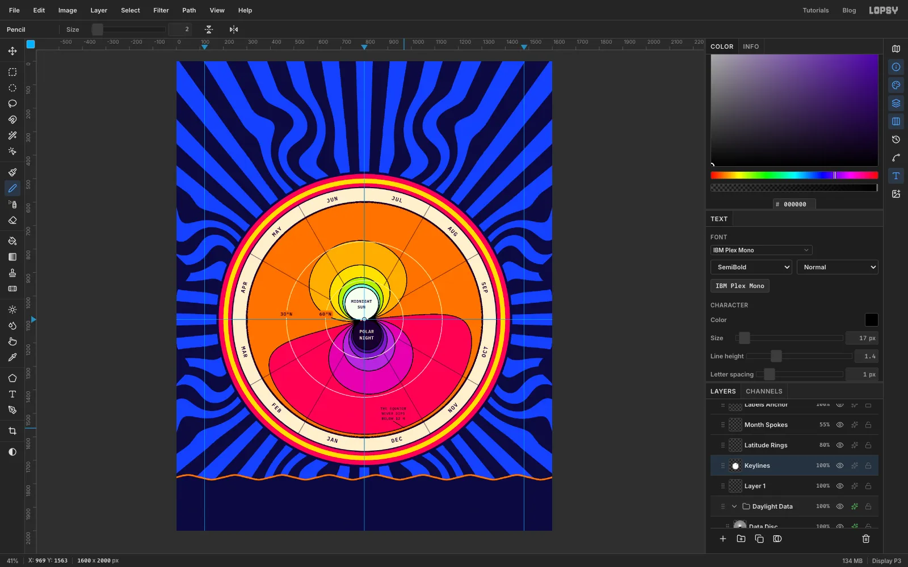

Click `Labels Anchor` first. The text settings restyle whatever text layer is selected, so if a month name were still selected, the next changes would land on it. Then, with the **Text** tool, keep **IBM Plex Mono SemiBold**, set **Letter spacing** to `1` and **Align** to **Center**. Before each label below, click `Labels Anchor`, set its size and colour, then click the canvas. Work from the bottom up:

1. `THE EQUATOR`, `NEVER DIPS`, `BELOW 12 H` on three lines (press [[Enter]] between them), size `15`, `#16022E`, centred at **922, 1500**.
2. `POLAR` / `NIGHT` on two lines, size `19`, `#FFF1CF`, centred at **810, 1164**.
3. `60°N` at **633, 1076** and `30°N` at **467, 1076**, size `20`, `#16022E`. Each sits on its ring, just above the horizontal spoke. Give each one a **Stroke** effect of **Width** `9` in `#FF7A0A`, the same orange as the field behind it. The stroke knocks the ring and the outlines out from behind the letters.
4. `MIDNIGHT` / `SUN`, size `17`, `#16022E`, centred at **787, 1034**.

The Equator note explains the thin orange crescent along the bottom of the rim. Near the Equator the day never gets shorter than 12 hours, even in December, so that sliver is data, not a slip. Point to it with a leader: click `Keylines`, pick the **Pencil** (**N**) at **Size** `2` in black, click just under the note at about **922, 1538**, and [[Shift]]-click on the crescent at about **969, 1563**.

## Draw an arch for the title

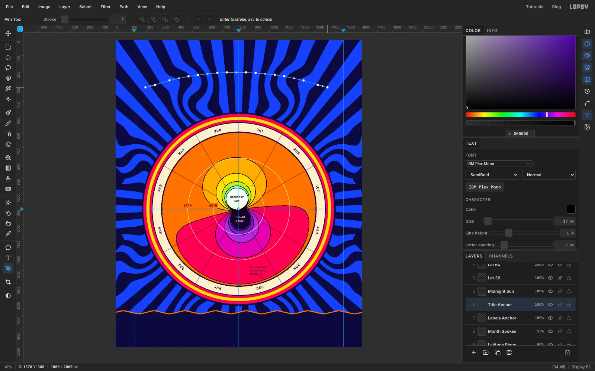

Click `Labels Anchor`, then **Add Layer**, and name the new layer `Title Anchor`.

With the **Pen** tool, draw an open arch through seven smooth anchors, dragging each a little to the right as you place it: **225, 300** · **412, 249** · **598, 220** · **785, 210** · **972, 220** · **1158, 249** · **1345, 300**. The arch is centred 15 px left of the page centre on purpose. Sonsie One's T has a long swash on the right, so centring the path at 800 makes the word look shifted to the right. Click the **✓ Commit path** button in the options bar. Don't press [[Enter]], because that strokes the path with paint.

## Set DAYLIGHT on the arch

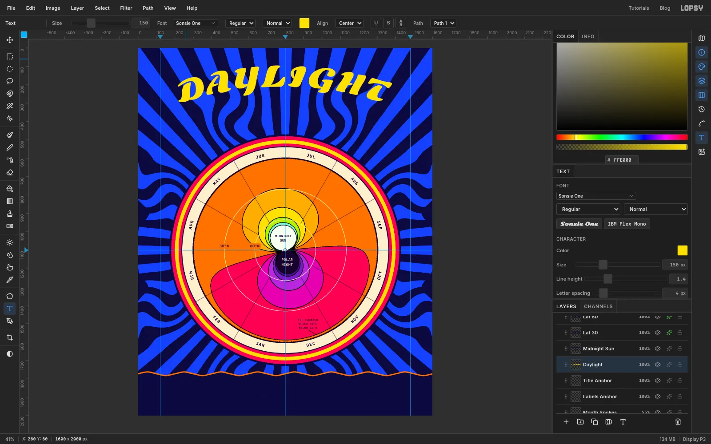

Click `Title Anchor`. With the **Text** tool, choose **Sonsie One**, size `150`, colour `#FFE000`, and set **Letter spacing** to `4`. Click anywhere in the empty sky, type `DAYLIGHT` and press [[Tab]].

In the Text options bar, open the **Path** menu and choose the last path in the list, which is the arch you just drew. Set **Align** to **Center**, so the word centres on the arch. To hide the path's outline, click its row in the Paths panel.

## Ride OSCILLATIONS on a wave

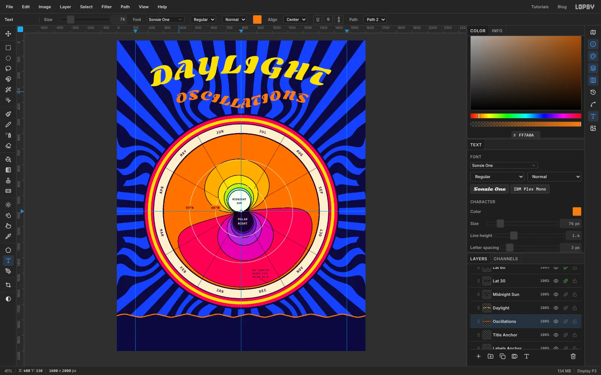

Click `Title Anchor` again. With the **Pen**, draw an open wave from **385, 406** to **1215, 406**, one and a half waves long. Place smooth anchors at:

- **385, 406**
- crest **523, 378**
- **662, 406**
- trough **800, 434**
- **938, 406**
- crest **1077, 378**
- **1215, 406**

Click **✓ Commit path**.

Click `Title Anchor`. Set the **Text** tool to **Sonsie One** size `76`, colour `#FF7A0A`, **Letter spacing** `3`. Click in empty sky, type `OSCILLATIONS` and press [[Tab]]. In **Path**, choose the last path in the list (the wave), then set **Align** to **Center**. Hide the path in the Paths panel.

## Build the legend inside the mapped group

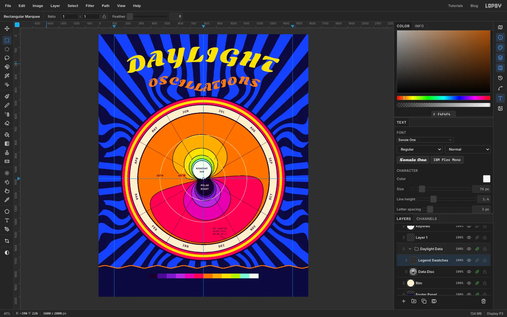

Here's a neat trick: if the legend swatches are the same greys as the data, inside the same group, the Gradient Map colours them for you, and they can't drift out of sync with the chart.

Click `Data Disc` and **Add Layer**. The new layer lands inside the group. Name it `Legend Swatches`. Make twelve 70 × 36 px rectangles in a row with the **Rectangular Marquee**'s exact-corners dialog, pressing [[Cmd+D]] before each one. The first runs **from 380, 1824 to 450, 1860**, and each next one starts 70 px further right. Fill them with these greys, left to right:

`#0B0B0B`, `#202020`, `#353535`, `#4A4A4A`, `#606060`, `#757575`, `#8A8A8A`, `#9F9F9F`, `#B5B5B5`, `#CACACA`, `#DFDFDF`, `#F4F4F4`

Press [[Cmd+D]]. Add a **Stroke** effect with **Width** `3` in white (`#FFFFFF`). The darkest swatch is almost the same colour as the panel, and the outline keeps it from disappearing.

## Divide the swatches

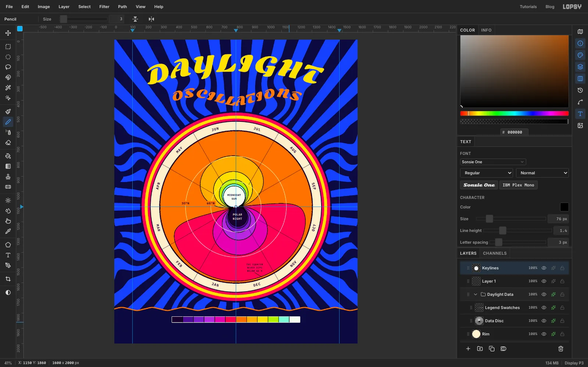

Click `Keylines`. Pick the **Pencil**, set **Size** `3`, and set the foreground to black. Draw a line at each boundary between swatches: click at the top edge (y 1824) at x 450, 520, 590 and so on up to 1150, then [[Shift]]-click straight down at the bottom edge (y 1860). Because `Keylines` is in Multiply, these lines match the chart's outlines.

## Label the legend and add the credits

Click `Labels Anchor` first, then set **Align** back to **Left**. Click `Labels Anchor` again before each label. Create these from the bottom up, with **IBM Plex Mono** in `#FFF1CF` unless noted. Centre each one with the **Move** tool and the arrow keys, as you did the month names.

1. Two credit lines, **Medium**, size `17`, **Letter spacing** `0`, centred on the page. Make the lower one first, centred at y **1948**: `Each spoke marks a twelfth of the year. Data: CBM day-length model, Forsythe et al. 1995.` Then the upper one at y **1916**: `Hours from sunrise to sunset at every latitude, Equator (rim) to North Pole (centre), through one year.`
2. The hours, **SemiBold** size `18`, **Letter spacing** `0`, each centred under its boundary at y **1876**. Work right to left: `24` at x 1220, `20` at 1080, `16` at 940, `12` at 800, `8` at 660, `4` at 520 and `0` at 380.
3. End labels, **Medium** size `15`, **Letter spacing** `1`. Put `MIDNIGHT SUN` just right of the bar, starting at x 1236, then `POLAR NIGHT` just left of it, ending at x 364. Centre both on the bar's middle, y 1842.
4. The caption `HOURS OF DAYLIGHT`, **SemiBold** size `16`, colour `#FFE000`, **Letter spacing** `4`. Click at **380, 1796** so its top-left corner lines up with the bar's left edge.

## Ink the title

Click the `DAYLIGHT` row and open its effects drawer:

- **Stroke**: **Width** `9`, colour `#16022E`
- **Drop Shadow**: **Offset X** `10`, **Offset Y** `12`, **Blur** `0`, **Spread** `0`, **Opacity** `100`, colour `#F2165A`

A shadow with no blur reads like a second ink colour printed slightly out of register, a staple of psychedelic posters. Do the same for `OSCILLATIONS`, with a **Stroke** of **Width** `7` in `#16022E` and a **Drop Shadow** of **Offset X** `6`, **Offset Y** `8`, **Blur** `0`, **Opacity** `100`, colour `#A835D8`.

## Draw a sparkle with the Pen

Click `Title Anchor`, then **Add Layer**, and name the new layer `Sparkles`.

With the **Pen**, click eight corner points around **170, 150**, alternating between a long tip 64 px out and a short inner corner 13 px out diagonally: **106, 150** · **161, 141** · **170, 86** · **179, 141** · **234, 150** · **179, 159** · **170, 214** · **161, 159**. Click the first point to close the path.

In the Paths panel, click **Path to Selection**, then **Delete Path**. Fill the selection with `#FFE000`.

## Copy, paste and scale the sparkle

Keep the selection and press [[Cmd+C]]. Then, for each copy:

1. Press [[Cmd+V]]. The copy is pasted in place on a new layer, and Lopsy switches to the **Move** tool.
2. Drag the copy to its spot.
3. Press [[Cmd+D]], pick the **Rectangular Marquee** (**M**) and draw a box just around the copy. Switch back to the **Move** tool (**V**).
4. [[Cmd]]-drag a corner handle to scale it evenly. Press [[Cmd+D]].

Before each paste, click the `Sparkles` row so every copy lands just above it. Place three copies:

- **1430, 470**, scaled to about 60%
- **1478, 118**, scaled to about 80%, sitting off the end of DAYLIGHT
- **150, 560**, scaled to about 45%

## Rotate the small sparkles

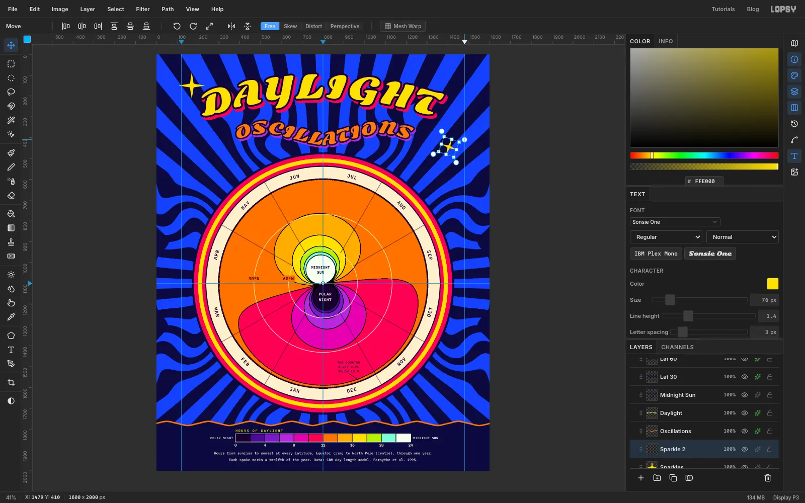

Tilt two of the copies so the sparkles don't look stamped. Click the layer of the copy at 1430, 470. Pick the **Rectangular Marquee** (**M**), draw a box just around it, switch to the **Move** tool (**V**) and drag the rotate handle outside its top-right corner by about **20°**. Press [[Cmd+D]]. Then click the layer of the copy at 150, 560 and do the same, by about **−15°**.

## Merge and outline the sparkles

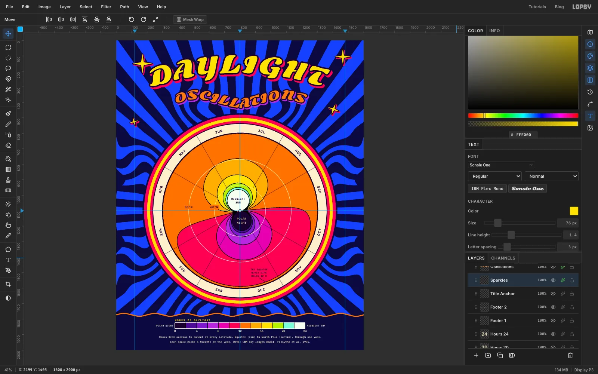

Click the top sparkle copy and choose **Layer → Merge Down** three times. All four end up on `Sparkles`. Give the layer the same treatment as the title: a **Stroke** of **Width** `5` in `#16022E`, and a **Drop Shadow** of **Offset X** `6`, **Offset Y** `7`, **Blur** `0`, **Opacity** `100`, colour `#F2165A`.

## Outline the rays in hot pink

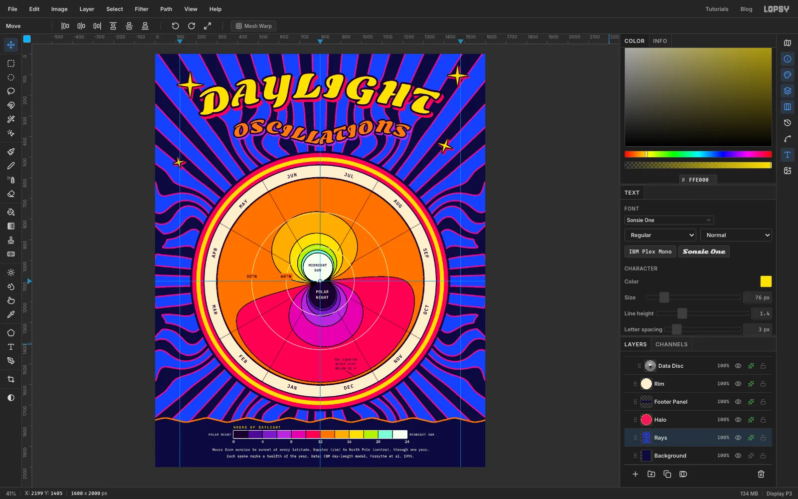

Click `Layer 1`, the empty layer you never used, and delete it with the bin button.

Click `Rays` and add a **Stroke** of **Width** `6` in `#FF2E88`. Pink against cobalt has nearly the same brightness, so the edge shimmers. That's the vibrating colour trick the 1960s poster artists loved.

## Add grain over everything

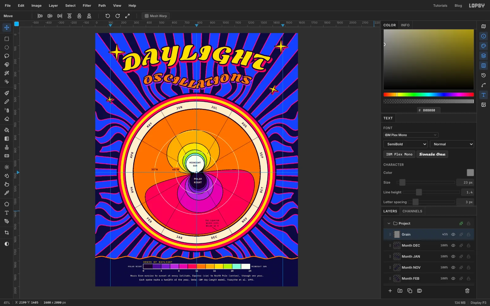

Click the first layer under `Project` at the top of the Layers panel (the first month name you made), then **Add Layer**. Name it `Grain`. Press [[Cmd+D]], set the foreground to `#808080` and choose **Edit → Fill**.

Choose **Filter → Add Noise…**, set **Amount** to `22`, and click **Mono** and **Gaussian**. Click **Apply**. Set the layer's **Blend** to **Overlay** and its opacity to `45`%. Mid grey disappears in Overlay, so only the speckle shows, like ink on rough paper.

Save your work with **File → Save Project**, and export with **File → Quick Export PNG**.

> **Tip:** To chart a different dataset, swap `Data Disc` for your own grey image. The Gradient Map, the keylines and the legend all keep working.
