Late-60s psychedelic posters and 70s blacklight velvet prints work on the same idea: put saturated, clashing colours side by side until they seem to vibrate, then give the eye one dark, simple shape to rest on. Here that shape is a total eclipse. A real NASA eclipse photo gives the corona its structure. Everything around it is built from flat, hard-edged shapes you can draw with selections and fills.

The sky is an op-art trick. Ten concentric rings of colour sit under a burst of white rays set to **Difference**, so every ray flips the ring beneath it to its opposite colour. The landscape uses another old poster trick: each hill is filled, duplicated, refilled in the next colour and nudged down, which leaves even stripes that follow the ridge line.

Along the way you'll use:

- the **Elliptical Marquee**'s typed-in corners for exact circles, **Edit → Fill**, and ruler **guides**
- **Sunburst** with the **Difference** blend mode, and a **layer mask**
- a dropped-in photo, **Screen** blending and a group **Gradient Map**
- **Liquify** (Push Forward) for melting drips, and brush strokes with **Taper**
- **Kaleidoscope** for a ring of petals
- **Duplicate Layer**, [[Cmd]]-click thumbnails, arrow-key nudges and **Merge Down** for banded hills
- **Stroke**, **Outer Glow** and **Inner Glow** effects, **Select → Inverse** and the **Eraser**
- duplicating a whole group, then scaling, flipping and recolouring it with a **Hue / Saturation** adjustment
- copy and paste with the **grid** and **Snap**, rotate and scale handles, and a **Hue/Saturation** filter
- **Copy Merged** with **Bloom**, **Add Noise** grain and a **Vignette**

The palette is fluorescent colour on near-black:

- Velvet black `#0B0613`, halo `#0A0418`, shade `#07000F`
- Sky rings `#FFD21A` → `#FF9E1A` → `#FF6A2A` → `#FF3D6E` → `#E81E9E` → `#B51FBF` → `#7B1FC8` → `#4B12A0` → `#2A0A5E` → `#12062A`
- Corona `#4B12A0` → `#00D9FF` → `#F0FFFF`, neon cyan `#00E5FF`, streamers `#DFFFFF`
- Petals `#B8FF1F`, dots `#FF2E9A`
- Far hills `#0B2F6A` / `#1260A8` / `#1AA0D0` / `#4FE3E0`
- Mid hills `#0D4A2A` / `#178A3A` / `#4CC72E` / `#A6E61C` / `#13A3B5` / `#0F6A50`
- River `#E8FFFF` → `#00E5FF` → `#5B17B8`
- Left hill `#3A0A52` / `#7A1696` / `#C21FB0` / `#FF4FC8` / `#D42AB8` / `#9A1A9E`
- Right hill `#4A0B3A` / `#8E1A6A` / `#D8287E` / `#FF6A9E` / `#E0428A` / `#A8236A`
- Mushroom cap `#FF9BDD` → `#FF2E9A` → `#7A0A6E`, stem `#FFF6DA` → `#FFD08A` → `#F07A3A`, gills `#FFE600` / `#F07A3A`
- Daisy `#FFE600`, grain grey `#808080`

> **Tip:** Positions are in document pixels, written `x, y`. The status bar at the bottom shows where the pointer is. **Edit → Fill** fills the selection (or the whole layer if nothing is selected) with the foreground colour, and [[Cmd+D]] deselects. To load a layer's shape as a selection, [[Cmd]]-click its thumbnail in the Layers panel.

> **Tip:** For an exact circle, choose the **Elliptical Marquee** and click once on the canvas without dragging. A dialog asks for the **From** and **To** corners of the circle's bounding box: a circle of radius `r` around `800, 700` runs from `800 − r, 700 − r` to `800 + r, 700 + r`.

> **Tip:** Blend modes live in the **Blend** dropdown at the top of a layer's effects drawer (the sparkle icon on its row). To change a layer's opacity, click the `100%` readout on its row and drag the slider.

## Set up the canvas and guides

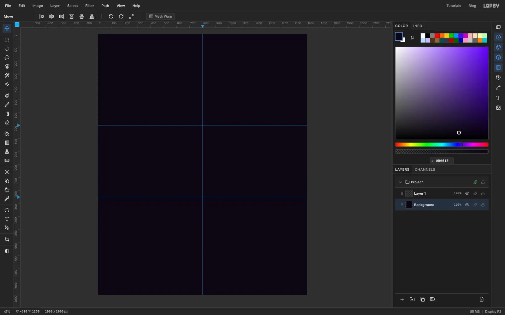

1. Create a new document **1600** × **2000** px.
2. Click the **Background** layer, set the foreground colour to `#0B0613` and choose **Edit → Fill**.
3. Click the top ruler at `800` for a vertical guide down the middle. Click the left ruler at `700` (the centre of the eclipse) and at `1250` (roughly where the horizon will sit).

## Paint ten concentric sky rings

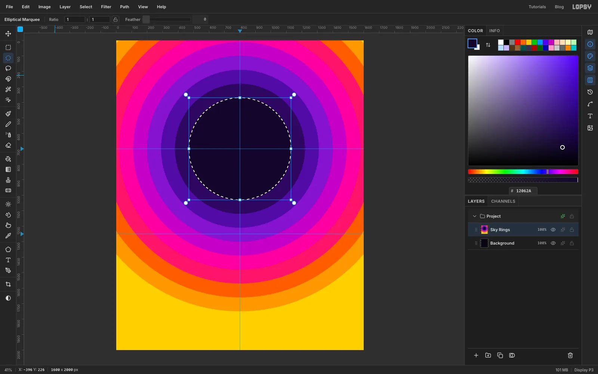

1. Click **Layer 1** and rename it `Sky Rings` (double-click the name). Fill it with `#FFD21A`.
2. Now fill smaller and smaller circles, all centred on the guide crossing at `800, 700`. Use the Elliptical Marquee dialog for each one, then fill it:
   - radius `1050` in `#FF9E1A`
   - radius `960` in `#FF6A2A`
   - radius `870` in `#FF3D6E`
   - radius `780` in `#E81E9E`
   - radius `690` in `#B51FBF`
   - radius `600` in `#7B1FC8`
   - radius `510` in `#4B12A0`
   - radius `420` in `#2A0A5E`
   - radius `330` in `#12062A`
3. Deselect.

The big circles run off the canvas, so their **From** corners are negative. Radius `1050` runs from `-250, -350` to `1850, 1750`. Type them in anyway. Each fill only covers the middle of the circle before it, so you're left with a ring of every colour.

## Burst white rays from the eclipse

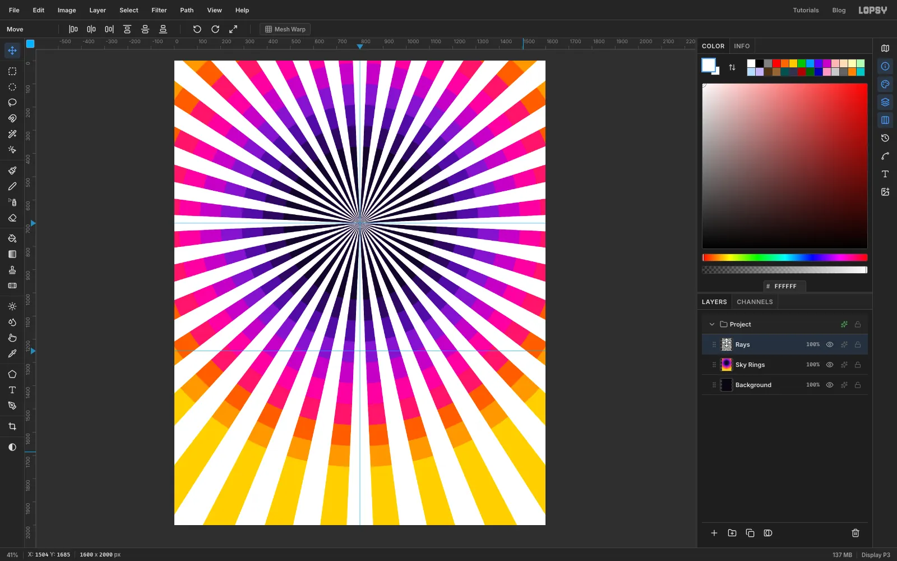

1. Add a new layer called `Rays` and set the foreground colour to white.
2. Choose **Filter → Sunburst…** and set **Rays** `36`, **Length** `150`, **Width** `50`, **Taper** `0`, **Softness** `0`, **Center X** `50` and **Center Y** `35`, then click **Apply**.

Center Y is a percentage of the canvas height, so `35` puts the burst exactly on the `700` guide.

## Flip the rings with Difference

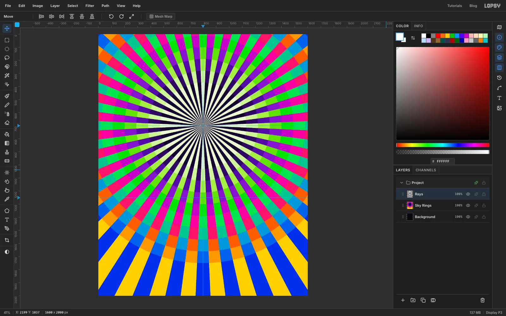

Open the Rays layer's effects drawer and set **Blend** to **Difference**.

Difference subtracts colours, so white turns every colour underneath into its opposite. Magenta becomes green, violet becomes lime and yellow becomes blue. Rays and gaps now alternate between a colour and its complement, which is the vibrating checker of op-art posters.

## Keep the centre calm with a mask

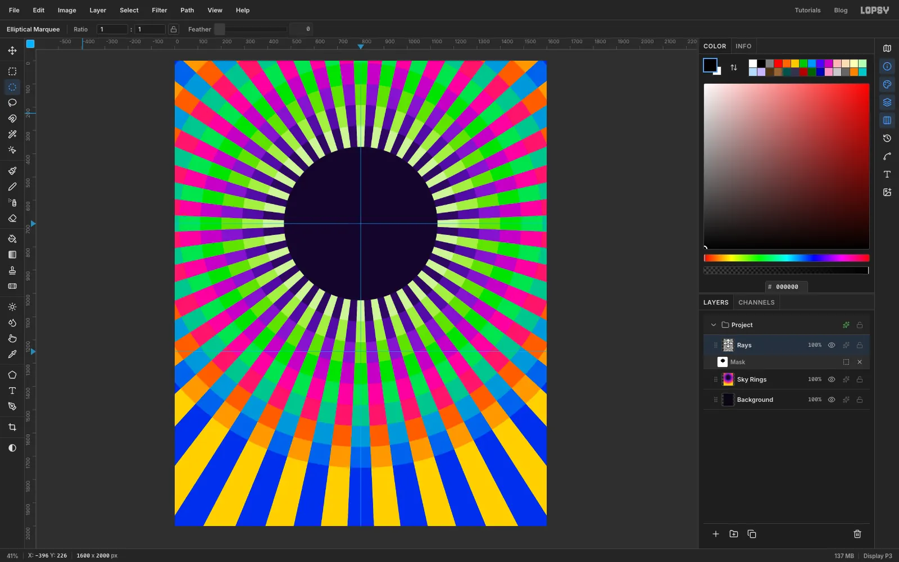

1. With Rays selected, click **Add Mask** at the bottom of the Layers panel, then click the new **Mask** thumbnail to edit it.
2. Select a circle of radius `330` around `800, 700` (from `470, 370` to `1130, 1030`), set the foreground colour to black and choose **Edit → Fill**.
3. Deselect, then click the Rays layer's name to stop editing the mask.

## Fade the outer sky to velvet black

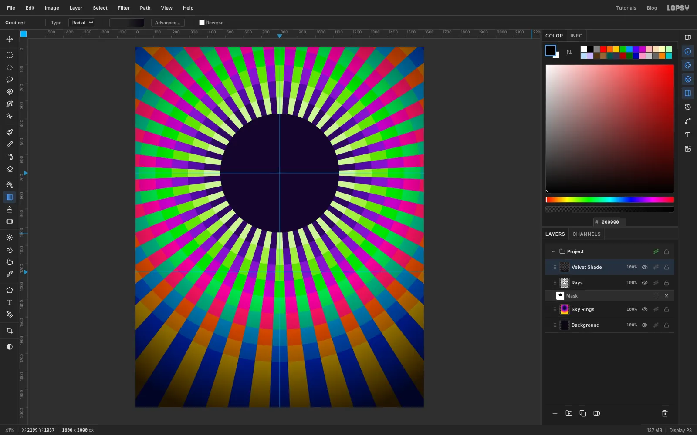

1. Add a layer called `Velvet Shade`.
2. Choose the **Gradient** tool, set **Type** to **Radial** and click **Advanced…**. Make three stops, all `#07000F`:
   - one at the start with its opacity at `0`
   - one at about 48% with its opacity at `0`
   - one at the end of the bar (100%) with its opacity at about `90`
3. Drag from the middle of the moon straight to the right, well past the canvas edge, about `1350` px.
4. Set the layer to **Multiply**.

Blacklight posters sit on black velvet. This layer leaves the middle of the picture alone and pulls the corners down towards black.

## Add a dark halo disc

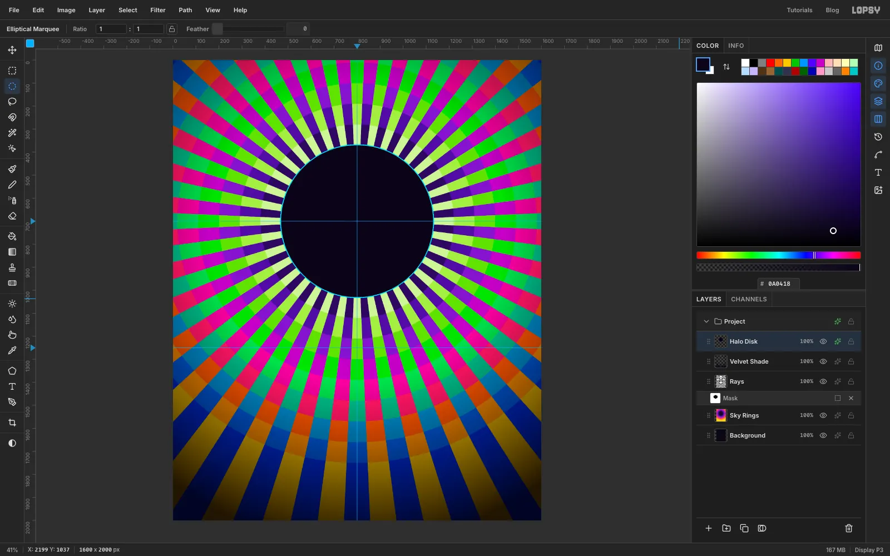

1. Add a layer called `Halo Disk`.
2. Select the same radius `330` circle around `800, 700` and fill it with `#0A0418`. Deselect.
3. Add a **Stroke** effect: **Width** `4`, colour `#00E5FF`.

The corona will glow against this disc, and the thin cyan rim gives the mandala a clean edge.

## Drop in an eclipse photo

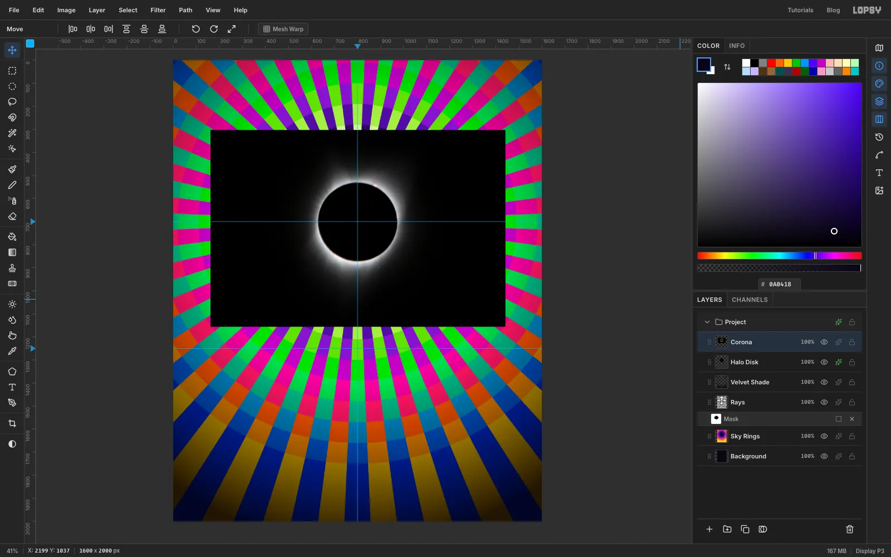

This painting uses NASA's public-domain photo of the 21 August 2017 total solar eclipse ("2017 Total Solar Eclipse (AFRC2017-0233-006)" on Wikimedia Commons). The 1280 px wide version works well. Any eclipse photo with the moon near the middle will do.

1. Drag the image file from your desktop onto the canvas. It lands in the top-left corner as a new layer, already selected, with the **Move** tool active.
2. Drag the photo until its black moon sits on the guide crossing, then use the arrow keys to settle it exactly. [[Shift]]+arrow moves 10 px at a time.
3. Deselect and rename the layer `Corona`.

## Screen the photo into a group

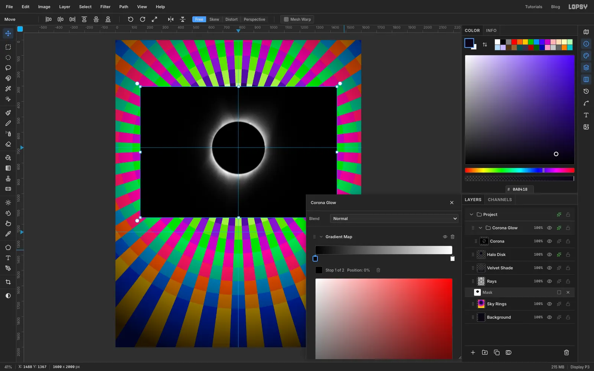

1. Set the Corona layer to **Screen**, which makes black disappear.
2. Choose **Layer → Group Layers** and rename the group `Corona Glow`.
3. Open the group's effects drawer and click **Add Adjustment**. Scroll down the menu and choose **Gradient Map**.

The photo turns into a black rectangle. Once a group has an adjustment, it is blended on its own first, so the Screen on the photo only sees an empty group. The next step fixes that.

## Tint the corona with a Gradient Map

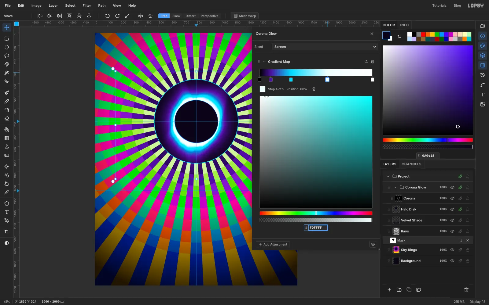

1. Set the **Corona Glow** group's own **Blend** to **Screen**. The rectangle vanishes.
2. In the Gradient Map, click an end stop to recolour it, click the bar to add a stop, and type each colour into the hex field. Set these stops:
   - black `#000000` at the start
   - `#4B12A0` at 10%
   - `#00D9FF` at 28%
   - `#F0FFFF` at 60%
   - white at the end

The faint grey streamers in the photo turn violet and cyan, and the bright inner corona turns white.

## Add the moon

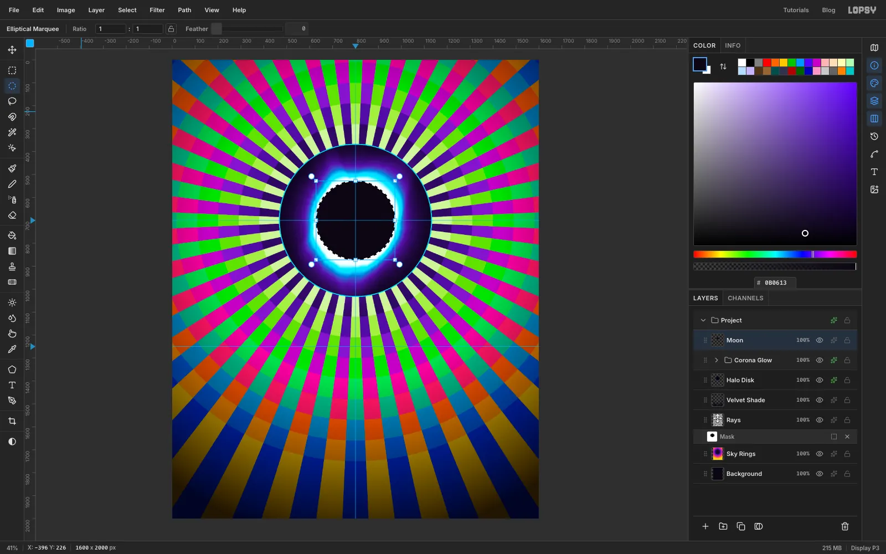

1. Close the drawer and collapse the **Corona Glow** group (the arrow on its row), so the next layer lands above it rather than inside.
2. Add a layer called `Moon`, select a circle of radius `172` around `800, 700` and fill it with `#0B0613`. Deselect.

## Melt the moon with Liquify

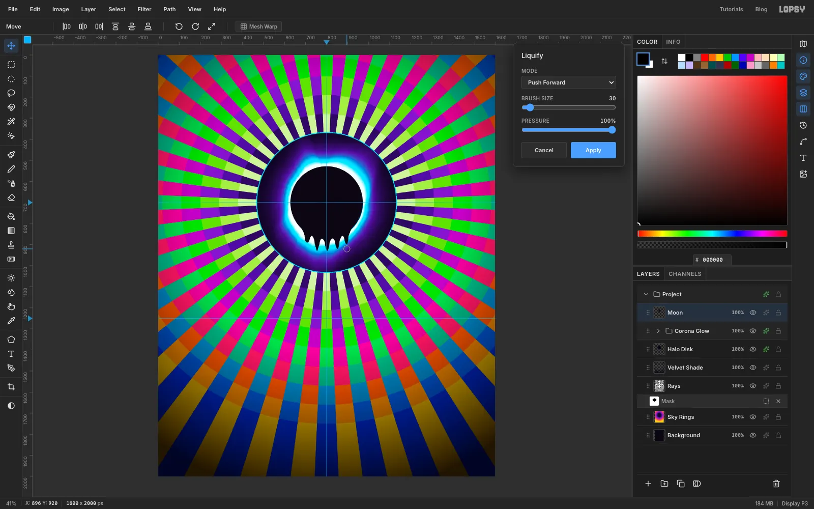

1. With **Moon** selected, choose **Filter → Liquify…**. Leave **Mode** on **Push Forward** and set **Brush Size** `30` and **Pressure** `100%`.
2. Start just inside the moon's lower edge and drag straight down about 100 px. Start the next drag a little lower down the same drip and drag again, until the drip is as long as you want.
3. Make five drips spaced evenly across the bottom of the moon. Let the middle one run longest, past the petal ring you'll add later (to about y = `1100`), and keep the two outside ones short. Then click **Apply**.

## Paint corona streamers

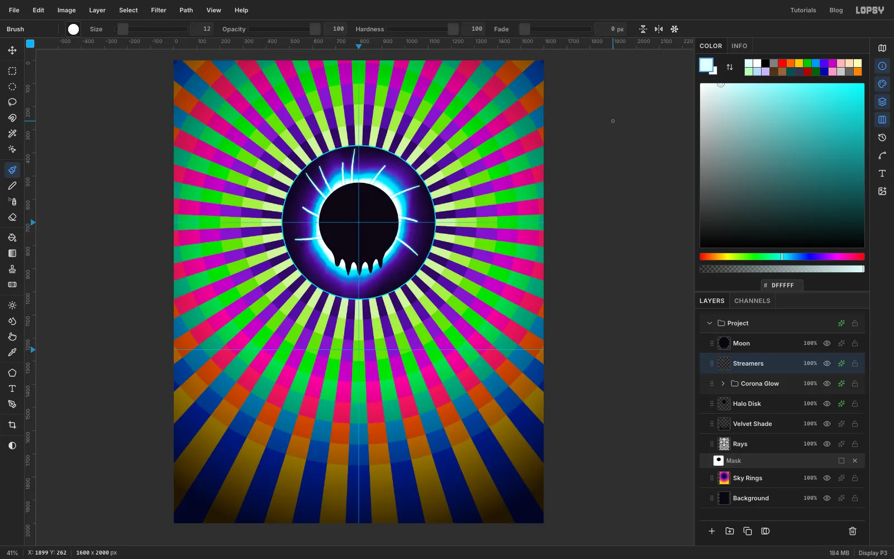

1. Click the **Corona Glow** row and add a layer called `Streamers`. It sits between the group and the Moon.
2. Choose the **Brush** with **Size** `12` and **Hardness** `100`. Open the brush settings and set **Taper** to `220`, so each stroke thins out to a point.
3. Set the colour to `#DFFFFF`. Paint ten strokes outward from the moon's edge, curving them slightly. Vary the lengths, and stop every one inside the dark disc. Leave a gap at the bottom where the drips are.
4. Set the layer to **Screen**.
5. Add an **Outer Glow** with **Size** `12`, **Opacity** `80` and colour `#00E5FF`.

> **Tip:** Set **Taper** back to `0` when you're done. The brush keeps its settings, and the cap highlight later needs an even stroke.

## Draw one petal

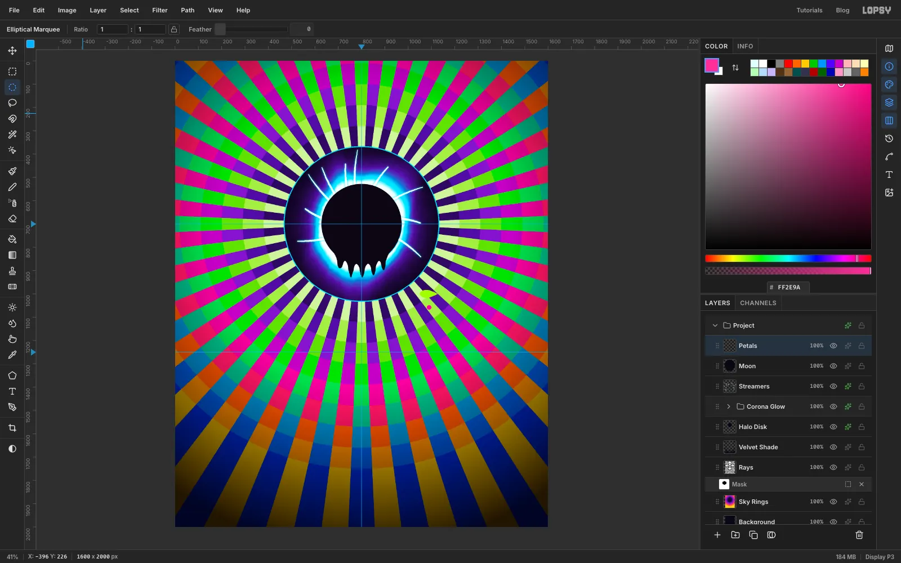

The **Kaleidoscope** filter mirrors one wedge of a layer around the *canvas* centre, so you build the petal ring at `800, 1000` and move it up afterwards.

1. Click **Moon** and add a layer called `Petals`.
2. With the **Lasso**, draw a slim leaf lying on the `1000` line at 3 o'clock from the canvas centre, pointing away from it. Start about 250 px right of the centre and make it about 80 px long and a third as wide. Fill it with `#B8FF1F`.
3. Select a circle of radius `10` around `1090, 1058` and fill it with `#FF2E9A`. Deselect.

The dot sits a little below the petal, half a segment round, so it ends up between the petals.

## Mirror it with Kaleidoscope

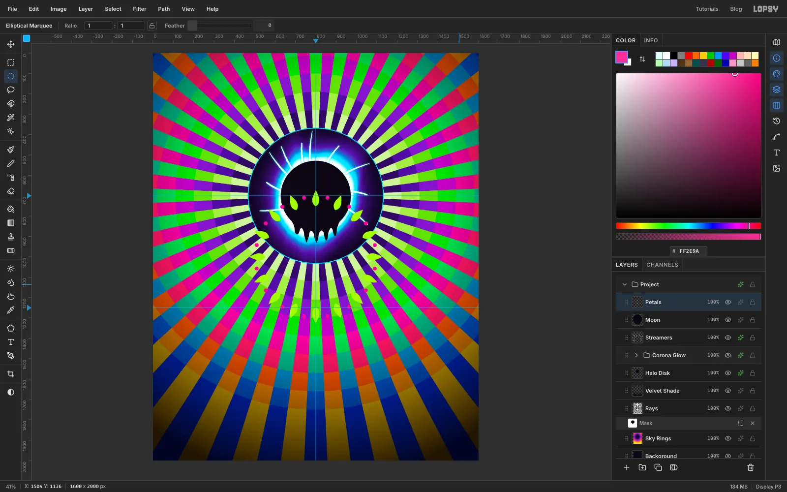

Choose **Filter → Kaleidoscope…** with **Segments** `16` and **Rotation** `0`, and click **Apply**.

## Lift the ring onto the eclipse

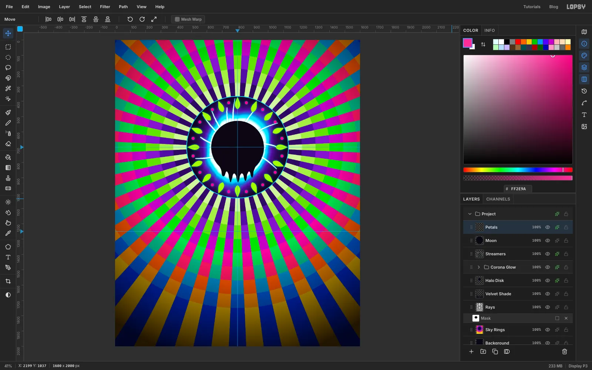

1. With the **Move** tool, drag the ring straight up until it sits evenly inside the dark disc (it needs to rise 300 px). Use the arrow keys for the last few pixels.
2. Add an **Outer Glow** to the Petals layer: **Size** `14`, **Opacity** `80`, `#00E5FF`.

## Start the far hills with offset copies

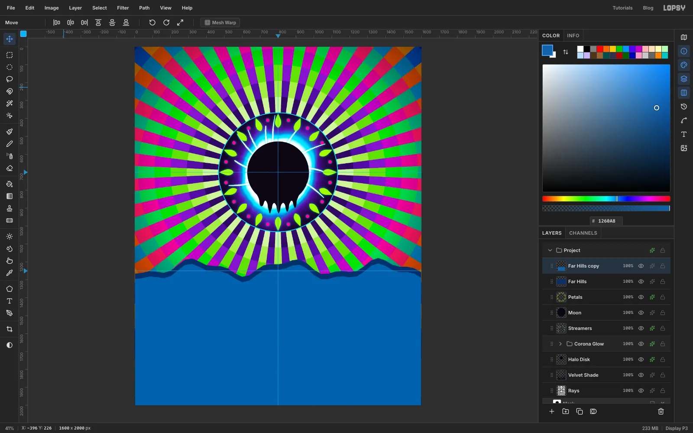

1. Add a layer called `Far Hills`. With the **Lasso**, draw a gently wavy ridge across the whole width, dipping and rising between about y = `1180` and `1270`. Carry the shape down to the bottom of the canvas and fill it with `#0B2F6A`.
2. Choose **Layer → Duplicate Layer**. [[Cmd]]-click the copy's thumbnail, fill it with `#1260A8` and deselect.
3. With the **Move** tool, press [[Shift+Down]] three times to drop the copy 30 px. A navy stripe now shows along the ridge.

## Finish the far hills

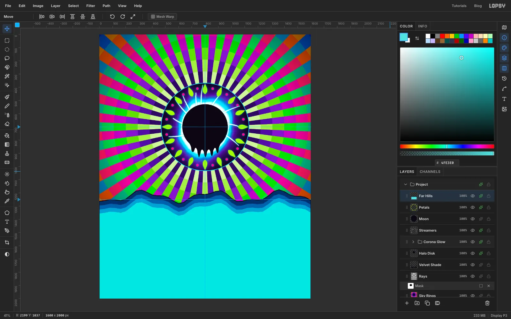

1. Repeat the duplicate, fill and 30 px nudge twice more, with `#1AA0D0` and then `#4FE3E0`. Always duplicate the newest copy, and set the foreground colour before **Edit → Fill**.
2. Click the top copy and choose **Layer → Merge Down** three times. Rename the result `Far Hills`.
3. Add a **Stroke** effect: **Width** `5`, colour `#0B0613`.

## Band the mid hills

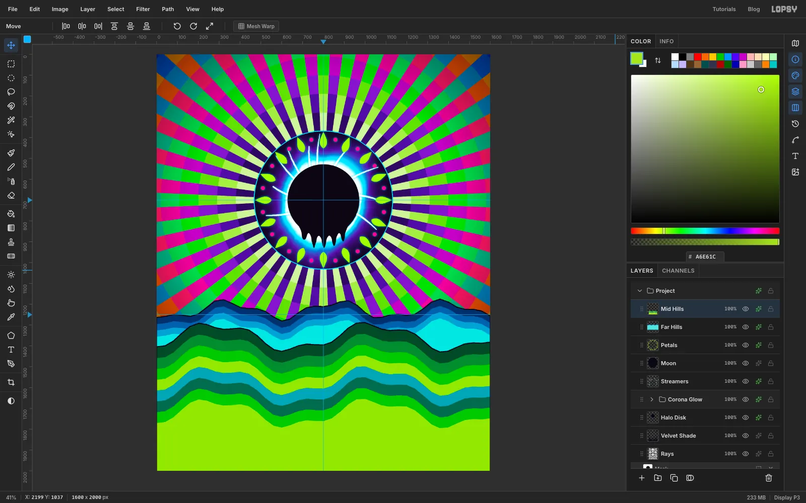

Add a layer called `Mid Hills` and lasso a bolder ridge in front, between about y = `1300` and `1420`. Band it the same way with 52 px nudges ([[Shift+Down]] five times, then [[Down]] twice). Use eight colours:

- `#0D4A2A`, `#178A3A`, `#4CC72E`, `#A6E61C`
- `#13A3B5`, `#0F6A50`, `#4CC72E`, `#A6E61C`

Click the top copy and choose **Merge Down** seven times. Rename the result `Mid Hills` and give it the same black **Stroke** of `5`.

The wider stripes make this range feel closer than the far hills.

## Wind a river out of the ridge

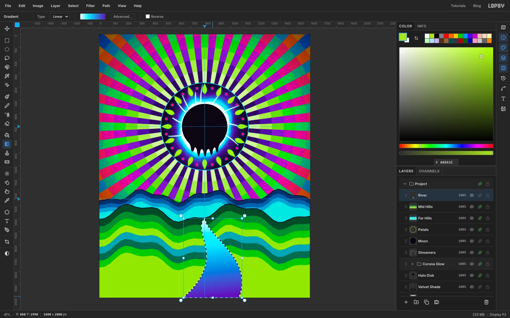

1. Add a layer called `River`. With the **Lasso**, start at a point on the green ridge at `800, 1398`.
2. Draw the left bank swinging left, then right, then reaching the bottom edge at about x = `640`. Come back up the right bank from about x = `1060`, so the river widens towards you.
3. Choose the **Gradient** tool (**Linear**) with stops `#E8FFFF`, `#00E5FF` at 35% and `#5B17B8`. Drag from the top of the river to the bottom.
4. Deselect. Add a black **Stroke** of `5` and an **Outer Glow** (**Size** `25`, **Opacity** `60`, `#00E5FF`).

## Add the near hills

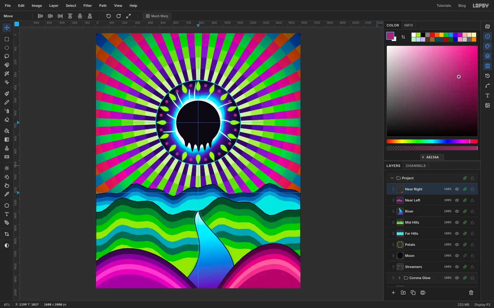

1. Add a layer called `Near Left` and lasso a round mound peaking at about `250, 1690`. Let it drop gently to the left edge and steeply to the right, off the bottom of the canvas left of the river mouth. Fill it with `#3A0A52`.
2. Band it as before, nudging each copy 40 px ([[Shift+Down]] four times). Use `#7A1696`, `#C21FB0`, `#FF4FC8`, `#D42AB8` and `#9A1A9E`.
3. Click the top copy and choose **Merge Down** five times. Rename the result `Near Left` and add a black **Stroke** of `5`.
4. Repeat for `Near Right`, a mound peaking at about `1400, 1650` that drops off the bottom right of the river mouth and gently to the right edge. Use `#4A0B3A`, `#8E1A6A`, `#D8287E`, `#FF6A9E`, `#E0428A` and `#A8236A`.

## Shape the mushroom stem

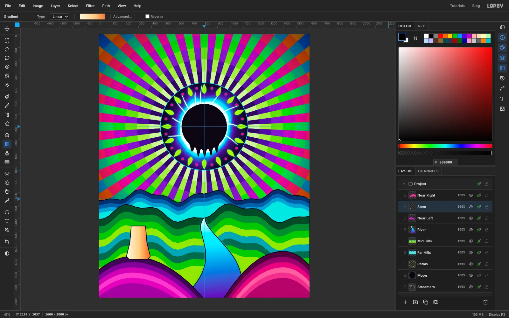

1. Click **Near Left** and add a layer called `Stem`.
2. Lasso a stem centred on x = `300`, from about `1458` down to the top of the hill. Make it about a fifth as wide as the cap will be at the top, slightly wider in the middle, and flaring like a trumpet at the base.
3. Fill it with a **Linear** gradient dragged left to right across the stem: `#FFF6DA`, `#FFD08A` at 55% and `#F07A3A`.
4. Deselect and add a black **Stroke** of `5`.

## Add striped gills

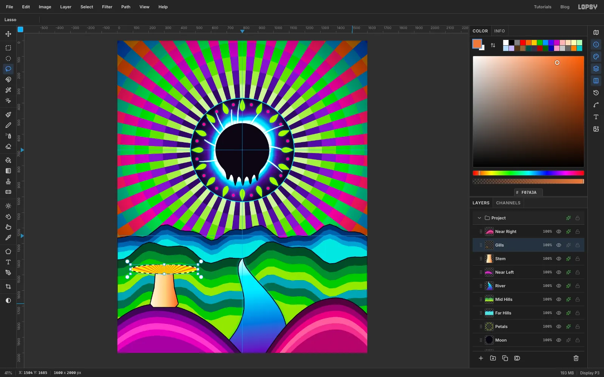

1. Add a layer called `Gills`. Lasso a flat oval across the top of the stem, a little narrower than the cap will be and about 60 px tall, and fill it with `#FFE600`.
2. Keep the selection, set the foreground colour to `#F07A3A`, and run **Filter → Sunburst…** with **Rays** `44`, **Length** `16`, **Width** `35`, **Taper** `0`, **Softness** `0`, **Center X** `18.75` and **Center Y** `75.5`.

Those centre values are `300, 1510`, just below the oval where the stem meets it, so the lines fan out from the stem. The selection keeps the rays inside the oval, so they read as gills. Deselect and add a black **Stroke** of `5`.

## Paint the cap

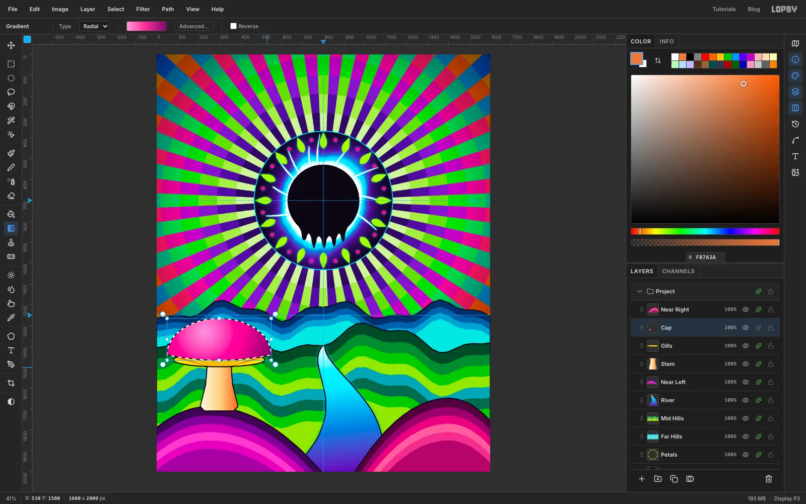

1. Add a layer called `Cap`. Lasso a dome over the gills, centred on about `300, 1440`, roughly 500 px wide and 175 px tall, with a slightly scooped underside.
2. Fill it with a **Radial** gradient of `#FF9BDD`, `#FF2E9A` at 45% and `#7A0A6E`. Drag from about `230, 1330` (the highlight) to `530, 1500`.
3. Deselect and add a black **Stroke** of `5`.

## Spot the cap and trim the spots

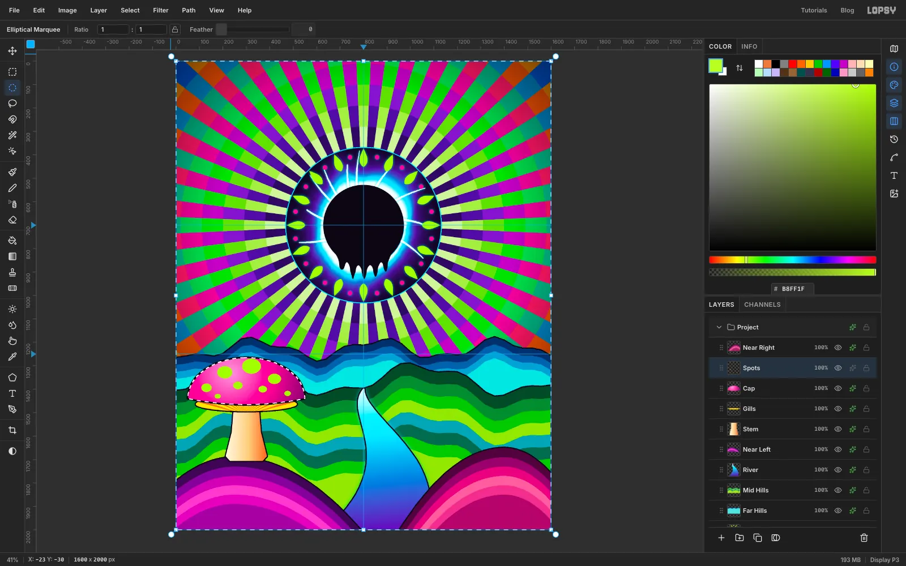

1. Add a layer called `Spots` with the foreground colour `#B8FF1F`. Drag eight slightly squashed ovals across the cap with the Elliptical Marquee, filling each one. Make the big ones up near the crown (about 80 px across) and the small ones near the rim (about 25 px).
2. [[Cmd]]-click the **Cap** thumbnail, choose **Select → Inverse**, and press [[Delete]] to trim anything hanging off the cap.
3. Deselect and add an **Inner Glow** (**Size** `8`, **Opacity** `70`, white).

## Group the mushroom

Click **Stem**, [[Shift]]-click **Spots**, choose **Layer → Group Layers**, and rename the group `Big Mushroom`.

## Copy the whole mushroom

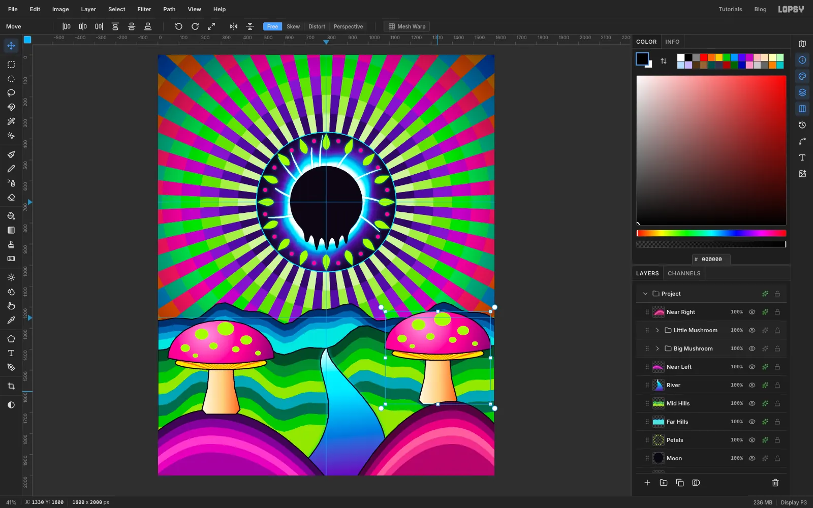

1. Collapse **Big Mushroom** and choose **Layer → Duplicate Layer**. Rename the copy `Little Mushroom`.
2. With the **Move** tool, drag the copy across so its stem base sits on the crest of the right-hand hill.

## Shrink the copy

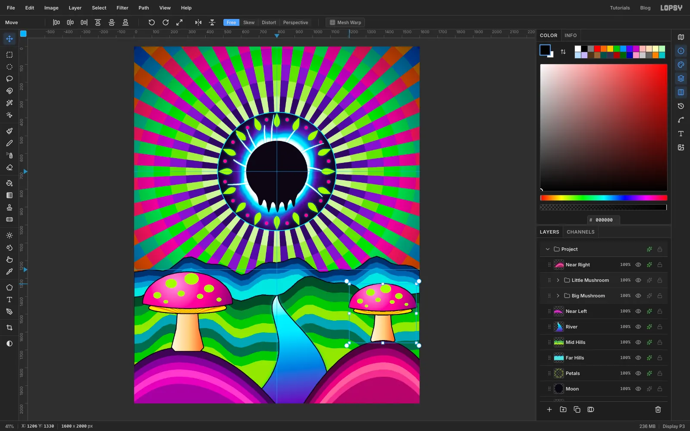

Hold [[Cmd]] and drag the copy's top-left corner handle in and down until it's about three quarters of its size. Holding [[Cmd]] keeps the proportions.

## Flip it

Click **Flip Horizontal** in the options bar so the copy doesn't look like a clone. Then nudge it a little left and down with the arrow keys, until the hill's crest hides the bottom of its stem.

## Recolour the copy

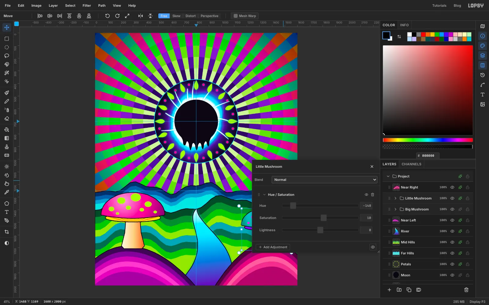

Open the **Little Mushroom** group's effects drawer, click **Add Adjustment** and choose **Hue / Saturation**. Set **Hue** `-140` and **Saturation** `10`.

The adjustment only affects the group, so the pink cap turns cyan, the lime spots turn magenta and the stem turns violet, while the original stays pink.

## Draw a daisy

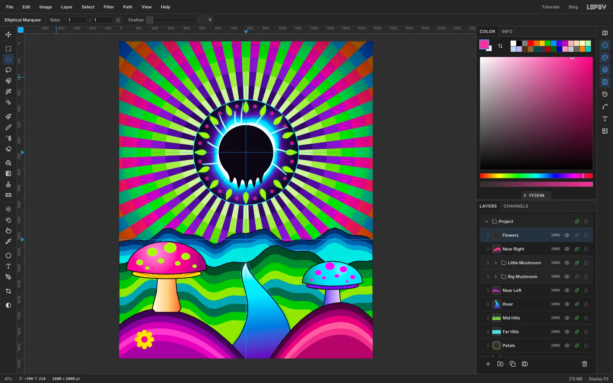

1. Click **Near Right** and add a layer called `Flowers`, so the flowers sit above both front hills.
2. Lasso an eight-petal daisy about 124 px across, low on the left hill. You can lasso one petal, then hold [[Shift]] and lasso the other seven around it. Fill it with `#FFE600`.
3. Select a circle of radius `20` in its middle and fill it with `#FF2E9A`. Deselect.

## Scatter copies on the grid

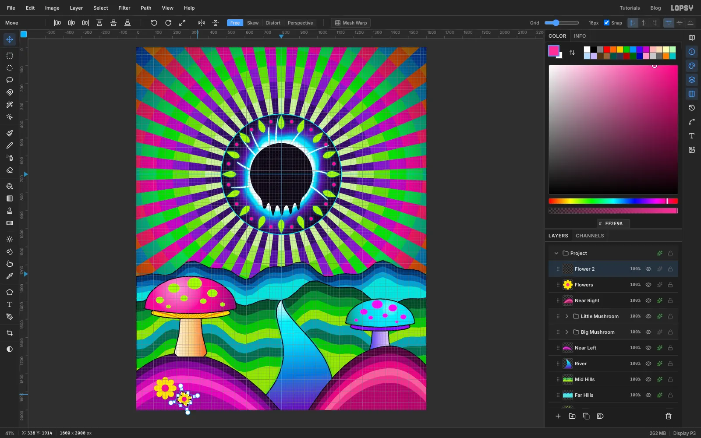

1. Choose **View → Show Grid**. Snap comes on with it, so dragged copies jump in 16 px steps and the rotate handle turns in 15° steps.
2. For each copy:
   - Click the **Flowers** layer and draw a **Rectangular Marquee** around the daisy.
   - Press [[Cmd+C]] then [[Cmd+V]]. The paste lands in place.
   - Drag it to its new spot.
   - [[Cmd]]-drag a corner handle to resize it, and drag just outside a corner to turn it.
   - Press [[Cmd+D]] to commit.
3. Make six copies:
   - two on the left hill, one small and turned 30°, and one full size turned 15°
   - one half size near the river bank, turned 45°
   - three on the right hill: one 10% larger, one at 70% turned 30°, and a small one turned 15°
4. For variety, recolour two of the copies with **Filter → Hue/Saturation…**. Do it right after [[Cmd+D]] commits the copy, while it's still on its own layer:
   - **Lightness** `75` makes a white daisy.
   - **Hue** `130` makes a cyan one.

## Merge and outline the daisies

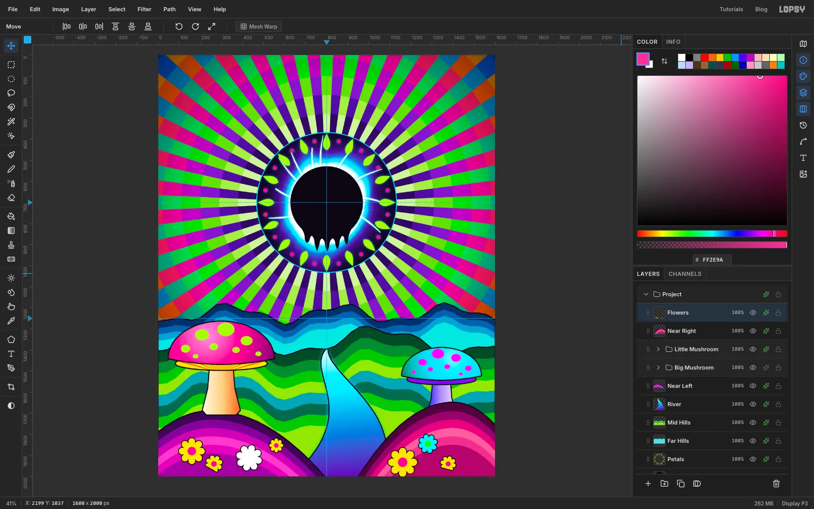

Hide the grid with **View → Show Grid**. Click the top daisy copy, choose **Layer → Merge Down** six times, and rename the result `Flowers`. Add a black **Stroke** of `4`.

## Sparkle the river

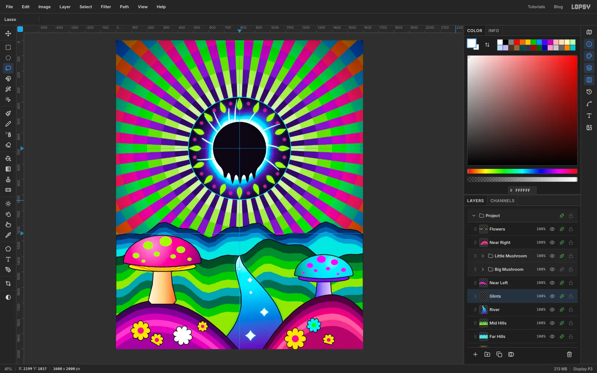

1. Click **River** and add a layer called `Glints`.
2. Lasso five four-point sparkles in white. Start small near the source and grow them towards the bottom edge (about 12 px to 36 px across). Stagger them left and right of the river's centre line so they don't look like a row of lights.
3. Add an **Outer Glow**: **Size** `18`, **Opacity** `90`, `#00E5FF`.

## Add a cap highlight

1. Expand **Big Mushroom**, click **Spots** and add a layer called `Cap Shine`.
2. With the **Brush** (**Size** `16`, **Hardness** `100`, white), paint one arc just inside the cap's upper-left edge.
3. Choose the **Eraser** with **Size** `60` and **Opacity** `70`, and click once over each end of the arc to fade it out. Set the layer to `85%`.

## Tuck the big mushroom behind its hill

Collapse **Big Mushroom** and drag its row down below **Near Left**. The hill is now drawn in front of the mushroom, ready to hide its base.

## Group the land and the sky

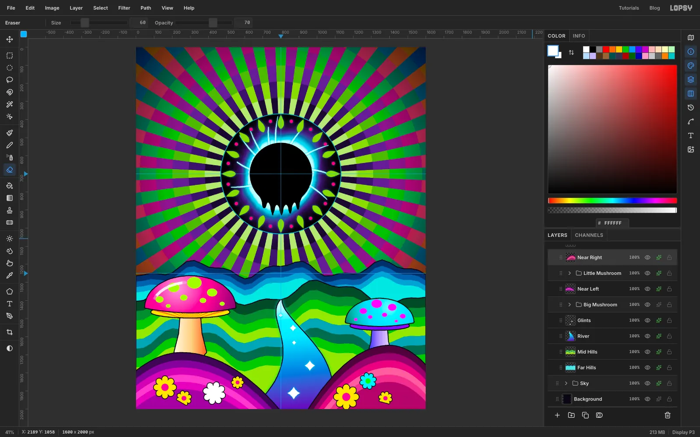

1. Click **Far Hills**, [[Shift]]-click **Flowers**, choose **Layer → Group Layers**, and name the group `Land`.
2. Do the same from **Sky Rings** to **Petals** and name it `Sky`.
3. Give the Sky group a **Hue / Saturation** adjustment with **Saturation** `-15` and **Lightness** `-10`. The sky steps back a little and the landscape and eclipse come forward.

## Settle the mushroom into the hill

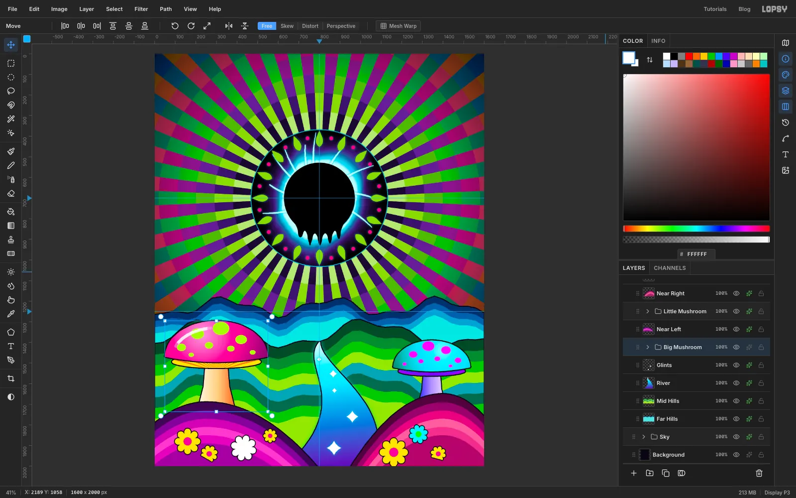

Expand **Land** and click the **Big Mushroom** group. Choose the **Move** tool and press [[Shift+Down]] three times. The whole group moves 30 px together, the stem's base disappears behind the crest, and the cap now overlaps the blue ridge behind it instead of just touching it.

## Add a neon bloom

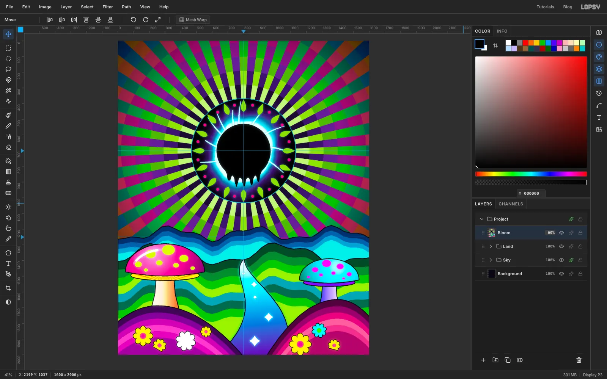

1. Click the **Land** group, choose **Edit → Copy Merged**, then press [[Cmd+V]]. Rename the new layer `Bloom`.
2. Run **Filter → Bloom…** with **Threshold** `85`, **Soft Knee** `30`, **Radius** `28` and **Intensity** `60`.
3. Set the layer to **Lighten** at `60%`.

Lighten only lets the glow through where it's brighter than the painting underneath, so you get halos without washing out the colours.

## Add velvet grain

1. Click **Bloom** and add a layer called `Velvet` above it. Fill it with `#808080`.
2. Run **Filter → Add Noise…** with **Amount** `45`, **Mono** and **Gaussian**, then **Filter → Gaussian Blur…** with **Radius** `1`.
3. Set the layer to **Overlay** at `80%`. Grey vanishes in Overlay, so only the speckle is left, like the nap of a flocked velvet poster.

## Finish with a vignette

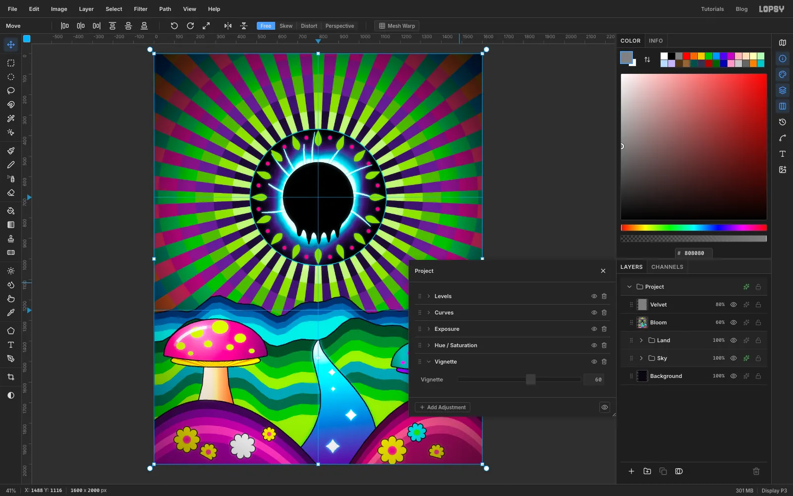

Click the **Project** group and open its effects drawer. It already lists neutral Levels, Curves, Exposure and Hue / Saturation adjustments, so leave those alone. Click **Add Adjustment**, choose **Vignette** and set it to `60`.

Save your work with **File → Save Project**, and use **File → Quick Export PNG** to export the finished painting.
