Late-60s San Francisco concert posters, especially Victor Moscoso's, got
their buzz from a trick he learned in Josef Albers' colour classes. If you
put two saturated colours of about the same lightness side by side, the
edge between them seems to vibrate. Add bulging, melting lettering that
fills its space and you have the psychedelic poster look.

In this tutorial you'll use that look for a small-business flier: a grand
opening for **Dizzy Cones**, an imaginary soft-serve shop. The background is
hot pink and electric blue stripes that you bulge and twirl. A rainbow cone
sits in a scalloped halo, and the shop name bends around it. The flier is
**1200 × 1600 px**.

Along the way you'll use:

- **Define Pattern** and **Fill with Pattern** for the stripes and the waffle
- **Lens Distortion** and **Liquify** (Twirl) to make the stripes swirl
- the **Brush** with **Radial Symmetry** for a scalloped edge
- the **Pen** tool and **Path to Selection** for the cone, plus **Emboss**
- the **Shape** tool's click-to-size dialog for rounded tiers and the rim, and its grid snapping for the info panel
- rotation and scale handles, copy and paste, and **Merge Down**
- **Define Brush** with **Scatter** and **Angle Jitter** for sprinkles
- **Mesh Warp** to bend rasterized type
- **Sunburst** for a starburst badge, and text in **Modak**, **Caprasimo** and **Sansita Swashed**
- **Stroke**, **Drop Shadow**, **Inner Glow** and **Outer Glow**, and the **Overlay** blend mode

The palette:

- Hot pink `#FF3D9A`, electric blue `#2E5BFF`
- Violet `#3A1478`, lime `#C8FF3A`, orange `#FF7A1A`
- Waffle `#E8A85A`, lattice `#B8742F`, rim `#C07A35`
- Cone shade `#5A2A0C` / `#6B3410`
- Pink scoop `#FF5FA8` / `#B8206A` (colour and shade)
- Lilac scoop `#B58CFF` / `#6B3FD0`
- Mint scoop `#5BF0B0` / `#1E9E6E`
- Title gradient `#E6FF5A` → `#FFD23A` → `#FF6A1A`
- Ink `#1E0A3C`, cream `#FFF1D0`, grain grey `#808080`

> **Tip:** Positions are in document pixels, written `x, y`. The status bar
> at the bottom shows where the pointer is. **Edit → Fill** fills the
> selection with the foreground colour, and [[Cmd+D]] deselects. New layers
> appear above the selected layer. If the selected row is an *expanded*
> group, the new layer or group goes inside it; if the group is
> *collapsed*, it goes next to it. So before each section, click the layer
> or group you want to build on, and collapse groups you have finished.

> **Tip:** For an exact rectangle or circle, pick the **Rectangular** or
> **Elliptical Marquee**, make sure nothing is selected, and click the canvas
> once without dragging. A dialog asks for the **From X / Y** and **To X / Y**
> corners. Effects live in each layer's effects drawer (the sparkle icon on
> its row), together with the **Blend** dropdown.

## Set up the canvas and guides

Choose **File → New**, enter **1200 × 1600** and click **Create**. Click the
*Background* row, set the foreground to cream `#FFF1D0` and choose
**Edit → Fill**.

Click the top ruler at `600` to drop a vertical guide down the middle. Then
click the left ruler at `650`, near the centre of the halo, and at `1350`, where
the info panel will start.

## Make a two-stripe pattern tile

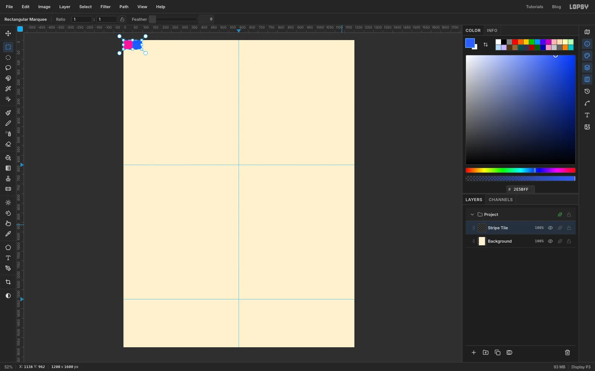

Click *Layer 1* and rename it *Stripe Tile*. With the exact-corners dialog,
select from `0, 0` to `48, 48` and fill it with hot pink `#FF3D9A`. Select
from `48, 0` to `96, 48` and fill it with electric blue `#2E5BFF`.

Now select the whole tile, `0, 0` to `96, 48`, and choose
**Edit → Define Pattern**. Deselect, then delete the *Stripe Tile* layer with
the trash button at the bottom of the Layers panel. The pattern stays saved.

## Fill the page with stripes

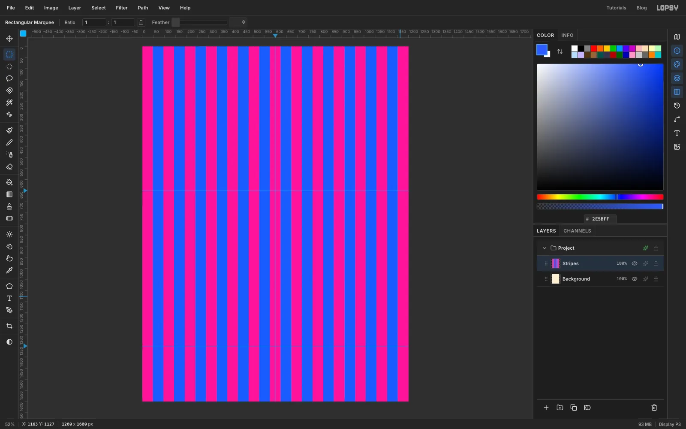

Click *Background* and add a new layer named *Stripes*. Choose
**Edit → Fill with Pattern…**, pick the stripe tile and click **Apply**. The
48 px stripes line up so that a pink stripe runs straight down the centre
guide.

## Bulge the stripes with Lens Distortion

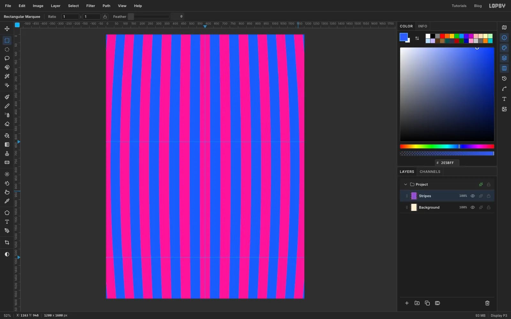

Choose **Filter → Lens Distortion…** and set **Strength** to `30` and
**Zoom** to `130`. Click **Apply**. Positive strength bows the stripes
outward like a fish-eye lens. The zoom pulls the edges back in so nothing
falls off the canvas.

## Twirl the stripes with Liquify

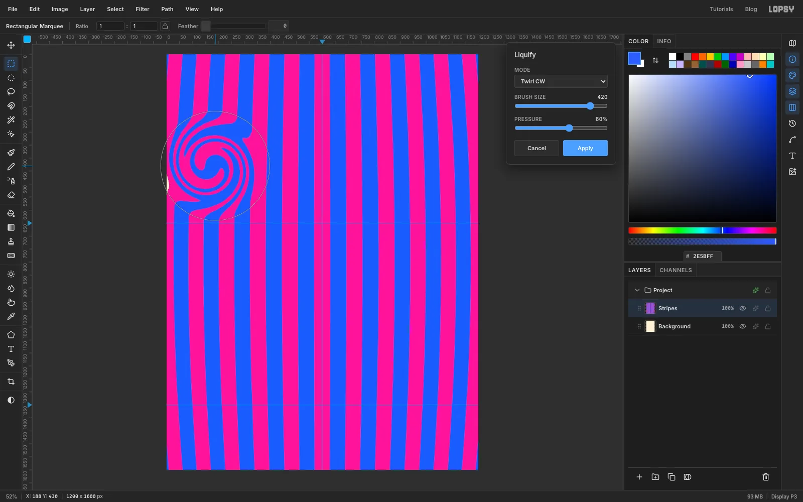

Choose **Filter → Liquify…**. Set **Mode** to **Twirl CW**, **Brush Size**
to `420` and **Pressure** to `60%`. Put the brush circle on the left edge at
about `170, 430`. Hold the mouse down and move it round in small circles,
about the size of a coin, five or six times. The stripes wind up into a
spiral. Click **Apply**.

Make five more swirls the same way, each with its own **Filter → Liquify…**:

- **Twirl CCW** at `1030, 430` on the right
- **Twirl CCW** at `160, 1020` and **Twirl CW** at `1040, 1020`, low on each side
- with **Brush Size** `360` and **Pressure** `50%`: **Twirl CCW** at `600, 140` and **Twirl CW** at `600, 1250`

The two swirls on each side turn in opposite directions, so the page looks
like marbled paper.

## Cut the halo disc

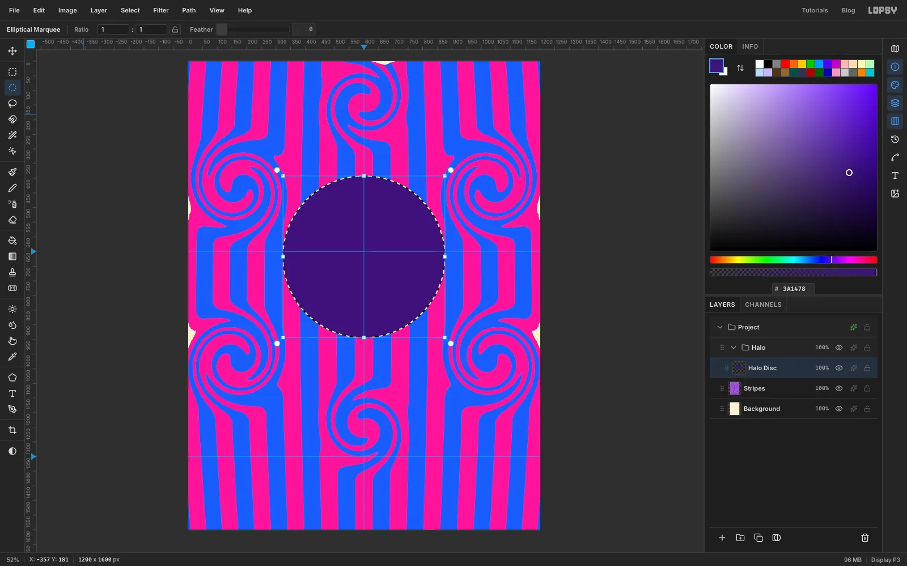

With *Stripes* selected, click the **New Group** button and name the group
*Halo*. Add a layer named *Halo Disc*.

Pick the **Elliptical Marquee** and use the exact-corners dialog to select
from `324, 392` to `876, 944`, a 552 px circle (radius 276) centred on `600, 668`. Fill it
with violet `#3A1478` and deselect.

## Scallop the edge with radial symmetry

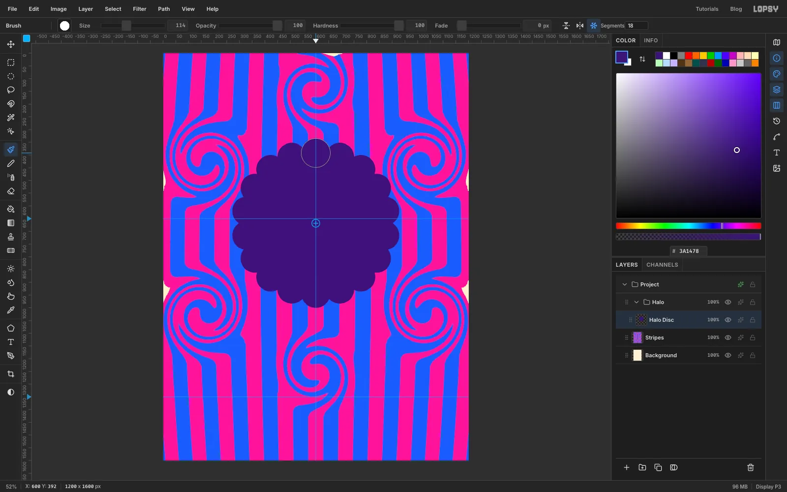

Pick the **Brush** and set **Size** to `114`, **Hardness** to `100` and
**Opacity** to `100`. Click the snowflake **Radial Symmetry** button in the
options bar and set **Segments** to `18`.

[[Cmd]]-click the centre of the disc at `600, 668` to move the symmetry
centre there. Then click once on the top edge of the disc at `600, 392`.
The one dab is copied 18 times around the circle, which gives the disc a
scalloped edge. Turn **Radial Symmetry** off again.

## Outline and lift the halo

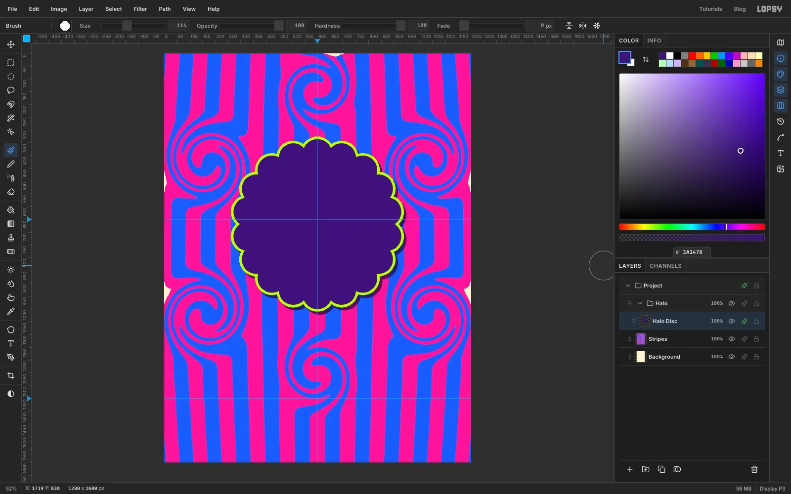

Open the *Halo Disc* effects drawer:

- Turn on **Stroke**, colour lime `#C8FF3A`, **Width** `10`.
- Turn on **Drop Shadow**, colour ink `#1E0A3C`, **Offset X** `10`,
  **Offset Y** `12`, **Blur** `1`, **Opacity** `75`.

Every shadow on the flier uses these same numbers, so they all seem to come
from one light.

## Add a scalloped keyline

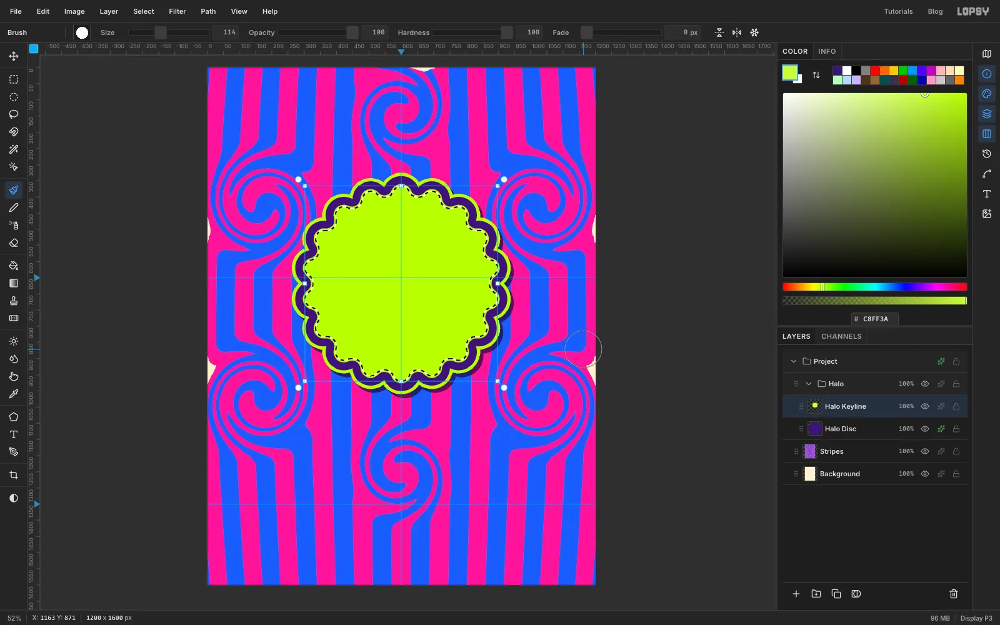

Add a layer named *Halo Keyline*. [[Cmd]]-click the *Halo Disc* thumbnail to
load its shape as a selection. Choose **Select → Shrink…** and shrink by
`24`. Fill with lime.

Shrink the selection again by `6` and press [[Delete]]. That leaves a thin
lime line that follows the scallops 24 px inside the edge. Deselect.

## Paint the dizzy spiral

Add a layer named *Spiral*. With the **Brush** at **Size** `16`, paint a
hot pink spiral. Start at the centre and wind outward three and a half
times, ending at the left side about 220 px from the centre. A smooth
spiral is hard to paint in one go, so zoom in to 100% and paint it a half
turn at a time, starting each stroke on the end of the last one. A little
wobble is fine, because psychedelic posters were drawn by hand, and you can
undo a turn and try again.

Paint a second arm in orange `#FF7A1A` that runs between the pink turns and
ends on the right. Set the **Size** to `30` and click once on the end of
each arm. The ball ends look deliberate instead of chopped off. Most of the
middle will be hidden behind the ice cream.

## Draw a waffle tile

Collapse the *Halo* group, click it, and add a **New Group** named *Treat*.
Inside it add another group named *Cone*, then a layer named *Waffle Tile*.

Pick the **Pencil** at **Size** `5` with lattice brown `#B8742F`. Click at
`100, 100` and **Shift**-click at `140, 140`. Then click `140, 100` and
**Shift**-click `100, 140`. Select exactly `100, 100` to `140, 140`, choose
**Edit → Define Pattern**, deselect and delete the *Waffle Tile* layer.

## Draw the cone with the Pen tool

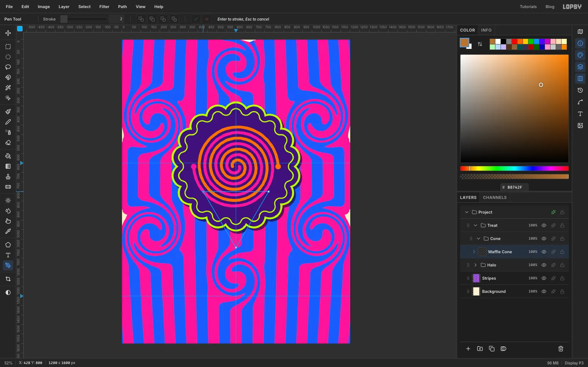

Add a layer named *Waffle Cone*. (Giving the layer a different name from
its group keeps the two easy to tell apart.) Pick the **Pen** tool. Click the three corners of
the cone: `428, 800` on the left, `772, 800` on the right and the tip at
`600, 1095`. Then click the first anchor again to close the path.

## Fill the cone with the waffle pattern

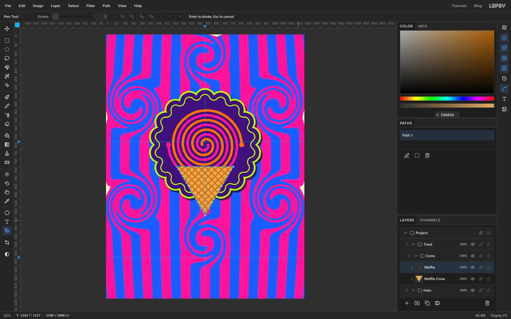

Open the **Paths** panel, click *Path 1* if it isn't highlighted, and click
the dashed-square **Path to Selection** button under the list. Fill the
selection with waffle tan `#E8A85A`.

Keep the selection, add a layer named *Waffle* and choose
**Edit → Fill with Pattern…** with the lattice tile. The pattern only fills
the cone. Putting it on its own layer first means you can hide it, or undo
just the pattern, while you check the scale. When it looks right, choose
**Layer → Merge Down** to merge it into *Waffle Cone*.

## Emboss the waffle

With the cone still selected, choose **Filter → Emboss…**. Set **Angle** to
`120` and **Strength** to `35`, and click **Apply**. The lattice lines now
look pressed in and the squares between them puff up, like a real waffle
cone.

## Shade the cone

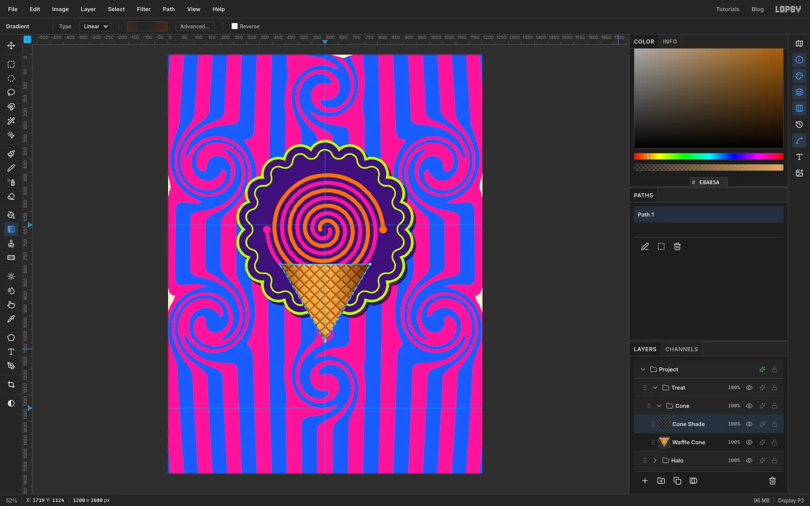

Keep the selection and add a layer named *Cone Shade*. Pick the
**Gradient** tool, **Linear**, and open **Advanced…**. Make four stops, all
in `#5A2A0C` (click the bar to add a stop):

- at the left end, **Opacity** 60%
- at 30%, **Opacity** 0%
- at 58%, **Opacity** 0%
- at the right end, **Opacity** 85%

Drag from the cone's left edge at `428, 900` to its right edge at
`772, 900`. Hold [[Cmd]] while you drag to keep the line level. Then set the
layer's **Blend** to **Multiply**. The right side is darker because it
faces away from the light, which comes from the upper left on this whole
flier. Deselect, and delete *Path 1* with the trash button in the Paths
panel.

## Roll the rim

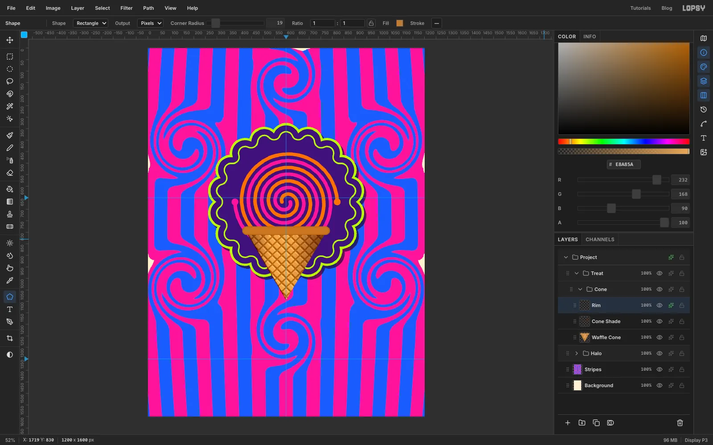

Add a layer named *Rim*. Pick the **Shape** tool. Set **Shape** to
**Rectangle**, **Corner Radius** to `19`, the fill to rim brown `#C07A35`
and no stroke. Click once at `600, 793` without dragging. In the size dialog
enter **Width** `380` and **Height** `38`, then click **Create**.

In the *Rim* effects drawer turn on **Inner Glow** with colour `#6B3410`,
**Size** `10` and **Opacity** `70`. That darkens the edges so the rim
looks rolled.

## Shape the first scoop tier

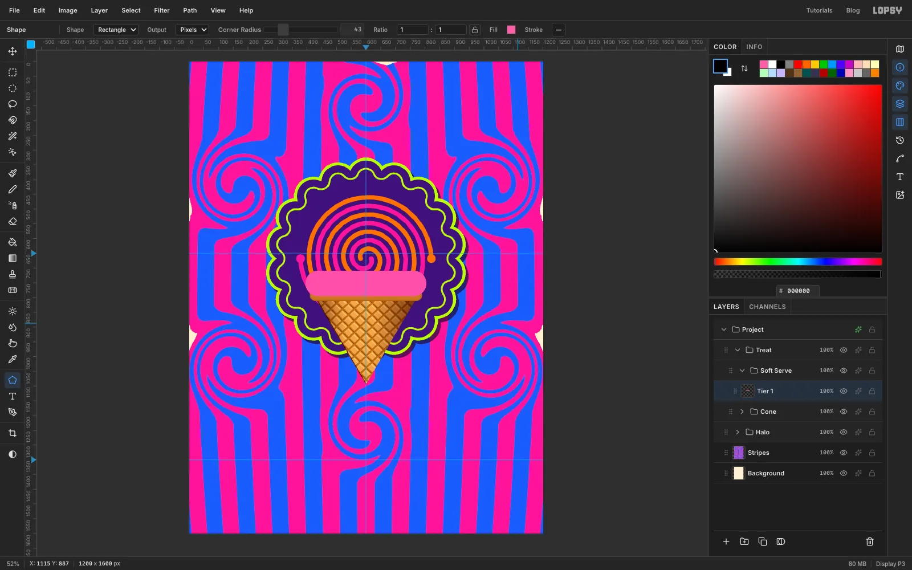

Collapse the *Cone* group, click it, and add a group named *Soft Serve*. It
sits above the cone. Add a layer named *Tier 1*.

With the **Shape** tool, set **Corner Radius** to `43` (half the height) and
the fill to pink `#FF5FA8`. Click at `600, 752` and make it **410 × 86**.
Give it two effects in its own shade colour `#B8206A`:

- **Inner Glow**, **Size** `24`, **Opacity** `65`
- **Drop Shadow**, **Offset X** `0`, **Offset Y** `8`, **Blur** `6`, **Opacity** `55`

## Tilt a tier

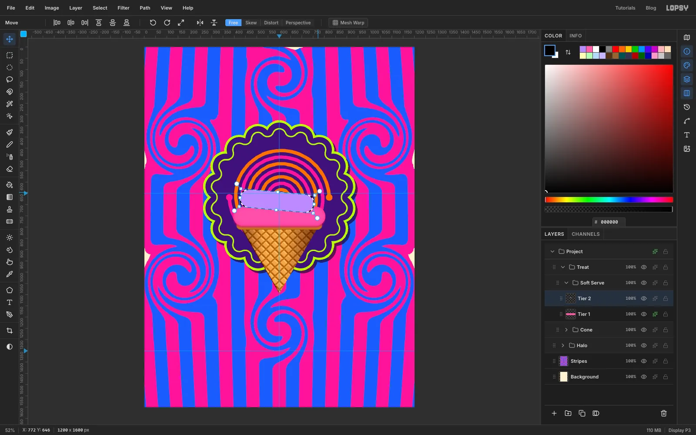

Add *Tier 2* the same way: lilac `#B58CFF`, **Corner Radius** `40`, click at
`590, 684` and make it **330 × 80**. Use the lilac shade `#6B3FD0` for its
**Inner Glow** (**Size** `22`) and its **Drop Shadow**. Everything else
matches *Tier 1*: glow **Opacity** `65`, shadow `0` / `8`, **Blur** `6`,
**Opacity** `55`.

[[Cmd]]-click the *Tier 2* thumbnail and pick the **Move** tool. Drag the
round rotation handle just outside the top-right corner down a little,
until the tier is turned about **5°** clockwise. Press [[Cmd+D]] to apply
the rotation and deselect.

## Stack all four tiers

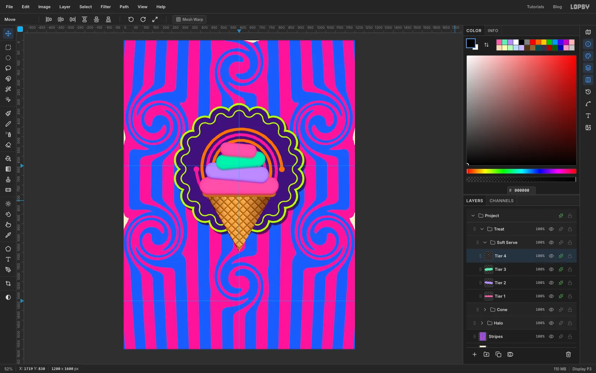

Add two more tiers the same way, with the same effect settings in each
tier's own shade colour. Each one is narrower than the last, overlaps the
one below by about 15 px, and tilts the opposite way:

- *Tier 3*: mint `#5BF0B0`, radius `37`, at `608, 622`, **256 × 74**, shade `#1E9E6E`, glow size `21`, rotated about **5°** counter-clockwise
- *Tier 4*: pink `#FF5FA8`, radius `33`, at `596, 567`, **190 × 66**, shade `#B8206A`, glow size `18`, rotated about **5°** clockwise

The alternating tilts make the stack read as one twisted rope instead of
four separate pills.

## Lasso the curl on top

Add a layer named *Tip*. With the **Lasso**, draw a teardrop. Start on the
top tier at `556, 556`, sweep up and to the right to a point at about
`636, 452`, then curve back down to `646, 556`. Fill it with lilac and give it an **Inner Glow** in `#6B3FD0` (**Size** `14`, **Opacity** `65`) and a
**Drop Shadow** in `#6B3FD0` (**Offset X** `0`, **Offset Y** `6`,
**Blur** `5`, **Opacity** `55`).

## Add crisp highlights

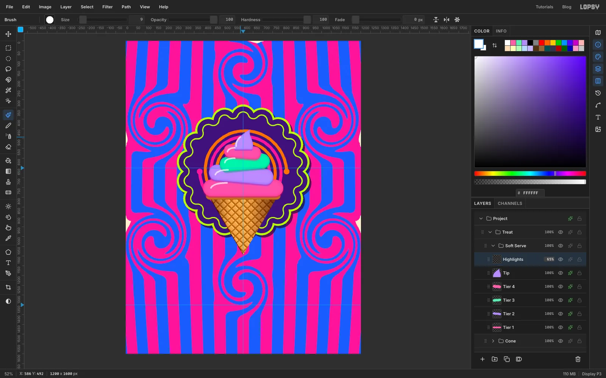

Add a layer named *Highlights*. Use the **Brush** at **Size** `9`,
**Hardness** `100`, in white. On each tier, paint a short curved stroke on
the upper left, following the round of the tier. Add one on the left side
of the curl. Set the layer's opacity to **65%**.

Keep them all on the same side so the light stays in the upper left.

## Drip over the rim

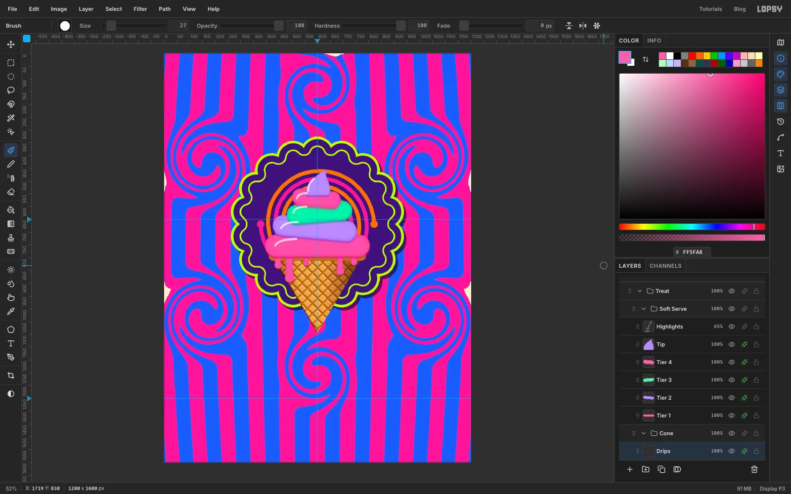

Expand *Cone*, click *Rim* and add a layer named *Drips*. It sits under the
tiers, so the drips seem to come out from under the bottom scoop.

Use the **Brush** with **Hardness** `100` and pink `#FF5FA8`. Drag five
short drips straight down from `y = 790`, at about `x = 446, 490, 556, 688`
and `742`. Use sizes between `18` and `28`, and end them at different
heights between `816` and `878`. Raise the size a little and click once at
the bottom of each drip to make a drop. Add an **Inner Glow** in `#B8206A`
(**Size** `8`, **Opacity** `60`) and a soft **Drop Shadow** in `#5A2A0C`
(**Offset X** `0`, **Offset Y** `5`, **Blur** `4`, **Opacity** `50`).

## Make a sprinkle brush

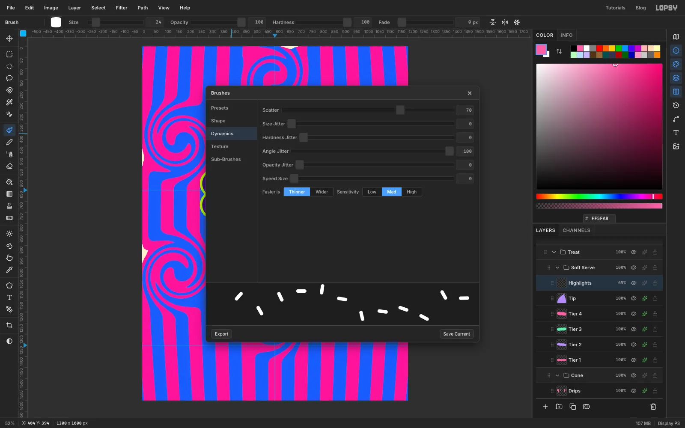

Add a temporary layer. With the **Shape** tool (**Rectangle**,
**Corner Radius** `4`, fill black), click at `150, 150` and make it
**8 × 24**: one rounded sprinkle. Select `134, 134` to `166, 166` and choose
**Edit → Define Brush…**. Name it *Sprinkle*, then delete the layer.

Pick the **Brush** and click **Open brush presets**. Choose *Sprinkle*. On
the **Shape** tab set **Size** `24` and **Spacing** `200`. On the
**Dynamics** tab set **Scatter** `70` and **Angle Jitter** `100`, so each
sprinkle lands at a random angle.

## Sprinkle the scoops

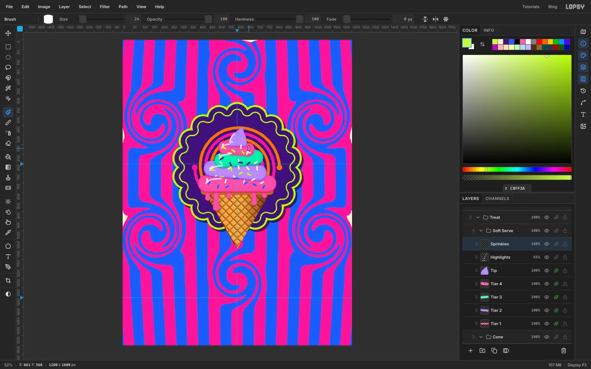

Click *Highlights* and add a layer named *Sprinkles*.

[[Cmd]]-click the *Tier 1* thumbnail, click the *Sprinkles* row again, and
paint two wavy strokes across the middle of the tier. Make one in cream
and one in a colour that stands out on it. The selection keeps the
sprinkles on the scoop. *Sprinkles* sits above every tier, so keep the
strokes below the edge of the tier above, or sprinkles will land on top of
it where the two overlap. Repeat for each tier:

- *Tier 1* (pink): cream and blue `#2E5BFF`
- *Tier 2* (lilac): cream and lime
- *Tier 3* (mint): cream and violet
- *Tier 4* (pink): cream and lime

Keep them off the bottom edge of *Tier 1* so the drips stay clean.
Deselect.

## Draw a sparkle

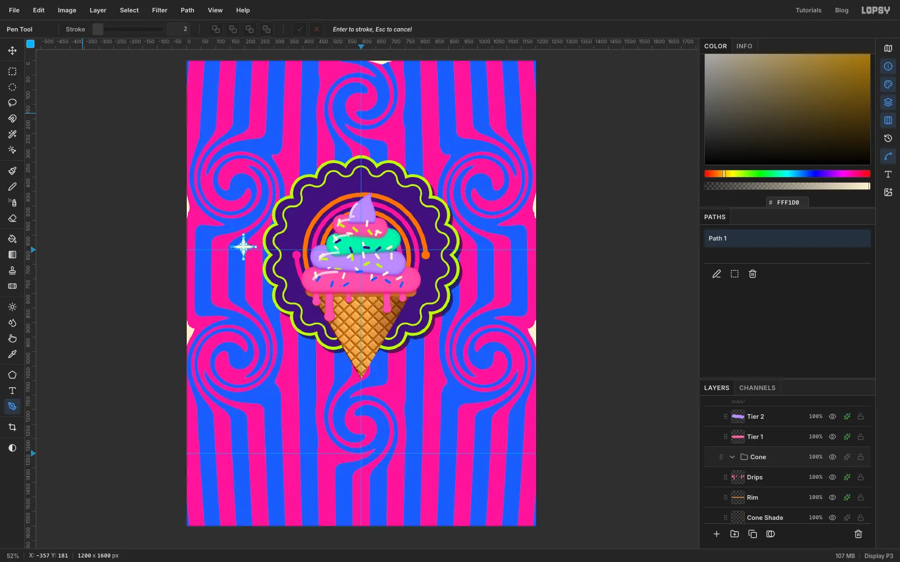

Collapse *Treat*, click *Halo* and add a layer named *Sparkle 1*. It sits
between the halo and the ice cream. Draw a four-pointed star with the
**Pen** tool in eight clicks, going round from the left tip:

- the tips: `154, 640` (left), `196, 598` (top), `238, 640` (right) and `196, 682` (bottom)
- between each pair of tips, a pinched point 9 px from the centre: `187, 631`, `205, 631`, `205, 649` and `187, 649`

Click the first anchor again to close it. Then click
**Path to Selection** in the Paths panel and fill with cream.

## Copy, scale and rotate the sparkles

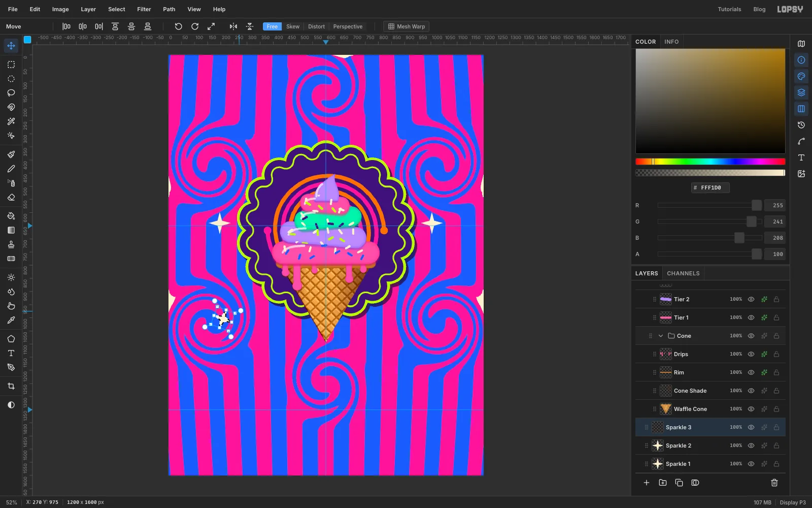

With the sparkle still selected, press [[Cmd+C]]. Delete *Path 1* in the
Paths panel and deselect. Press [[Cmd+V]]: the copy is pasted in place on a
new layer above, which you can rename *Sparkle 2*. With the **Move** tool,
drag it across to `1004, 640`, so the two sparkles mirror each other across
the halo.

Paste again, rename the new layer *Sparkle 3* and drag it down to
`214, 1010`. [[Cmd]]-click its
thumbnail, hold [[Cmd]] and drag a corner handle inward until it's about
70% of the size. Then drag a rotation handle to turn it about 20°. Press
[[Cmd+D]].

## Glow the sparkles

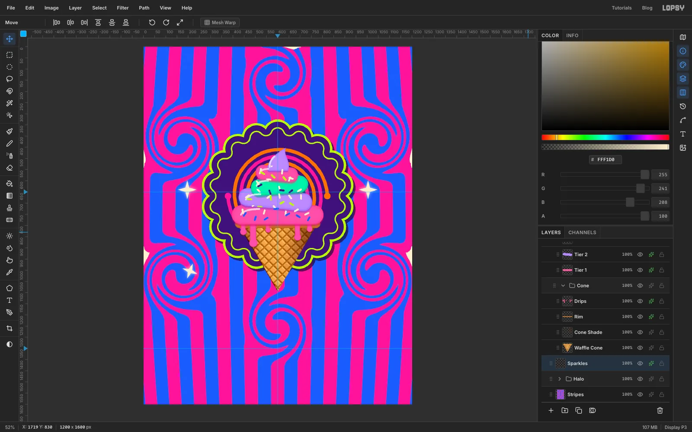

Merge the copies into one layer: click *Sparkle 3* and choose
**Layer → Merge Down**, then do it once more with *Sparkle 2*. Rename the layer *Sparkles*.
Give it an **Outer Glow** in white with **Size** `18` and **Opacity** `70`.

## Type the title

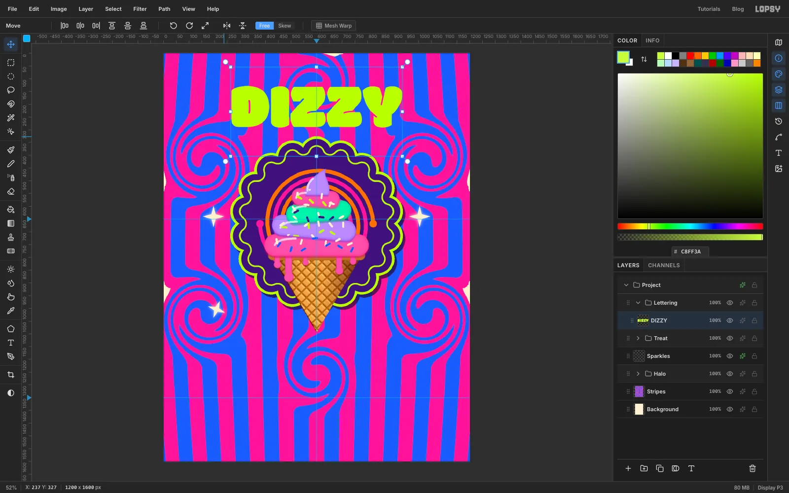

Make sure *Treat* is collapsed, click it, and add a group named *Lettering*. Pick the
**Text** tool and choose **Modak** at size `250`, in lime. Click an empty
spot near the top of the page and type `DIZZY`. Commit it with the ✓ button.

With the **Move** tool, nudge it with the arrow keys until it's centred on
the middle guide with its middle at about `y = 209`. Then click
**Rasterize Layer** at the bottom of the Layers panel. The next steps need
pixels.

## Fill the letters with a gradient

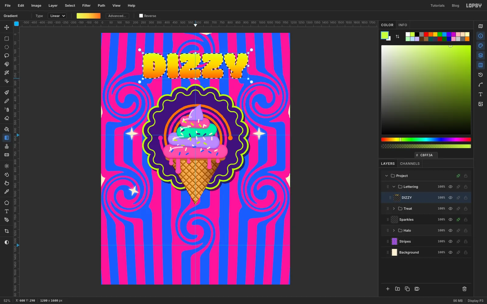

[[Cmd]]-click the *DIZZY* thumbnail to select the letters. Pick the
**Gradient** tool, **Linear**, and open **Advanced…**. It still holds the
four cone-shade stops, so delete one and set every stop's **Opacity** back
to 100%. Then set three stops:
`#E6FF5A` at the left, `#FFD23A` in the middle and `#FF6A1A` at the right.
Drag from the top of the letters straight down to the bottom. The gradient
only fills the letters. Deselect.

## Bend the word with Mesh Warp

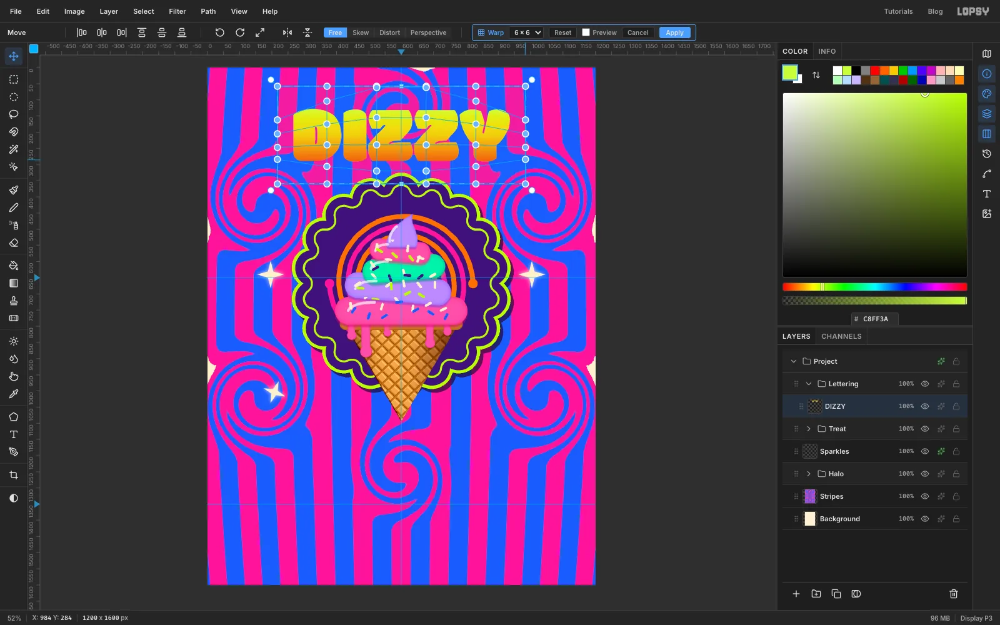

The aim is a classic swollen arch: the middle letters stretch taller while
the D and Y squash down at the ends.

With the **Rectangular Marquee**, select a box around the word with about
50 px to spare on each side and 70 px above and below it. The warp can only
move pixels inside this box, and the handles on its outer edge can't leave
it, so this spare room is what lets the letters bend.

Pick the **Move** tool and click **Mesh Warp** in the options bar. Set the
grid to **6 × 6**. The top and bottom rows sit in the empty margin, so pull
the rows that cross the letters. The status bar shows the pointer position,
so you can measure each drag, and the **Preview** checkbox shows the result
as you go. These are the moves used here:

- **second row:** the two middle points up about 56 px, the next ones out up about 14 px, and the end points down about 44 px
- **third row:** the middle points up about 24 px and the ends down about 26 px
- **fourth row:** just the end points down about 8 px
- **fifth row:** the middle points down about 20 px and the ends up about 16 px

Click **Apply**, then deselect.

## Outline, shadow and inline

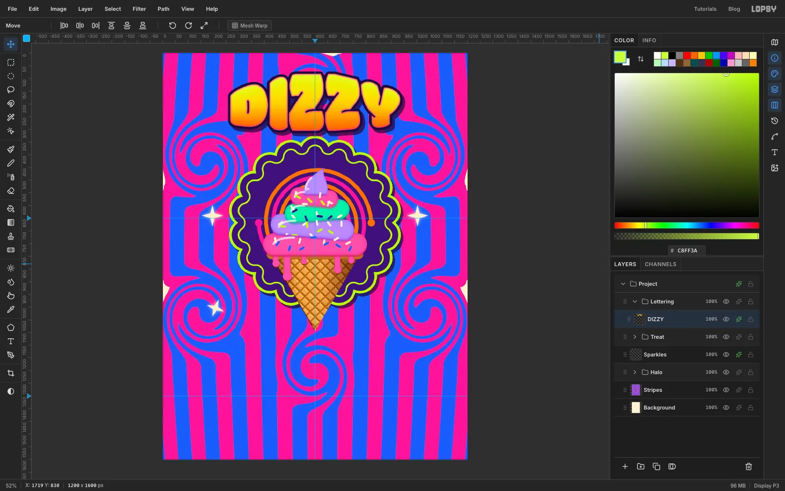

Give *DIZZY* three effects:

- **Stroke** in ink `#1E0A3C`, **Width** `10`
- the flier's **Drop Shadow**: ink, `10` / `12`, **Blur** `1`, **Opacity** `75`
- **Inner Glow** in hot pink `#FF3D9A`, **Size** `6`, **Spread** `70`, **Opacity** `100`

The pink inline picks up the stripe colour, so the letters vibrate against
the background instead of sitting on top of it.

## Repeat for CONES

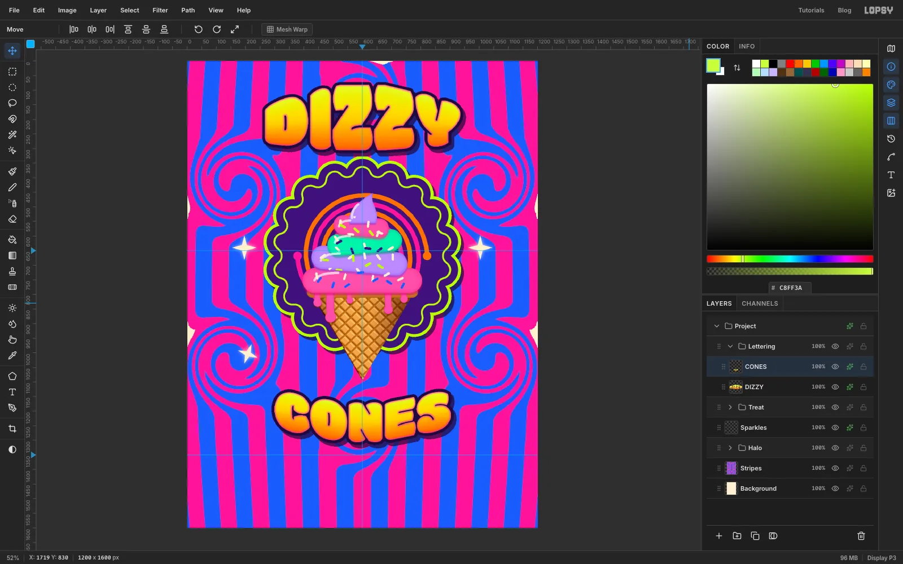

Click *Lettering* and type `CONES` in **Modak** at size `200`. Centre it at
about `y = 1207`, rasterize it and give it the same gradient.

Warp it the other way, so it curves like a smile that cradles the cone tip.
Draw the same roomy marquee around the word first. Then, with the same
6 × 6 grid, on rows two to five pull the two middle points
down 26 to 34 px and lift the end points 20 to 30 px. Add the same three
effects. Check that the cone tip clears the top of the O and N by about
30 px.

## Draw the info panel on the grid

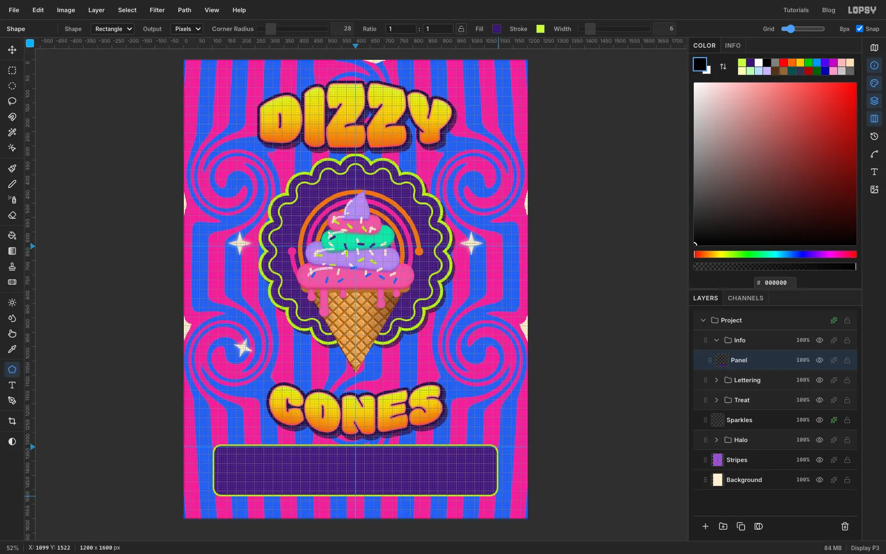

Collapse *Lettering*, click it, add a group named *Info* and a layer named
*Panel*. Set the **Shape** tool to **Rectangle**, **Corner Radius** `28`,
fill violet, and stroke lime at **Width** `6`.

Choose **View → Show Grid** and drag the **Grid** slider in the options bar
to **8 px**. Shapes grow from where you press, and both the centre and the
corner snap to the grid. Press at `600, 1432` and drag to about
`1096, 1520`. The panel snaps to `104–1096` across and `1344–1520` down.
Hide the grid again and give the panel the flier's **Drop Shadow**.

## Set the panel type

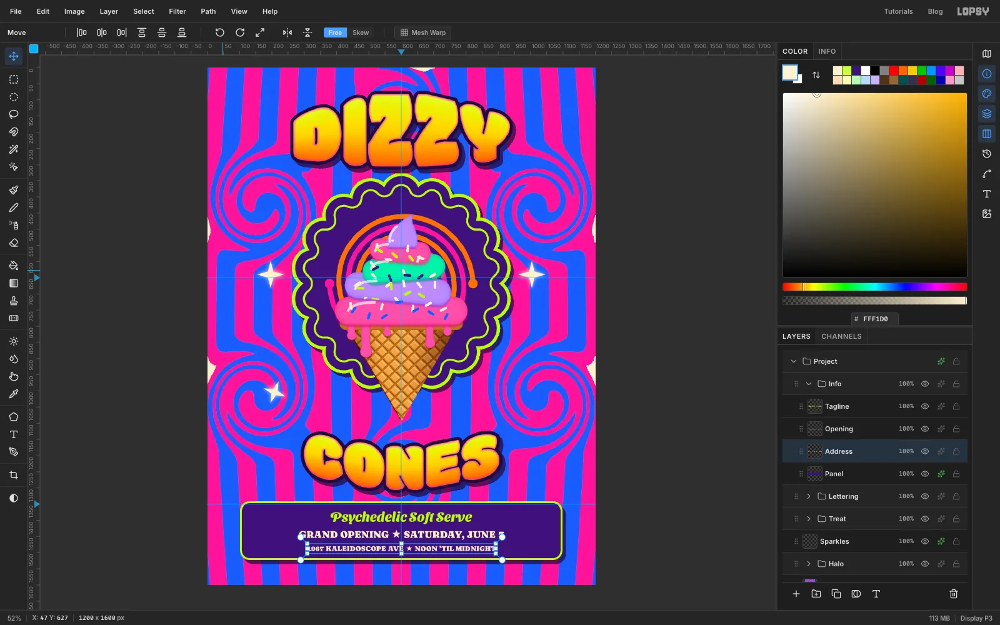

Click the *Panel* row before each new piece of text, so the Text tool's
settings don't restyle the last one. To type ★ and ’ on a Mac, use the
character viewer ([[Ctrl+Cmd+Space]]), or copy them from this page. Create each line over an empty part of
the stripes, then nudge it into place, centred on the middle guide:

- **Sansita Swashed**, weight **800**, size `42`, lime: `Psychedelic Soft Serve`, centred at `y = 1391`
- **Caprasimo**, size `30`, cream: `GRAND OPENING ★ SATURDAY, JUNE 7`, at `y = 1444`
- **Caprasimo**, size `22`, cream: `1967 KALEIDOSCOPE AVE ★ NOON ’TIL MIDNIGHT`, at `y = 1486`

That leaves about 24 px between the text and the panel's outline at the
top and at the bottom.

## Make a starburst badge

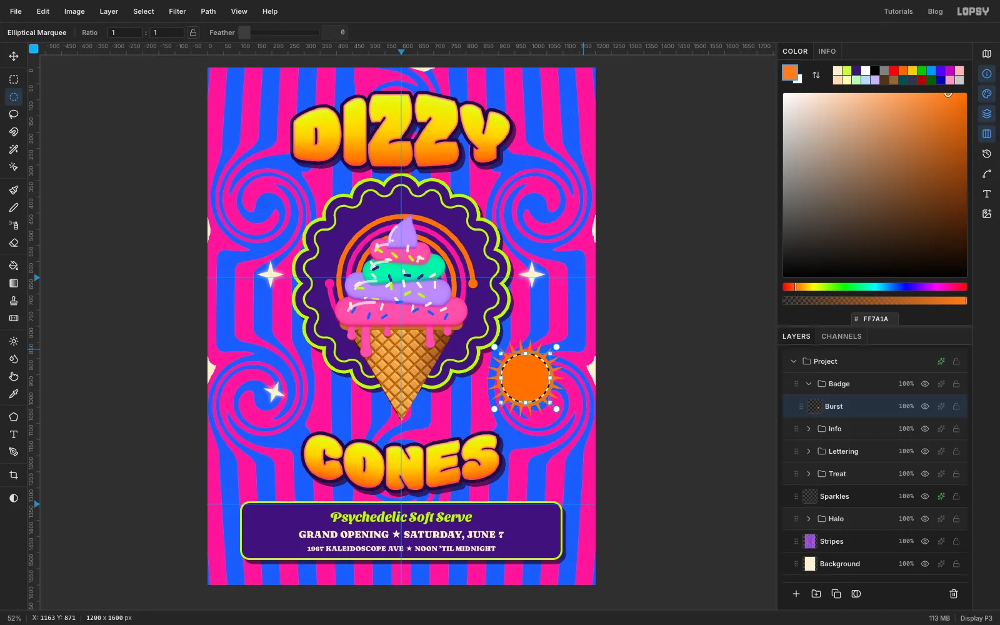

Collapse *Info*, click it, add a group named *Badge* and a layer named
*Burst*. Set the foreground to orange `#FF7A1A` and choose
**Filter → Sunburst…**:

- **Rays** `22`, **Length** `9`, **Width** `100`, **Taper** `100`
- **Center X** `82`, **Center Y** `60`

**Center X** and **Center Y** are percentages of the document, so 82% of
1200 and 60% of 1600 put the centre at `984, 960`. **Length** is a
percentage of the distance to the farthest corner, so `9` makes spikes
about 124 px long. High taper turns each ray into a spike that's widest at
the centre, so you get a star badge.

Still on *Burst*, with orange as the foreground, use the
**Elliptical Marquee** dialog to select from `896, 872` to `1072, 1048` and
fill it. That gives the badge a solid core. Then shrink the selection by
`12`. On a new layer named *Burst Ring*, fill the
selection with cream, shrink it by `4` and press [[Delete]] to leave a thin
ring. Give *Burst* the flier's **Drop Shadow**.

## Add the badge text and tilt it

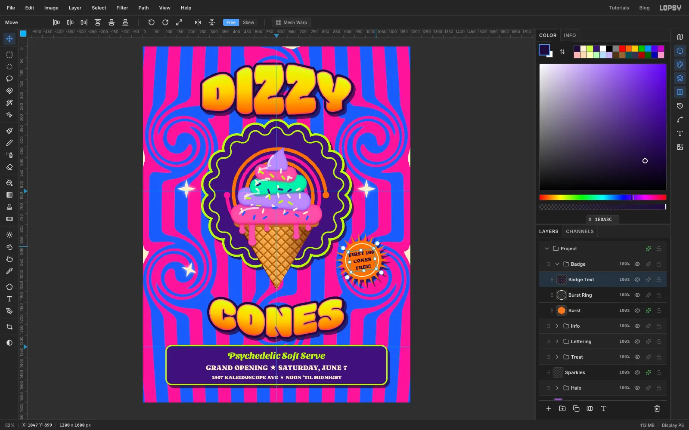

Click *Burst Ring*. Pick the **Text** tool with **Caprasimo** at size `22`
in ink, and set **Align** to **Center**. Type `FIRST 100`, press [[Enter]],
type `CONES`, press [[Enter]] and type `FREE!`. Commit it, name the layer
*Badge Text*, and nudge it to the middle of the ring.

With the **Move** tool, drag a rotation handle to tilt the text about 8°
counter-clockwise, then press [[Cmd+D]]. A rotation turns around the text
box, not the letters, so nudge it back to the centre of the ring. Leave at
least 8 px between the letters and the cream ring.

## Cut the frame

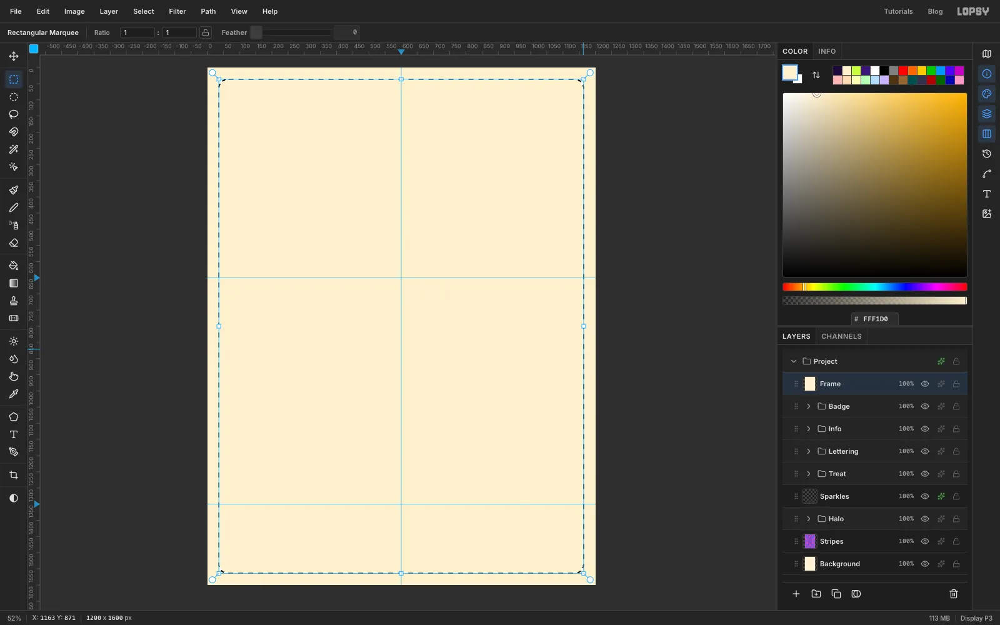

Collapse *Badge*, click it, and add a layer named *Frame*. Set the
foreground back to cream and fill the whole layer. Select from `36, 36` to `1164, 1564`, then choose
**Select → Shrink…** `28` followed by **Select → Grow…** `28`. Shrinking
and growing by the same amount rounds the corners. Press [[Delete]] to cut
the window and deselect.

Give the frame a **Stroke** in violet, **Width** `8`. The stroke goes on
the inside edge of the window, like a keyline.

## Add print grain

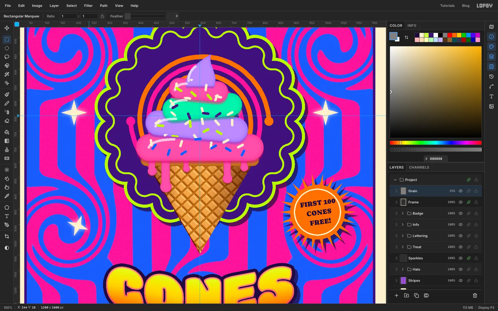

Add a layer named *Grain* at the top. Fill it with grey `#808080` and choose
**Filter → Add Noise…** with **Amount** `40` and **Mode** set to
**Mono**. Set the layer's **Blend** to **Overlay** and its opacity to
**35%**. Mid grey disappears in Overlay, so only the noise shows, as a
fine grain that makes the flat colours look printed. It's too fine to see
at fit-to-screen zoom, so choose **View → Actual Size** to check it.

Export with **File → Quick Export PNG**, and save the project with
**File → Save Project** so you can come back and change the date for the
next event.
