From the 1920s to the early 1950s, pulp magazines like *Weird Tales*,
*Adventure* and *Amazing Stories* sold on their covers. A painted monster
loomed over a helpless victim, a fat masthead in yellow or red shouted the
title, and starbursts and teaser boxes crowded the corners. The covers were
lurid on purpose, with hot oranges against deep teals and night blues. Cheap
pulp paper yellowed fast, and the presses rarely lined up their colour
plates.

In this tutorial you'll borrow that look for a small business: a grand
opening flier for **Octopus Oddities**, an imaginary harbourside curiosity
shop. The monster is a real octopus, cut out of an 1896 natural-history
lithograph and repainted. It rises out of a stormy sea and reaches for the
shop's prize exhibit, a ship in a bottle. The flier is **1200 × 1600 px**.

Along the way you'll use:

- multi-stop **Gradients**, **Sunburst**, **Clouds** and a **layer mask** for a stormy sunset sky
- the **Brush** and **Spray** for painted water, glints and white water
- a dropped photo, the **Magic Wand** with Shift-click, **Grow**, **Shrink** and **Inverse** to cut out the octopus
- **Hue/Saturation** and **Surface Blur** to turn a lithograph into paint
- **Flip**, scale, rotate and **Rotate 90°**, on layers, a pasted copy and whole groups
- **Copy** and **Paste** to borrow a tentacle tip
- **Group Layers**, **Duplicate Layer**, **Merge Down** and **Rasterize Layer**
- live text in **Ultra**, **Bevan**, **Bowlby One SC** and **Fjalla One**, with the text **Skew** mode
- **Stroke**, **Drop Shadow**, **Inner Glow**, **Outer Glow** and **Color Overlay**
- **Multiply**, **Screen**, **Overlay** and **Soft Light** blend modes, **Fibers**, **Add Noise** and an adjustment stack for the aged-paper finish

The palette:

- Night sky `#0B1626` → `#183A5A` → `#2F7F7B` → `#E3B85A` → `#F4D58D`
- Sea `#2A5A60` → `#123341` → `#081723` → `#050D14`
- Chop `#7FBFB0`, glints `#F6D98A`, white water `#EAF4EE`
- Masthead yellow `#F7C531`, extrusion `#8E1A12`, keyline `#120C08`
- Ribbon red `#B8201A`, cream `#F3E6C4`, card `#EFE3C2`
- Rim light `#F2C14E`, eye `#FFE27A` → `#F28A1E` → `#9E2E0C`
- Bottle glass `#A8E0CF` → `#3E8A7E` → `#123A38`, putty `#1F5FA0`, cork `#9A6532`
- Lightning `#FFF4CC`, glow `#FFE9A8`
- Ink black `#14100C`, edge burn `#4A2C12`, yellowing `#E2BE73`

You'll also need the octopus. Download
[*Octopus vulgaris* by Comingio Merculiano](https://commons.wikimedia.org/wiki/File:Octopus_vulgaris_Merculiano.jpg),
a public-domain plate from 1896, from Wikimedia Commons.

> **Tip:** Positions are in document pixels, written `x, y`. The status bar
> at the bottom shows where the pointer is. **Edit → Fill** fills the
> selection with the foreground colour, and [[Cmd+D]] deselects and commits
> a transform. New layers appear directly above the selected layer, so click
> the layer you want to build on first. Effects and the **Blend** dropdown
> live in each layer's effects drawer, the sparkle icon on its row.

> **Tip:** For an exact rectangle or ellipse, pick the **Rectangular** or
> **Elliptical Marquee**, make sure nothing is selected, and click the canvas
> once without dragging. A dialog asks for the **From X / Y** and **To X / Y**
> corners.

## Set up the canvas and guides

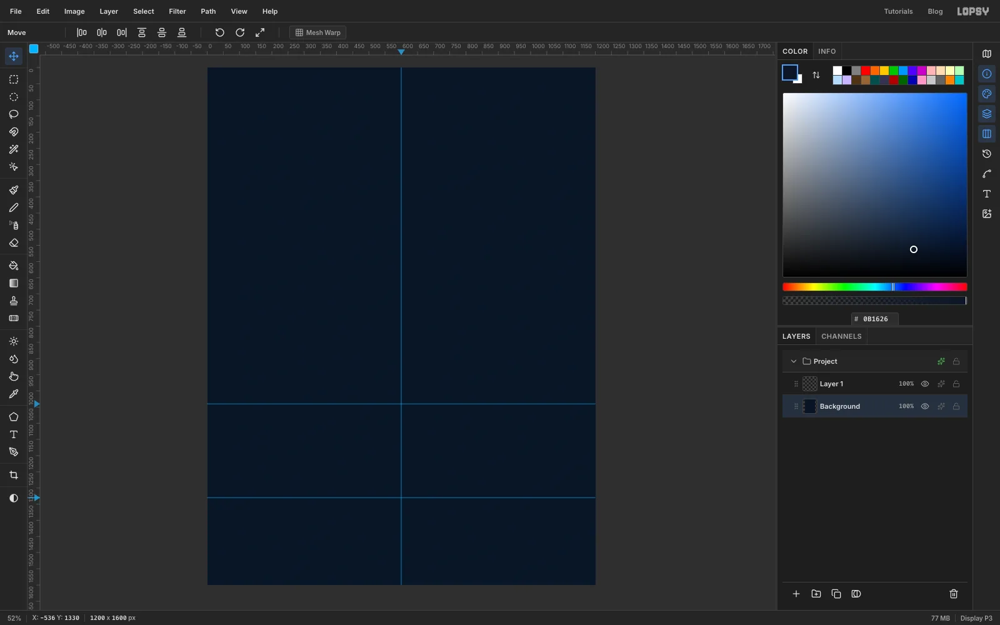

Choose **File → New**, enter **1200 × 1600** and click **Create**. Click the
*Background* row, set the foreground to night navy `#0B1626` and choose
**Edit → Fill**.

Click the left ruler at `1040` to drop the horizon guide, and again at
`1330`, where the info band will start. Click the top ruler at `600` for a
centre line.

## Paint the night-to-sulphur sky

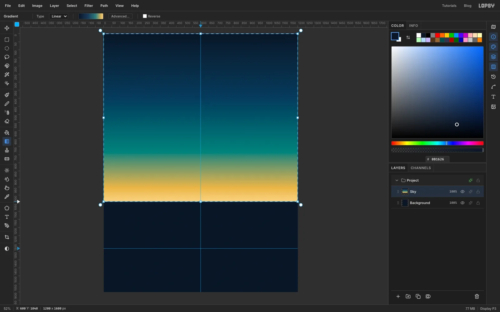

Click *Layer 1* and rename it *Sky*. Pick the **Gradient** tool, set it to
**Linear** and click **Advanced…**. Make five stops: `#0B1626` at 0%,
`#183A5A` at 38%, `#2F7F7B` at 70%, `#E3B85A` at 92% and `#F4D58D` at 100%.
Click a stop and type its hex code into the editor's colour field. Click the
bar to add a stop.

Select from `0, 0` to `1200, 1040` so the gradient stops at the horizon.
Drag from the top of the page straight down to the horizon guide.

## Fan out sunburst rays

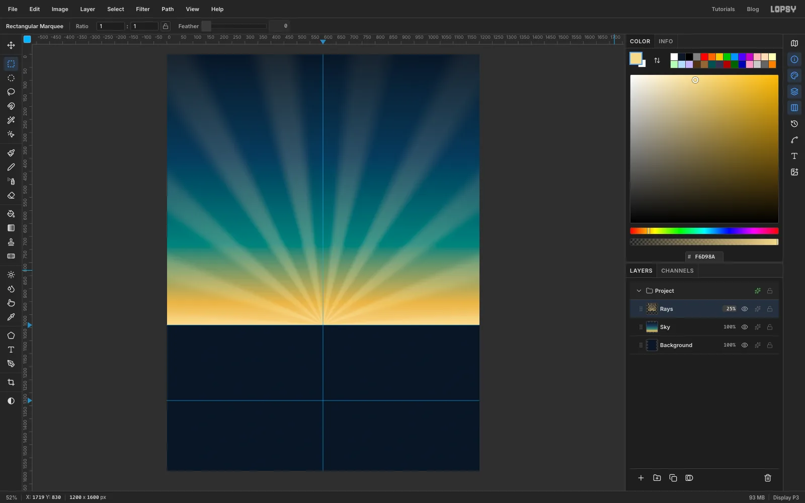

Add a layer named *Rays* and set the foreground to pale sulphur `#F6D98A`.
Select the sky again, `0, 0` to `1200, 1040`, and choose
**Filter → Sunburst…**:

- **Rays** `18`, **Length** `120`, **Width** `40`
- **Fade** `75`, **Softness** `60`, **Jitter** `35`, **Seed** `7`
- **Center X** `50`, **Center Y** `65`, which puts the origin on the horizon

Click **Apply** and deselect. Set the layer's **Blend** to **Screen** and its
opacity to **25%**. The rays now glow faintly instead of striping the sky.

## Stir in storm clouds near the horizon

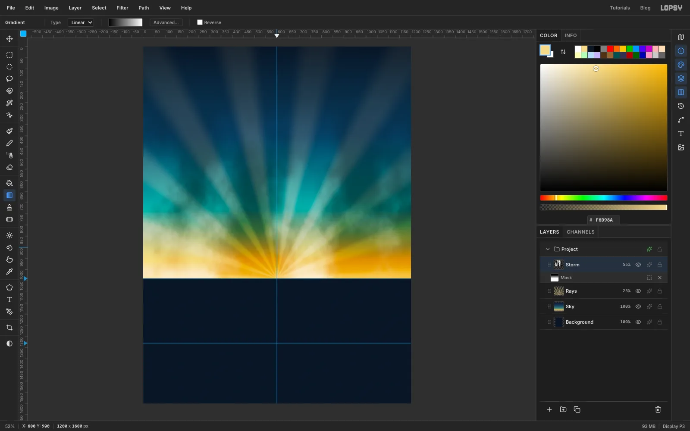

Add a layer named *Storm*, select the sky again and choose
**Filter → Clouds…** with **Scale** `5`. Deselect. Set the **Blend** to
**Overlay** and the opacity to **55%**.

The clouds should hang low over the sunset, so mask the top away. Click
**Add Mask** at the bottom of the Layers panel, then click the mask
thumbnail to edit it. Open the Gradient tool's **Advanced…** editor, delete
the three middle stops (click a stop, then **Delete stop**), and set the
left stop to `#000000` and the right one to `#FFFFFF`. Drag from `600, 250`
down to `600, 900`. Black hides, so the clouds fade out
above. Click the *Storm* row to stop editing the mask.

## Lay down the sea

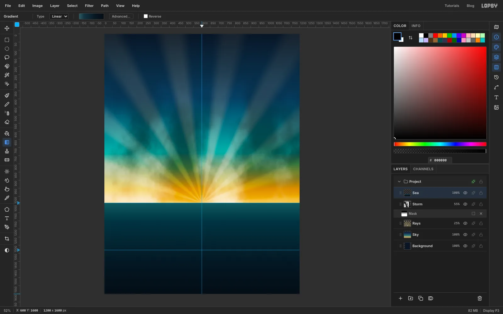

Add a layer named *Sea*. Give the gradient four stops: `#2A5A60` at 0%,
`#123341` at 20%, `#081723` at 65% and `#050D14` at 100%. Select from
`0, 1040` to `1200, 1600` and drag from the horizon guide down to the bottom
edge. Deselect.

## Reflect the sunset on the water

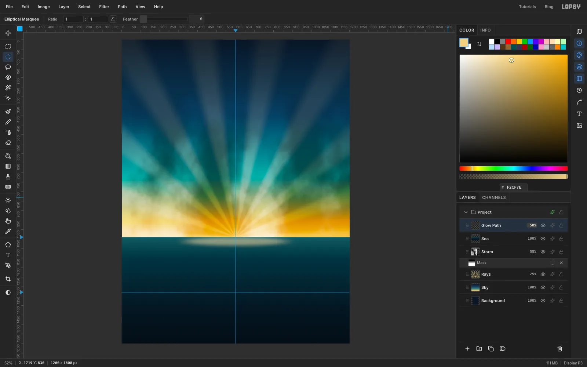

Add a layer named *Glow Path* and set the foreground to `#F2CF7E`. With the
**Elliptical Marquee**, select from `330, 1040` to `870, 1084`, a flat oval
just under the horizon. Choose **Select → Feather…** `18`, fill, and
deselect.

Choose **Filter → Motion Blur…** with **Angle** `0` and **Distance** `90` to
smear it sideways like a reflection. Set the **Blend** to **Screen** and the
opacity to **50%**.

## Paint the chop

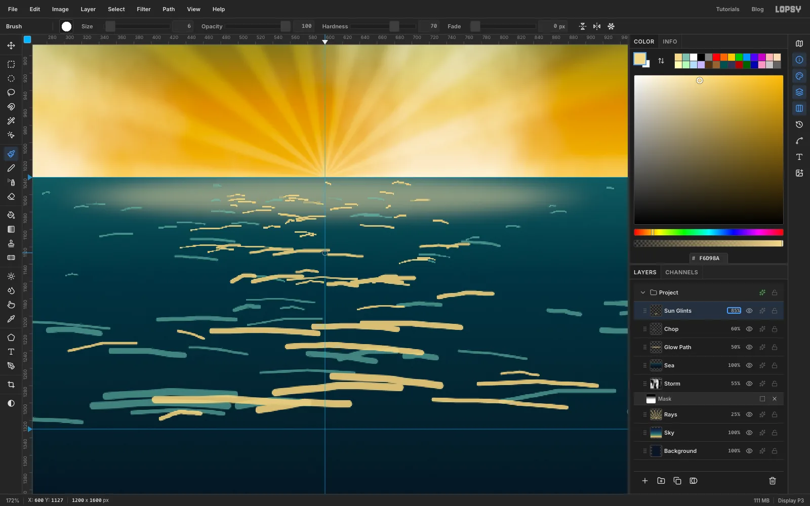

Pulp painters suggested water with short horizontal strokes, so do the same.
Add a layer named *Chop*, pick the **Brush** and set **Hardness** to `70`,
**Opacity** to `100` and the foreground to `#7FBFB0`.

Paint short horizontal dashes across the whole sea, each with a slight sag
in the middle. Work down in bands, making the dashes bigger as they come
toward you:

- just below the horizon: **Size** `2`, about 15 px long
- then **Size** `3`, `4`, `6` and `8`
- in the last band, from `1270` to the info band guide: **Size** `10`, about 100 px long

In each band, drop the size to about half for a few of the dashes and vary
their lengths a lot, so no two rows repeat. When you're done, set the layer
opacity to **60%**.

## Scatter sun glints

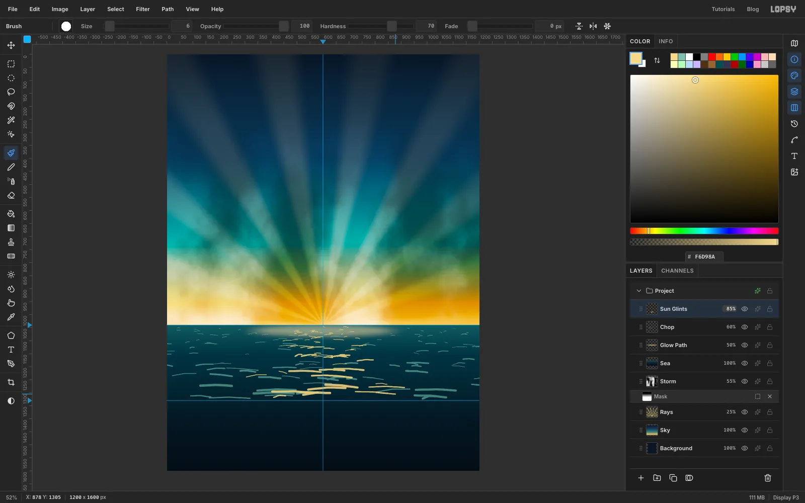

Add a layer named *Sun Glints* and switch the foreground to `#F6D98A`. Paint
the same kind of dashes, but fewer, and only in a column under the sun. It
starts about 180 px wide at the horizon and spreads to about 700 px at the
info band guide. Set the layer opacity to **85%**.

## Drop in the octopus lithograph

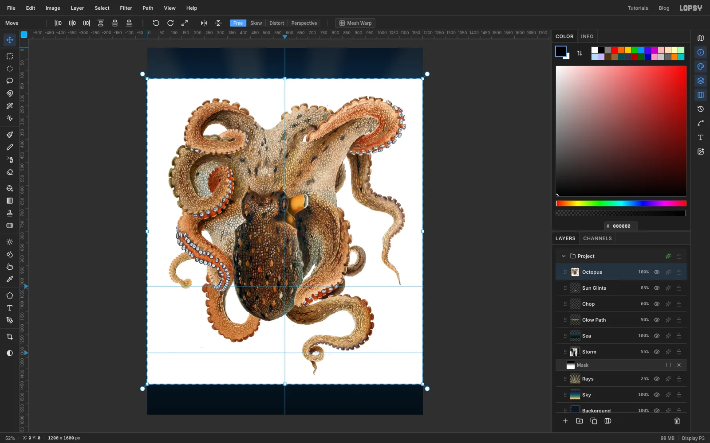

Click *Sun Glints*, then drag the downloaded octopus image from your file
browser onto the canvas. It arrives as *Pasted Layer*, scaled to the page
width. Rename it *Octopus*.

## Cut the octopus out of its paper

Pick the **Magic Wand**, turn **Contiguous** on and set **Tolerance** to
`20`. Click the white paper near a corner. The wand can't reach the pockets
of paper trapped between the curled arms, so Shift-click inside each one to
add it. There are eight, the biggest between the lower-left arms.

Choose **Select → Grow…** `2` so the selection eats the pale fringe, press
[[Delete]] and deselect.

## Turn the lithograph into paint

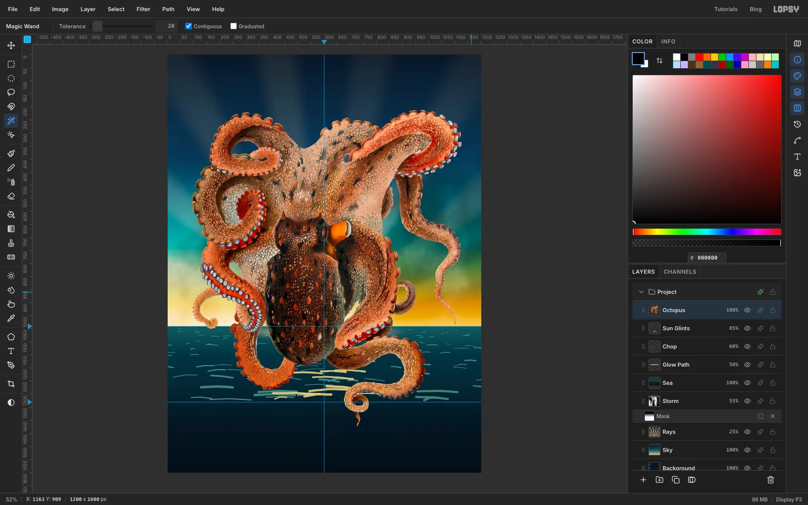

Choose **Filter → Hue/Saturation…** with **Hue** `-8`, **Saturation** `30`
and **Lightness** `-4`. The octopus turns from a museum brown to a pulp
orange.

Then choose **Filter → Surface Blur…** with **Radius** `6` and
**Threshold** `40`. Surface Blur smooths flat areas but stops at strong
edges, so the engraver's stipple melts into patches of paint while the
outline stays crisp.

## Flip it so the mantle rises

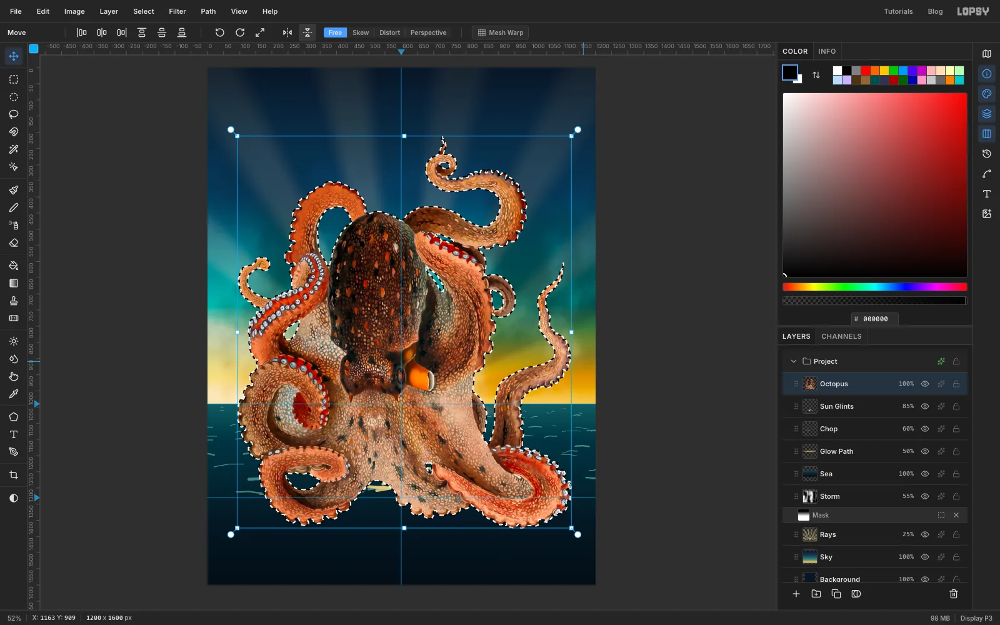

In the lithograph the octopus is seen from above with its mantle pointing
down. [[Cmd]]-click the *Octopus* thumbnail to load its shape as a
selection, pick the **Move** tool and click **Flip Vertical** in the options
bar. Now the mantle rears up and the arms reach down toward the water.

## Scale it up

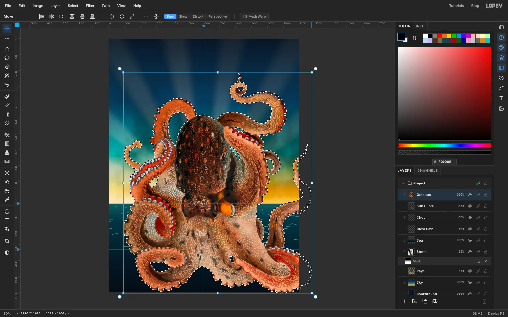

Choose **View → Zoom Out** so you can see the bottom-right handle. Hold
[[Cmd]] to keep the proportions and drag that handle down and right until
the octopus is about 15% bigger, roughly 1190 px across.

## Drag it into place

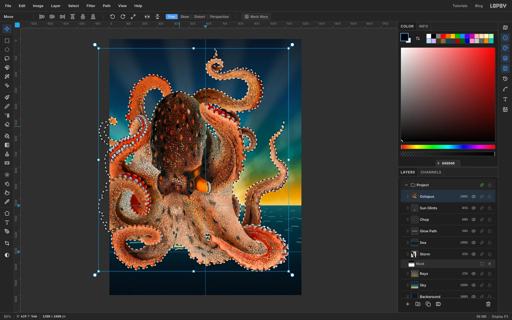

Drag inside the selection to move the octopus up and left. Its left arms
should hang about 70 px off the left edge and its highest tip should reach
`y 58`. Low on the mantle, just left of the big orange siphon, is the
octopus's real eye, a small dark ring. It should land at about `515, 906`,
with the siphon just left of the centre guide. Press [[Cmd+D]] to commit,
then choose **View → Fit to Screen**.

Scaling up brought back a little of the engraver's stipple, so run
**Filter → Surface Blur…** once more, this time with **Radius** `8` and
**Threshold** `30`.

## Trim the stray tips

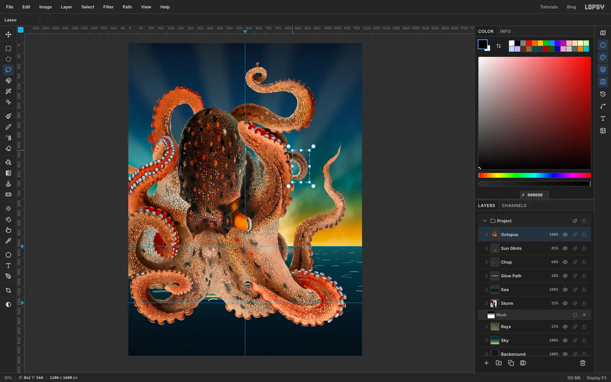

Three bits of arm would fight the type and the frame. Select each with the
**Rectangular Marquee** and press [[Delete]]:

- the thin tip poking up where the masthead goes: `626, 20` to `726, 98`
- the tip cut off by the left edge: `0, 462` to `70, 568`
- the lone curl beside the mantle, which looks like a teapot handle: `842, 548` to `930, 712`

Last, shave off the pale outline the lithograph left behind. [[Cmd]]-click
the thumbnail, choose **Select → Shrink…** `2`, then **Select → Inverse**,
and press [[Delete]]. Deselect.

## Stand the octopus in the sea

If the octopus ends exactly on the horizon it looks miles away. It should
stand in the water in front of it. With the **Lasso**, start off the left
edge at about `y 1098` and drag a gentle, wavy line right across the page.
Let it rise and fall by about 14 px, with five or six crests across the
width. Carry on off the right edge, then down and back along the bottom
of the canvas, and let go to close the shape. Press [[Delete]] and
deselect.

## Add a rim of sunset light

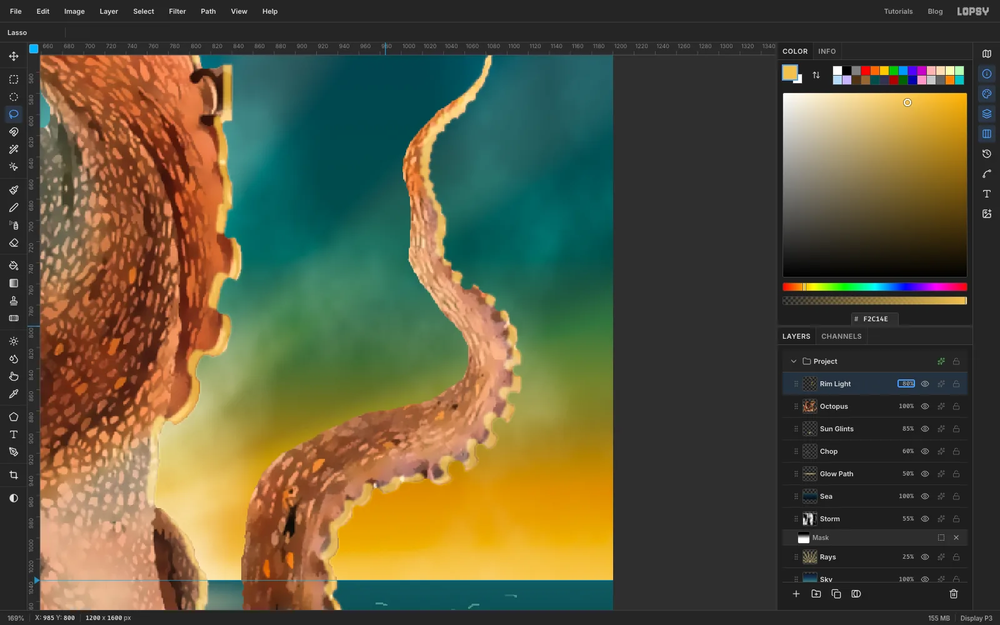

The sunset is low behind the octopus, so its light should catch only the
edges that face right and down. Click *Octopus* and add a layer named
*Rim Light*. [[Cmd]]-click the *Octopus* thumbnail, fill the shape with
`#F2C14E` and deselect.

Click **Duplicate Layer** and rename the copy *Rim Cutter*. With the
**Move** tool, press [[Left]] 8 times and [[Up]] 5 times.
[[Cmd]]-click the *Rim Cutter* thumbnail, click the *Rim Light* row and
press [[Delete]]. Only a thin crescent is left on each right and lower edge.
Deselect and delete *Rim Cutter*.

Lasso a wavy line just above the one you used for the octopus, and delete
everything below it so no rim shows under the water. Choose
**Filter → Gaussian Blur…** `3`, set the **Blend** to **Screen** and the
opacity to **80%**.

## Paint a glowing eye

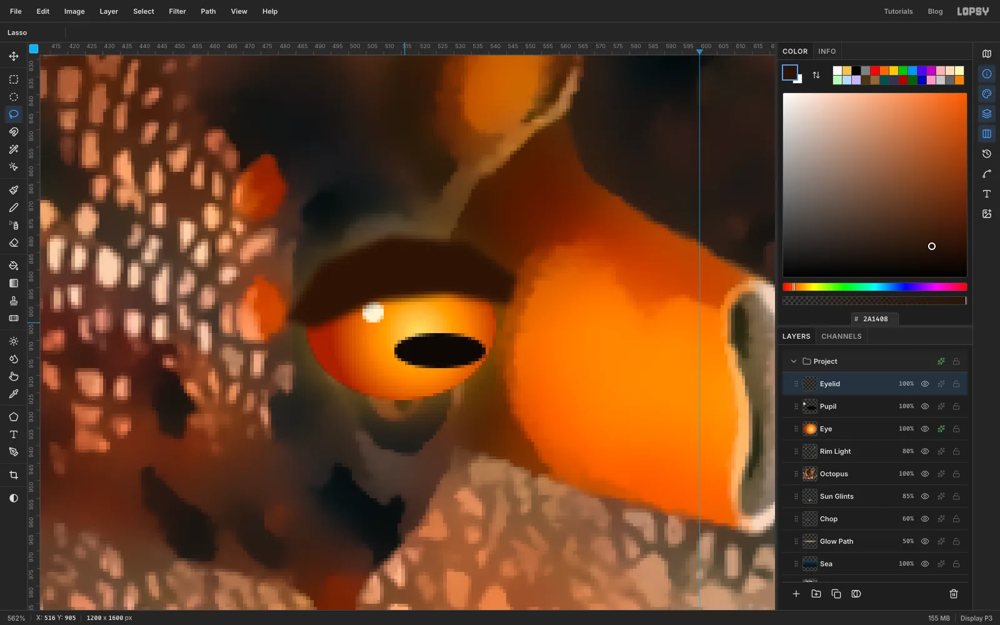

Every pulp monster needs a menacing eye. Paint it over the lithograph's
small eye ring in three layers:

1. **Eye.** Add a layer named *Eye* and select an ellipse from `488, 885`
   to `542, 927`. Set a **Radial** gradient with stops `#FFE27A`,
   `#F28A1E` at 55% and `#9E2E0C`, and drag from the middle of the
   ellipse about 25 px to the right. Deselect and add an **Outer Glow** in
   `#FFB238`, **Size** `24`, **Opacity** `70`.
2. **Pupil.** Add a layer named *Pupil* and fill a flat ellipse from
   `513, 908` to `539, 918` with `#0E0805`. Placing it right of centre and
   low makes the octopus look toward the bottle you'll add later. Fill a
   tiny circle near the top left of the eye with `#FFF6D8` for a catchlight.
3. **Lid.** Add a layer named *Eyelid*. With the **Lasso**, draw a heavy
   crescent over the top third of the eye, a little wider than the eye
   itself. Choose **Select → Feather…** `2` and fill it with `#2A1408`.

## Strike the lightning

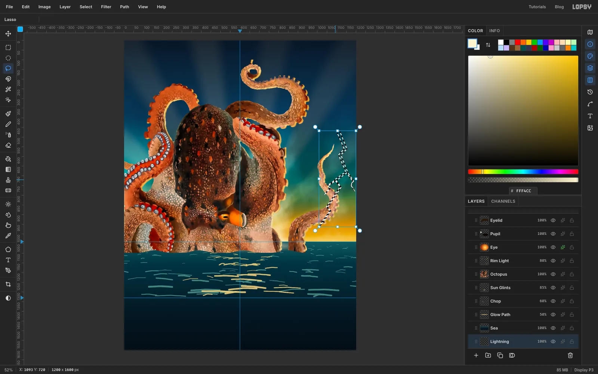

Click *Storm* and add a layer named *Lightning*, so the bolt sits behind
the octopus and the sea. Set the foreground to `#FFF4CC`.

With the **Lasso**, draw a zigzag bolt with four sharp kinks. Start at
about `1108, 470`, where the badge will later cover the top, and come down
to a point at about `1010, 962`. Make it about 16 px wide at the top and
let it narrow steadily to the point. Draw down one side and back up the
other, keeping each run as straight as you can.

Hold [[Shift]] and lasso two thin forks branching off the middle kinks,
each 60 to 110 px long and narrowing to a point. Fill, deselect, and add
an **Outer Glow** in `#FFE9A8`, **Size** `22`, **Opacity** `70`.

## Churn white water around the arms

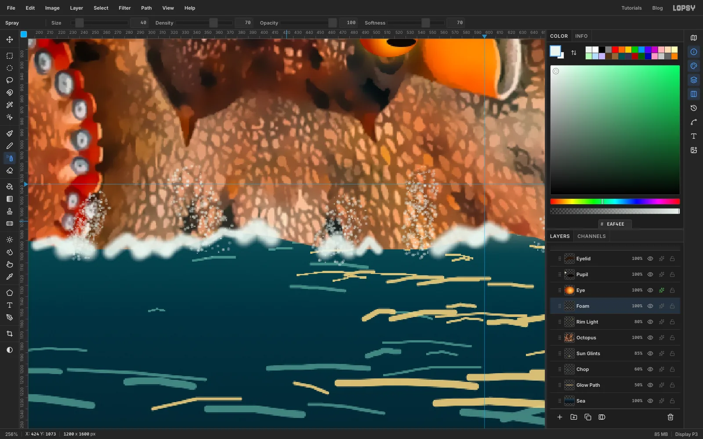

Click *Rim Light* and add a layer named *Foam*. Set the foreground to
`#EAF4EE`.

Pick the **Brush** with **Hardness** `25` and **Opacity** `90`. Paint short
humped strokes along the swell line wherever an arm meets the water. Vary
the **Size** between `10` and `24` and leave a few gaps, so the churn
breaks up instead of running in a line.

Then pick the **Spray**, set **Opacity** `90` and **Density** `70`, and
flick short upward strokes, 25 to 60 px tall, off the churn with **Size**
between `28` and `50`.

## Start the ship in a bottle

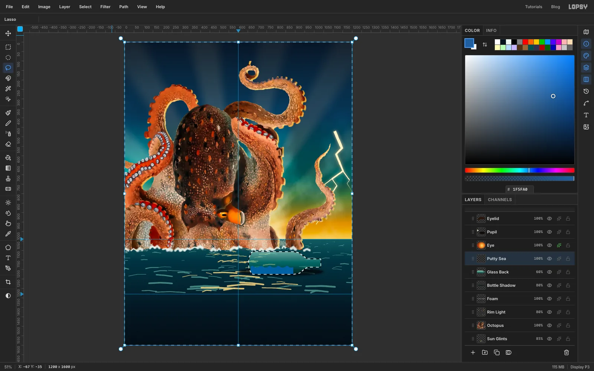

The bottle is built lying on its side, centred on `830, 1166`, and tipped
later.

- **Shadow.** Click *Foam* and add a layer named *Bottle Shadow*. Select an
  ellipse from `590, 1190` to `1050, 1234`, feather it `10` and fill with
  `#04121A`. Set the **Blend** to **Multiply** and the opacity to **80%**.
- **Glass.** Add a layer named *Glass Back*. With the **Lasso**, draw the
  bottle lying on its side: a rounded left end at `x 654`, a body 120 px
  tall (`y 1106` to `1226`) running to `x 890`, a sloping shoulder, and a
  44 px neck from `x 966` to `x 1035`. Set a **Linear** gradient with
  `#A8E0CF` at 0%, `#3E8A7E` at 45% and `#123A38` at 100%, and drag it from
  the top of the bottle to the bottom. Deselect and set the opacity to
  **60%**.
- **Putty sea.** Add a layer named *Putty Sea*. Lasso a wavy band across
  the bottom third of the body, letting it spill past the glass, and fill
  it with `#1F5FA0`. [[Cmd]]-click the *Glass Back* thumbnail, choose
  **Select → Inverse** and press [[Delete]] to trim the putty to the glass.

## Rig the little ship

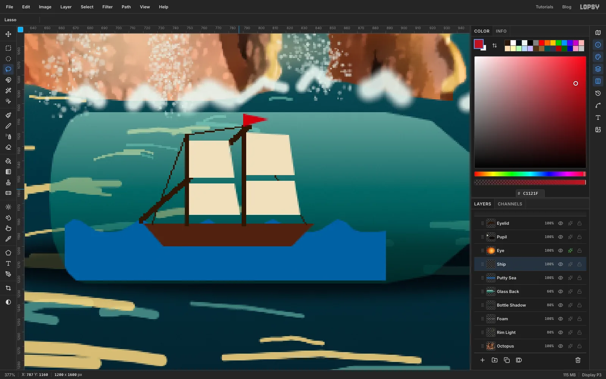

Add a layer named *Ship*. Lasso a small hull, 120 px long at the deck
(`720` to `840` on `y 1184`) and narrower at the keel (`734` to `824` on
`y 1200`), and fill it with `#4A2414`.

Pick the **Pencil**, **Size** `3`, colour `#2B1608`. Click the foot of each
mast and [[Shift]]-click its top to draw a straight line: the first from
`750, 1184` to `750, 1122`, the second from `790, 1184` to `790, 1116`.
Draw a bowsprit from `718, 1182` to the top of the second mast. Drop to
**Size** `1` for two rigging lines from the mast tops down to the bow and
the stern.

Lasso four cream `#EDE0C0` sails, two on each mast, and a tiny red
`#C1121F` pennant at the top of the second mast.

## Finish the glass

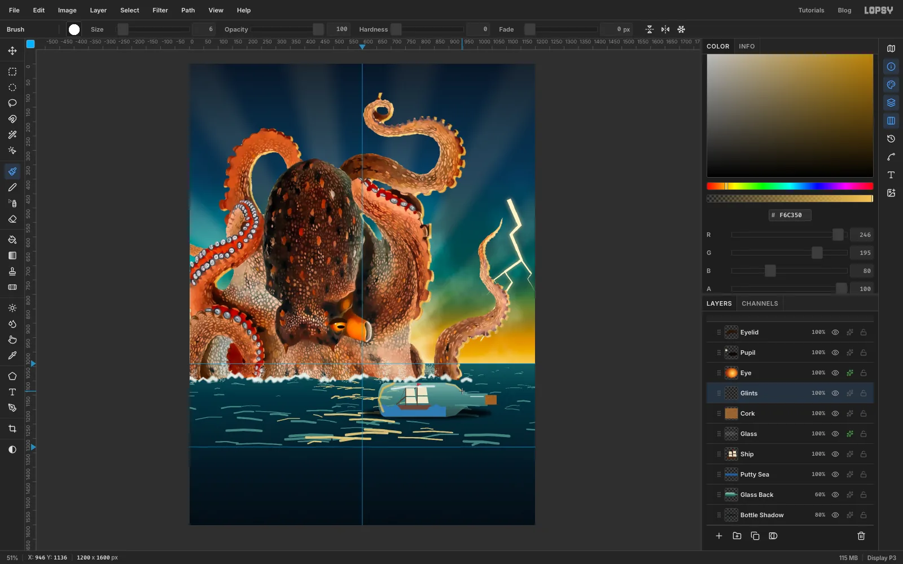

- **Glass.** Add a layer named *Glass*. In the Color panel, set white with
  **A** (alpha) at `12`. [[Cmd]]-click the *Glass Back* thumbnail to load
  the bottle shape and fill. Set the colour back
  to full opacity. Give the layer a **Stroke** of **Width** `3` in `#0B1626`
  and an **Inner Glow** in `#DFF3EE`, **Size** `12`, **Opacity** `60`.
- **Cork.** On a layer named *Cork*, fill a rectangle from `1026, 1149` to
  `1066, 1183` with `#9A6532`. Add **Filter → Add Noise…** `30`, **Mono**,
  for grain.
- **Glints.** On a layer named *Glints*, take the **Brush** at
  **Hardness** `0`, **Opacity** `80`:
  - a white **Size** `12` streak along the top of the body, and a **Size** `6` one on the neck
  - a sulphur `#F6C350` **Size** `12` curve around the left end, and a **Size** `6` one along the shoulder, where the sunset hits it

## Group the bottle and tip it

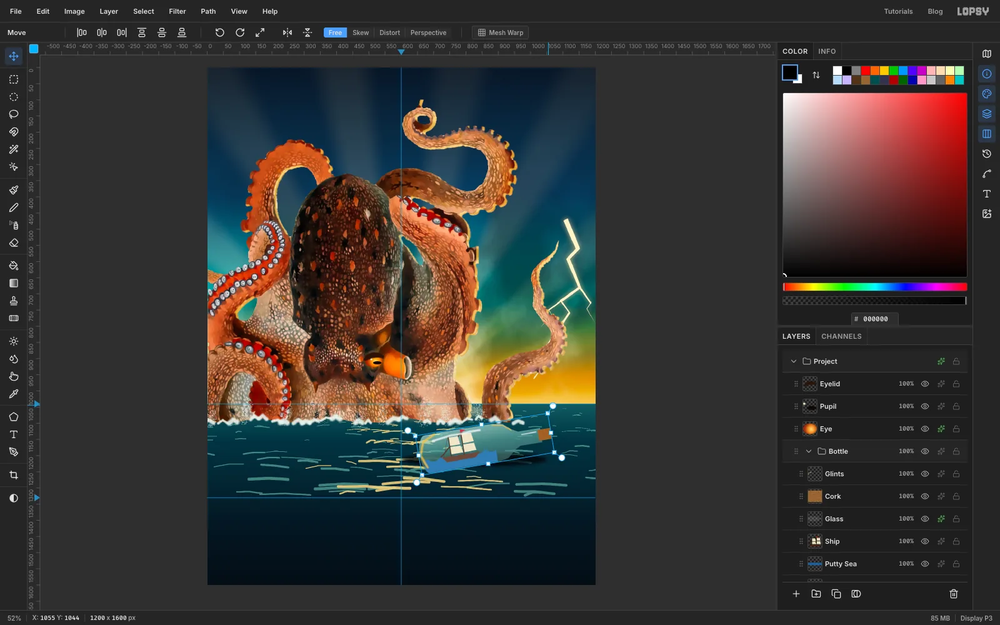

Click *Glass Back*, [[Shift]]-click *Glints*, and choose
**Layer → Group Layers**. Name the group *Bottle*.

With the group selected and the **Move** tool active, drag the top-right
rotate handle up about 9° so the neck lifts, as if a swell is rolling under
it. Press [[Cmd+D]] to commit.

## Sink the bottle into the water

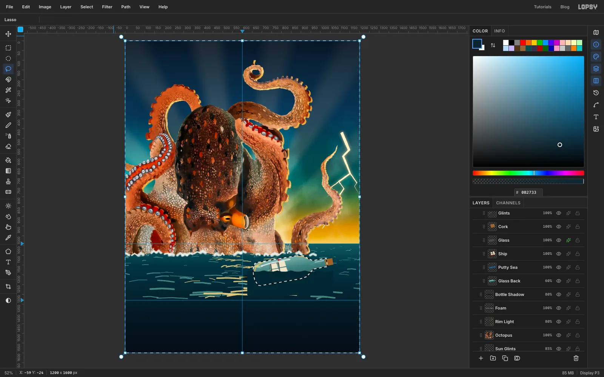

Collapse the *Bottle* group, click it, and add a layer named *Bottle Water*
above it. Lasso a shape from just left of the bottle along a small swell at
about `y 1184`, past its right end, and down below it. Fill it with
`#0B2733` and deselect.

Expand the group and [[Cmd]]-click the *Glass Back* thumbnail. Check that
*Bottle Water* is still the selected row, choose **Select → Inverse** and
press [[Delete]]. The water now darkens only the glass below the waterline.
Set the opacity to **80%**.

Add a layer named *Bottle Foam* and set the foreground to white water
`#EAF4EE`. Give each end of the bottle a short flick of the **Spray**,
**Size** `30`, **Density** `60`.

## Borrow a tentacle tip to grab the bottle

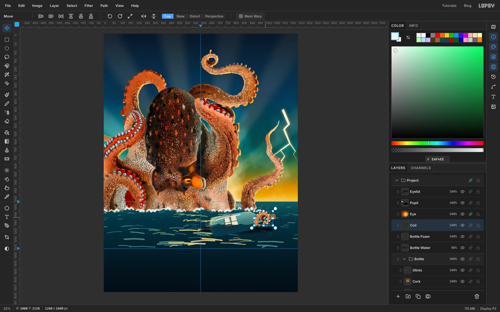

The victim needs a monster. Click *Octopus* and select from `590, 96` to
`722, 262`, around the curl at the end of the top arm. Choose
**Edit → Copy**, click *Bottle Foam*, and choose **Edit → Paste**. Rename
the new layer *Coil* and deselect.

With the **Move** tool, click **Rotate 90° CW** in the options bar so the
curl's arm points down. [[Cmd]]-click its thumbnail. Hold [[Cmd]] and drag
the bottom-right handle in to shrink it by a quarter. Then drag it so the
curl hooks over the bottle's neck at about `1000, 1138`, and press
[[Cmd+D]].

## Hide the cut and set the coil in light

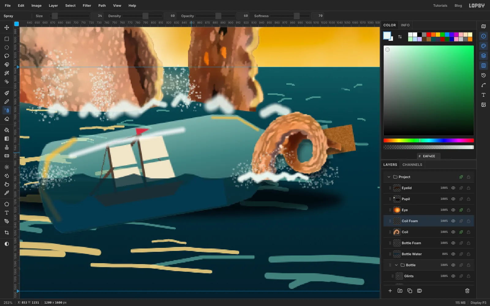

With *Coil* selected, use the **Rectangular Marquee** to select from
`900, 1186` to `1160, 1390` and press [[Delete]], so the coil's cut end
sinks below the waterline. Give *Coil*
the octopus's light: an **Inner Glow** in `#F6D98A`, **Size** `10`,
**Opacity** `35`, and a **Drop Shadow** at `3, 6`, **Blur** `8`,
**Opacity** `60`, so it sits on the glass.

Add a layer named *Coil Foam* and paint four little white clots at the
foot of the coil with the **Brush** (**Size** `8`–`14`). Add one **Spray**
flick above them.

## Set the issue strip

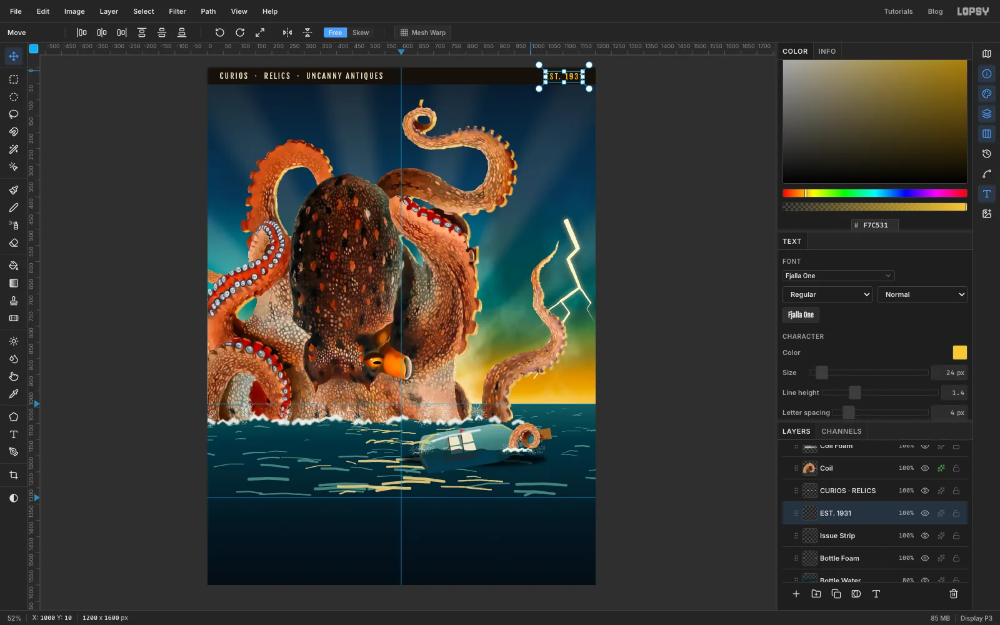

Click *Bottle Foam* and add a layer named *Issue Strip*. Fill a rectangle
from `0, 0` to `1200, 52` with `#14100C`.

Pick the **Text** tool, choose **Fjalla One** at **24 px** in `#EFE3C2`,
and click near `40, 10`. Type `CURIOS · RELICS · UNCANNY ANTIQUES` with
two spaces around each dot, and press [[Tab]] to commit. In the Text panel,
set **Letter spacing** to `4`. Nudge it so the line's middle sits on
`y 26` and its left edge on `x 40`.

Click *Issue Strip* again, so the next text doesn't restyle this one. Type
`EST. 1931` in `#F7C531`, with the same font, size and spacing. Line its
right edge up at `x 1160`.

## Type the masthead

Click *Issue Strip* again. Choose **Ultra** in masthead yellow `#F7C531`
and leave **Letter spacing** at `4` from the strip. Ultra is very wide, so
start at **176 px**. Click at about `80, 60`, type `OCTOPUS` and press
[[Tab]]. The word should span roughly `85` to `1115`. With the **Move**
tool, centre it on the `600` guide with its middle at about `y 160`.

## Lean it forward

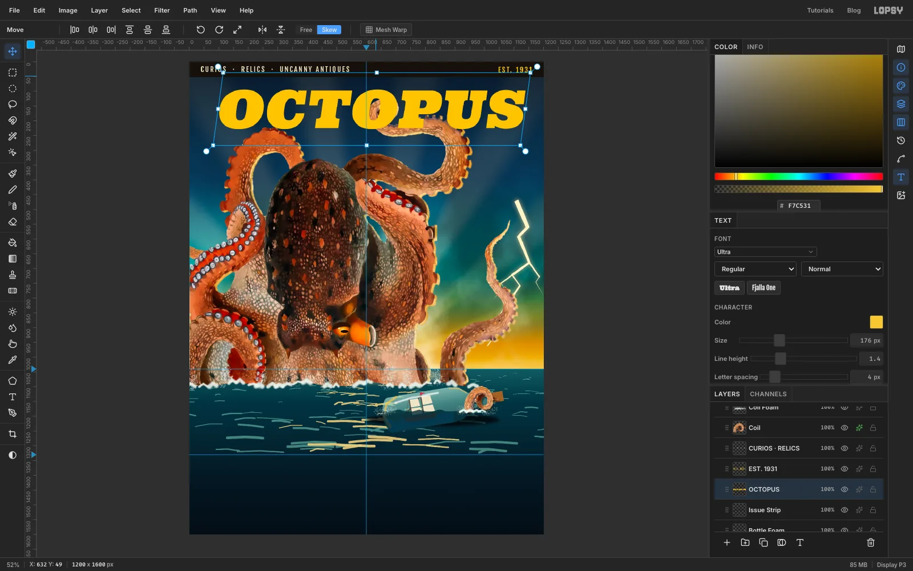

Pulp mastheads often lean forward as if they're moving. Pick the **Move**
tool and click **Skew** in the options bar. Drag the handle in the middle
of the top edge 34 px to the right. The letters slant and the text stays
editable. Click **Free** again and re-centre the word on `600, 160`.

## Build the 3D extrusion

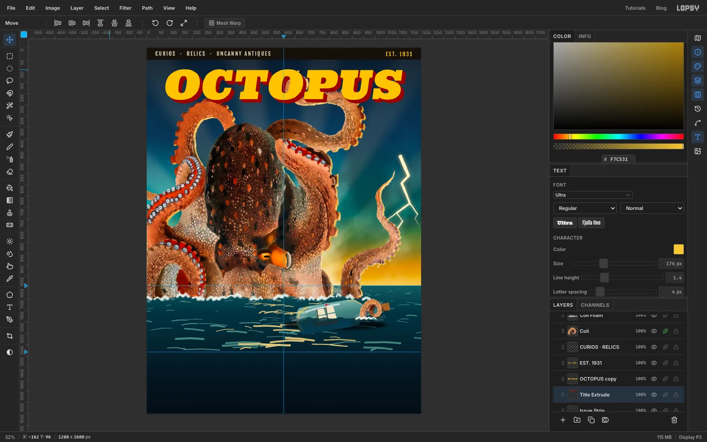

Click **Duplicate Layer**. Click the *lower* of the two OCTOPUS layers,
click **Rasterize Layer** at the bottom of the Layers panel, and rename it
*Title Extrude*. Give it a **Color Overlay** in `#8E1A12`, then click
**Rasterize Layer Style** in its drawer to bake the colour in.

Now thicken it by doubling, with the **Move** tool selected:

1. Click **Duplicate Layer**, press [[Right]] once and [[Down]] once, and
   choose **Layer → Merge Down**.
2. Repeat, nudging **2** px each way, then **4**, then **8**.

Four merges give a solid 15 px extrusion.

## Ink the masthead

Give *Title Extrude* a **Stroke** of **Width** `5` in `#120C08` and a
**Drop Shadow** at `4, 10`, **Blur** `18`, **Opacity** `70`. Old presses
never lined up their plates, so nudge the extrusion 2 px right and 1 px up
for a slightly off-register look.

Click the upper OCTOPUS layer and rename it *Title Face*. Give it the same
**Stroke** and an **Inner Glow** in `#E2701C`, **Size** `14`,
**Opacity** `55`, which warms the edges of each letter.

## Draw the swallowtail ribbon

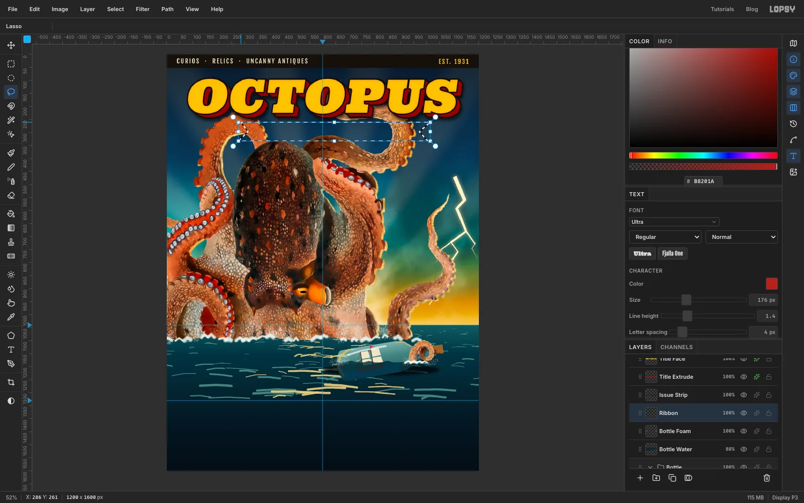

Click *Bottle Foam* and add a layer named *Ribbon*, so it sits under the
masthead. With the **Lasso**, draw a long banner, keeping each edge as
straight as you can. Its corners and notches are at about:

- top edge from `286, 261` to `1014, 261`
- in to a notch at `972, 297`, out to the bottom corner at `1004, 333`
- bottom edge back to `276, 333`
- in to the left notch at `313, 297`

The top corners are 10 px right of the bottom ones, matching the
masthead's lean. Fill with `#B8201A` and deselect. Add a **Stroke** of
**Width** `4` in `#120C08` and a **Drop Shadow** at `3, 8`, **Blur** `12`,
**Opacity** `65`.

## Set ODDITIES on the ribbon

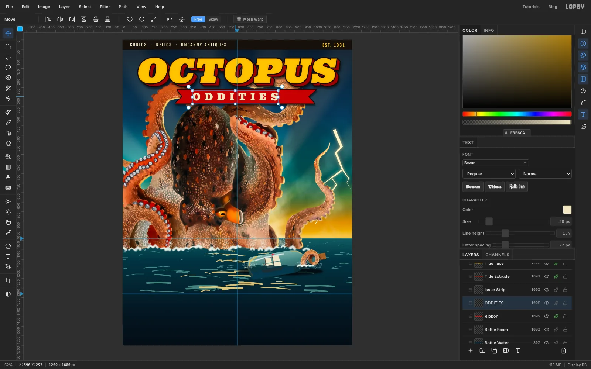

Clicking near the masthead would edit it, because its text box reaches
below the letters. So type this word out in the open water first. With
*Ribbon* selected, choose **Bevan** at **50 px** in `#F3E6C4`, click at
about `380, 1420`, type `ODDITIES` and press [[Tab]]. Set **Letter spacing**
to `22`.

With the **Move** tool, drag it up onto the ribbon and nudge it until it's
centred on `590, 297`, the middle of the part of the ribbon you'll see.

## Let an arm grab the ribbon

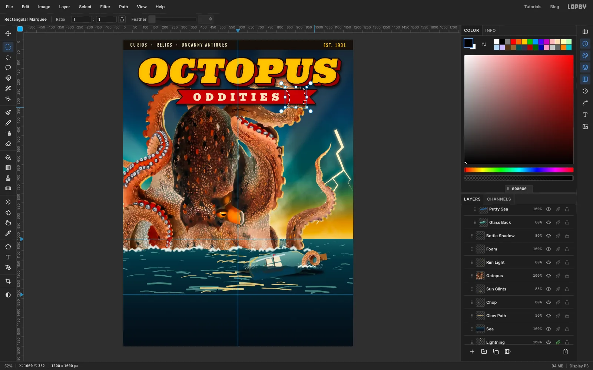

One of the arms runs behind the ribbon's right end. Bring it in front by
cutting the ribbon away where the arm is.

Click *Ribbon* and [[Cmd]]-click the *Octopus* thumbnail. Pick the
**Rectangular Marquee**, hold [[Shift]] and [[Option]], and drag from
`846, 246` to `1000, 352`. Shift+Option keeps only the overlap, so you're left
with the arm's shape across the ribbon tail. Press [[Delete]].

The ribbon's **Stroke** now inks a keyline along the arm. Select from
`948, 240` to `1038, 350` and press [[Delete]] again to clear the scraps of
tail beyond the arm.

## Make the starburst

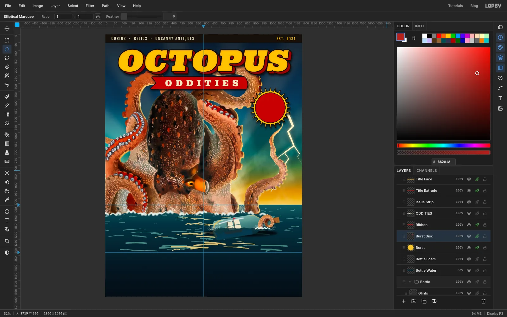

Click *Bottle Foam* and add a layer named *Burst*. Set the foreground to
`#F7C531` and choose **Filter → Sunburst…**:

- **Rays** `24`, **Width** `100`
- **Taper** `100`, so each ray is a spike that comes to a point
- **Length** `8`. Length is a percentage of the distance from the centre to the farthest corner of the page, so `8` ends the tips about 122 px out
- **Center X** `84` and **Center Y** `28`, which is `1008, 448`
- **Fade**, **Softness** and **Jitter** at `0`

Click **Apply**. Fill a circle from `908, 348` to `1108, 548` with the same
yellow to fill between the roots of the spikes, and deselect. Add a
**Stroke** of **Width** `4` in `#120C08` and a **Drop Shadow** at `4, 10`,
**Blur** `14`, **Opacity** `70`.

On a layer named *Burst Disc*, fill a circle from `918, 358` to
`1098, 538` with ribbon red `#B8201A` and give it a **Stroke** of
**Width** `3` in `#120C08`.

## Letter and tilt the badge

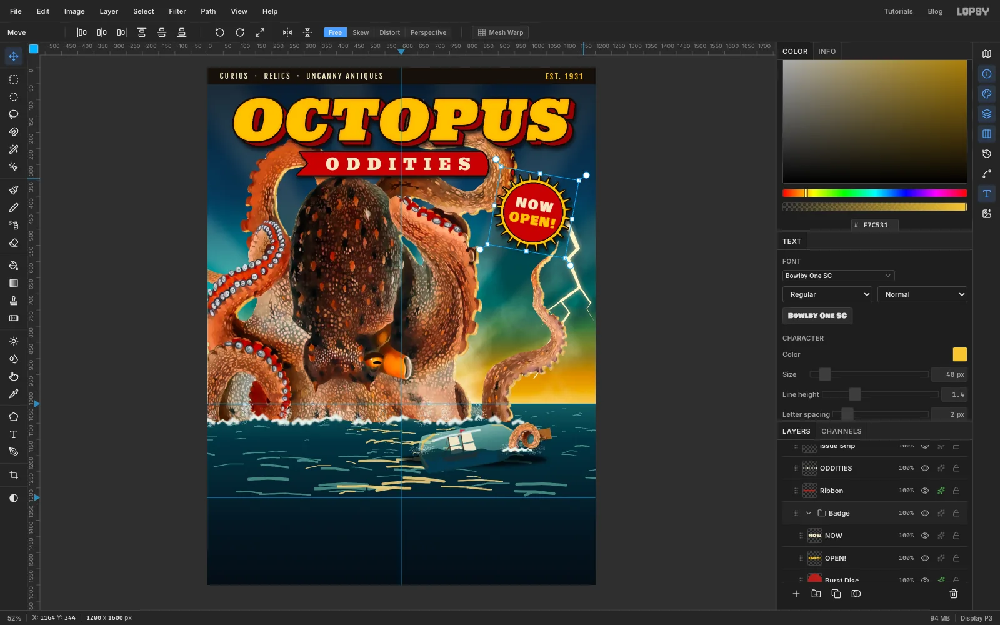

With *Burst Disc* selected, set **Bowlby One SC** at **40 px**, cream
`#F3E6C4`, letter spacing `4`. Click in open water, around `120, 1440`,
type `NOW` and press [[Tab]]. Then drag it into the disc with the **Move**
tool so its middle sits at `1008, 424`. Click *Burst Disc* again and type
`OPEN!` in yellow `#F7C531`, spacing `2`. Centre it on `1008, 471`. Leave at
least 10 px between the exclamation mark and the edge of the disc.

Click *Burst* and [[Shift]]-click *NOW* to select the four badge layers.
Choose **Layer → Group Layers** and name the group *Badge*. With the
**Move** tool, drag its top-right rotate handle clockwise about 10°, and
press [[Cmd+D]].

## Write the teaser card

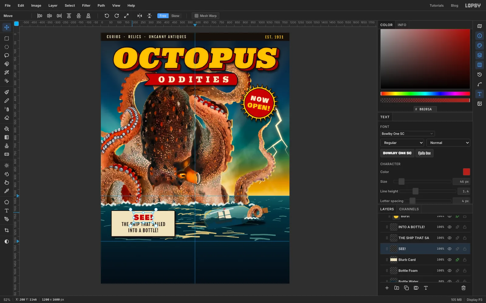

Click *Bottle Foam* and add a layer named *Blurb Card*. Fill a rectangle
from `70, 1136` to `470, 1298` with `#EFE3C2`. Give it a **Stroke** of
**Width** `4` in `#120C08` and a **Drop Shadow** at `6, 10`, **Blur** `12`,
**Opacity** `70`.

Type the three lines from the bottom up, clicking *Blurb Card* before each
one, so a click never lands in a line you've already set:

- `INTO A BOTTLE!` in **Fjalla One** **30 px**, `#14100C`, spacing `2`, centred on `270, 1258`
- `THE SHIP THAT SAILED` the same way, centred on `270, 1220`
- `SEE!` in **Bowlby One SC** **46 px**, red `#B8201A`, spacing `4`, centred on `270, 1176`

## Tilt the card

Click *Blurb Card* and [[Shift]]-click *INTO A BOTTLE!*, the topmost of the
three lines. Choose **Layer → Group Layers** and name the group *Blurb*.
With the **Move** tool, drag the top-right rotate handle up about 4°
counter-clockwise, and press [[Cmd+D]]. A slight tilt reads as a pasted-on
teaser, the way pulp covers stuck their blurbs at an angle.

## Draw the info band on the grid

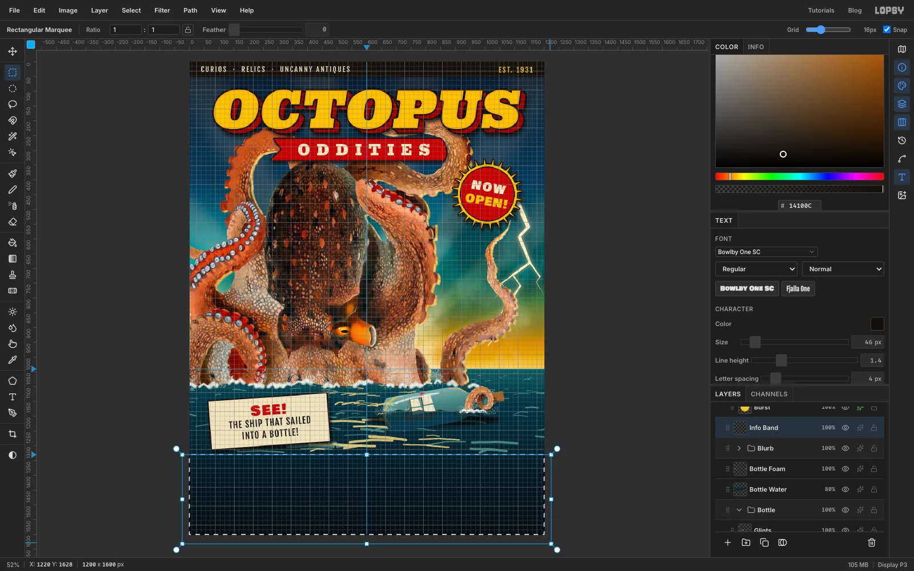

Collapse *Blurb*, click it, and choose **View → Show Grid**. The grid is
16 px and **Snap** turns on with it. Add a layer named *Info Band*. With the
**Rectangular Marquee**, drag from off the left edge, just below the
`1330` guide, to past the bottom-right corner. The top edge snaps to the
nearest grid line, `1328`.
Fill it with `#14100C`, deselect, and turn the grid off again with
**View → Show Grid**.

## Rule the band

Add a layer named *Info Rules*. Pick the **Pencil** at **Size** `3` with
foreground `#F7C531`. Click at `48, 1348`, then [[Shift]]-click at
`1152, 1348` for a straight rule. Draw the second rule from `48, 1580` to
`1152, 1580` the same way.

## Set the shop's details

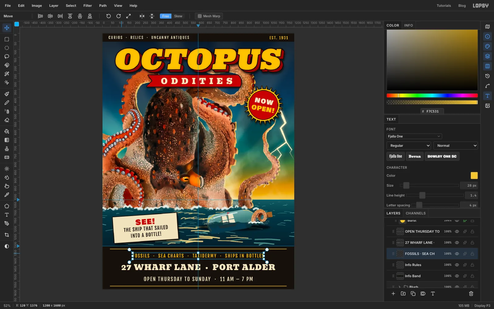

Again working from the bottom up, with *Info Rules* selected before each
line:

- `OPEN THURSDAY TO SUNDAY · 11 AM – 7 PM` in **Fjalla One** **32 px**, `#EFE3C2`, spacing `4`, centred on `600, 1535`
- `27 WHARF LANE · PORT ALDER` in **Bevan** **48 px**, `#F3E6C4`, spacing `3`, centred on `600, 1461`
- `FOSSILS · SEA CHARTS · TAXIDERMY · SHIPS IN BOTTLES` in **Fjalla One** **28 px**, `#F7C531`, spacing `4`, centred on `600, 1389`

Put two spaces either side of each dot. Leave about the same gap above the
first line as below the last, about 30 px from each rule.

Click *Info Band* and [[Shift]]-click *OPEN THURSDAY TO*, the topmost of
the three text rows in the Layers panel. Choose **Layer → Group Layers** and
name the group *Info*.

## Yellow the paper

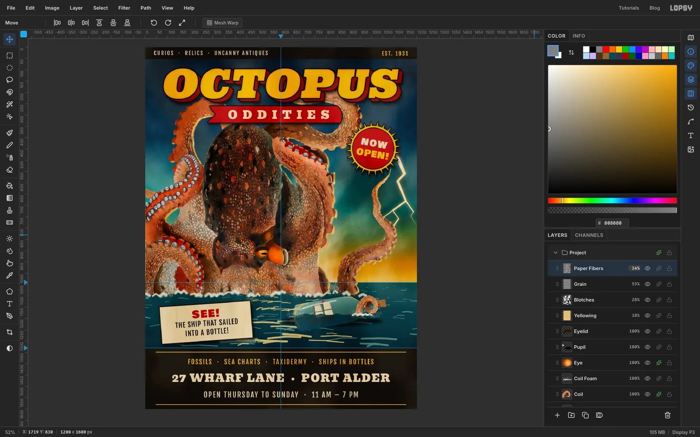

Collapse your groups and click the top layer. Then add four layers for the
pulp paper:

- **Yellowing.** Fill the whole layer with `#E2BE73`. **Blend**
  **Multiply**, opacity **18%**.
- **Blotches.** **Filter → Clouds…** **Scale** `8`. **Blend**
  **Soft Light**, opacity **28%**.
- **Grain.** Fill with `#808080`, then **Filter → Add Noise…** **Amount**
  `60`, **Mono**, **Gaussian**. **Blend** **Overlay**, opacity **55%**.
- **Paper Fibers.** **Filter → Fibers…** **Variance** `16`, **Strength**
  `8`. **Blend** **Multiply**, opacity **14%**.

## Burn the edges

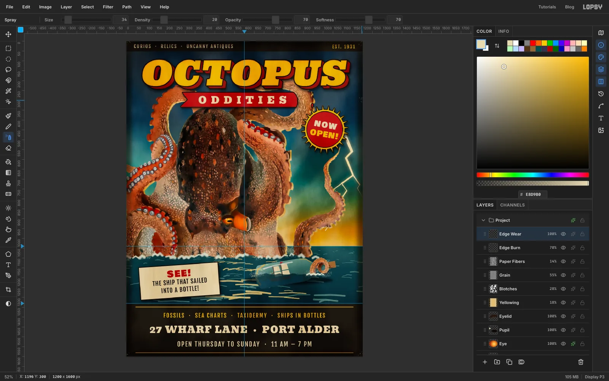

Add a layer named *Edge Burn*. Select from `26, 26` to `1174, 1574`, choose
**Select → Inverse** and **Select → Feather…** `22`, and fill with
`#4A2C12`. Deselect, set the **Blend** to **Multiply** and the opacity to
**70%**. The page edges brown like old newsprint.

On a layer named *Edge Wear*, click a few times with the **Spray** at
**Size** `34`, **Density** `20`, colour `#E8D9B0`, right on the corners and
two points on the edges. These are scuffs where the paper rubbed.

The grain is too fine to judge at fit-to-screen zoom, so choose
**View → Actual Size** and look at the teaser card. You should see a speckle
over the cream and the black type, as if it were printed on rough paper.

## Grade the whole flier

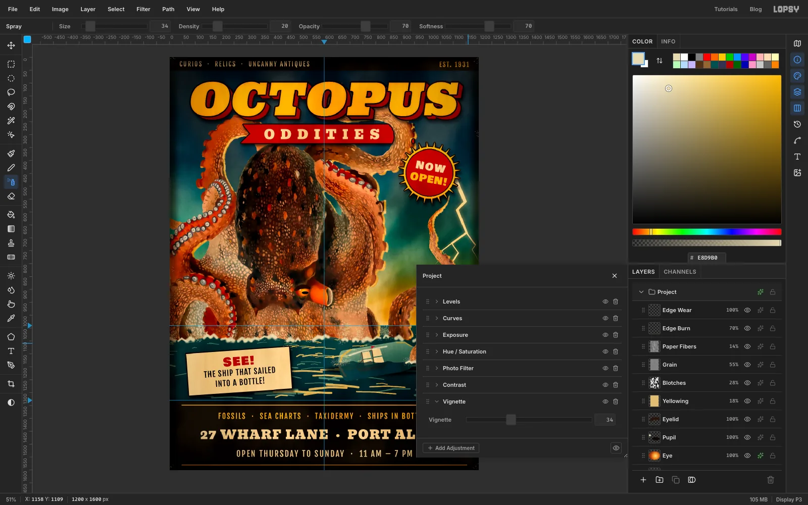

Choose **Layer → Adjustment Layer…** to open the adjustment stack for the
whole document. The stack already holds neutral **Levels**, **Curves**,
**Exposure** and **Hue/Saturation** nodes, so leave those alone. Click
**Add Adjustment** three times:

- **Photo Filter**, **Density** `18`, to warm everything
- **Contrast** `10`
- **Vignette** `34`, to pull the eye into the middle

Close the drawer. Export with **File → Quick Export PNG** and save the
project with **File → Save Project**.
