Christmas cards are usually quiet: snow, candles, a silent night. This one is a gig flyer for a band that doesn't exist, **The Mohawk Evergreens**, playing the North Pole on Christmas Eve. The headline says it all: **NO SILENT NIGHT**.

Punk flyers from the late 1970s were made with whatever was free. Photos were run through a photocopier until they turned into hard black shapes. Text came from a typewriter, a marker or a strip of tape, and everything was glued to whatever paper was lying around. Nothing lines up, and that's the charm. You'll copy all of those moves here:

- a real photo of a tree, "photocopied" with **Threshold** until it's solid black ink
- a second, yellow copy of the tree printed slightly out of register, the way cheap two-colour printing slips
- a torn fluorescent flyer taped onto newsprint
- punk hardware as decorations: barbed wire, chrome studs and safety pins
- toner specks and streaks over everything at the end

The document is 1400 × 1960 px, a 5 × 7 card at 280 dpi. Where this tutorial gives coordinates, read them off the rulers as rough targets. Nothing here needs to be exact.

You'll need one photo, which is CC0 (no rights reserved) on Wikimedia Commons: [Picea pungens f. glauca, Miranda de Ebro, Spain](https://commons.wikimedia.org/wiki/File:Picea_pungens_f.glauca,_Miranda_de_Ebro,_Spain.jpg) by Jebulon, a blue spruce standing against a stone wall. Download the **1280 px** wide version and save it as `spruce.jpg`.

The tools you'll use:

- **Threshold**, **Gaussian Blur**, **Add Noise** and **Motion Blur**
- the **Magic Wand**, **Lasso**, **Rectangular Marquee**, **Select → Inverse** and the **Eraser**
- the **Move** tool's scale and rotate handles, and nudging with the arrow keys
- the **Brush** with **Taper**, a home-made brush tip from **Edit → Define Brush…**, and brush **Size Jitter**, **Angle Jitter** and **Scatter**
- the **Pen** tool for straight and curved strokes
- **Duplicate Layer**, **Copy**, **Paste**, **Merge Down**, **New Group** and **Rasterize Layer**
- layer effects: **Drop Shadow**, **Stroke** and **Color Overlay**, plus the **Multiply** blend mode
- text in **Anton**, **Permanent Marker** and **Special Elite**

The palette is one photocopier and three cheap inks:

- Newsprint `#ECE6D6`, type grey `#5E584C`, paper core `#F7F5EF`
- Toner black `#141414`
- Fluoro pink `#FF3E8E`, misprint yellow `#F7EA1E`, mohawk lime `#8DF03C`
- Marker red `#E3262B`, masking tape `#E6D37F`
- Chrome `#FFFFFF` → `#C3C9D1` → `#7D848E` → `#16181C`, wire silver `#D3D7DD`

> **Tip:** On a wide-gamut (Display P3) screen, Lopsy reads typed hex codes as P3 colours. These codes were picked that way, so they'll look a touch duller on an sRGB screen.

> **Note:** Shortcuts are written for a Mac. On Windows use [[Ctrl]] wherever it says [[Cmd]]. To rename a layer, double-click its name. Keep layers named as you go, because later steps refer to them.

## Set up the card and type the newsprint

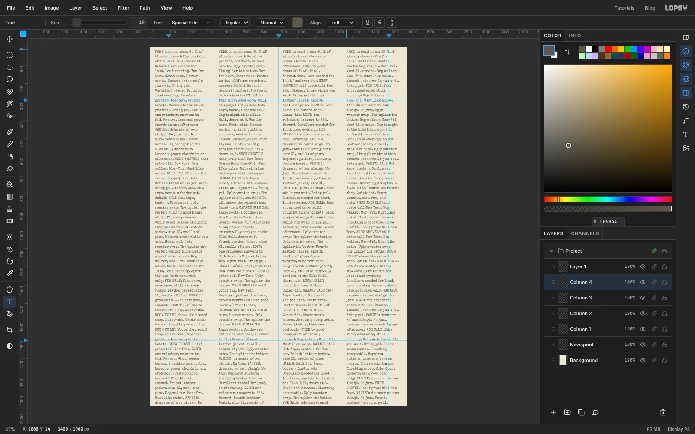

Choose **File → New**, keep the units on **Pixels**, and make the document **1400** wide and **1960** high. A new document comes with a **Background** layer and an empty **Layer 1** above it. Leave Layer 1 alone for now. It becomes the flyer's paper later.

Drop a few guides by clicking the rulers: on the top ruler at x **100**, **700** and **1300**, and on the left ruler at y **290** and **1600**. The middle one marks the centre line for the tree, and the others mark roughly where the flyer will sit.

Click the **Background** row, set the foreground to `#ECE6D6` and choose **Edit → Fill**. To set the foreground colour anywhere in this tutorial, click the hex field at the bottom of the **Color** panel, type the code and press [[Enter]].

Newsprint needs words. Click **Add Layer** (the **+** under the Layers panel) and name the layer **Newsprint**. Press [[T]] for the **Text** tool, set the font to **Special Elite** and the **Size** to **19**, and set the foreground to `#5E584C`. Click near the top-left corner and type 15 to 20 lines of made-up classified ads, about 28 characters to a line, pressing [[Enter]] at the end of each line. Things like *LOST: one reindeer, answers to Sid* or *WANTED: drummer w/ own sleigh*. Then select what you typed with [[Cmd+A]], copy it, click at the end and paste it a few times until the column reaches the bottom of the canvas. Press [[Tab]] to finish.

Make three more columns the same way, each starting about a quarter of the canvas further right. Reuse the same ads in a different order. After each column, click **Rasterize Layer** at the bottom of the Layers panel. That turns the type into plain pixels, so clicking near it later can't reopen it for editing.

## Knock the newsprint back

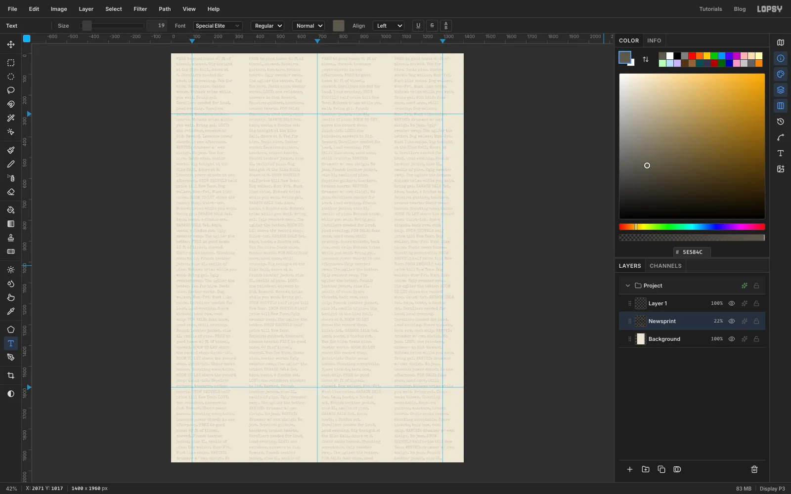

Choose **Layer → Merge Down** four times, until all four columns are part of the **Newsprint** layer.

Click the sparkle icon at the right of the layer's row to open the effects drawer, set the blend mode to **Multiply**, and close the drawer. That's the "effects button" in later steps. Then click the **100%** figure on the row, which is its opacity button, and drag the slider to **22%**. Now it reads as old paper rather than something you're meant to read.

## Drop the spruce photo onto the canvas

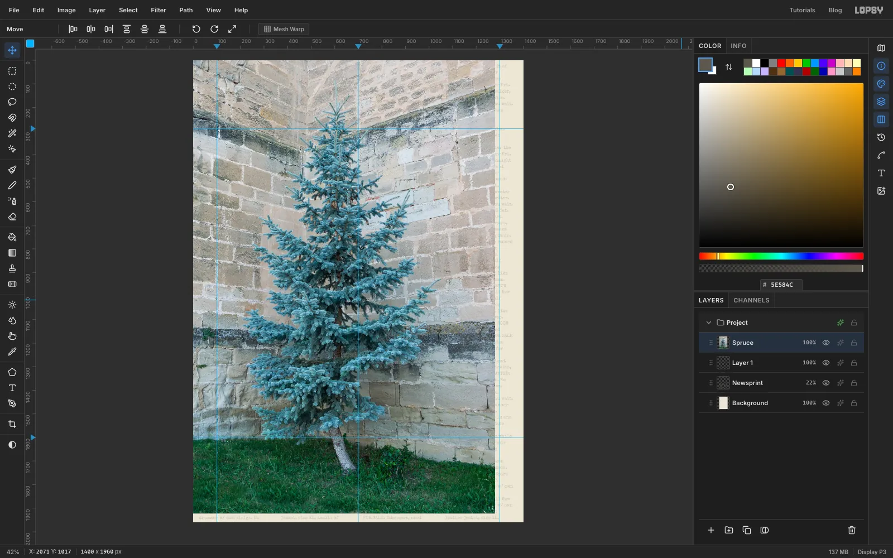

Click the empty **Layer 1** row, then drag **spruce.jpg** from your computer onto the canvas. It lands in the top-left corner as a new layer, already selected and with the **Move** tool active. Press [[Cmd+D]] to drop the selection and rename the layer **Spruce**.

The photo is only there as raw material. In the next few steps it gets photocopied into a hard black silhouette.

## Photocopy it with Threshold

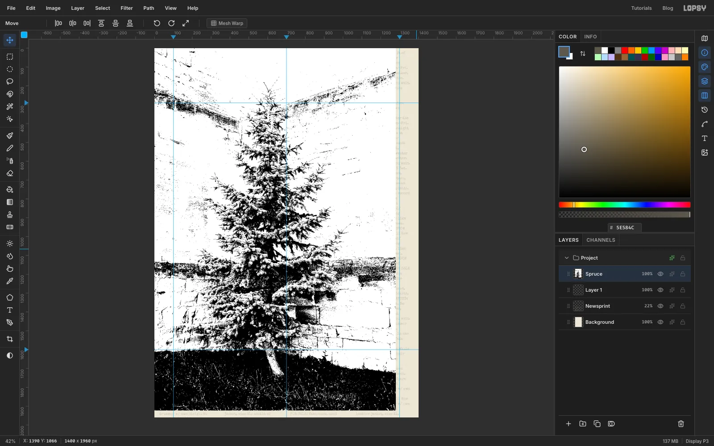

Choose **Filter → Threshold...**, set the **Level** to **105** and click **Apply**.

Every pixel is now either black or white, which is exactly what a cranked-up photocopier does. The tree is dark enough to go black, the sunny wall goes white, and the needle tips with frost on them break up into white speckle.

## Close up the speckle

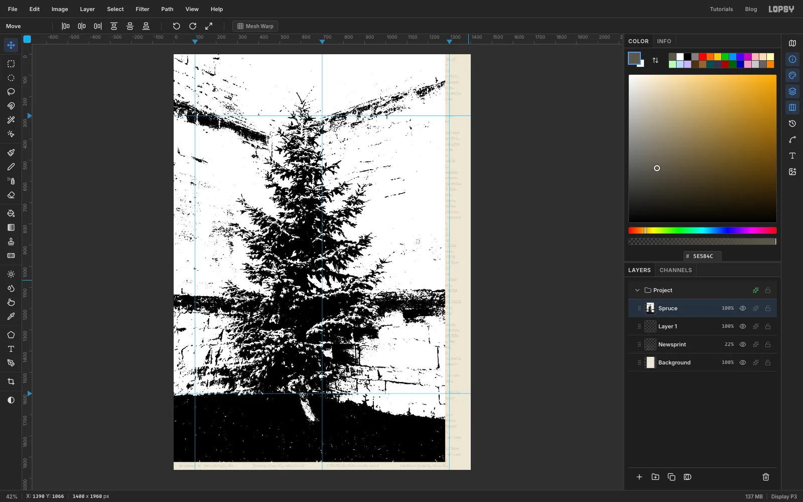

That speckle makes the tree look grey from a distance, and you want solid ink. Choose **Filter → Gaussian Blur...** with a **Radius** of **2**, then **Filter → Threshold...** again with a **Level** of **215**.

The blur smears the small white flecks into grey. The second Threshold is set high, so anything that isn't almost pure white goes back to black, and the flecks fill in. It's a quick way to thicken a black-and-white image.

## Select all the white with the Magic Wand

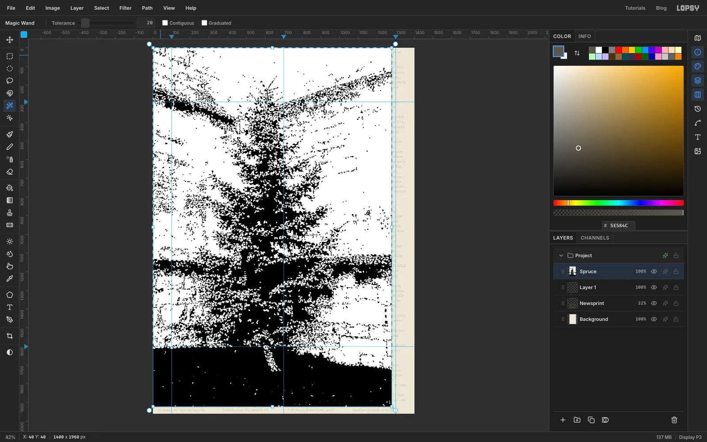

Press [[W]] for the **Magic Wand**. In the options bar set **Tolerance** to **20** and untick **Contiguous**, so a single click picks up every white pixel in the layer, not only the ones touching where you click.

Click anywhere on the white wall in the top-left corner. Press [[Delete]], then [[Cmd+D]]. The white is gone, and only black remains: the tree, plus bits of wall, mortar and grass.

## Lasso around the tree

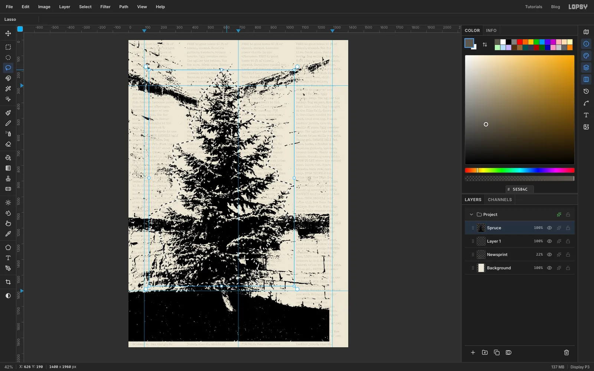

Press [[L]] for the **Lasso** and trace around the tree, a little outside the tips of the branches. Start at the tip, work down the right side, run along under the lowest branches, and come back up the left side to where you started.

Two things matter here:

- where the lasso has to cut across branches it leaves a cut edge. Follow the branch tips where you can, and don't worry about the odd straight run: you'll soften those cut edges with a brush in a few steps
- take the bottom edge just above the grass. It's fine to slice through the bottom of the tree, because the trunk is going to be covered later

## Cut the tree out

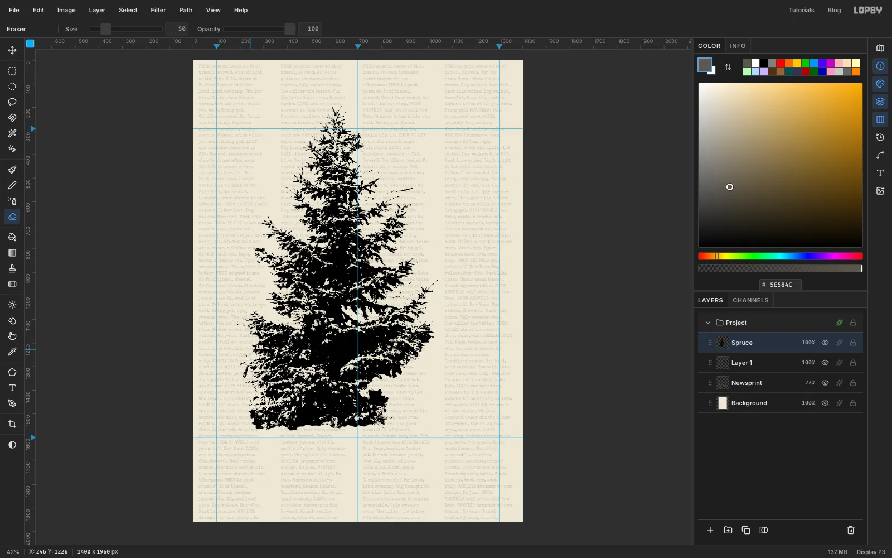

Choose **Select → Inverse**, press [[Delete]] and then [[Cmd+D]]. Everything outside your lasso disappears.

Look at the lower left of the tree. A dark band on the wall ran behind those branches, and it's still there as a black slab between them. Press [[E]] for the **Eraser**, set its **Size** to **50**, and drag three short horizontal strokes across the slab from the left edge inward, about 35 px apart. Stop each one a little short of the branches, and stop them at slightly different places so you don't leave a straight edge.

## Scale the tree down

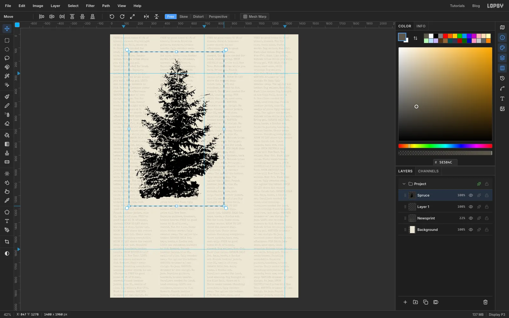

Press [[M]] for the **Rectangular Marquee** and draw a box around the whole tree with a little room to spare.

Press [[V]] for the **Move** tool. Hold [[Cmd]] and drag the bottom-right handle up and to the left until the box is about three-quarters of its size. [[Cmd]] keeps the proportions. Press [[Enter]] to apply it and [[Cmd+D]] to deselect.

> **Tip:** Keep the marquee's edges away from the guides while you draw it. With **Snap to Guides** on, an edge that gets close jumps onto the guide, and any branches outside the box get left behind.

## Centre the tree

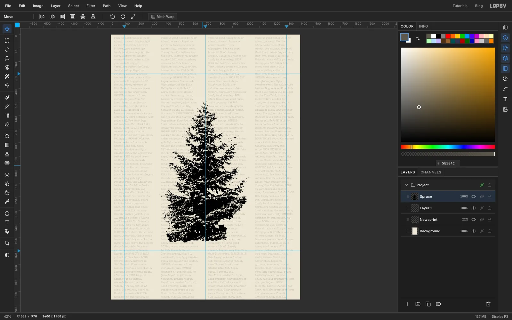

With the **Move** tool still active and nothing selected, drag the tree so its tip sits on the centre guide at about y 470. Its lowest branches should end up around y 1540.

## Lop off the spindly top

A spruce has a thin, wispy leader at the top. You're about to replace it with a mohawk, so cut it off.

With the **Lasso**, draw a shape around everything above about y 800: up and around the tip, and back across the tree along a slightly uneven line with small ups and downs. Press [[Delete]] and [[Cmd+D]]. That edge is the tree's new hairline, and the needles left along it will cover the roots of the mohawk.

## Flick needle tips out of the cut edges

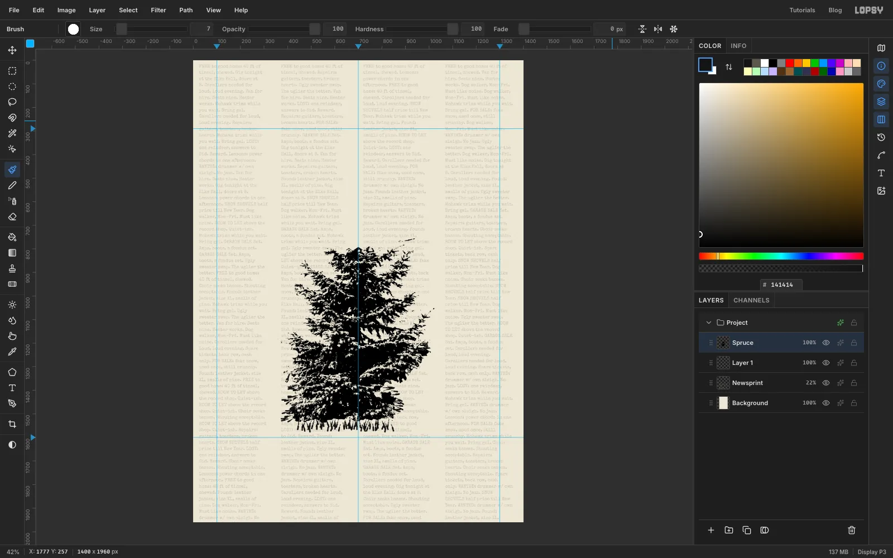

Anywhere your lasso sliced through branches, there's an edge that looks cut with scissors. You can hide those by drawing a few needles back in.

Press [[B]] for the **Brush**. Click the brush-tip thumbnail at the left of the options bar to open the **Brushes** window, pick **Hard Round** on the **Presets** tab, then on the **Shape** tab set **Size** to **7**, **Hardness** to **100**, **Spacing** to **5** and **Taper** to **28**. Close the window.

Taper makes each stroke start at nothing and swell to full size, so always start a stroke at the **tip** of the needle, out in the empty space, and drag back into the tree. Set the foreground to `#141414` and flick short strokes, 20–50 px long, two or three at slightly different angles at each spot:

- out to the left along the lower left edge
- down along the base
- out to the right along the notch on the lower right

When you're done, open the **Brushes** window again and set **Taper** back to **0**, or every brush stroke from here on will be tapered.

## Tear out the pink flyer

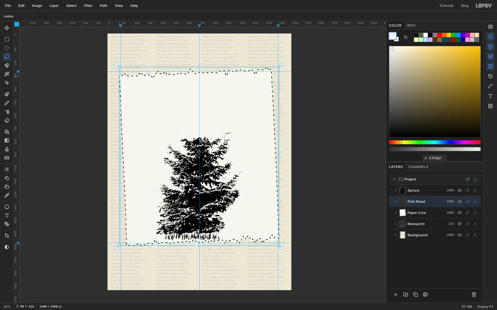

When you tear coloured paper, the torn edge shows the white paper inside it. You'll fake that with two layers.

Click **Layer 1** and rename it **Paper Core**. Set the foreground to `#F7F5EF`. With the **Lasso**, draw a big sheet from about x 110 to 1290 and y 285 to 1610, leaning slightly counter-clockwise, so each side drifts about 50 px to the right from top to bottom. Make the top and bottom edges jagged and torn, and keep the two sides nearly straight, as if it had been cut there. Choose **Edit → Fill** and press [[Cmd+D]].

Click **Add Layer** and name it **Pink Sheet**. Lasso almost the same shape again. Run its sides right along the white sheet's sides so no white shows there, but tuck it 5–8 px inside the white along the torn top and bottom, with a differently jagged edge.

## Fill the flyer pink

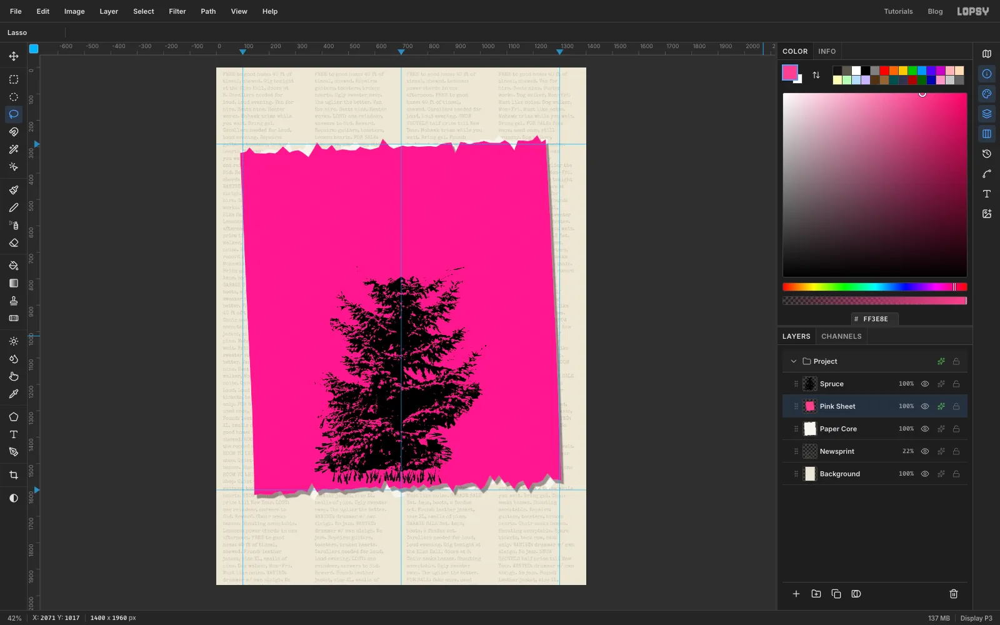

Set the foreground to `#FF3E8E`, choose **Edit → Fill** and press [[Cmd+D]].

Open the **Pink Sheet** effects, tick **Drop Shadow**, set the colour to `#2A1A20`, **Offset X** to **10**, **Offset Y** to **14**, **Blur** to **4** and **Opacity** to **45**, and close the drawer. The white core peeks out along the torn edges, and the shadow lifts the sheet off the newsprint.

## Tape the corners down

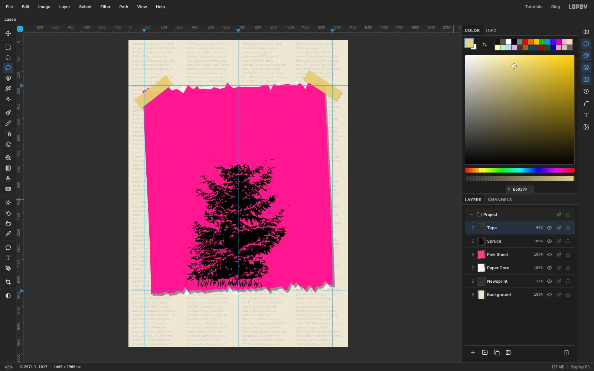

Click the **Spruce** row and add a layer called **Tape**. Set the foreground to `#E6D37F`.

With the **Lasso**, draw a strip of tape about 250 × 70 px across the top-left corner of the flyer, angled about 38° so it runs down to the left. Give the two short ends a little zig-zag, like torn tape. Then hold [[Shift]] and lasso a second strip across the top-right corner, angled the other way. [[Shift]] adds to the selection. Choose **Edit → Fill** and press [[Cmd+D]].

Apply **Filter → Add Noise...** with **Amount** **18** and the **Mono** toggle selected. Add a **Drop Shadow** with the colour `#3A2A10`, **Offset X** **2**, **Offset Y** **4**, **Blur** **4** and **Opacity** **30**, then set the layer's opacity to **90%** so the pink shows faintly through the tape.

## Print a yellow plate out of register

Click the **Spruce** row and choose **Layer → Duplicate Layer**. The copy appears above it. Rename the copy **Spruce Ink**.

Now click the original **Spruce** row underneath and rename it **Spruce Misprint**. Open its effects, tick **Color Overlay**, set the colour to `#F7EA1E` and close the drawer.

With **Spruce Misprint** still selected, press [[V]] and nudge it out of line: [[Shift+Right]] once and [[Right]] four times moves it 14 px right, and [[Shift+Down]] once moves it 10 px down. The yellow shows along every edge, just like a two-colour print where the plates slipped.

## Draw the mohawk spikes

The mohawk goes underneath the tree, so the ragged hairline you cut earlier covers the roots of the spikes.

Click the **Pink Sheet** row and add a layer called **Mohawk**. With the **Lasso**, draw seven long thin triangles, about 35 px wide at the base. Root all of them inside the tree at about y 880, across a span only 100 px wide around the centre line, and fan them out:

- the middle spike stands straight up and is the tallest, reaching about y 530
- the others lean out by up to about 28° on each side
- vary the lengths, a little longer, then shorter, then longer again, so they look gelled rather than ruled

Draw the first triangle normally, then hold [[Shift]] for each of the others to add it to the selection.

## Dye the mohawk lime

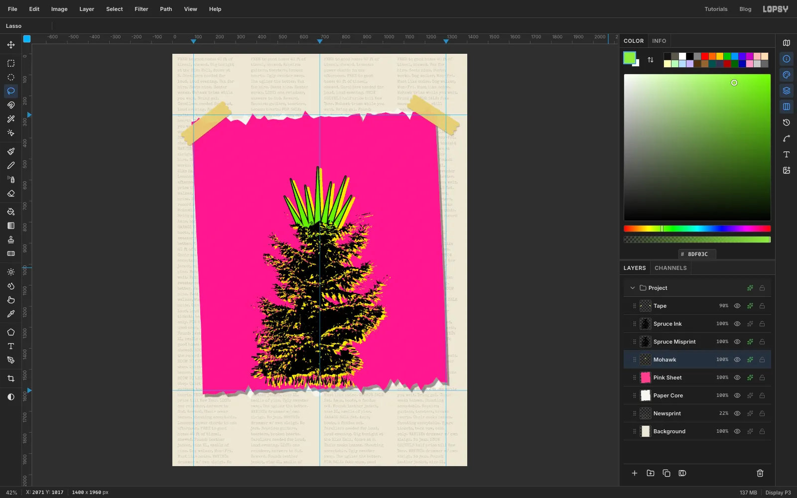

Set the foreground to `#8DF03C`, choose **Edit → Fill** and press [[Cmd+D]].

Open the **Mohawk** effects. Tick **Stroke**, set **Width** to **5** and the colour to `#141414`. Then tick **Drop Shadow**, set the colour to `#F7EA1E`, **Offset X** to **14**, **Offset Y** to **10**, **Blur** to **0**, **Spread** to **0** and **Opacity** to **100**. A hard yellow shadow is the same misprint as the tree's, so the mohawk looks as if it came off the same press.

## Make a barbed-wire brush tip

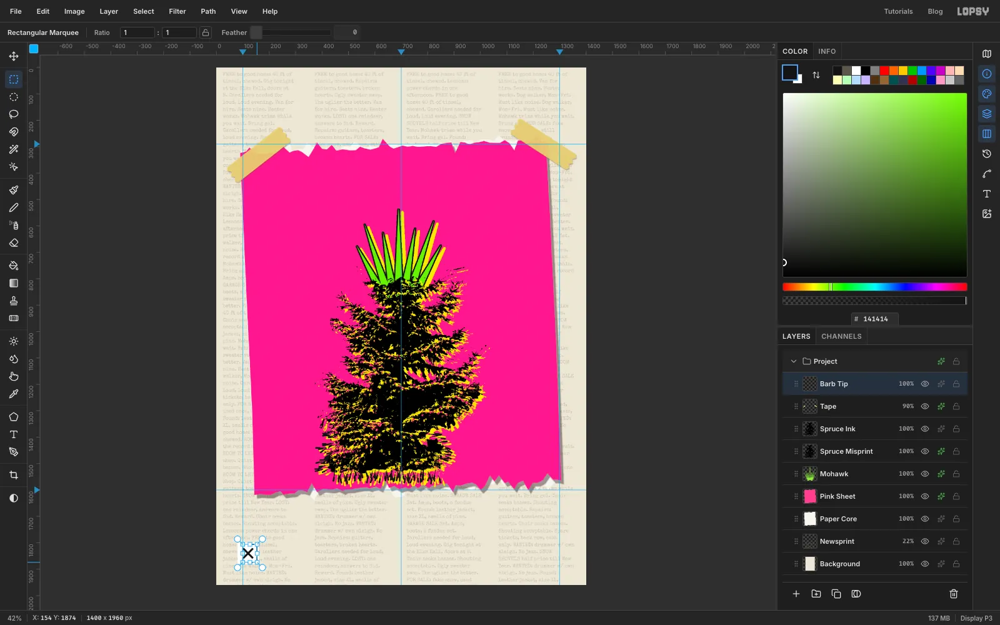

Barbed wire is a wire with an X every few centimetres, and Lopsy can turn any drawing into a brush tip.

Click the **Tape** row and add a layer called **Barb Tip**. Anywhere out of the way, such as the bottom-left corner:

1. marquee an 80 × 80 px square, fill it with white (`#FFFFFF`) and press [[Cmd+D]]
2. press [[B]], pick **Hard Round** in the **Brushes** window and set **Size** to **7** and **Hardness** to **100**. With the foreground at `#141414`, click about 8 px in from one corner of the square, then hold [[Shift]] and click the same distance in from the opposite corner
3. do the same across the other diagonal, so the two lines make an X

Press [[M]] and marquee just the X, about 68 × 68 px. Choose **Edit → Define Brush...**, name it `Barb` and click OK. Lopsy uses dark pixels as paint and white as empty, which is why the X sits on white.

Press [[Cmd+D]] and click **Delete Layer** at the bottom of the Layers panel to get rid of the drawing. The brush tip stays.

## Pen the wire

Click the **Spruce Ink** row and add a layer called **Barbed Wire**. Set the foreground to `#D3D7DD`.

Press [[P]] for the **Pen** tool and set **Stroke** to **6** in the options bar. Draw an open curve for the upper swag, from the tree's left edge at about x 520, y 865, sagging to about y 935 in the middle and rising to x 905, y 810 on the right. Press and drag at each point to curve it, then press [[Enter]]. Lopsy strokes the path with the foreground colour.

Set **Stroke** to **5** and draw a second strand along the same route, using five or six points set a little above and below the first strand in turn. Where they cross, the two strands look twisted together.

Do the same for a lower swag, from about x 430, y 1185, dipping to y 1300, up to x 1000, y 1120. Then open the **Paths** panel (the curved-path icon in the strip at the right edge of the window) and delete each path, so their outlines don't get in the way.

## Pick the Barb tip and set some randomness

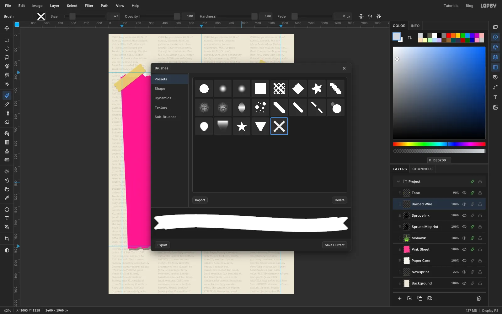

Press [[B]] and open the **Brushes** window. Your **Barb** tip is the last one in the **Presets** grid, and it's already selected.

On the **Shape** tab, set **Size** to **32**, **Spacing** to **170**, **Hardness** to **100** and **Opacity** to **100**. Spacing above 100% leaves a gap between each X.

On the **Dynamics** tab, set **Size Jitter** to **35**, **Angle Jitter** to **30** and **Scatter** to **6**. Real barbs are twisted on by hand, and this makes each one a slightly different size and angle.

## Run the barbs along the wire

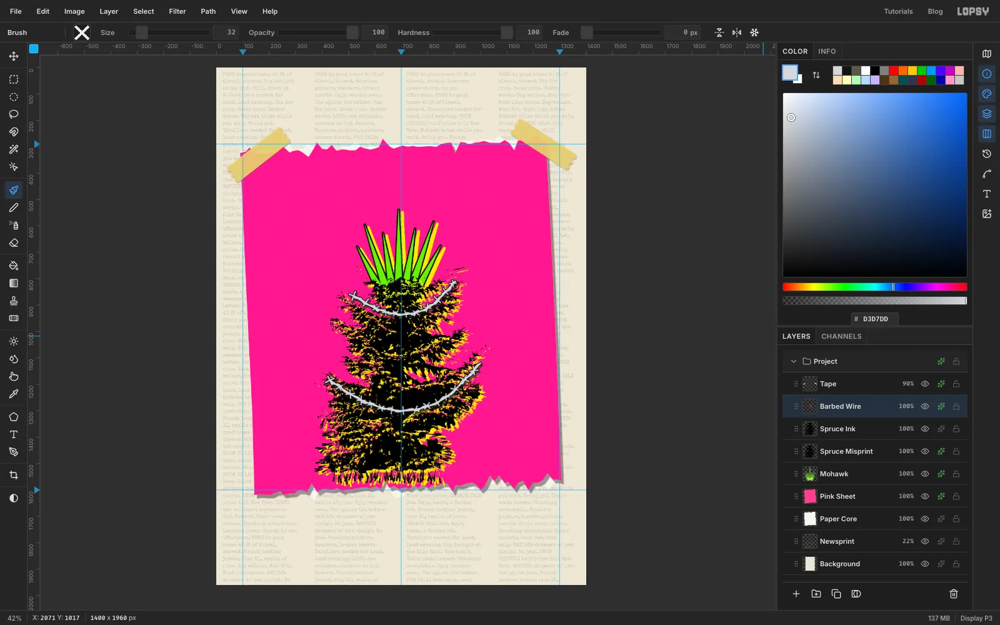

Close the window and drag the brush along each swag, following the wire from one end to the other in one smooth stroke.

Open the **Barbed Wire** effects. Tick **Stroke** with **Width** **3** and the colour `#141414`, and **Drop Shadow** in `#141414` with **Offset X** **5**, **Offset Y** **7**, **Blur** **2** and **Opacity** **60**. The black outline keeps the silver readable where it crosses the black tree.

## Build one chrome stud

The studs on a leather jacket are little pyramids, and four shades of grey are enough to draw one.

With **Barbed Wire** selected, click **New Group** under the Layers panel and name the group **Ornaments**. With the **Ornaments** row selected, click **Add Layer**. The new layer appears indented inside the group. Name it **Stud**.

Zoom in to about 300% so the points are easy to hit. Imagine a diamond 52 px tall centred at about x 612, y 1000, with a point in the middle. Lasso each of its four triangles in turn, making their corners meet, and fill each one:

- top left: `#FFFFFF`
- top right: `#C3C9D1`
- bottom right: `#16181C`
- bottom left: `#7D848E`

Add a **Stroke** of **2** in `#141414`, and a **Drop Shadow** in `#141414` with **Offset X** **4**, **Offset Y** **6**, **Blur** **3** and **Opacity** **70**.

## Paste more studs around the tree

Marquee the stud with a few pixels to spare, press [[Cmd+C]], then [[Cmd+V]]. The copy pastes in place on a new layer and Lopsy switches to the **Move** tool, so drag it to a new spot and press [[Cmd+D]].

Click the **Stud** row again before each copy and repeat until you have seven studs. Scatter the six copies over the tree, two or three per tier, staggered so no two line up, and all clear of the wire. Use the screenshot of the next step as a guide.

## Merge the studs into one layer

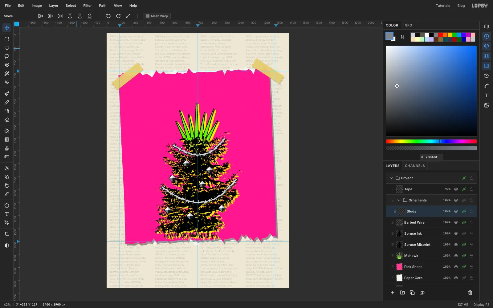

Every paste lands directly above the **Stud** layer, so the pasted layers are stacked above it in the group. Click the top one in the **Ornaments** group and choose **Layer → Merge Down** six times, until only one layer is left. Rename it **Studs**.

Merge Down keeps the bottom layer's effects, so every stud now shares the outline and shadow you gave the first one.

## Draw a safety pin with the Pen

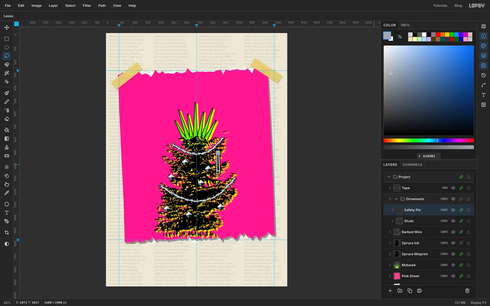

Add a layer called **Safety Pin** and set the foreground to `#D3D7DD`. With the **Pen** tool, set **Stroke** to **7** and draw the pin upright on the right side of the tree, with its top at about x 865, y 915:

1. the back wire: click at the top, click about 135 px straight below, and press [[Enter]]
2. the front wire: click about 22 px to the right of the bottom of the back wire, click back up near the top, and press [[Enter]]
3. the coil: set **Stroke** to **6** and draw a small open circle, about 26 px across, joining the two wires at the bottom. Drag at each point to curve it, and stop just short of where you started, or the Pen closes the path

For the clasp, lasso a small rounded cap about 34 × 32 px over the top of both wires and fill it with `#A3A9B1`. Add a **Stroke** of **3** in `#141414` and a **Drop Shadow** in `#141414` with **Offset X** **5**, **Offset Y** **7**, **Blur** **3** and **Opacity** **65**.

## Tilt the pin so it hangs

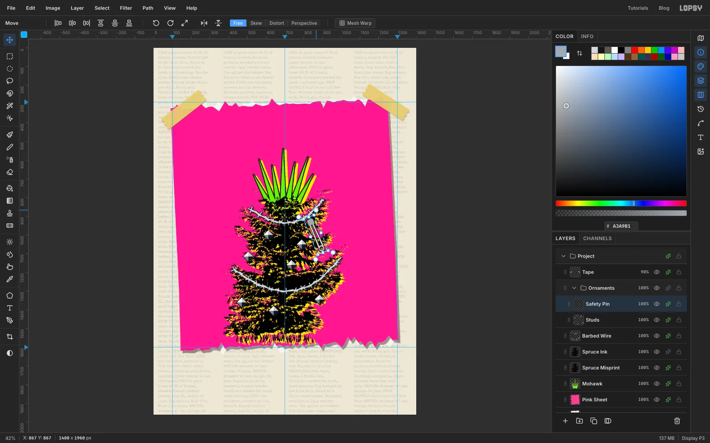

Marquee the pin with a little room around it. Press [[V]], hover just outside a corner until the cursor turns into a curved arrow, and drag to rotate the pin about 22° counter-clockwise. Press [[Enter]] and [[Cmd+D]].

## Copy a smaller pin through the lower wire

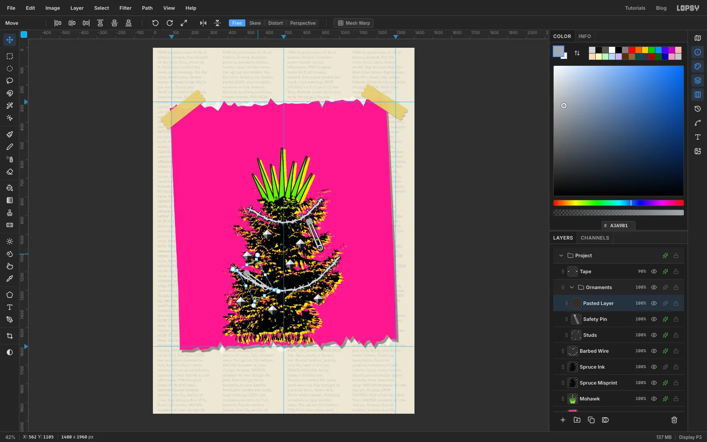

Marquee the pin again, press [[Cmd+C]] and [[Cmd+V]], and drag the copy over to the left so it sits across the lower wire at about x 560, y 1260, as if it's pinned through it.

Press [[M]] and marquee the copy, then press [[V]]. Hold [[Cmd]] and drag the bottom-right handle in to make it about 15% smaller, then drag outside a corner to rotate it about 30° counter-clockwise, all before you press [[Enter]]. Press [[Cmd+D]], then **Layer → Merge Down** to put both pins on the **Safety Pin** layer.

## Set the band name on a white plate

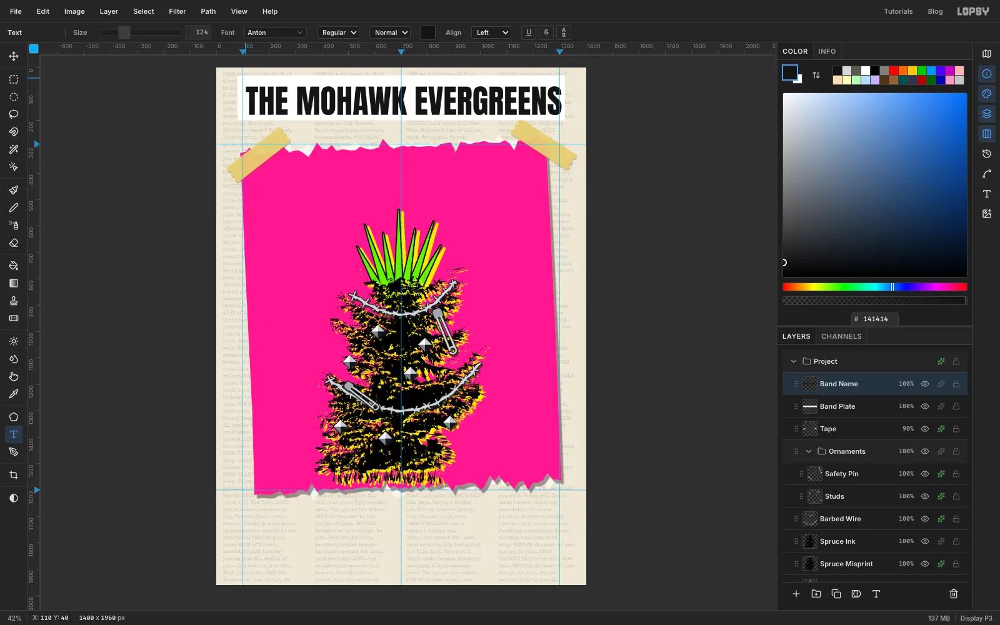

Click the **Tape** row and add a layer called **Band Plate**. Marquee a white rectangle across the top, from about x 80, y 30 to x 1320, y 200, and fill it with `#FFFFFF`. The white gets deleted in the next step, once the noise has done its job.

Press [[T]], set the font to **Anton**, **Size** **124** and the foreground to `#141414`. Click at the top left of the white plate, type `THE MOHAWK EVERGREENS` and press [[Tab]]. Click **Rasterize Layer**, then press [[V]] and drag the text so it's centred on the middle guide, at about y 112. The line nearly fills the width between the outer guides.

## Photocopy the band name

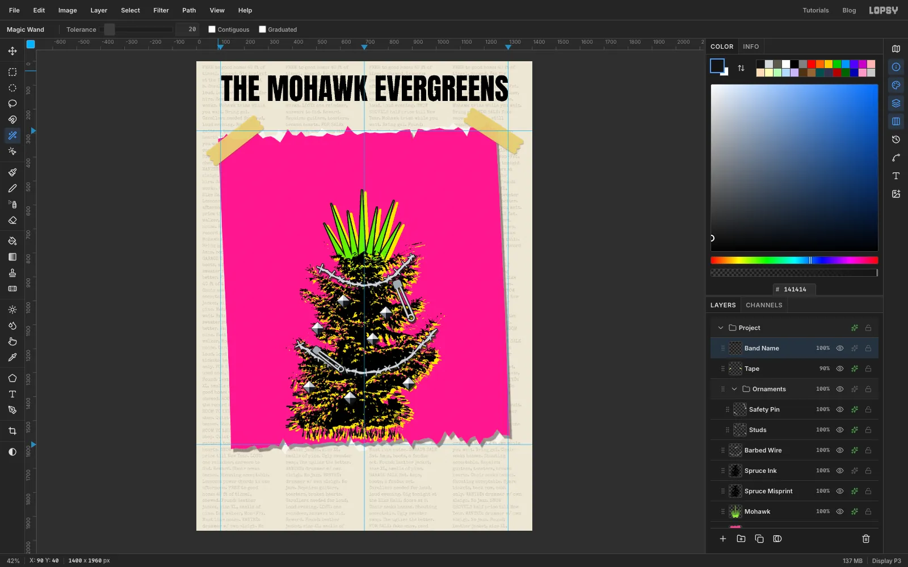

Clean digital type next to a photocopied tree looks wrong. Run the type through the same photocopier.

Choose **Layer → Merge Down** to put the text onto its white plate, and rename the layer **Band Name**. Apply **Filter → Add Noise...** with **Amount** **70** and **Mono**, then **Filter → Gaussian Blur...** with **Radius** **1**, and **Filter → Threshold...** with **Level** **140**. The edges of every letter break up the way toner does.

Press [[W]] for the **Magic Wand** (still with **Contiguous** off), click the white plate, press [[Delete]] and [[Cmd+D]]. The plate was there so the noise had something to bite into. Now only the rough black letters are left.

## Type the headline on a strip of black tape

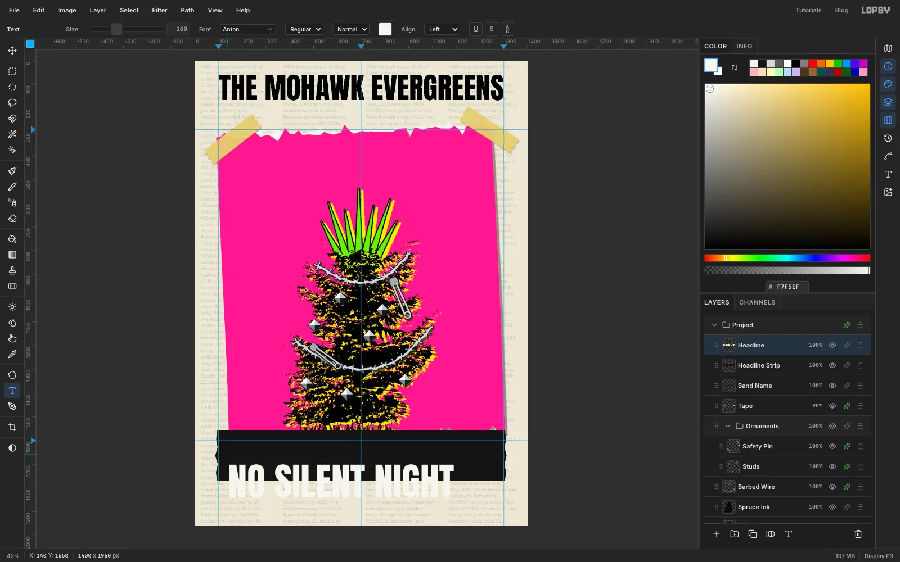

Add a layer called **Headline Strip**. With the **Lasso**, draw a strip of tape nearly the width of the flyer and about 214 px tall, centred on the middle guide and overlapping the flyer's bottom edge, with little zig-zags at each end like torn tape. Fill it with `#141414` and press [[Cmd+D]].

Press [[T]], set **Anton**, **Size** **160** and the foreground `#F7F5EF`. Click near the left end of the strip, type `NO SILENT NIGHT` and press [[Tab]]. It won't land in the right place yet. Click **Rasterize Layer**.

## Seat the headline in the strip

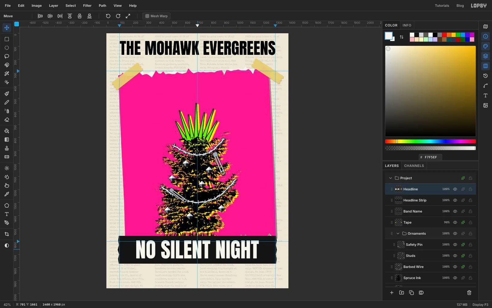

Press [[V]] and drag the headline until it's centred in the strip: on the middle guide, with the same gap above the capitals as below them, about 38 px each. There's no descender in NO SILENT NIGHT, so centre the capitals themselves. Choose **Layer → Merge Down** to put the type onto the strip.

## Tilt the strip

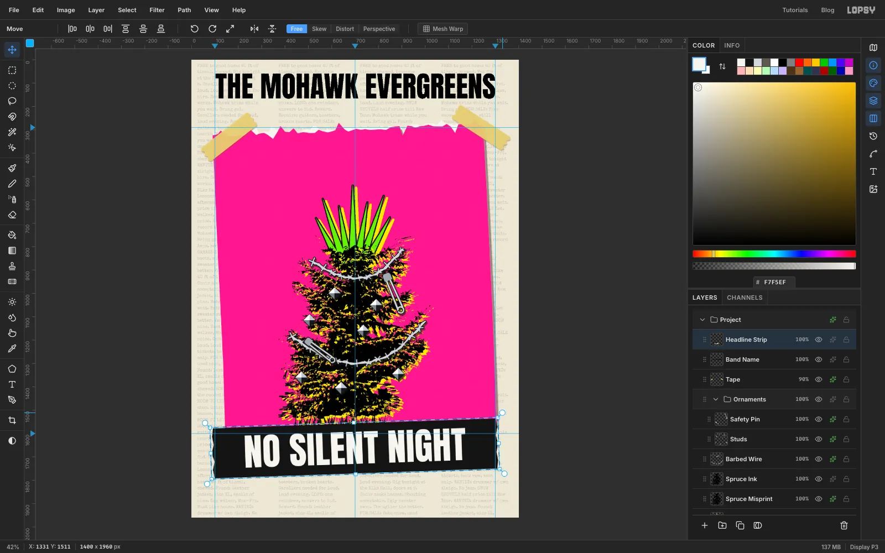

Marquee the whole strip, press [[V]], and drag outside a corner to rotate it about 2° counter-clockwise. Press [[Enter]] and [[Cmd+D]]. Because the text is merged into the tape, they tilt together and the padding stays even.

## Scrawl the sign-off in marker

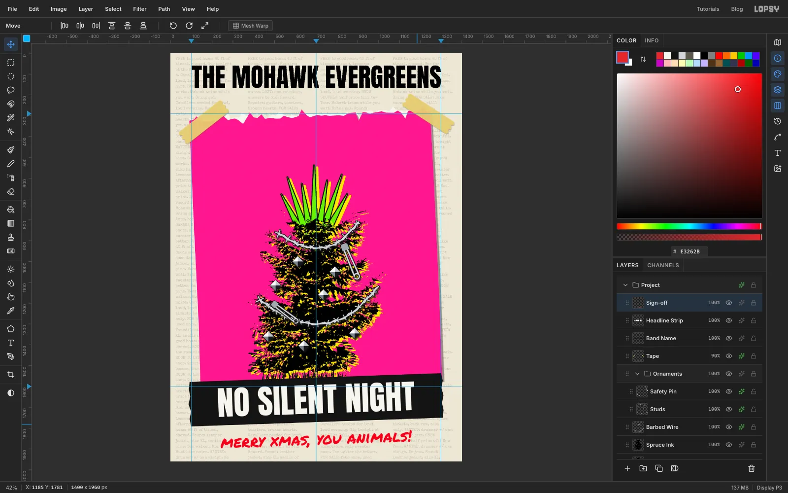

With **Headline Strip** active, press [[T]], set **Permanent Marker**, **Size** **76** and the foreground `#E3262B`. Click in the empty space at the bottom, type `merry xmas, you animals!` and press [[Tab]]. Permanent Marker draws its lowercase letters as small capitals, so it comes out shouting, which suits it.

Click **Rasterize Layer** and rename the layer **Sign-off**. Press [[V]] and drag it so it's centred on the middle guide at about y 1858. Then press [[M]], marquee it, press [[V]] and rotate it about 2° counter-clockwise to match the strip. Leave about 40 px between the strip and the tops of the letters, and keep the bottom of the line at least 60 px above the edge of the card.

## Type the gig details on a paper scrap

Click the **Tape** row and add a layer called **Gig Scrap**. Lasso a scrap of paper about the size of a playing card, with torn left and right edges, on the right edge of the flyer and overlapping the tree's lower right branches. Fill it with `#F7F5EF`.

Press [[T]], set **Special Elite** and the foreground `#141414`, and type each line as its own text layer, out in empty space so you don't click into one you've already made:

- `LIVE!` at **Size** **60**
- `XMAS EVE`, `THE NORTH POLE`, `ALL AGES` and `NO COVER` at **Size** **27**

Rasterize each one, then drag them onto the scrap, centred and stacked from the top down. Leave a little more room above and below **LIVE!** than between the small lines, and check that there's at least as much space under **NO COVER** as above **LIVE!**.

## Pin the scrap at an angle

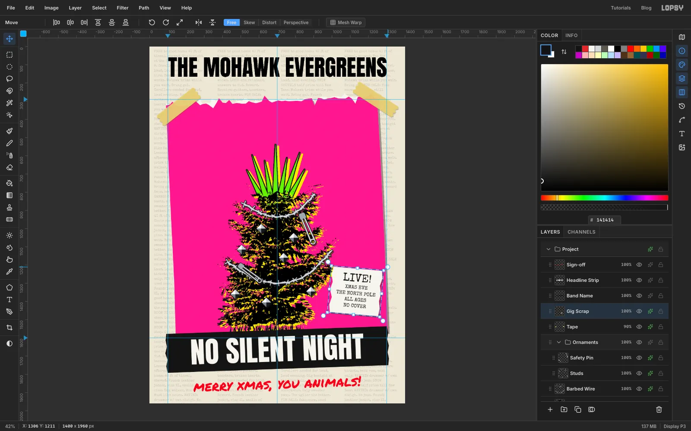

Click the top line's layer and choose **Layer → Merge Down** five times to put all the lines onto **Gig Scrap**. Add a **Drop Shadow** in `#2A1A20` with **Offset X** **6**, **Offset Y** **9**, **Blur** **5** and **Opacity** **45**.

Marquee the scrap, press [[V]], and rotate it about 5° clockwise. Press [[Enter]] and [[Cmd+D]].

## Doodle a couple of marker stars

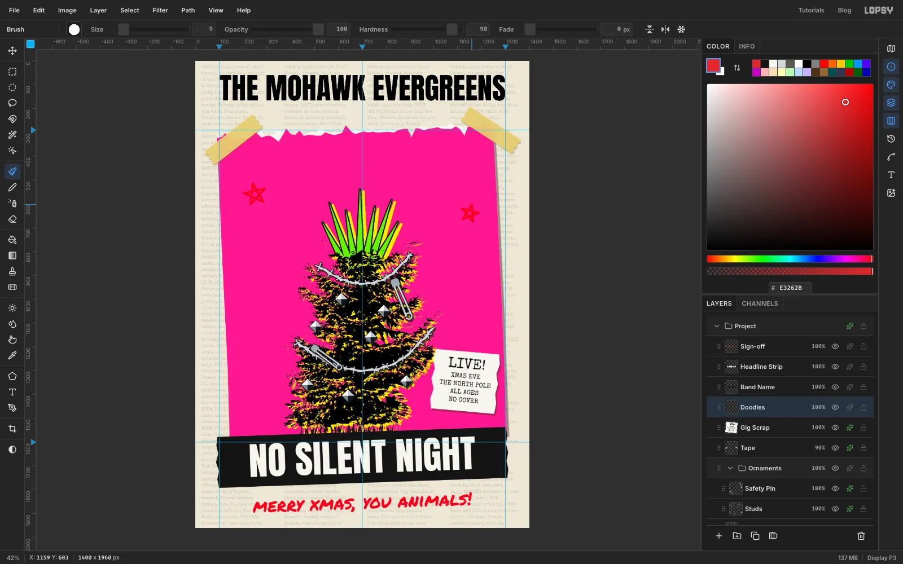

Add a layer called **Doodles**. Open the **Brushes** window, pick **Hard Round** on the **Presets** tab (that also takes you off the Barb tip), and set **Size** to **9**, **Hardness** to **90** and **Spacing** to **5**. Set the foreground to `#E3262B`.

Draw a five-pointed star in one continuous stroke, the way you'd draw one on a school notebook, about 90 px across, to the upper left of the mohawk at about x 250, y 560. Draw a slightly smaller one on the other side at about x 1150, y 640. Stop at two. A third lower down would make them look randomly scattered rather than placed.

## Make the toner layer

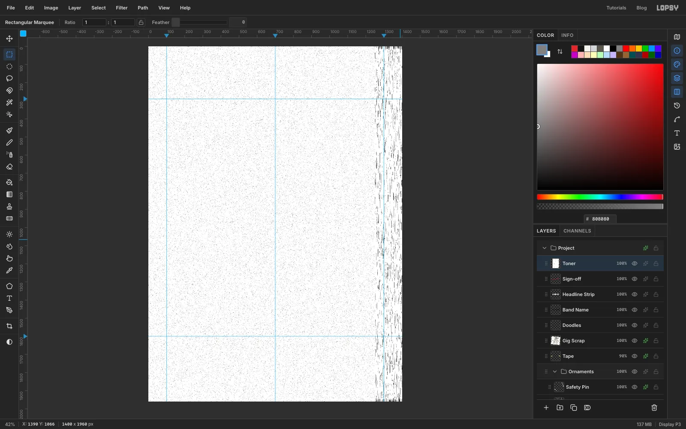

Every photocopy has stray toner: random specks everywhere, plus streaks where the drum is dirty.

Click the **Sign-off** row and add a layer called **Toner**. Fill it with `#808080`, and apply **Filter → Add Noise...** with **Amount** **100**, **Mono** and **Gaussian**.

Marquee a band down the right edge of the canvas, about 150 px wide, and apply **Filter → Motion Blur...** with **Angle** **90** and **Distance** **40**. Filters only work inside the selection, so only that band gets streaked. With the band still selected, apply **Filter → Threshold...** at **124**. Then choose **Select → Inverse** and apply **Threshold** again at **94** for the rest of the canvas. Press [[Cmd+D]].

The blurred band and the rest need different levels because the blur pulls the greys towards the middle. The specks should read as a light dusting, with white clearly winning. If it looks like a dark carpet, undo and try a lower level.

## Lay the toner over the card

Press [[W]], keep **Contiguous** off, set **Tolerance** to **10**, click any white area of the **Toner** layer and press [[Delete]], then [[Cmd+D]]. Only the black specks are left.

Set the layer's blend mode to **Multiply** and its opacity to **35%**. The specks sit on everything, the pink, the tape and the type, which is what ties the collage together into one photocopied sheet.

Save with **File → Save Project**, and export with **File → Quick Export PNG**. Then go and make some noise.
