Before social media, a punk show got its crowd from a sheet of paper stapled to a telephone pole. The band cut pictures out of magazines, glued them to a page with typed or hand-lettered details, and ran a stack through the copier at the corner shop. Anything that went through that copier came out the same way:

- photos turned into coarse black dots or hard black and white
- type cut from different sources and stuck on at an angle
- label-maker strips, masking tape and marker scrawl
- toner specks and dark streaks along the edges of the sheet

This tutorial builds a flyer for an imaginary band, **Warthog Insurrection**, playing a basement venue called The Rust Bucket. The flyer is 1200 × 1600 px, a letter-size page. Every piece goes on its own layer, and most pieces are grouped and tilted a few degrees, so the whole page looks pasted up by hand.

You'll need one photo from Wikimedia Commons: **Warthog Face 001.jpg** by Trisha M Shears. It's in the **public domain**, so you can use it freely. It shows a warthog looking straight at the camera. Download the full-size file (1710 × 1455 px), open it in Preview or any image viewer, and crop a square about **1080 px** across around the head. Keep both pairs of tusks, the ears and the mane, with the head close to the middle of the square.

The tools you'll use:

- the **Lasso**, the **Rectangular Marquee** and its exact-size dialog, and the **Magic Wand**
- **Select → Shrink / Grow / Feather / Inverse**, and [[Cmd]]-click on a layer thumbnail to load its shape as a selection
- **Paste**, the **Move** tool's scale and rotate handles, its **Rotate 90° CCW** button, and arrow-key nudges
- **Desaturate**, **Brightness/Contrast**, **Unsharp Mask**, **Gaussian Blur**, **Halftone**, **Threshold**, **Add Noise**, **Motion Blur** and **Emboss**
- the **Brush** and the **Eraser**
- live text in four Google fonts (Anton, Special Elite, Bebas Neue and Permanent Marker), editing text in place, and Letter spacing
- groups, **Duplicate Layer**, **Merge Down**, and the **Overlay**, **Multiply**, **Soft Light** and **Hard Light** blend modes
- the **Drop Shadow** layer effect

The palette is one sheet of coloured copy paper, toner and paper scraps:

- Fluorescent pink paper `#EC5A9C`
- Toner black `#17131A`
- Scrap white `#F4F1EA`, label ink `#F2F0EA`
- Masking tape `#F2E4CC`
- Grain grey `#808080`

> **Tip:** On a wide-gamut (Display P3) screen, Lopsy reads typed hex codes as P3 colours. These codes were picked as P3 values, so the pink matches the finished flyer. On an sRGB screen it comes out a little softer.

> **Note:** Shortcuts are written for a Mac. On Windows use [[Ctrl]] wherever it says [[Cmd]].

## Lay down the pink copy paper

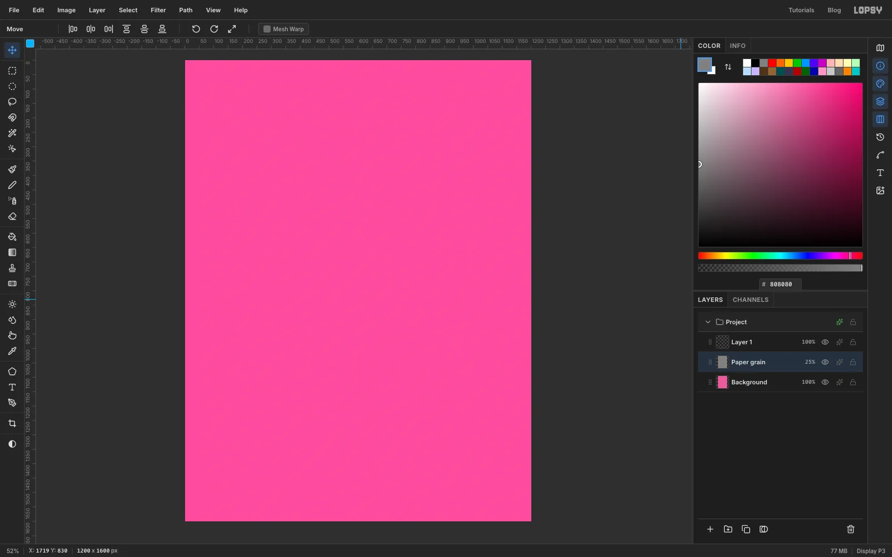

Choose **File → New**, keep the units on **Pixels**, and make the document **1200** wide and **1600** high. A new document comes with a *Background* layer and an empty *Layer 1* above it. Leave *Layer 1* where it is; you'll use it later as a safe place to start new type.

Click *Background*, type pink `#EC5A9C` into the hex field of the **Color** panel, and choose **Edit → Fill**.

Real copy paper has a faint tooth, so add some grain:

1. Click **Add Layer** and double-click the new layer's name to rename it *Paper grain*.
2. Set the foreground to grain grey `#808080` and choose **Edit → Fill**.
3. Run **Filter → Add Noise…** at **Amount 30** with **Mono** selected.
4. Run **Filter → Gaussian Blur…** at **Radius 1**.
5. Open the layer's effects with the sparkle button on its row, set the blend mode to **Overlay**, and close the drawer. Then click the layer's **100%** and drag its opacity down to **25%**.

The grey disappears into the pink and leaves only a fine mottle.

## Paste the warthog photo

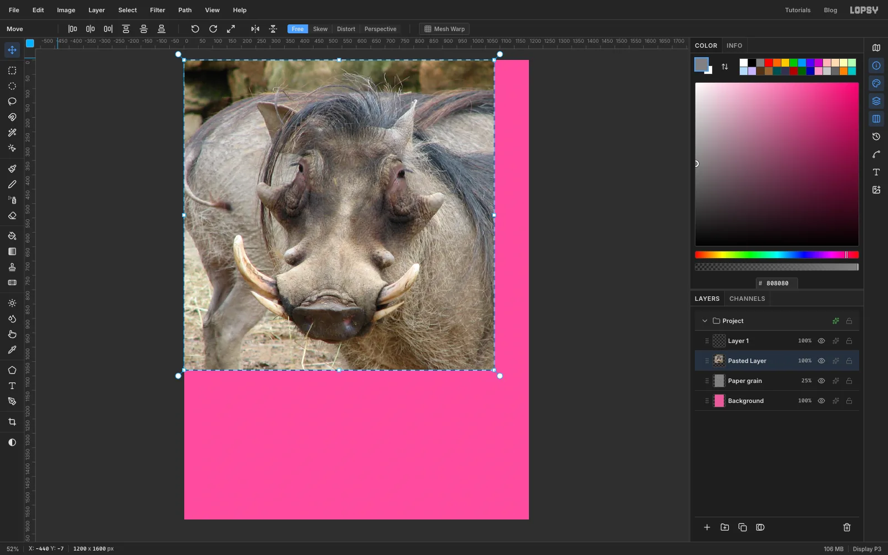

Copy your cropped square photo in Preview. Back in Lopsy, click *Paper grain* so the photo lands above it, and press [[Cmd+V]].

A pasted image that fits on the canvas lands at the top-left corner at full size. Lopsy selects it and switches to the **Move** tool for you. Double-click the new layer's name and rename it *Warthog photo*.

## Scale the photo to 85%

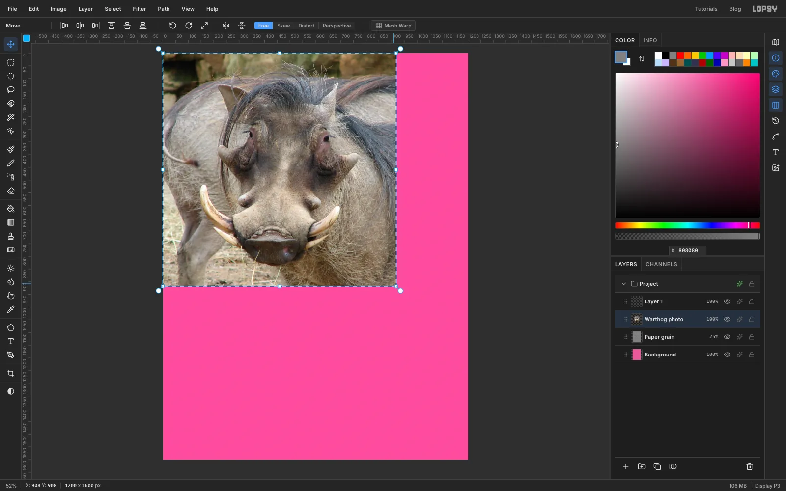

Hold [[Cmd]] and drag the photo's bottom-right handle up and to the left until its right edge reaches about **920** on the top ruler, about 85% of its size. [[Cmd]] keeps the proportions.

Scale before you add the halftone dots, not after. Shrinking a finished halftone blurs the dots into grey mush.

## Move the head to the middle of the page

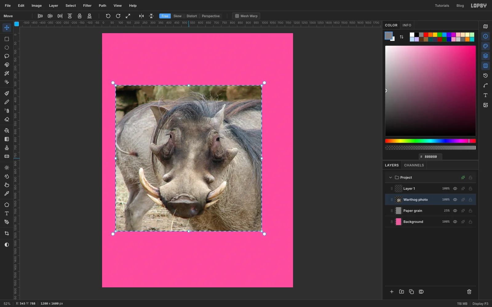

With the **Move** tool, drag the photo down and a little to the right. Its left edge should sit just inside the page (about 90 on the top ruler) and its top about a fifth of the way down (about 330 on the left ruler). The head should end up a little left of the page centre, with the snout at about y 1150. Press [[Cmd+D]] to drop the selection.

## Push the photo to hard black and white

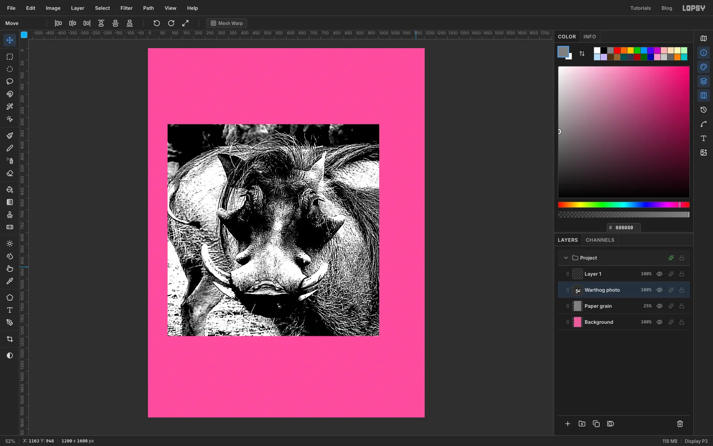

A copier only knows black and white, so throw away the colour and the soft middle tones:

1. **Filter → Desaturate**.
2. **Filter → Brightness/Contrast…** with **Brightness 0** and **Contrast 100**.
3. **Filter → Brightness/Contrast…** again, with **Brightness −10** and **Contrast 40**. The fur goes darker, but the ivory tusks stay white, so they separate from the face.
4. **Filter → Unsharp Mask…** with **Radius 3** and **Amount 2**, to crisp up the warts and the snout.

## Tear a paper scrap for the photo

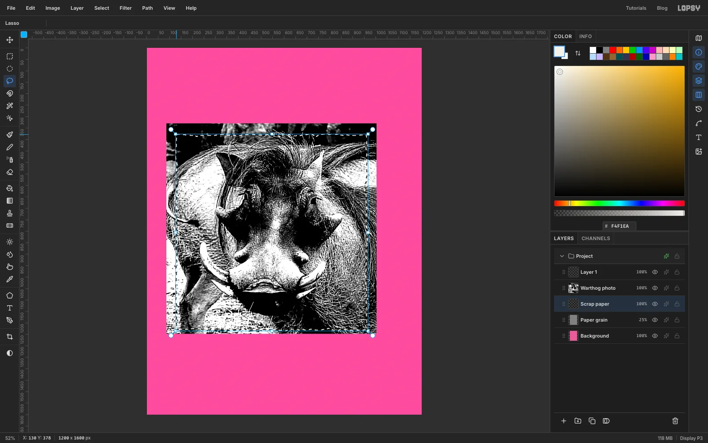

In a real paste-up the picture is torn out of a magazine. Click *Paper grain* and add a layer called *Scrap paper* so it sits under the photo. Set the foreground to scrap white `#F4F1EA` now, ready for the fill.

Pick the **Lasso** and draw a rough rectangle a little inside the photo: from about **130, 380** at the top left to about **960, 1230** at the bottom right. Keep each side roughly straight, but let your hand jitter a few pixels back and forth as you go, so every edge looks torn rather than cut. Finish where you started.

## Fill the scrap and trim the photo to it

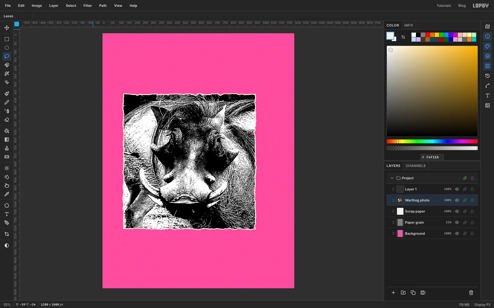

Choose **Edit → Fill** to fill the selection with scrap white. Keep the selection.

Choose **Select → Shrink…** and shrink it by **5** px. Then click *Warthog photo*, choose **Select → Inverse** and press [[Delete]]. Deselect with [[Cmd+D]].

Shrinking first leaves a thin white rim of paper around the photo, as if it had been torn from a page with a margin.

## Screen the photo with halftone dots

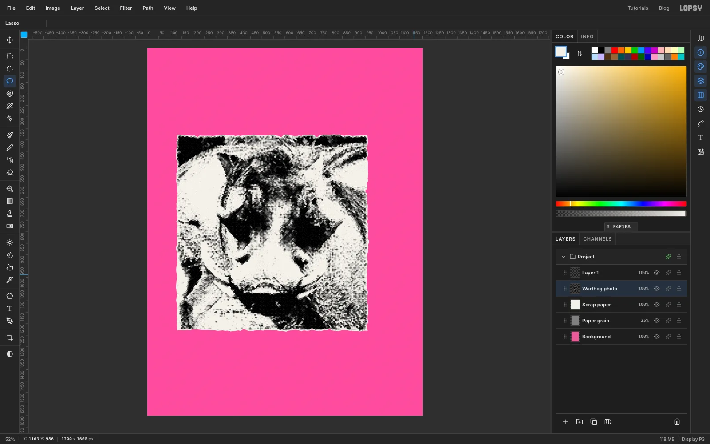

The Halftone filter reads one pixel at the centre of each dot cell. On fur, that pixel is random: light hair or dark gap. So soften the texture first:

1. **Filter → Gaussian Blur…** at **Radius 4**.
2. **Filter → Halftone…** with **Dot Size 8**, **Density 1.3**, **Angle 45** and **Softness 1**.

Dark areas turn into big dots and light areas into small ones. The dots keep the grey of the photo underneath.

## Print every dot in solid black

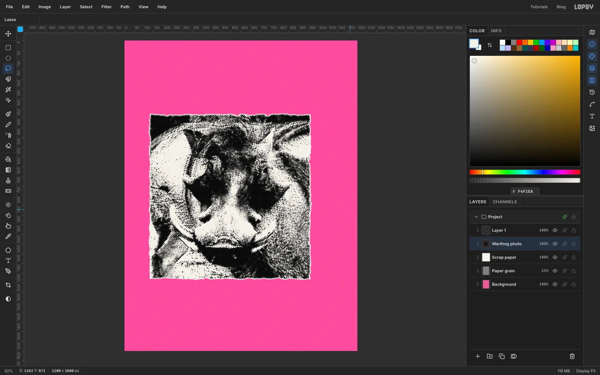

Run **Filter → Threshold…** at **Level 250**. Anything darker than near-white turns black, so every grey dot now prints solid. This is the photo the copier would give you: eye sockets and snout solid black, with the paler tusks showing as gaps in the dots beside the snout.

## Group the photo and tilt it

Click *Scrap paper*, [[Shift]]-click *Warthog photo*, and choose **Layer → Group Layers**. Rename the group *Photo scrap*.

With the group selected and the **Move** tool active, press [[Cmd+D]] to make sure nothing is selected. Hover just outside the top-right corner of the box until the cursor changes to the rotate cursor. Drag up and to the left a little to turn the group about **3°** anticlockwise. Then drag the group a few pixels to the left, so its left edge sits about 100 px in from the page edge.

## Set WARTHOG across the top

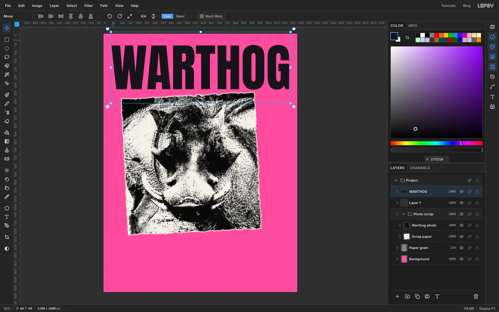

Click *Layer 1*, the empty layer at the top of the stack. Text options restyle whichever text layer is active, so always start new type from a plain layer.

Pick the **Text** tool. Set the font to **Anton**, **Size 316**, and the colour to toner black `#17131A`. Click near the top-left corner of the page, type **WARTHOG** and press [[Tab]] to commit it. Double-click the new layer's name and rename it *WARTHOG*. Lopsy names text layers after their first few characters, so renaming keeps the panel readable.

Switch to the **Move** tool and drag the word until its letters start at about x 50 and their tops sit at about y 70. At size 316 the word spans almost the whole width, ending at about x 1150.

## Tear a strip of black gaffer tape

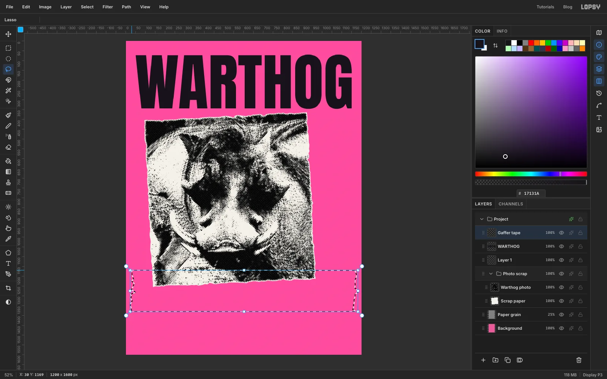

Click *WARTHOG* and add a layer called *Gaffer tape*.

With the **Lasso**, draw a long band across the bottom of the photo, from near the left edge of the page (about x 30, y 1170) to near the right edge (about x 1170, y 1380). Keep the top and bottom as steady as you can; a slight wobble is fine, because tape edges aren't perfect either. Make both ends ragged, the way tape tears when you rip it by hand.

Set the foreground to toner black `#17131A`, choose **Edit → Fill** and deselect.

## Print INSURRECTION on the tape

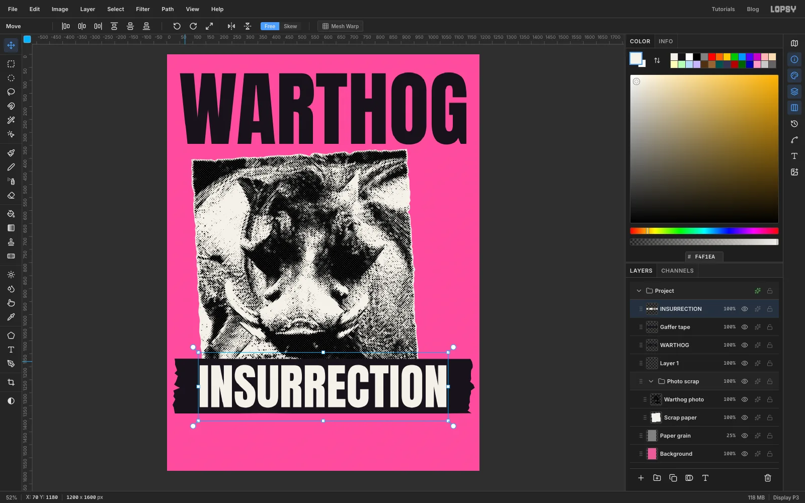

With *Gaffer tape* still active, pick the **Text** tool. Keep **Anton**, set **Size 188** and the colour to scrap white `#F4F1EA`.

Click in an empty bit of the page, away from WARTHOG. A click inside an existing text layer's box edits that layer instead of making a new one. Type **INSURRECTION**, press [[Tab]], and rename the layer *INSURRECTION*.

Switch to the **Move** tool and drag the word onto the tape so it's centred both ways: about 75 px of black at each end, and roughly equal black above and below the letters.

## Group the headline and tilt it the other way

Click *Gaffer tape*, [[Shift]]-click *INSURRECTION*, and choose **Layer → Group Layers**. Rename the group *Tape headline*.

Press [[Cmd+D]], then drag the group's top-right rotate handle down a little to turn it about **2.5°** clockwise. The photo leans one way and the tape leans the other, so the pair looks stuck on by hand rather than laid out on a grid.

## Type the lineup on a torn slip

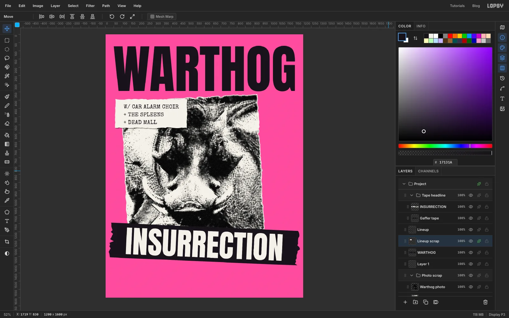

Click *WARTHOG* and add a layer called *Lineup scrap*. With the **Lasso**, draw a small torn rectangle, about 435 × 175 px, over the photo's top-left corner. Let it hang off the photo into the pink by about 70 px, and keep its top edge about 50 px below WARTHOG. Fill it with scrap white `#F4F1EA` and deselect.

Pick the **Text** tool, set the font to **Special Elite**, **Size 34**, colour toner black `#17131A`. Click inside the slip and type three lines, pressing [[Return]] between them: **W/ CAR ALARM CHOIR**, then **+ THE SPLEENS**, then **+ DEAD MALL**. Press [[Tab]] and rename the layer *Lineup*. Then switch to the **Move** tool and drag the text so it's centred on the slip.

The slip and the photo's paper rim are the same white, so they merge. Click *Lineup scrap*, open its effects, and turn on **Drop Shadow** with **Offset X 4**, **Offset Y 4**, **Blur 2** and **Opacity 45**. Close the drawer.

## Tilt the lineup slip

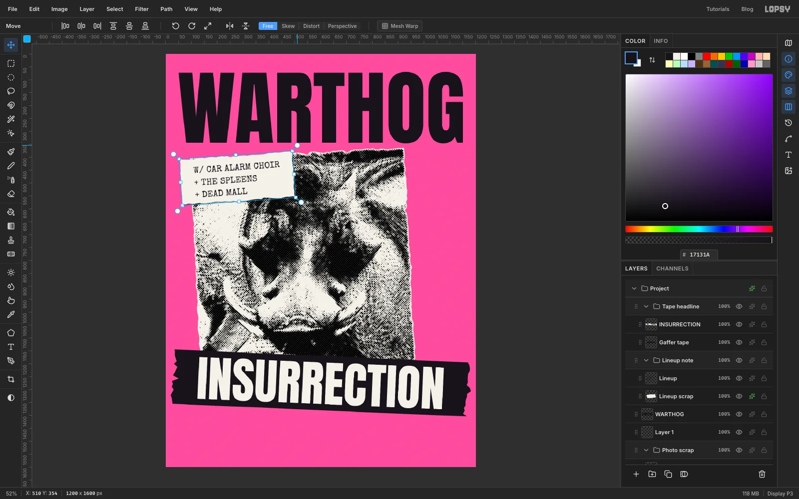

Click *Lineup scrap*, [[Shift]]-click *Lineup*, choose **Layer → Group Layers**, and rename the group *Lineup note*. Press [[Cmd+D]] and rotate the group about **4°** anticlockwise with its corner handle.

## Make a Dymo label for the date

Punk flyers are full of label-maker tape: hard plastic strips with raised white letters.

1. Click *WARTHOG* and add a layer called *Dymo strip*.
2. Pick the **Text** tool. Set **Bebas Neue**, **Size 52**, and colour label ink `#F2F0EA`. Click in an empty spot, type **SAT. NOV. 21 - DOORS 8PM**, press [[Tab]], and rename the layer *Dymo text*.
3. Open the **Text** panel from the right-hand panel bar and set **Letter spacing** to **6**. Label makers space their letters out.
4. Open the text layer's effects and turn on **Drop Shadow**: **Offset X 0**, **Offset Y 2**, **Blur 1**, **Opacity 70**.
5. Switch to the **Move** tool and drag the text to the bottom left, lined up with the W of WARTHOG (about x 72) and about 65 px below the gaffer tape (about y 1446).
6. Click *Dymo strip*. Pick the **Rectangular Marquee** and drag a box around the text with about 20 px to spare on the left, top and bottom, and about 28 px on the right. Letter spacing adds a gap after the last letter, so the right end needs a bit more.
7. Choose **Select → Shrink…** by **7**, then **Select → Grow…** by **7**. The corners come back rounded, like a die-cut label.
8. Fill with toner black `#17131A` and deselect.

## Duplicate the label for the venue

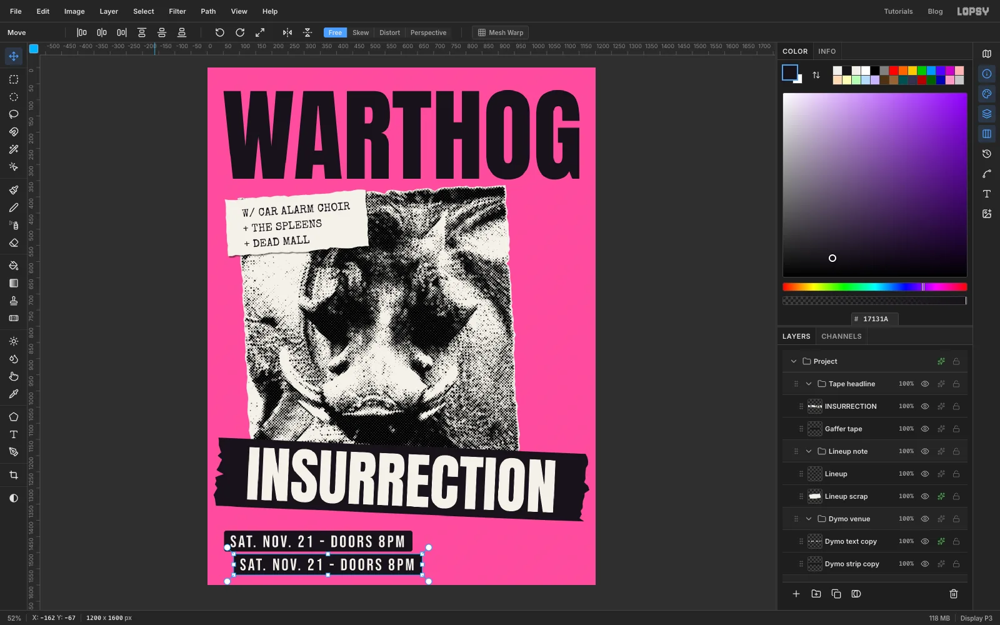

Click *Dymo strip*, [[Shift]]-click *Dymo text*, choose **Layer → Group Layers**, and rename the group *Dymo date*.

Choose **Layer → Duplicate Layer** to copy the whole group, and rename the copy *Dymo venue*. Its layers are called *Dymo strip copy* and *Dymo text copy*. With the **Move** tool, nudge it with the arrow keys about 30 px right and 72 px down so you can see both. [[Shift]] plus an arrow key moves 10 px at a time.

## Retype the copied label

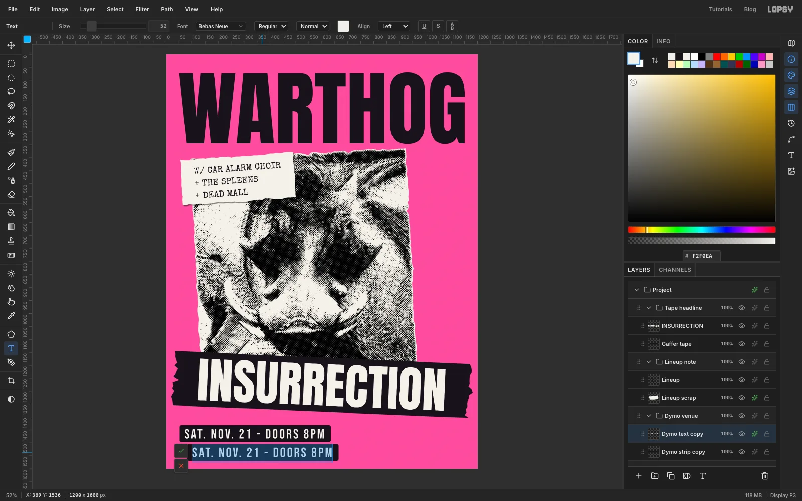

Pick the **Text** tool and click on the lower label's letters. The text opens for editing. Press [[Cmd+A]] to select all of its text and type **RUST BUCKET - 2111 E. CANAL ST.** over it. Press [[Tab]].

Then, with the text layer still active, set **Size** to **54** in the options bar. The venue matters more than the date, so make it a little bigger.

## Stretch the strip under the new text

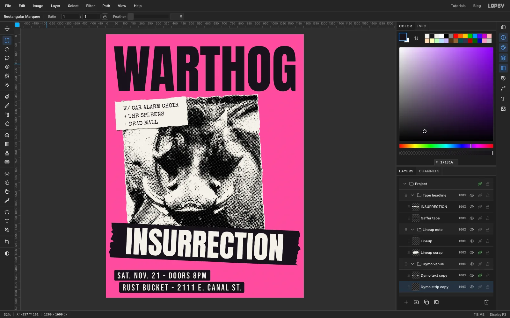

The new text is longer than the old strip. Click *Dymo strip copy*, pick the **Rectangular Marquee**, and drag a box around the new text with the same padding as before. Choose **Select → Shrink…** **7** and **Select → Grow…** **7** again. Check the foreground is still toner black `#17131A`, fill, and deselect. The new strip covers the old one.

## Tilt the date and stand the venue label on end

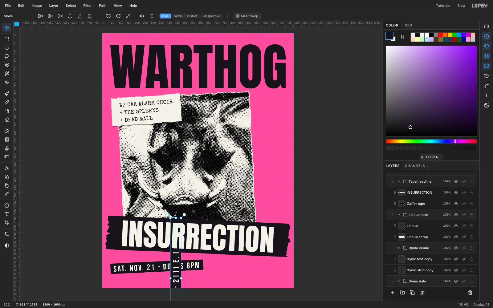

Pick the **Move** tool. Click *Dymo date*, press [[Cmd+D]], and rotate it about **2.5°** anticlockwise with a corner handle.

Click *Dymo venue* and press [[Cmd+D]]. In the **Move** tool's options bar, click **Rotate 90° CCW**. The whole group turns on end, live text and all, and now reads from bottom to top.

## Move the venue label into the right margin

Drag the vertical label into the right margin, about halfway between the photo and the page edge (around x 1080). Put its top end about 50 px below WARTHOG (about y 400). Its bottom end should stop about 30 px above the INSURRECTION tape, with clear pink between them.

## Hand-letter the price

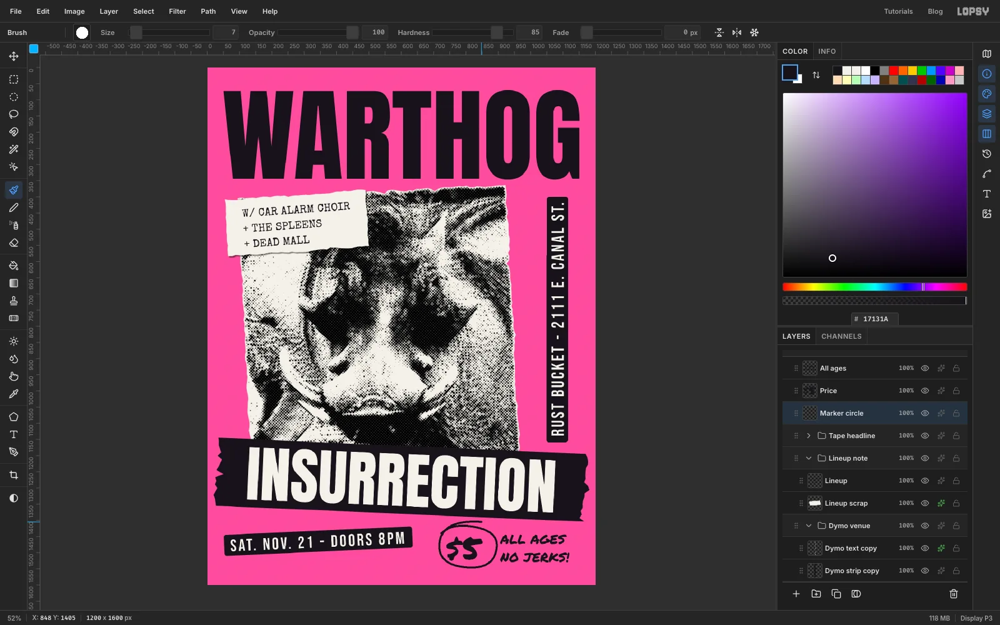

Click the small arrow on the *Tape headline* row to collapse the group, then click the group. Add a layer called *Marker circle*. It lands above the group, not inside it.

Your last text used Letter spacing 6, and that setting carries over to new text. Open the **Text** panel and set **Letter spacing** back to **0**.

1. Pick the **Text** tool, set **Permanent Marker**, **Size 40**, and toner black. Click on an empty part of the photo, away from the existing type. Type **ALL AGES**, press [[Return]], type **NO JERKS!**, then press [[Tab]] and rename the layer *All ages*. Switch to the **Move** tool and drag it to the bottom right, about 80 px in from the right edge and level with the date label.
2. Click *Marker circle* and pick the **Text** tool again. Set **Size 100**, click another empty spot on the photo and type **$5**. Press [[Tab]] and rename the layer *Price*. Switch to the **Move** tool and drag it to the left of ALL AGES, with about 55 px between them, centred on the two lines.
3. Click *Marker circle* and pick the **Brush**. Open the brush settings and set **Size 7**, **Hardness 85**, **Spacing 5**. Check that **Taper** is **0**, then close the panel. In one quick stroke, loop round the $5 one and a bit times. Start at the top left, keep the loop about 40 px clear of the letters, and let the end overshoot the start.

## Group the marker notes and tilt them

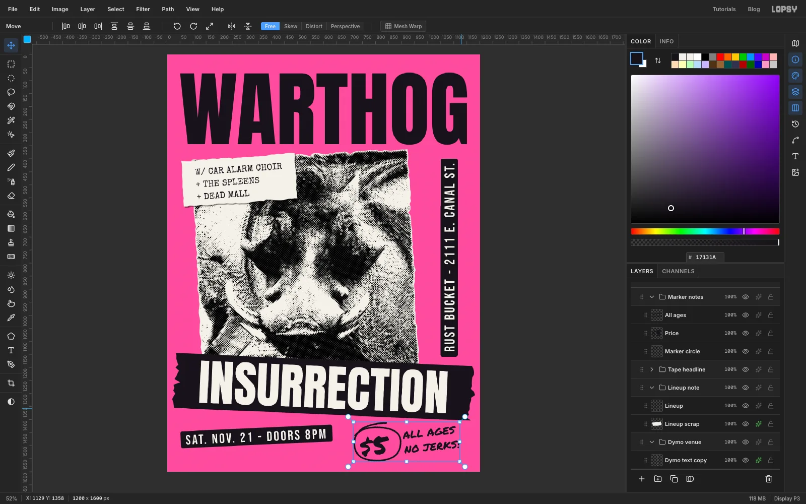

Click *Marker circle*, [[Shift]]-click *All ages*, choose **Layer → Group Layers**, and rename the group *Marker notes*. Pick the **Move** tool, press [[Cmd+D]] and give it a slight anticlockwise turn with a corner handle, so the scrawl rises to the right like quick handwriting.

## Tape down the venue label

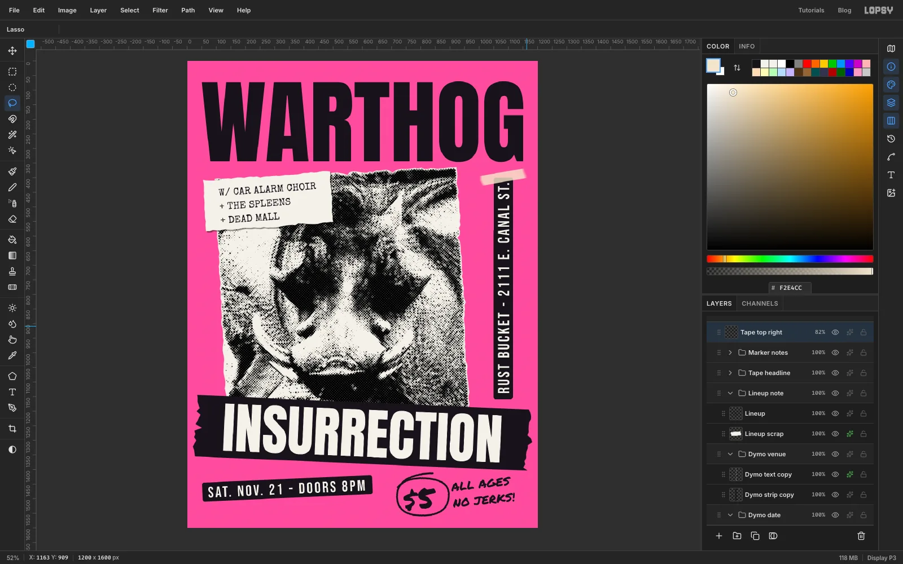

Collapse *Marker notes*, click it, and add a layer called *Tape top right*.

With the **Lasso**, draw a short strip about **150 × 34 px** across the top end of the venue label. Tilt it about 10° so it rises to the right, and make both ends torn. The tape should cover only the label's black end, not the letters of "ST.".

Fill it with masking tape `#F2E4CC` and deselect. Give it some paper fibre:

1. **Filter → Add Noise…** at **Amount 16**, **Mono**.
2. **Filter → Motion Blur…** with **Angle 350** and **Distance 10**, so the noise streaks along the tape.
3. Set the layer's opacity to **82%** so the label shows through a little.

## Copy the tape and turn the copy

Choose **Layer → Duplicate Layer** and rename the copy *Tape lineup*. [[Cmd]]-click its thumbnail to select its shape. With the **Move** tool, drag a rotate handle to turn it about **28°** anticlockwise.

## Stick the copy on the lineup slip

Drag the rotated tape over the top-left corner of the lineup slip. Centre it on the corner so it crosses from the pink onto the paper. Press [[Cmd+D]].

## Make toner specks

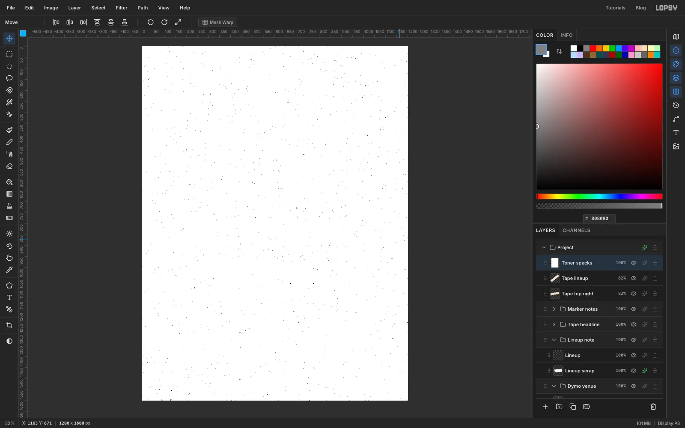

Click *Tape lineup* and add a layer called *Toner specks*. Fill it with grain grey `#808080`, then run:

1. **Filter → Add Noise…** at **Amount 100**, **Mono**.
2. **Filter → Gaussian Blur…** at **Radius 3**. The blur clumps the noise together.
3. **Filter → Threshold…** at **Level 105**. Only the darkest clumps survive, as small black specks on white.

Start from mid-grey, not white. Add Noise only moves each pixel about 50 levels up or down, so noise on white would never get dark enough to print.

## Knock out the white and wear the specks away

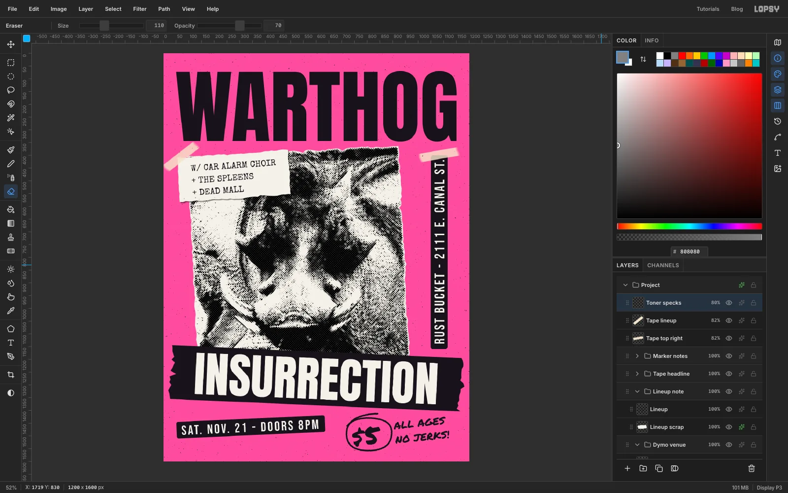

Pick the **Magic Wand**, set **Tolerance 10** and untick **Contiguous**. Click a white pixel on *Toner specks*, press [[Delete]], and deselect. Tick **Contiguous** again.

Specks everywhere look like a filter. A real copy is dirtier in some places than others, and the type should stay readable. Pick the **Eraser** at **Opacity 70** and wipe some areas clean:

- at **Size 420**, one wavy stroke down the middle of the photo
- at **Size 260**, one stroke along the INSURRECTION tape
- at **Size 180**, a stroke across the lineup slip
- at **Size 110**, a stroke along the date label and one up the venue label

Set *Toner specks* to **Multiply** at **80%**.

## Add a copier-lid shadow and a fold

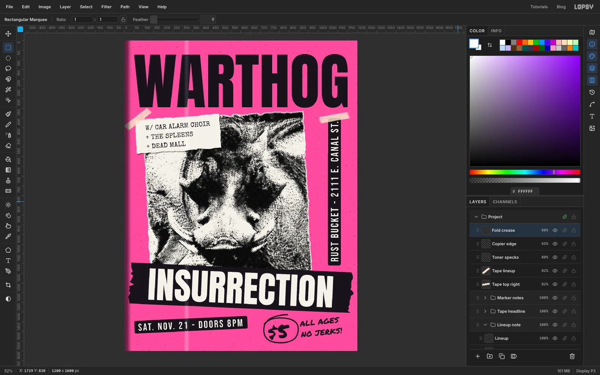

**Copier edge.** Add a layer called *Copier edge*. Pick the **Rectangular Marquee** and click once on the canvas without dragging to open its exact-size dialog. Set **From** to **−40, −40** and **To** to **24, 1640**, then press [[Enter]]. The strip starts off the canvas so its feathered edge only fades inwards. Choose **Select → Feather…** at **16**. The foreground is still grain grey from the toner layer, so set it back to toner black `#17131A`, then fill and deselect. Set the layer to **Multiply** at **65%**. This is the shadow you get when the copier lid doesn't quite close.

**Fold.** Flyers get folded into pockets. Add a layer called *Fold crease*. Use the exact-size dialog again for a strip from **312, −40** to **330, 1640**. Feather it by **7**, fill it with white `#FFFFFF`, and deselect. Set it to **Soft Light** at **60%**. It lightens the paper along the fold without leaving a hard line.

## Emboss the label letters

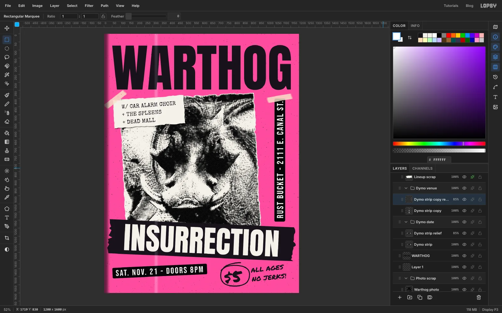

Real label tape has raised letters. For each label:

1. Click the label's text layer (*Dymo text*, then *Dymo text copy*) and choose **Layer → Merge Down**. The text and its shadow are flattened onto the strip.
2. Click the strip and choose **Layer → Duplicate Layer**. Rename the copy with *relief* on the end, such as *Dymo strip relief*.
3. Run **Filter → Emboss…** with **Angle 135** and **Strength 30**. Higher strengths push the relief further out, and above about 40 it looks like a doubled image, not raised plastic.
4. Set the copy to **Hard Light** at **85%**.

Hard Light leaves flat areas alone and keeps only the light and dark edges, so each letter and the strip's rim catch the light.

Save with **File → Save Project**, then export with **File → Quick Export PNG**.

> **Tip:** View the flyer at 100% before you export. Check that no type touches the edge of its tape or label. Check too that nothing crowds the bottom edge: leave at least 40 px of pink below the lowest marker stroke.
