Late-1970s punk posters were made with whatever was lying around: a photocopier, a pair of scissors, a glue stick and a stack of magazines to cut letters out of. Jamie Reid's sleeves for the Sex Pistols are the famous ones. Hot pink and acid yellow, a cut-out photo pushed through the copier until it turned into dots, and a title spelled out in ransom-note letters, each from a different magazine.

In this tutorial you'll make one for *Granny Uprising*, an imaginary comedy about a pensioner who has had enough. The star is the most famous mother in art: Whistler's 1871 *Arrangement in Grey and Black No. 1*. You'll photocopy her and give her a mohawk. The poster is 1200 × 1800 px and has:

- a cut-out of the portrait, turned into a black-and-white halftone with a white scissor margin
- a green liberty-spike mohawk
- a two-row ransom-note title made from fourteen tilted text layers on paper scraps
- typewriter tagline strips held by a safety pin that goes through the paper
- a yarn ball with crossed knitting needles, a round sticker, a sprayed star and a marker scrawl
- a billing block on a torn yellow band, masking tape, toner speckle and burnt edges

You'll need one image. On Wikimedia Commons, search for **Whistlers Mother high res.jpg** and download the 1920 px version. The painting is in the public domain, so you can use it freely.

Along the way you'll use the Lasso (with [[Shift]] to add), the marquees, Select → Grow and Feather, the Brush, Pencil, Eraser and Spray tools, the Gradient tool, live text that you rotate and re-edit, groups, copy and paste, and filters including Desaturate, Brightness/Contrast, Halftone, Add Noise, Gaussian Blur and Threshold.

The palette is the classic punk trio, plus photocopy black and white:

- Hot pink `#E9579C`, magenta scrap `#B92B6E`, magenta ink `#C42D74`
- Acid yellow `#F3DD2B`, lime `#86DB3A`
- Ink `#161616`, copy paper `#F3EFE4`, newsprint grey `#D9D4C7`
- Pin silver `#C9CED6`, masking tape `#F2ECD2`, copier streak `#B9B0B4`, edge burn `#4A1236`, white `#FFFFFF`

> **Note:** Shortcuts are written for a Mac. On Windows use [[Ctrl]] wherever it says [[Cmd]]. Positions are given in document pixels as rough guides; the status bar at the bottom of the window shows the cursor's X and Y as you move. Tilts are approximate too: the rotate handles have no angle readout, so just aim for small, alternating leans.

## Set up a pink poster with guides

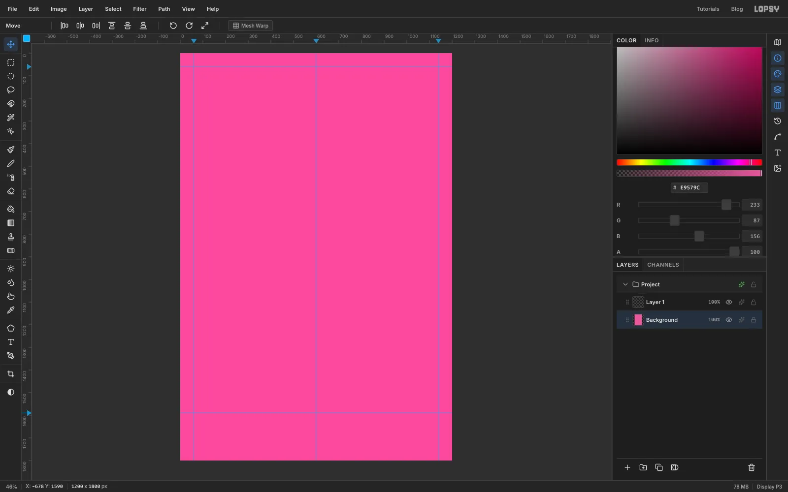

Choose **File → New** and make a **1200 × 1800** px document with a white background.

Select the *Background* layer, set the foreground colour to `#E9579C` and choose **Edit → Fill**.

A new document also comes with an empty *Layer 1* on top. Leave it there. You'll use it as a handle for adding groups at the top level of the stack, and later you'll paint a marker line on it.

Now add guides. Click the top ruler at **60**, **600** and **1140** for the side margins and the centre line. Then click the left ruler at **60** for the top margin and at **1590**, which is where the yellow billing band will start.

## Tear a yellow band along the bottom

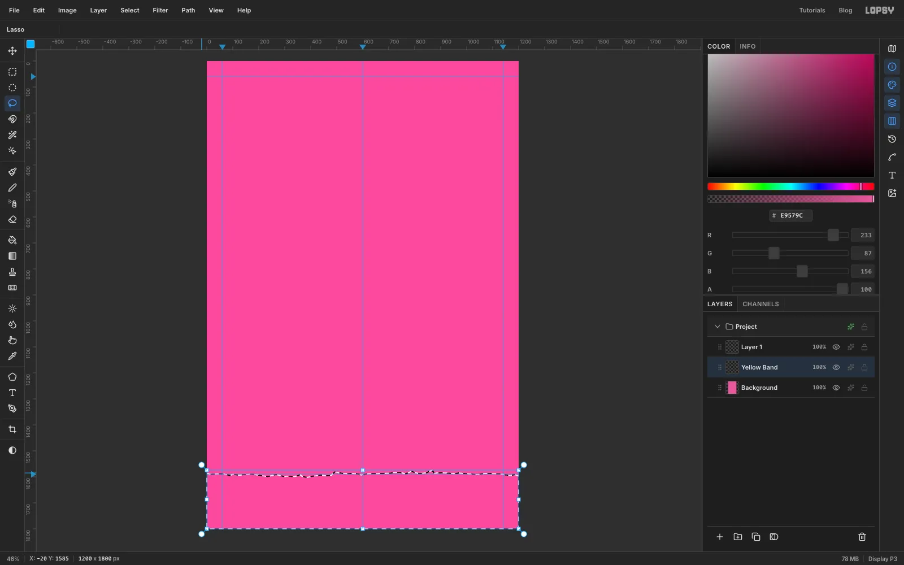

Click **Add Layer** and name the new layer *Yellow Band*. Pick the **Lasso**.

Start just off the left edge of the canvas, at about the height of the bottom guide. Drag across to the right edge in a wobbly line. Take uneven bites: mostly small ones a few pixels deep, plus the odd deeper tear. A torn sheet never has a regular zig-zag. Carry on down past the bottom of the canvas, back along underneath it, and up to where you started.

Set the foreground to `#F3DD2B`, choose **Edit → Fill** and press [[Cmd+D]].

## Drop in the portrait

Click the *Background* layer so the photo lands directly above it, underneath the yellow band. Drag the JPG from your downloads folder onto the canvas.

Lopsy puts it on its own layer, scaled to fit the poster's width. Double-click the new layer's name and rename it *Granny*.

## Cut her out with the Lasso

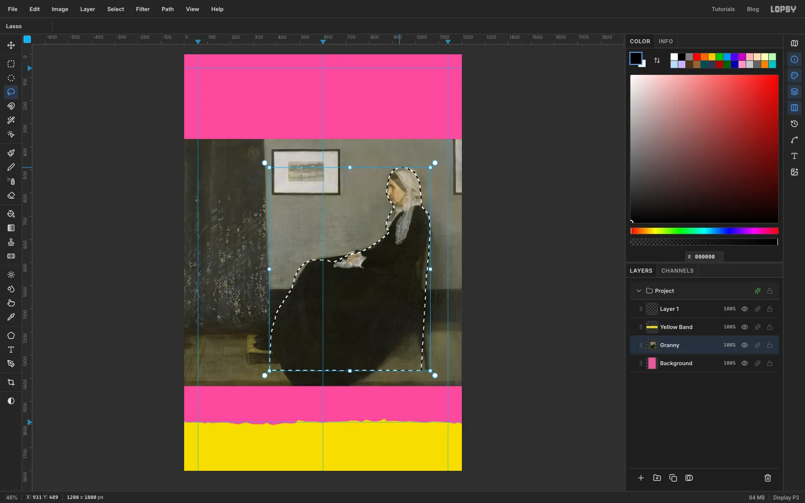

Punk collage is scissor work, so don't aim for a perfect mask. Pick the **Lasso** and trace around the sitter. Go over the top of her bonnet and down her back. Follow the chair down to the floor, then come back along the bottom of the painting. Run up the front of her skirt, along the top of her lap to her hands, and over the lace at her chest and chin. Finish round her face and back up to the bonnet.

A slightly shaky hand is fine. It reads as scissors.

## Delete the wall and curtain

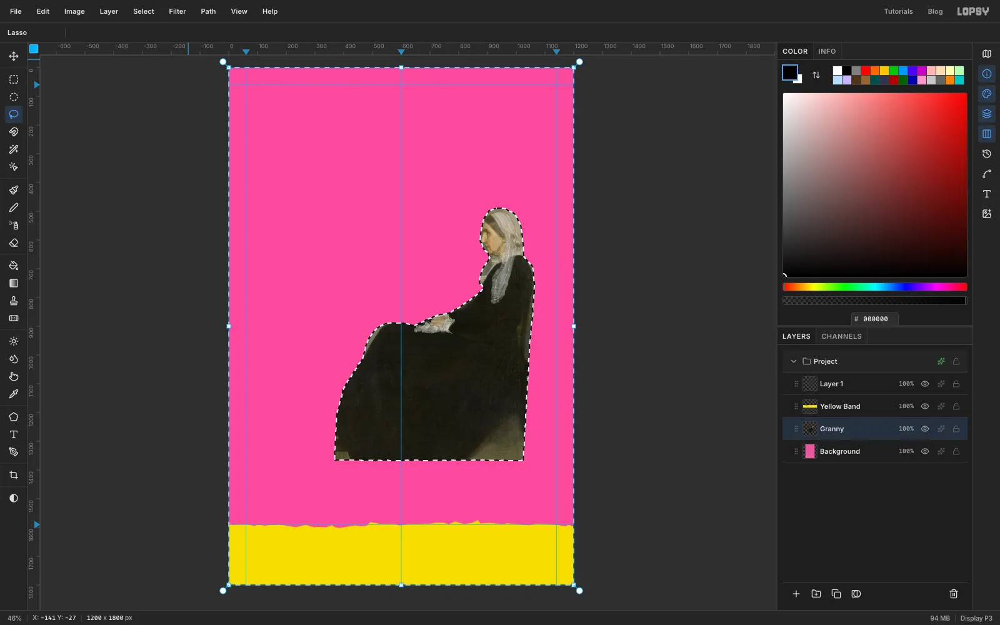

Choose **Select → Inverse** and press [[Delete]]. The wall, the framed print and the flowered curtain are deleted, and only the cut-out is left. Press [[Cmd+D]].

## Scale the cut-out up

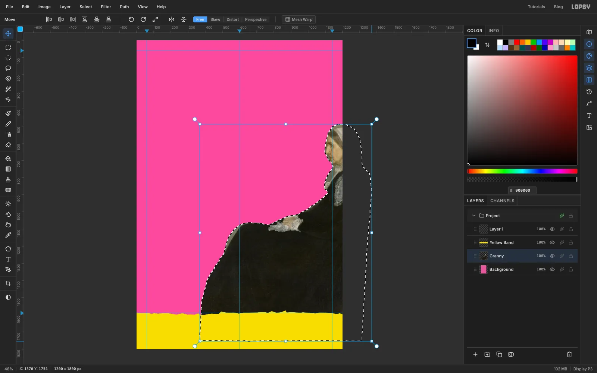

She needs to be much bigger. [[Cmd]]-click the *Granny* thumbnail in the Layers panel to select her outline. Transform handles appear around her.

Pick the **Move** tool. Zoom out a step with **View → Zoom Out** so the corner has somewhere to go. Then hold [[Cmd]] and drag the bottom-right corner handle out until she's about **1.45×** her size, roughly 1000 px wide. [[Cmd]] keeps the proportions.

## Slide her off the right edge

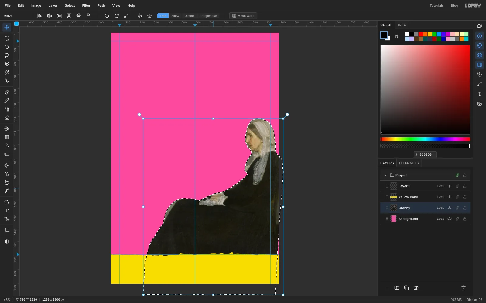

Drag from inside the selection to move her. The back of the chair should run about 30 px off the right edge of the poster, and the top of her bonnet should sit at about **y 616**, just over a third of the way down.

Letting her bleed off the edge makes the poster feel cropped from something bigger. Her skirt can go under the yellow band and off the bottom too.

Press [[Cmd+D]] to finish the move, then **View → Fit to Screen**.

## Give her a white scissor margin

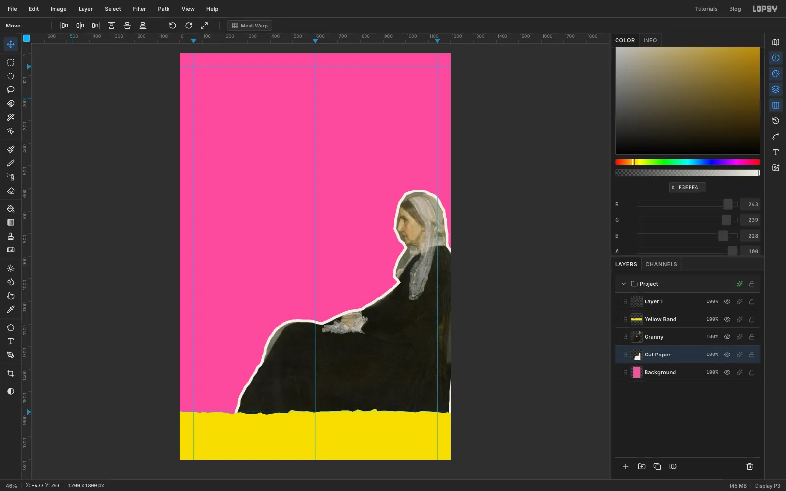

[[Cmd]]-click the *Granny* thumbnail again. Choose **Select → Grow…**, enter **12** and click **Apply**.

Click the *Background* layer, add a layer called *Cut Paper* (it lands between the background and the photo), set the foreground to `#F3EFE4` and choose **Edit → Fill**. Press [[Cmd+D]]. She now looks like she was cut out of a photocopy with a margin left round her.

## Push her through the photocopier

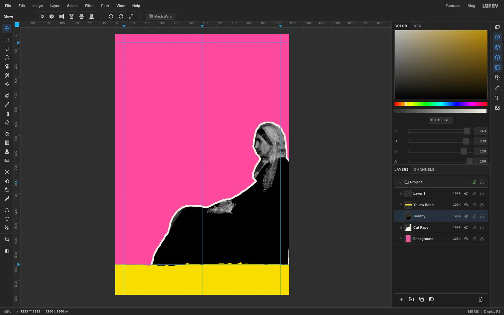

Click the *Granny* layer. Choose **Filter → Desaturate**, then **Filter → Brightness/Contrast…** with **Brightness** at **−15** and **Contrast** at **60**.

Her dress is now almost solid black. That's what a cheap copier does, but it would print as one flat slab. You'll fix that in the next step.

## Pull folds out of the dress

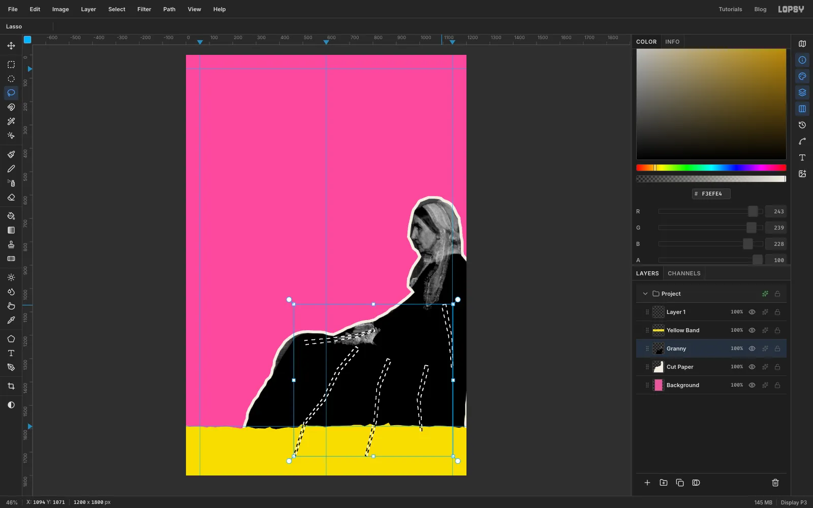

Pick the **Lasso** and draw a long, thin wedge, about 18 px wide and tapering to a point, along the top of her lap from her hands to her knee. Then hold [[Shift]] and draw three more wedges, which [[Shift]] adds to the selection:

- two running diagonally down the skirt from below the lap towards the hem, following the drape
- one short one down her back, where the light catches the shoulder

Make them slightly curved and unevenly spaced. Real folds are never parallel.

Choose **Select → Feather…** with **5**, then **Filter → Brightness/Contrast…** with **Brightness 24** and **Contrast 0**. Press [[Cmd+D]].

Her hands come out of the copier as a pale smear, so darken them a little. Lasso loosely round the clasped hands and feather by **6**. Run **Filter → Brightness/Contrast…** with **Brightness −28** and **Contrast 30**, so they read as shapes. Press [[Cmd+D]].

## Screen her into halftone dots

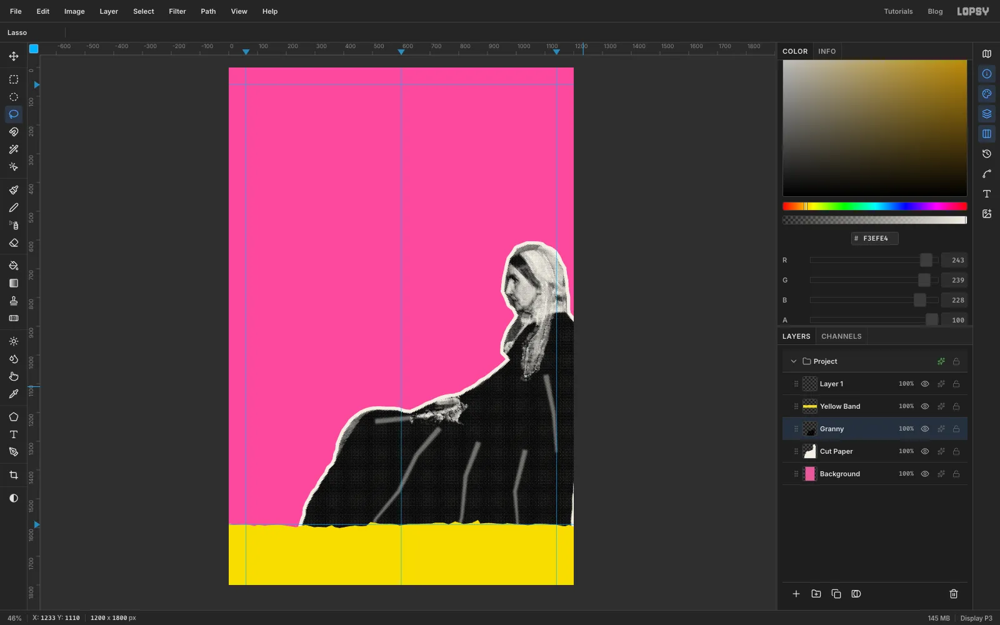

Choose **Filter → Halftone…** and set:

- **Dot Size** **5**
- **Density** **1.3**
- **Angle** **45**
- **Softness** **1**

Click **Apply**. Density above 1 packs the cells tighter than the dots, so the darkest areas print solid black while her face stays as light, readable dots. The white gaps go transparent, so the paper layer underneath shows through as the "paper".

> **Tip:** Keep Softness at 1 when Density is above 1. With a hard edge, the tiny gaps between nearly touching dots catch the pixel grid unevenly, and a blocky moiré grid appears across the dark areas.

## Lasso the liberty spikes

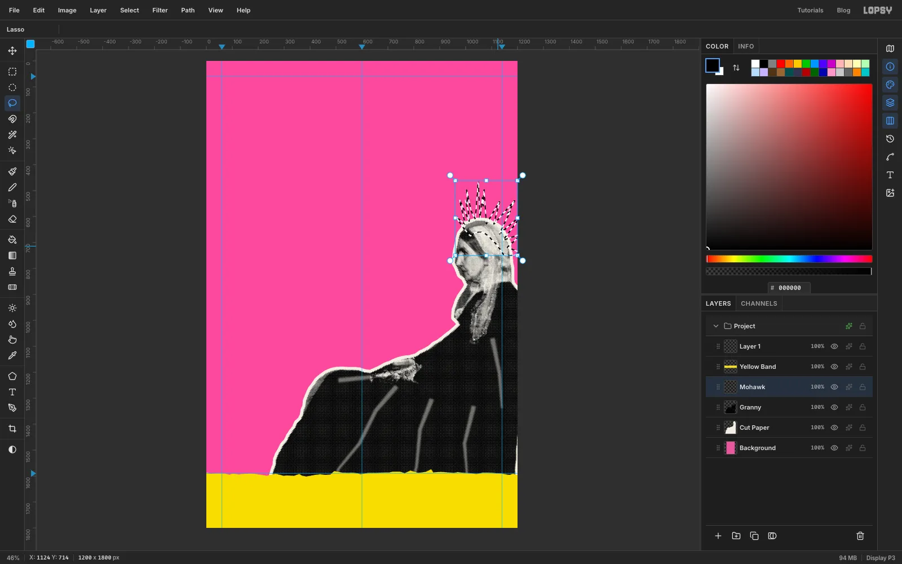

With *Granny* selected, add a layer called *Mohawk*. It sits right above the photo.

Each spike is its own skinny triangle. Its base starts *inside* the bonnet, so the hair grows out of her head rather than sitting on top of it. Its tip points away from the centre of her head, leaning back a little.

With the **Lasso**, draw the first spike at her forehead. Then hold [[Shift]] and draw twelve more, working back over the crown to the nape of her neck. Let neighbouring bases overlap, and vary them:

- Make the front and back spikes short, about 60–90 px.
- Make the crown spikes longer, up to about 190 px.
- Change the lean by a few degrees from one spike to the next.

## Fill and grit the mohawk

Set the foreground to `#86DB3A`, choose **Edit → Fill** and press [[Cmd+D]].

A flat fill looks like vector clip art next to the photocopy, so rough it up. Run **Filter → Gaussian Blur…** at **1** to soften the edges. Then run **Filter → Add Noise…** with **Mono** selected and **Amount** at **45**.

## Start the ransom-note title

Every letter is a live text layer sitting on its own scrap of paper. All the scraps are painted on one layer underneath.

Click *Layer 1* and click **New Group** at the bottom of the Layers panel. Name the group *Title*. With the group selected, click **Add Layer**: the layer goes *inside* the group. Name it *Scraps*.

The recipe for each letter:

1. Click *Scraps*, so the new text goes just above it and so the Text options don't restyle a letter you've already made.
2. Pick the **Text** tool and set the font, size and colour from the table below.
3. Click where the letter goes, type it and press [[Tab]] to commit. The text box hangs down and to the right from your click, so click a little left of the letter's centre and about half the type size above the row's centre line. Then nudge it into place with the **Move** tool and the arrow keys.
4. Pick the **Move** tool and drag the round rotate handle just off the text's top-right corner to tilt the letter.
5. Click *Scraps* again. With the **Lasso**, draw a four-sided scrap around the letter, about 16 px clear of it on every side, tilted to match. Add a slight kink in one or two edges, as scissors do.
6. Set the foreground to the scrap colour and choose **Edit → Fill**, then [[Cmd+D]].

Start with the last letter, the **G** of UPRISING, with its scrap against the right margin guide. Work right to left, and do the whole bottom row before the top row. A click with the Text tool on top of an existing text box edits that box instead of starting a new one, and every box runs right and down from where you clicked. Building from the bottom right means you never click inside one.

## Cut out the rest of the letters

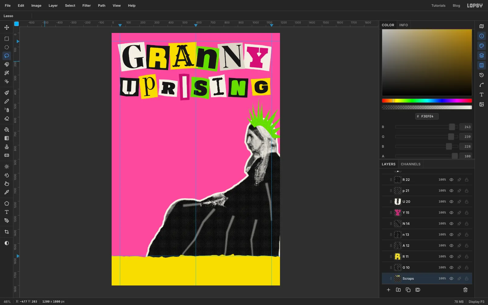

Build the other thirteen letters the same way. Row two, UPRISING, sits with its centre line at about **y 388**:

- **G**: Rubik Mono One 126, ink `#161616` on `#F3DD2B`, tilt −4°
- **N**: Titan One 150, ink `#86DB3A` on `#161616`, tilt 4°
- **I**: Special Elite 170, ink `#161616` on `#F3EFE4`, tilt −7°
- **s** (lowercase): Alfa Slab One 190, ink `#161616` on `#86DB3A`, tilt 5°
- **I**: Anton 178, ink `#F3EFE4` on `#B92B6E`, tilt −2°
- **R**: Holtwood One SC 112, ink `#161616` on `#F3EFE4`, tilt 6°
- **p** (lowercase): Old Standard TT 190, ink `#161616` on `#F3DD2B`, tilt −5°
- **U**: Black Ops One 150, ink `#F3EFE4` on `#161616`, tilt 3°

Row one, GRANNY, sits at about **y 170**:

- **Y**: Ultra 200, ink `#C42D74` on `#F3EFE4`, tilt 5°
- **N**: DM Serif Display 236, ink `#161616` on `#D9D4C7`, tilt −4°
- **n** (lowercase): Archivo Black 250, ink `#161616` on `#86DB3A`, tilt 7°
- **A**: Rye 200, ink `#161616` on `#F3DD2B`, tilt −3°
- **R**: Bungee 196, ink `#F3DD2B` on `#161616`, tilt 4°
- **G**: Abril Fatface 230, ink `#161616` on `#F3EFE4`, tilt −6°

Each letter takes roughly 110–180 px of row, so the U of UPRISING and the G of GRANNY end up against the left margin guide. Let neighbouring scraps touch or overlap a little. The lowercase letters and the mix of sizes are what make it look like a ransom note rather than a font.

## Lift the scraps with a hard shadow

Click *Scraps* and open its effects with the sparkle button on the row. Turn on **Drop Shadow** and set **Offset X** **7**, **Offset Y** **8**, **Blur** **0**, **Spread** **0** and **Opacity** **70**. Close the drawer.

A blur of 0 gives the shadow a hard edge, like paper pasted down slightly off the board.

## Nudge the whole title into place

Look at the top margin. The title should sit just below the top guide with a little pink above it. If it doesn't, click the *Title* group's row, pick the **Move** tool and drag any letter. Here it went down about **14 px**. All fourteen letters and their scraps move together, and the letters stay live and editable.

## Type the tagline strips

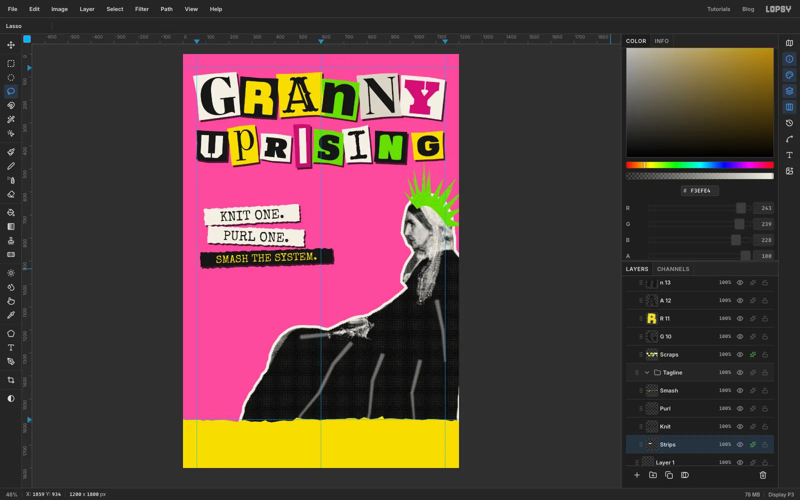

Click *Layer 1* again, so the new group sits at the top level rather than inside *Title*. Click **New Group** and name it *Tagline*, then add a layer inside it called *Strips*.

Every line is set in **Special Elite**, a typewriter face. Work from the bottom up for the same reason as the title, clicking *Strips* before each one:

- **SMASH THE SYSTEM.** at size **46** in `#F3DD2B`, the lowest line, tilted slightly anticlockwise. Name the layer *Smash*.
- **PURL ONE.** at size **58** in `#161616`, about 90 px above it, tilted slightly clockwise. Name it *Purl*.
- **KNIT ONE.** at size **58** in `#161616`, another 90 px up, tilted anticlockwise. Name it *Knit*.

The three lines stack down the left side of the poster, below the title, with their left ends about 140 px in from the edge. The bottom one sits at about y 884.

For each strip, click *Strips* and draw a long Lasso rectangle around the line, tilted to match. Leave about **70 px** of paper either side of the words and about 15 px above and below. Give the short ends and the long edges a ragged, torn wobble. Fill the black strip with `#161616` and the other two with `#F3EFE4`, pressing [[Cmd+D]] after each.

Then give *Strips* the same **Drop Shadow** as the scraps, at **6 / 7**.

## Draw the safety pin's legs

Click *Strips* and add a layer called *Safety Pin*. The pin lies almost upright across the left ends of the top two strips, in the spare paper you left there, leaning slightly to the right as it goes down.

Pick the **Brush**. In the brush settings set **Size** to **8**, **Hardness** to **100** and **Opacity** to **100**, and set the foreground to `#C9CED6`.

Draw the two legs as straight lines, about 200 px long:

- For the first leg, click just above the KNIT strip, then [[Shift]]-click a little below the bottom of the PURL strip.
- Draw the second leg about 12 px to the right of the first, from the bottom end up to a little short of the top. That one is the pointed leg that tucks under the clasp.

## Add the coil and the clasp

For the coil spring, pick the **Elliptical Marquee**. Hold [[Cmd]] to keep it a perfect circle and drag a circle about **32 px** across over the bottom ends of the legs. Choose **Edit → Fill**. Then draw a **14 px** circle in its middle and press [[Delete]], which leaves a ring.

For the clasp, use the **Lasso** to draw a rounded hood about **50 × 38 px** over the top ends, and fill it. Press [[Cmd+D]].

Open the layer's effects and add a **Stroke** of **2** in black. Close the drawer.

## Push the pin through the paper

A pin that just lies on top isn't pinning anything. Lasso roughly round the KNIT ONE strip to select it. Then pick the **Eraser**, set **Size** to **12**, and erase a stretch about 40 px long of the right-hand, pointed leg in the middle of the strip.

The eraser only works inside the selection, so the leg disappears exactly where it passes behind the paper. It looks like it goes in through one hole and comes out of the next. Press [[Cmd+D]].

## Cross two knitting needles

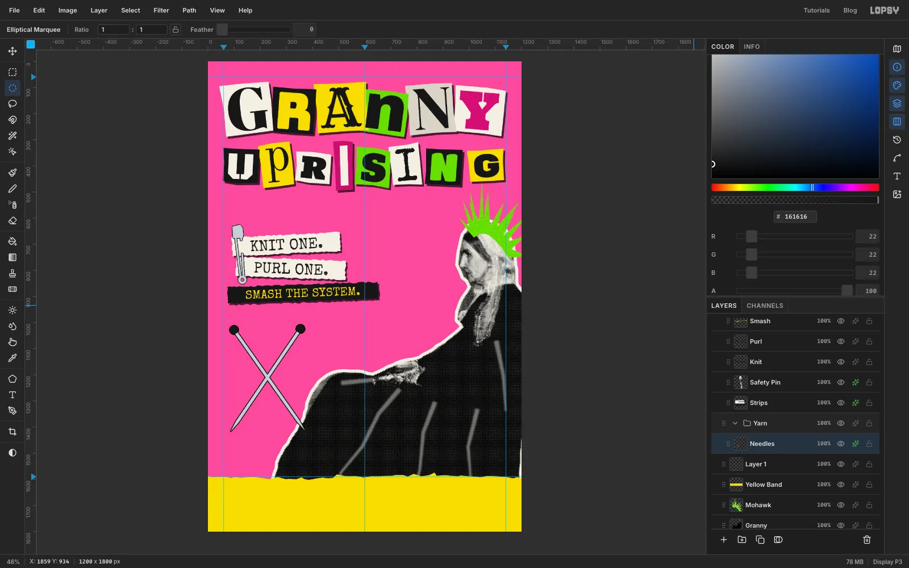

The needle knobs sit close to the left margin guide, so turn off **View → Snap to Guides** for now. Otherwise the knob circles snap to the guide and get a flat side.

Click *Layer 1*, click **New Group** and name it *Yarn*. Add a layer inside called *Needles*.

Each needle is a long, thin lasso shape about **12 px** wide and **470 px** long, coming to a point over its last 45 px. Draw the two so they cross in an X just inside the left margin, below the tagline. The knobs go at the top, about 250 px apart, and the points at the bottom, a little above the band. The crossing point, where the ball will go, is at about **226, 1220**. Fill both with `#C9CED6`.

For the knobs, pick the **Elliptical Marquee**, hold [[Cmd]] for a perfect circle and drag a **32 px** circle at the top end of each needle. Fill them with `#161616`. Press [[Cmd+D]] and add a black **Stroke** of **3**.

## Wind a ball of wool

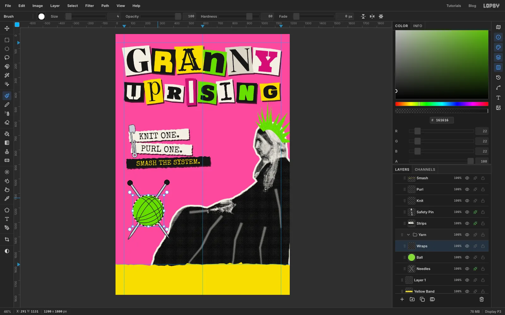

Add a layer called *Ball*. With the **Elliptical Marquee**, holding [[Cmd]] for a perfect circle, draw a circle **216 px** across centred where the needles cross. Fill it with `#86DB3A`. The needles are on the layer below, so they now look as if they're stuck through the ball.

Add a layer called *Wraps* and [[Cmd]]-click the *Ball* thumbnail so you can only paint inside the ball. Pick the **Brush** at **Size** **4** with a `#161616` foreground.

Wool wraps around a ball in bands that meet at two points, like lines of longitude meeting at the poles. Paint three sets of curves. In each set, the curves start and end at the same two points on the ball's edge. Some bow out wide, others stay nearly straight.

- Tilt the first set down to the right, with three or four curves.
- Tilt the second set the other way, with three curves.
- Make the third set steep, with two curves.

Press [[Cmd+D]]. Give *Ball* a black **Stroke** of **4** and the same hard **Drop Shadow** as the scraps.

## Run a strand to her hands

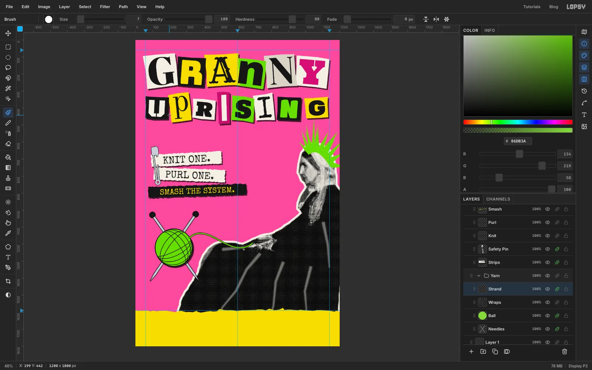

Click *Wraps* and add a layer called *Strand*. Set the Brush to **Size** **7** with a `#86DB3A` foreground. Drag a loose S-curve from the top right of the ball, up over the pink, down across her lap and into her hands.

Give it a black **Stroke** of **2** so it stays visible against the black dress. Then turn **View → Snap to Guides** back on.

## Make a round sticker

Click *Layer 1*, click **New Group** and name it *Sticker*. Add a layer inside called *Sticker Disc*. With the **Elliptical Marquee**, holding [[Cmd]] for a perfect circle, draw a **180 px** circle under the needle points, centred at about **198, 1476**, so its right edge laps over the hem of her skirt. Fill it with `#F3DD2B`, press [[Cmd+D]] and give it a black **Stroke** of **3**.

Add three lines of black text on the disc. Work bottom up, clicking *Sticker Disc* before each. Centre each line with the **Move** tool: drag until the middle of its text box sits over the disc's centre, then nudge with the arrow keys.

- **NO PROBLEM.** in Special Elite **19**
- **FUTURE?** in Archivo Black **27**
- **NO** in Archivo Black **50**

Keep every line at least 12 px clear of the rim. The middle line is the widest, so check it first.

## Slap the sticker on at an angle

Click the *Sticker* group row and pick the **Move** tool. With no selection on the canvas, the handles frame everything in the group. Drag the top-right round rotate handle anticlockwise by about **12°**.

The text layers turn with the disc and stay live, so you can still click into FUTURE? later and retype it.

## Set the billing block

Click the *Yellow Band* layer, so the billing text lands just above it. Set three lines in black, again bottom first, and name them *Credits*, *Release* and *Presents*. Use the Text panel's **Letter spacing** for the tracking. Centre each line with the **Move** tool: drag it until the middle of its text box sits on the centre guide, then nudge with the arrow keys. The heights below are where the middle of each line's letters should sit.

- Credits in **Bebas Neue 27**, spacing **2**, at **y 1752**. Type `DAME MAVIS HOLT · SID PURL · THE KNITWITS    MUSIC BY THE BINGO CALLERS    DIRECTED BY DOT McGINTY`. Paste it if your keyboard can't type the middle dot.
- **IN CINEMAS 13 NOVEMBER** in **Anton 74**, spacing **3**, at **y 1698**.
- **SAFETY PIN PICTURES PRESENTS** in **Bebas Neue 34**, spacing **8**, at **y 1636**.

Leave at least 30 px between the top line and the torn edge, and about 40 px under the credits.

## Scrawl a note in marker

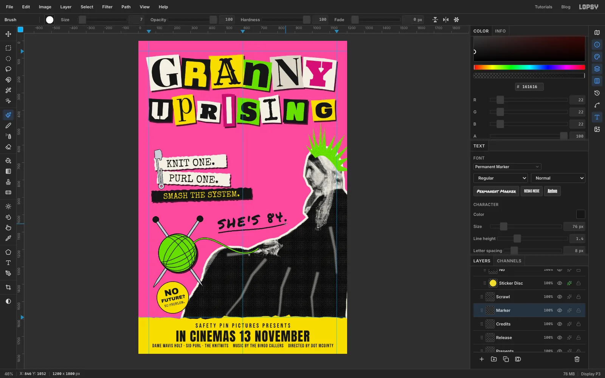

Click *Layer 1*. With the Text tool, set **Permanent Marker** at **76** in `#161616` and type **SHE'S 84.** in the empty pink above her lap, centred at about **652, 1032**. Name the layer *Scrawl*, and tilt it about 7° anticlockwise with the Move tool's rotate handle.

Now click *Layer 1* again and rename it *Marker*. Check the foreground is still `#161616`, pick the **Brush** at **Size** **7** and drag a slightly wavy underline beneath the words.

## Spray a star on the wall

Click *Marker* and add a layer called *Spray Star*. With the **Lasso**, draw a five-pointed star about **236 px** across, centred at about **790, 640** in the gap between the tagline and her face. Fill it with `#F3DD2B` and press [[Cmd+D]]. Run **Filter → Gaussian Blur…** at **2** so the edge is soft, like spray through a loose stencil.

Pick the **Spray** tool and set **Size** **36**, **Density** **60**, **Opacity** **95** and **Softness** **30**. Drag once around the star's outline.

Then set **Size** **90**, **Density** **22** and **Opacity** **70** and drag a loose loop over just the lower-right points. Overspray always drifts one way.

## Let it drip

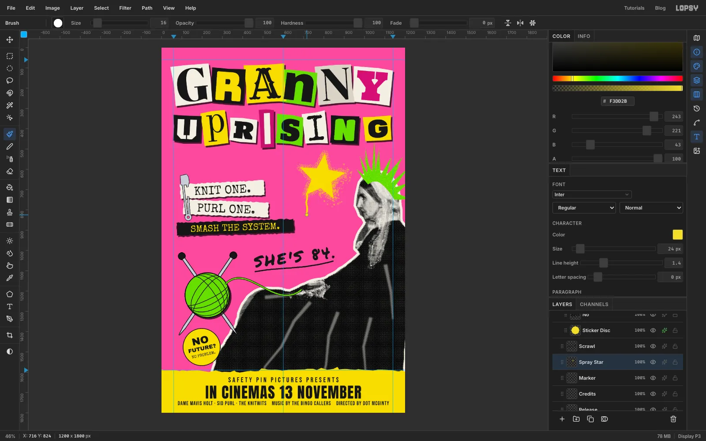

Pick the **Brush** at **Size** **9**, **Hardness** **100**. Drag a slightly wavering line straight down about 100 px from the star's lower-left point. Then set the size to **16** and click once at the bottom for the bead of paint.

## Tape down the cut-out

Click *Spray Star* and add a layer called *Tape*. With the **Lasso**, draw a strip about **150 × 44 px** across the edge of her lap, near where the strand crosses. Make both short ends ragged zig-zags. Fill it with `#F2ECD2`.

The fill leaves the selection active with handles on it. With the **Move** tool, drag the rotate handle until the tape crosses the edge at about **52°**. Press [[Cmd+D]] and set the layer's opacity to about **88%**, so the tape is just see-through.

## Copy the tape for the band

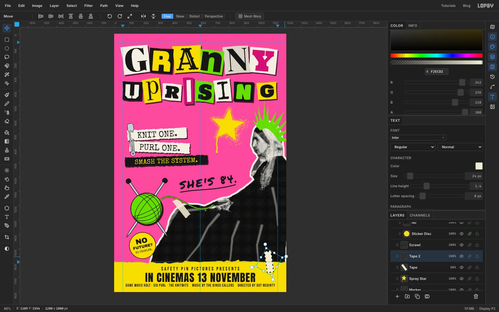

[[Cmd]]-click the *Tape* thumbnail, press [[Cmd+C]] and then [[Cmd+V]]. The copy is pasted in place on its own layer. Rename it *Tape 2*.

[[Cmd]]-click its thumbnail to select it, and drag it down to the lower right, across the yellow band's torn edge at about **1080, 1590**. Rotate it another **30°** so it stands nearly upright, press [[Cmd+D]] and set its opacity to **88%** too.

Now it looks like the band was taped on as well.

## Add toner speckle and burnt edges

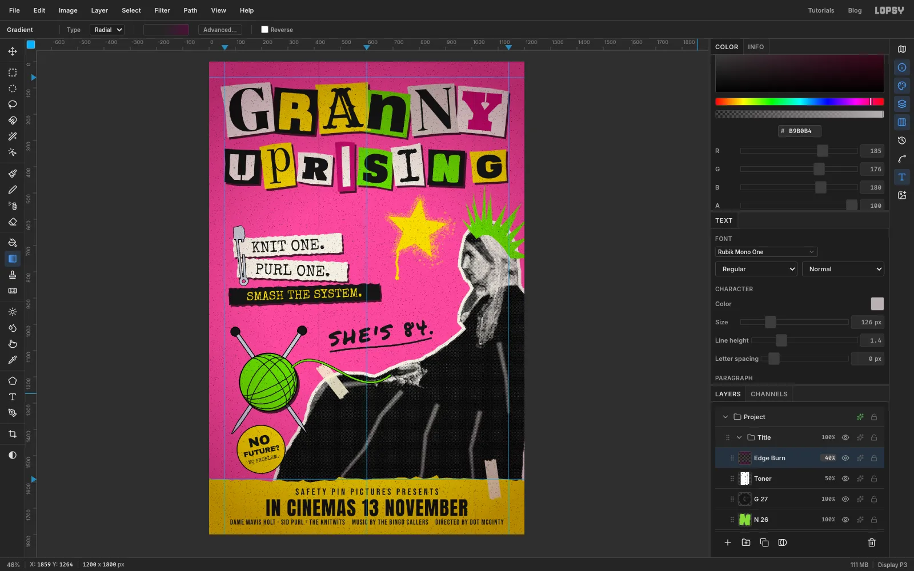

The *Title* group is at the top of the stack, so a layer at the top of it covers the whole poster. Click the top letter layer inside *Title* and add a layer called *Toner*.

1. Choose **Select → All**, fill it with `#FFFFFF` and press [[Cmd+D]].
2. Run **Filter → Add Noise…** with **Mono** and **Gaussian** selected and **Amount** at **100**.
3. Run **Filter → Gaussian Blur…** at **2**.
4. Run **Filter → Threshold…** at **238**. That leaves only small clumps of black, about 3% of the layer.
5. Pick the **Pencil** at **Size** **2** with a `#B9B0B4` foreground. Click at the top of the canvas and [[Shift]]-click at the bottom to draw a faint vertical line. Draw a second one further across. These are the streaks a dirty copier drum leaves.
6. Set the layer's blend mode to **Multiply** and its opacity to **50%**.

Add one more layer called *Edge Burn*. Pick the **Gradient** tool, set **Type** to **Radial** and click **Advanced…**. Use three stops, all in `#4A1236`:

- the left end at 0% opacity
- a second stop at 0% opacity about 40% along
- the right end at full opacity

Click a stop's marker under the bar to select it, then set its colour and its opacity in the picker below. Click the bar itself to add the middle stop, and drag its marker to about 40%. Click **Done**.

Drag from the centre of the poster straight up to just above the top edge. Set the layer to **Multiply** at **40%**. The edges and corners darken, like a sheet that has been copied one time too many.

Both grit layers sit inside the *Title* group, so don't move that group from now on. If you do, the grit moves with it.

Choose **File → Quick Export PNG** to save the poster, and **File → Save Project** to keep the layers.
