In the early 1960s, illustrators like Klaus Bürgle and Chesley Bonestell painted the future for magazines and children's annuals. Their scenes showed families on holiday on other worlds: glass domes, saucer-topped towers and swooping "Googie" roofs, with a giant planet filling the sky. The look is called **retro-futurism**, and it's a lot of fun to paint.

In this tutorial you'll paint *Jovian Lido*: a space-age resort on Europa, Jupiter's icy moon. The planet itself is a real NASA photograph. Everything else is painted with selections, gradients and soft brushes. You'll use a wide range of Lopsy's tools:

- **Photo compositing.** You'll drop in an image, clear its background with the **Magic Wand**, then scale and rotate it with the Move tool's handles.
- **The Healing Brush**, to paint out a blemish in the photo.
- **Selections.** You'll combine marquees with Shift (add), Alt (subtract) and Shift+Alt (intersect). You'll also use Grow, Shrink, Feather and Inverse, and load selections from layer thumbnails.
- **The Pen tool**, both for precise shapes (**Path to Selection**) and for curved strokes (press [[Enter]] to stroke a path).
- **Gradients**, including gradients painted into **layer masks**.
- **Filters:** Add Noise, Threshold, Gaussian Blur, Motion Blur, Pixel Stretch, Clouds, Voronoi, Find Edges and Hue/Saturation.
- **Effects:** Outer Glow, Inner Glow, Drop Shadow, Stroke, Color Overlay and Rasterize Layer Style.
- **Groups**, which you'll duplicate, flip, scale and move as a unit, plus a **Perspective** transform.
- **Group adjustments** on the root group: Vignette and Saturation.

You'll need one photo. Download NASA's Cassini true-colour portrait of Jupiter, [PIA02873](https://commons.wikimedia.org/wiki/File:Jupiter_by_Cassini-Huygens.jpg). It's public domain, 1080 × 1020 px, and shows the planet on a black background.

The light comes from the **right** in this painting, because that's where the photo is lit. Keep that in mind for every highlight and shadow.

The palette:

- Night sky `#060A26` → `#141A5C` → `#4A2A86` → `#B8508A` → `#F6A48E`
- Jupiter shadow `#0B0A2C`, limb glow `#F4C4E8`, Jupiter light `#FFB27A`
- Io `#FFF4B8` → `#E9B84C` → `#9A5426`, Io shadow `#2A1B4E`
- Far ice `#D9B4DC` → `#7D6AB4`, lit facets `#C9B0E2`
- Near ridge `#5B4B90` / `#7A64AE`, crest light `#C9A0DC`
- Ice plain `#EAD8F0` → `#BCB6E2` → `#6E6CB0`
- Cracks `#B4643E` / `#6E2E1A`
- Chrome `#6A609E` → `#C9C1E6` → `#FFFFFF` → `#C4BBE4`, ring chrome `#6E64A2` → `#ECE8F8` → `#9A90C8`
- Saucer underside `#5E548F`, ground shadows `#2E2466` / `#3A2A44`
- Glass `#F2FDFF` → `#9EE6F6` → `#3B8FC0`
- Window gold `#FFD27A`, beacon `#FF4A4A`
- Roof tangerine `#FF9A55` → `#E2512A`, gable glass `#8FD3E6` → `#D8F4FA`
- Rocket red `#E8463A`, fins `#B02C2A` → `#FF6B4A`
- Deck `#F1E6D8` → `#C7B1A4`, tile lines `#A9927F`
- Pool `#2CC2DE` → `#5ADFEC` → `#1592C2`, far wall `#0A3E5E` → `#167EA4`, coping `#FAF5EC`
- Water glint `#F07AB8`, sky tint `#E86FB0` → `#6A4AC0`
- Parasol `#B83A1C` → `#FF8A47` → `#FFC07A`, gores `#FFF1DC`
- Plant `#1E6E73` → `#5FD0B8`, blossoms `#FF7AB6`

> **Tip:** Keep the **Info** panel open. It shows the cursor position in document pixels, so "about 760 px down" is easy to find.

## Set up the canvas and paint the night sky

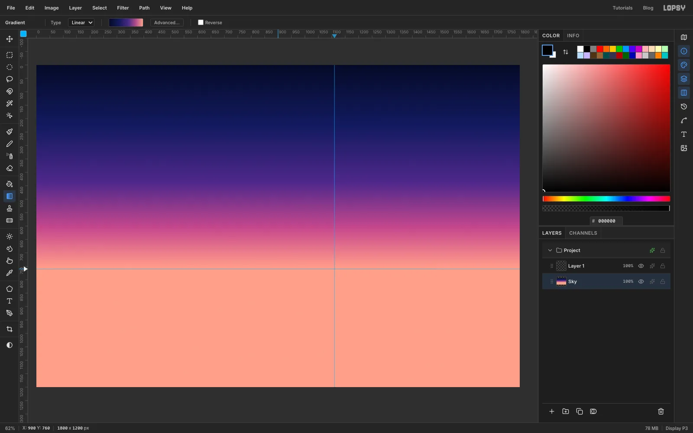

Open [Lopsy](/). In the **New Document** dialog, set **Width** to `1800` and **Height** to `1200`, choose a white background and click **Create**.

Add two guides:

- Click the left ruler at about `760` for the **horizon**.
- Click the top ruler at about `1110` for the **centre of the dome** you'll build later.

Rename *Background* to *Sky* by double-clicking its name. Pick the **Gradient** tool, set **Type** to **Linear** and click **Advanced…**. Click the gradient bar to add stops until there are five, and type the night-sky colours into the **Hex** field for each one, at about 0, 30, 58, 80 and 100%. Then drag from the top edge straight down to the horizon guide. Everything below the horizon stays peach, but it will be covered by ice.

## Make a starfield from noise

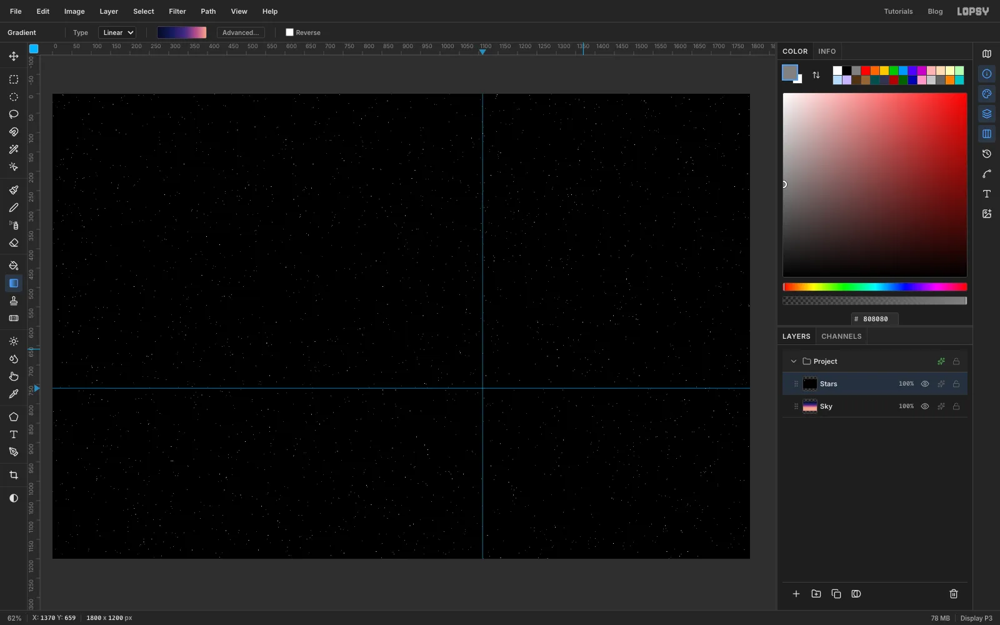

Select *Layer 1* and rename it *Stars*. Set the foreground colour to `#808080` and choose **Edit → Fill**. Then:

1. Run **Filter → Add Noise…** with **Amount** `100`, **Mono** and **Gaussian**.
2. Run **Filter → Threshold…** at `178`.

Gaussian noise piles most pixels up around mid-grey, so only a few rare specks are bright enough to survive the threshold. Those specks are your stars.

## Fade the stars out toward the horizon

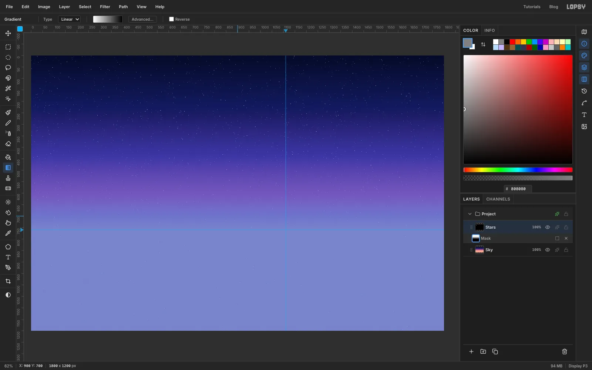

Open the layer's effects drawer (the ✦ button on its row) and set the blend mode to **Screen**, so the black disappears.

Click **Add Mask** at the bottom of the Layers panel, then click **Edit mask** on the new mask row. Set the gradient to two stops, white → black, and drag from about y `260` down to about y `700`. The stars now thin out as they reach the bright part of the sky, where real stars would be washed out.

## Add a few bright stars

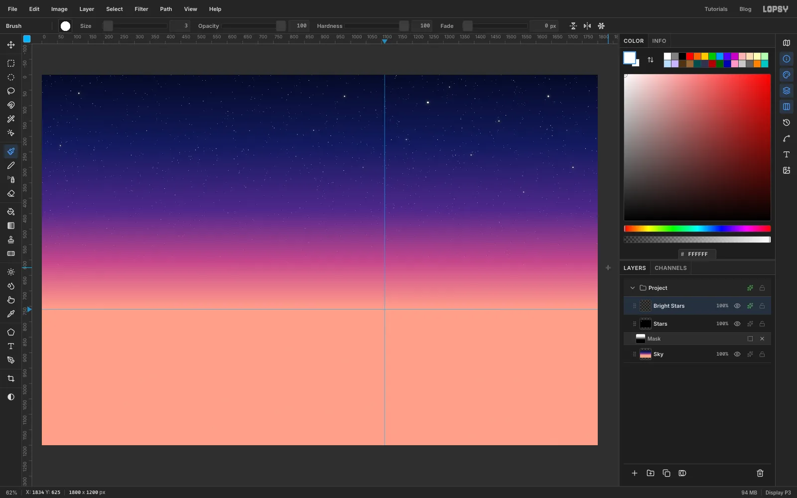

Click **Add Layer** and name the new layer *Bright Stars*. Choose the **Brush** with **Hardness** `100` and white paint. Click a dozen single dots across the upper sky, changing **Size** between `3` and `7` as you go. Keep them away from the upper left, where Jupiter will go.

In the effects drawer, turn on **Outer Glow** with **Size** `14` and **Opacity** `80`. Each dot now twinkles a little.

## Drop in the Jupiter photo

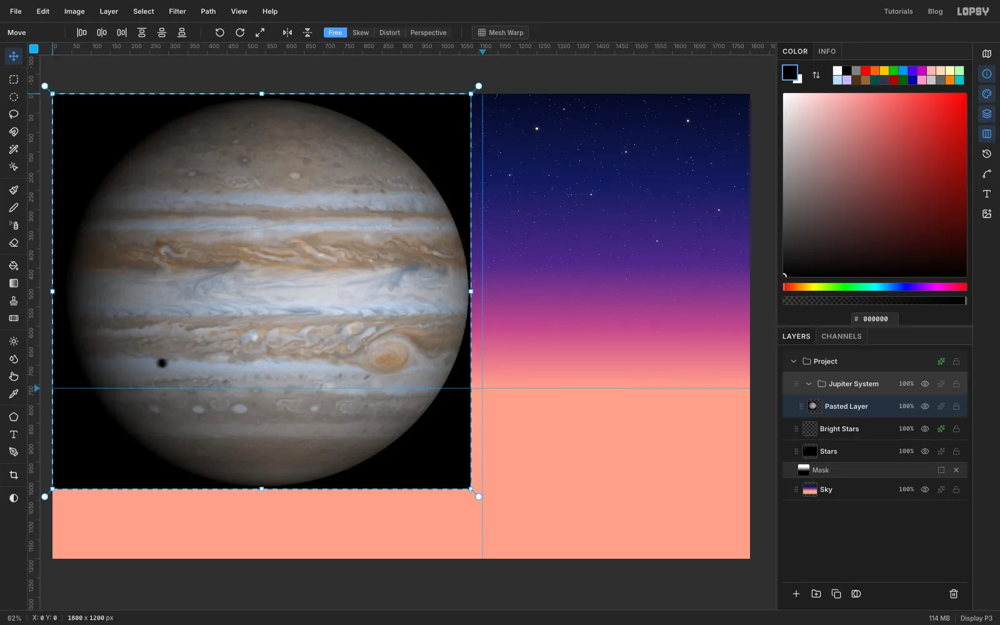

Click **New Group** and name it *Jupiter System*. Then drag the downloaded photo from your desktop onto the canvas. Lopsy adds it as a new layer at the top-left corner, inside the group. Rename it *Jupiter*.

## Select the black of space with the Magic Wand

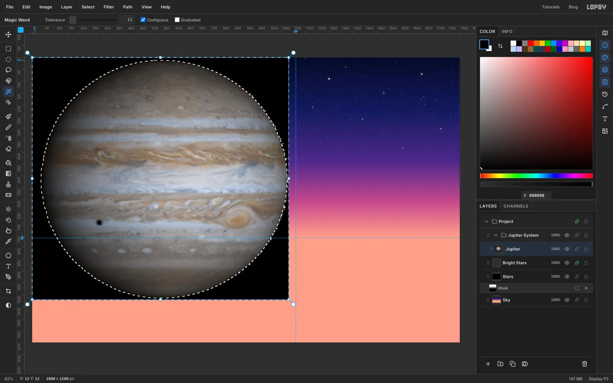

Pick the **Magic Wand** and set **Tolerance** to `12` with **Contiguous** ticked. Click the black corner of the photo. The low tolerance stops the wand before it reaches the planet's dark edge. Press [[Delete]] to clear the black, then [[Cmd+D]] to deselect.

## Trim the dark rim

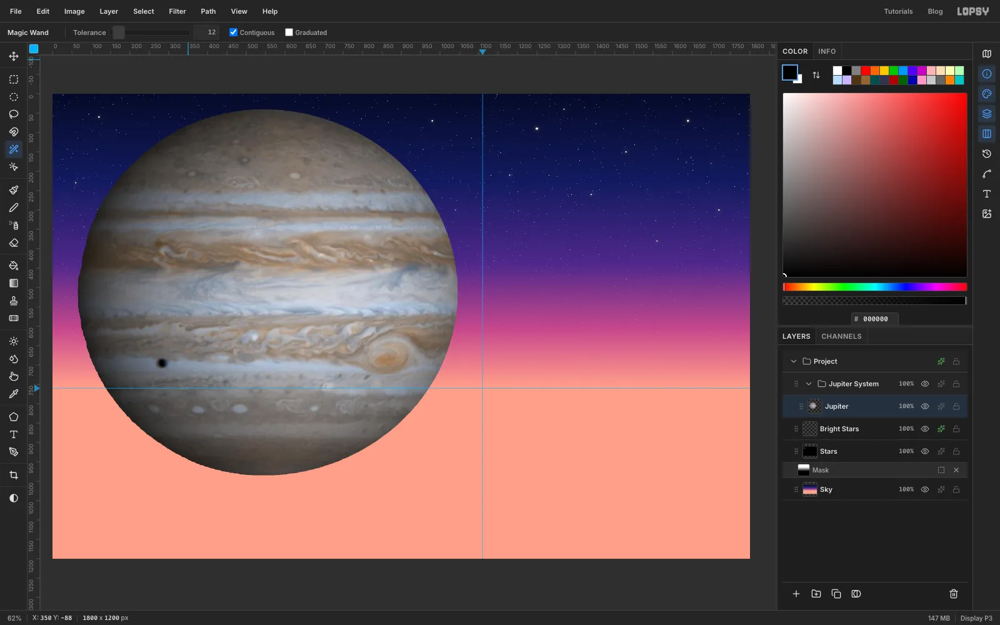

The photo's edge fades into a dark, soft ring that would look like an outline over the violet sky. To remove it:

1. [[Cmd]]-click the *Jupiter* thumbnail to select the planet.
2. Choose **Select → Shrink…** and enter `28`.
3. Choose **Select → Inverse** and press [[Delete]].
4. Press [[Cmd+D]] to deselect.

## Scale the planet down

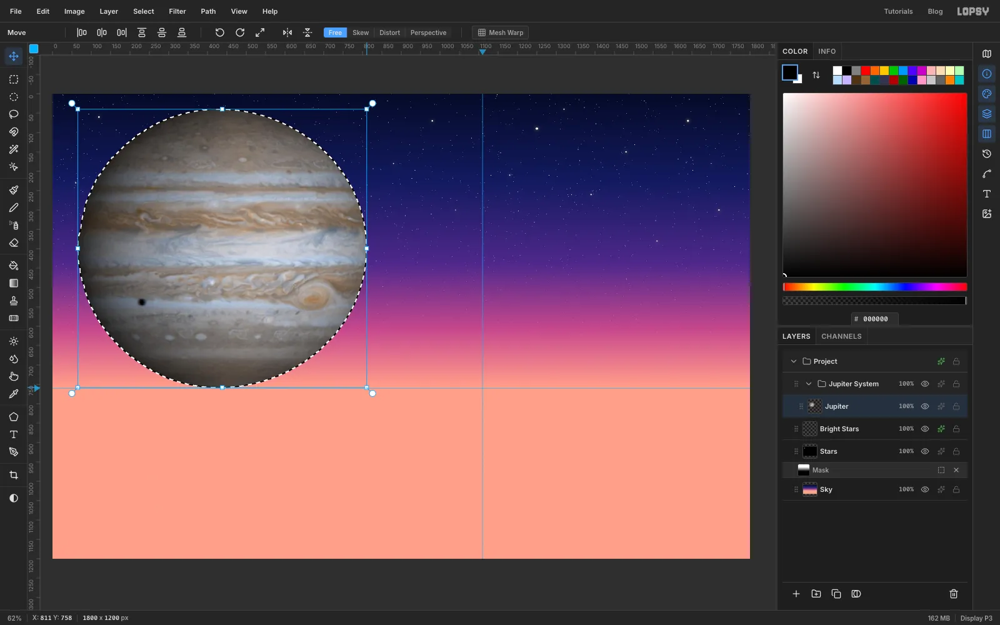

[[Cmd]]-click the thumbnail again to load the planet as a selection, so you can transform it. Pick the **Move** tool, hold [[Cmd]] and drag the bottom-right corner handle up and to the left until the planet is about three quarters of its size, roughly 740 px across. Holding [[Cmd]] keeps the circle from squashing.

## Tilt the planet

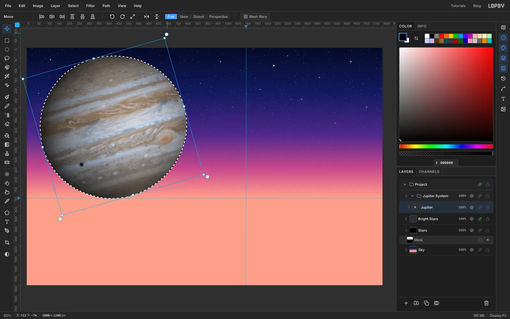

Drag the round rotation handle just outside the top-right corner about 16° anticlockwise. The cloud bands now run diagonally, which feels more dynamic than flat stripes. Press [[Cmd+D]] to commit the transform.

Then drag the planet with the Move tool, or nudge it with the arrow keys, so its centre sits at about `510, 400`. Its lower edge should dip just below the horizon.

## Heal away the moon's shadow

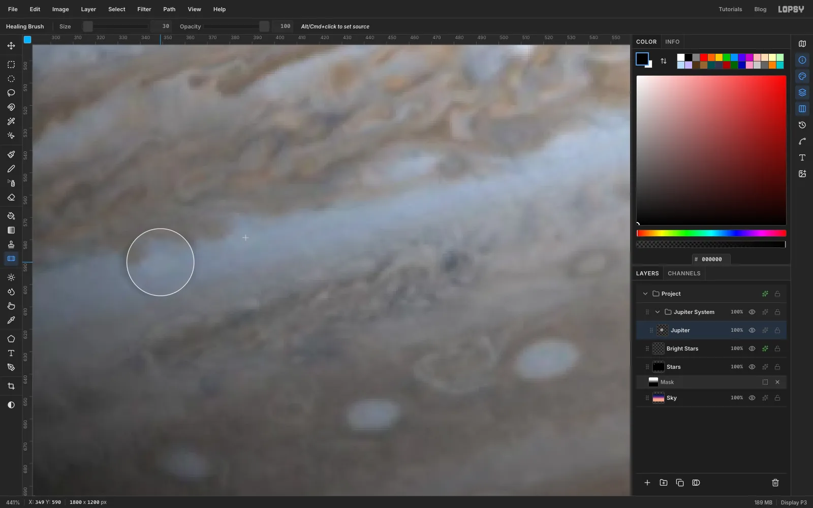

The photo shows a small black dot on the planet: the shadow of a moon. It will end up in the planet's night side, where it makes no sense, so remove it.

Zoom in on the dot. Choose the **Healing Brush** and set **Size** to `30`. [[Alt]]-click a patch of cloud a little to the right of the dot, along the same band, to set the source. Then paint a short stroke over the dot. The Healing Brush borrows the texture from the source but matches the colour of the spot you paint, so the repair is invisible.

## Warm up the photo

Space-age paintings exaggerate colour. With *Jupiter* selected:

1. Run **Filter → Hue/Saturation…** with **Hue** `-6`, **Saturation** `38` and **Lightness** `4`.
2. Run **Filter → Brightness/Contrast…** with **Brightness** `4` and **Contrast** `18`.

## Select the night side

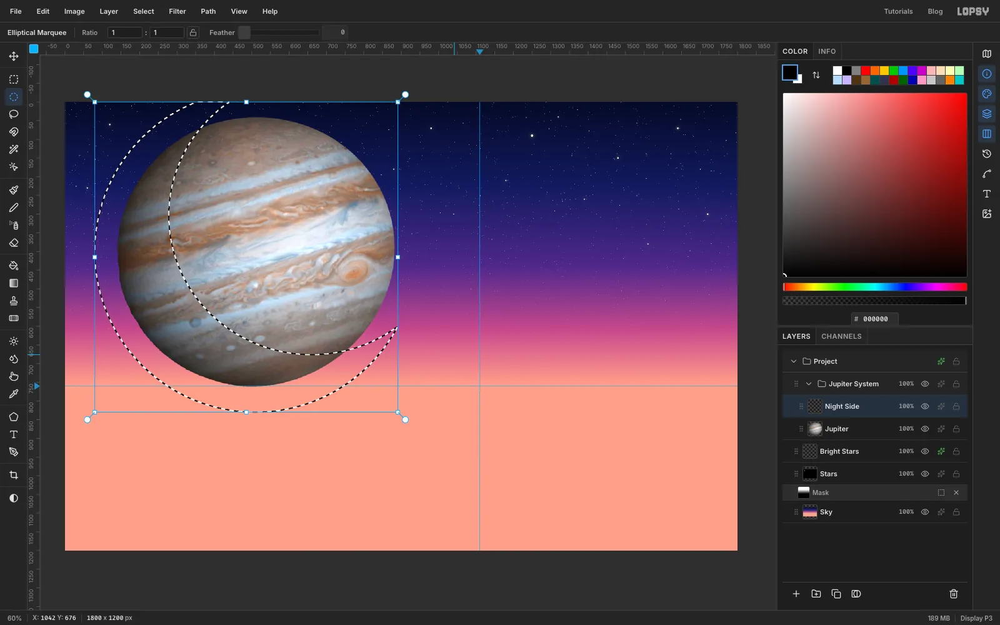

Add a layer called *Night Side* inside the group. Pick the **Elliptical Marquee** and, with nothing selected, click once on the canvas. In the **Elliptical Selection** dialog, enter a circle about 70 px larger than the planet all round: **From** `80, -30` and **To** `940, 830`.

Now hold [[Alt]] and drag a second circle the size of the planet, shifted about 150 px to the right and 96 px up. That subtracts it, leaving a crescent on the left. This is the part of the planet facing away from the sun.

## Fill the night side

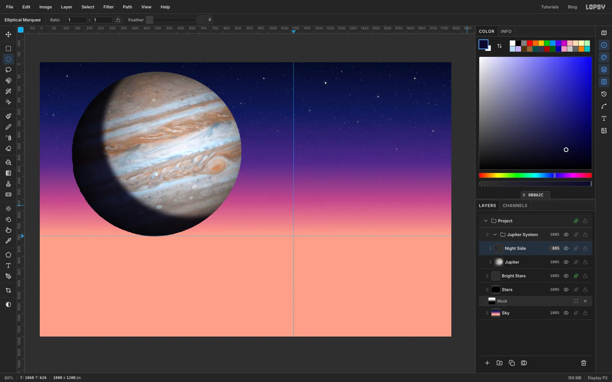

1. Choose **Select → Feather…** with `20`, which softens the terminator (the line between day and night).
2. Fill with `#0B0A2C` (**Edit → Fill**).
3. [[Cmd]]-click the *Jupiter* thumbnail, choose **Select → Inverse** and press [[Delete]]. This trims the shadow crisply to the planet's edge, so the night side is darkest right at the limb.
4. Deselect, then set the layer to **Multiply** at `88%`.

## Add a glow on the sunlit edge

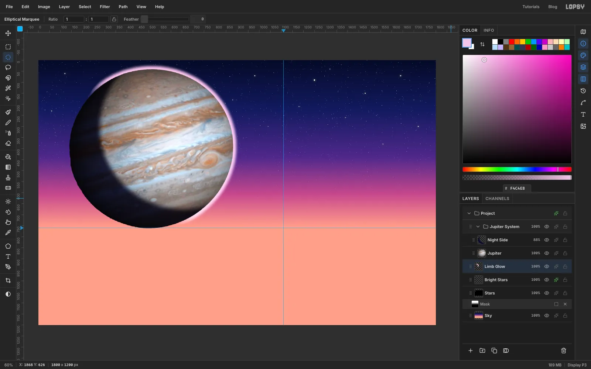

Select *Bright Stars* and add a layer called *Limb Glow*. It sits below the Jupiter group, so the planet covers its middle.

1. [[Cmd]]-click the *Jupiter* thumbnail. Run **Select → Grow…** `14`, then **Select → Feather…** `12`.
2. Fill with `#F4C4E8`.
3. Press [[Cmd+D]]. With the Elliptical Marquee, click the canvas and make an exact circle from `-50, 120` to `730, 900`. That's the planet's size plus a little, shifted down and left toward the dark side. Feather it by `40` and press [[Delete]]. The glow now fades away around the shadowed side.
4. Set *Limb Glow* to **Screen**.

## Paint Io

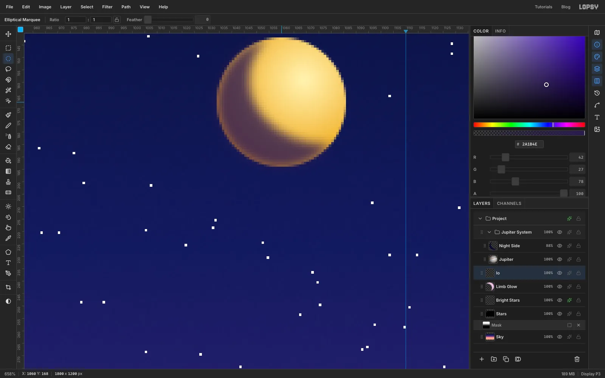

Press [[Cmd+D]], then, with *Limb Glow* still selected, add an *Io* layer. Make an exact circle from `1034, 142` to `1086, 194`. Pick the **Gradient** tool, set **Type** to **Radial**, and give it three stops: `#FFF4B8`, `#E9B84C` and `#9A5426`. Drag from just up-right of the centre out to the lower-left edge.

For the shadow side, [[Alt]]-drag a circle of the same size about 13 px right and 9 px up. That leaves a crescent on the lower left. Feather it by `4` and fill it with `#2A1B4E` at 80% opacity (set **A** to `80` in the Color panel). The moon now matches Jupiter's lighting.

## Lasso a range of ice spires

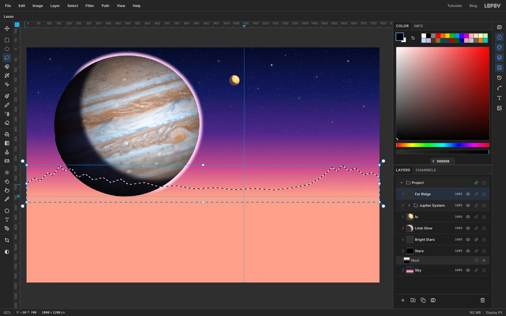

Click the *Jupiter System* group row and collapse it with its arrow. A new layer then lands beside the group instead of inside it. Add a layer called *Far Ridge*.

With the **Lasso**, drag a jagged skyline from the left edge to the right edge. Put tall, sharp spires at both ends, reaching up to about y `600`, and keep the middle low, around y `720`. Close the shape below the horizon.

Fill it with a linear gradient from `#D9B4DC` to `#7D6AB4`, dragged from about y `600` down to y `770`. The peaks fade toward the sky colour, as distant mountains do.

## Light the spires' right-hand faces

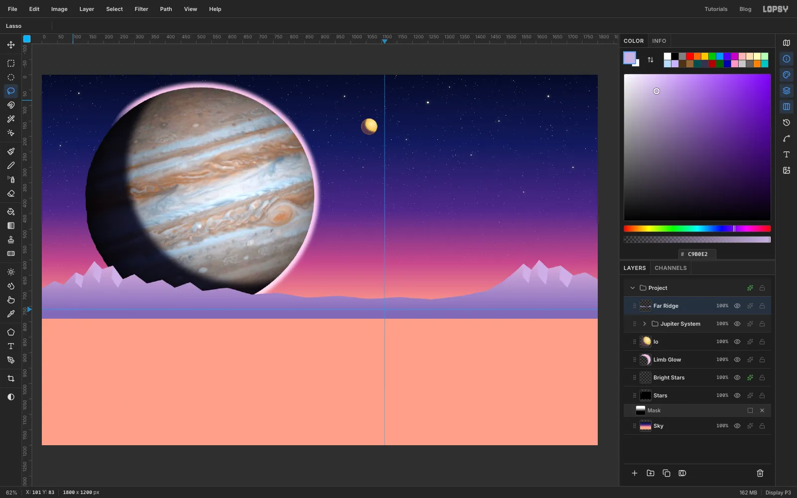

Bonestell's mountains always had crisp lit planes. For each tall spire, lasso a narrow sliver down its right-hand slope, from the peak to partway down, and fill it with `#C9B0E2`. Right-hand faces catch the light because the sun is on the right.

## Lay down the ice plain

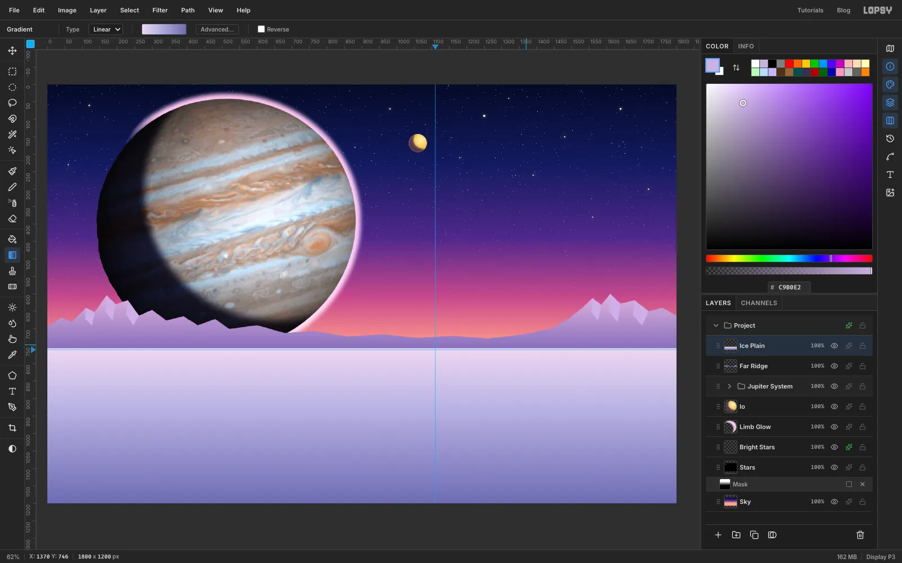

Press [[Cmd+D]] and add an *Ice Plain* layer above the ridge. Use the **Rectangular Marquee**'s exact dialog to select from `0, 756` to `1800, 1200`. Fill it with a three-stop gradient, `#EAD8F0` → `#BCB6E2` → `#6E6CB0`, dragged from the horizon to the bottom edge.

While the selection is active, run **Add Noise…** at `6`, **Mono**, **Gaussian** for a faint frosty grain.

## Add a darker shelf in front

Add a *Near Ridge* layer. Lasso a lower, darker shelf along the left half of the horizon, ending just under the dome's left edge, and fill it with `#5B4B90`.

Keep the selection, pick a soft **Brush** (**Size** `46`, **Hardness** `0`, **Opacity** `55`) and paint `#C9A0DC` along the crest. The selection keeps the paint on the rock. Lasso two or three lit facets and fill them with `#7A64AE`.

The shelf's flat bottom would look pasted on. To blend it in, click **Add Mask** and then **Edit mask**. Drag a white → black gradient from y `752` down to y `800`, so the shelf melts into the ice.

## Crack the ice

Europa is famous for its reddish-brown cracks, called *lineae*. Add a *Lineae* layer and pick the **Pen** tool. Set the foreground to `#B4643E`, then draw three gentle curves across the plain:

- **A far one** near the horizon, with **Stroke** set to `10`.
- **A wide near one** sweeping across the whole plain, with **Stroke** `34`.
- **A middle one** that crosses the near one, with **Stroke** `24`.

Click-drag to make smooth points, and press [[Enter]] after each curve to stroke it.

Run **Gaussian Blur…** at `10` and set the layer to **Multiply** at `40%`. Add a *Cracks* layer and trace the same three curves again in `#6E2E1A`, this time with **Stroke** `1`, `3` and `2`. Set that layer to 75%. Now each band has a sharp fracture down its middle.

## Scuff the ice and haze the horizon

Add an *Ice Scuffs* layer. Paint four or five short, soft strokes of `#FBF6FF` across the plain (Size `60`, Hardness `0`, Opacity `50`) and set the layer to **Overlay**.

Add a *Horizon Haze* layer. Paint one long stroke of `#F7B4C4` along the horizon from edge to edge, with a huge soft brush (Size `260`, Opacity `40`). Set the layer to **Screen**. The haze separates the far ridges from the plain.

## Draw the tower with the Pen tool

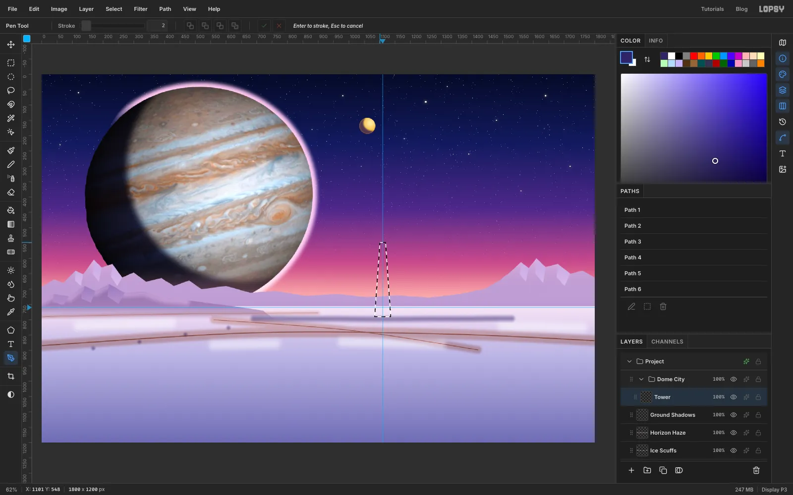

Add a *Ground Shadows* layer first. With a soft brush (Size `34`, Opacity `45`) and `#2E2466`, paint a long line along y `796` from x `690` to `1530`, where the dome's base will sit. At Size `22`, also click four dabs where the monorail's pylons will stand later: at about x `170`, `320`, `470` and `610`, between y `825` and `895`, lower toward the left. Set the layer to **Multiply**. Every building you add will now sit on something.

Click **New Group** and name it *Dome City*. Inside it, add a *Tower* layer. Pick the **Pen** tool and click four corners around the dome guide:

- The top, from x `1101` to `1119` at y `548`.
- The base, from x `1084` to `1136` at y `790`.

Click the first point again to close the path. In the **Paths** panel, click **Path to Selection**, then **Delete Path**.

Fill the selection with a horizontal linear gradient, `#6A609E` → `#C9C1E6` → `#FFFFFF` → `#C4BBE4`, with the white at about 78% so the brightest edge faces the sun. Drag it straight across the tower's base.

## Add the glass cap and the saucer

**The glass cap.** Add a *Cap* layer and select an exact ellipse from `1062, 494` to `1158, 554`. Fill it with a radial gradient, `#F2FDFF` → `#9EE6F6` → `#3B8FC0`, dragged from the upper right of the ellipse to its lower-left edge.

**The saucer.** Add a *Saucer* layer above *Cap*, and select an ellipse from `986, 522` to `1234, 574`. Fill it with a four-stop chrome gradient dragged across its width, with the white at about 76%.

To shade the underside, [[Alt]]-drag a rectangle over the saucer's top half. That leaves only the lower half selected. Fill it with `#5E548F` at 55% opacity.

## Light the saucer and add a beacon

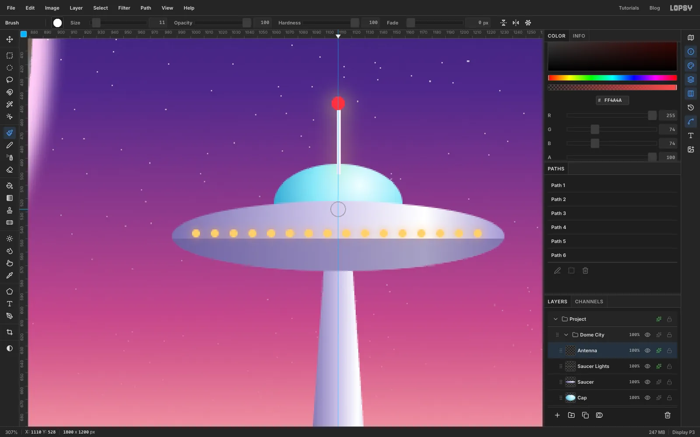

Add a *Saucer Lights* layer. Choose a hard **Brush** at Size `7`. Open the brush presets, set **Spacing** to `200` on the **Shape** tab, and paint with `#FFD27A`. Click near the left end of the saucer's rim, then [[Shift]]-click near the right end. Spacing 200 turns the straight line into a neat row of separate dots. Give the layer an **Outer Glow** with Size `10`, Opacity `85` and colour `#FFB347`. Then set Spacing back to `25`.

Add an *Antenna* layer. Draw a 3 px white **Pencil** line up from the cap: click, then [[Shift]]-click. Click one dot of `#FF4A4A` at the top with an 11 px brush, and give the layer an **Outer Glow** with Size `22` and Opacity `90`.

## Build the west hotel wing

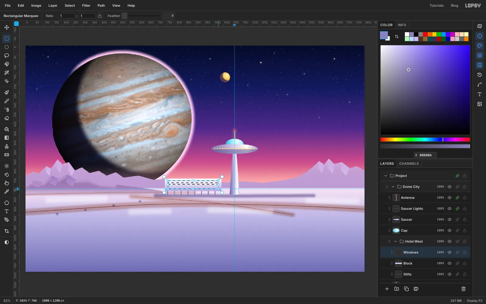

Select *Tower* and click **New Group**. Name it *Hotel West*. Inside it, build the wing from the bottom up, one layer per part. Zoom in to 200% or more for the small parts.

1. **Stilts.** Add a *Stilts* layer. Draw short vertical **Pencil** lines (Size `5`, `#8B80BA`) every 36 px between x `754` and `1030`, from y `770` down to the ground at y `792`.
2. **Block.** Add a *Block* layer. Select from `740, 706` to `1040, 772` with the exact dialog. Fill it with a vertical gradient, white at the top to `#B4AADA` at the bottom.
3. **Windows.** Add a *Windows* layer. Select the first ribbon with the exact dialog, from `756, 716` to `1024, 728`. Then [[Shift]]-drag two more ribbons of the same width below it, each about 12 px tall with an 8 px gap, to add them to the selection. Fill with `#FFD27A` and add an **Outer Glow** with Size `9` and Opacity `70`.

## Glaze the gable and add the swept roof

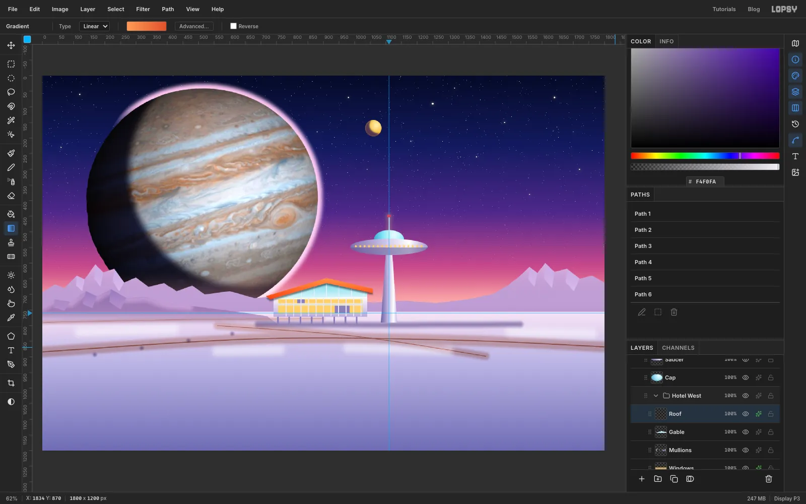

1. **Mullions.** Add a *Mullions* layer. Fill three small rectangles in the window strips with `#8A80B8` as unlit rooms. Then draw thin vertical Pencil lines in `#E9E5F6` every 24 px across the windows.
2. **Gable.** Add a *Gable* layer. With the Pen tool, trace the triangle between the top of the block and where the roof will go: a low point at the left, a peak at about `910, 662`, and the top-right corner of the block. Use **Path to Selection** and fill it with `#8FD3E6` → `#D8F4FA`. Add a few vertical mullion lines.
3. **Roof.** Add a *Roof* layer. Pen a thin boomerang chevron that overhangs the block: from `716, 706` up to a peak at `910, 648`, down to `1058, 682`, and back along a parallel underside 16 px lower. Fill it with `#FF9A55` → `#E2512A`, top to bottom, and add a **Drop Shadow** with Offset X `0`, Offset Y `6`, Blur `6` and Opacity `45`.

## Duplicate and flip the wing

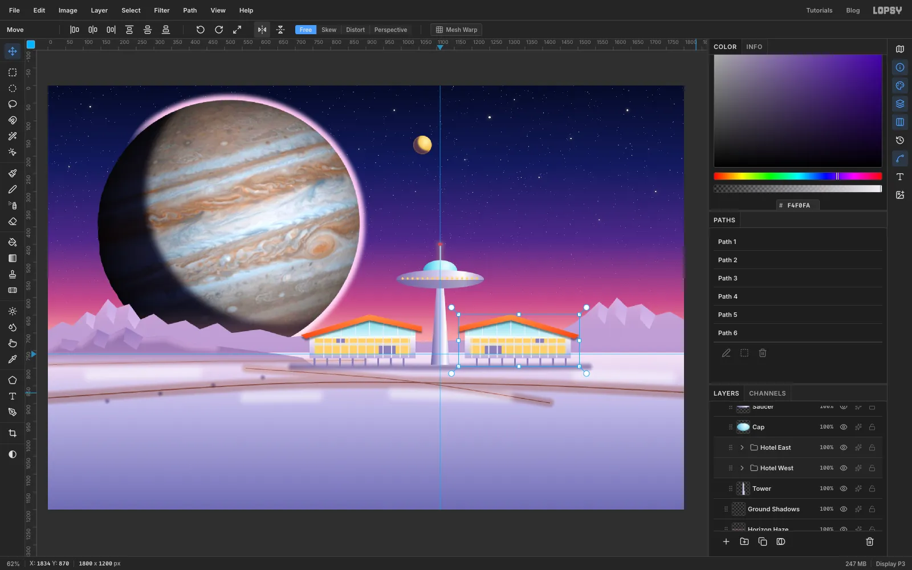

Collapse the *Hotel West* group, keep its row selected, and click **Duplicate Layer**. The whole group is copied. Rename the copy *Hotel East*.

With the **Move** tool and nothing selected, click **Flip Horizontal** in the options bar. The group mirrors in place. Then drag the group straight to the right with the Move tool. Stop when its roof peak sits as far right of the tower as the west peak sits left of it, about 446 px. The Info panel shows how far you've moved. Use the arrow keys for the last few pixels.

## Make the east wing a little smaller

Two identical wings look static. With *Hotel East* still selected, hold [[Cmd]] and drag the box's **top-right** corner handle in and down by about an eighth. The bottom-left corner stays pinned, so the stilts still stand on the ground, and the smaller wing reads as slightly farther away. Press [[Cmd+D]] to commit.

## Select the glass dome

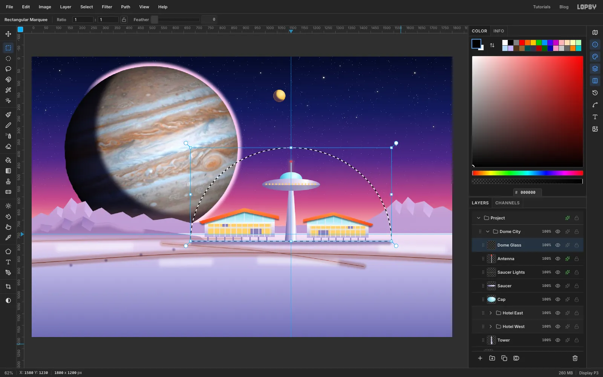

Select the top layer in *Dome City* (*Antenna*) and add a *Dome Glass* layer. Make an exact ellipse from `680, 390` to `1540, 1190`, centred on the dome guide. Then [[Alt]]-drag a rectangle over its lower half, from the base line at y `790` down past the bottom, to keep only the hemisphere.

Fill it with `#F6E8F6` at only 8% opacity. Then add an **Inner Glow** with Size `22` and Opacity `70`. The edges of the glass, where you look through more of it, catch more light, just like a real glass dome.

## Add the dome's ribs

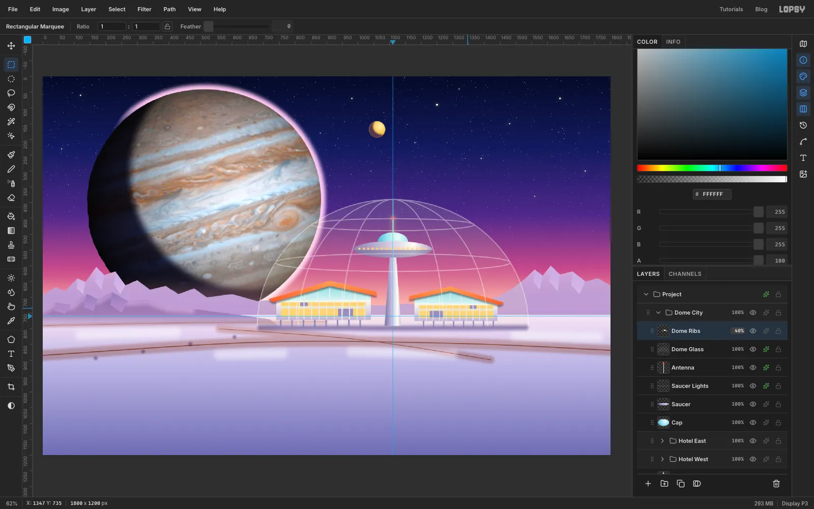

Add a *Dome Ribs* layer. Pick the **Shape** tool, set **Shape** to **Ellipse**, click the fill swatch and choose **Remove fill**, then set the stroke to white with **Width** `3`.

Click on the dome's centre at `1110, 790`, just below where the guides cross, to open the **Shape Size** dialog. Make three ellipses of the same height (`800`) but different widths (`860`, `600` and `320`). These are the meridians. Add two flat rings for latitude lines:

- **Lower ring:** `744 × 56`, centred at y `590`.
- **Upper ring:** `516 × 38`, centred at y `470`.

Draw a vertical Pencil line down the middle. Then select everything below the base line and press [[Delete]] to remove the lower halves. Set the layer to 40%.

## Seat the dome on a ring and add highlights

**Highlights.** Add a *Dome Shine* layer. With a soft white brush (Size `30`, Opacity `70`), paint a curved stroke that follows the dome's right shoulder. Add a thinner one (Size `12`) just inside it. Set the layer to **Screen** at `45%`. The highlights go on the right only, facing the sun.

**Foundation ring.** Add a *Dome Ring* layer. Make an exact ellipse from `674, 776` to `1546, 804`. [[Alt]]-drag a slightly narrower ellipse shifted up by 8 px, leaving a thin crescent along the front. Fill it with a chrome gradient, `#6E64A2` → `#ECE8F8` → `#9A90C8`, dragged across its width.

## Run a monorail in from the left

Collapse *Dome City*, select *Horizon Haze* and click **New Group**. Name it *Monorail*. Putting it below the dome group means the dome's glass covers the end of the track.

1. **Track.** Add a *Track* layer. With the Pen tool, set **Stroke** to `14` and the colour to `#EEE9F7`. Click-drag a gentle curve from the left edge at y `868` up into the dome at about `900, 776`, and press [[Enter]].
2. **Underside.** Duplicate the layer and name the copy *Track Top*. Select the original *Track*, give it a **Color Overlay** of `#6A5E9C`, and nudge it down 8 px with the arrow keys. It becomes the beam's shadowed underside.
3. **Pylons.** On a *Pylon Shadows* layer, make small `44 × 10` ellipses of `#2E2466` just left of where each pylon will land. Blur them with **Gaussian Blur** `3` and set the layer to **Multiply** at 55%. On a *Pylons* layer above it, draw four **Pencil** lines (Size `9`, `#8478B8`) from the track down to the ice. Make the lines longer toward the viewer. Finish each one with a small `#5E5494` ellipse foot pad (`22 × 7`).

## Draw the train

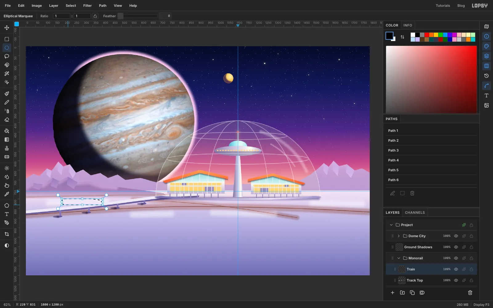

Select *Track Top* and add a *Train* layer. With the Pen tool, outline the body on the track at about `300, 812`: about 200 px long, with a flat top and bottom 32 px apart and a slanted bullet nose that points up the track. Use **Path to Selection**. Then [[Shift]]-drag a small ellipse over the back end to round off the tail. Fill it with `#E8463A`.

Pen a small windscreen on the nose and fill it with `#9FE8F6`. Select a long window band along the side and fill it with `#CFF6FF`. Finally, draw a thin `#FFE7D6` Pencil belt line below the windows.

## Shade and tilt the train

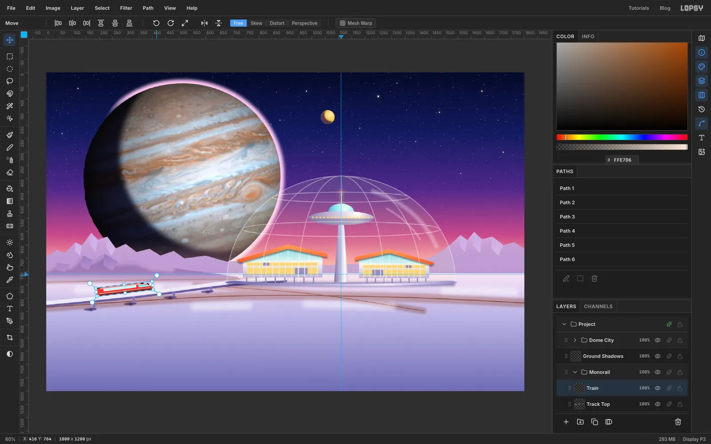

Choose **Dodge / Burn**. Set **Mode** to **Burn** with **Exposure** `45` and **Size** `16`, and stroke along the train's underside. Then switch to **Dodge** at Size `10` and stroke along the roof.

[[Cmd]]-click the *Train* thumbnail, pick the **Move** tool, and drag the rotation handle about 7° anticlockwise to match the slope of the track. Press [[Cmd+D]]. Add a **Drop Shadow** (Offset X `-4`, Offset Y `7`, Blur `4`, Opacity `45`) so the train sits on the beam.

## Shape the rocket's hull

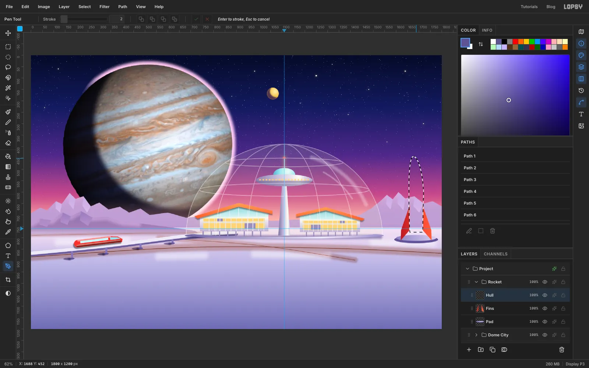

Collapse *Monorail* and *Dome City*, select the *Dome City* row and click **New Group**. Name it *Rocket*. The rocket stands to the right of the dome, centred on x `1688`, with its base at y `806` and its nose at y `452`. Build it from the bottom up:

- **Pad.** Add a *Pad* layer. Fill an exact ellipse from `1592, 792` to `1784, 824` with `#5E5394`. Then fill a slightly smaller ellipse a few pixels higher with a lighter violet gradient.
- **Fins.** Add a *Fins* layer. Pen two swept fins that start on the body about 150 px above the base and flare out about 36 px on each side down to the pad. Fill them with `#B02C2A` → `#FF6B4A`.
- **Hull.** Add a *Hull* layer. Pen the hull: a body 64 px wide from y `776` up to y `600`, closing in a pointed nose made from two smooth points.

Fill the hull with a six-stop horizontal chrome gradient, from dark violet on the left to white at about 78% and back to violet at the right edge. That puts the shine on the sunlit side.

## Paint a red band with an intersection

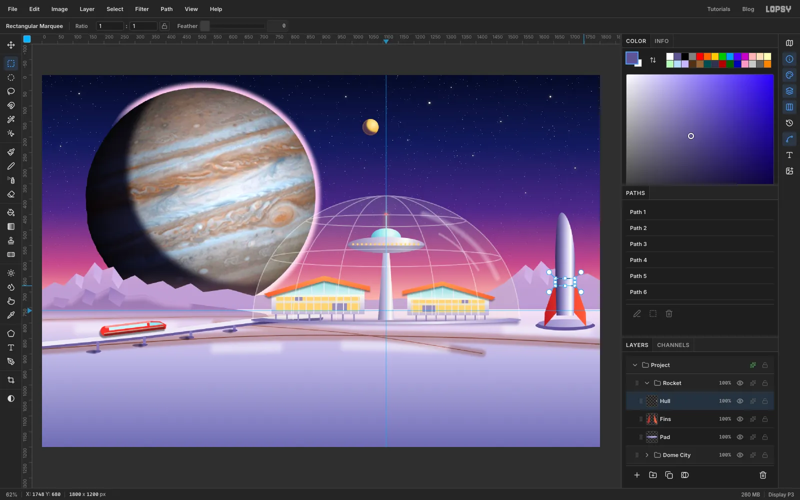

Keep the hull selected. Hold [[Shift]]+[[Alt]] and drag a rectangle across the hull just above the fins. That **intersects** the two shapes, leaving a band that follows the hull's outline exactly. Fill it with `#E8463A` at 85%, so a little of the chrome sheen shows through.

## Finish the rocket

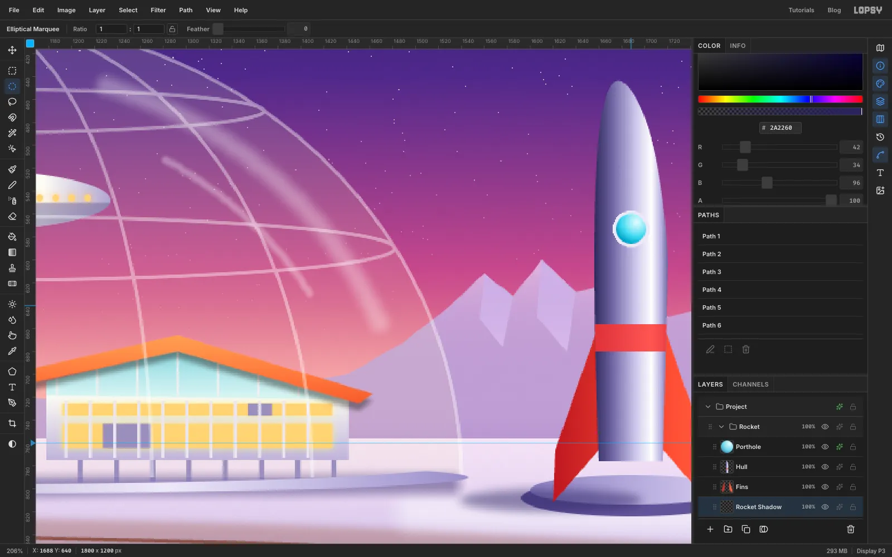

1. **Porthole.** Make a small ellipse and fill it with a radial gradient, `#E8FDFF` → `#6FD6EE` → `#1E6C9C`. Add a **Stroke** effect, Width `3`, in `#EDE9F8`.
2. **Engine bell.** Pen a short trapezoid under the hull and fill it with a dark-to-light-to-dark gradient.
3. **Shadow.** On a *Rocket Shadow* layer above *Pad*, make a wide ellipse reaching left of the pad. Feather it by `8` and fill it with `#2A2260` at 50%. The shadow falls left, away from the sun.

## Build the glass railing and the tiled deck

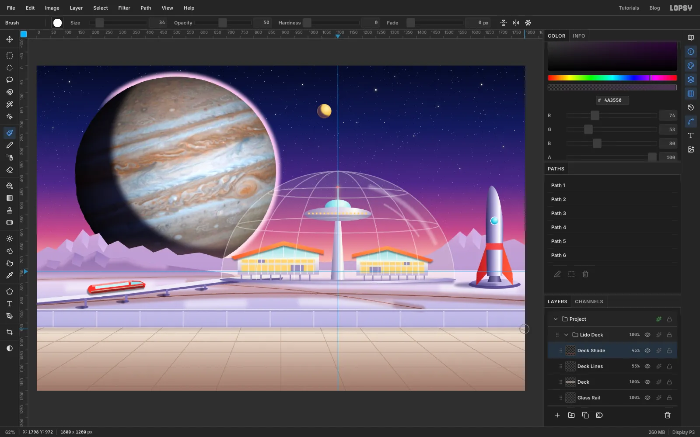

Collapse *Rocket*, keep it selected and click **New Group**. Name it *Lido Deck*.

1. **Glass rail.** Add a *Glass Rail* layer. Fill a band from y `904` to y `966` with `#F4F0FF` at 12%. Above it, fill a thin chrome rail from y `898` to `907` with a white → `#7D74AE` gradient. Draw **Pencil** posts (Size `5`, `#CFC7E8`) every 160 px.
2. **Deck.** Add a *Deck* layer. Fill from y `966` to the bottom with `#F1E6D8` → `#C7B1A4`, and run **Add Noise** `5`, Mono, Gaussian.
3. **Tiles.** Add a *Deck Lines* layer. With a 2 px Pencil in `#A9927F`, draw five horizontal tile rows, closer together near the rail. Then draw lines that all aim at a vanishing point above the centre of the deck, about `900, 610`, each with a click and a Shift-click. Set the layer to 55%.
4. **Shade.** Add a *Deck Shade* layer. Add a gradient from transparent to `#7A4A3A`, top to bottom, on **Multiply** at 45%. Paint a soft dark stroke along the deck's far edge for the railing's shadow.

## Dig the kidney pool

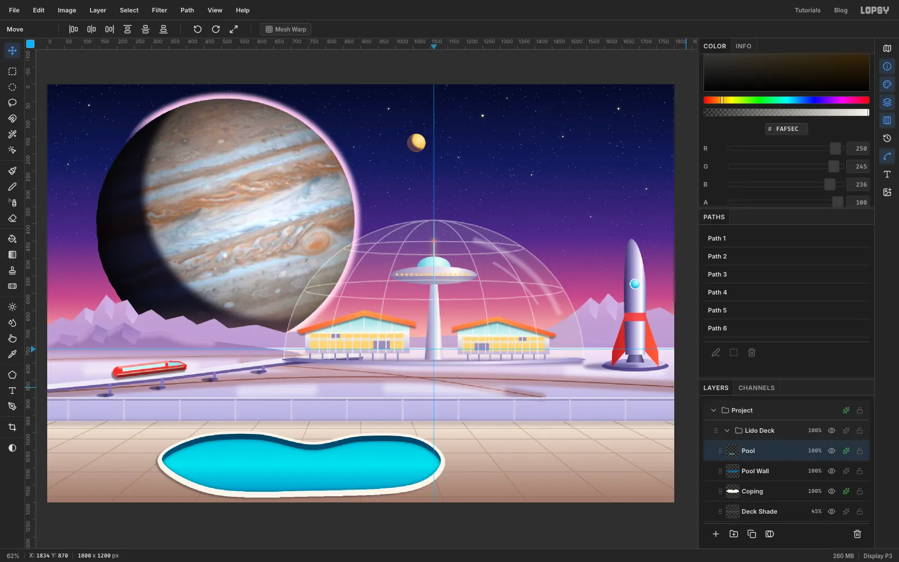

The pool is three layers built from one Pen shape. Draw a kidney from about x `330` to `1130` and y `1004` to `1166`, with about ten smooth click-drag points, pinched in along the top edge. Each time you need the shape again, use **Path to Selection**.

1. **Coping.** Add a *Coping* layer. Select the kidney, **Grow** it by `12`, and fill it with `#FAF5EC`. Nudge the layer down 5 px. The rim is now thinner at the back and thicker at the front, as it would be in perspective. Add a soft Drop Shadow to the left.
2. **Pool Wall.** Add a *Pool Wall* layer. Fill the kidney with `#0A3E5E` → `#167EA4`, top to bottom.
3. **Pool.** Add a *Pool* layer. Fill the kidney with a three-stop water gradient, `#2CC2DE` → `#5ADFEC` → `#1592C2`. Nudge it down 16 px. Then [[Cmd]]-click the *Pool Wall* thumbnail, **Inverse**, and [[Delete]]. The water now sits inside the basin, with a band of dark wall showing along the far edge. Give the water an **Inner Glow** in `#05364E` (Size `18`, Opacity `55`).

## Reflect Jupiter in the water

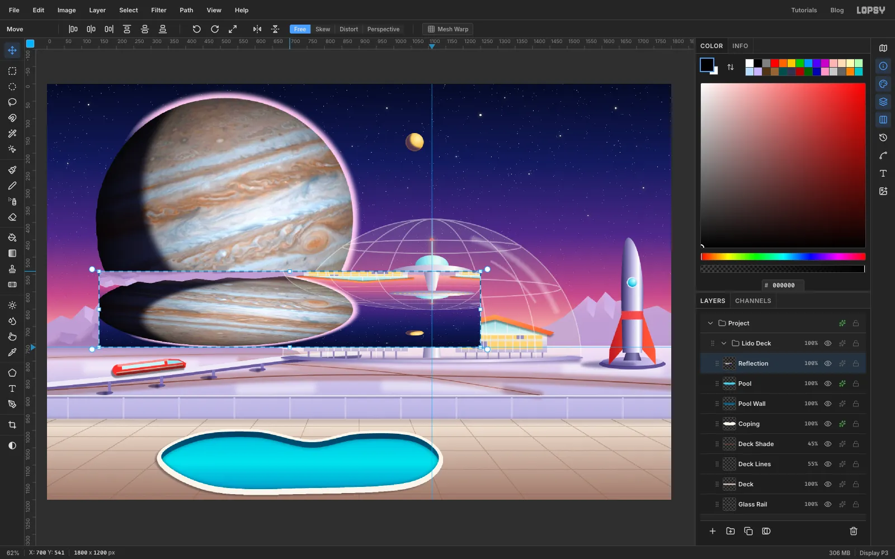

Select a big rectangle around Jupiter and the dome, from `150, 30` to `1250, 760`. Choose **Edit → Copy Merged**, which copies what you see, not a single layer, then **Edit → Paste**. The paste lands in place on a new layer. Name it *Reflection*.

With the **Move** tool, click **Flip Vertical**. Drag the top-middle handle down until the copy is about a third of its height, and press [[Cmd+D]]. Drag it down with the Move tool until its top lines up with the top of the water.

Then trim and soften it:

1. [[Cmd]]-click the *Pool* thumbnail, choose **Inverse** and press [[Delete]].
2. Run **Motion Blur…** (Angle `0`, Distance `16`).
3. Run **Pixel Stretch…** (Amount `14`, Bands `40`, Seed `7`, RGB Split `0`). This adds ripple bands.
4. Set the layer to **Screen** at 70%.

## Tint the water and start the caustics

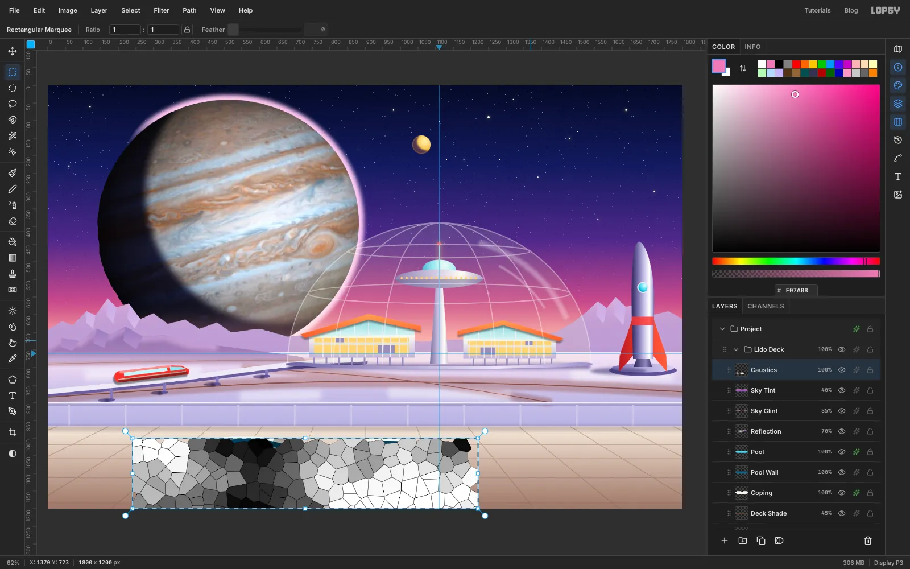

First, tint the water with the sky:

1. Add a *Sky Glint* layer and brush a soft `#F07AB8` stroke (Size `26`, Opacity `70`) along the far wall. Trim it to the water: [[Cmd]]-click the *Pool* thumbnail, choose **Inverse** and press [[Delete]]. Set it to **Screen** at 85%.
2. Add a *Sky Tint* layer. [[Cmd]]-click the *Pool* thumbnail and fill the selection with a gradient from `#E86FB0` to `#6A4AC0`, top to bottom. Set it to **Overlay** at 40%.

For the caustics, deselect, add a *Caustics* layer and select a rectangle a little wider than the pool, from `240, 1000` to `1220, 1200`. Run these three filters in order:

1. **Filter → Clouds…** with Scale `6`.
2. **Filter → Voronoi…** with Cells `30`, Edge Width `2` and Seed `11`.
3. **Filter → Find Edges**.

Find Edges turns the cell borders into a bright net on black, like light dancing on a pool floor.

## Foreshorten the net with Perspective

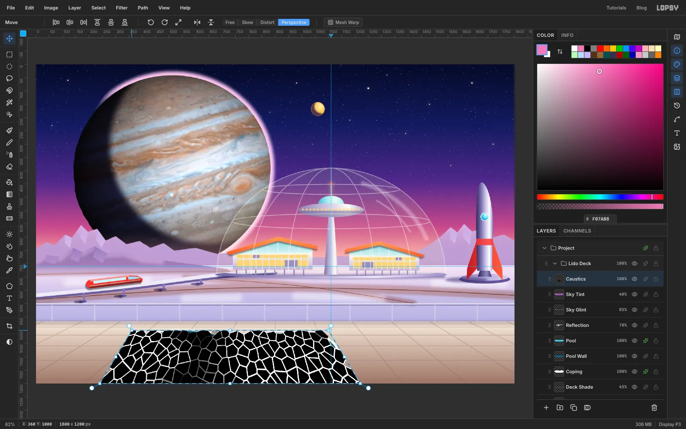

The cells should get smaller toward the far side of the pool. With the rectangle still selected, pick the **Move** tool and click **Perspective** in the options bar. Drag the top-left corner handle inward about 120 px. The top-right corner mirrors it, making a trapezoid. Press [[Cmd+D]] to commit.

## Clip the caustics into the water

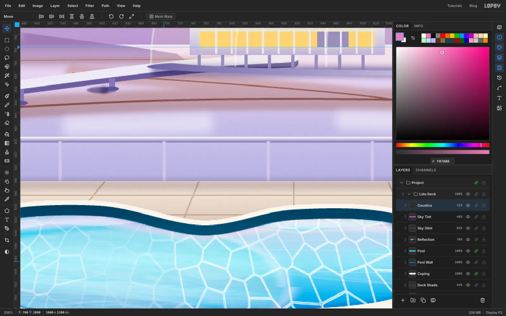

[[Cmd]]-click the *Pool* thumbnail, choose **Inverse** and press [[Delete]]. Set *Caustics* to **Screen** at 32%. The water now has depth: a dark wall at the back, a pink sky glint, a streaked reflection, and a shimmering net that recedes.

## Add a chrome ladder

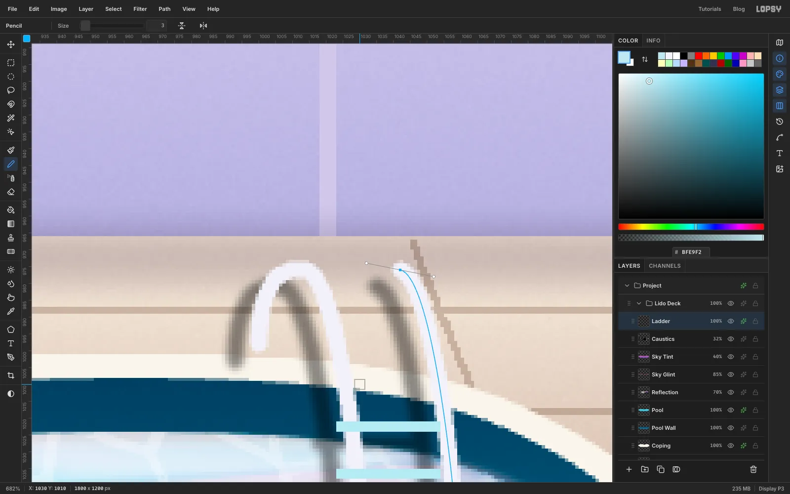

Add a *Ladder* layer. With the Pen tool (Stroke `5`, `#F4F1FA`), draw a hand-rail with three points:

1. Click-drag upward from a point on the deck just behind the far coping.
2. Click-drag sideways at the top of the arch.
3. Click once down in the water.

Press [[Enter]]. Draw a second rail 28 px to the right. Add two short Pencil rungs underwater in `#BFE9F2`, and a **Drop Shadow** (Offset X `-7`, Offset Y `5`, Blur `3`, Opacity `45`).

## Make a lounger with thickness

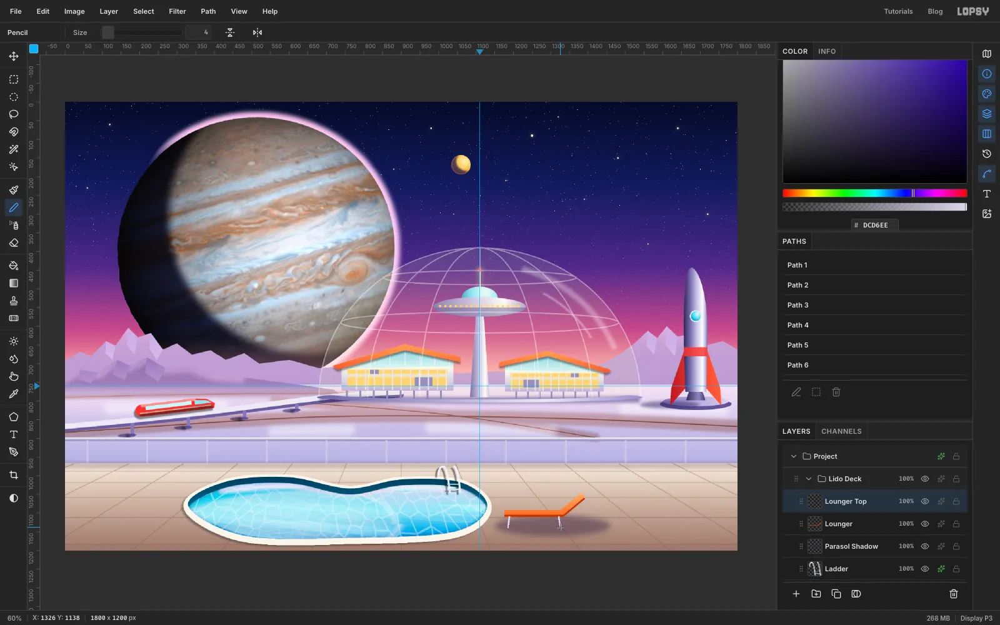

Add a *Parasol Shadow* layer first: a wide, feathered ellipse of `#3A2A44` at 50%, to the left of where the parasol will stand.

Then add a *Lounger* layer and Pen a lounger in side view, to the right of the pool: a flat seat about 150 px long at y `1092` (from x `1176`), with a back that rises about 50 px on the right. Fill it with `#FFB070` → `#FF7A3D`. To give it thickness:

1. **Duplicate Layer** and name the copy *Lounger Top*.
2. Select the original *Lounger*. Give it a **Color Overlay** of `#B4401E` and nudge it down 6 px.
3. Click **Rasterize Layer Style** in its effects drawer to bake the overlay into the pixels. Merge Down keeps the lower layer's effects live, so a live overlay would tint the whole merged lounger.

Draw two chrome legs under the seat with a 4 px Pencil. Then select *Lounger Top*, choose **Layer → Merge Down**, and add a **Drop Shadow** with Offset X `-16`, Offset Y `9`, Blur `7` and Opacity `40`.

## Copy, paste and flip a second lounger

Select a rectangle around the lounger, **Edit → Copy**, then **Edit → Paste**, and name the new layer *Lounger 2*. While the pasted selection is still active, click **Flip Horizontal** in the Move tool's options bar so the twin faces the other way.

Deselect, then drag it with the Move tool about 300 px right and a little down, onto the other side of where the parasol will go. Give it the same Drop Shadow.

## Raise a striped parasol

Add a *Parasol Pole* layer. Fill a small `#8E86B8` ellipse on the deck at about `1430, 1140` for the base. Then draw a 7 px pale Pencil pole up from it to about y `890`, between the two loungers.

Add a *Canopy* layer. With the Pen tool, click an apex above the pole and two corners about 165 px either side, and use **Path to Selection**. Then [[Shift]]-drag an ellipse across the bottom to round the hem. Fill it with `#B83A1C` → `#FF8A47` → `#FFC07A`, left to right, so the right side is lit.

## Stripe the parasol

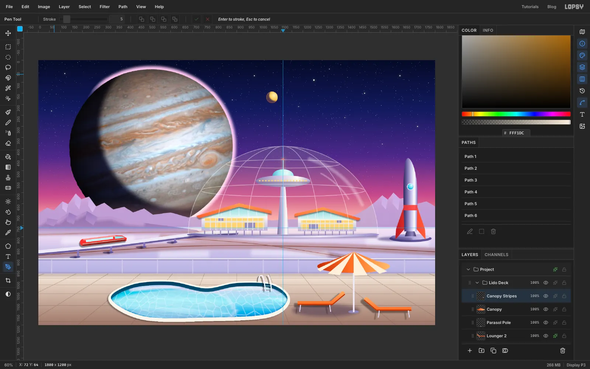

Add a *Canopy Stripes* layer. Pen four wedges from the apex down to the hem, skipping every other gore, and fill each one with `#FFF1DC`. Let them overshoot the hem: [[Cmd]]-click the *Canopy* thumbnail, **Inverse**, and [[Delete]] trims them all at once.

Set the layer to 85% and click a cream dot on the apex for the finial.

## Plant an alien planter in the corner

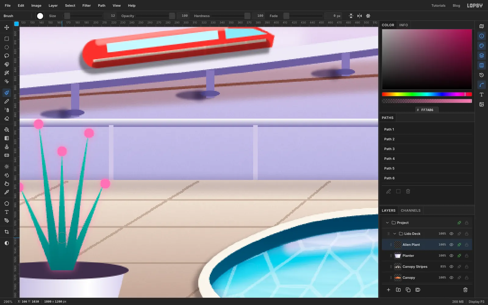

The lower-left corner is empty, so fill it. Add a *Planter* layer:

1. Pen a tapered pot, about 140 px wide at the top (y `1066`) and 90 px wide at the bottom (y `1156`), near the left edge. Fill it with a pale chrome gradient.
2. Fill an ellipse across its top with `#3E2F4A` for the soil.
3. Add a Drop Shadow to the left.

Add an *Alien Plant* layer. Pen five long, thin leaves rising from the soil, fanning out to about y `900`. Fill each one with `#1E6E73` → `#5FD0B8`, dark at the base. Click a pink `#FF7AB6` dot at each tip and give the layer an **Outer Glow** in the same pink. The leaves overlap the glass rail, which pushes the planter forward.

## Nudge the rocket group in from the edge

Step back and check the balance. The rocket's fins crowd the right edge a little, and groups make that easy to fix. Collapse *Lido Deck*, then click the *Rocket* group row. With the **Move** tool and nothing selected, drag the rocket about 28 px to the left. Every layer in the group moves together: pad, shadow, fins, hull, band and porthole.

## Wash the scene with Jupiter's light and add grain

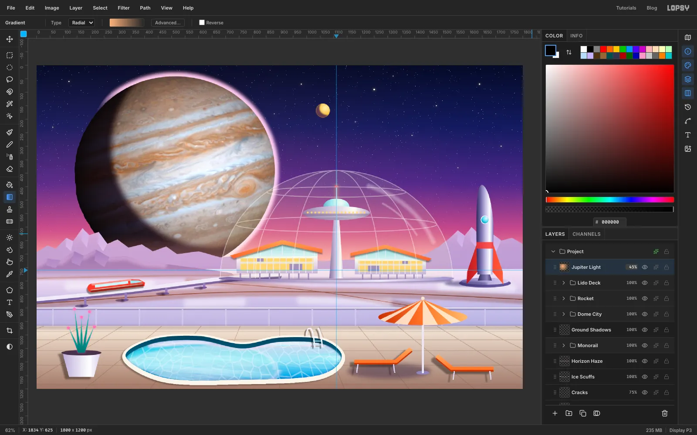

Add a *Jupiter Light* layer at the top. Drag a radial gradient from `#FFB27A` (opaque) to the same colour at 0% opacity, starting at Jupiter's centre and ending at about `1500, 900`. Set it to **Soft Light** at 45%.

Add a *Grain* layer, fill it with `#808080`, run **Add Noise…** at `40` (Mono, Gaussian), and set it to **Overlay** at 35%. The grain gives the photo and the painted shapes the same surface.

## Finish with a vignette

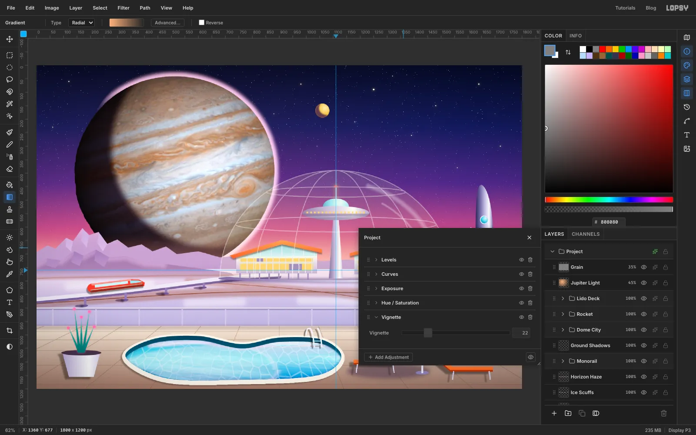

Open the effects drawer of the root **Project** group. Click **Add Adjustment**, choose **Vignette** and set it to `22`. Then add **Saturation & Vibrance** with Saturation `6` and Vibrance `14`. These adjust the whole painting without touching any layer.

Choose **File → Quick Export PNG** to save the painting, and **File → Save Project** to keep a `.lopsy` with every layer, group, mask and effect still editable. Want a different holiday? Swap Jupiter for a photo of Saturn, change the parasol to teal, or light the hotel windows pink.
