In the early 1960s the future looked like a diner sign. Space Age design, also called *Googie* or *atomic age*, drew rockets, satellites and atoms onto everything from coffee shops to toasters. The look has a few signature moves:

- **starbursts**: thin spokes radiating from a hub, often tipped with little balls
- **boomerangs and swoops**: shapes that tilt and curve as if they're moving fast
- **orbits**: ellipses and atom diagrams drawn as thin rings
- **chrome and cream**: appliance-white plastic, polished metal, and warm teals and oranges

In this tutorial you'll use that language for a modern product: an app mockup for **Zero-G Laundry**, a laundromat on an orbiting space station. One phone shows a cycle in progress through a washing-machine porthole. The Earth is visible through the glass, with socks floating around it. A second, tilted phone lets you book a pod. The board is **1800 × 1350 px**.

You'll need one photo: **The Earth seen from Apollo 17.jpg** on Wikimedia Commons, taken by the Apollo 17 crew in 1972. It's a NASA photo, so it's in the **public domain**. Download the 1280 px version.

The tools you'll use:

- the **Shape** tool for rounded rectangles, pills and outlined ellipses
- the **Pen** tool for Googie swoops, sparkles, socks, arcs and a gauge needle
- the **Gradient**, **Spray**, **Brush** (with **Taper** and **Radial Symmetry**) and **Eraser** tools
- **Add Noise**, **Motion Blur**, **Radial Blur**, **Oil Paint**, **Posterize**, **Hue/Saturation** and **Gaussian Blur**
- marquees with **Alt** to subtract, **Select → Inverse / Feather**, and [[Cmd]]-click on a layer thumbnail
- copy and paste, **Merge Down**, a **layer mask**, and scaling and rotating with the Move tool's handles
- groups that you move and rotate as one piece, with live text inside
- layer effects: **Drop Shadow**, **Stroke**, **Inner Glow** and **Outer Glow**, plus the **Overlay** and **Screen** blend modes
- a non-destructive **Vignette** on the root group

The palette is cream plastic and polished chrome against a teal night sky, with atomic orange and mustard for accents:

- Sky `#2A8C8C` → `#17586A` → `#123B4C` → `#0B1D2A`
- Cream `#F4E9CF`, phone shell `#ECE4D0`, screen ivory `#FBF5E6`
- Teal `#1E8582`, deep teal `#155E66`, aqua `#5CC8C0`
- Atomic orange `#F26A2E`, burnt orange `#C94A1A`, mustard `#F4B43C`, rocket red `#D7392C`
- Chrome `#B9C5CA`, track beige `#E3D3AF`, ink `#1C2B33`

The type is three Google fonts: **Righteous** for headings and numbers, **Michroma** for small wide labels, and **Audiowide** for buttons and pod names.

> **Note:** Shortcuts are written for a Mac. On Windows use [[Ctrl]] wherever it says [[Cmd]].

> **Tip:** You don't have to hit exact sizes by dragging. Click once with the **Shape** tool, without dragging, and a dialog asks for the Width and Height. Click once with a **Marquee** and a dialog asks for the From and To corners. Use them whenever a step gives a size.

## Paint a radial night sky

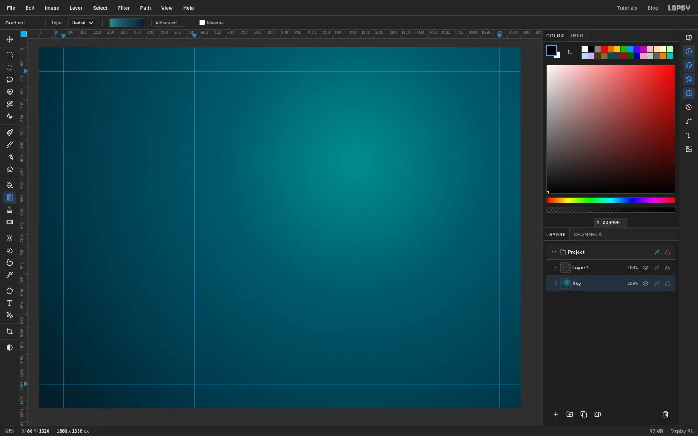

Choose **File → New** and make a document **1800** wide and **1350** high. Drop guides by clicking the rulers: on the top ruler at **90**, **580** and **1720**, and on the left ruler at **90** and **1260**. The left column of type will sit between the first two vertical guides.

Click the *Background* layer and rename it *Sky*. Pick the **Gradient** tool, set **Type** to **Radial**, and click **Advanced…**. Give it four stops: `#2A8C8C` at the left end, `#17586A` at 35%, `#123B4C` at 70% and `#0B1D2A` at the right end. Click **Done**.

Drag from a point up and right of the middle (about x 1180, y 430) down to the bottom-left corner. The brightest spot sits behind where the phones will go, and the corners fall into darkness.

## Spray a star field

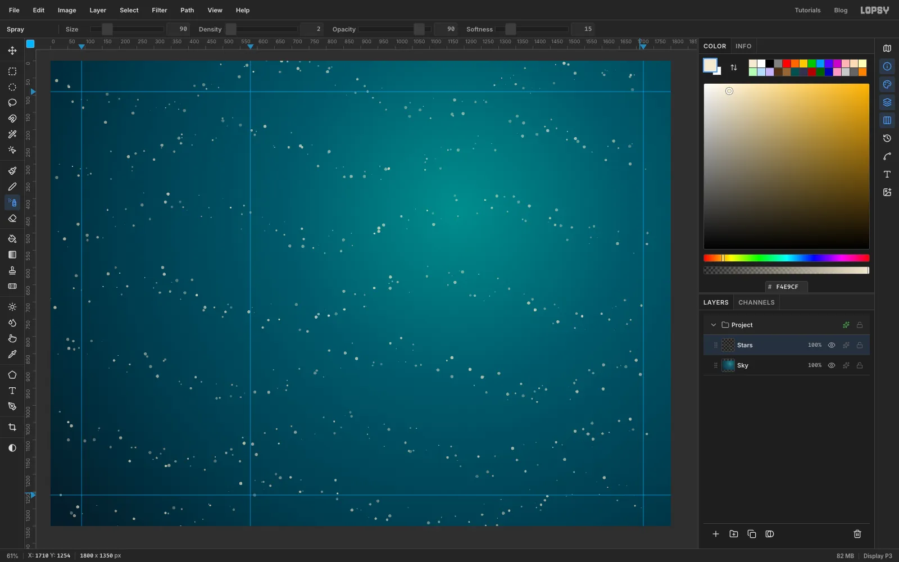

Click the empty *Layer 1* and rename it *Stars*. Set the foreground to cream `#F4E9CF`.

Pick the **Spray** tool and set **Size 90**, **Density 2**, **Opacity 90** and **Softness 15**. Density is the number of dots in each puff, so a low number keeps the stars sparse. Make seven long, gently wavy sweeps across the whole canvas, from top to bottom, alternating left-to-right and right-to-left. Keep moving. The Spray keeps puffing about six times a second wherever the cursor lingers, so a slow or paused drag makes clumps.

## Draw two orbit rings and tilt them

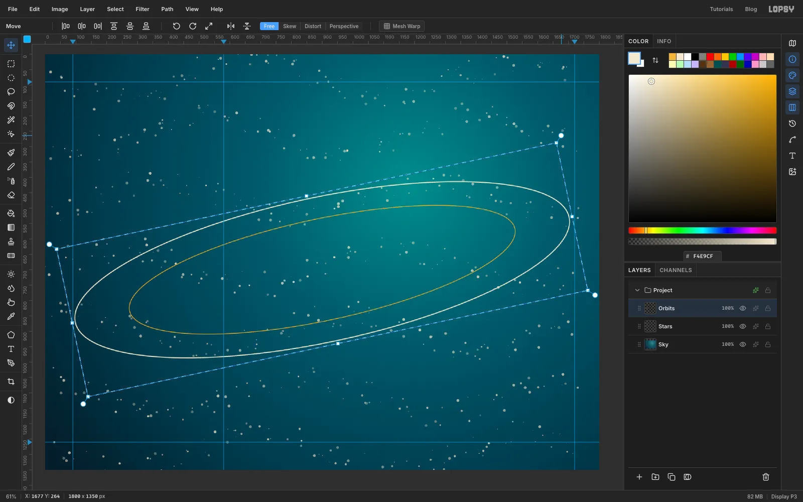

Click **Add Layer** and name it *Orbits*. Pick the **Shape** tool, set **Shape** to **Ellipse** and **Output** to **Pixels**. Remove the fill (click the Fill swatch, then **Remove fill**), set the stroke to cream `#F4E9CF` and the **Width** to **3**.

Shapes grow from where you press. Press at the middle of the canvas, slightly low (about x 900, y 700), and drag out until the ellipse is about **1640 × 470**. Then switch the stroke to mustard `#F4B43C`, **Width 2**, and draw a smaller one from the same centre, about **1280 × 330**.

Draw a **Rectangular Marquee** around both rings. Switch to the **Move** tool, grab the round rotate handle just outside a corner, and turn the rings about **12°** anticlockwise. Press [[Enter]] to commit and [[Cmd+D]] to deselect. Click the layer's opacity and set it to **45%**, so the rings sit back behind everything.

## Draw a Googie starburst

Add a layer called *Starburst* and set the foreground to mustard `#F4B43C`. The burst sits just above where the right-hand phone's top edge will be, centred at about **x 1560, y 92**.

Pick the **Brush** and open the **Brushes** panel from the options bar. On its **Shape** tab choose a hard round tip: **Size 6**, **Hardness 100**, **Spacing 2**. **Taper** lives on the same tab. It makes the stroke thinner as it goes, starting from where you press, so set it to about the spoke's length and each spoke thins to a point at its tip.

Draw 16 spokes, always dragging **from the hub outwards**, spaced evenly like the marks on a clock face but sixteen of them. Do the eight long ones first, then the eight short ones in the gaps, so you only change Taper once:

- long spokes are about **86 px** with **Taper 90**
- short spokes are about **50 px** with **Taper 52**

Finish each long spoke with a ball. Draw a 10 px circle just past its tip with the **Elliptical Marquee** (hold [[Cmd]] to keep it round) and choose **Edit → Fill**. Press [[Cmd+D]] when you're done.

## Copy, shrink and turn a second burst

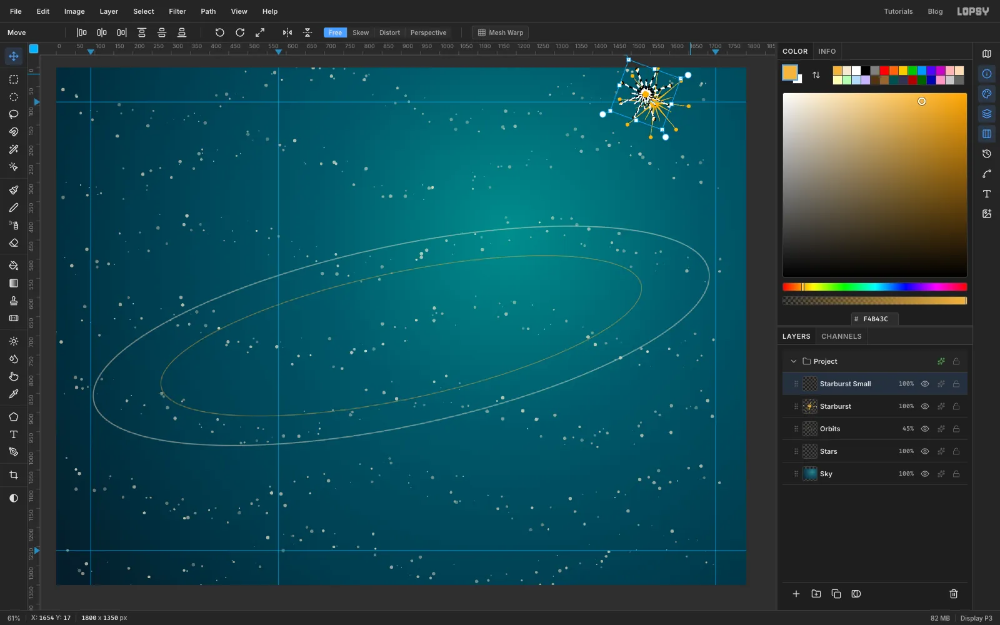

Draw a marquee around the starburst, then press [[Cmd+C]] and [[Cmd+V]]. A copy made inside Lopsy pastes back in place, on its own layer. Rename it *Starburst Small*.

With the **Move** tool, hold [[Cmd]] and drag the bottom-right corner handle in until the copy is about three quarters of its size. Then grab the rotate handle and turn it about **20°**, so its spokes don't line up with the first burst. Press [[Enter]] and [[Cmd+D]].

Drag the copy down to the bottom of the canvas, just right of the left column's guide (around x 600, y 1235). It will peek out from under the first phone.

## Scatter four-point sparkles

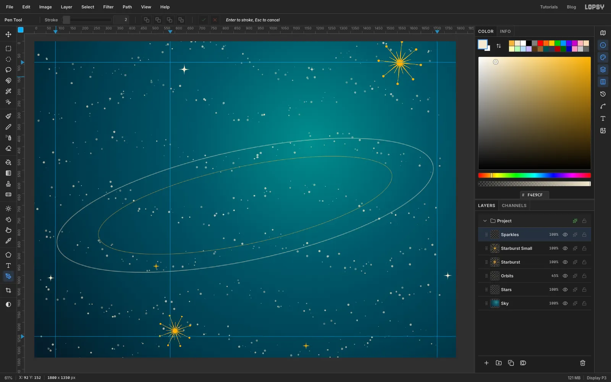

Add a layer called *Sparkles*. The classic Space Age sparkle is a four-pointed star with pinched, curved sides. The **Pen** tool draws it in eight clicks:

1. **Click** (don't drag) the left tip.
2. Halfway between the left and top tips, but close to the centre (about a fifth of the way out), **press and drag** a short way towards the top tip, about a fifth of the sparkle's radius. That point is the pinched "waist", and dragging gives it a curve.
3. Click the top tip, drag the next waist towards the right tip, click the right tip, drag the next waist towards the bottom tip, click the bottom tip, then drag the last waist towards the left tip.
4. Click the first anchor again to close the shape.

Open the **Paths** panel and click **Path to Selection**, then **Delete Path**. Fill the selection with cream or mustard and deselect.

Make six sparkles with radii from about **9** to **26 px**. Put a big cream one at about x 640, y 120 and a small cream one at about x 1185, y 120. Add one near each side edge, around x 70, y 1010 and x 1765, y 1000. Finish with two small mustard ones low down, near x 520, y 960 and x 1160, y 1300.

## Paint a banded planet

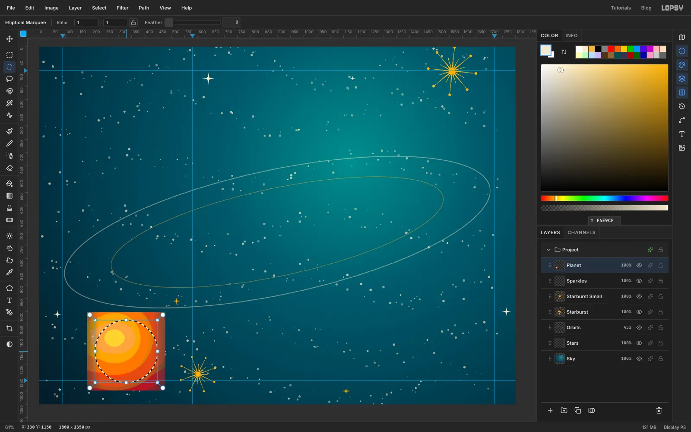

Add a layer called *Planet*. Draw a square marquee about **300 px** across in the bottom-left corner, centred around **x 330, y 1150**.

Set the **Gradient** to **Radial** with four stops: `#FFD27A` at the left end, `#F4B43C` at 30%, `#F26A2E` at 62% and `#8E2A1F` at the right end. Drag from just up and left of the block's centre to past its bottom-right corner, which puts a highlight on the upper left.

Now turn the smooth gradient into gas bands:

1. **Filter → Add Noise…**: **Mono**, **Amount 14**.
2. **Filter → Motion Blur…**: **Angle 0**, **Distance 100**. The noise smears into horizontal streaks.
3. **Filter → Posterize…**: **Levels 7**. The soft shading snaps into flat, screen-printed bands.

Why a square block and not a circle? The blur pulls transparency in at the edges, and a circle would end up with a see-through rim. Instead, draw a round **Elliptical Marquee** **236 px** across, centred on the block. Choose **Select → Inverse**, press [[Delete]], then deselect. The planet has a crisp edge.

## Tuck the ring behind the planet

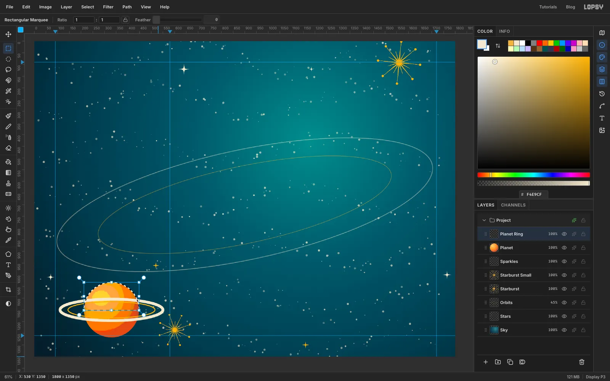

Add a layer called *Planet Ring*. With the **Shape** tool still on **Ellipse** with no fill, draw two flat rings centred on the planet:

- a cream ring about **440 × 92** with a **12** px stroke
- a mustard ring about **372 × 70** inside it, with a **4** px stroke

The back of the ring has to disappear behind the planet. Draw a circle marquee over the planet: start at its top-left and hold [[Cmd]] to keep it round. Then hold [[Alt]] and drag a rectangle over the lower half of the planet. [[Alt]] subtracts, so only the top half of the disc stays selected. Press [[Delete]], then deselect. The ring now passes in front of the planet at the bottom and behind it at the top.

## Tilt the planet and its ring together

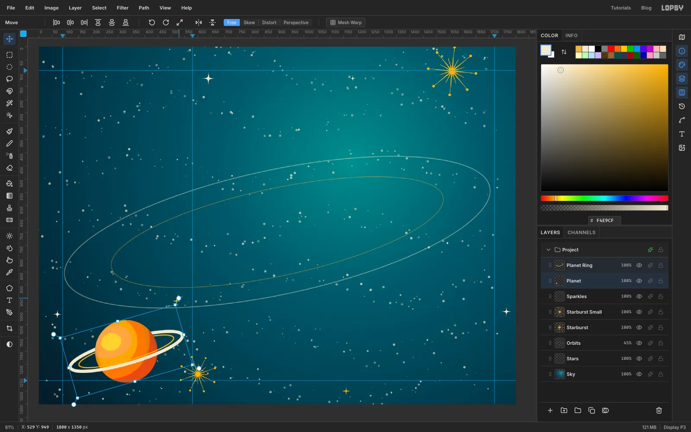

In the Layers panel, click *Planet*, then [[Shift]]-click *Planet Ring* so both are selected. With the **Move** tool and no marquee, the handles frame both layers together. Drag a rotate handle about **16°** anticlockwise and press [[Enter]].

## Build the first phone's body and screen

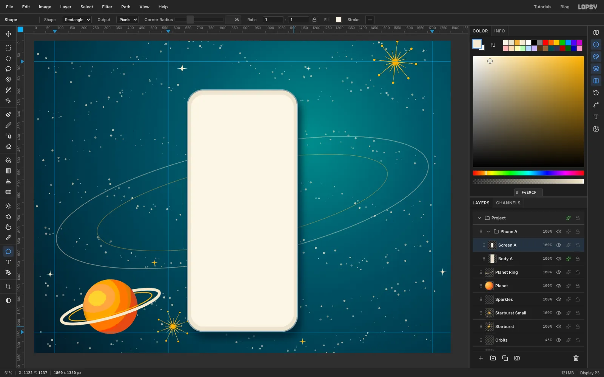

Click *Planet Ring*, then click **New Group** at the bottom of the Layers panel and name the group *Phone A*. With the group active, click **Add Layer**: the new layer goes inside the group. Name it *Body A*.

Pick the **Shape** tool, set **Shape** to **Rectangle**, **Corner Radius 72**, fill `#ECE4D0` and no stroke. Press at **x 900, y 735** and drag out to a **480 × 1040** phone. It's 60 px lower than it will end up. You'll move the whole phone up at the end, after the porthole has been centred on the canvas.

Open the layer's effects (the sparkle button on its row):

- **Drop Shadow**: colour `#0B1D2A`, **Offset X 16**, **Offset Y 30**, **Blur 44**, **Spread 0**, **Opacity 70**
- **Stroke**: colour `#8FA1A8`, **Width 5**, position **inside**. It reads as a chrome rim.

Add a layer called *Screen A* and draw a second rounded rectangle from the same centre: **444 × 1004**, **Corner Radius 56**, fill ivory `#FBF5E6`.

## Draw the Googie header swoop with the Pen

Add a layer called *Header A*. The header's bottom edge should sweep up from left to right, like the roof of a 1950s drive-in. Draw it with the **Pen**:

1. Click outside the screen's top-left corner, then outside its top-right corner.
2. Click on the right edge, about a third of the way down the header (y 330).
3. Just right of the screen's middle, at about **y 400**, press and drag about **100 px** to the left, angling slightly down. This makes a smooth point, and dragging along the direction you're travelling bends the edge into a long, sagging curve.
4. Click outside the screen's left edge, lower down (y 432).
5. Click the first anchor to close the path.

Don't worry that the path sticks out past the screen's rounded corners. You'll trim it next.

## Fill the header, add a pinstripe, and trim both

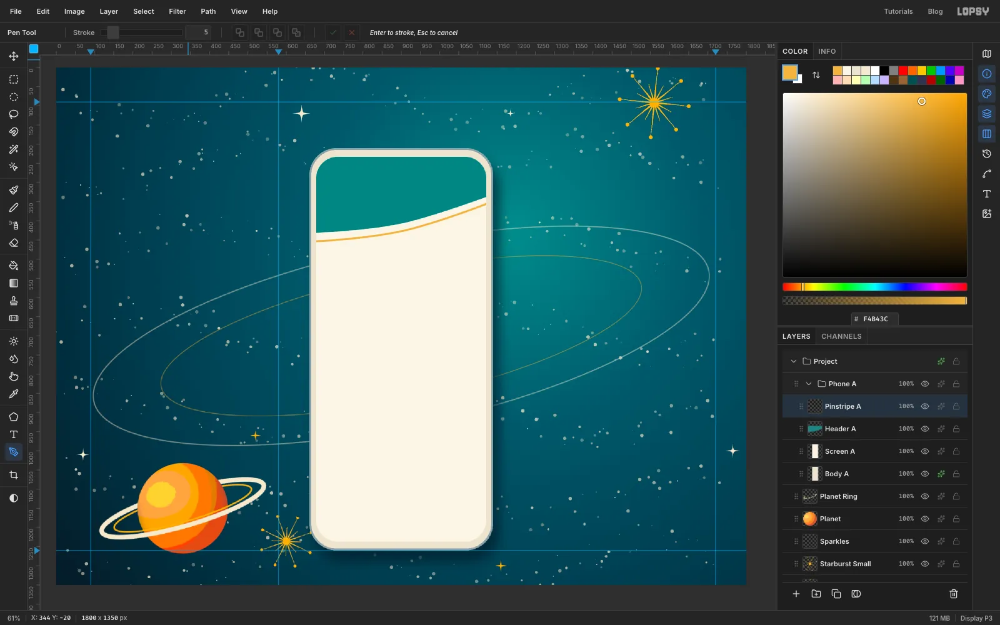

In the Paths panel click **Path to Selection** and **Delete Path**. Fill with teal `#1E8582` and deselect.

Add a layer called *Pinstripe A* and set the foreground to mustard. Set the Pen's **Stroke** to **5**. Draw an open path about 20 px under the header's edge. Click just outside the left edge at about **y 454**. Then press just right of the middle at about **y 420** and drag about 100 px to the right, angling slightly up, so it bends the same way as the header. Finally click just outside the right edge at about **y 352**. Press [[Enter]] to stroke it, then delete the path.

To trim both layers to the screen, click *Header A*, [[Cmd]]-click the *Screen A* thumbnail to load the screen's shape as a selection, choose **Select → Inverse** and press [[Delete]]. Do the same on *Pinstripe A*.

## Spin a brushed chrome ring

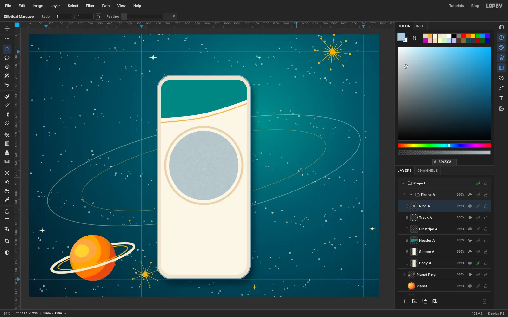

The porthole sits exactly on the canvas centre (**x 900, y 675**). That matters, because **Radial Blur** always streaks pixels towards the canvas centre, whatever layer you run it on.

First, add a layer called *Track A*. With the **Shape** tool on **Ellipse**, no fill, a beige `#E3D3AF` stroke at **Width 10**, draw a **396 px** circle from the canvas centre. It becomes the groove for a progress bar.

Add a layer called *Ring A*. Draw a **356 px** circle marquee on the canvas centre and fill it with chrome `#B9C5CA`. In the Elliptical Marquee's click dialog, that's From **722, 497** To **1078, 853**. Then:

1. **Filter → Add Noise…**: **Mono**, **Amount 45**.
2. **Filter → Radial Blur…**: **Amount 40**.

The speckle stretches into fine radial streaks, like a spun metal dish.

## Cut out the ring's middle and add shine

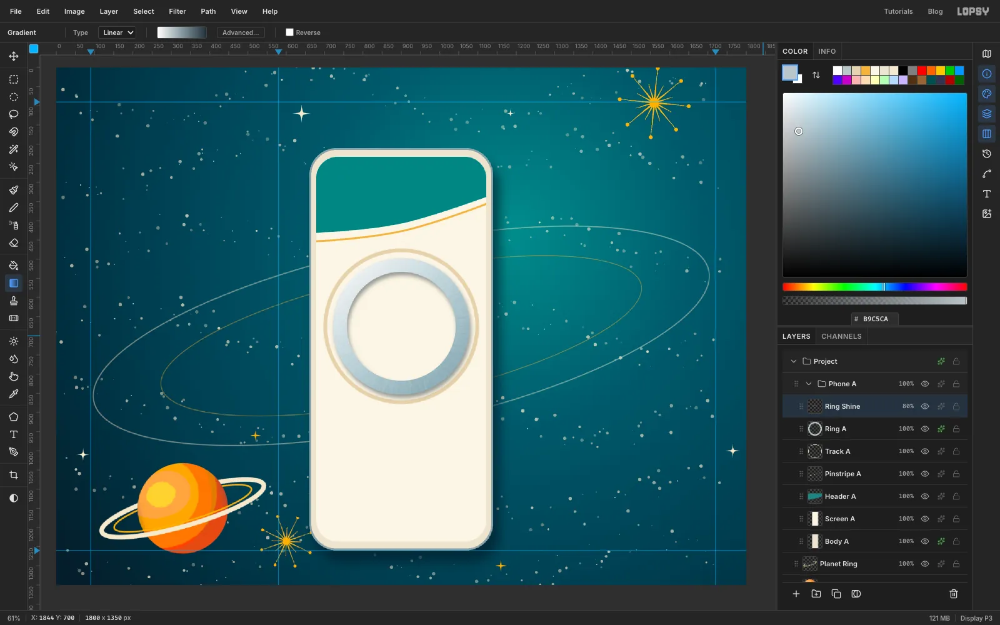

Deselect, then draw a **284 px** circle marquee on the same centre (From **758, 533** To **1042, 817**) and press [[Delete]]. You're left with a thick ring. Give *Ring A* a **Drop Shadow**: colour `#1C2B33`, **Offset X 4**, **Offset Y 9**, **Blur 16**, **Opacity 45**.

[[Cmd]]-click the *Ring A* thumbnail and add a layer called *Ring Shine*. Make a **Linear** gradient of white → `#8899A0` → `#22323A` and drag it from the ring's top-left to its bottom-right. Set the layer's blend mode to **Overlay** at **80%**. The top-left of the ring catches the light and the bottom-right falls into shade, so it reads as curved metal.

## Add the glass and drop in the Earth

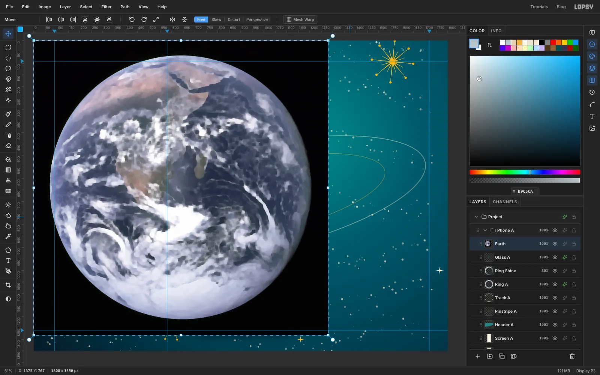

Add a layer called *Glass A*. Draw a **284 px** circle marquee on the centre and make a **Radial** gradient: `#24607A` → `#123B4C` at 60% → `#0B1D2A`. Drag it from just up and left of the centre towards the bottom right. Deselect and add an **Inner Glow**: black, **Size 26**, **Opacity 80**. The glass looks deep and dark at its rim.

Drag the Earth photo from your desktop onto the canvas. It lands at the top-left as a new layer, already selected. Rename it *Earth*.

Before you shrink it, choose **Filter → Oil Paint…** with **Radius 6** and **Sharpness 1.5**. Oil Paint smooths clouds and oceans into soft painted patches. Doing it at full size, rather than after scaling down, keeps the continents recognisable.

## Shrink the Earth to fit the porthole

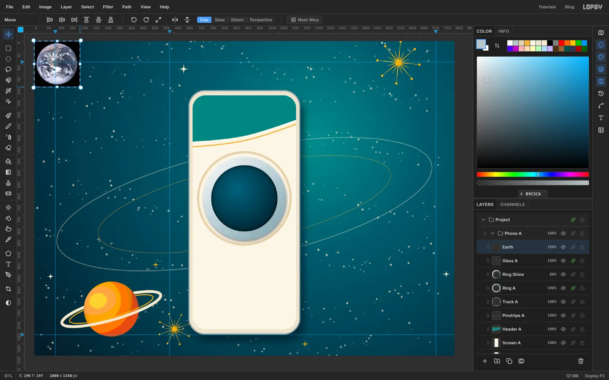

With the **Move** tool, hold [[Cmd]] and drag the photo's bottom-right corner handle up and to the left until it's about **196 px** square. Press [[Enter]] and [[Cmd+D]].

## Trim and flatten the Earth

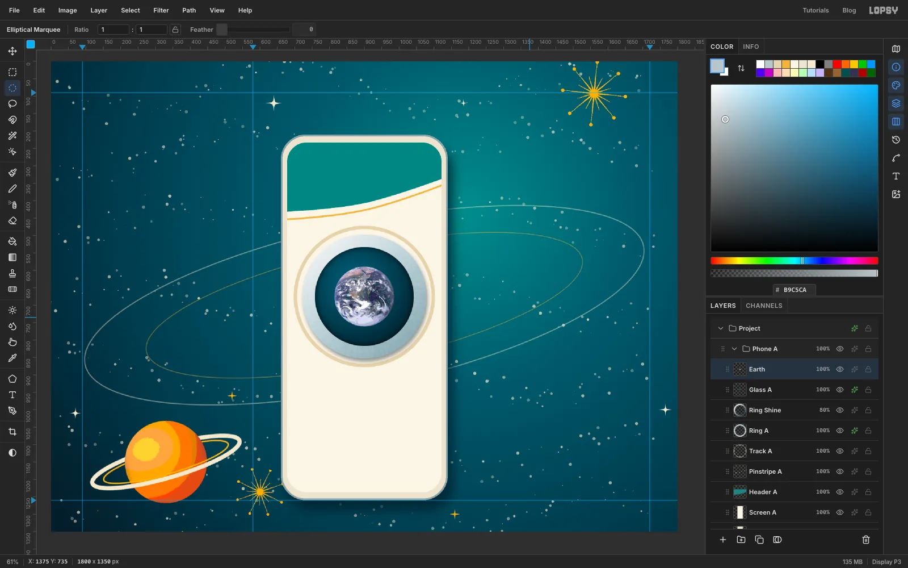

Drag the Earth to the middle of the porthole, and use the arrow keys for the last few pixels. Draw a **172 px** circle marquee on the canvas centre (From **814, 589** To **986, 761**), choose **Select → Inverse** and press [[Delete]]. That removes the black space around the planet. Deselect.

Then make it match the illustration:

1. **Filter → Hue/Saturation…**: **Saturation +25**.
2. **Filter → Posterize…**: **Levels 8**.

The photo flattens into a handful of flat blues and creams, like a printed postcard.

## Float socks and droplets around the Earth

Add a layer called *Socks*. In zero gravity, the laundry doesn't tumble at the bottom of the drum. It floats. Draw three L-shaped socks around the Earth with the **Pen**, each about 55 px from cuff to toe:

1. Click the two corners of the open cuff, about 22 px apart.
2. Press and drag a short way along the back of the leg, about 40 px down from the cuff.
3. Drag round the heel, then along the sole.
4. Drag round the toe, then back along the top of the foot.
5. Drag at the instep, where the foot meets the leg.
6. Click the first anchor to close the shape.

Turn each sock so it lies along the circle around the Earth, as if it's orbiting.

For each sock, use **Path to Selection**, fill it (orange `#F26A2E`, mustard `#F4B43C`, red `#D7392C`), and delete the path. Then, with a hard **4 px** cream brush, drag two short stripes across each cuff. Set **Taper** back to **0** in the Brushes panel first, or the stripes come out as wedges.

Scatter four droplets between the socks: aqua `#5CC8C0` circles of 10 to 18 px, each with a small white highlight circle near its top-left.

## Fling the socks with Radial Blur

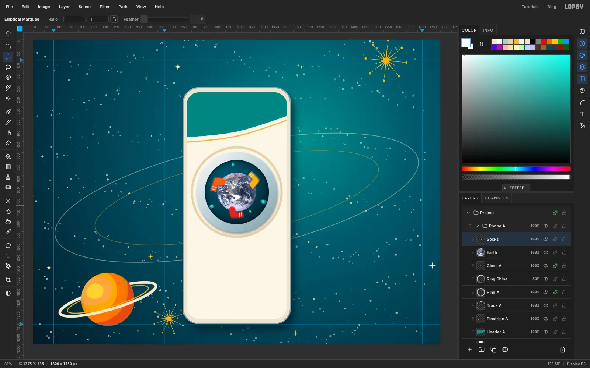

Choose **Filter → Radial Blur…** with **Amount 5**. Radial Blur is a zoom blur. It smears every pixel along the line towards the canvas centre, and the porthole sits right on that centre. So the socks streak straight out from the Earth, as if the spin is flinging them against the drum. A low Amount keeps them readable.

## Add glass shine and a progress arc

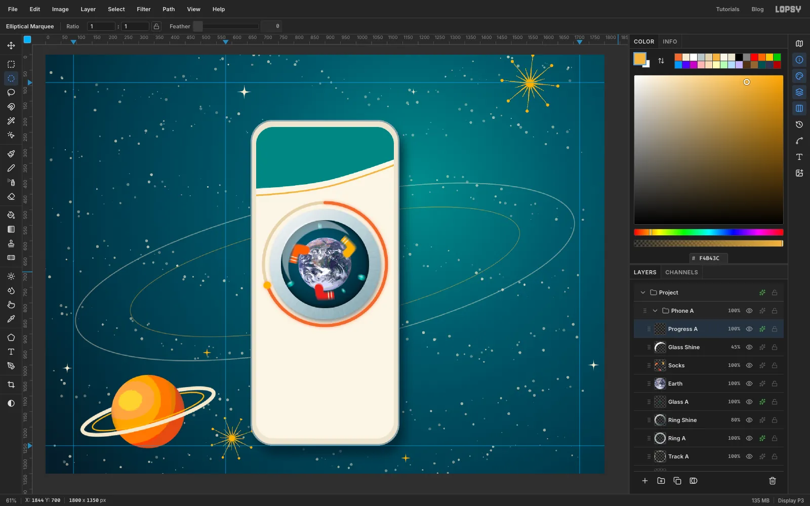

**Glass shine.** Add a layer called *Glass Shine*. Draw a **240 px** circle marquee centred 18 px left of and 22 px above the porthole's centre (From **762, 533** To **1002, 773**) and fill it white. Deselect, then draw a **248 px** circle centred 6 px right of and 8 px below the centre (From **782, 559** To **1030, 807**) and press [[Delete]]. A thin crescent is left at the upper-left. Deselect, run **Gaussian Blur** with **Radius 3**, and set the layer to **Screen** at **45%**.

**Progress arc.** Add a layer called *Progress A* and set the foreground to atomic orange. Set the Pen's **Stroke** to **10**. Start at the top of the beige track and work clockwise around it to about eight o'clock. At each step, press on the track and drag a little along it, so the curve hugs the circle. Six points is plenty. Press [[Enter]] to stroke the path, then delete it.

Draw a **24 px** mustard dot at the end of the arc. Give the layer an **Outer Glow**: orange, **Size 14**, **Opacity 60**.

## Add the controls, status bar and home indicator

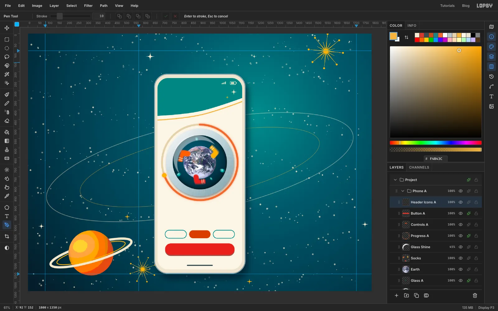

Add a layer called *Controls A*. With the **Shape** tool on **Rectangle**, **Corner Radius 21**:

- two outlined chips, **112 × 42**, with no fill and a teal **3** px stroke, centred at **x 774** and **x 1026** (y 1052)
- a filled chip between them, burnt orange `#C94A1A` with no stroke

The chips span the same width as the button below, so the screen keeps one left and right margin.

On the same layer, draw a **136 × 6** pill in `#3A4950` near the bottom of the screen. That's the home indicator.

Add a layer called *Button A*: a **364 × 60** pill, **Corner Radius 30**, rocket red `#D7392C`, centred at **y 1130**. Give it a hard **Drop Shadow**: `#7A1F17`, **Offset Y 6**, **Blur 0**, **Opacity 75**. It looks like a chunky push-button.

Add a layer called *Header Icons A* for the status bar's right-hand side, all in cream:

- **Signal bars**: four tiny rectangle marquees getting taller, each filled.
- **Battery**: a **30 × 15** outlined rectangle (stroke **2**, radius **4**), with a fill bar and a nub.
- **Sparkles**: two small Pen sparkles in the header, one cream and one mustard.

## Set the first screen's type

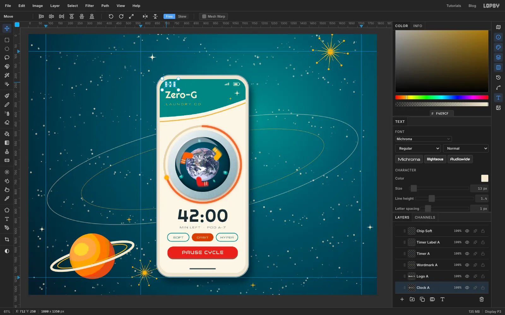

Click *Header Icons A* first. New text then lands above it, inside the group. It also means changing the font won't restyle a text layer you've already made, because a raster layer is active. Pick the **Text** tool and click roughly where each line goes. Then switch to the **Move** tool and nudge it into its slot with the arrow keys:

- **9:41**: Michroma 13, cream, left side of the status bar
- **Zero-G**: Righteous 50, cream, top-left of the header
- **LAUNDRY CO.**: Michroma 13, mustard, **Letter spacing 6**, under the logo
- **42:00**: Righteous 92, ink `#1C2B33`, **Letter spacing 2**, centred under the porthole
- **MIN LEFT · POD A-7**: Michroma 13, `#56656C`, **Letter spacing 3**, centred under the timer
- **SOFT**, **ORBIT**, **HYPER**: Michroma 13, centred in each chip. Use deep teal `#155E66` on the outlined chips and ivory on the filled one.
- **PAUSE CYCLE**: Audiowide 24, ivory, **Letter spacing 2**, centred on the button

Work from the bottom of the screen up. A text-tool click inside an existing line of text edits that text instead of starting a new one, and starting at the bottom keeps your clicks clear of the lines you've already set.

Check each label's centring by eye against its pill. Caps have no descenders, so centre the cap height, not the line box.

## Move the whole phone into place

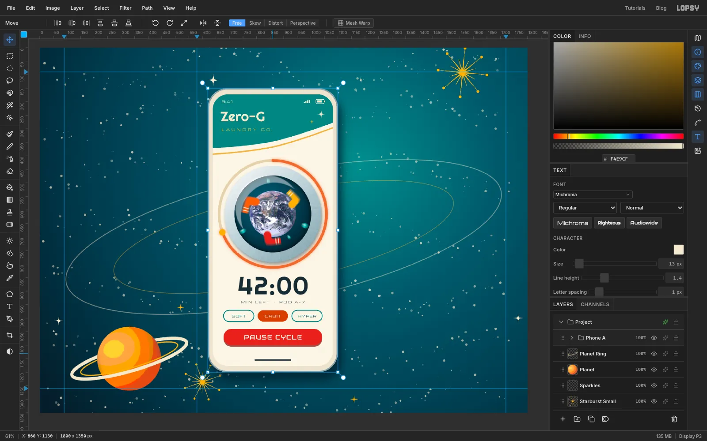

Collapse the *Phone A* group and click its row. With the **Move** tool and no marquee, drag anywhere on the phone **60 px up** and **40 px left**. For an exact move, use the arrow keys instead: [[Shift+Up]] six times and [[Shift+Left]] four times, 10 px per press. Every layer inside moves together, live text and effects included. The porthole now sits a little above the screen's middle, which leaves the controls breathing room at the bottom.

## Start the second phone

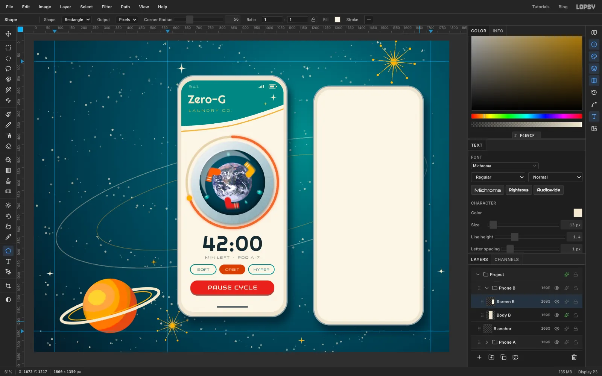

With the collapsed *Phone A* row active, click **Add Layer**. A collapsed group as the active row puts the new layer beside it, not inside it. With that spare layer active, click **New Group** and name it *Phone B*. The group lands on the top level next to *Phone A*. You'll delete the spare layer at the end.

Inside the new group, build the same body and screen as before, centred at **x 1450, y 715**: *Body B* with the same Drop Shadow and Stroke, and *Screen B*.

## Mirror the header swoop

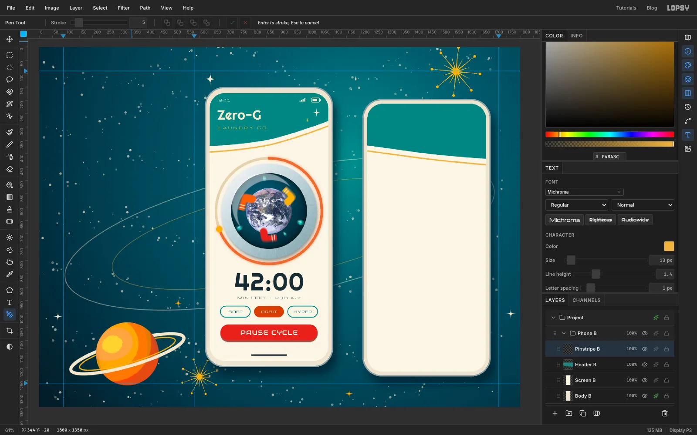

Draw *Header B* and *Pinstripe B* the same way as the first phone, but mirror the swoop: high on the left (about **y 366**), low on the right (about **y 420**). The two screens then lean towards each other like a pair of wings. Trim both to *Screen B* with [[Cmd]]-click, **Inverse** and [[Delete]].

## Build an atom icon from one ellipse

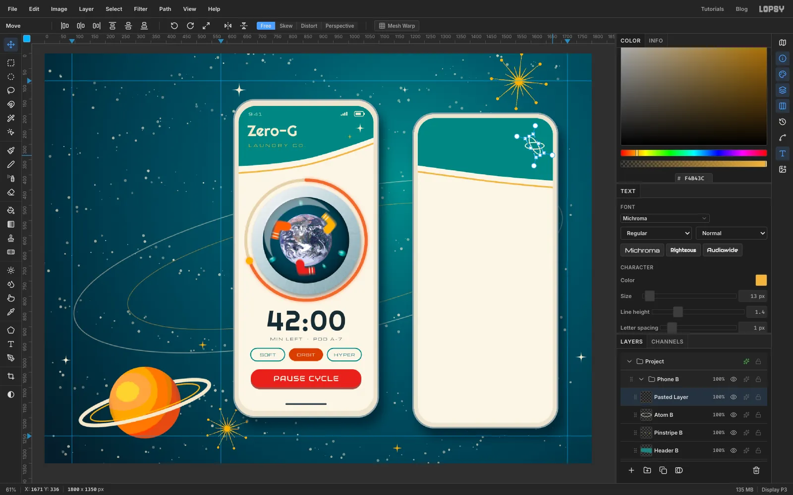

Add a layer called *Atom B*. Draw one cream outlined ellipse, **62 × 22** with a **3** px stroke, on the right of the header (about x 1612, y 304).

Draw a marquee around it and press [[Cmd+C]], then [[Cmd+V]]. The copy pastes in place on a new layer, selected and with the **Move** tool active. Drag a rotate handle to turn it **60°**, press [[Enter]], deselect, and choose **Layer → Merge Down**. Press [[Cmd+V]] again: the clipboard still holds the flat ellipse. Turn this copy **−60°**, commit, deselect and merge down. Three crossed orbits make the classic atom. Finish with a **12 px** mustard dot in the middle.

## Add the status bar to the second phone

On the same *Atom B* layer, draw the signal bars, battery and home indicator the same way you did for the first phone.

## Lay out the pod cards

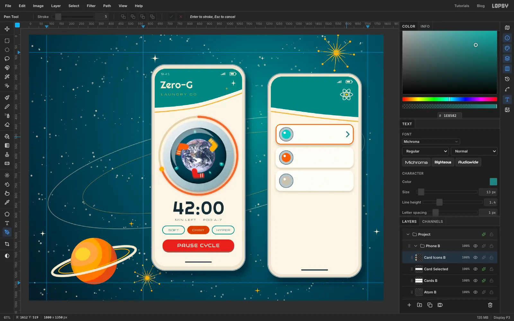

Add a layer called *Cards B*. Draw two rounded rectangles, **396 × 104**, **Corner Radius 26**, fill `#FFFDF7`, centred at **y 624** and **y 742**. Give the layer a soft **Drop Shadow**: `#8A7A55`, **Offset Y 6**, **Blur 16**, **Opacity 35**.

The selected card goes on its own layer, *Card Selected*, at **y 506**, so it can have its own effects. Use the same shadow, slightly stronger (**Offset Y 8**, **Blur 18**, **Opacity 45**), plus an orange **Stroke** of **4** px, position **inside**.

Add a layer called *Card Icons B*. On the left of each card draw a mini porthole:

- a **70 px** chrome circle with a steel `#6E7E86` **3** px stroke
- a **46 px** coloured glass on top: aqua for free, orange for busy, warm grey for out of service
- a **12 px** white highlight near the top-left

Draw a teal chevron on the selected card with the **Pen**: three clicks and [[Enter]] at **Stroke 5**.

## Draw the gauge arcs

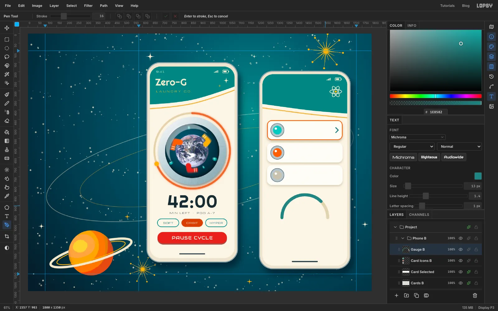

Add a layer called *Gauge B*. The dial's hub sits at **x 1450, y 965**, and its radius is **120**.

Set the Pen's **Stroke** to **16** and the foreground to track beige. Draw the top half of a circle with three anchors:

1. At the left end (x 1330, y 965), press and drag straight up about 66 px.
2. At the top (x 1450, y 845), press and drag about 66 px to the right.
3. At the right end (x 1570, y 965), press and drag straight down about 66 px.

Press [[Enter]].

Switch to teal and draw a second arc over it, from the left end round to about half past one: three quarters of the half-circle, or 1200 out of 1600. Use four anchors this time, dragging each one a little along the curve. That's the current spin speed.

## Tick the dial with Radial Symmetry

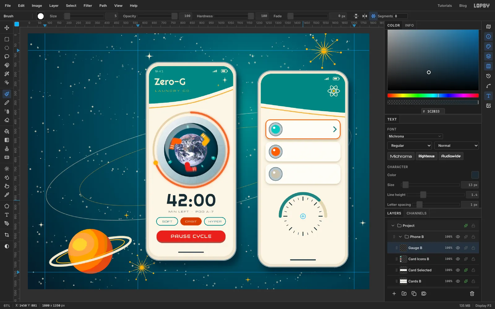

Set the foreground to ink and pick the **Brush**: hard, **Size 3**, with **Taper 0** in the Brushes panel. In the options bar click **Radial Symmetry**. It switches on at 8 segments, so type **24** into **Segments**. [[Cmd]]-click the dial's hub to move the symmetry centre there.

Drag one **10 px** tick straight down from just inside the top of the arc, from about 100 px above the hub to 90 px above it. Lopsy repeats it 24 times around the hub. Set **Segments** to **8** and the brush to **Size 5**, then drag one longer **18 px** tick at the top. The symmetry centre stays on the hub. You get eight major ticks.

Turn **Radial Symmetry** off when you're done. Otherwise it keeps taking every [[Cmd]]-click.

## Trim the ticks and add the needle

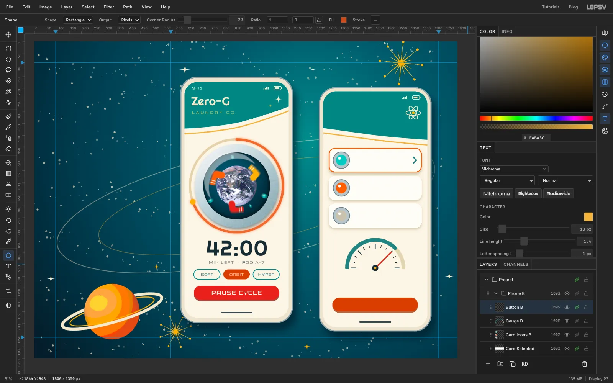

Draw a **Rectangular Marquee** over everything below the hub's centre line and press [[Delete]]. Only the top half of the ticks remains.

Draw the needle with the **Pen** at **Stroke 6** in rocket red. Click the hub, then click about **96 px** out from the hub towards the end of the teal arc, stopping just inside the ticks. Press [[Enter]]. Finish with a **26 px** ink circle on the hub and a **10 px** mustard dot in it.

On a new layer, *Button B*, draw a **364 × 58** burnt-orange pill near the bottom of the screen, with a hard **Drop Shadow** in `#9A3A12`.

## Set the second screen's type

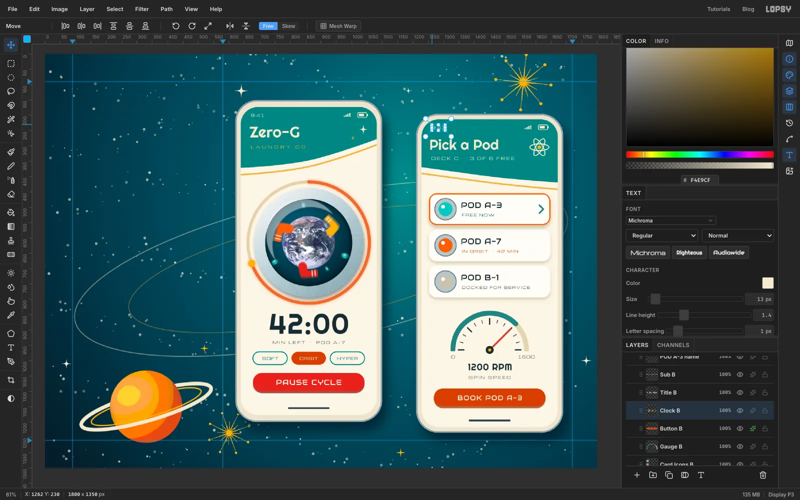

Click *Button B* and set the type from the bottom of the screen up, nudging each line into place:

- **BOOK POD A-3**: Audiowide 22, ivory, **Letter spacing 2**, centred on the button
- **SPIN SPEED**: Michroma 13, `#56656C`, **Letter spacing 3**
- **1200 RPM**: Righteous 30, ink. Leave clear space between it and the hub.
- **0** and **1600**: Michroma 14, `#56656C`, centred under each end of the arc
- The status lines, Michroma 12 with **Letter spacing 2**, lined up under the pod names: **FREE NOW** in deep teal, **IN ORBIT · 42 MIN** in `#C24813`, **DOCKED FOR SERVICE** in `#56656C`
- **POD A-3**, **POD A-7**, **POD B-1**: Audiowide 26, ink, just right of each porthole
- **DECK C · 3 OF 6 FREE**: Michroma 14, cream, **Letter spacing 3**
- **Pick a Pod**: Righteous 46, cream
- **9:41**: Michroma 13, cream

Line the pod names and status lines up on one left edge. The cards then read as a list.

## Tilt the second phone

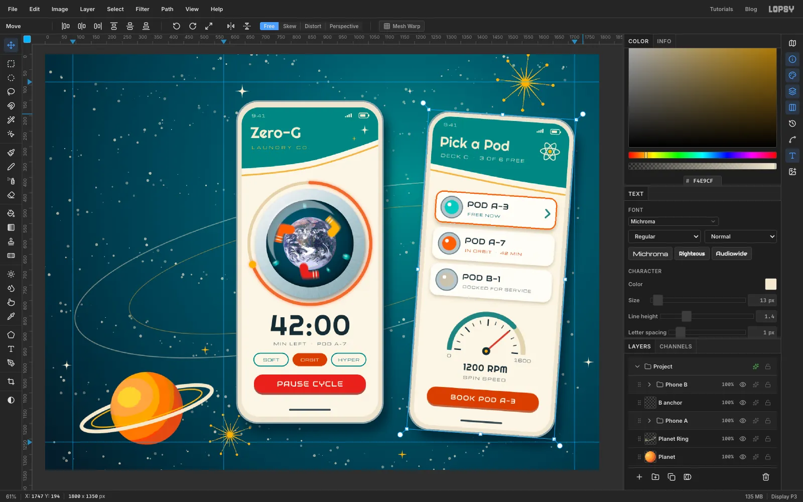

Collapse *Phone B* and click its row. With the **Move** tool and no marquee, drag a rotate handle about **4°** clockwise and press [[Enter]]. The whole phone turns as one piece: shadows, strokes, live text and the dial. The small tilt makes the second phone feel like it's been tossed onto the table, and keeps the layout from looking like a spreadsheet.

## Draw the left column's graphics

Click *Phone B* (still collapsed) and add a layer called *Left Column*. On it:

- three small mustard **Pen** sparkles as bullets, one above another at x 106, about 50 px apart
- an outlined pill with the **Shape** tool: **384 × 56**, **Corner Radius 28**, no fill, cream **2** px stroke, under the bullets
- a speed swoosh: a hard mustard **Brush** at **Size 12**, with **Taper 520** in the Brushes panel. Drag it once from the left margin to the column guide, rising gently to the right. It's thick where you start and thins to a point.

## Set the headline and copy

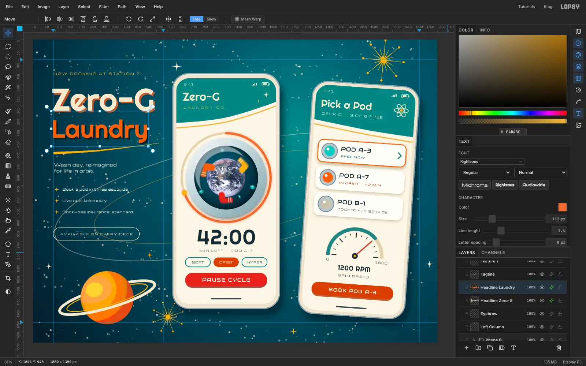

With *Left Column* active, set the type, again from the bottom up:

- **AVAILABLE ON EVERY DECK**: Michroma 13, cream, **Letter spacing 3**, centred in the pill
- the three bullet points: Michroma 15, cream, **Letter spacing 1**, just right of each sparkle. Use *Book a pod in three seconds*, *Live spin telemetry* and *Sock-loss insurance, standard*.
- the tagline *Wash day, reimagined / for life in orbit.*: Michroma 19, cream, two lines
- **Laundry**: Righteous 112, atomic orange
- **Zero-G**: Righteous 140, cream
- **NOW DOCKING AT STATION 7**: Michroma 14, mustard, **Letter spacing 4**

Line everything up on the left margin guide.

Give the two headline words a hard offset shadow, the way a sign painter would. **Drop Shadow** with **Offset X 7**, **Offset Y 7**, **Blur 0**, **Opacity 75**: orange on *Zero-G*, near-black `#06121B` on *Laundry*.

## Clean the sky behind the copy

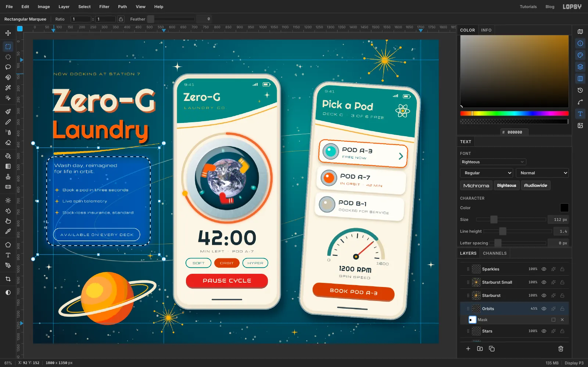

Stars and orbit lines running through small type make it hard to read. Clean them out:

1. **Stars.** Click *Stars* and pick the **Eraser** at **Size 44**. Drag along each line of copy and across the pill. Then use **Size 90** for one pass each across the eyebrow and the two headline words.
2. **Orbits.** Click *Orbits*, then **Add Mask** at the bottom of the Layers panel. Click the new mask thumbnail to edit the mask.
3. Draw a marquee over the left column, from just above the tagline to just below the pill. Choose **Select → Feather…** with **40**, set the foreground to black, and choose **Edit → Fill**.

The rings now fade out behind the text and pick up again past it. Deselect, and click the layer's name to leave mask editing.

## Add film grain

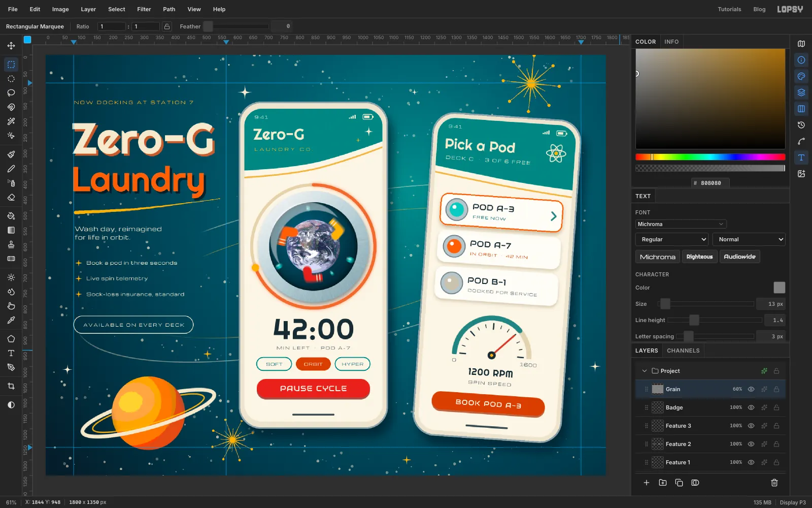

First tidy up. Click the spare empty layer next to *Phone B* and click **Delete Layer**. Then click the top row in the Layers panel and add a layer called *Grain*. Select all, fill it with mid-grey `#808080` and deselect. Choose **Filter → Add Noise…** with **Mono**, **Gaussian** and **Amount 40**.

Set the blend mode to **Overlay** and the opacity to **60%**. On Overlay, mid-grey disappears, so only the speckle remains. It takes the edge off the clean vector shapes and makes the board look printed.

## Darken the corners with a Vignette

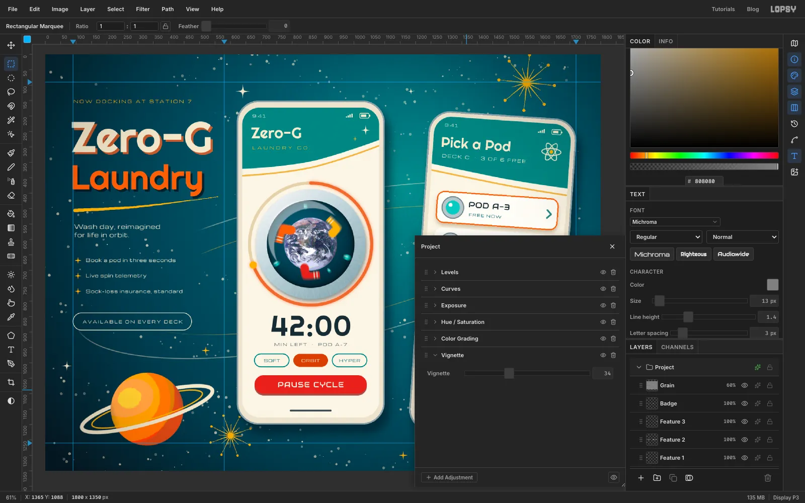

Click the *Project* group at the top of the Layers panel and open its effects with the sparkle button. Because it's a group, the drawer shows adjustments. The root group already lists a few default nodes: Levels, Curves, Exposure, Hue/Saturation and Color Grading. They're neutral until you change them. Click **Add Adjustment → Vignette** and set **Vignette** to **34**. The corners darken and pull the eye into the phones.

Close the drawer. Choose **File → Save Project** to keep an editable copy, and **File → Quick Export PNG** for the finished image.
