**Mercury Zenith** doesn't exist. It's an imaginary 1950s science fiction film about a domed city on the hottest planet in the solar system, where at high noon the sun stands straight overhead and nothing casts a shadow.

Retro-futurism is the look of the future as people imagined it back then. The main reference here is **Arthur Radebaugh**, an airbrush illustrator who drew the newspaper feature *Closer Than We Think* from 1958 to 1963, full of glowing streamlined cities. The second is the one-sheet posters of the period: a low viewpoint, one small figure, one huge block title and a stack of billing at the bottom.

The trick that makes this picture work is simple. You paint one flat wall, then use the Move tool's **Distort** mode to stand copies of it up in perspective, with every vertical edge aimed at the centre of the sun. That one idea builds the whole city.

The document is 2400 × 3640 px, roughly the shape of a real one-sheet. Where this tutorial gives positions, read them off the rulers as rough targets. Only the aim of the tower edges really matters.

You'll need two public domain NASA photos from Wikimedia Commons:

- [MESSENGER EN0108828359M](https://commons.wikimedia.org/wiki/File:MESSENGER_EN0108828359M.png), a view of Mercury's cratered surface. Enlarge it to double size, 2032 × 2048 px, in any image viewer and save it as `mercury.png`
- [Aldrin Apollo 11](https://commons.wikimedia.org/wiki/File:Aldrin_Apollo_11_original.jpg), the famous photograph of Buzz Aldrin on the Moon. Download the 1920 px version and crop it tightly around the astronaut, about 720 × 1200 px, so the top of the helmet touches the top edge. Save it as `astronaut.png`

The tools you'll use:

- the **Gradient** tool with typed colour stops, and the exact-size dialogs of the **Rectangular** and **Elliptical Marquee**
- the **Move** tool's **Distort** mode, rotate handles and corner scaling
- **Define Pattern** and **Fill with Pattern**
- the **Pen** tool with **Path to Selection**, and the **Lasso**
- photos dropped on the canvas, **Select → Inverse**, **Shrink** and **Feather**
- **Sunburst**, **Add Noise**, **Threshold**, **Gaussian Blur**, **Posterize**, **Chromatic Aberration** and **Halftone**
- the **Screen**, **Multiply**, **Soft Light** and **Overlay** blend modes
- **Gradient Map** and **Color Grading** adjustments on groups
- the **Stroke** effect, **Merge Down**, **Copy Merged** and **Rasterize Layer**
- text in **Racing Sans One**, **Bebas Neue** and **Fjalla One**

The palette is hot on top and cool in the shadows:

- Sky `#FF9320` → `#FF6A1F` → `#E5401C` → `#7A1538` → `#2A0E3A` → `#0E0A1E`
- Sun `#FFFDF2` → `#FFF0BE`, rings `#FFD98A` → `#FFC45E`, rim `#FFAC3A` → `#FF8A1F`
- Lit walls `#FFF0BE` → `#FFC67A` → `#F0693A` → `#A8241F`
- Shaded walls `#3FAFA6` → `#1A7A80` → `#0E4A66` → `#101C3E`
- Lit rooms `#FFD27A`, trim `#FFF6DF` / `#6FBFB4`
- Ground inks `#14061A`, `#5C1C18`, `#A83A1C`, `#D85A24`, `#F08A3A`
- Suit inks `#14061A`, `#2E3A58`, `#8A96AC`, `#FFF6DF`
- Title `#FFF6DF` → `#FFE27A` → `#FFB33A`, sides `#FF6A3A` → `#C2261C`

> **Tip:** On a wide-gamut (Display P3) screen, Lopsy reads typed hex codes as P3 colours. These codes were picked that way, so they'll look a touch duller on an sRGB screen.

> **Note:** Shortcuts are written for a Mac. On Windows use [[Ctrl]] wherever it says [[Cmd]]. To rename a layer, double-click its name. Keep layers named as you go, because later steps refer to them. The **Paths** and **Text** panels start closed, so open them from the icons in the rail on the far right. The buttons under the Layers panel have icons rather than labels: **+** is Add Layer, the folder is **New Group**, and the **T** is **Rasterize Layer**, which only shows while a text layer is active. The status bar at the bottom shows the pointer's X and Y as you move, which helps when you're aiming for a position.

> **Note:** The Gradient tool has no shortcut, so click its icon in the toolbox. To set up a gradient, click **Advanced…** in its options bar. A new gradient keeps the last one's stops, so select any extra stops and delete them. Drag the two end stops to the ends of the bar, click the bar to add a stop, and type its colour in the **Hex** field. You place stops by eye, so the percentages here are targets, and when two stops are meant to sit together, a few pixels apart is right. Click **Done** when you've finished. The same goes for the stops in a **Gradient Map**.

> **Note:** Most gradients here fill a marquee. Picking a marquee switches tools, so always click the **Gradient** tool again before you drag. Otherwise your drag just moves the selection.

> **Note:** With the **Pen**, a click makes a sharp corner, and pressing and dragging makes a smooth curve. Click the first anchor again to close a shape.

> **Note:** You'll use the marquee's exact-size dialog a lot. Press [[Cmd+D]] so nothing is selected, pick the **Rectangular** or **Elliptical Marquee**, and click once on the canvas without dragging. Enter **From** and **To** corners and press [[Enter]].

> **Note:** The follow-along project leaves out the three print-texture layers (Registration, Print Dots and Grain), so every layer stays editable. Those layers include an opaque copy of the picture on top, which would hide anything you changed underneath. It does keep the final Color Grading.

## Paint a sky that radiates from the sun

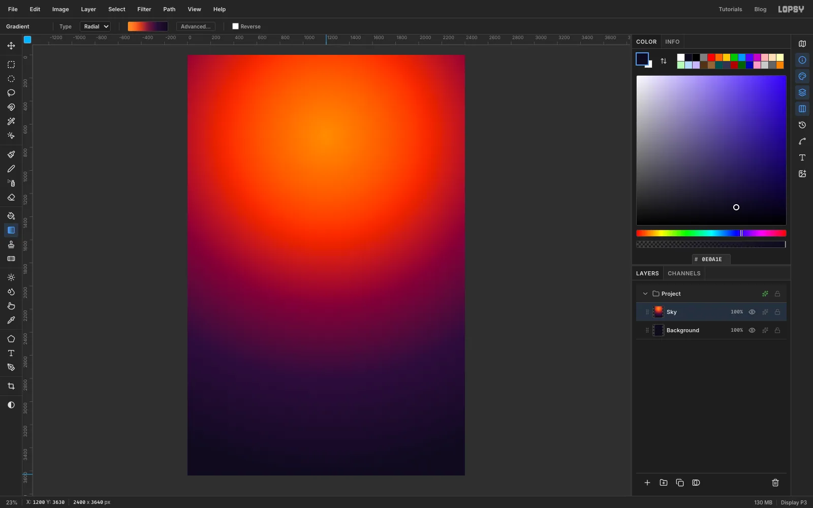

Choose **File → New**, keep the units on **Pixels**, and make the document **2400** wide and **3640** high.

Click **Background**, set the foreground to `#0E0A1E` and choose **Edit → Fill**.

Click **Layer 1** and rename it **Sky**. Pick the **Gradient** tool, set **Type** to **Radial**, and click **Advanced…** to enter six stops:

- 0%: `#FF9320`
- 17%: `#FF6A1F`
- 30%: `#E5401C`
- 50%: `#7A1538`
- 72%: `#2A0E3A`
- 100%: `#0E0A1E`

Use the marquee dialog from **0, 0** to **2400, 3640**, then click the Gradient tool again and drag from about **1200, 700** straight down to the bottom edge. That point is where the sun will sit, and everything in the poster aims at it. Press [[Cmd+D]].

## Scatter stars in the dark corners

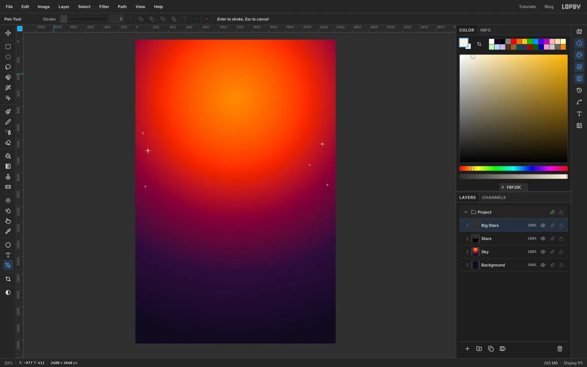

Add a layer called **Stars**, fill it with `#808080`, and run **Filter → Add Noise…** with **Amount** at **100** and **Mono** on. Then run **Filter → Threshold…** at **178**. Only the very brightest specks survive.

Open the layer's effects drawer (the sparkle button on its row) and set **Blend Mode** to **Screen**, which makes the black vanish.

The sun would drown any stars near it anyway, so clear the middle. Use the Elliptical Marquee dialog with **From** -50, -550 and **To** 2450, 1950. Choose **Select → Feather…** at **160** and press [[Delete]]. Press [[Cmd+D]].

Fine speckle looks like camera noise on its own, so add a few drawn stars. Add a layer called **Big Stars** and set the foreground to `#FBF2DC`. For each star, press [[P]] for the **Pen**, click eight points to make a thin four-pointed star, and click the first point to close it. In the **Paths** panel (the curve icon in the far right rail) click **Path to Selection** and then **Delete Path**, choose **Edit → Fill**, and press [[Cmd+D]]. Make six of them, 40 to 80 px across, down both sides of the sky between y 1100 and y 1800.

## Throw rays out with Sunburst

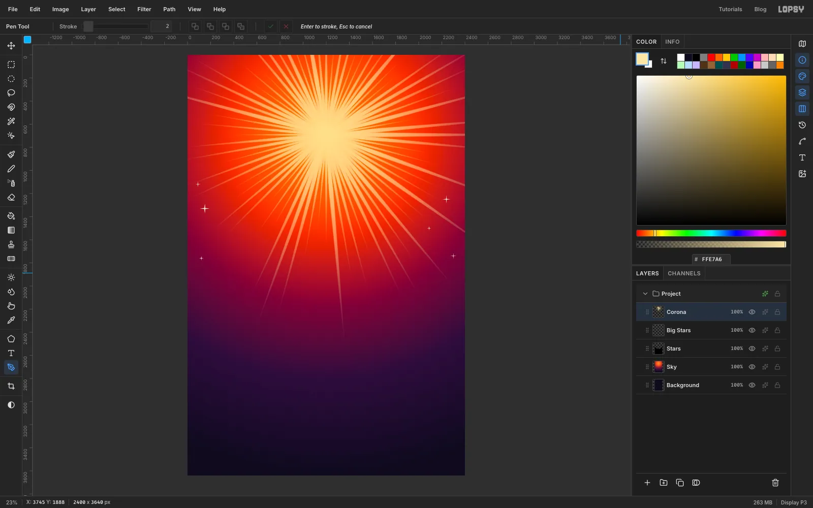

Add a layer called **Corona** and set the foreground to `#FFE7A6`. Choose **Filter → Sunburst…** and enter:

- **Rays** 72, **Length** 62, **Width** 30
- **Taper** 100, **Fade** 100, **Softness** 30
- **Center X** 50, **Center Y** 19
- **Jitter** 55, **Seed** 7, **Opacity** 80

The jitter is what stops it looking like a clip-art burst, because no two rays end at the same length. Set the layer's **Blend Mode** to **Screen**.

## Darken the top and add two orbit rings

The billing goes at the very top, so that part of the sky needs to be calmer. Add a layer called **Sky Shade**. Set up a **Linear** gradient from `#3A0E28`, through `#B8605A` at 55%, to `#FFFFFF`. Marquee from **0, 0** to **2400, 600**, click the Gradient tool again, drag from the top edge to the bottom of the selection, and press [[Cmd+D]]. Set **Blend Mode** to **Multiply**. White does nothing in Multiply, so the shade fades out by itself.

Rings around a nucleus were the emblem of the atomic age. Add a layer called **Orbit A** and set the foreground to `#FBF2DC`. In the Elliptical Marquee dialog use **From** 240, 440 and **To** 2160, 960. Choose **Edit → Fill**, then **Select → Shrink…** at **11**, press [[Delete]] and press [[Cmd+D]].

To tilt it, draw a rectangular marquee just around the ring and press [[V]] for the **Move** tool. Drag the small round rotate handle off any corner until the ring rises to the right by about **20°**, and press [[Cmd+D]].

Do the same on a new layer called **Orbit B**, in `#FFE7A6`, with **From** 400, 480 and **To** 2000, 920. Use **Shrink** **7**, and tilt this one the other way, falling to the right by about **28°**.

## Make a sun in flat bands

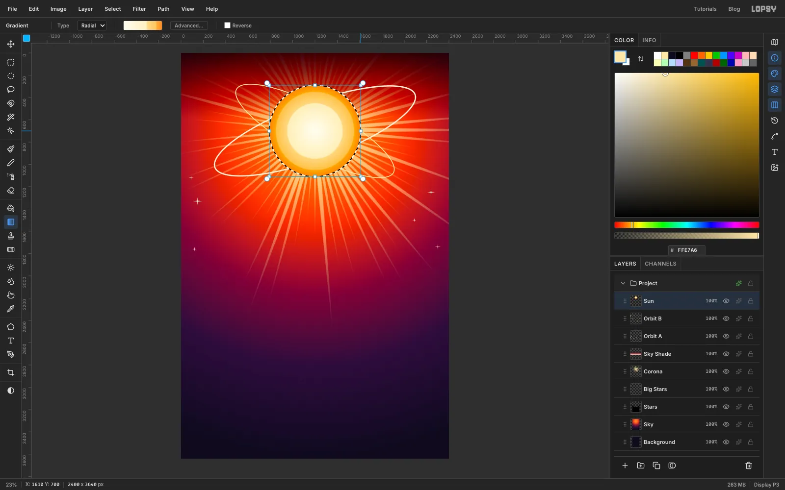

Add a layer called **Sun**. Set up a **Radial** gradient with these stops. The pairs that sit close together give hard edges, so it reads as painted bands rather than a soft glow:

- 0%: `#FFFDF2`
- 60%: `#FFF0BE`
- 61.5%: `#FFD98A`
- 85%: `#FFC45E`
- 86.5%: `#FFAC3A`
- 100%: `#FF8A1F`

In the Elliptical Marquee dialog use **From** 790, 290 and **To** 1610, 1110. Click the Gradient tool again and drag from the centre, **1200, 700**, out to the right edge of the circle, and press [[Cmd+D]].

The sun sits above the rings, so they pass neatly behind it.

## Make the window tiles

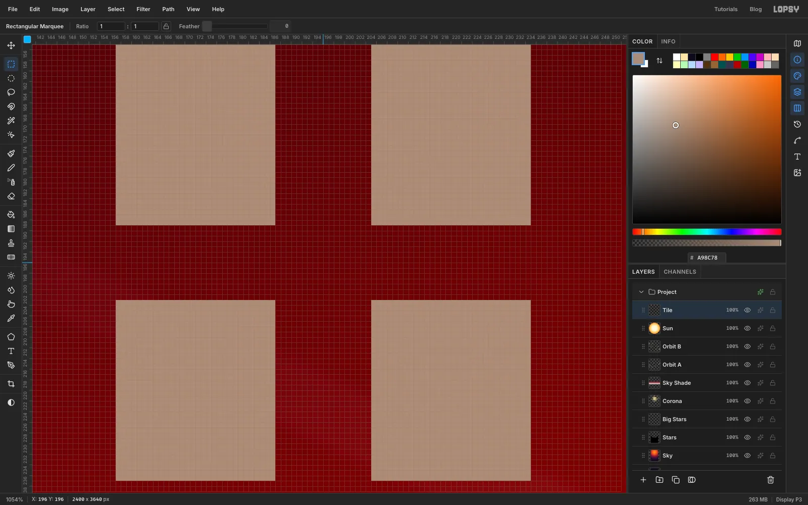

You need three small repeating patterns. Add a layer called **Tile** and zoom right in around **200, 200**, up in the empty top left corner.

**Tile 1, every window.** The tile is a **192 × 192** square from **100, 100** to **292, 292**, split into four rows of four 48 px cells. Fill a **30 × 34** pane near the middle of every cell in `#A98C78`. The first pane runs from 109, 107 to 139, 141, and the rest repeat every 48 px. If you'd rather not make sixteen, make one pane and define just its 48 px cell, because it repeats to the same grid. Marquee the tile, choose **Edit → Define Pattern**, press [[Delete]] and press [[Cmd+D]].

**Tile 2, a few lit rooms.** On the same 192 px square, fill just four panes in `#FFD27A`: column 1 of row 1, columns 3 and 4 of row 2, and column 2 of row 4. Marquee the square, define it as a pattern, press [[Delete]] and press [[Cmd+D]].

**Tile 3, a fin.** Fill one tall bar in `#C98A6A`, from **164, 100** to **228, 292**. Marquee the square, define it, press [[Delete]] and press [[Cmd+D]].

Patterns aren't named after what you call them here. They appear as thumbnails in the order you defined them, so later steps say first, second and third. If you defined other patterns earlier in this session, these come after them.

Select the **Tile** layer and delete it with the bin button under the Layers panel.

## Paint the flat sunlit wall

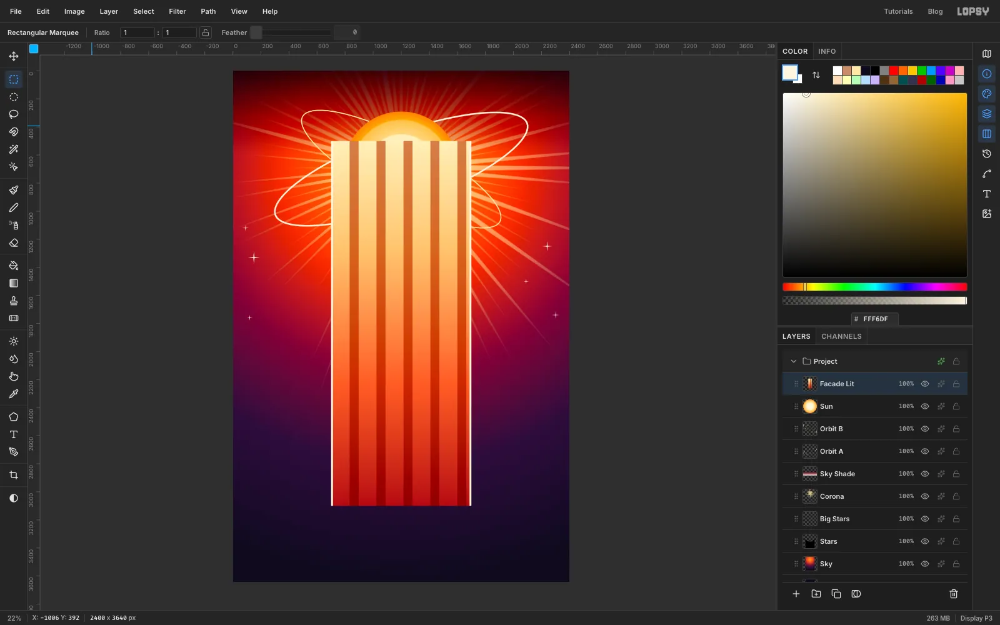

Every tower face in the city is a copy of one of three flat walls, all the same size. Add a layer called **Facade Lit**. Set up a **Linear** gradient: `#FFF0BE`, `#FFC67A` at 30%, `#F0693A` at 66%, `#A8241F` at 100%.

Use the marquee dialog with **From** 700, 500 and **To** 1700, 3100. Click the Gradient tool again and drag from the top of the selection to the bottom. Press [[Cmd+D]].

Now the fins. Add a layer called **Panes**, make the same marquee and choose **Edit → Fill with Pattern…**. Click the third thumbnail, which is the fin, and click **Apply**. Press [[Cmd+D]], set the layer's **Blend Mode** to **Multiply** and choose **Layer → Merge Down**. Multiply lets the fin darken whatever colour is underneath, so it works from the pale top to the deep bottom.

Finish with trim. With the foreground at `#FFF6DF`, fill a 14 px strip down each side: from 700, 500 to 714, 3100 and from 1686, 500 to 1700, 3100. Press [[Cmd+D]].

> **Tip:** Keep the fins wide. I started with fine flutes and small windows on every wall, and when Distort squeezes them toward the sun they break up into shimmering moiré. Big shapes stay clean.

## Paint the two shaded walls

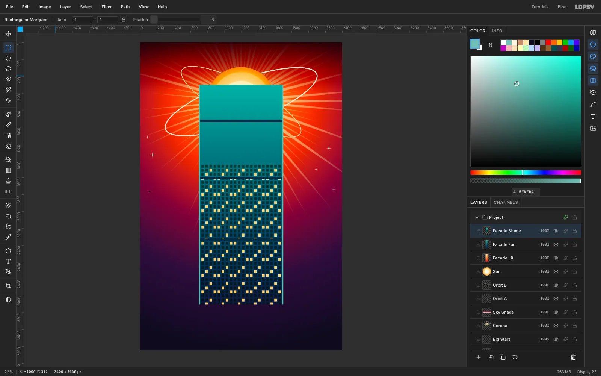

Add a layer called **Facade Far**. Do exactly what you just did for Facade Lit, with two changes. The gradient is `#3FAFA6`, `#1A7A80` at 30%, `#0E4A66` at 65%, `#101C3E` at 100%, and the trim is `#6FBFB4`. This fins-only wall is for distant towers and the small top stages, where windows would be far too small to read.

Add a layer called **Facade Shade** and fill the same rectangle with the same teal gradient. This is the wall for the big faces:

1. Add a layer called **Panes**, make the same marquee, and fill it with the first pattern thumbnail.
2. Marquee the top third, from 700, 500 to 1700, 1436, and press [[Delete]]. Windows would turn to noise up there.
3. Press [[Cmd+D]], set **Blend Mode** to **Multiply** and choose **Layer → Merge Down**.
4. Add a layer called **Lights**, make the marquee, fill it with the second thumbnail, clear the same top third, press [[Cmd+D]] and merge down. Leave this one on Normal, because lit rooms should glow rather than darken.
5. With the foreground at `#0A2A44`, fill three 26 px belts across the wall, starting at y 916, y 1592 and y 2320.
6. Add the `#6FBFB4` trim down both sides and press [[Cmd+D]].

Now click the eye on **Facade Lit**, **Facade Far** and **Facade Shade** to hide all three. You can still copy from a hidden layer.

## Lay down aim lines

Add a layer called **Aim Lines** at the top of the stack and set the foreground to `#FFFFFF`. Choose **Filter → Sunburst…** and enter **Rays** 48, **Length** 150, **Width** 5, **Taper** 50, **Center X** 50, **Center Y** 19 and **Opacity** 45. Leave **Fade**, **Softness** and **Jitter** at **0**.

This is your perspective grid, standing in for the construction lines an illustrator would rule by hand. When you look up at a tall building, its vertical edges converge on a point overhead, and that point is the sun. Every side edge you place in the next steps should aim at the sun's centre. The base points won't always land on a ray, so use the rays as a guide to the angle.

## Stand a wall up with Distort

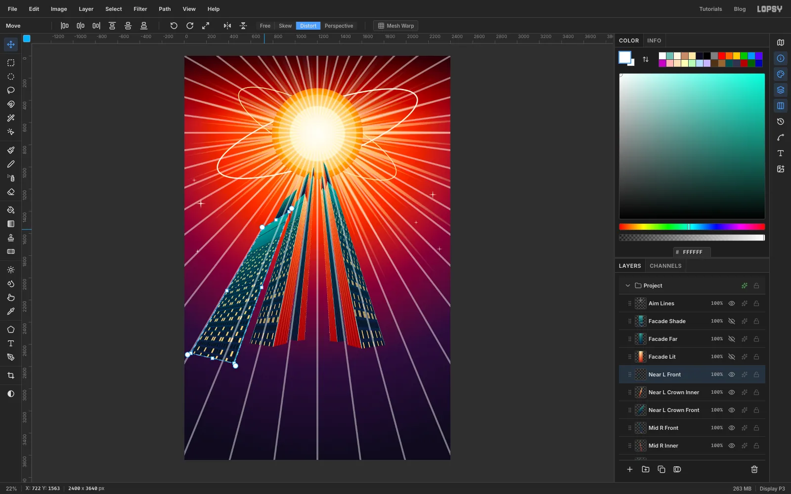

Here's the move you'll repeat for every face. The screenshot shows it on a later tower, **Near L Front**, because this is the procedure you'll be using from here on:

1. Click the wall you want in the Layers panel and press [[Cmd+C]].
2. Click the face you built last (for the very first one, click **Sun**). Give the copy a second to finish, since a paste straight after copying can pick up whatever was on your clipboard before, and press [[Cmd+V]]. The copy lands just above that row, under the hidden walls and the Aim Lines. Rename it.
3. In the marquee dialog, select the wall's rectangle: **From** 700, 500 and **To** 1700, 3100.
4. Press [[V]] for the Move tool and click **Distort** in the options bar.
5. Drag each corner to its target, bottom corners first. Move them out past the canvas edge if they need to go there, because Lopsy keeps pixels that hang off the canvas.
6. Press [[Cmd+D]] to commit.

> **Tip:** At this zoom the rotate handle sits right on top of each corner square. In Distort a rotate handle does nothing, so if a drag doesn't move the corner, press slightly inside the box instead. Your cursor shows diagonal arrows when you're on the corner handle and a crosshair when you're not.

Each tower has two faces meeting at a near corner: a **Front** in shadow and an **Inner** that faces the avenue and catches the sun. On the left of the poster the Front is on the left, and on the right of the poster the Front is on the right.

The corner of the base is the lowest point on the ground, and the corner of the roof is the highest point on the roof. So each base makes a shallow V, and each roof makes a shallow upside-down V. That's what makes it read as a building seen from below, not from above.

## Build the far and middle towers

Work back to front, so nearer towers overlap farther ones. For each tower, make the small top stage (the **Crown**) first, then the main faces. Inner faces use **Facade Lit**. Front faces use **Facade Shade**, except on the **Far** towers and on every **Crown**, which use **Facade Far**.

Each bullet gives the base as left, corner and right x, then the heights of the corner at the roof and at the top of the crown. The base corner sits up to 30 px lower than the two ends on these towers:

- **Far L**: base x 940, 1020, 1085 at y 2560. Roof corner at y 1070, crown top at y 1000
- **Far R**: base x 1320, 1380, 1460 at y 2570. Roof corner at y 1190, crown top at y 1080
- **Mid L**: base x 590, 800, 925 at y 2590. Roof corner at y 1240, crown top at y 1050
- **Mid R**: base x 1480, 1600, 1810 at y 2610. Roof corner at y 1130, crown top at y 950

For a roof, slide up from each base point along its aim line. The corner goes to the height above, and the two far ends stop about 30 to 80 px lower.

A **Crown** is the same corner carried on up the same aim line, with its other side pulled in by about a third of the wall's width. Its bottom corners sit on the roof of the face below, and it narrows as it rises.

Here are two faces worked through in full, so you can see how the numbers fit. They're from **Near L** in the next step, but they work the same way on every tower:

- **Near L Front**: bottom left 60, 2680. Bottom right 450, 2770, the base corner. Top right 945, 1404, the roof corner. Top left 710, 1551, which is the far end of the roof
- **Near L Crown Front**: bottom right 945, 1404, the same roof corner. Bottom left 798, 1503, about a third of the way in along the roof. Top right 1020, 1197, the crown top. Top left 898, 1302

The Inner face shares the corner edge and goes the other way, to the inner end of the base. Check each one by eye: if a side edge doesn't point at the sun, drag its top corner along until it does.

Name them as you go: **Far L Crown Front**, **Far L Crown Inner**, **Far L Front**, **Far L Inner**, and so on. It's about four minutes a tower once you have the rhythm.

## Build the near and edge towers

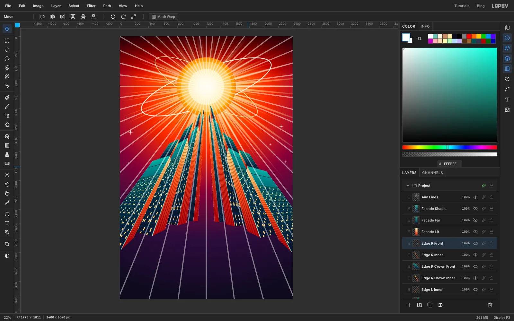

The same again, closer and bigger. Now the base corners drop further, by the amount shown, and the roof ends stop about 70 to 150 px below the corner:

- **Near L**: base x 60, 450, 630 at y 2680, corner 90 lower. Roof corner at y 1400, crown top at y 1200
- **Near R**: base x 1770, 1950, 2340 at y 2700, corner 90 lower. Roof corner at y 1540, crown top at y 1330
- **Edge L**: base x -320, 20, 190 at y 2800, corner 160 lower. Roof corner at y 1650, crown top at y 1420
- **Edge R**: base x 2210, 2380, 2720 at y 2830, corner 160 lower. Roof corner at y 1800, crown top at y 1570

The left and right sides deliberately don't match. Different roof heights stop the city looking like a mirrored logo.

Keep the Edge towers fairly narrow, with only their lower corners running off the canvas, so you can see sky outside them higher up. My first version made them far wider, and they read as huge tilted wedges instead of buildings.

## Clean up and merge each tower

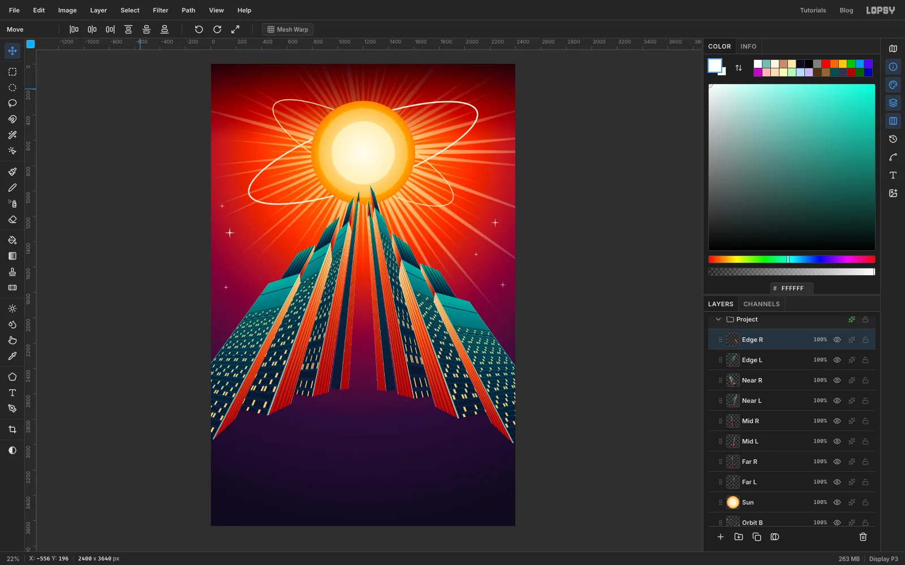

Delete **Aim Lines**, **Facade Lit**, **Facade Far** and **Facade Shade**. They've done their job.

For each tower, click the top one of its four rows and choose **Layer → Merge Down** three times, so its four faces become one layer. Rename it **Far L**. Repeat for all eight. The stack now runs **Far L**, **Far R**, **Mid L**, **Mid R**, **Near L**, **Near R**, **Edge L**, **Edge R** from the bottom up.

## Drop in the Mercury photo

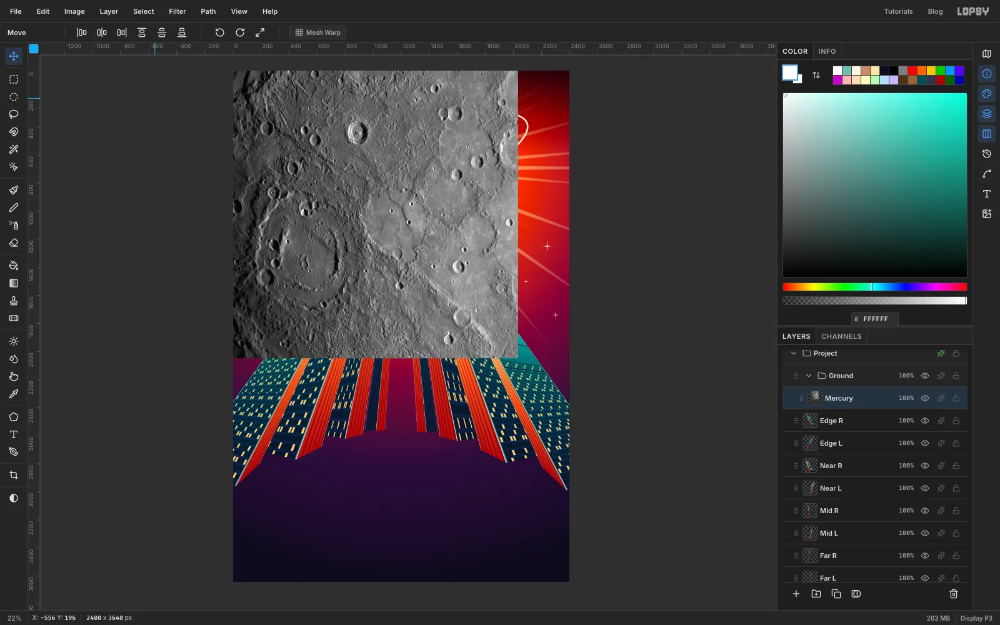

Click **Edge R**, then click **New Group** (the folder icon under the Layers panel) and call it **Ground**. With the group selected, drag `mercury.png` from your desktop onto the canvas. It lands at the top left, inside the group. Rename the new layer **Mercury**.

Sitting above the towers means the ground hides all their base corners, which you'll be glad of in a moment.

## Lay the photo flat on the ground

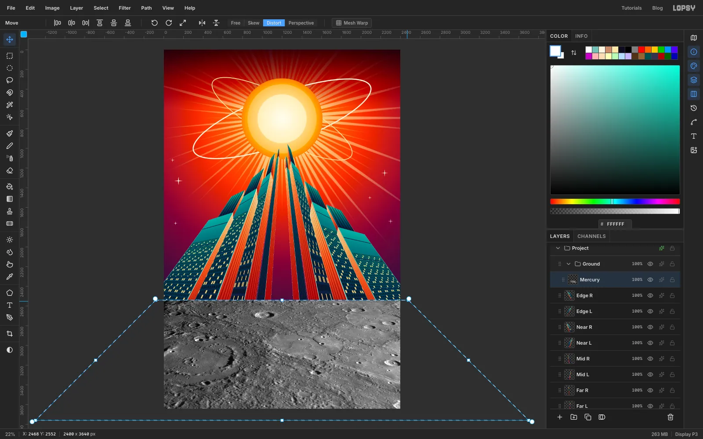

It's a picture taken from orbit, looking straight down. Distort turns it into a plain stretching away to the horizon.

Marquee the photo with **From** 0, 0 and **To** 2032, 2048. Press [[V]] and click **Distort**. Then drag the corners, bottom ones first:

- Bottom left to about **-1300, 3760**, well out on the pasteboard
- Bottom right to about **3700, 3760**
- Top left to about **-80, 2540**
- Top right to about **2480, 2540**

Press [[Cmd+D]].

## Give the planet a curved horizon

A photograph next to flat painted towers looks pasted on, so simplify it. Run **Filter → Gaussian Blur…** at **Radius 5** to melt away the fine speckle, then **Filter → Posterize…** at **6 levels**.

A straight edge would look like a table top, so curve it. In the Elliptical Marquee dialog use **From** -1500, 2600 and **To** 3900, 4800. Choose **Select → Inverse**, press [[Delete]] and press [[Cmd+D]]. Now you're standing on a small, hot planet.

Add a layer called **Ground Shade**, inside the group. Set up a **Linear** gradient: `#FFFFFF`, `#8A8A8A` at 45%, `#000000`. Marquee from **0, 2800** to **2400, 3640**, click the Gradient tool again, drag from about y 2810 down to y 3500, press [[Cmd+D]] and set **Blend Mode** to **Multiply**. The title and credits will sit on this dark foot.

## Turn the ground into flat inks

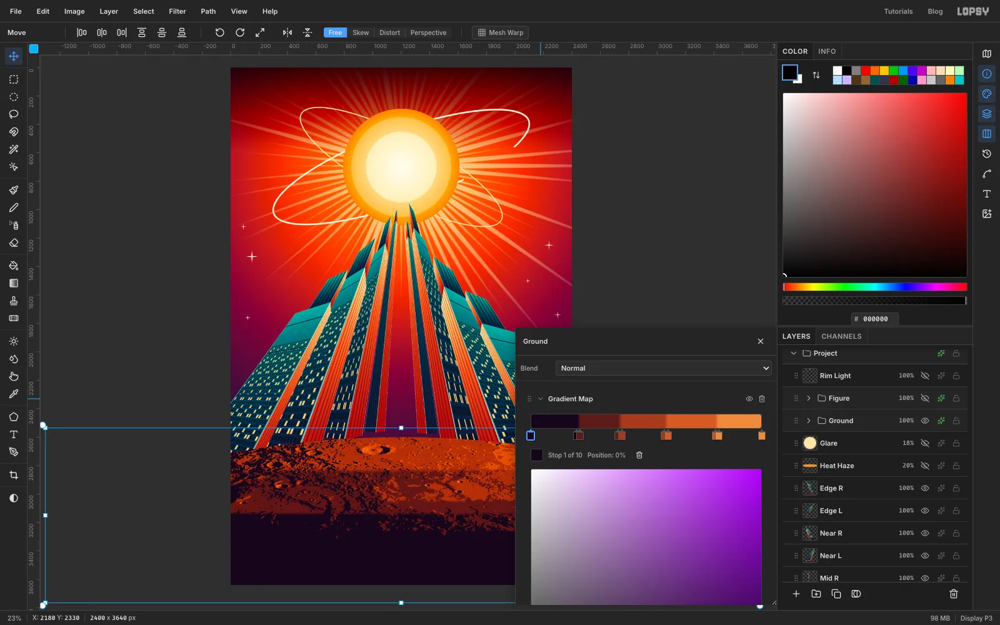

Click the **Ground** group and open its effects drawer. Click **Add Adjustment → Gradient Map**. This remaps the whole group by brightness, and it's non-destructive, so you can keep adjusting the colours.

Click the first stop and type its colour in the **Hex** field, then do the same for the last stop. Click the bar to add each new stop and type its colour. Pairs of stops close together make hard edges, so the photo becomes a five-colour print:

- 0% and 20%: `#14061A`
- 21.5% and 38%: `#5C1C18`
- 39.5% and 58%: `#A83A1C`
- 59.5% and 80%: `#D85A24`
- 81.5% and 100%: `#F08A3A`

Because Ground Shade is inside the group, its smooth fade comes out as hard bands of darker ink too. Close the drawer.

I took this screenshot from a later save, so the Layers panel shows a few layers you haven't made yet, hidden, and the ring is already open by the rocket's spot.

## Add heat haze and glare

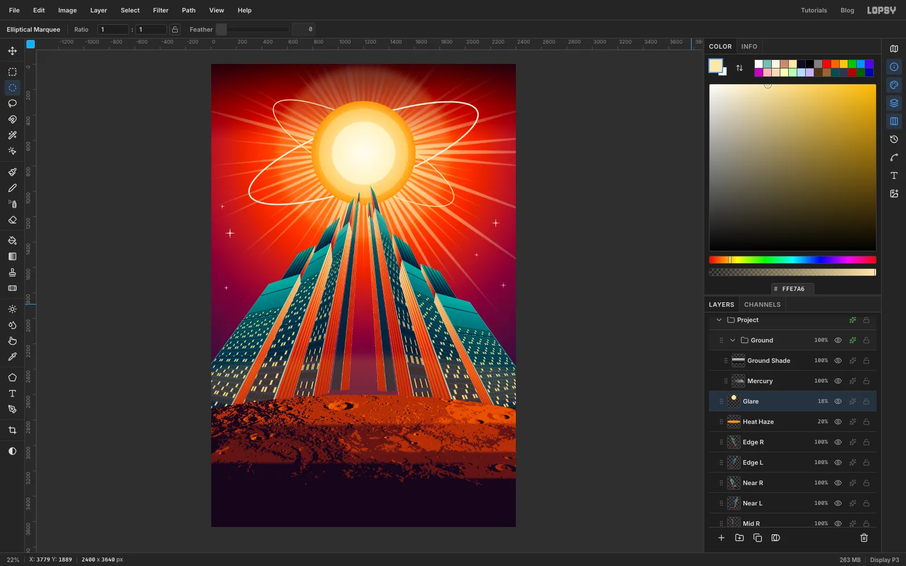

Click **Edge R** (the row below the Ground group) and add a layer called **Heat Haze**. Set the foreground to `#FF9320`. In the Elliptical Marquee dialog use **From** -200, 2300 and **To** 2600, 2760. Choose **Select → Feather…** at **120**, then **Edit → Fill**, and press [[Cmd+D]]. Set **Blend Mode** to **Screen** and the row's opacity to **20%**.

Add a layer called **Glare** in `#FFE7A6`, with the Elliptical Marquee dialog at **From** 520, 20 and **To** 1880, 1380. **Feather** it by **320**, fill, press [[Cmd+D]], set **Screen** and use **18%** opacity. It melts the tops of the towers into the light.

## Cut out the astronaut

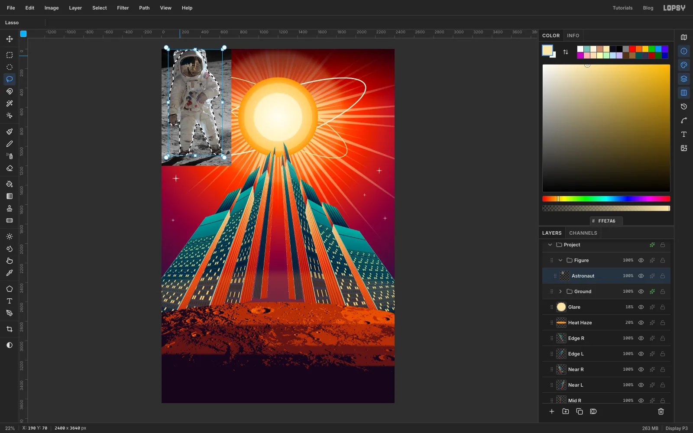

Click the small arrow on the **Ground** group row to collapse it, and click the row. Click **New Group** and call the new group **Figure**. Collapsing first makes the new group a neighbour of Ground rather than a group inside it.

Drag `astronaut.png` onto the canvas and rename the layer **Astronaut**.

Press [[L]] for the **Lasso** and draw around the figure. Round over the top of the helmet as you pass it, because the photograph crops the backpack flat, and a flat top makes the head look boxy. Leave out the shadow and the ground.

Choose **Select → Inverse**, press [[Delete]] and press [[Cmd+D]].

## Age the suit and scale it down

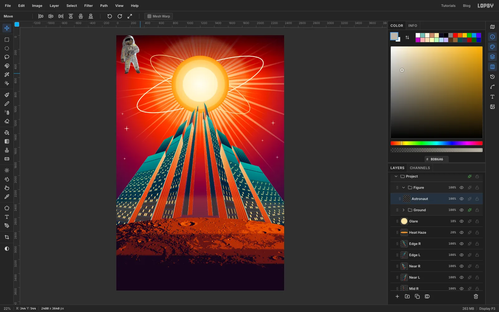

A flag and mission patches pin the photo to 1969, and this film is set well before anyone had been there. Lasso around the flag on the sleeve, set the foreground to `#BDB6A6`, choose **Edit → Fill** and press [[Cmd+D]].

Run **Filter → Gaussian Blur…** at **Radius 3** and **Filter → Posterize…** at **6 levels**. That's what removes the photographic detail.

Draw a marquee around the figure and press [[V]]. Hold [[Cmd]] and drag the bottom right corner in until the figure is half its size, about 280 px wide. Press [[Cmd+D]].

Drag the figure to the centre of the poster, so its boots stand on the crest of the horizon at about **y 2610**.

## Print the suit in four inks

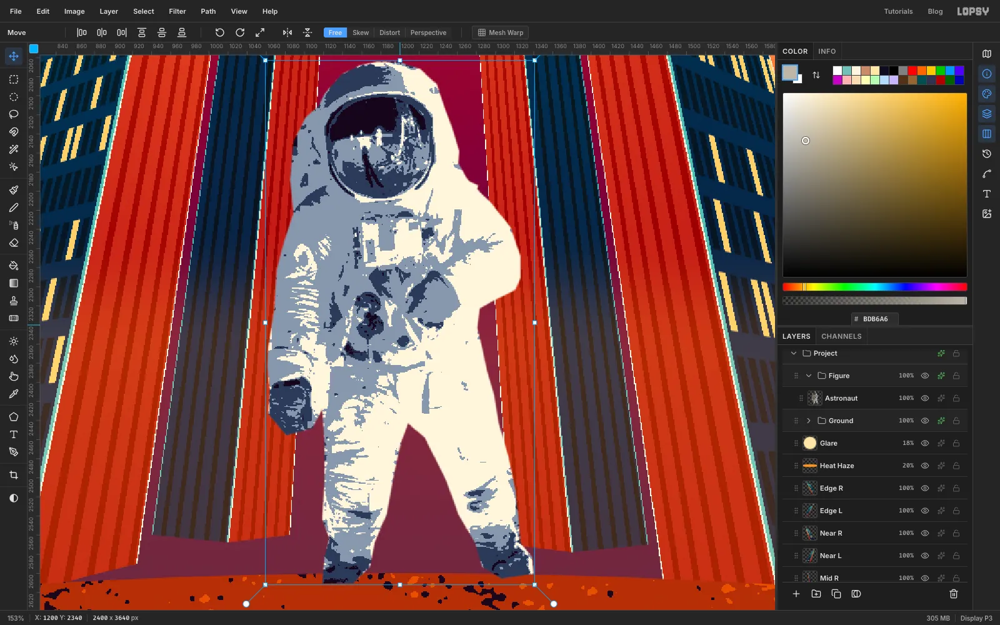

Click the **Figure** group, open its drawer and click **Add Adjustment → Gradient Map**. Enter these hard-edged stops:

- 0% and 18%: `#14061A`
- 19.5% and 33%: `#2E3A58`
- 34.5% and 50%: `#8A96AC`
- 51.5% and 100%: `#FFF6DF`

Close the drawer. He's the only cool, pale thing in a hot picture, so your eye goes straight to him. In my first version he was mapped orange with the ground, and he disappeared.

Don't add a shadow under him. There's a reason the tagline says what it says.

## Light him from straight overhead

Hold [[Cmd]] and click the **Astronaut** thumbnail to select his outline. Keep that selection, collapse the **Figure** group, click its row and add a layer called **Rim Light**.

Set the foreground to `#FFC04A` and choose **Edit → Fill**. Press [[L]] for the Lasso and tap [[Down]] seven times, which moves only the selection outline down by 7 px. Press [[Delete]] and press [[Cmd+D]].

What's left is a thin line along every edge that faces up, exactly where the noon sun would catch him.

## Draw the rocket's flame

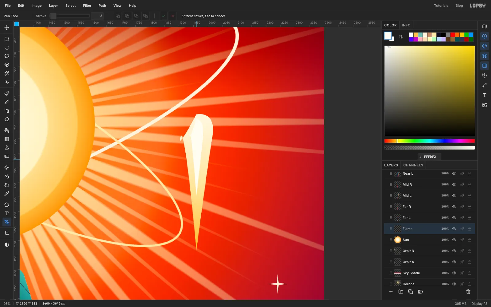

Scroll down the Layers panel to **Sun** and click it, so the rocket flies in front of the sun and behind the towers. Add a layer called **Flame**. You'll draw the whole rocket upright in the empty sky at the top right, centred on about **x 1960**, and tilt it at the end.

Press [[P]] for the Pen and draw the flame with smooth anchors at its widest points. Make a teardrop about 110 px wide, starting at the widest point near **y 740**, curving up to a point at **y 670** and down to a long point at **y 1130**. Click the first anchor to close it, and in the **Paths** panel click **Path to Selection** and **Delete Path**.

Set up a **Linear** gradient: `#FFF6DF`, `#FFE7A6` at 50%, `#FFC04A`. Drag it from the top of the flame to the tip. An orange flame would disappear against this sky, so keep it pale.

Press [[Cmd+D]]. Draw a thinner teardrop inside, about 45 px wide and ending around **y 950**, make it a selection, fill it with `#FFFDF2`, and press [[Cmd+D]].

## Build a chrome rocket

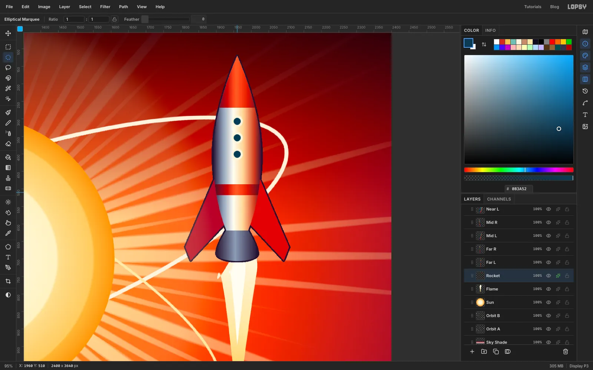

Add a layer called **Rocket** and draw each part with the Pen, in this order. Press [[Cmd+D]] before each one, and turn each path into a selection and delete the path when you've finished with it. The whole rocket is centred on x 1960 and runs from about **y 120** at the nose to **y 680** at the nozzle.

**Fins.** Draw a swept-back four-sided fin on each side of where the body will be. The left one has corners at about 1812, 666, then 1905, 448, then 1929, 596, then 1827, 705, and the right one mirrors it. Fill the left one with `#A8182A` and the right one with `#D22A20`, so one side is in shade.

**Nozzle.** Draw a bell, about 60 px wide at the top and 120 px wide at the bottom, sitting at the tail. Fill it with a **Linear** gradient dragged across its width: `#20102E`, `#8E9CB4` at 45%, `#20102E`.

**Body.** Draw a bullet shape with a sharp nose at y 120. Use smooth anchors at the widest points, about 140 px across at y 401, and narrow it to about 60 px at the tail, y 619. Keep this path, because you'll use it again in a moment. Make it a selection, set up a gradient with six stops, click the Gradient tool and drag across the width:

- 0%: `#20102E`
- 20%: `#8E9CB4`
- 42%: `#FFFDF2`
- 62%: `#FFD9A0`
- 86%: `#C2462A`
- 100%: `#3A1030`

That off-centre pale streak with a warm edge on the sun side is what makes it read as polished metal.

**Nose and belly band.** Press [[Cmd+D]], select the body path in the **Paths** panel, and click **Path to Selection** again. Pick the **Rectangular Marquee**, hold [[Shift]] and [[Alt]], and drag a rectangle from above the nose, wider than the rocket, down to about y 268. That leaves only the part where the two overlap. Click the Gradient tool and fill it across the width: `#3A0C22`, `#C2261C` at 30%, `#FF6A3A` at 48%, `#D2301C` at 72%, `#3A0C22`. Do the same for a thin belly band from y 487 to y 518, then delete the path.

**Portholes.** Press [[Cmd+D]]. Using the Elliptical Marquee dialog, make three circles on x 1960, centred at y 307, y 354 and y 401. Each one is 32 px across, so the first runs from 1944, 291 to 1976, 323. Fill them with `#FFF6DF`. Then fill a 20 px circle inside each with `#0B3A52`.

Press [[Cmd+D]] and open the **Rocket** layer's effects. Enable **Stroke** at **Width 4** in `#20102E`, to lift the red fins off the red sky. Then choose **Layer → Merge Down**, so rocket and flame become one layer, and name it **Rocket**.

## Tilt it onto its orbit

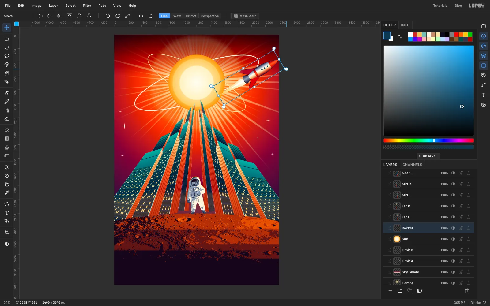

Draw a marquee just around the rocket and its flame. Press [[V]], and drag a rotate handle clockwise by about **60°**, so the nose points up and to the right, roughly along the lower right part of Orbit A. Press [[Cmd+D]].

## Fly it past the sun

Press on the rocket with the Move tool and drag it down and left until its centre is about **1830, 650**. The flame should reach back over the sun's rim, and the upper fin should clear the sun with a little sky between them.

Orbit A now runs through the lower fin, and that tangle catches the eye. Click **Orbit A**. In the marquee dialog use **From** 1640, 560 and **To** 2260, 960, press [[Delete]] and press [[Cmd+D]]. The ring now seems to pass behind the rocket.

## Set the title

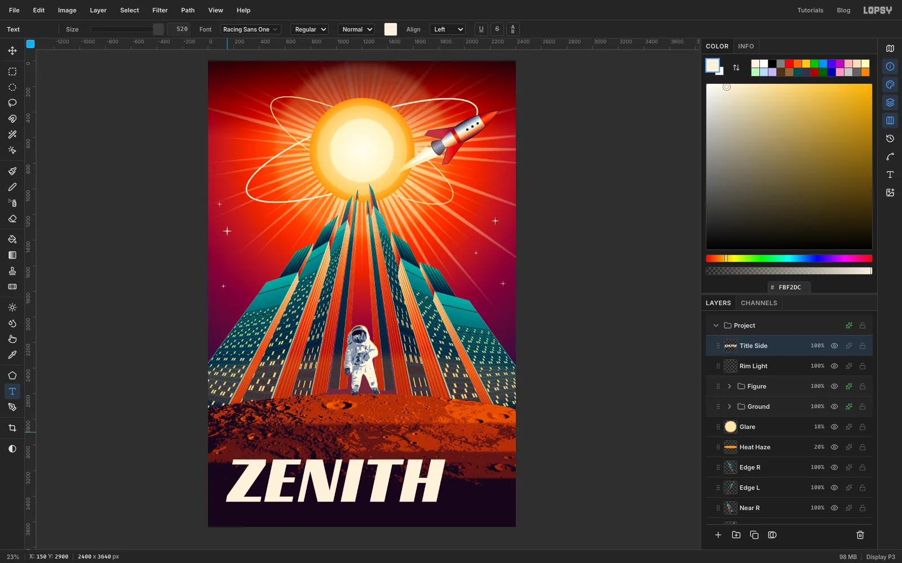

Click **Rim Light** so the new text lands above it. Press [[T]] for the **Text** tool. Choose **Racing Sans One**, set **Size** to **520** and the color to `#FBF2DC`. It's a slanted, sign-painter kind of face that looks like the chrome badge on a 1950s car.

Click at about **150, 2900**, type **ZENITH**, and press [[Tab]]. Click **Rasterize Layer** under the Layers panel, because Distort needs pixels. Rename the layer **Title Side**.

## Make the title recede into the city

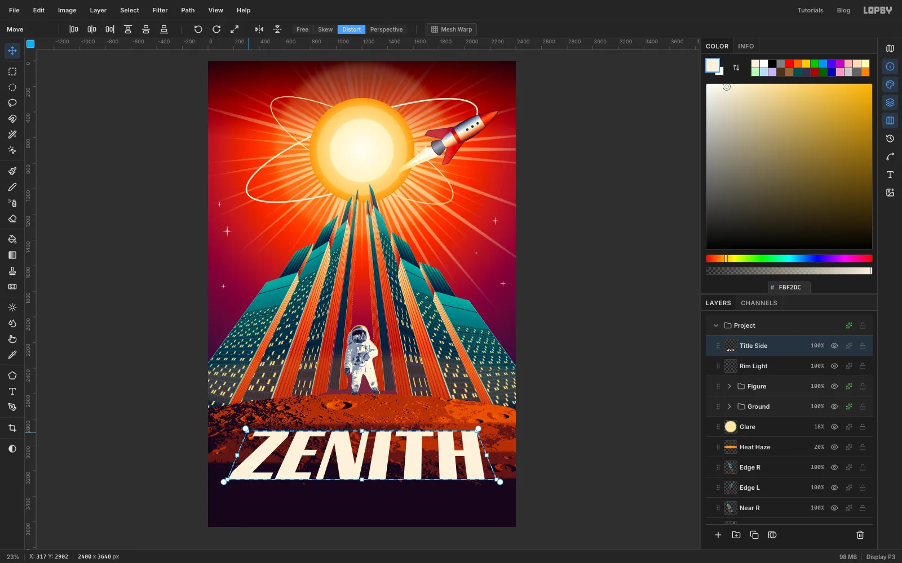

Draw a marquee just around the word, press [[V]] and click **Distort**. Drag the corners:

- Bottom left to about **150, 3270**
- Bottom right to about **2250, 3270**
- Top left to about **305, 2890**
- Top right to about **2095, 2890**

Those side edges aim straight at the sun, so the title stands in the same space as the towers. Press [[Cmd+D]], and tap the arrow keys until the word sits in the middle of the poster, holding [[Shift]] to move 10 px at a time. Measure by the ink, not by your eye on the slant.

## Paint the title's face

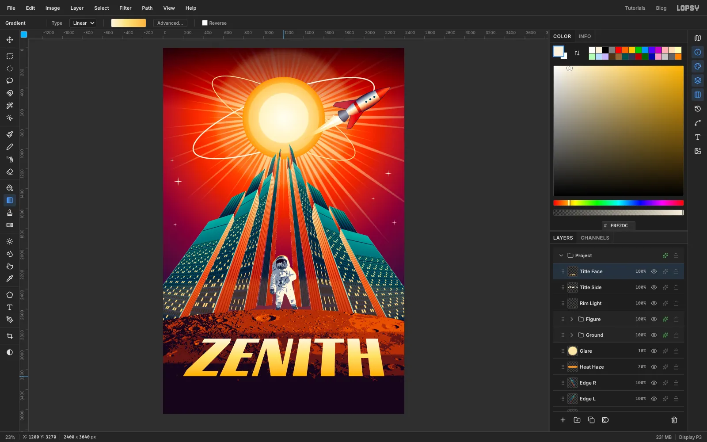

Choose **Layer → Duplicate Layer** and rename the copy **Title Face**. Hold [[Cmd]] and click its thumbnail to select the letters.

Set up a **Linear** gradient: `#FFF6DF`, `#FFE27A` at 45%, `#FFB33A`. Drag it from the top of the letters to the bottom, and press [[Cmd+D]]. The selection keeps the colour inside the letters.

I tried a chrome gradient first, with a hard horizon through the middle. It looked straight out of the 1980s. Keep it warm and simple.

## Give it a solid block

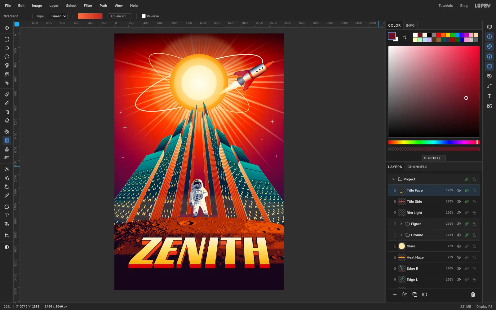

Click **Title Side**, hold [[Cmd]] and click its thumbnail, set the foreground to `#6E1020`, choose **Edit → Fill** and press [[Cmd+D]].

To extrude it, press [[V]], choose **Layer → Duplicate Layer**, click the copy's row, tap [[Down]] twice and choose **Layer → Merge Down**. Do that again and move the copy 4 px, then 8, 16 and 32. [[Shift]] and an arrow key moves 10 px, which saves some tapping. Each pass doubles the depth, so five passes make a solid 62 px block with smooth diagonal edges. Starting with big steps leaves a staircase on every slanted stroke.

Hold [[Cmd]] and click the thumbnail again, set up a **Linear** gradient from `#FF6A3A` to `#C2261C`, and drag from the top of the letters to the bottom of the block. Press [[Cmd+D]].

Open the effects on **Title Side**, enable **Stroke**, set **Width** to **6** and the color to `#0E0A1E`. Do the same on **Title Face** with **Width 5**.

## Add MERCURY above it

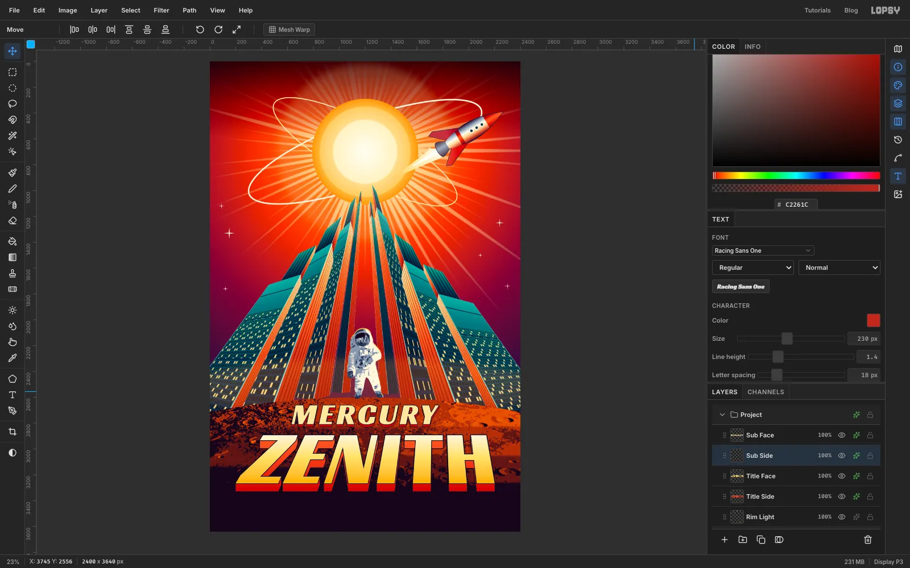

Click **Title Face**, press [[T]], and set **Size** to **230**, keeping Racing Sans One, with the color at `#FFE7A6`. Click at about **600, 2630**, type **MERCURY** and press [[Tab]]. In the **Text** panel (the **T** in the far right rail) set **Letter spacing** to **18**. Click **Rasterize Layer** and rename it **Sub Side**.

Tap the arrow keys until it's centred on the poster with the top of the letters at about **y 2660**. That leaves a clear gap under the boots and a clear gap above ZENITH.

Duplicate it, rename the copy **Sub Face**, and give it a **Stroke** of **Width 4** in `#0E0A1E`. Then click **Sub Side**, hold [[Cmd]] and click its thumbnail, fill it with `#C2261C` and press [[Cmd+D]]. Extrude it the same way with moves of 2, 4, 8 and 6 px, and give it the same Stroke.

## Stack the billing

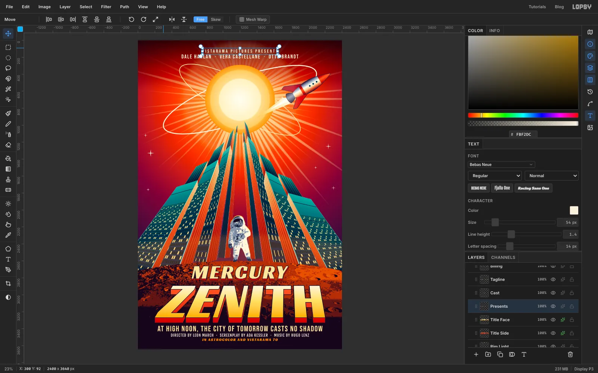

Create these from the bottom up, because a click inside an existing line's text box edits that line rather than starting a new one. Before each one click **Title Face**, so you don't restyle the last line. Press [[T]], set the font, size and color, click near **x 300** at the height given, type, and press [[Tab]]. Then set **Letter spacing** in the Text panel.

- **Process**: IN ASTROCOLOR AND VISTARAMA 70. Racing Sans One, **44**, spacing **6**, `#FF9320`, at about y 3500
- **Billing**: DIRECTED BY LEON MARCH · SCREENPLAY BY ADA KESSLER · MUSIC BY HUGO LENZ. Fjalla One, **44**, spacing **4**, `#FBF2DC`, at about y 3450
- **Tagline**: AT HIGH NOON, THE CITY OF TOMORROW CASTS NO SHADOW. Bebas Neue, **92**, spacing **7**, `#FFE7A6`, at about y 3340
- **Cast**: DALE HARLAN · VERA CASTELLANE · OTTO BRANDT. Bebas Neue, **66**, spacing **8**, `#FBF2DC`, at about y 150
- **Presents**: VISTARAMA PICTURES PRESENTS. Bebas Neue, **54**, spacing **14**, `#FBF2DC`, at about y 90

After each line press [[V]] and tap the arrow keys to centre it.

Condensed capitals are what real billing blocks used. They let you fit lots of words into a narrow band, and the tagline should end up no wider than ZENITH.

## Slip the registration

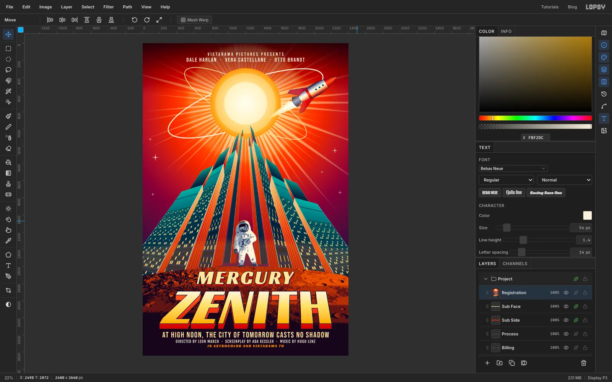

Now to make it look printed. Old lithographs were printed one ink at a time, and the sheets never lined up perfectly.

Click **Sub Face**, the top row. Choose **Edit → Copy Merged**, give it a second or two to finish, and press [[Cmd+V]]. Rename the new layer **Registration**. Run **Filter → Chromatic Aberration…** at **Amount 1**. Any more and the small credits become hard to read.

From here on the top layer is an opaque copy of the picture, so make any changes to the art first.

## Add a dot screen

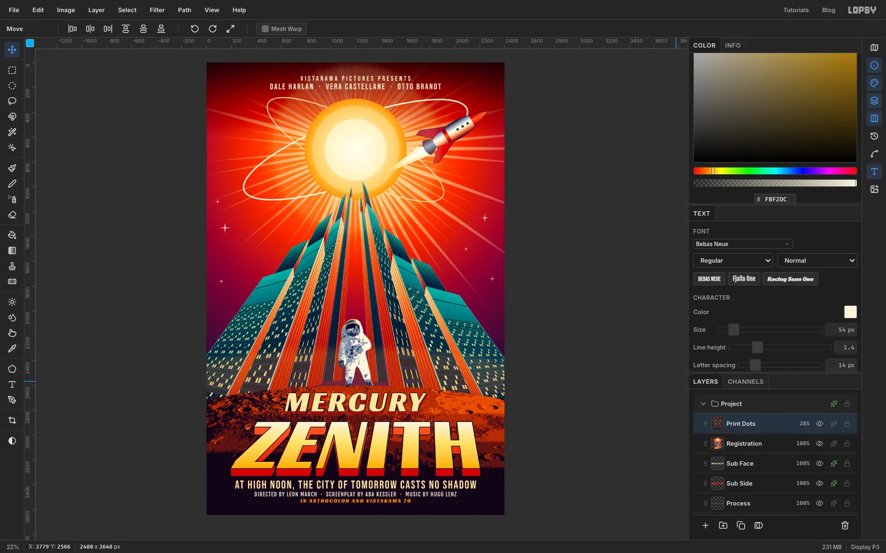

Choose **Edit → Copy Merged** again, give it a moment, press [[Cmd+V]], and rename the layer **Print Dots**. Run **Filter → Halftone…** with **Dot Size 9**, **Angle 45** and **Softness 1**.

Set **Blend Mode** to **Soft Light** and the row's opacity to **28%**. You should feel the dots more than see them.

## Add paper tooth

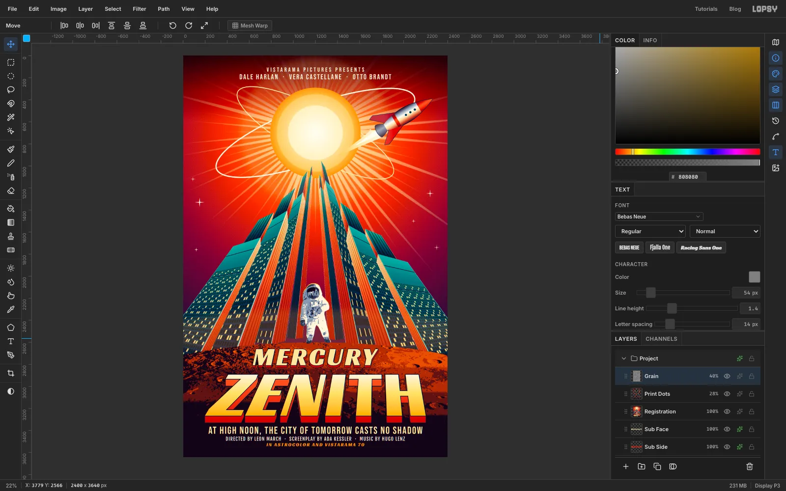

Add a layer called **Grain**, fill it with `#808080`, and run **Filter → Add Noise…** with **Amount 70** and **Mono** on. Set **Blend Mode** to **Overlay** and the opacity to **40%**. Mid-grey disappears in Overlay, so only the noise is left.

## Pull it all together with Color Grading

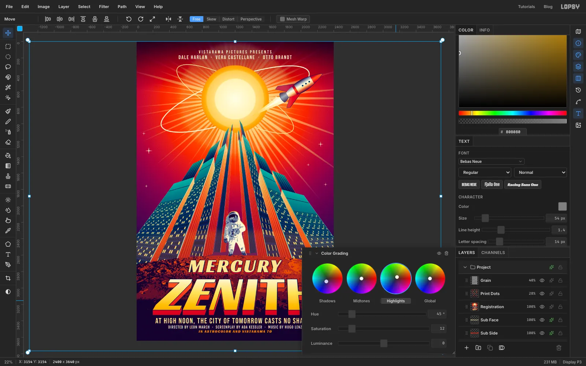

Click the **Project** group at the very top of the Layers panel, open its effects drawer and click **Add Adjustment → Color Grading**.

Click the **Shadows** tab, and set **Hue** to **250** and **Saturation** to **22**. Then click **Highlights**, and set **Hue** to **45** and **Saturation** to **12**.

Cool shadows and warm highlights are the old colour-print look, and because it runs over the whole picture, every ink now sits in the same light. Close the drawer, then choose **File → Quick Export PNG**.

Stand well back and check the things that always give a poster away: the title centred by its ink, every line of billing clear of everything else, and one thing in the picture that's cold.
