This tutorial builds a birthday card that looks like a 1950s magazine advert for the "home of tomorrow". **Model L** is a friendly household robot with one job: wheeling a lit birthday cake across an atomic-age kitchen. Everything is drawn in Lopsy from shapes, selections, patterns and type on a 1400 × 1960 px canvas. That's a 5 × 7 card at 280 dpi.

Mid-century advertising art has a recognisable recipe, and most of it maps directly onto Lopsy tools:

- **Flat colour with a dark keyline.** Every part of the robot is a Shape-tool rectangle or ellipse with a navy stroke. The outline does the drawing; the fill only adds colour.
- **Halftone instead of soft shading.** Old print couldn't do smooth gradients, so shadows were printed as dots. A gradient run through the **Halftone** filter gives you exactly that.
- **Starbursts, boomerangs and checkerboards.** Repeating motifs are perfect for **Define Pattern** and **Fill with Pattern**.
- **A slightly imperfect print.** A misregistered second colour behind the title and some paper grain make it feel printed rather than vector-clean.

Along the way you'll use:

- **Guides**, the **grid** and snapping
- the **Shape** tool (rectangles with corner radius, ellipses, fill and stroke)
- **Define Pattern**, **Fill with Pattern** with row stagger, and the **Perspective** transform
- selections: [[Cmd]]-clicking a thumbnail, [[Shift]] to add, [[Alt]] to subtract, **Shrink** and **Inverse**
- rotating and scaling pixels, live text and whole groups with the **Move** tool's handles
- **Sunburst**, **Halftone**, **Add Noise** and **Gaussian Blur**
- **Stroke**, **Drop Shadow** and **Outer Glow** effects, plus **Multiply** and **Overlay**
- **Copy**, **Paste**, **Merge Down**, **Duplicate Layer** and arrow-key nudges
- the **Text** tool with Google Fonts (Yellowtail, Righteous and Josefin Sans), and the **Levels** adjustment on the Project group

The palette:

- Paper `#F3E7CF`, cream `#FFF6E3`
- Wallpaper `#F6C3B0`, wallpaper stars `#E98C76`
- Robot teal `#3FA7A3`, chrome `#B9C7D4`, wheel `#7D8FA3`
- Mustard `#E8B23A`, coral `#E4572E`, deep coral `#B8401E`
- Navy ink `#1E2F44`
- Cake pink `#F28AA0`, flame `#FFD25A`, flame glow `#FF9E3D`
- Eyes `#A8F5EA`, eye glow `#7FF5E6`
- Sunburst rays `#F7D58A`

> **Tip:** Positions are given as `x, y` in document pixels. The status bar at the bottom left shows where your cursor is. Mac key names are used; on Windows and Linux use Ctrl for Cmd.

> **Tip:** The **Shape** tool draws onto the **active layer** and grows **from the centre out**. Press where you want the middle of the shape and drag to one corner. So "a rectangle from `510, 830` to `890, 1200`" means: press at its centre, `700, 1015`, and drag to `890, 1200`. Set the **Fill**, **Stroke**, **Width** and **Corner Radius** in the options bar before you drag. To draw without an outline, click the Stroke swatch and choose **Remove stroke**. The marquees are different: they go corner to corner.

> **Tip:** "Fill" means set the foreground colour in the Color panel's hex field, then choose **Edit → Fill**. Press [[Cmd+D]] to drop a selection before you draw a new one.

> **Tip:** Three keys finish things. [[Cmd+D]] commits a move, scale or rotation of pixels and drops the selection. [[Esc]] commits a transform on a text layer. [[Tab]] finishes typing text.

> **Tip:** The ✦ button on a layer's row opens its **effects drawer**. It holds the layer effects (Stroke, Drop Shadow, Outer Glow…) and the layer's **blend mode**. Opacity is set by clicking the percentage on the row.

> **Tip:** A new layer appears just above the active one. If the active row is a group, the new layer goes inside it. Each step says which row to click first.

## Set up the card and the scene panel

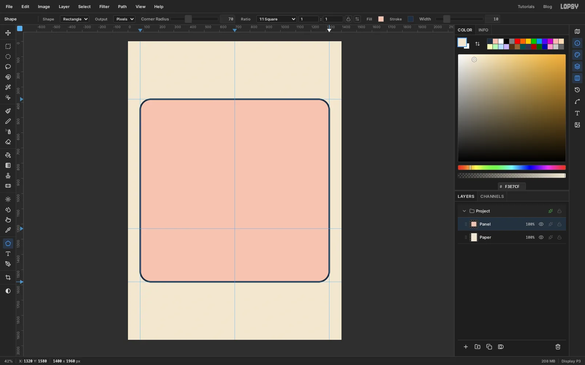

Create a new document `1400` × `1960` px with a white background. Rulers are on by default. Click the top ruler at x `80` and `1320` to drop the side margins, then [[Cmd]]-click it near the middle: [[Cmd]]-click snaps a guide to the nearest half, so it lands exactly on `700`. Click the left ruler at y `380` (top of the scene), `1230` (where wall meets floor) and `1580` (bottom of the scene).

1. Double-click `Background` and rename it `Paper`. Press [[Cmd+A]], fill with `#F3E7CF` and press [[Cmd+D]].
2. Rename `Layer 1` to `Panel`. Pick the **Shape** tool ([[U]]), set **Shape** to **Rectangle**, **Corner Radius** `70`, **Fill** `#F6C3B0`, **Stroke** `#1E2F44` and **Width** `10`.
3. Press on the centre guide at `700, 980` and drag to where the right and bottom guides cross, `1320, 1580`. The rounded rectangle snaps to the guides.

This panel is the "photo" in the advert. The space above it holds the title and the space below holds the nameplate and copy.

## Make a checkerboard tile

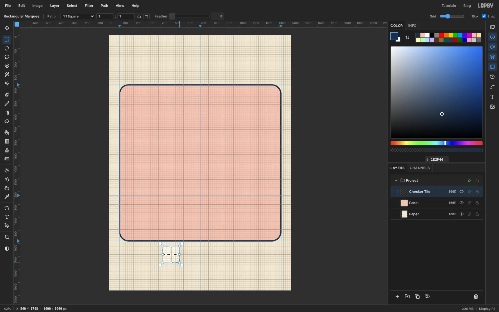

Turn on **View → Show Grid**. It shows 16 px cells and turns snapping on, which makes exact squares easy.

1. Click **Add Layer** and name it `Checker Tile`. Fill a 128 × 128 square anywhere in the empty paper below the panel with `#FFF6E3`.
2. With the **Rectangular Marquee** ([[M]]), drag a 64 × 64 square over the tile's top-left quarter. Hold [[Shift]] and drag another over the bottom-right quarter to add it.
3. Fill with `#1E2F44`, then press [[Cmd+D]].
4. Marquee the whole 128 × 128 tile and choose **Edit → Define Pattern**.
5. Press [[Cmd+D]] and click **Delete Layer**. The pattern is saved, so you don't need the tile any more.

## Fill the floor with the pattern

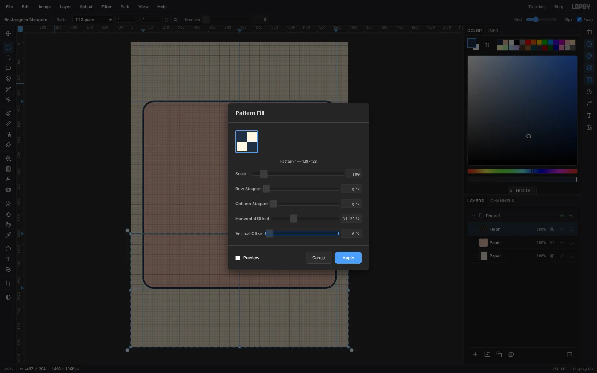

Click `Panel`, click **Add Layer** and name it `Floor`. Marquee from the left edge of the canvas, starting a couple of pixels above the horizon guide (`0, 1228`), to the bottom-right corner. Starting just above the guide means no sliver of wall shows between the floor and the baseboard later. Choose **Edit → Fill with Pattern…**, pick the checker pattern and set **Horizontal Offset** to `31.25` %. Click **Apply**.

The tiles start from the left edge of the canvas. The offset shifts them sideways so a seam between two tiles lands exactly on the centre guide. That matters in the next step, where the floor converges towards the centre.

## Put the floor in perspective

Press [[Cmd+D]], pick the **Move** tool ([[V]]) and click **Perspective** in the options bar. Handles appear around the floor. Drag the **bottom-left** corner handle a long way out to the left, almost 2000 px past the canvas edge, deep into the grey workspace. In Perspective mode the bottom-right corner mirrors it.

Pull it further than feels natural. A gentle drag gives you a floor that tilts. A big one makes the far rows tiny and the near rows tall, and that strong foreshortening is what reads as a floor stretching away.

## Trim the floor to the panel

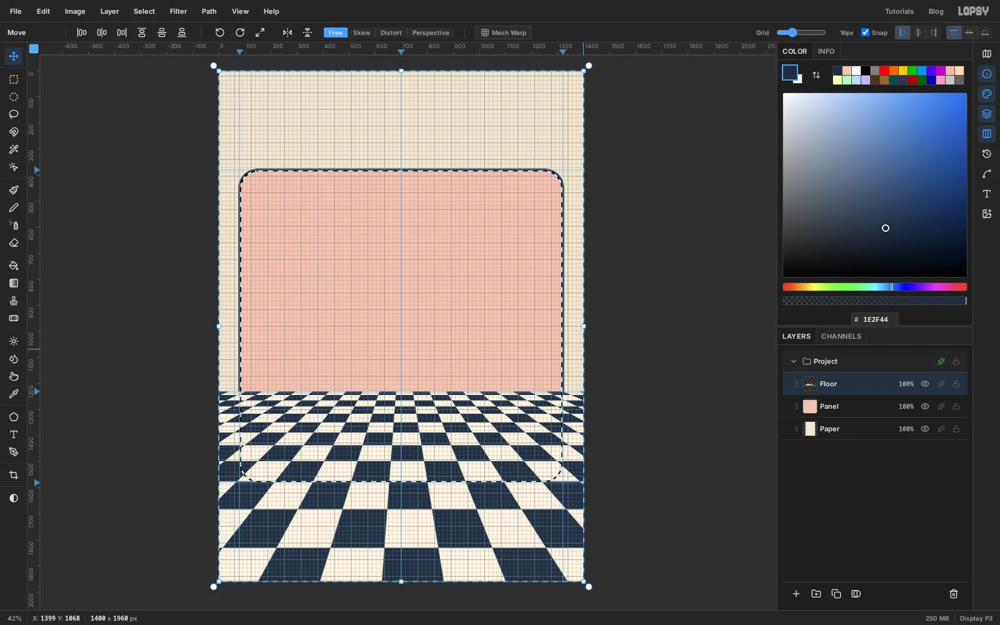

The floor now spills out over the paper. Clip it to the panel:

1. Press [[Cmd+D]] to commit the transform.
2. [[Cmd]]-click the `Panel` layer's thumbnail to select its pixels.
3. Choose **Select → Shrink…** and enter `9`, so the selection sits just inside the navy outline.
4. Click the `Floor` row, press [[Cmd+Shift+I]] to invert the selection, then press [[Delete]].

You'll use this same trick for the wallpaper and anything else that needs to stay inside the panel.

## Draw an atomic star tile

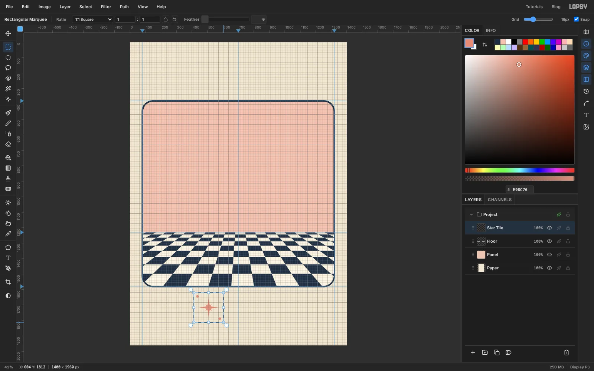

Atomic-age wallpaper is all four-point sparkles and little dots. Make one tile of it:

1. Click **Add Layer** and name it `Star Tile`. Set the foreground to `#E98C76`.
2. Pick a centre point in the empty paper below the panel. With the **Lasso** ([[L]]), click eight points around it: a tip 62 px straight up, a waist point 8 px up and 8 px right, a tip 62 px to the right, a waist point 8 px down and right, then the same again for the bottom and left tips, and close the shape. You get a slim four-point sparkle 124 px from tip to tip. Fill it.
3. On the same centre, lasso a smaller sparkle turned 45°: tips about 21 px out on each diagonal, waist points 9 px out straight up, down, left and right. Fill it too. The two merge into one eight-pointed atomic star.
4. With the **Elliptical Marquee**, add two dots: an 18 px dot about 70 px up and to the left of the star, and a 12 px dot about 70 px down and to the right. Fill both.
5. Marquee a 192 × 192 square with the star in the middle and choose **Edit → Define Pattern**. Then press [[Cmd+D]] and delete the `Star Tile` layer.

## Paper the wall

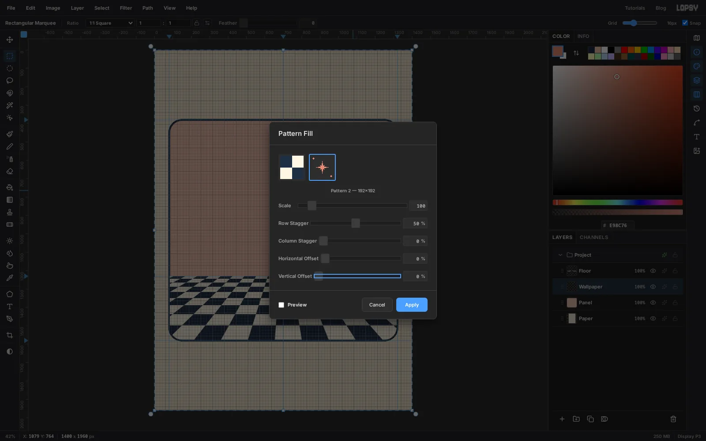

Click `Panel`, then **Add Layer**, and name it `Wallpaper`. Press [[Cmd+A]] and choose **Edit → Fill with Pattern…**. Pick the star pattern and set **Row Stagger** to `50` %, which shifts every second row by half a tile like a real wallpaper print. Apply it.

Clip it the same way as the floor: [[Cmd]]-click the `Panel` thumbnail, **Shrink** by `9`, click `Wallpaper`, [[Cmd+Shift+I]] and [[Delete]]. The floor covers the stars below the horizon, so you only see them on the wall. Turn the grid off with **View → Show Grid** now. Snapping to it would fight the shapes coming next.

## Add the sunburst spotlight

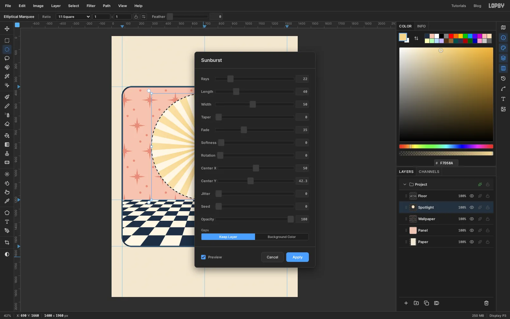

Ad illustrators loved putting the product in front of a burst of rays.

1. With `Wallpaper` active, click **Add Layer** and name it `Spotlight`.
2. With the **Elliptical Marquee**, hold [[Cmd]] to keep a circle and drag from `300, 430` to `1100, 1230`. That's an 800 px circle on the centre guide whose bottom just touches the horizon. Fill it with `#FFF6E3`.
3. Keep the selection, set the foreground to `#F7D58A` and choose **Filter → Sunburst…**. Set **Rays** `22`, **Length** `40`, **Width** `50`, **Taper** `0`, **Fade** `35` and **Softness** `0`. Set **Center X** `50` and **Center Y** `42.3` so the rays start from the middle of the circle (830 is 42.3% of 1960). Click **Apply**.
4. Press [[Cmd+D]] and open the layer's effects drawer. Turn on **Stroke**, **Width** `10`, colour `#E4572E`.

The rays stay inside the circle because the selection was active. The fade makes them dissolve towards the centre, so the robot's head will sit on a calm patch.

## Add a baseboard and group the room

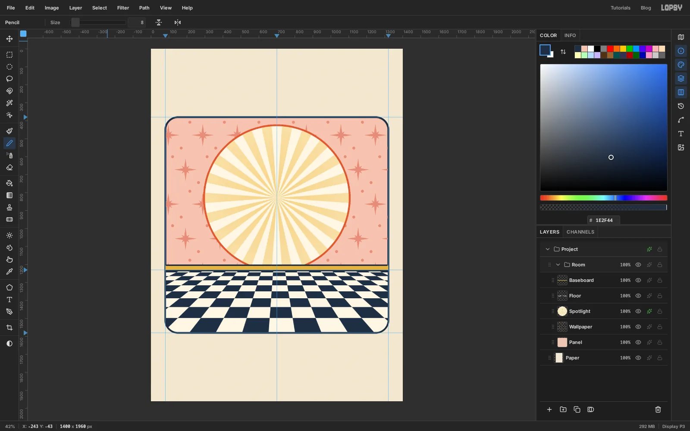

Click `Floor`, add a layer named `Baseboard` and marquee a 26 px strip that sits on the horizon guide, from the panel's inner left edge to its inner right edge (`89, 1206` to `1311, 1232`). Fill it with `#E8B23A`. Then pick the **Pencil** ([[N]]), **Size** `8`, colour `#1E2F44`. Click at the left end of the strip's top edge and [[Shift]]-click at the right end to draw a straight line. Do the same along the bottom edge.

Now tidy up: click `Baseboard`, [[Shift]]-click `Panel`, and choose **Layer → Group Layers**. Name the group `Room`.

## Build the robot's body

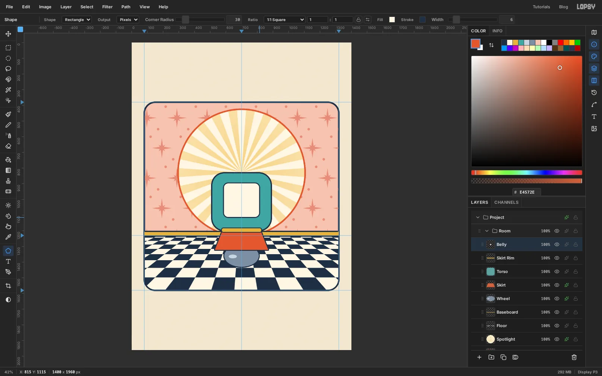

Click `Baseboard` so the robot's layers stack above it. For each part below, click **Add Layer**, name it, then draw it. The list runs bottom to top, so each new layer lands above the last.

- `Wheel`: **Ellipse**, fill `#7D8FA3`, no stroke, from `590, 1290` to `810, 1430`. On the same layer, draw a small `#C9D5E0` ellipse about 52 × 24 px in the upper left of the ball for a highlight. Then give the layer a **Stroke** effect, **Width** `6`, `#1E2F44`. Using an effect instead of the Shape tool's stroke means the highlight doesn't get its own outline.
- `Skirt`: with the **Lasso**, click a trapezoid from `590, 1170` to `810, 1170` across the top, flaring out to `870, 1322` and `530, 1322`. Fill with `#E4572E` and add the same navy Stroke effect.
- `Torso`: **Rectangle**, **Corner Radius** `80`, fill `#3FA7A3`, stroke `#1E2F44`, **Width** `8`, from `510, 830` to `890, 1200`.
- `Skirt Rim`: **Rectangle**, radius `12`, fill `#E8B23A`, stroke width `5`, from `572, 1182` to `828, 1210`. This little band ties the skirt to the body.
- `Belly`: **Rectangle**, radius `30`, fill `#FFF6E3`, stroke width `6`, from `585, 895` to `815, 1115`.

Use the same navy for every outline. A consistent keyline is what makes separate shapes read as one illustration.

## Give it a head

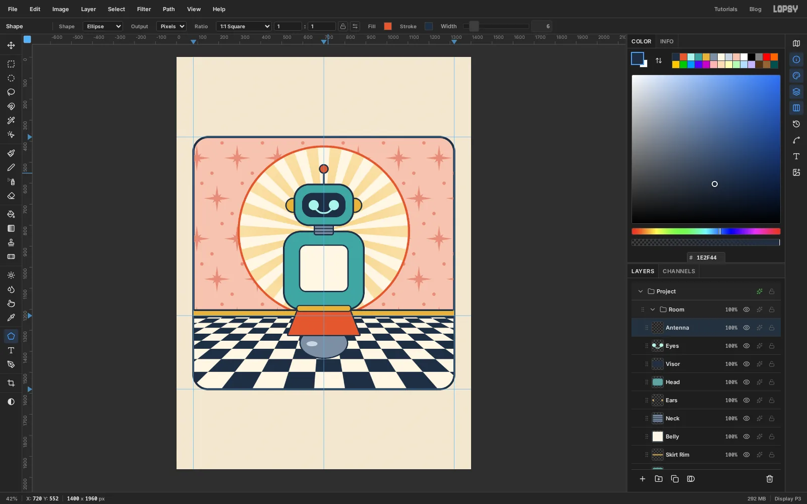

Keep adding layers upwards from `Belly`:

- `Neck`: rectangle, fill `#7D8FA3`, stroke width `6`, radius `8`, from `655, 780` to `745, 845`. With the **Pencil** at size `5`, draw three navy ribs across it with click and [[Shift]]-click.
- `Ears`: two `#E8B23A` circles, 66 px across, centred on `553, 705` and `847, 705`, with a navy stroke of `6`.
- `Head`: rectangle, radius `70`, fill `#3FA7A3`, stroke width `8`, from `560, 605` to `840, 800`. It covers the inner halves of the ears.
- `Visor`: rectangle, radius `48`, fill `#1E2F44` and **no stroke**, from `597, 645` to `803, 762`.
- `Eyes`: two `#A8F5EA` circles, 48 px across, at `652, 704` and `748, 704`. Then set the foreground to the same `#A8F5EA`, pick the **Brush** ([[B]]), **Size** `9`, **Hardness** `100`, and drag a small smile arc under them.
- `Antenna`: a navy pencil line (size `8`) straight up from the top of the head at `700, 606` to `700, 540`, topped with a 40 px `#E4572E` ball with a navy stroke.

## Make the arms from rotated segments

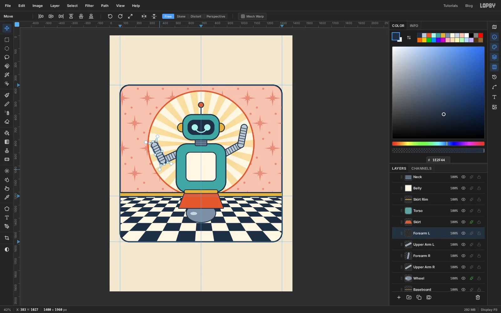

Each arm is two segments: a rounded pill with ribs, drawn level and then rotated into place. Click `Wheel` first, so the arms tuck **behind** the torso.

For each segment:

1. Click **Add Layer** and name it.
2. Draw a level **Rectangle** 48 px tall with **Corner Radius** `24`, fill `#B9C7D4`, navy stroke width `6`, using the length and centre from the table below.
3. With the **Pencil** at size `4`, add ribs across it every 20 px with click and [[Shift]]-click.
4. Marquee around the pill, switch to the **Move** tool and drag the round rotation handle just outside a corner until the pill reaches the angle in the table. Press [[Cmd+D]] to commit.

- `Upper Arm R`: 190 px long, centred on `942, 870`. Rotate about 29° anticlockwise, so it rises from the right shoulder to the elbow at `1005, 835`.
- `Forearm R`: 180 px long, centred on `1018, 770`. Rotate about 79° anticlockwise, so it stands almost upright from the elbow to the hand at `1030, 705`.
- `Upper Arm L`: 175 px long, centred on `462, 932`. Rotate about 26° anticlockwise, so it drops from the left shoulder to the elbow at `405, 960`.
- `Forearm L`: 182 px long, centred on `375, 900`. Rotate about 63° clockwise, so it rises from the elbow to the hand at `345, 840`.

Each pill is 48 px longer than the gap between its joints, so its rounded ends tuck under the joints you'll add next. It's fine to overshoot and drag back. The box shows the angle as you go.

## Add joints, dials and a claw

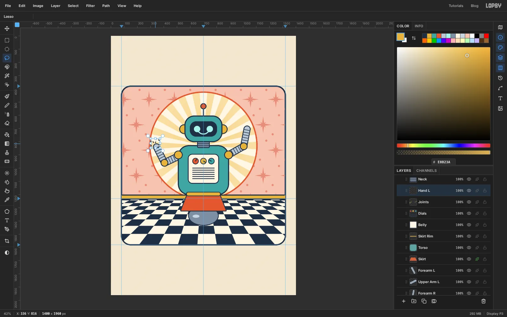

Click `Belly` and add these layers in order:

1. `Dials`: three 44 px circles in a row at y `947`, centred at x `640`, `700` and `760`, filled `#E4572E`, `#E8B23A` and `#3FA7A3` with a navy stroke of `5`. With the **Pencil** at size `5`, click each centre and [[Shift]]-click out at a different angle to draw the needles. Then draw six grille lines across the belly from y `1000` to `1080`, 16 px apart.
2. `Joints`: mustard circles with a navy stroke of `6`, 60 px across at the shoulders (`510, 900` and `890, 900`) and 52 px across at the elbows (`405, 960` and `1005, 835`). They hide the ends of the arm segments.
3. `Hand L`: the waving claw. With the **Elliptical Marquee**, drag a 72 px circle from `300, 776` to `372, 848`, just past the tip of the left forearm. Then pick the **Lasso**, hold [[Alt]], and click a narrow triangle with its point at the centre of the circle, opening up and to the left. [[Alt]] subtracts it from the circle, leaving a claw.

Fill the claw with `#E8B23A`, press [[Cmd+D]] and give `Hand L` a navy **Stroke** effect of `6`.

## Bake the cake

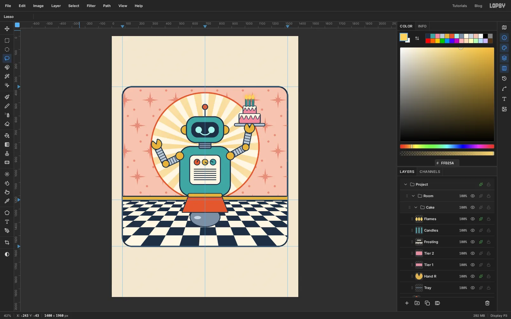

Click `Antenna` so the cake goes on top of the robot, and build it from the bottom up, one layer per part:

1. `Tray`: a rectangle, radius `10`, fill `#B9C7D4`, navy stroke `5`, from `920, 656` to `1150, 676`.
2. `Hand R`: a 72 px mustard claw (marquee from `998, 654` to `1070, 726`, just past the right forearm's tip) with the wedge cut out of the **top**, the same way as the left hand. The tray rests in the gap, so it looks gripped. Add the navy **Stroke** effect.
3. `Tier 1` and `Tier 2`: rectangles filled `#F28AA0` with a navy stroke of `6` and radius `10`: `955, 585` to `1115, 656`, then `985, 527` to `1085, 590`.
4. `Frosting`: with the **Lasso**, click a wavy band across the top of each tier, with four or five rounded drips hanging down. Fill with `#FFF6E3` and add a navy **Stroke** effect of `4`.
5. `Candles`: three 14 × 58 px teal rectangles standing on the top tier at x `1010`, `1035` and `1060`, with a navy stroke of `4`.
6. `Flames`: lasso a small teardrop over each candle and fill with `#FFD25A`. Add **Outer Glow**: **Size** `34`, **Opacity** `85`, colour `#FF9E3D`.

Select `Flames`, [[Shift]]-click `Tray`, and choose **Layer → Group Layers**. Name it `Cake`.

## Group the robot and lift it out

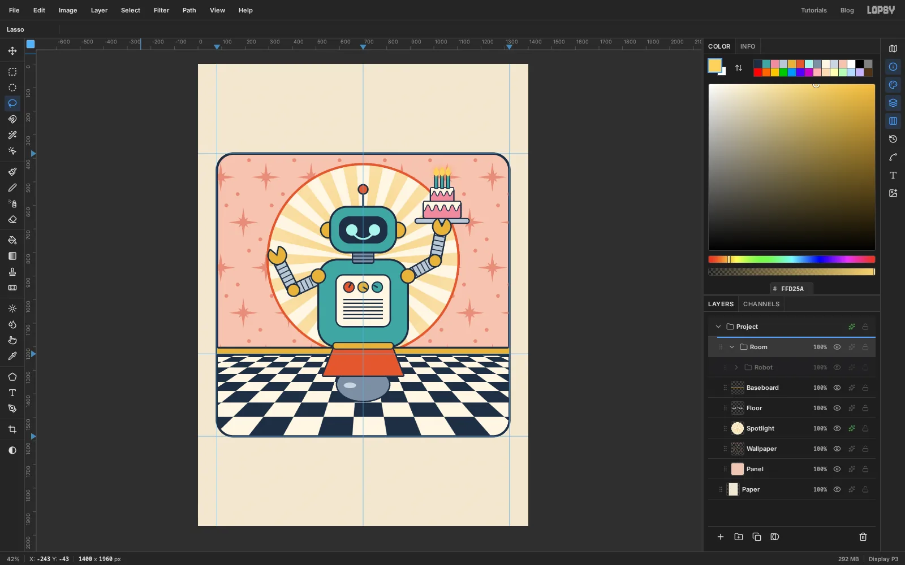

Collapse `Cake`. Click it, then [[Shift]]-click `Wheel` to select every robot layer, and choose **Layer → Group Layers**. Name the group `Robot`.

Because the robot was built inside `Room`, the new group is still inside it. Collapse `Robot`, grab its grip (⋮⋮) and drag it up until the blue line sits above `Room`. Let go, and `Robot` sits at the top level, above the whole room.

## Scale and place the whole robot

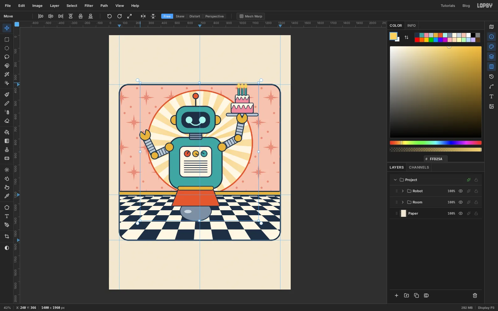

Click the `Robot` row, press [[Cmd+D]] to be sure nothing is selected and pick the **Move** tool. Handles appear around every layer in the group.

1. Hold [[Cmd]] (to keep the proportions) and drag the **top-left** corner handle up and out by about 60 px, so the robot grows by roughly 7%. Press [[Cmd+D]].
2. Drag the robot down about 40 px so the wheel sits properly on the floor, a little below the horizon.

If the scale or move goes wrong, [[Cmd+Z]] undoes the whole group transform in one step.

## Select the torso without the belly

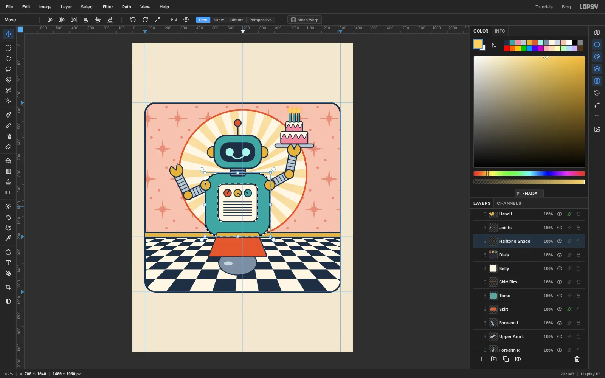

Mid-century print shading is a band of dots on the side away from the light. Start by selecting where the dots can go.

1. Expand `Robot`. [[Cmd]]-click the `Torso` thumbnail.
2. Hold [[Cmd+Alt]] and click the `Belly` thumbnail. That subtracts the belly, so the dots won't land on the cream panel.
3. Click `Dials` and **Add Layer**. Name it `Halftone Shade`.

## Shade it with halftone dots

Keep the selection. Pick the **Gradient** tool, set **Type** to **Linear** and click **Advanced…** in the options bar to open the **Gradient Editor**. The gradient uses its own stops, not the foreground colour. Click a stop to set its colour, and click under the bar to add one. Set white `#FFFFFF` at 0%, white again at 40% and navy `#1E2F44` at 100%, then click **Done**. [[Shift]]-drag across the torso from its left edge to its right edge. The gradient only lands inside the selection.

Now choose **Filter → Halftone…** and set **Dot Size** `14`, **Angle** `45` and **Softness** `0.5`. White prints no dots, so the left side stays clean and the dots grow towards the right. Press [[Cmd+D]].

Do the same for the head on a `Head Shade` layer above `Head`: [[Cmd]]-click the `Head` thumbnail, drag the same gradient across it and run the same Halftone.

Finally set both shade layers to **Multiply** in the effects drawer and drop their opacity to `40%`. Multiply keeps the navy dots and lets the white between them disappear.

## Ground it with a shadow and glows

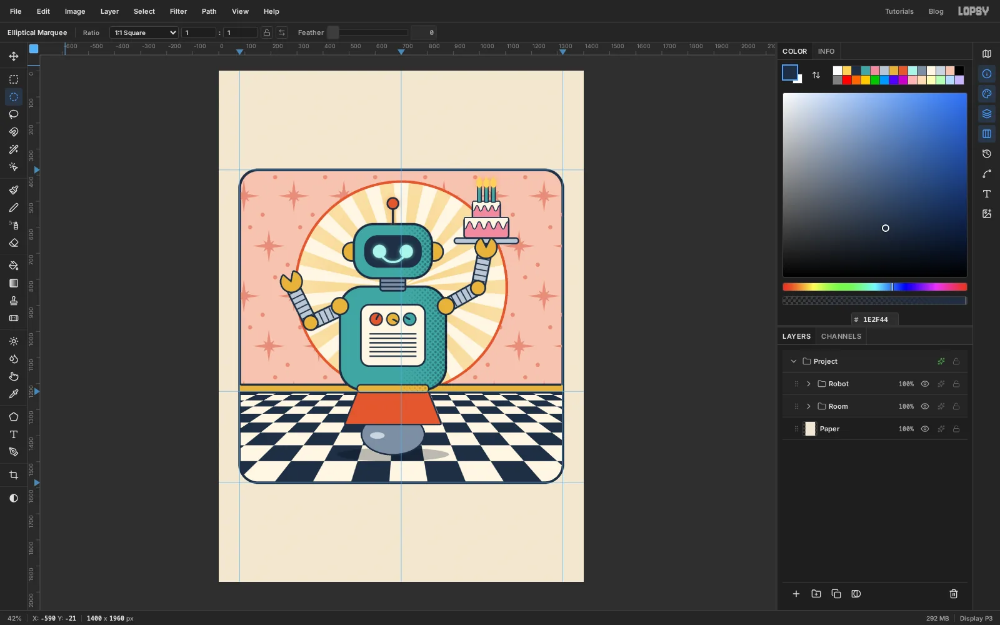

- Click `Wheel` and add a layer named `Floor Shadow`. Fill a flat ellipse about 430 × 52 px centred just below the ball with `#1E2F44`. Set it to **Multiply** at `30%`, then drag `Wheel` back above it so the ball sits on its shadow.
- On `Eyes`, add **Outer Glow**: **Size** `22`, **Opacity** `70`, colour `#7FF5E6`.
- On `Antenna`, add **Outer Glow**: **Size** `26`, **Opacity** `75`, colour `#FF9E3D`.

A flat, translucent shadow fits the style. A big blurry one would look like a photo pasted into a cartoon. Collapse `Robot` when you're done.

## Set the script title

Set the foreground to `#E4572E`. Pick the **Text** tool ([[T]]), choose **Yellowtail** in the font menu and set **Size** to `155` *before* you click. Click in the empty paper above the panel and type `Happy Birthday!`. Press [[Tab]] to commit.

1. Pick the **Move** tool and click **Align center horizontally**.
2. Add two effects: **Stroke**, **Width** `8`, colour `#F3E7CF` (the paper colour, so the letters seem cut out), and **Drop Shadow**, **Offset X** `9`, **Offset Y** `9`, **Blur** `0`, **Opacity** `100`, colour `#1E2F44`. A zero blur gives the hard "sign-painter" shadow.
3. Drag the rotation handle just outside the top-left corner of the text's box to tilt it about 4° up to the right. Press [[Esc]] to commit. The text stays editable.

Drag the title so the bottoms of the "p"s and "y"s clear the panel's top edge by about 40 px. Script descenders hang a long way down, so judge the gap by those, not by the baseline.

## Fake a misprinted second colour

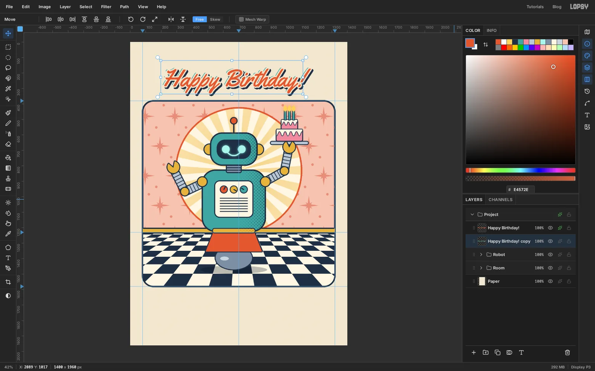

Cheap colour printing often landed the second ink a little out of line. It's an easy detail to fake:

1. With the title selected, choose **Layer → Duplicate Layer**.
2. Pick the **Text** tool, click the **Text color** swatch in the options bar and set it to `#3FA7A3`. With the layer selected (not being edited), that recolours the whole copy.
3. In the copy's effects drawer, untick **Stroke** and **Drop Shadow**.
4. Drag the original `Happy Birthday!` row back above the copy, so the copy is underneath.
5. Click the copy, pick the **Move** tool and nudge it with the arrow keys. Each press moves it 1 px: press [[←]] nine times and [[↑]] seven times.

A sliver of teal now peeks out along the top-left edges of every letter.

## Seat the nameplate

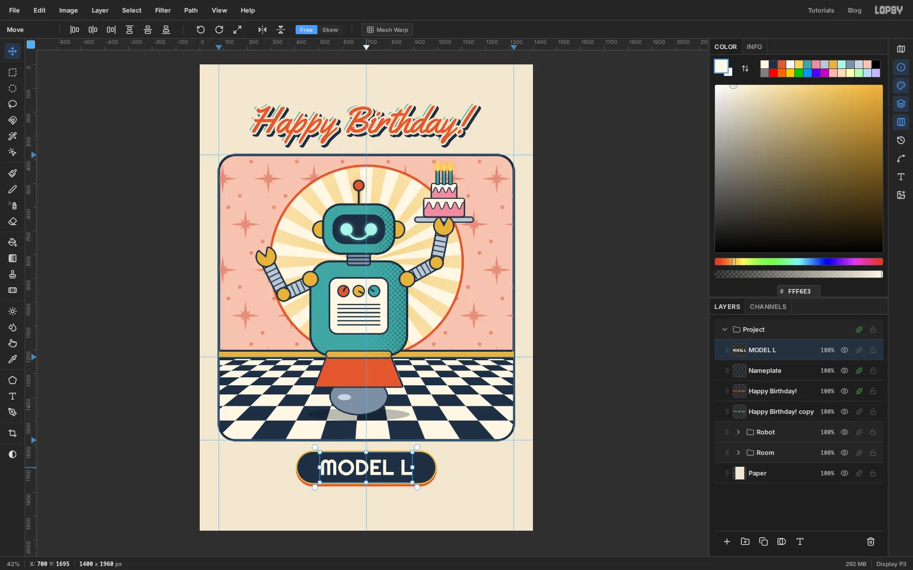

Click `Happy Birthday!` and add a layer named `Nameplate`. With the **Shape** tool, draw a rectangle with **Corner Radius** `65`, fill `#1E2F44` and no stroke, from `410, 1630` to `990, 1760` (press at `700, 1695`). Add a **Stroke** effect, **Width** `6`, `#E8B23A`, and a **Drop Shadow** with **Offset X** `0`, **Offset Y** `9`, **Blur** `0`, **Opacity** `100`, colour `#E4572E`. That gives it a printed coral underline.

Set the foreground to `#FFF6E3`, choose **Righteous** at **Size** `92` and click in empty paper below the pill to type `MODEL L`. Press [[Tab]], pick the **Move** tool and drag the text into the pill.

Centre capitals by their **ink**, not their box. Text boxes leave extra room for accents above and descenders below, so a box centred in the pill leaves the letters sitting high. Leave the same gap above the cap tops as below the baseline (about 33 px each) and the same space at both ends.

## Add the advertising copy

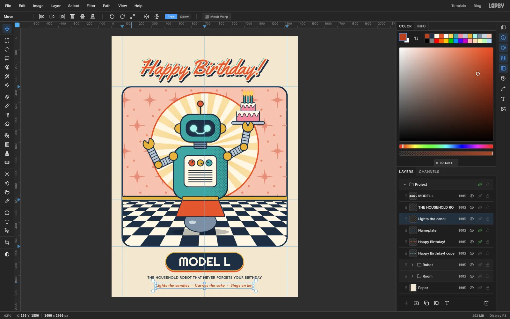

Click `Nameplate` first, so a text click in empty space starts a new layer instead of editing `MODEL L`.

1. Set the foreground to `#1E2F44`, choose **Josefin Sans**, **Size** `26`, and click below the pill. Type `THE HOUSEHOLD ROBOT THAT NEVER FORGETS YOUR BIRTHDAY` and press [[Tab]]. Set the weight to **SemiBold**.
2. Click `Nameplate` again. Set the foreground to `#B8401E`, keep Josefin Sans, **Size** `30`, and type `Lights the candles  ·  Carries the cake  ·  Sings on key` on a line about 55 px below the first. The middle dot is [[Option+Shift+9]] on a Mac (Alt+0183 on Windows), with two spaces either side. Set the style to **Italic**.
3. Centre each one with the **Move** tool's **Align center horizontally**.

The deep coral is darker than the title coral on purpose. The lighter one is hard to read at small sizes on cream.

## Stamp a "New!" seal

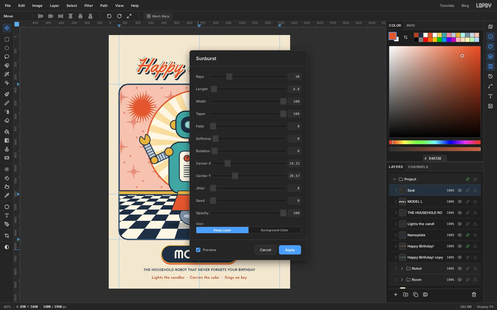

Click `MODEL L`, press [[Cmd+D]] and add a layer named `Seal`. Set the foreground to `#E4572E` and open **Filter → Sunburst…** again, this time to make a badge rather than rays:

- **Rays** `30`, **Length** `6.8`, **Width** `100`, **Taper** `100`, **Fade** `0`, **Softness** `0`
- **Center X** `18.21` and **Center Y** `28.57`, which puts the centre at `255, 560`

At full width and taper, the rays overlap into a spiky star. To give it a big solid middle for the text, marquee a circle from `161, 466` to `349, 654` with the **Elliptical Marquee** (188 px, on the same centre), fill it with `#E4572E` and press [[Cmd+D]]. Then add a **Drop Shadow**: **Offset** `5` / `5`, **Blur** `0`, **Opacity** `100`, `#1E2F44`.

Now the text. Set the foreground to `#FFF6E3` and pick the **Text** tool with **Righteous** and **Center** alignment.

1. Click the `Seal` row, set **Size** `56`, click in empty canvas away from the seal and type `NEW!`. Press [[Tab]].
2. Click the `Seal` row again, set **Size** `26`, click in empty canvas and type `BIRTHDAY`, press [[Enter]], and type `MODE`. Press [[Tab]].
3. With the **Move** tool, drag each one onto the seal so both are centred on x `255`, with `NEW!` above.

Clicking `Seal` first each time puts both text layers directly above it, in the order `NEW!`, `BIRTHDAY MODE`, `Seal`.

## Group and tilt the badge

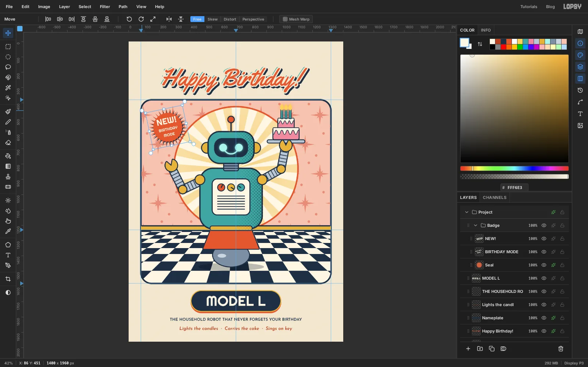

Click `NEW!`, [[Shift]]-click `Seal` to select all three, and choose **Layer → Group Layers**. Name it `Badge`.

Press [[Cmd+D]], pick the **Move** tool, and drag the rotation handle anticlockwise about 12°. All three layers turn together around the badge's centre, and both text layers stay editable. A tilted seal looks slapped on, which is exactly the energy an advert badge needs.

## Scatter cream sparkles

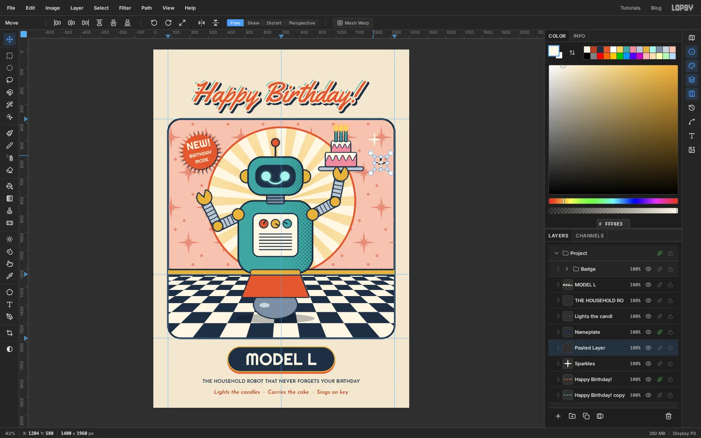

Click `Happy Birthday!` and add a layer named `Sparkles`. Lasso a slim four-point star about 88 px tall at `1210, 492`, in the top-right of the wall, and fill it with `#FFF6E3`. Then duplicate it with the clipboard:

1. Marquee around the sparkle and press [[Cmd+C]].
2. Press [[Cmd+V]]. The copy pastes in place on a new layer, selected and with the Move tool picked.
3. Drag it to a new spot, then [[Cmd]]-drag a corner handle inwards to shrink it.
4. Press [[Cmd+D]], then [[Cmd+E]] to merge it down into `Sparkles`.

Paste three copies at different sizes: two down the right side of the wall and one on the left at about `168, 870`. Uneven sizes and spacing look more natural than a neat row.

## Add paper grain

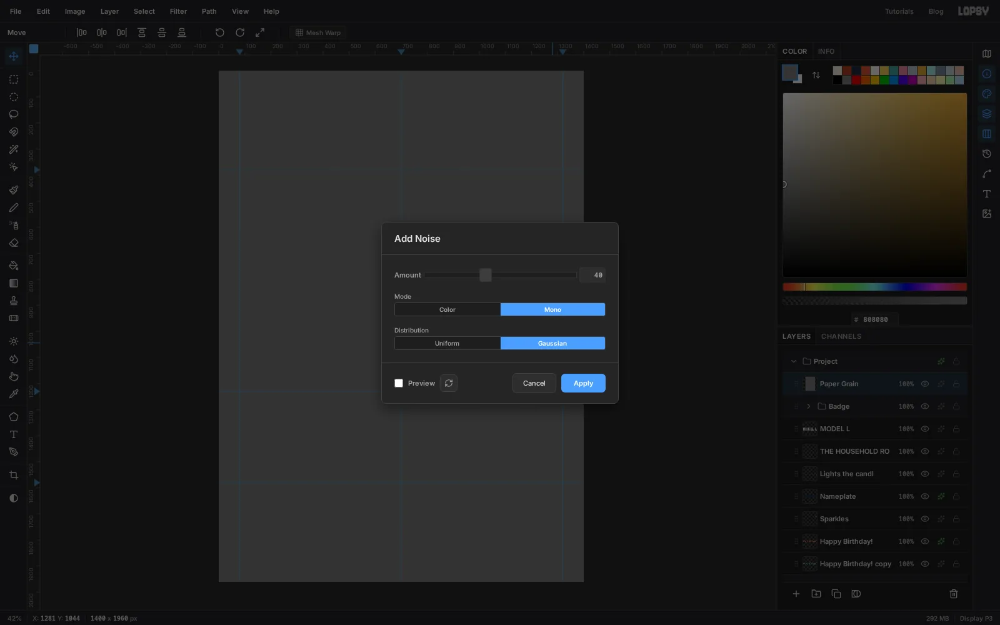

Collapse `Badge` and click `MODEL L` (just below it), then click **Add Layer** and name it `Paper Grain`. Drag it by its grip above `Badge`, so it's the top row inside Project and sits over everything. Press [[Cmd+A]] and fill the whole canvas with `#808080`, then press [[Cmd+D]].

1. Run **Filter → Add Noise…** with **Amount** `40`, **Mono** and **Gaussian**.
2. Run **Filter → Gaussian Blur…** with **Radius** `1` to soften the speckle into grain.
3. Set the layer to **Overlay** at `30%`.

Overlay ignores 50% grey, so only the speckle shows, lightening and darkening the colours beneath. It's subtle at fit-to-screen zoom and shows up when the card is printed or viewed full size.

## Fade the ink with Levels

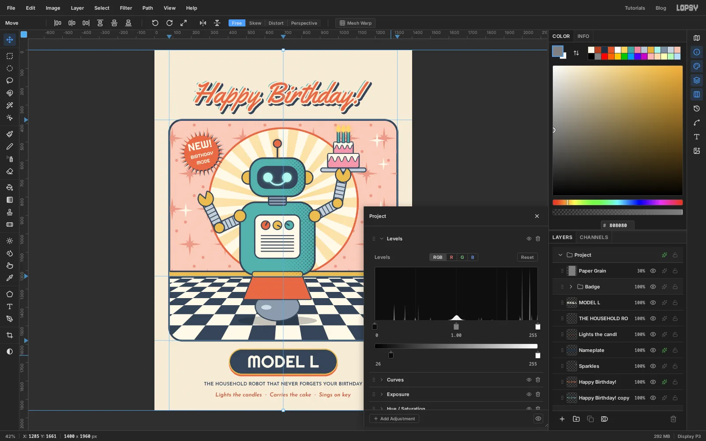

Pure navy looks too crisp for old printing, where the darkest ink never quite hit black. Choose **Layer → Adjustment Layer…**. Lopsy applies adjustments to the Project group, and the panel opens beside the canvas.

Expand **Levels** and drag the lower **output** black slider from `0` to about `26`. Every dark lifts slightly, as if the ink had faded on cream stock.

Close the panel, save with **File → Save Project**, and export with **File → Quick Export PNG**.
