The drive-in posters of the 1950s promised far more than the films delivered:
impossible planets, chrome rockets, a towering hero and a title that leapt off
the wall. The look is often called *raygun Gothic*, and it borrows the
sunbursts and saucer towers of Googie architecture. This tutorial uses all of
that for a made-up film, **Rocket Zoo**, in which the animals take over the
spaceship and the people end up in the cages.

It's a 1500 × 2250 px one-sheet. It's a photomontage: one real zebra photo,
graded to look painted, sitting inside drawn shapes and hand-set type.

The photo is [Hartmann's Mountain Zebra](https://commons.wikimedia.org/wiki/File:Hartmanns_Mountain_Zebra_Image_001.jpg)
by Trisha M. Shears (public domain) on Wikimedia Commons. Download the original
1056 × 1220 version. A different zebra photo will work if the head faces you,
but you'll have to adjust the positions. The names on the poster are invented.

Along the way you'll use:

- the **Gradient** tool's Advanced editor with typed colors, and **Sunburst** for rays, stars and a badge
- **Add Noise** and **Threshold** for stars, then **Threshold** again to turn a photo into stripes
- **Clouds**, **Motion Blur** and **Liquify** for a banded planet
- **groups**, including scaling, rotating and moving a whole group with the **Move** tool
- the **Lasso**, **Feather**, **Grow**, **Shrink** and adding or subtracting selections
- a group **Gradient Map**, **Oil Paint** and **Multiply** layers to grade the photo
- **Perspective**, a doubled-up 3D edge, **Stroke**, **Drop Shadow** and **Outer Glow**
- **Text** in Bowlby One, Yellowtail, Anton and Bebas Neue, including rotating live text
- **Halftone** and a grain layer to finish

The palette:

- Night sky `#0A1230` → `#103A63` → `#17807F`, horizon `#E8C27A` → `#F2784B`
- Cream `#FFF4D8`, bright yellow `#FFD84F`, title yellow `#FFF6B8`, title orange `#F7913A`
- Coral `#F2593A`, tomato `#D9412F`, wine `#5E1433`
- Helmet teal `#3DB8B0` → `#17707E` → `#0C2A4C`, hoses `#8FE3DA`
- Skyline `#1E5A74`, near skyline `#0B1636`

A few habits save trouble all the way through:

- **Exact shapes.** With a marquee tool, a single click (no drag) opens a small dialog where you type From X/Y and To X/Y. Use it wherever this tutorial gives numbers, and click somewhere on the canvas to open it. The values can run past the canvas edge.
- **Gradient colors.** With the Gradient tool active, click **Advanced…** in the options bar. Drag the two end stops to the ends of the bar, click the bar to add a stop, and type each color into the **Hex** field. Remove leftover stops with the delete button. Stops stay the way you left them, so check the list each time.
- **Committing transforms.** The Move tool's handles only work with the Move tool active ([[V]]), so press it after you draw a marquee. Pressing [[Cmd+D]] commits a scale or rotation and deselects. Enter doesn't commit. Commit before you drag the piece somewhere else.
- **Where new layers land.** A new layer goes just above the active one. With an expanded group active it goes inside the group, and with a collapsed group active it goes above it as a sibling. So collapse a finished group with its arrow before adding the next one.
- **Foreground and blending.** Each step names the foreground color it needs, so set it in the Color panel first. Blend mode and layer effects are both in the layer's **✦** drawer. Close the drawer when you're done, or it catches clicks. Opacity is the percentage on the layer row.

## Lay down the sky gradient

Choose **File → New** and create a 1500 × 2250 px document. Rename the empty layer **Sky**.

Pick the **Gradient** tool, leave the type on Linear, and open **Advanced…**. Set six stops: `#0A1230` at the far left, `#103A63` about a third of the way along, `#17807F` at the halfway mark, `#E8C27A` at 60%, `#F2784B` at 66%, and `#2A1538` at the far right.

Drag from the very top of the canvas straight down to the very bottom. The hot band near the two-thirds line becomes the horizon.

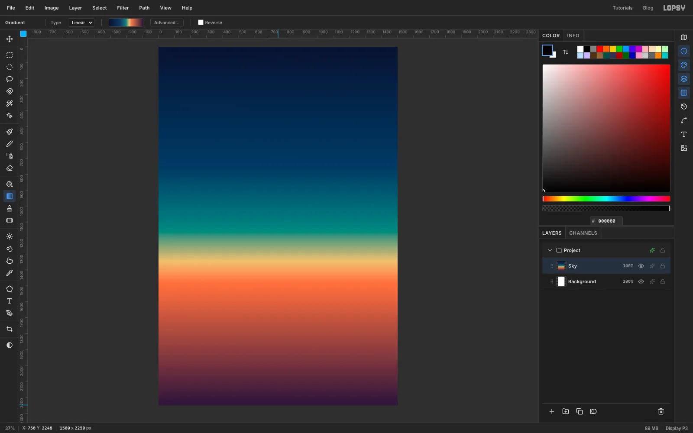

## Add guides and Googie rays

Click the top ruler at 80, 750 and 1420 to drop three vertical guides, and click the left ruler at 80, 1500 and 2170 for three horizontal ones. They mark the margins, the center line and the horizon.

Click **Add Layer** and name it **Rays**. Set the foreground to `#FFF1C9`, then choose **Filter → Sunburst**. Use Rays 28, Length 120, Width 50, Fade 40, Center X 52 and Center Y 36.4 and click Apply. That center is where the helmet will go.

Set the layer to **Soft Light** and its opacity to 26%.

## Scatter stars and fade them out

Add a layer named **Stars**, set the foreground to `#808080`, and choose **Edit → Fill** to make it solid grey. Run **Filter → Add Noise** with Amount 100 and the **Mono** button on, then **Filter → Threshold** with Level 177. Only the few brightest specks survive as white. Set the layer to **Screen** so the black drops out.

Stars shouldn't reach the horizon. Marquee a box from (-40, 980) to (1540, 2290), choose **Select → Feather…** with 120, and press [[Delete]]. Then press [[Cmd+D]].

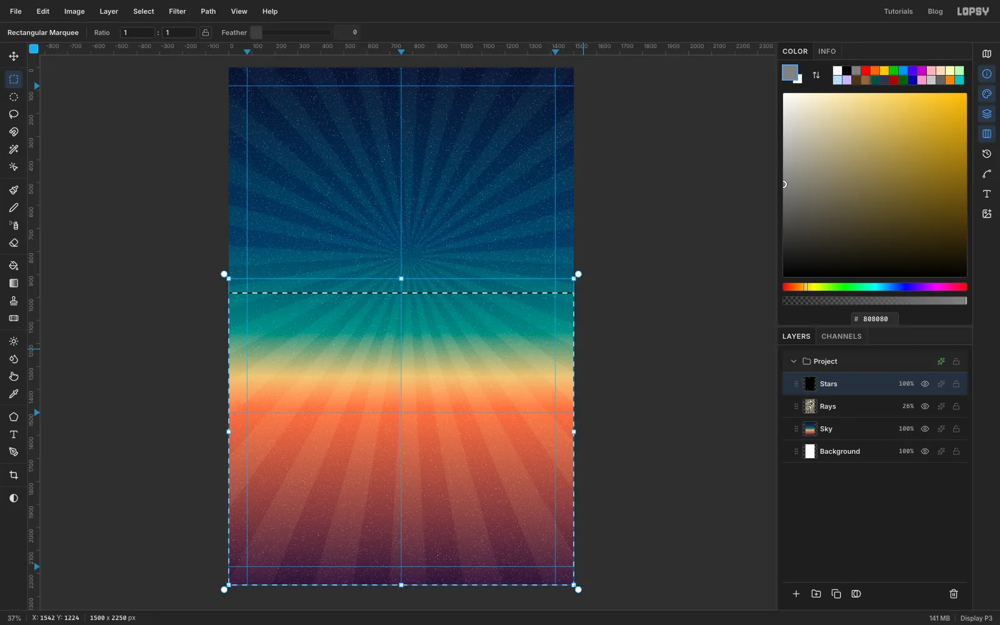

## Draw a spiky atomic star

Add a layer named **Big stars** and set the foreground to `#FFF6DC`. Run **Sunburst** again with Rays 8, Length 5, Width 22, Taper 100, Center X 50 and Center Y 6. Taper 100 turns each ray into a spike.

That's the smallest star Sunburst will draw, and it's too big. Marquee around it from (620, 20) to (880, 260), press [[V]], hold [[Cmd]] and drag the bottom-right corner handle in until the box is about half the size. Press [[Cmd+D]].

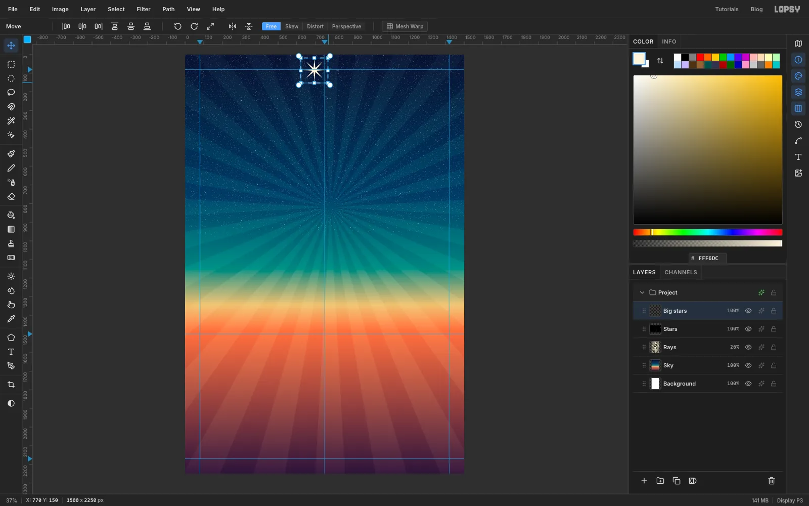

## Paint the planet's bands

Click **New Group** and name it **Saturn**, then add a layer inside it named **Planet**.

Marquee a box from (0, 120) to (720, 920). Set up a Linear gradient with eight stops, spaced evenly, for the bands: `#F7A35C`, `#F2593A`, `#FBD08A`, `#D9412F`, `#F9B25F`, `#B32E3A`, `#F7A35C`, `#7C1F3E`. Drag from near the box's top left down to near its bottom right, at a slight angle, so the bands tilt.

Keep the selection. Add a layer named **Storms**, run **Filter → Clouds** at Scale 16, then **Filter → Motion Blur** with Angle 0 and Distance 240. Set it to **Soft Light**. The long streaks cut across the tilted bands and break up their edges.

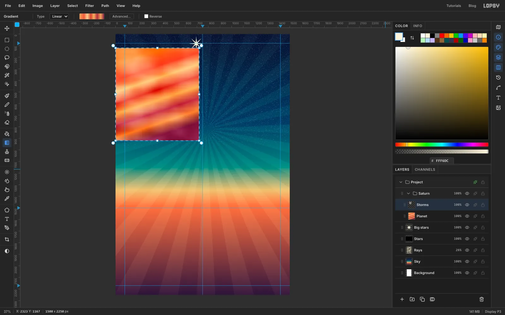

## Cut the bands into a disc

Press [[Cmd+D]], click the **Storms** row and choose **Layer → Merge Down**.

With the **Elliptical Marquee**, make a circle from (-30, 220) to (570, 820). Choose **Select → Inverse**, press [[Delete]], then [[Cmd+D]]. The planet runs slightly off the left edge, which gives the poster more scale than a whole disc would.

## Bulge the planet into a ball

The bands are still flat. Choose **Filter → Liquify**, set Mode to **Bloat**, Brush Size to 500 and Pressure to 40, and click once in the middle of the disc. The bands curve around the middle as if wrapped on a sphere. Click **Apply**.

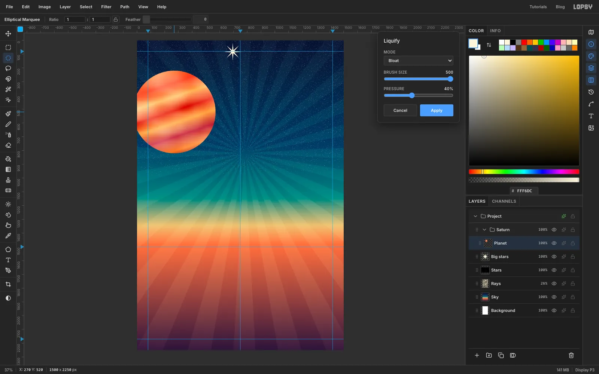

## Shade the night side

[[Cmd]]-click the **Planet** thumbnail to select its shape. Add a layer named **Planet shade**.

Set the Gradient tool to **Radial** with stops `#FFFFFF` at the left, `#FFF0E0` at 50%, `#8A3D6A` at 80% and `#160F3A` at the right. Drag from the upper right of the disc, a little in from its edge, out past its lower-left edge. Set the layer to **Multiply** and press [[Cmd+D]].

Multiply ignores the white, so the lit side stays clean and the far side falls into plum.

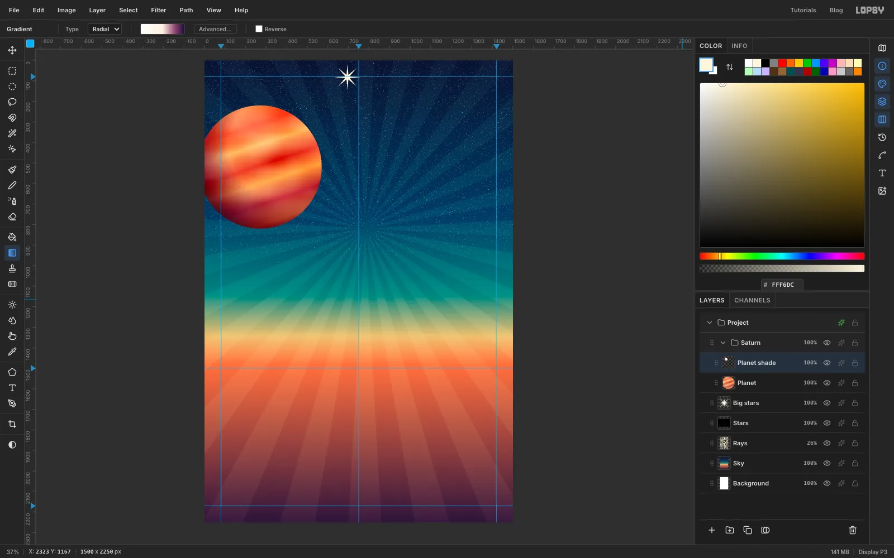

## Build the ring from flat ellipses

Add a layer named **Ring** above Planet shade. Build it in the empty sky, where it can't run off the canvas. Using the marquee dialog each time, and pressing [[Cmd+D]] after each one:

- Ellipse (160, 1058) to (1340, 1342): set the foreground to `#F7DDA6` and choose **Edit → Fill**
- Ellipse (220, 1073) to (1280, 1327): fill `#E0955F`
- Ellipse (268, 1084) to (1232, 1316): press [[Delete]]
- Ellipse (278, 1087) to (1222, 1313): fill `#FCE9BE`
- Ellipse (320, 1097) to (1180, 1303): fill `#C96F4A`
- Ellipse (365, 1108) to (1135, 1292): press [[Delete]]

The thin gap between the third and fourth ellipses is the ring's dark division.

## Tilt the ring and hang it on the planet

Marquee around the whole ring, from (150, 1050) to (1350, 1350), and press [[V]]. Drag the round rotation handle just outside a corner to turn the ring 20° counterclockwise, so its right end rises and it matches the planet's tilt. Press [[Cmd+D]].

Now drag the ring up and to the left until its center sits on the planet's center. It hangs off the left edge, and that's fine.

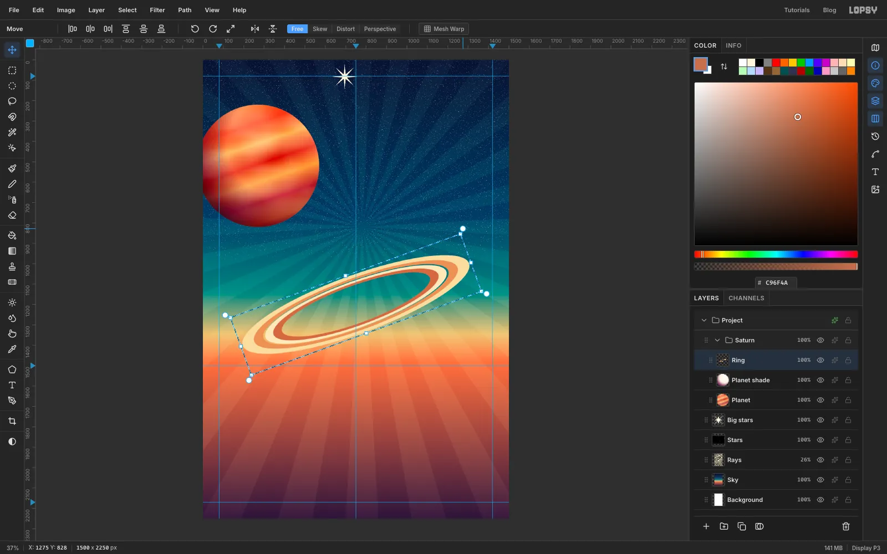

## Tuck the back of the ring behind the planet

The ring needs to pass behind the planet at the top. With **Ring** still active, [[Cmd]]-click the **Planet** thumbnail. Pick the **Lasso**, hold [[Alt]] and draw around the lower half of the planet, following the ring's slope along the top of your loop. That subtracts it and leaves the planet's upper half selected.

Press [[Delete]], then [[Cmd+D]]. The ring now passes in front of the planet at the bottom and behind it at the top.

## Nudge the whole planet by moving its group

Click the **Saturn** group row, press [[V]], and drag anywhere on the canvas to move the planet and ring down about 35 px together. This leaves room for the tagline above it.

Press [[Cmd+Z]] and then [[Cmd+Shift+Z]] to check that the group steps back and forward cleanly. You'll lean on that when you try out placements.

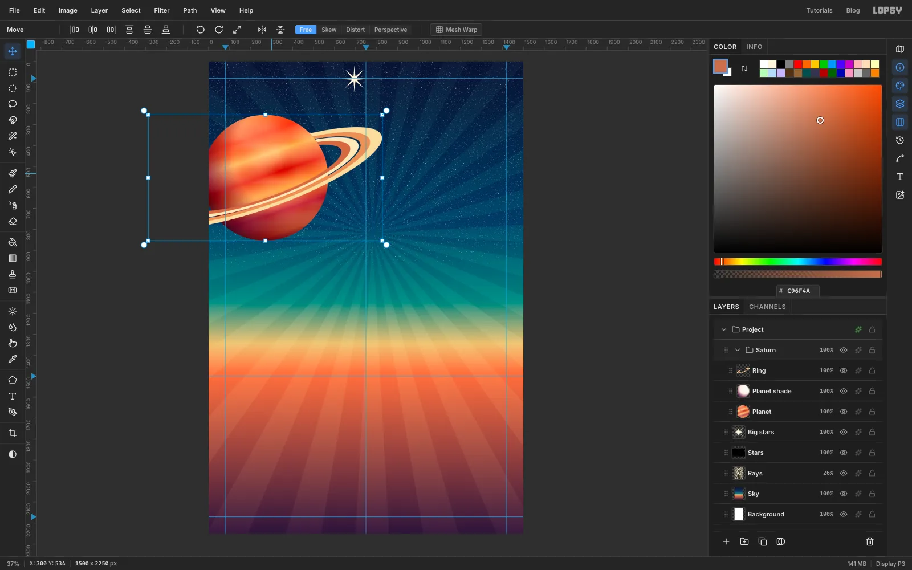

## Rough in the flame and fins

Collapse **Saturn** with its arrow, click its row, then click **New Group** and name it **Rocket**. Draw the rocket big and upright in the middle of the sky. You'll shrink it later.

Add a layer named **Flame** and use the Lasso to draw a long teardrop pointing down, about 170 px wide and 450 tall, from roughly (750, 1340) to (750, 1790). Make a Linear gradient with `#FFFBE0`, `#FFD84F` at 35%, `#F2593A` at 70% and `#B32E3A`, and drag it from the top of the flame to the tip. Press [[Cmd+D]], run **Filter → Gaussian Blur** at Radius 8, and add an **Outer Glow** in the ✦ drawer with Size 46 and Opacity 70.

Add a layer named **Back fins** and lasso two swept-back fins either side of x = 750, starting around y = 1170 and reaching out and down to about y = 1480. Fill the left one `#B32E3A` and the right one `#7C1F3E`, so one side reads as shaded.

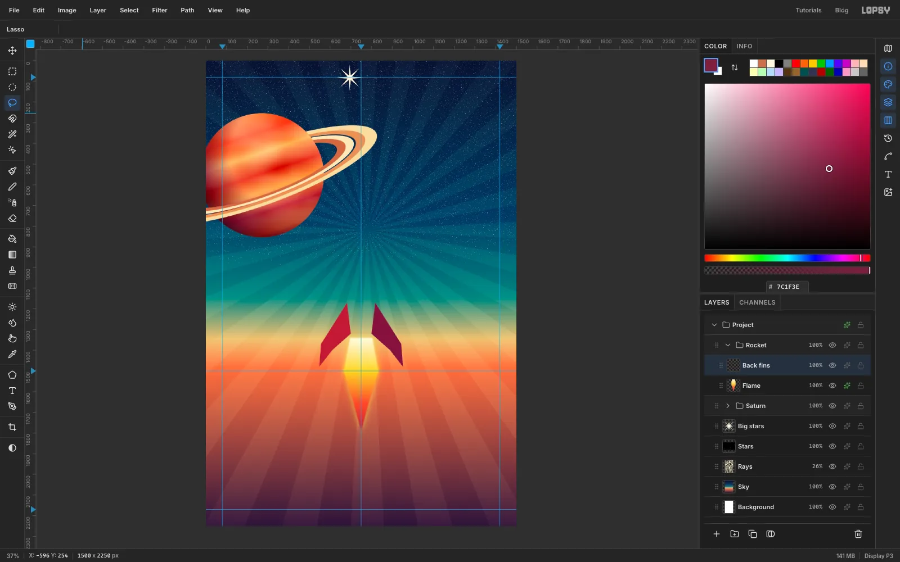

## Turn a tall ellipse into a chrome hull

Add a layer named **Hull**. Marquee an ellipse from (668, 840) to (832, 1360). Set a Linear gradient with these eight stops, spaced as you go across a polished cylinder: `#0F2340`, `#7E9BB0` at 14%, `#FFFFFF` at 30%, `#C5D8DF` at 45%, `#4E6C80` at 62%, `#10294A` at 76%, `#E88F5C` at 90%, `#FFD3A8`. Drag straight across the ellipse from left to right. The warm stops at the end are the glow reflected from the horizon. Press [[Cmd+D]].

Add a layer named **Nose**. [[Cmd]]-click the **Hull** thumbnail, then with the rectangular marquee hold [[Shift]]+[[Alt]] and drag a box over the top of the hull down to y = 1010. That keeps only the overlap. Fill it with a red gradient going across: `#4A0C20`, `#E2452F` at 20%, `#FFD2B0` at 33%, `#F2593A` at 50%, `#6E1630` at 80%, `#F2784B`. Do the same for the bottom of the hull, from y = 1250 down, on the same layer. Then lasso a thin front fin down the middle, from (750, 1190) to about y = 1500, and fill it `#F2593A`.

Add a layer named **Porthole**, marquee a circle from (712, 1020) to (788, 1096), and drag a Radial gradient from `#6FD6D0` to `#0F2F4F` across it, starting at the upper left. Press [[Cmd+D]] and add a **Stroke** of Width 9 in `#FFE9B8`.

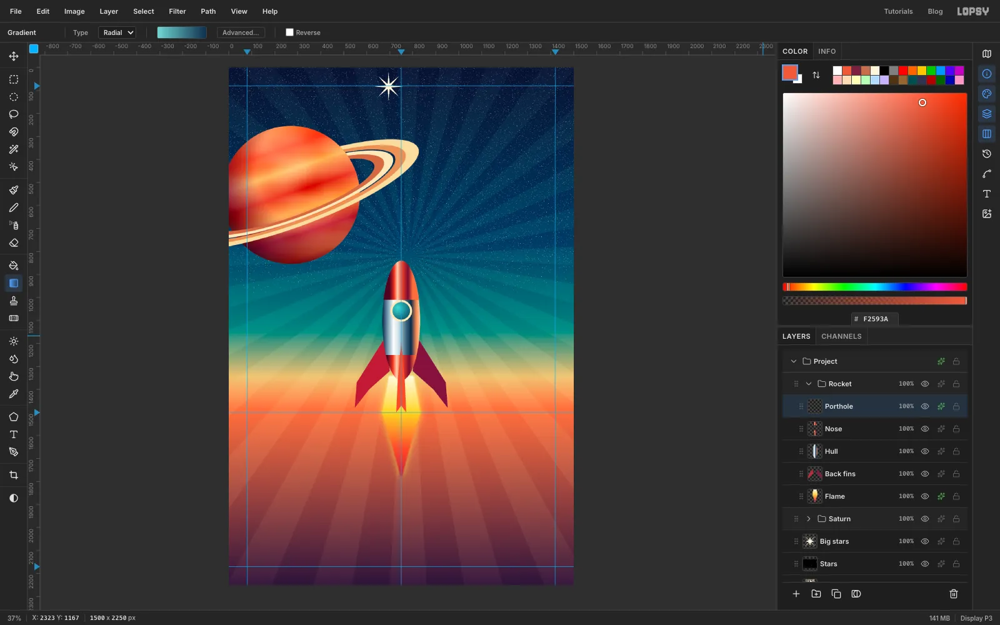

## Scale, rotate and fly the rocket as a group

Click the **Rocket** group row and press [[V]]. A group shows handles around everything inside it, with no selection needed.

Hold [[Cmd]] and drag the bottom-right corner up and left until the rocket is about half its size, then press [[Cmd+D]]. Click the group row again and drag a rotation handle 30° clockwise, so the nose points up and to the right. Press [[Cmd+D]], click the row once more and drag the rocket to the top-right corner, leaving a little space above its nose.

Press [[Cmd+Z]] three times to watch the rocket go back to where it started, then [[Cmd+Shift+Z]] three times to bring it back.

## Paint the smoke trail

Collapse **Rocket**, click the **Saturn** row (the collapsed group below it), and add a layer named **Trail**, so the smoke sits under the rocket.

Pick the **Brush** and open its presets panel from the options bar. Set Hardness 80 and Spacing 42. On the Dynamics tab set Size Jitter 60 and Scatter 30. Close the panel so it doesn't cover the canvas. Spaced-out dabs with varied sizes look like the billowing clouds a poster artist would paint.

The trail runs from the flame down the right side of the poster to the horizon, bowing out to the right, in three strokes that get wider. Set the foreground to `#8FA9B4` and paint it at Size 62, then Size 96, then Size 140. Set the foreground to `#FFF4D6` and paint the same three strokes again, about 15 px up and to the left, so the blue-grey is left showing as the shadow.

Then set the brush back to Hardness 100, Spacing 10, Size Jitter 0 and Scatter 0.

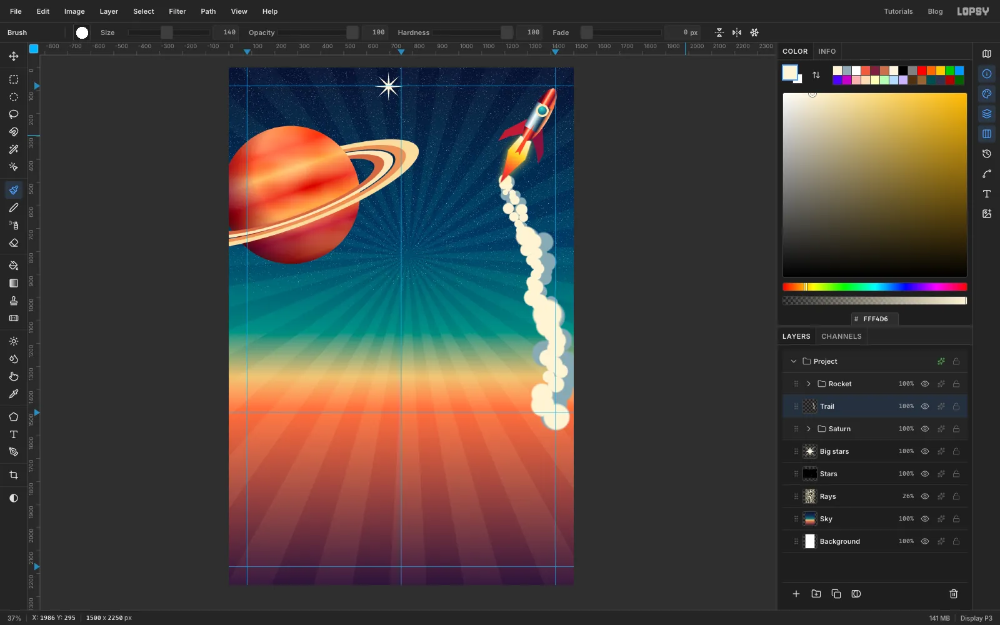

## Silhouette a far skyline

Click the collapsed **Rocket** row, click **New Group** and name it **City**, then add a layer named **Skyline far**. Set the foreground to `#1E5A74`. Everything on this layer can run down past y = 1600, since the ground will cover it.

- **Domes:** fill four circles sitting on the horizon, two at the left and two at the right, between 60 and 96 px in radius
- **Blocks:** fill two tall rectangles, at about x = 150 and x = 1190
- **Wedges:** lasso two boomerang-roofed buildings, at about x = 340 and x = 1020, with their roofs sloping in opposite directions
- **Saucer tower:** fill a thin rectangle at x = 296 from y = 1290 down, a flat ellipse across its top (78 × 22 px radius), and a small one above that. Then pick the **Pencil** at Size 6, click above the small ellipse and [[Shift]]-click higher up for the mast

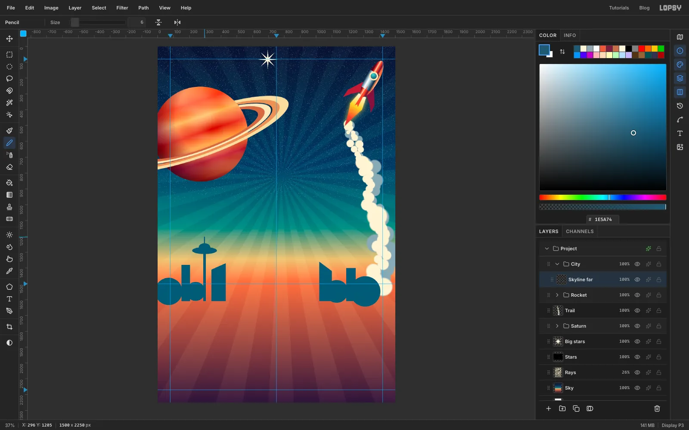

## Curve the ground and build the cage

Add a layer named **Ground**. Marquee one enormous ellipse from (-1400, 1528) to (2900, 4100). Only its top shows, and that curve makes the ground look like a small planet. Drag a Linear gradient from `#16294C` through `#0B1636` at 40% to `#060A1C`, from the horizon to the bottom edge. Press [[Cmd+D]].

Add a layer named **Cage glass**. Marquee an ellipse from (-30, 1370) to (330, 1730), drag a Linear gradient from `#BFF3E6` to `#2B8C96` down its upper half, and press [[Cmd+D]]. Marquee a box from (-40, 1590) to (340, 1800) and press [[Delete]] to flatten the bottom. Press [[Cmd+D]] and set the opacity to 45%.

Add a layer named **Cage bars** and set the foreground to `#0B1636`. For each of these widths, marquee an ellipse from y = 1370 to y = 1730 centered on x = 150, choose **Edit → Fill**, then **Select → Shrink…** by 7, press [[Delete]] and [[Cmd+D]]: half-widths 180, 118 and 56. Delete the same bottom box again.

For the crossbars, marquee the dome ellipse from (-30, 1370) to (330, 1730) so the lines stay inside it. Pick the **Pencil** at Size 7 and draw horizontal lines at y = 1420, 1480, 1540 and 1584, each by clicking at the left and [[Shift]]-clicking at the right. Press [[Cmd+D]].

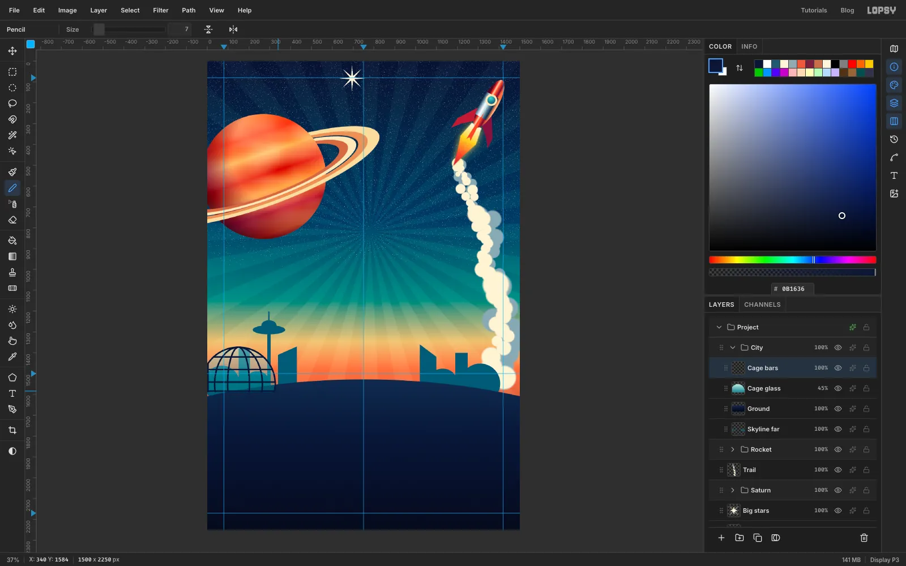

## Draw the launch gantry

Add a layer named **Gantry**. With the **Pencil** at Size 8 and the same dark foreground, click at (1376, 1270) and [[Shift]]-click at (1376, 1606) for one leg, then do the same at x = 1456 for the other.

At Size 5, add a rung and an X of two diagonal lines every 56 px on the way down, using the same click and [[Shift]]-click. Its feet go below the ground's edge, so it stands on the ground.

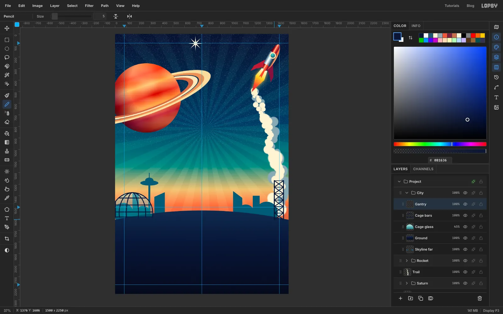

## Start the helmet and drop in the photo

Collapse **City**, click its row, click **New Group** and name it **Suit**. Add a layer named **Glass back**. Marquee a circle from (250, 300) to (1250, 1300) and drag a Radial gradient with `#3DB8B0`, `#17707E` at 55% and `#0C2A4C` from just right of the circle's center to below its bottom edge. Press [[Cmd+D]].

Click **New Group** and name it **Zebra**. It lands inside Suit, above Glass back. Drag the zebra photo from your desktop onto the canvas. It lands at the top left at full size. Rename the new layer **Photo**.

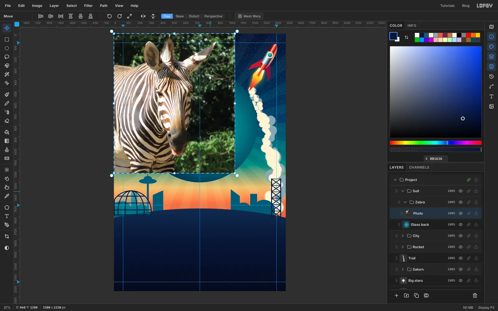

## Lasso the zebra out of the leaves

Press [[Cmd+D]], then trace the zebra with the **Lasso**, taking your time around the ears and jaw. Zoom in if it helps. Start at the left edge of the photo and follow the back of the neck to the left ear. Include that ear, then cut straight across the top of the head.

Two places need a decision:

- **The mane.** This zebra has a tall tuft between its ears, and in a helmet it reads as a third ear. Cut it down to a low ridge.
- **The right ear.** It sticks out sideways with a thin tip, like a horn. End your line early and round it off, about 90 px short of the real tip.

Go down the right side of the face and around the muzzle, leaving out the tongue, then down the chest to the bottom of the photo and back up the left edge to where you started.

Choose **Select → Feather…** with 2 so the edge isn't razor sharp. Choose **Select → Inverse**, press [[Delete]], and press [[Cmd+D]].

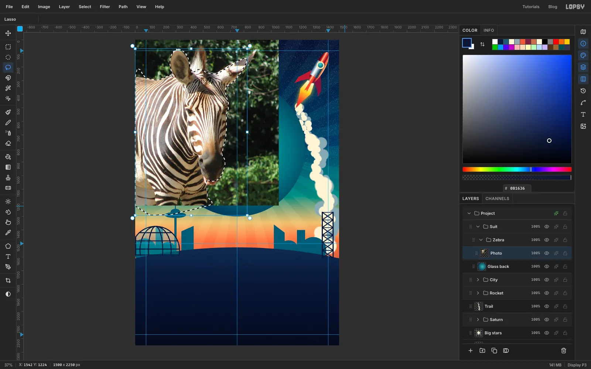

## Fit the head and lift the ear

Marquee the whole photo, from (0, 0) to (1056, 1222), a touch past its bottom edge so nothing gets left behind, and press [[V]]. Hold [[Cmd]] and drag the bottom-right corner in to about 88%, which ends near (929, 1075). Press [[Cmd+D]].

Click the **Photo** row and drag the zebra down and to the right until its ears sit inside the top of the helmet circle and its face is just right of center: about 305 px right and 303 px down. Press [[Cmd+D]].

The right ear still points sideways. Choose **Filter → Liquify**, set Mode to **Push Forward**, Brush Size to 230 and Pressure to 60, and drag from the outer half of the ear straight up about 50 px. Click **Apply**.

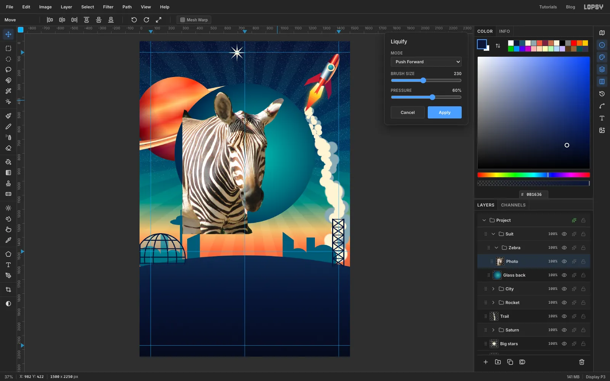

## Mirror a strip to widen the neck

The photo now stops just short of the helmet's left edge. Marquee the leftmost strip of neck, from (306, 300) to (376, 1380). Press [[Cmd+C]], wait a moment, press [[Cmd+V]], then [[Cmd+D]].

Choose **Image → Flip Horizontal** to mirror the pasted strip in place, and drag it left about 68 px so its edge meets the photo's edge. Mirrored stripes meet themselves at the seam, so you can hardly see the join. Press [[Cmd+D]] and choose **Layer → Merge Down**. Merging can change the layer's name, so rename it **Photo** if it did.

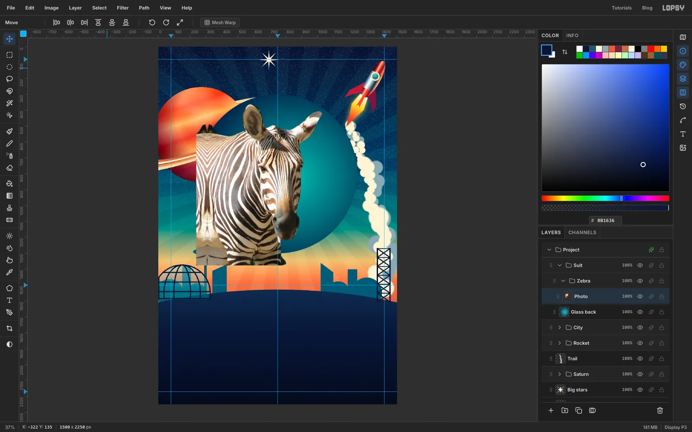

## Clip the zebra to the helmet and collar

Marquee the helmet circle again, from (250, 300) to (1250, 1300). Then, with the Elliptical Marquee still active, hold [[Shift]] and drag an ellipse from (394, 1194) to (1106, 1348) to add the opening of the collar. It's fine if it isn't exact, as the collar will cover the edge.

Choose **Select → Inverse**, press [[Delete]] and press [[Cmd+D]]. The neck now carries on below the glass, down into where the collar will go.

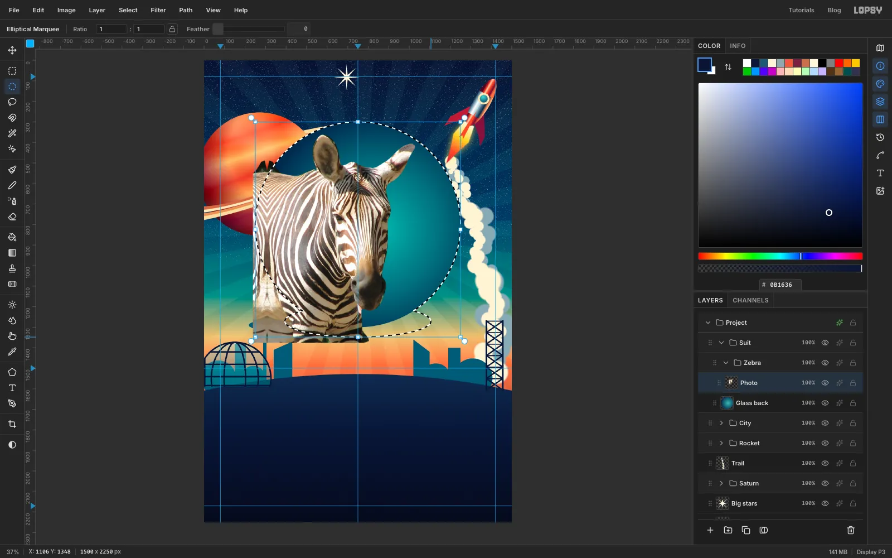

## Grade the photo to look painted

With **Photo** active, run **Filter → Brightness/Contrast** with Brightness -4 and Contrast 28, then **Filter → Oil Paint** with Radius 1 and Sharpness 3. This softens the fine hair so it reads more like gouache.

Open the ✦ drawer on the **Zebra** group, click **Add Adjustment** and choose **Gradient Map**. Set five stops: `#0A1230` at the left, `#1E4F7A` at 24%, `#E0B088` at 50%, `#FFF0D0` at 78%, `#FFFDF2` at the right. The photo's browns and greens are gone, replaced by the poster's navy and cream. Close the drawer.

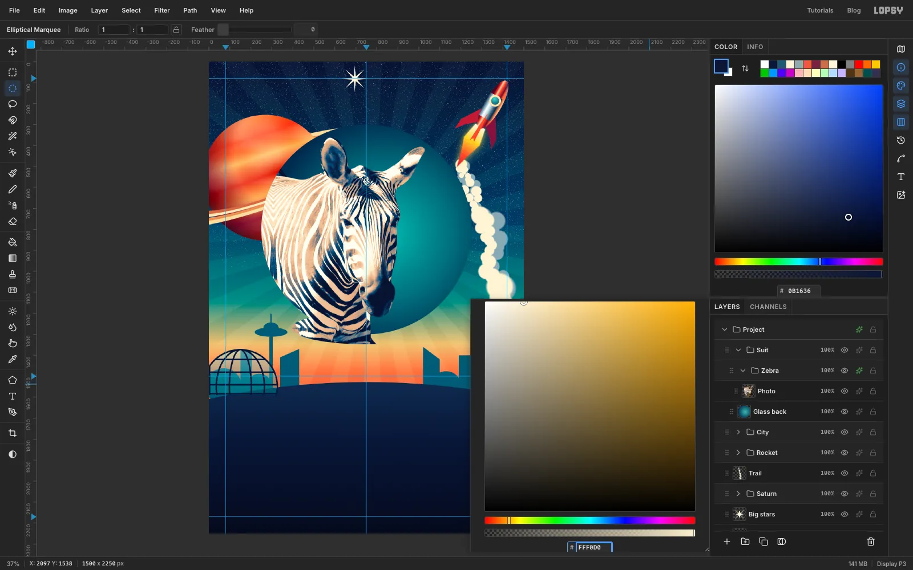

## Calm the face and add rim light

The sunlit middle of the face is too bright. Click the **Photo** row and add a layer named **Face burn** above it, inside the group. Marquee an ellipse from (626, 880) to (760, 1060), Feather it by 28, fill it with `#B4B4B4` and press [[Cmd+D]]. Set it to **Multiply**. A soft grey like this pushes the highlights down without losing the stripes.

Collapse **Zebra**, click its row and add a layer named **Rim light**. Open **Zebra** again and [[Cmd]]-click the **Photo** thumbnail, then fill with `#FFC79A`. With the Rectangular Marquee active, nudge the selection outline 5 px to the left with the arrow keys. Only the outline moves. Feather by 5, press [[Delete]] and press [[Cmd+D]]. That leaves a thin warm line down the zebra's right edges. Set it to **Screen** at 60%.

Add a layer named **Eye glints** and click once in each eye with the **Brush** at Size 11 in `#FFFDF2`.

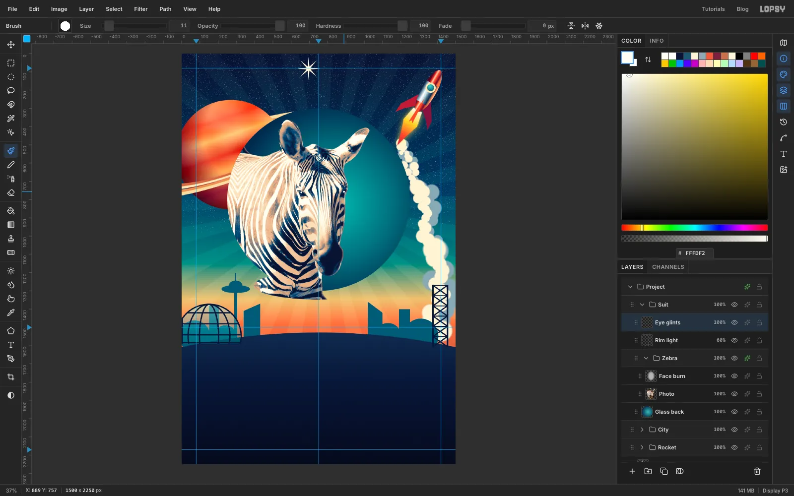

## Add the shoulders and collar opening

Click the **City** row and add a layer named **Shoulders**, which puts it under the helmet. Lasso the suit: from low on the left edge, up and over a round shoulder at about (290, 1425), then a concave slope up to the neck at about (480, 1310), straight across to (1020, 1310), and the mirror image down the right.

Drag a Linear gradient across it from left to right with `#5E1433`, `#C9352F` at 20%, `#F2593A` at 42%, `#FF9A5C` at 56%, `#D9412F` at 74% and `#4A0C2C`. Press [[Cmd+D]]. Marquee a box from (-40, 1660) to (1540, 2300), Feather by 70 and press [[Delete]] so the suit melts into the ground. Press [[Cmd+D]].

Still on this layer, marquee an ellipse from (390, 1198) to (1110, 1354) and drag a Linear gradient from `#7A2118` to `#E8512F` down it. That's the inside of the collar. Press [[Cmd+D]].

Click **Glass back**, add a layer named **Neck shadow**, and [[Cmd]]-click the **Photo** thumbnail. **Grow** by 12, **Feather** by 8, then with the rectangular marquee hold [[Shift]]+[[Alt]] and drag a box from (200, 1170) to (1300, 1400) to keep only the bottom part. Fill with `#0A1230`, press [[Cmd+D]] and set it to **Multiply**.

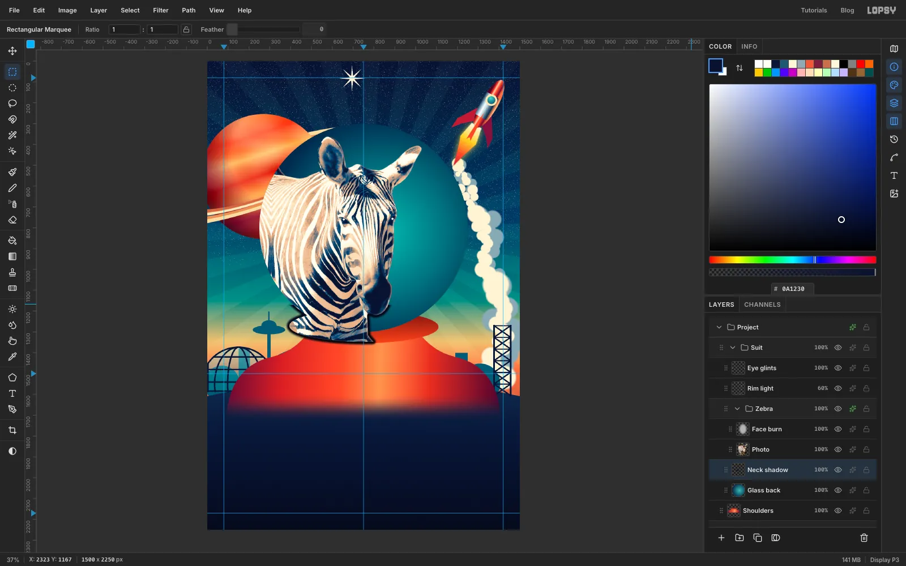

## Shade the glass and add the window reflection

Click **Eye glints** and add a layer named **Glass shade**. Marquee the helmet circle, fill it with `#071433`, then marquee a smaller circle from (300, 350) to (1200, 1250), Feather by 60, press [[Delete]] and press [[Cmd+D]]. Set it to **Multiply** at 55%. This darkens only the edge, which makes the glass look curved.

Add a layer named **Reflection** and set the foreground to `#FFF4D8`. Marquee a circle from (288, 338) to (1212, 1262). Hold [[Alt]] and drag a second, same-sized circle by eye, slightly lower and to the right, starting about (302, 364) and ending about (1258, 1320). That subtracts it and leaves a thin crescent at the upper left. Choose **Edit → Fill**, then [[Cmd+D]].

Fade the two ends: marquee a box from (210, 620) to (1290, 1380), Feather by 50, press [[Delete]] and [[Cmd+D]]. Do the same with a box from (730, 220) to (1290, 1380). Set the layer to **Screen** at 60%.

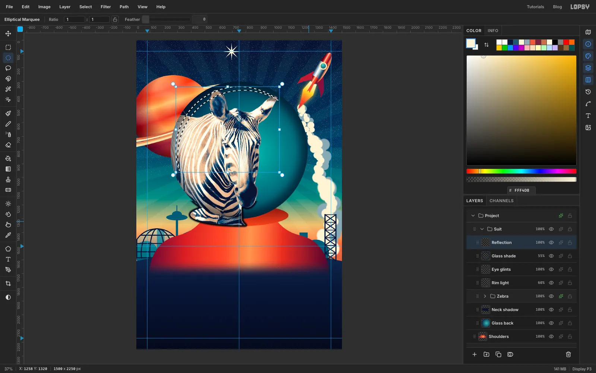

## Finish the glass with a rim and sparkle

Add a layer named **Warm bounce** and set the foreground to `#FFB27A`. Marquee a circle from (276, 326) to (1224, 1274). Hold [[Alt]] and drag a circle by eye, shifted a little up and to the left, from about (266, 316) to about (1210, 1260), which leaves a sliver along the lower right. Fill it. Fade the top half by marqueeing (210, 220) to (1290, 840), Feathering by 90 and pressing [[Delete]]. Press [[Cmd+D]] and set it to **Screen** at 42%. That's the horizon's glow on the lower right of the bubble.

Add a layer named **Rim ring**. Marquee the helmet circle and drag a Linear gradient with `#FFFDF2`, `#8FE3DA` at 45% and `#FF9A5C` from its upper left to its lower right. **Shrink** by 9, press [[Delete]] and press [[Cmd+D]].

Add a layer named **Sparkle**. With the **Brush** in white, click once at Size 38 in the upper left of the glass, and once at Size 16 just above and to the right of it.

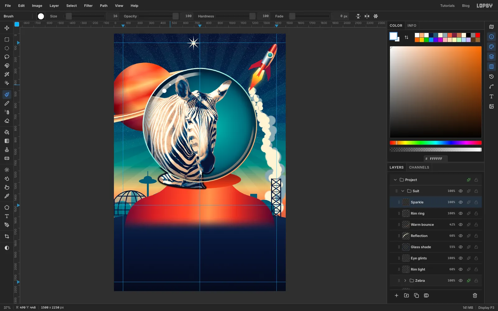

## Rivet on a chrome collar

Add a layer named **Collar**. Marquee an ellipse from (330, 1182) to (1170, 1390), set the same eight chrome stops you used on the hull, and drag straight across from left to right. Press [[Cmd+D]].

Marquee an ellipse from (394, 1194) to (1106, 1348) and press [[Delete]] to open up the ring. Press [[Cmd+D]]. The back of the ring would cross the neck, so [[Cmd]]-click the **Glass back** thumbnail, then with the rectangular marquee hold [[Shift]]+[[Alt]] and drag a box from (170, 1080) to (1330, 1242). Press [[Delete]] and [[Cmd+D]]. Now only the front of the ring overlaps the glass.

Add a **Drop Shadow** with Offset X 0, Offset Y 14, Blur 18 and Opacity 60.

Add a layer named **Rivets**, set the foreground to `#FFF0D0`, and with the **Brush** at Size 15 click 15 evenly spaced dots along the front of the collar.

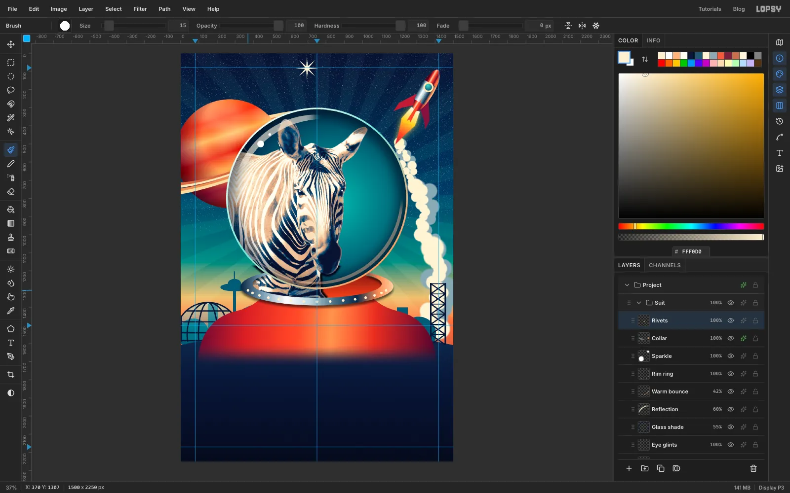

## Set the title type

Collapse **Suit**, click its row, click **New Group** and name it **Title**, then add a layer named **Title anchor**. This is an empty raster layer. Selecting it before making new text keeps the Text options from restyling existing type.

Pick the **Text** tool. Before clicking, set the font to **Bowlby One**, Size to 412 and the foreground to `#FFF4D8`. Click in the empty ground, type **ZOO** and press [[Tab]]. Click **Rasterize Layer**, the T icon in the bottom row of the Layers panel, press [[V]] and use the arrow keys ([[Shift]] moves 10 px) to center it on the middle guide, with the tops of the letters at about y = 1658.

Click **Title anchor** again. Pick the Text tool, set Size to 254 and the foreground to `#FFD84F`, click in the sky above the title area, type **ROCKET** and press [[Tab]]. Open the Text panel with the **T** icon in the right-hand rail, set **Letter spacing** to 12 to keep the heavy letters apart, then click **Rasterize Layer** again. Center it with the tops of the letters at about y = 1486. ROCKET sits under ZOO in the stack, which you want.

[[Cmd]]-click the **ROCKET** thumbnail. Set a Linear gradient with `#FFF6B8`, `#FFD84F` at 45%, `#F7913A` at 80% and `#E2452F`, drag from the top of the letters to the bottom, and press [[Cmd+D]].

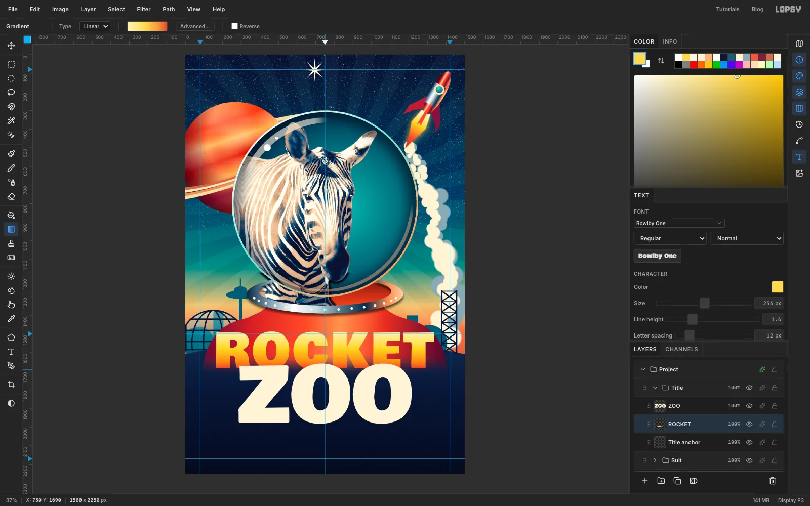

## Borrow real stripes for ZOO

Here's the trick that ties the title to the hero. Expand **Suit** and **Zebra**, click the **Photo** row, and marquee a box of neck from (300, 520) to (620, 1240), where the stripes are strongest. Press [[Cmd+C]], then [[Cmd+D]].

Click the **ZOO** row, wait a moment and press [[Cmd+V]]. Press [[Cmd+D]] and rename the pasted layer **Hide**.

Marquee around it, press [[V]], hold [[Cmd]] and drag a rotation handle clockwise, so it snaps in 15° steps to exactly 90°. Press [[Cmd+D]]. Marquee around the sideways strip, press [[V]], hold [[Cmd]] and drag its corner out until the strip is about 1130 px wide. Press [[Cmd+D]]. Then drag it down over the word ZOO so it covers all three letters, with the strip's ragged top edge well above them.

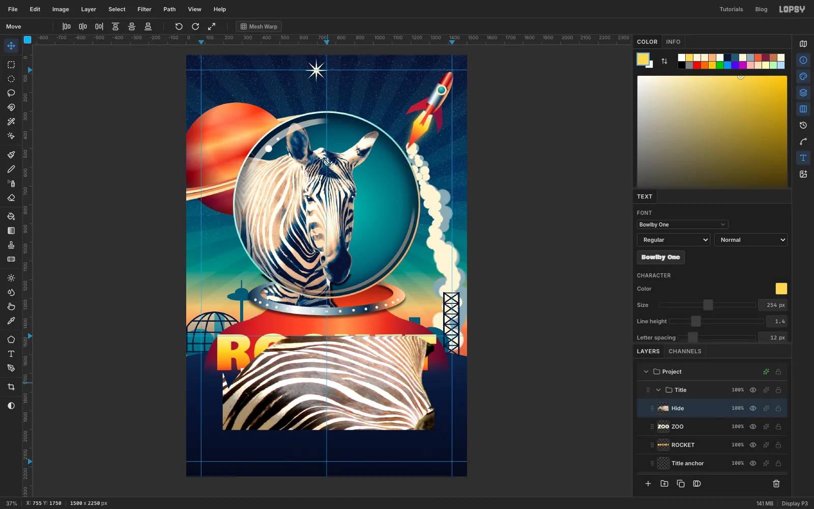

## Turn the hide into hard stripes

With **Hide** active, run **Filter → Gaussian Blur** at Radius 5, then **Filter → Threshold** at Level 150. The blur stops the threshold from leaving fuzzy, hairy edges. Set the layer to **Multiply**, so the white drops out and only the black prints.

[[Cmd]]-click the **ZOO** thumbnail, choose **Select → Shrink…** by 9, then **Select → Inverse**, and press [[Delete]]. Press [[Cmd+D]]. The stripes stop short of the edge of each letter, leaving a cream border that keeps the shapes readable on the dark ground. Choose **Layer → Merge Down** to bake the stripes into ZOO.

## Give the title some perspective

Click the **ZOO** row and choose **Layer → Merge Down** to merge it onto ROCKET, then rename the result **Title art**.

Marquee a box around both words, from (120, 1470) to (1380, 2040), and press [[V]]. Click **Perspective** in the options bar. Drag the bottom-left corner handle about 60 px to the left. The bottom-right corner moves out to match, so the title looks like it's coming towards you. Press [[Cmd+D]].

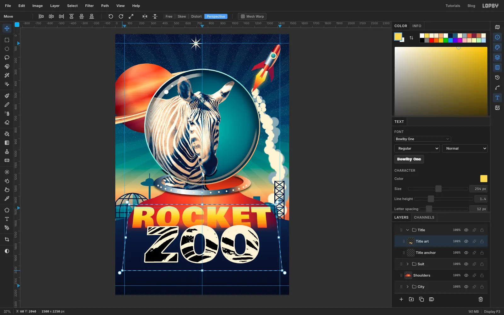

## Extrude a 3D edge

Click **Title anchor** and add a layer named **Extrude**, so it's under the art. [[Cmd]]-click the **Title art** thumbnail, fill with `#D9412F` and press [[Cmd+D]].

Now double the shape up to make depth. Choose **Layer → Duplicate Layer**, click the copy's row, press [[V]], tap the arrow keys to move it 3 px left and 3 px down, and choose **Layer → Merge Down**. Repeat with 6 px, then 8 px, then 9 px. Each merge gives you a thicker shape, so a few steps cover a long edge.

[[Cmd]]-click the **Extrude** thumbnail and drag a Linear gradient from `#F2593A` at the top of the title to `#5E1433` at the bottom. Press [[Cmd+D]]. Add a **Stroke** of Width 10 in `#0A1230` and a **Drop Shadow** with Offset X -8, Offset Y 10, Blur 14 and Opacity 70.

Finally click **Title art** and add a **Stroke** of Width 5 in `#0A1230`. The dark outline keeps the red edge from melting into the coral suit.

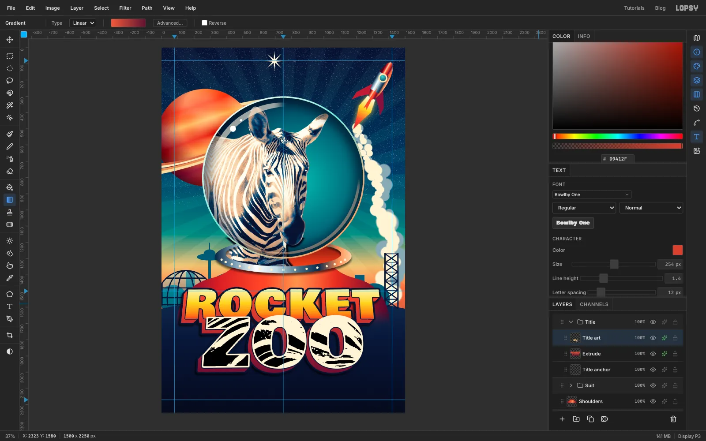

## Set the credits and tagline

Collapse **Title**, click its row, click **New Group** and name it **Type**, then add a layer named **Type anchor**. Click this row before each new line of text. Start from the bottom, so clicks for later lines don't land on earlier ones, and reset **Letter spacing** in the Text panel each time, since it carries over.

Make each line, then center it on the middle guide with the Move tool's arrow keys. Keep about 55 px of space below the DIRECTED BY line, which goes first:

- **Bebas Neue, Size 26, Letter spacing 3,** `#F5E6C4`: DIRECTED BY WALT KESSLER · PRODUCED BY IDA MARSH · AN ORBIT PICTURES RELEASE
- **Bebas Neue, Size 34, Letter spacing 3,** `#FFD84F`: AND ZELDA AS THE CAPTAIN · IN ROCKETSCOPE AND GLORIOUS ASTROCOLOR
- **Anton, Size 40, Letter spacing 5,** `#FFF4D8`: DOLORES VANCE · BUCK HARLAN · MILO REYES

Then the tagline at the top, in **Yellowtail** with Letter spacing 0. Don't center these. Offset them so they stagger like a hand-painted line:

- **Size 84,** `#FFD84F`: now the zebra has the keys! with its first letter at about x = 172, at y = 147
- **Size 92,** `#FFF4D8`: Man built the cages... with its first letter at about x = 121, at y = 55

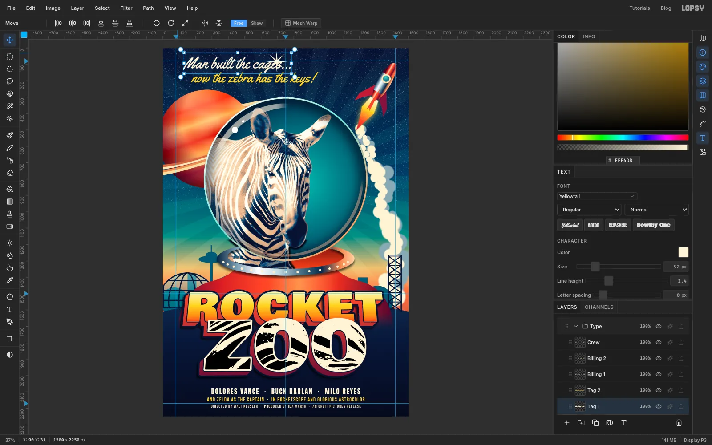

## Move the star and add a name tag

The big star now sits in the tagline's way. Click **Big stars** and drag it down and right, into the gap between the helmet and the rocket. Press [[Cmd+D]].

Click **Shoulders** and add a layer named **Name tag**. Marquee a box from (616, 1402) to (884, 1458), then **Shrink** by 14 and **Grow** by 14. Going in and back out rounds the corners. Fill with `#FFF4D8`, press [[Cmd+D]] and add a **Stroke** of Width 4 in `#0A1230`.

With that layer active, use the Text tool to type **ZOOKEEPER** in **Bebas Neue** at Size 46, Letter spacing 4, color `#0A1230`. Center it inside the tag with even space above and below.

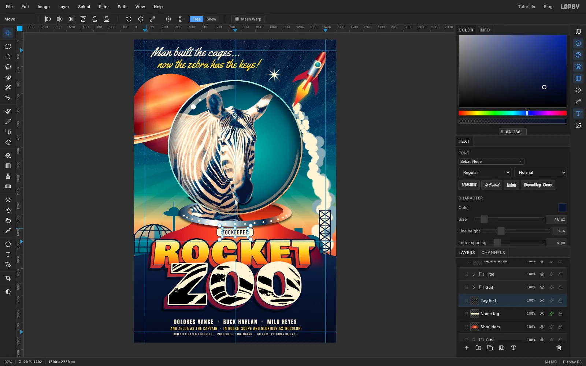

## Add a SEE! burst and rotate its text

Expand **Type**, click **Type anchor** and add a layer named **Burst**, above the credits and tagline. Set the foreground to `#FFD84F` and run **Sunburst** with Rays 18, Length 8.8, Width 100, Taper 100, Center X 11.8 and Center Y 46.5, which fills the gap under the planet. Add a **Stroke** of Width 5 in `#0A1230`.

Click **Burst** before each line, so the text lands above it, and build from the bottom. Center each line on the burst:

- **Bebas Neue, Size 31, Letter spacing 1,** `#0A1230`: ON PARADE!
- **Bebas Neue, Size 31, Letter spacing 1,** `#0A1230`: CAGED MEN
- **Bowlby One, Size 58, Letter spacing 0,** `#C9352F`: SEE!

To tilt all three, click the top text row and [[Shift]]-click the lowest text row so just those three are selected, press [[V]], and drag a rotation handle about 10° counterclockwise. Press [[Cmd+D]]. The text stays live, so you can still fix a typo.

## Copy a smaller star

Click **Big stars**, marquee around the star, then press [[Cmd+C]], wait a moment and press [[Cmd+V]]. Press [[Cmd+D]].

Marquee around the pasted star, press [[V]], hold [[Cmd]] and drag a corner in to about half its size. Press [[Cmd+D]] and drag the small star into the open sky to the right of the smoke trail. Press [[Cmd+D]]. Two sizes make the sky feel deeper.

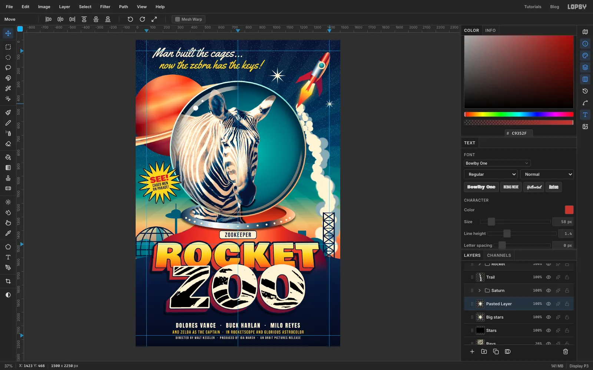

## Hand the zebra its keys

The tagline needs a payoff inside the picture. Expand **Suit**, click **Eye glints** and add a layer named **Key one**. Set the foreground to `#FFD84F`.

- Marquee a circle from (972, 842) to (1048, 918), choose **Edit → Fill**, **Shrink** by 20, press [[Delete]] and [[Cmd+D]]. That's the head of the key.
- Fill a shaft: a box from (1001, 914) to (1019, 1060).
- Fill two teeth: boxes from (1019, 1016) to (1052, 1032) and from (1019, 1044) to (1044, 1060).

[[Cmd]]-click the thumbnail, drag a Linear gradient with `#FFF6B8`, `#FFD84F` and `#C9762F` across the key, and press [[Cmd+D]].

Choose **Layer → Duplicate Layer** and rename the copy **Key two**. Marquee around it from (968, 838) to (1056, 1064), press [[V]], drag a rotation handle 24° counterclockwise, and press [[Cmd+D]]. Click **Key one**, make the same marquee, turn it 24° clockwise and press [[Cmd+D]]. The two heads now sit together with the blades fanned apart.

Click **Key two** and add a layer named **Key ring**. Marquee a circle from (950, 770) to (1070, 890), fill with `#FFF6B8`, **Shrink** by 11, press [[Delete]] and [[Cmd+D]]. Give all three layers a **Stroke** of Width 3 in `#0A1230`.

## Put the people in the cage

Here's the joke for anyone who looks closely. Collapse **Suit**, expand **City**, click **Cage glass** and add a layer named **Captives**, so they stand behind the bars. Set the foreground to `#0B1636` and pick the **Brush**.

At Size 17, click two heads, at (58, 1470) and (104, 1470). At Size 19, draw each body from y = 1490 down to y = 1586 by clicking and then [[Shift]]-clicking. At Size 7, add two raised arms per figure in the same way, reaching up to about y = 1450. Then collapse **City** again.

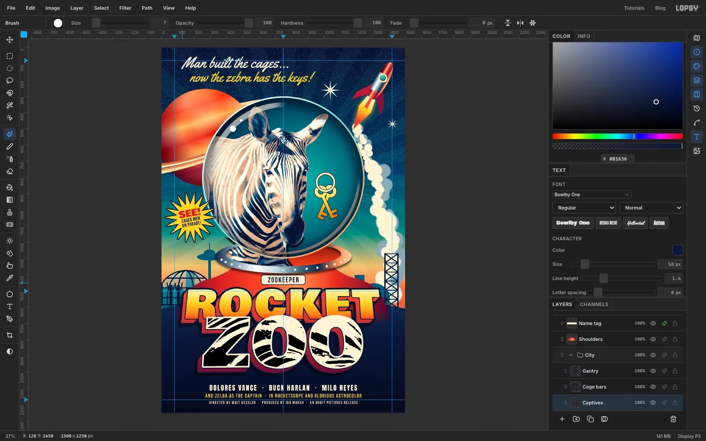

## Print dots on the shoulders

Click **Shoulders** and add a layer named **Suit dots**. [[Cmd]]-click the **Shoulders** thumbnail. Drag a Radial gradient with `#FFFFFF`, `#FFFFFF` at 45% and `#3A0A28` from the middle of the chest out to the lower left of the shoulder, then press [[Cmd+D]].

Run **Filter → Halftone** with Dot Size 14, Density 1, Angle 30 and Softness 1. Pure white prints nothing, so the dots only appear towards the edges, just as shading was printed on old posters.

Marquee a box from (-40, 1560) to (1540, 2300), Feather by 30, press [[Delete]] and [[Cmd+D]], so no dots run below the title. Set the layer to **Multiply**.

## Make the coral read as a spacesuit

Still above **Shoulders**, add these four layers:

- **Suit seams:** **Brush** at Size 6 in `#5E1433`. Paint three curved pleats across each upper arm. Most of these will be hidden by the title, but the ends show.
- **Shoulder light:** Lasso a soft sliver along the top of each shoulder, Feather by 12, and fill with `#FFD9B0`. Press [[Cmd+D]] after each one. Set it to **Screen** at 60%.
- **Hoses:** open the Brush presets panel and set Hardness 100, Spacing 62, then close it. With Size 30 in `#8FE3DA`, paint a curved hose from the collar down over each shoulder, ending just above the title. The wide spacing makes the beads of a ribbed hose. Set Spacing back to 10 and add a **Stroke** of Width 3 in `#0A1230`.
- **Buttons:** Brush at Size 20. Click three dots either side of the name tag, colored `#FFD84F`, `#8FE3DA` and `#FFF4D8`, mirrored left to right. Add a **Stroke** of Width 3 in `#0A1230`.

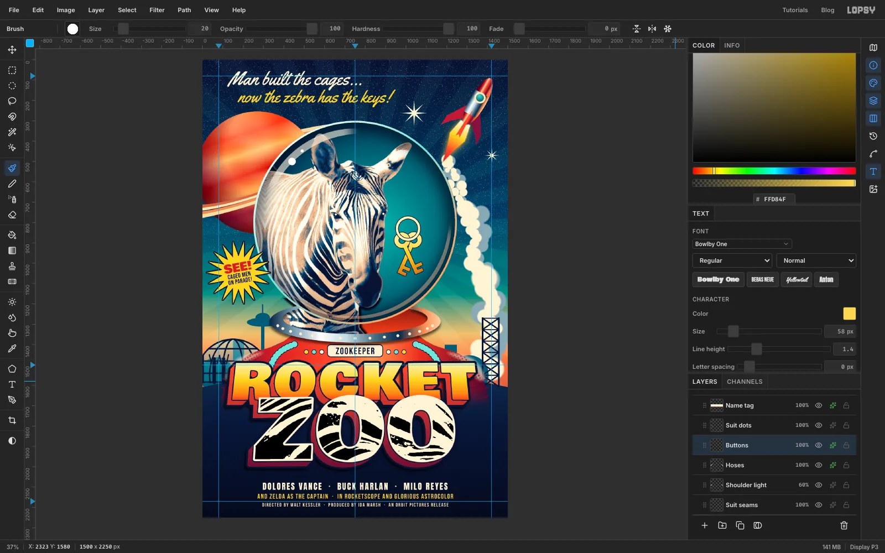

## Add grain and export

Collapse **Type**, click its row and add a layer named **Grain**. Fill it with `#808080`, run **Add Noise** with Amount 40 and the **Mono** button on, set it to **Overlay** and drop the opacity to 30%. The noise takes the digital smoothness off the gradients, so the whole sheet looks printed.

Save it with **File → Save Project**, then choose **File → Quick Export PNG**.

