A **risograph** is a fast, cheap stencil printer that prints one ink at a time from a drum. Designers love it for the same quirks that make it cheap:

- only a few spot colours, like fluorescent pink, yellow and teal
- inks that overprint, so pink on yellow makes a red-orange and teal on yellow makes green
- halftone dots for any shade lighter than solid ink
- drums that never quite line up, so every colour sits a few pixels off the others
- small white flecks where the ink didn't take

In this tutorial you'll design a wrap-around label for an imaginary craft kombucha, **Zesty Kombucha — Pink Grapefruit + Ginger**, and fake all of those quirks on purpose. The label is 1800 × 900 px, split into three panels by fold lines:

- a **left panel** with ingredients, a nutrition table and a barcode
- a **front panel** with a halftoned grapefruit, a starburst badge and the brand name
- a **right panel** with a batch stamp, a ginger root, a few lines of story and the volume

Each ink lives in its own **group set to Multiply**, just like a separate drum. Anything you put in the Pink Ink group prints pink, and where it overlaps the Yellow Ink group the two multiply into a red-orange, the way real ink does.

You'll need one photo: **USDA Eat Healthy Food Group Gallery serving size half medium grapefruit.jpg** from Wikimedia Commons. It's a US Department of Agriculture photo in the **public domain**. It shows a grapefruit half from above on a white background. Download the original 800 × 650 px file.

The tools you'll use:

- the **Elliptical** and **Rectangular Marquee** (with their exact-size dialogs), **Select → Inverse / Shrink**, and the **Magic Wand**
- the **Move** tool's scale and rotate handles, **Copy**, **Paste**, **Flip Horizontal** and **Merge Down**
- the **Shape** tool (Polygon, Ellipse and Rectangle), the **Pen**, the **Pencil**, the **Brush** and the **Eraser**
- **Desaturate**, **Brightness/Contrast**, **Halftone**, **Add Noise**, **Gaussian Blur**, **Motion Blur** and **Threshold**
- the **Gradient** tool, the **Color Overlay** layer effect, and the **Multiply** and **Overlay** blend modes
- live text in four Google fonts: **Shrikhand**, **Rubik Mono One**, **Archivo Black** and **IBM Plex Mono**, including text on a path
- guides, the grid with **Snap to Grid**, and groups nudged with the arrow keys

The palette is cream paper and three riso inks:

- Paper `#F2EBDC`
- Yellow ink `#FFD23F`
- Fluorescent pink ink `#FF4FA3`
- Teal ink `#0A8288`
- Grain grey `#808080` (a texture layer, not an ink)

> **Tip:** On a wide-gamut (Display P3) screen, Lopsy reads typed hex codes as P3 colours. These codes were picked as P3 values, so they match the finished label. On an sRGB screen they come out a little duller.

> **Note:** All positions are in document pixels. The status bar at the bottom left shows the pointer's X and Y, so you can check where you are before you click. Rename every layer as you make it (double-click its name), including text layers, so the Layers panel matches the screenshots.

> **Note:** Shortcuts are written for a Mac. On Windows use [[Ctrl]] wherever it says [[Cmd]].

## Set up the label, fold guides and paper grain

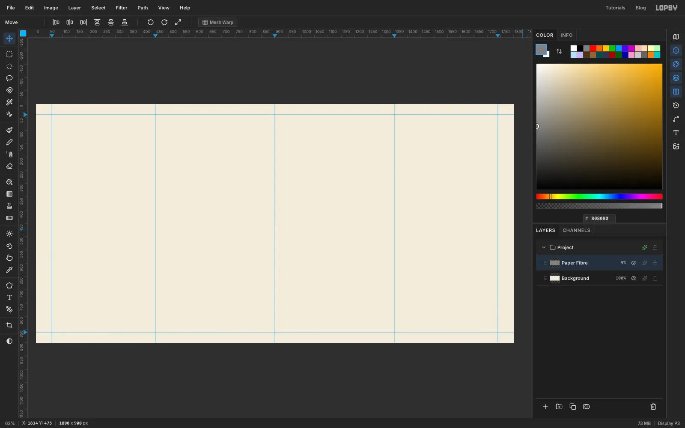

Choose **File → New**, keep the units on **Pixels**, and make the document **1800** wide and **900** high.

Click the top ruler to drop vertical guides at **60**, **450**, **900**, **1350** and **1740**. The guides at 450 and 1350 are the folds where the label wraps around the bottle, 900 is the centre of the front, and 60 and 1740 are the side margins. Click the left ruler for horizontal guides at **40** and **860**.

Select the **Background** layer, set the foreground to paper `#F2EBDC` in the Color panel's hex field, and choose **Edit → Fill**.

Now the paper grain. Select **Layer 1** and double-click its name to rename it **Paper Fibre**. Set the foreground to `#808080` and choose **Edit → Fill** again. Then run these filters:

1. **Filter → Add Noise…**: Amount **100**, **Mono**, **Gaussian**.
2. **Filter → Motion Blur…**: Angle **20**, Distance **5**. This smears the specks into short fibres.
3. **Filter → Brightness/Contrast…**: Brightness **0**, Contrast **70**.

Click the layer's effects button (the ✦ icon on its row), set **Blend** to **Overlay**, and close the drawer. Click the layer's opacity readout to open its slider and drag it down to about **9%**. The paper is now faintly grainy instead of flat.

## Make one group per ink

With **Paper Fibre** selected, click **New Group** at the bottom of the Layers panel. Rename the group **Yellow Ink**, open its effects button and set **Blend** to **Multiply**. Click **Add Layer** while the group is selected and rename the new layer **Sun Disc**. It lands inside the group.

Collapse **Yellow Ink** with its arrow and click its row. Click **New Group** again: the new group appears above it. Name it **Pink Ink**, set it to **Multiply**, and add a layer inside it called **Burst**.

Collapse **Pink Ink**, click its row, and make a third group, **Teal Ink**, also on **Multiply**, with a layer inside called **Leaves**.

From now on, the rule is simple. To print in an ink, click a layer *inside* that ink's group before you add anything. New layers and new text always land just above the selected layer.

## Print a yellow sun behind the fruit

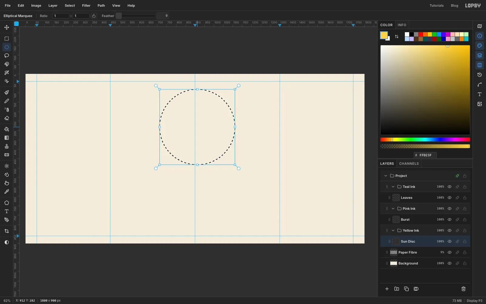

Expand the groups again and select **Sun Disc**. Choose the **Elliptical Marquee** ([[M]] cycles the marquees) and click once on the canvas without dragging. In the dialog that opens, enter From **712, 82** and To **1112, 482**. That's a 400 px circle centred at 912, 282.

Set the foreground to yellow `#FFD23F`, choose **Edit → Fill**, then press [[Cmd+D]] to deselect.

The fruit will sit 12 px left of and 12 px above this disc. The sliver of yellow that peeks out at the lower right is your first piece of "misregistration".

## Drop in the grapefruit photo

Select the **Burst** layer in the Pink Ink group, then drag the downloaded grapefruit JPEG from your Finder onto the canvas. It lands as a new layer at the top-left corner of the document, inside Pink Ink. Rename it **Grapefruit**, and press [[Cmd+D]] if it arrives selected.

The photo still has its white background and a soft grey shadow. You'll cut the fruit out with a circle rather than the Magic Wand, because the shadow would leave a grey fringe.

## Cut the fruit out with a circle

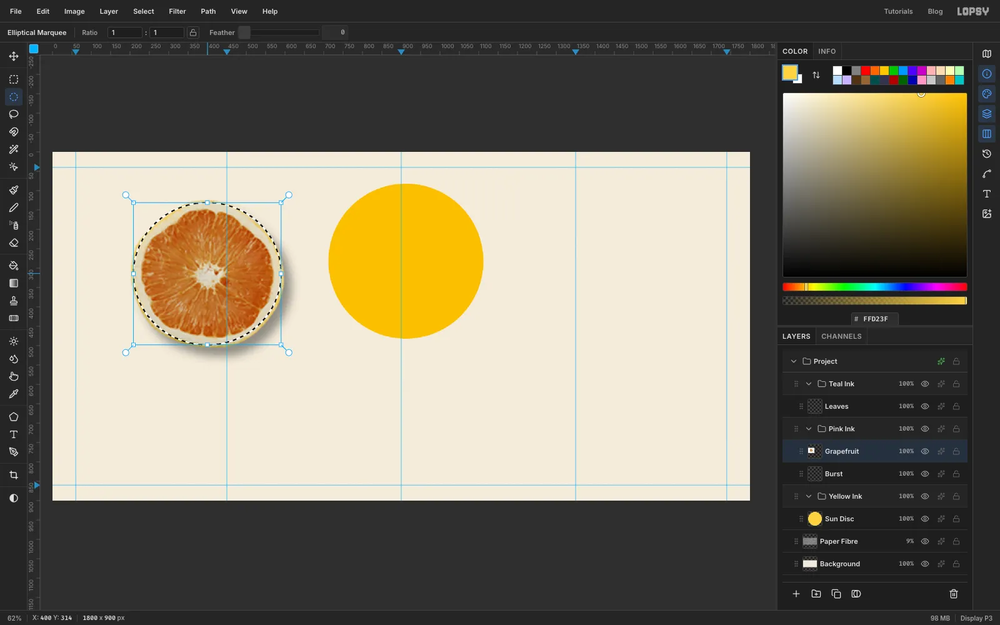

With the **Elliptical Marquee**, click once on the canvas and enter From **209, 131** and To **590, 498**. The ellipse should sit just inside the yellow edge of the rind.

Choose **Select → Inverse**, press [[Delete]] to clear the background and shadow, then press [[Cmd+D]]. Only the fruit is left.

## Move the fruit onto the sun and scale it up

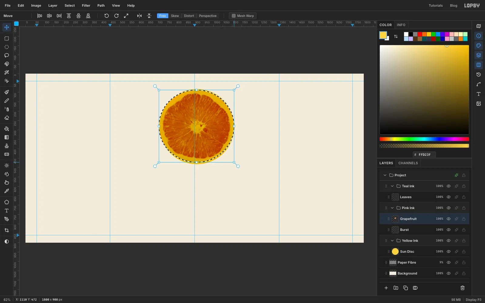

[[Cmd]]-click the **Grapefruit** thumbnail to load the fruit's outline as a selection. Switch to the **Move** tool ([[V]]) and drag from the middle of the fruit until it's centred on the **900** guide, with its centre at about y 270. Press [[Enter]] and then [[Cmd+D]].

[[Cmd]]-click the thumbnail again to bring the transform handles back. Hold [[Cmd]] for a uniform scale and drag the **bottom-right** corner handle outward a little until the fruit is about **400 px** wide, roughly 5% bigger. Press [[Enter]], then [[Cmd+D]]. If the fruit drifted while scaling, nudge it back with the arrow keys until it's centred on the 900 guide. [[Shift]]+arrow moves 10 px at a time.

## Turn the fruit into a grey separation

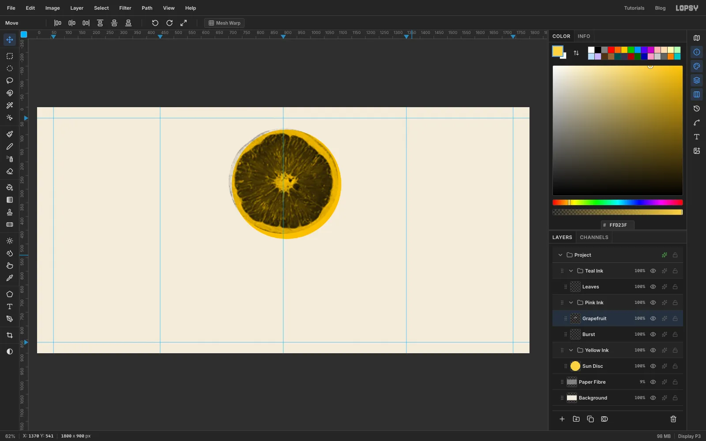

A riso drum only knows "ink" or "no ink", so the photo has to become a greyscale image first. With **Grapefruit** selected:

1. Choose **Filter → Desaturate**.
2. Choose **Filter → Brightness/Contrast…** and set Brightness **−20**, Contrast **60**.

The fruit looks olive because the grey multiplies over the yellow disc in the group below. That's expected: you're seeing both "plates" at once.

## Screen the fruit into halftone dots

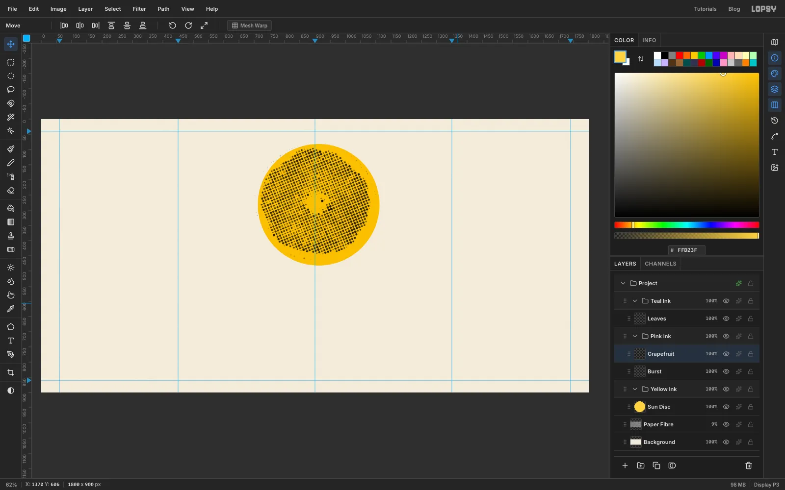

Choose **Filter → Halftone…** and set **Dot Size 9**, **Density 1**, **Angle 22**, **Softness 0.6**. Click **Apply**.

Dark areas of the flesh become big dots and the pale membranes become small ones. White parts print nothing at all.

Now give the dots their ink. Click the layer's effects button, tick **Color Overlay**, and set its colour to pink `#FF4FA3`. Close the drawer. The dots turn red-orange where they sit on the yellow disc, and pink where they hang over the paper.

## Cut the segment lines with the Eraser

Real grapefruit has pale walls between its segments. Choose the **Eraser** ([[E]]) and set **Size** to **7**.

The fruit's centre is at about **900, 270**. Click once about 24 px from the centre, then [[Shift]]-click near the rind, about 170 px out, to erase a straight line. Repeat for **ten** evenly spaced spokes, one every 36°, like slicing a pie into ten. Start straight up; the second spoke points just past 1 o'clock.

Then use the **Elliptical Marquee** dialog to select a 44 px circle in the middle (From **878, 248** To **922, 292**) and press [[Delete]] to clear the core, then [[Cmd+D]]. The marquee only opens its exact-size dialog when nothing is selected.

## Add a thin pith line inside the rind

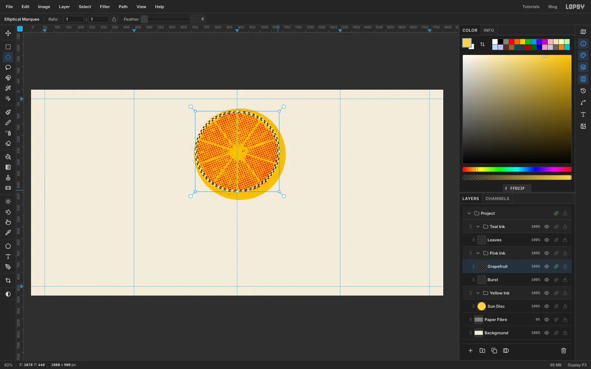

The fruit needs a pale band between the flesh and the rind. Still on **Grapefruit**, open the **Elliptical Marquee** dialog and select From **716, 94** To **1084, 446**. That's an ellipse 16 px inside the edge of the dots.

Zoom in so you can place the next drag accurately. Hold [[Alt]] and drag a second ellipse from about **722, 100** to **1078, 440**, watching the X and Y in the status bar. [[Alt]] subtracts it, leaving a thin ring of marching ants about 6 px wide. (The exact-size dialog can't subtract, so this one is a drag.)

Press [[Delete]], then [[Cmd+D]]. A thin paper-coloured line now circles the flesh, just like the white pith of a real grapefruit.

## Draw a solid pink rind

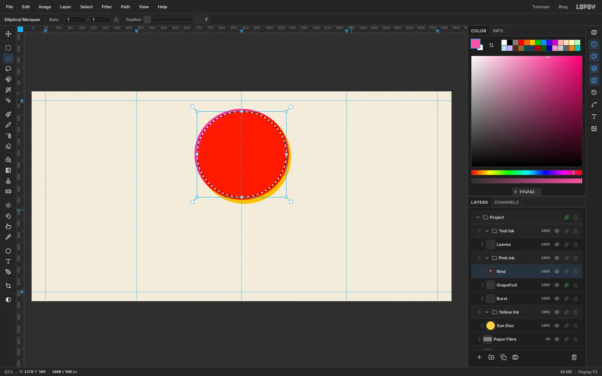

The halftone edge is soft, so a solid rind holds the shape together. Click **Add Layer** (it lands above Grapefruit, inside Pink Ink) and name it **Rind**.

Open the **Elliptical Marquee** dialog and select From **698, 75** To **1103, 465**, just outside the dots. Set the foreground to pink `#FF4FA3` and choose **Edit → Fill**.

Choose **Select → Shrink…**, enter **11** and apply. Press [[Delete]] and then [[Cmd+D]]. You're left with an 11 px pink ring. Where it crosses the yellow disc it turns red.

## Start the starburst badge from a square

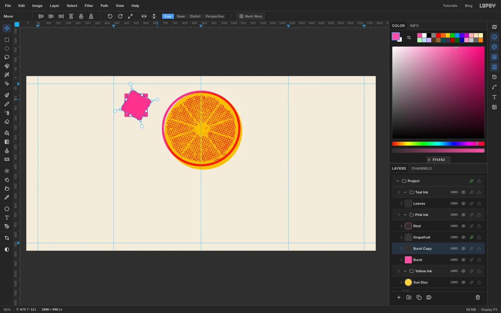

Select the **Burst** layer. Choose the **Shape** tool ([[U]]) and in the options bar set **Shape** to **Polygon**, **Sides** to **4** and **Corner Radius** to **0**. Set the **Fill** swatch to `#FF4FA3` and remove the **Stroke**.

Shapes grow from the point you press. Press at **566, 150** and drag 60 px down and right, so you get a 120 px square.

Now turn it into a star by stacking turned copies:

1. [[Cmd]]-click the **Burst** thumbnail, press [[Cmd+C]] then [[Cmd+V]]. The copy is pasted in place, already selected.
2. Grab one of the round **rotate** handles just outside a corner of the box. Hold [[Cmd]] while you drag, so the angle snaps in 15° steps, and turn it **30°**.
3. Press [[Enter]], press [[Cmd+D]], and choose **Layer → Merge Down**.

## Finish the twelve-point star

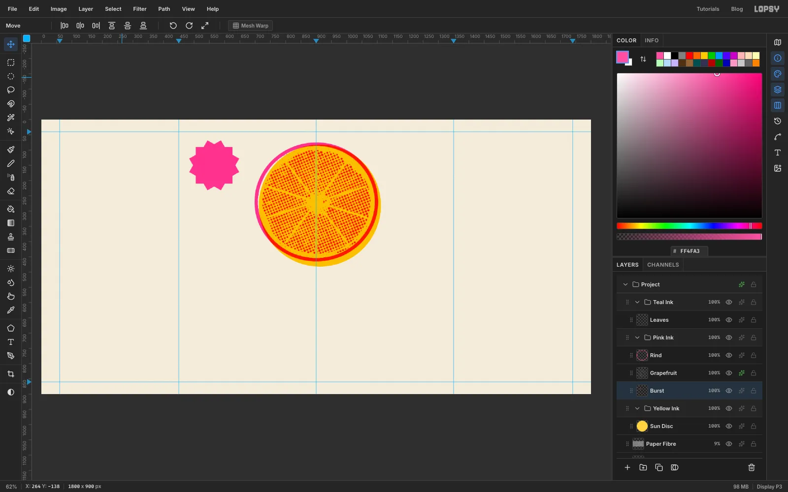

Repeat the same three steps on the merged shape, but turn the copy **60°** this time. A square, plus a copy at 30° and copies at 60° and 90°, gives a neat twelve-point star.

> **Tip:** This is a good moment to test undo. Press [[Cmd+Z]] three times and the star goes back to two squares. Press [[Cmd+Shift+Z]] three times and it comes back exactly.

## Set and tilt the badge type

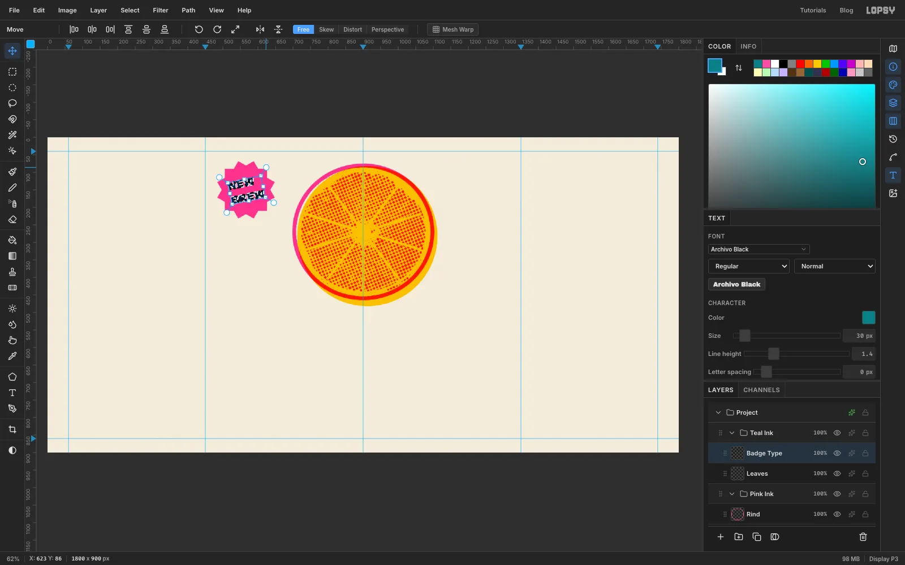

Select the **Leaves** layer, so the type prints in teal. Choose the **Text** tool ([[T]]) and set the options bar to **Archivo Black**, **Size 30**, **Align: Center**, colour teal `#0A8288`.

Click above the middle of the star and type **NEW**, press [[Enter]], then type **BREW**. Press [[Tab]] to commit. Rename the layer **Badge Type**. Use the **Move** tool and arrow keys to centre it on the star.

To tilt it, click **Rasterize Layer** at the bottom of the Layers panel. [[Cmd]]-click its thumbnail, drag a rotate handle **12° anticlockwise**, press [[Enter]] and then [[Cmd+D]]. Teal over pink prints as a deep navy.

Before you set any more type, change **Align** back to **Left** with a non-text layer selected. Otherwise it carries over to the next text you make.

## Draw a leaf with the Pen

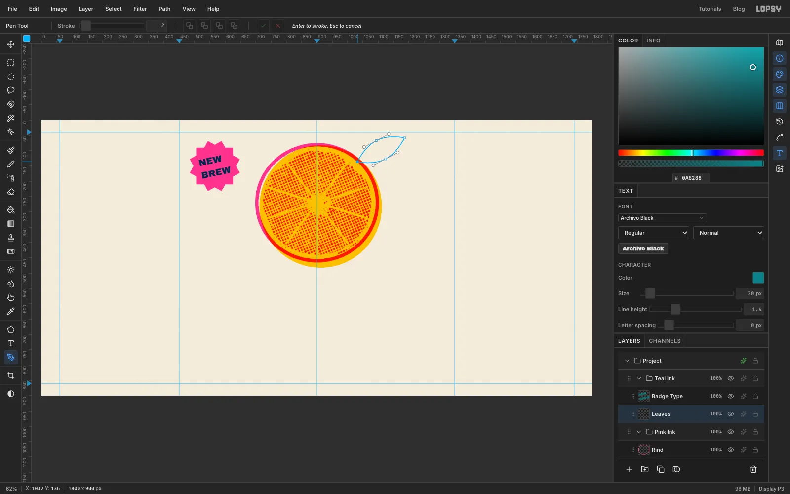

Select **Leaves** and set the foreground to teal `#0A8288`. Choose the **Pen** tool ([[P]]). Each leaf is four anchors: a corner where it joins the fruit, a smooth anchor on each side, and a corner at the tip.

For the upper leaf:

1. Click at **1032, 136** on the rind, for the stem end.
2. Press above the middle of the leaf, at about **1094, 66**, and drag about 40 px towards the tip so a smooth curve forms.
3. Click at **1186, 58** for the tip.
4. Press below the middle, at about **1124, 128**, and drag about 40 px back towards the stem.
5. Click the first anchor again to close the path.

In the **Paths** panel click **Path to Selection**, then **Delete Path**. Choose **Edit → Fill** and press [[Cmd+D]].

Draw a slimmer second leaf the same way, from **1042, 146** to a tip at **1206, 196**, and fill it too.

## Erase curved veins into the leaves

Choose the **Eraser** with **Size 4**. In each leaf, drag one gently curved stroke from near the stem to about four-fifths of the way to the tip. Bow it slightly to one side so it reads like a midrib, not a ruler line. The paper shows through, which is how riso shows a white line.

## Draw bubble rings with the Shape tool

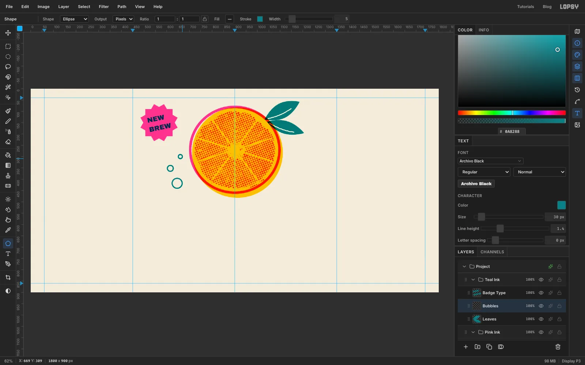

Kombucha is fizzy, so add some bubbles. With **Leaves** selected, click **Add Layer** and name it **Bubbles**.

Choose the **Shape** tool, set **Shape** to **Ellipse**, remove the **Fill**, and set the **Stroke** to teal `#0A8288` with **Width 5**. Press [[Cmd]] while you drag to keep each one a circle. Draw three rings rising up the left of the fruit:

- a large one centred at **646, 418**, dragged out 22 px
- a medium one at **616, 352**, dragged out 13 px
- a small one at **660, 300**, dragged out 9 px

## Copy, flip and move the bubbles to the other side

Press [[Cmd+D]], then use the **Rectangular Marquee** dialog to select the three bubbles: From **590, 284** To **676, 448**. Press [[Cmd+C]] then [[Cmd+V]]. The copy is pasted in place, selected.

With the **Move** tool active, click **Flip Horizontal** in the options bar. Then drag the copy about **553 px** to the right, until the cluster sits right of the fruit and clear of the leaves. Press [[Enter]], [[Cmd+D]], and **Layer → Merge Down** to put all six rings on the Bubbles layer.

## Set "Zesty" with a misregistered shadow

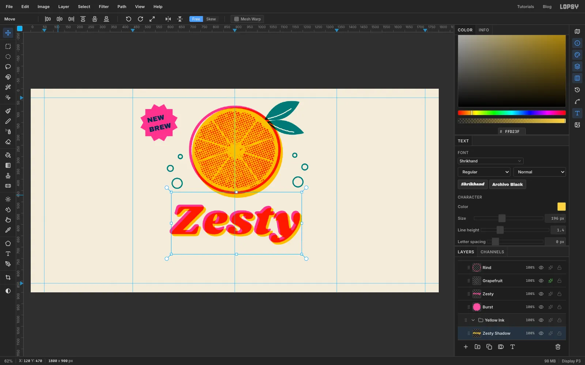

Select **Burst** so the type prints pink. Choose the **Text** tool, pick **Shrikhand** at **Size 196**, colour pink `#FF4FA3`. Click in the empty space under the fruit, type **Zesty** and press [[Tab]]. Rename the layer **Zesty**.

Switch to the **Move** tool and use the arrow keys to centre the word on the **900** guide, with the top of the Z about **30 px** below the yellow disc.

Now the yellow drum. Select **Sun Disc** and make the same text: **Zesty**, Shrikhand, 196, but in yellow `#FFD23F`. Click somewhere empty on the left panel so you don't click into the pink word, and rename the layer **Zesty Shadow**. With the **Move** tool, drag it over the pink word until the two line up exactly, then press [[Right]] nine times and [[Down]] nine times. Where the two overlap they print red. The pink edge shows at the top left and the yellow at the bottom right.

## Add KOMBUCHA, the flavour line and a bottom strip

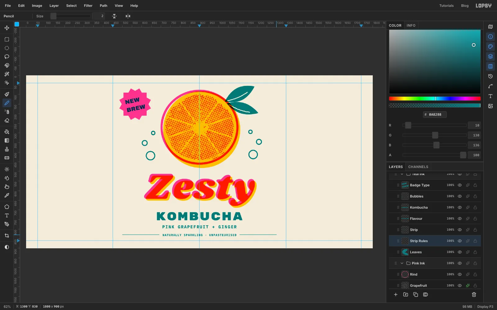

Select **Leaves** so the type prints teal. Set **KOMBUCHA** (rename the layer **Kombucha**) in **Rubik Mono One** at **Size 60**. In the **Text** panel, set **Letter spacing** to **6**. Centre it on the 900 guide, leaving about **32 px** between the bottom of the "y" in Zesty and the top of the capitals.

Select **Leaves** again and set **PINK GRAPEFRUIT + GINGER** in **IBM Plex Mono**, weight **Bold**, **Size 22**, Letter spacing **3**. Centre it about **26 px** below KOMBUCHA and name it **Flavour**.

Then set **NATURALLY SPARKLING · UNPASTEURISED** in IBM Plex Mono Bold, **Size 15**, Letter spacing **2**, centred at y **830**. Name it **Strip**.

> **Tip:** Letter spacing sticks to the Text tool. Check it in the Text panel every time you start a new piece of type.

Finally, rule lines either side of the strip. Select **Leaves**, add a layer called **Strip Rules**, choose the **Pencil** ([[N]]) at **Size 2**, and with teal as the foreground click at **500, 830** and [[Shift]]-click about **18 px** before the start of the text. Do the same from 18 px after the text to **1300, 830**.

## Draw a gradient for the yellow dot field

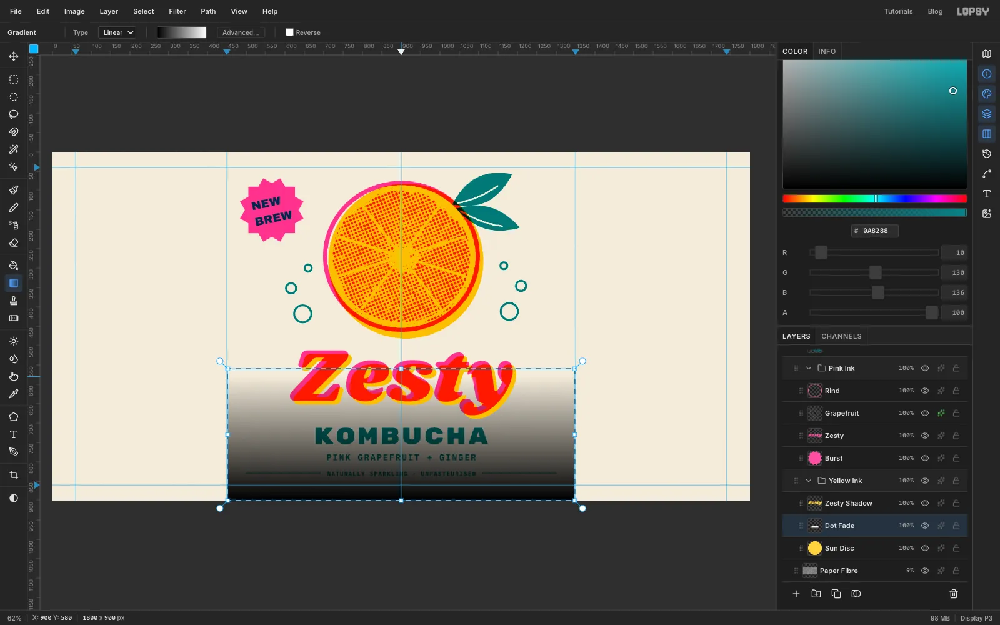

Select **Sun Disc** and click **Add Layer**. Name it **Dot Fade**. It lands in the Yellow Ink group.

Press [[Cmd+D]] if anything is selected, then use the **Rectangular Marquee** dialog to select From **452, 560** To **1348, 900**. Choose the **Gradient** tool from the toolbox, set **Type** to **Linear**, and click **Advanced…** to set the two stops to black `#000000` on the left and white `#FFFFFF` on the right.

Drag from the bottom edge of the selection straight up to about **y 580**. You get black at the bottom fading to white near the top. Press [[Cmd+D]].

## Screen it and clear a band for the small type

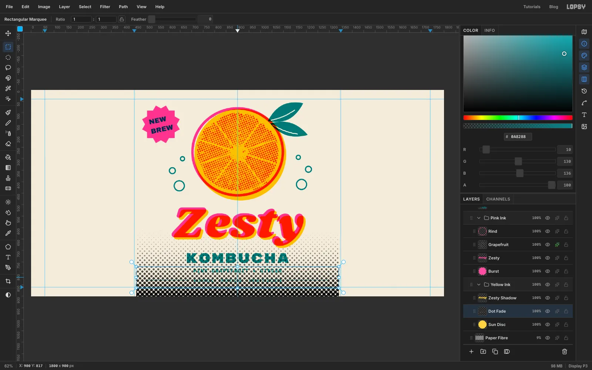

Choose **Filter → Halftone…** with **Dot Size 14**, **Density 1**, **Angle 45**, **Softness 0.4**. Black becomes big touching dots at the bottom, and white prints nothing at the top.

The dots on the edges spill a few pixels past the folds. Select From **458, 0** To **1342, 900**, choose **Select → Inverse** and press [[Delete]].

Then give the small type a clean band of paper. Press [[Cmd+D]] first, so the next click opens the dialog, and select From **458, 770** To **1342, 864**, press [[Delete]] and [[Cmd+D]].

## Ink the dots yellow

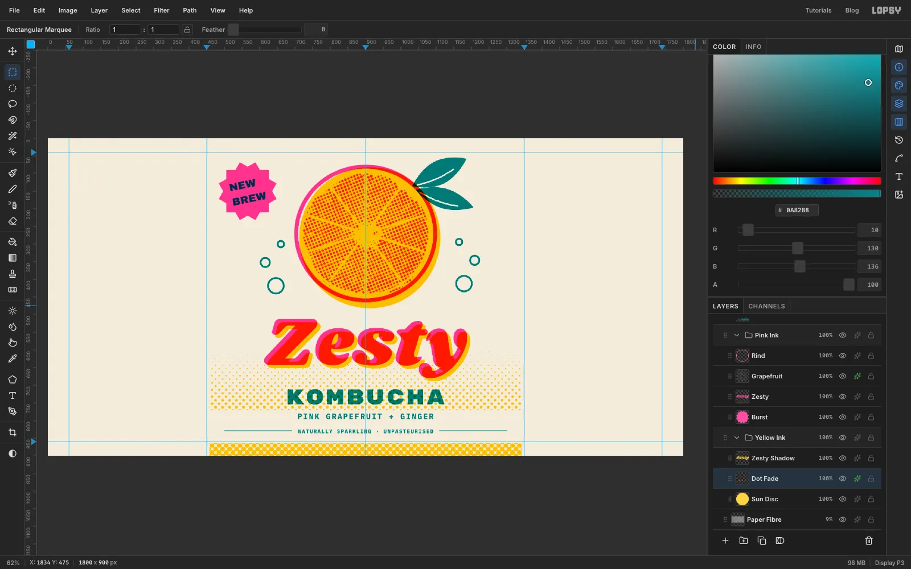

Open the **Dot Fade** effects button, tick **Color Overlay** and set it to yellow `#FFD23F`. Close the drawer.

The dots fade up behind Zesty and KOMBUCHA, overprinting red under the pink and green under the teal. Below the clear band, the densest dots make a chequered strip along the bottom edge.

## Snap a yellow band to the grid

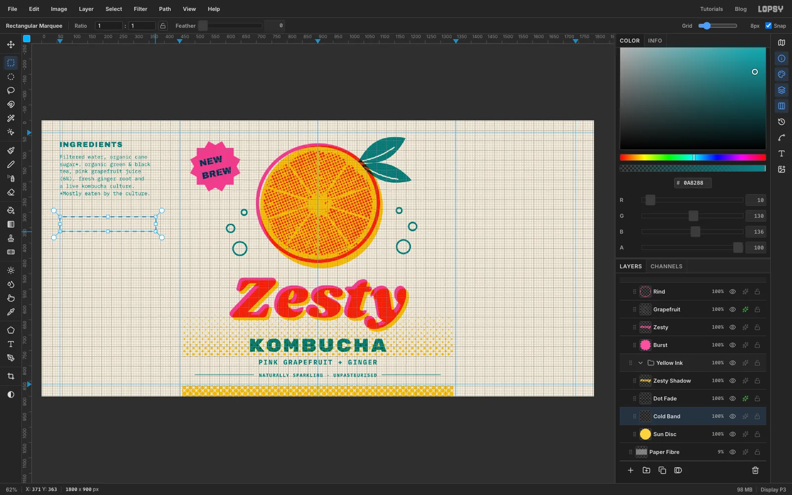

First, the left panel's text. Select **Leaves** and set **INGREDIENTS** in **Archivo Black**, **Size 24**, Letter spacing **2**, with its left edge on the **60** guide and its top at about **y 70**.

Then select **Leaves** again and set the list below in **IBM Plex Mono**, Regular, **Size 17**, Letter spacing **0**, also on the 60 guide. Press [[Enter]] at the end of each line:

- Filtered water, organic cane
- sugar\*, organic green & black
- tea, pink grapefruit juice
- (6%), fresh ginger root and
- a live kombucha culture.
- \*Mostly eaten by the culture.

Now the yellow band. Select **Sun Disc**, add a layer and name it **Cold Band**. Turn on **View → Show Grid**, drag the **Grid** slider at the right of the options bar to **8px** (it only appears while the grid is showing), and turn on **View → Snap to Grid**. Turn **View → Snap to Guides** off so the margin guide doesn't pull the edge.

With the **Rectangular Marquee**, drag from about **61, 313** to **371, 363**. The corners snap to grid lines, giving a band from **60, 314** to **372, 362**. Set the foreground to yellow `#FFD23F` and choose **Edit → Fill**, press [[Cmd+D]], and turn the grid and grid snapping off again.

## Box the nutrition table

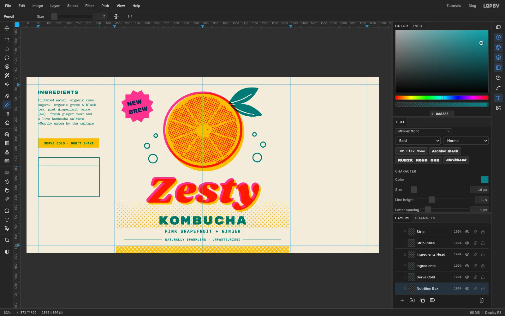

Select **Leaves** and set **SERVE COLD · DON'T SHAKE** in IBM Plex Mono **Bold**, **Size 16**, Letter spacing **1**. Centre it on the band. Teal over yellow prints a dark green.

Select **Leaves**, add a layer called **Nutrition Box** and choose the **Shape** tool. Set **Shape** to **Rectangle**, **Corner Radius 0**, no **Fill**, and a teal **Stroke** at **Width 3**. Press at **216, 512** and drag to **372, 612**. The rectangle grows from the press point, so the box runs from **60** to **372** across and **412** to **612** down.

Choose the **Pencil** at **Size 2**. Click at **61, 456** and [[Shift]]-click at **371, 456** to rule off the header.

## Fill in the nutrition table

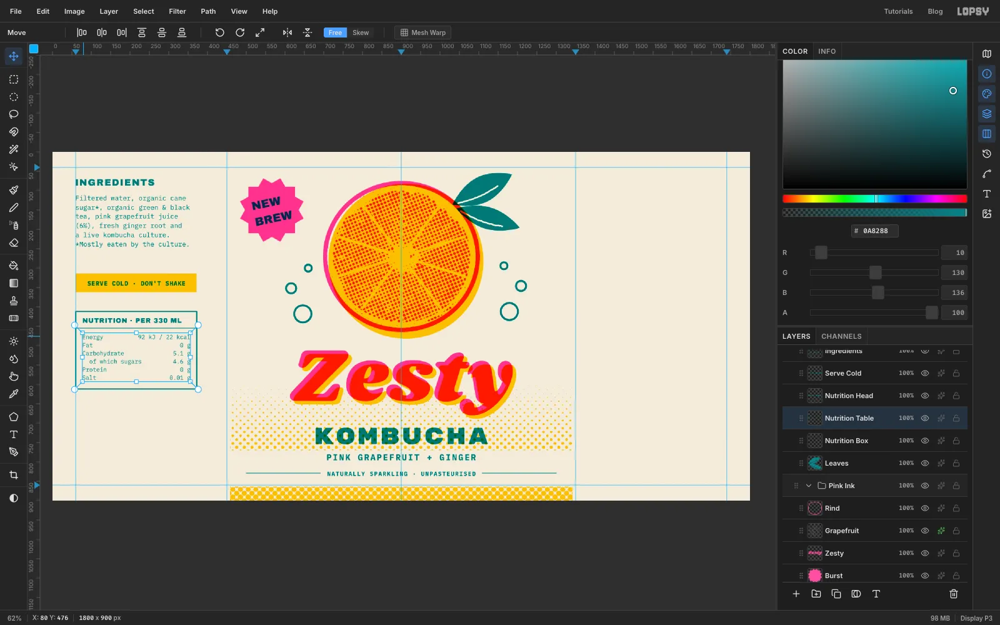

Select **Nutrition Box** and set **NUTRITION · PER 330 ML** in **Archivo Black**, **Size 17**, Letter spacing **1**. Place it **18 px** inside the box's left edge, centred in the header strip.

Select **Nutrition Box** again and set the table in **IBM Plex Mono**, Regular, **Size 15**, Letter spacing **0**, with its top at about **y 472**. Because every character in a monospaced font is the same width, you can line the numbers up on the right just by typing spaces:

- `Energy          92 kJ / 22 kcal`
- `Fat                         0 g`
- `Carbohydrate              5.1 g`
- `  of which sugars         4.6 g`
- `Protein                     0 g`
- `Salt                     0.01 g`

Check that the gaps inside the box are equal on the left and right.

## Draw a real EAN-13 barcode with the Pencil

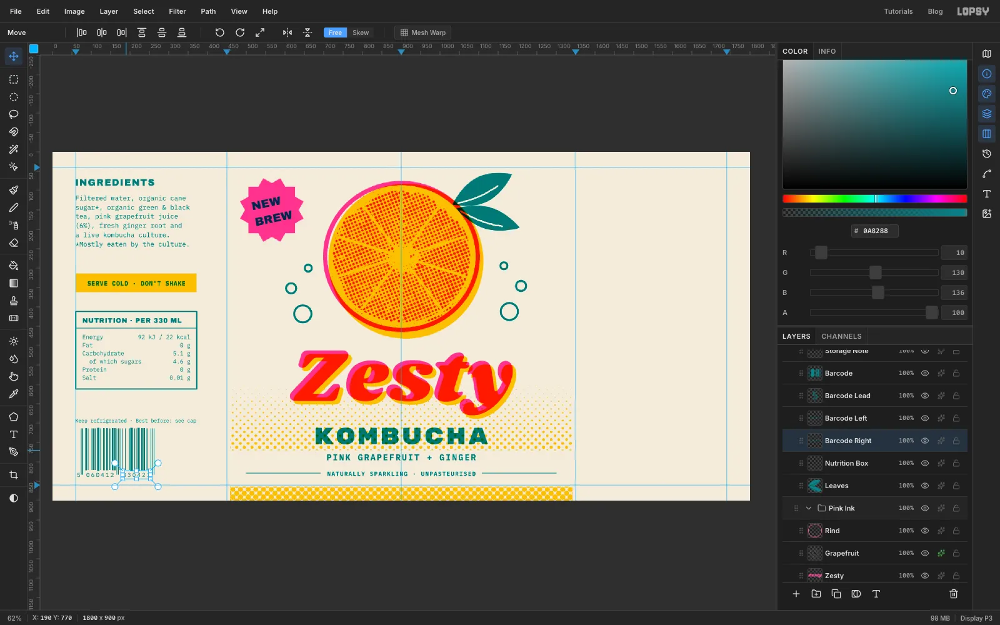

Select **Nutrition Box** and set **Keep refrigerated · Best before: see cap** in IBM Plex Mono, **Size 13**, on the 60 guide at **y 688**.

Then add a layer called **Barcode**. In real life your printer or barcode service supplies this artwork; draw it here if you want the practice, or skip to the digits. The barcode is a real EAN-13 for the number 5 060412 830423. Each of its 95 thin "modules" is 2 px wide, starting at x 74. Choose the **Pencil** with teal as the foreground. For each bar, click at **y 716** and [[Shift]]-click at **y 820** at these x positions:

- **Size 2**: 75, 79, 93, 103, 107, 111, 125, 149, 167, 171, 175, 181, 189, 199, 213, 217, 245, 255, 259, 263
- **Size 4**: 88, 134, 142, 156, 162, 232, 238
- **Size 6**: 119, 205, 223

The six bars at **75, 79, 167, 171, 259** and **263** are the guard bars. Run those down to **y 832** instead.

For the digits, use IBM Plex Mono at **Size 15**. Put **5** just left of the bars. Set **060412** (Letter spacing **3.5**) centred under the left half and **830423** under the right half, with their bottoms at **y 838**, between the guard bars.

## Make the batch stamp's rings and arcs

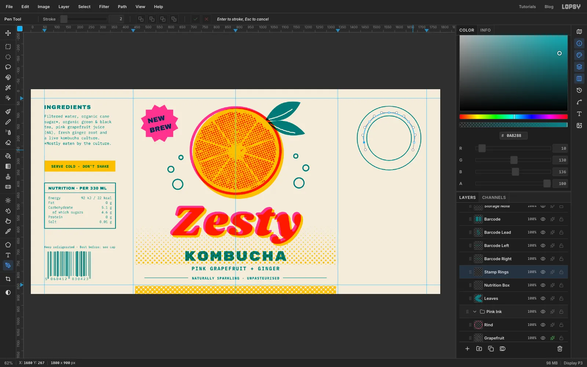

Select **Nutrition Box**, add a layer called **Stamp Rings**, and choose the **Shape** tool: **Ellipse**, no fill, teal stroke, **Width 3**. Holding [[Cmd]], press at **1575, 215** and drag out **140 px** for the outer ring, then press there again and drag out **98 px** for the inner ring.

Type on a path follows the direction you draw it, so draw two separate arcs. That way both lines of text read upright.

- **Top arc**: with the **Pen**, draw a curve 112 px from the centre, from the left side (about **1465, 234**), up over the top (**1575, 103**), and down to the right side (**1685, 234**). Drag a smooth handle at each anchor so it follows the circle. Click **Commit path** (✓) in the options bar rather than closing it.
- **Bottom arc**: draw a second curve 124 px from the centre, starting at the lower left (about **1468, 277**), dipping through the bottom (**1575, 339**) and ending at the lower right (**1682, 277**). Commit it with ✓.

## Wrap the stamp text round the arcs

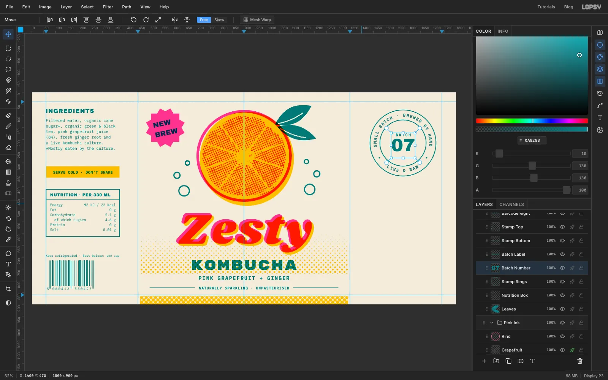

Select **Stamp Rings** and set **SMALL BATCH · BREWED BY HAND** in IBM Plex Mono **Bold**, **Size 18**, Letter spacing **3**. Click in empty canvas below the stamp, type it and press [[Tab]]. With the layer still selected, open the **Path** dropdown on the Text options bar (not the Path menu at the top of the window). Your two arcs are the last two entries; the first of them is the top arc. Pick it, then set **Align** to **Center**. The text jumps onto the arc.

Select **Stamp Rings** again and do the same with **LIVE & RAW**, Letter spacing **4**, on the bottom arc (the last entry), also centred. Hide the path outline by clicking the selected path in the Paths panel. Don't delete the paths, because that unbinds the text.

Brush two **7 px** teal dots in the gaps between the two lines. Then set **BATCH** (IBM Plex Mono Bold, 16, spacing 4) and **07** (**Archivo Black**, **76**) centred inside the inner ring.

## Draw a branching ginger root

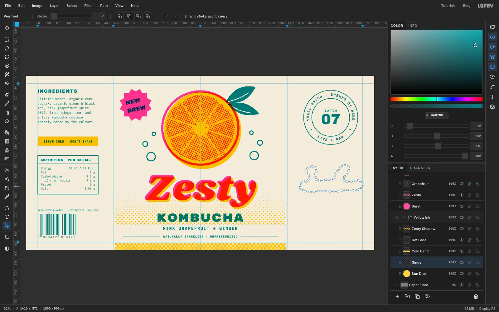

Select **Sun Disc**, add a layer called **Ginger**, and set the foreground to yellow.

With the **Pen**, draw one closed outline round a ginger root. It's a fat horizontal body from about **x 1416** to **1740**, between y **540** and **600**. A short branch goes up and left to a knuckle near **1475, 470**, and a longer branch goes up and right to a knuckle near **1650, 462**. Press and drag a short handle at each anchor so the outline stays rounded and lumpy. Keep anchors at least 20 px apart, because clicking near the first anchor closes the path early.

Click the first anchor to close it. Then **Path to Selection**, **Delete Path**, **Edit → Fill** and [[Cmd+D]].

## Shade the ginger with pink dots

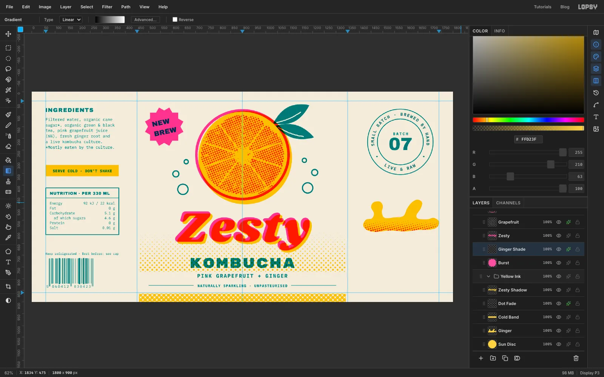

Select **Burst**, add a layer called **Ginger Shade** (it's in Pink Ink), and [[Cmd]]-click the **Ginger** thumbnail to load the root's shape.

With the **Gradient** tool (black to white, as before), drag from **y 612** up to **y 548**, then press [[Cmd+D]]. Apply **Halftone** with **Dot Size 9**, **Density 1**, **Angle 15**, **Softness 0.4**.

[[Cmd]]-click the **Ginger** thumbnail again, choose **Select → Inverse**, press [[Delete]] to trim dots that poke past the edge, and [[Cmd+D]]. Finally add a pink **Color Overlay**. The dots print orange on the yellow root.

## Add growth rings, story copy and volume

Select **Nutrition Box**, add a layer called **Ginger Lines**, and choose the **Brush** ([[B]]) at **Size 4**, Hardness **100**, teal. Drag short curved strokes that wrap round the root: three across the body, bowing slightly, and one across each branch.

Then set the copy, each time with **Nutrition Box** selected first. The Text tool still remembers Bold, Center and wide spacing from the stamp, so reset them:

- the story in IBM Plex Mono **Regular**, **Size 16**, Letter spacing **0**, Align **Left**, left edge at **x 1410**, top at **y 640**: "Fermented for 14 days with / a living culture, then / bottled raw. Tart, zingy / and a little bit wild."
- **330 ML** in **Archivo Black**, **Size 44**, Letter spacing **1**, Align **Left**, at x 1410, with its baseline at **y 838**, level with the barcode digits
- **< 0.5% ABV** and **VEGAN · GF** on two lines, IBM Plex Mono Bold, **Size 15**, Letter spacing **1**, Align **Right**, right edge on the **1740** guide, same baseline

## Add dotted fold marks

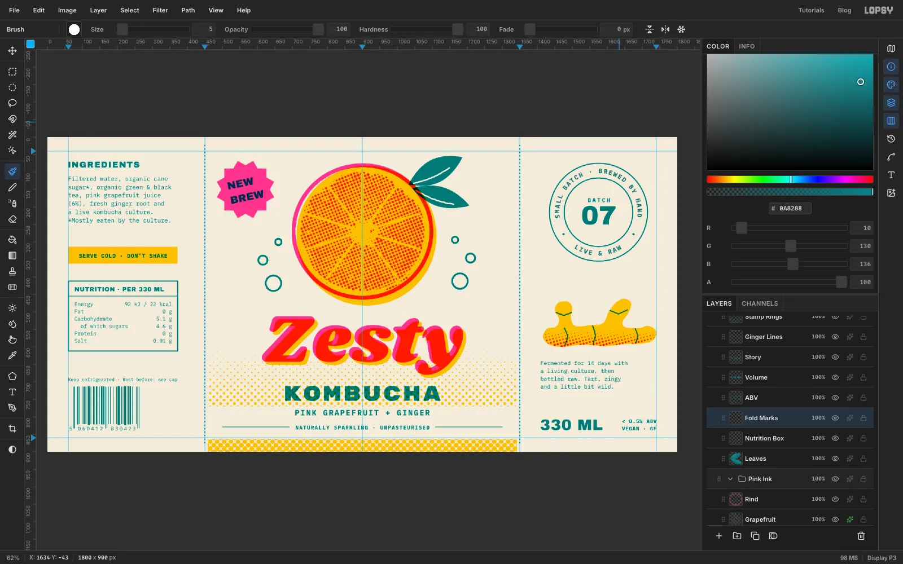

Select **Nutrition Box**, add a layer called **Fold Marks**, and choose the **Brush** at **Size 5**. Click the brush tip swatch at the left of the Brush options bar to open the **Brushes** panel, and set **Spacing** to **200%**, so each dab sits apart from the next.

Click at **450, 24** and [[Shift]]-click at **450, 876**, then do the same at **x 1350**. You get dotted fold lines. Set **Spacing** back to where it was afterwards.

## Make ink dropouts for each drum

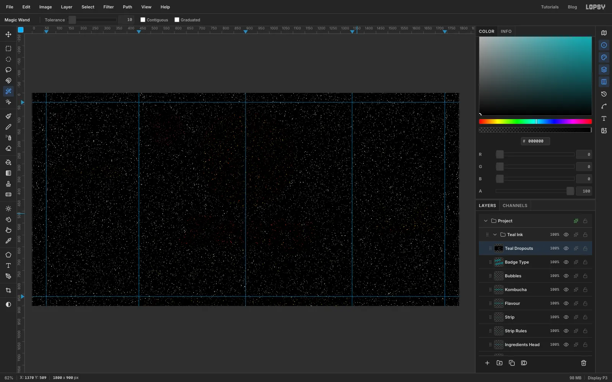

Real riso ink misses the paper in small clumps. You'll make a fresh speckle layer at the top of each ink group: Yellow, then Pink, then Teal. The screenshot shows the last one, Teal Dropouts, straight after Threshold. Here's the recipe for Yellow Ink:

1. Select the top layer inside **Yellow Ink**, click **Add Layer**, and name it **Yellow Dropouts**.
2. Set the foreground to black and choose **Edit → Fill**. The whole label goes black for a moment, because black multiplies over everything below.
3. **Add Noise…**: Amount **100**, **Mono**, **Gaussian**.
4. **Gaussian Blur…**: Radius **2**. This clumps the noise.
5. **Threshold…**: start the Level at about **24** and lower it until only a light scatter of white flecks is left. Aim for 1–2% of the area. Blurred noise is dim, so the right level is low, often around 20.

## Keep only the flecks

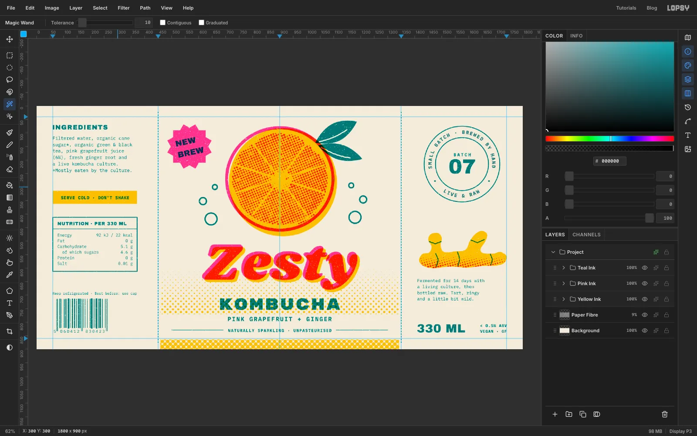

Choose the **Magic Wand** ([[W]]), set **Tolerance** to **10** and untick **Contiguous**. Click any black spot, press [[Delete]] and [[Cmd+D]]. Only the white flecks are left.

Inside a Multiply group, white does nothing to the paper but knocks holes in that group's ink, which is exactly what a dropout looks like.

Repeat for **Pink Ink** (**Pink Dropouts**) and **Teal Ink** (**Teal Dropouts**). Each time you run Add Noise you get a new pattern, so the flecks differ from ink to ink. Use a slightly lower Threshold for teal, since dropouts show most in big flat areas of dark ink.

## Knock the drums out of register

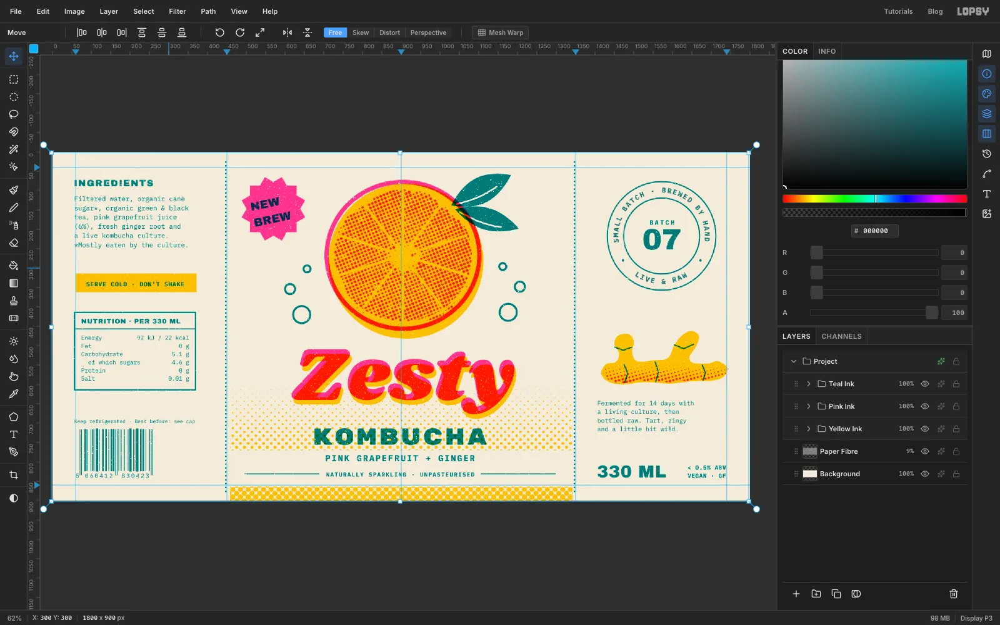

Last of all, the misregistration. Collapse **Pink Ink**, click its row to select the whole group, switch to the **Move** tool, and press [[Right]] four times and [[Up]] three times. Collapse **Teal Ink**, select it, and press [[Left]] three times and [[Down]] twice.

Every pink element moves together, and so does every teal one. Leaf edges, letters and rings now sit a few pixels off the yellow, like a real riso print. If you go too far, [[Cmd+Z]] steps back one nudge at a time.

Save with **File → Save Project**, then **File → Quick Export PNG** for the finished label.
