Rococo is the French decorative style of the mid 1700s: pale rooms, gold scrollwork, shells, ribbons and porcelain. The word comes from *rocaille*, the shell and pebble work used to line garden grottoes. Its ornament is built from C and S curves that swell and curl, and it's happiest when things don't quite match, so the left side of a shell is rarely the same as the right. Rococo's best colours came from the Sèvres porcelain factory: a turquoise called *bleu céleste*, a pink later named *rose Pompadour*, and a yellow called *jonquille*.

In this tutorial you'll present an imaginary app in that language. *Oolong Pavilion* helps you steep tea slowly. It's named for the kind of garden tea house Frederick the Great built at Sanssouci. The board is 2400 × 1600 px and holds:

- a blue damask wall that you paint and tile yourself
- a gold wall rail with scrolled corners
- three phones in cast-gold frames, hanging from ribbons like portrait miniatures
- a timer screen with a real Sèvres cup inside a beaded dial, a home screen with a tea house medallion, and a tea list
- an oval title, a Sèvres teapot on a wall bracket, and Redouté roses

The one big idea is the gold. You won't paint any gold at all. Everything metal is painted in **flat grey** first, then turned into relief with **Emboss** and coloured all at once with a **Gradient Map** on one group. Light falls the same way on every piece because the emboss happens after the pieces are assembled, so mirrored copies don't end up lit from the wrong side.

You'll need four images from Wikimedia Commons, all free to use. Download the 1920 px wide version of the first three, and the file itself for the fourth:

- **Small tray, cup and saucer (déjeuner carré) MET DP201025.jpg**, a Sèvres cup from about 1765 (CC0)
- **Chinese House Potsdam-, Germany.jpg**, the tea house at Sanssouci (CC0)
- **Teapot with cover MET DP229672.jpg**, a Sèvres teapot from 1780 (CC0)
- **Redoute - Rosa centifolia foliacea.jpg**, a Redouté rose print on white (public domain)

The tools you'll use:

- the **Brush** with **Taper**, **Hardness**, **Spacing**, **Symmetry Vertical** and **Radial Symmetry**, and [[Shift]]-click for straight lines
- the **Shape** tool's click-to-size dialog, with corner radius, fill and stroke
- **Define Pattern** and **Fill with Pattern**
- the **Lasso** (with [[Alt]] to subtract), **Magic Wand**, **Elliptical Marquee**, **Select → Grow / Shrink / Inverse**, and [[Cmd]]-click on a thumbnail
- **Copy**, **Paste**, the **Move** tool's flip buttons and handles, and transforming a group and a layer together
- **Emboss**, **Gaussian Blur**, **Hue/Saturation** and **Unsharp Mask**
- group adjustments: **Gradient Map**, **Color Grading** and **Vignette**
- layer effects: **Drop Shadow**, and the **Multiply** blend mode
- live text in **Pinyon Script**, **Playfair Display**, **Playfair Display SC**, **EB Garamond**, **Bodoni Moda** and **Libre Baskerville**

The palette:

- Wall `#B9DEE8`, shading `#A6CFD8`
- Rose Pompadour `#E6ADBB`, deep rose `#C8546E`
- Porcelain cream `#FCF6E8`, card cream `#FFFBEF`
- Jonquille `#F1E0A2`
- Aubergine ink `#5A1A2C`, bronze ink `#6B4514`
- Metal before gilding `#8C8C8C`
- Gold `#55360C` → `#96701F` → `#CFA63F` → `#F0D67E` → `#FFF8D6`
- Ribbon `#E795AE` / `#E8A9BA` / `#B95C7E`

> **Tip:** On a wide-gamut (Display P3) screen, Lopsy reads typed hex codes as P3 colours, so everything comes out a little richer than on an sRGB screen. The codes are the same either way.

> **Note:** Shortcuts are written for a Mac. On Windows use [[Ctrl]] wherever it says [[Cmd]], except for handle drags and the symmetry-centre click, which use the Windows key. Positions like "x 340, y 395" are document pixels, and the status bar at the bottom left shows them as you hover. They're guides, so trust your eye over the numbers.

> **Tip:** Much of this is small work, so zoom in. [[Cmd]]+scroll zooms around the pointer, holding [[Space]] and dragging pans, and **View → Fit to Screen** takes you back. When you make shapes on top of each other, don't move the mouse between clicks and they'll share a centre.

## Fill the wall

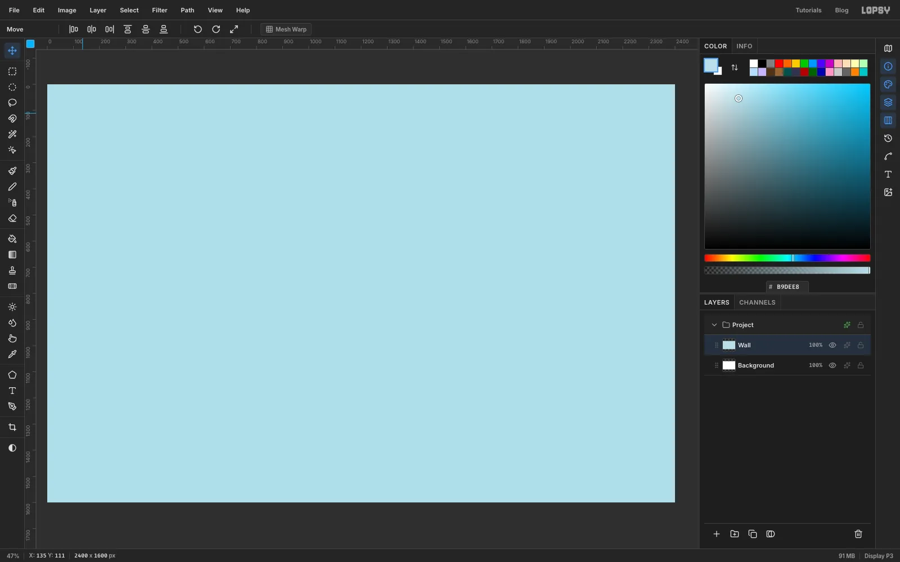

Choose **File → New**, keep the units on **Pixels**, and make the document **2400** wide and **1600** high with a white background.

Click the empty *Layer 1* and double-click its name to rename it *Wall*. Set the foreground to `#B9DEE8` in the Color panel and choose **Edit → Fill**.

## Paint a damask tile with the mirror on

Damask is a woven pattern of one motif inside a pointed oval, called an ogee. You only have to paint half of it.

Click **Add Layer** at the bottom of the Layers panel and name the layer *Tile*. Set the foreground to white and press [[B]] for the **Brush**. In the options bar, click **Symmetry Vertical**, the mirror button that reflects left and right. The mirror line starts at the centre of the canvas, which is where you'll paint.

Click the brush-tip thumbnail at the left of the options bar to open the **Brushes** modal. Size, Hardness, Spacing and Taper are all on its **Shape** tab. It can stay open while you paint, but it opens over the middle of the canvas, so drag it aside by its title bar.

**Taper** thins a stroke as it travels. It's the distance in pixels over which the stroke narrows to nothing, so a stroke starts fat and ends in a point. That's the whole secret of rococo line, and you'll use it for almost everything.

> **Tip:** Keep the pointer moving while you paint. If you hold still for about a second and a half mid-stroke, Lopsy smooths the stroke and loses the taper. Undo with [[Cmd+Z]] if that happens.

1. **The ogee.** Set **Hardness 100**, **Size 9**, **Taper 0**. Start on the mirror line about 225 px below the centre of the canvas and draw one long curve upwards, bulging about 50 px to the right, then crossing back over the line near the height of the canvas centre. Then start 225 px above the centre and curve down, bulging 50 px the same way, until you're back on the line just above the centre. The mirror draws the other side, and the crossing makes the pinched waist.
2. **The leaves.** Set **Size 26**, **Taper 190**. Paint three leaves on the right, each from its rounded tip in towards a point about 80 px below the centre. Make them about 175, 150 and 110 px long, fanning from almost upright to about 45°. Painting towards the stem gives you a round tip and a thin base, like a petal. Painting the other way gives you a spike, and a spiky damask looks like a marijuana leaf.
3. **The curl.** Set **Size 18**, **Taper 120**. From about 90 px below the centre, draw a short curl out to the right that hooks round at the end.

Now click **Symmetry Vertical** again to turn the mirror off. For the centre stem, set **Size 30**, **Taper 200** and draw straight down the mirror line, from 125 px above the centre to about 80 px below it. Then set **Size 18**, **Taper 100** and draw straight up the line, from about 195 px below the centre to about 95 px below it.

## Tile the pattern across the wall

Press [[M]] for the **Rectangular Marquee**. With nothing selected, click once on the canvas to open its exact-corners dialog, enter **From** 1065, 570 and **To** 1335, 1030, and click **Select**. That box leaves a little air either side of the motif, so the columns will sit close together.

Choose **Edit → Define Pattern**, then press [[Cmd+D]] to deselect. Delete the *Tile* layer with the bin button at the bottom of the Layers panel, because the pattern is stored now.

Add a layer called *Damask* and choose **Edit → Fill with Pattern…**. Click your new swatch, set **Scale** to **50** and **Column Stagger** to **50**, and click **Apply**. The stagger drops every other column by half a tile, which is how real damask repeats.

Click the percentage on the *Damask* row and drag its **Opacity** down to **26**. Silk damask is one colour with a change of sheen, and it should sit well behind everything.

## Shade the wall

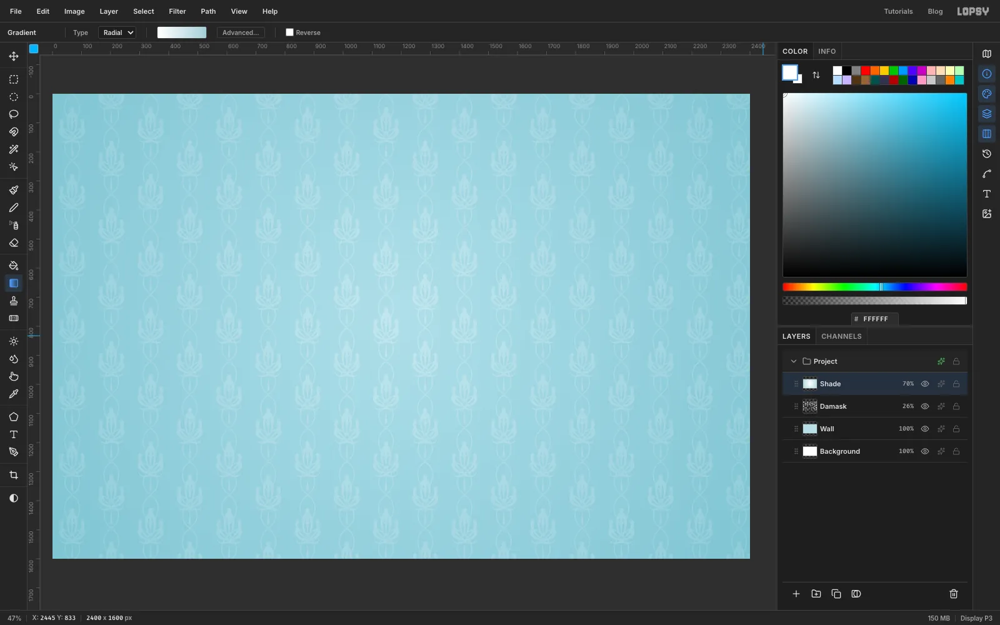

Add a layer called *Shade* and click the **Gradient** tool in the toolbox. Set **Type** to **Radial** and click **Advanced…**. Make the left stop white and the right stop `#A6CFD8`, using the **Hex** field for each, and click **Done**.

Drag from the middle of the canvas to just past the bottom right corner. Then open the layer's effects with the sparkle button on its row, set the **Blend** to **Multiply** and close the drawer. Set the layer's **Opacity** to **70**. White does nothing on Multiply, so only the corners darken.

Now build the layer stack, so everything you make later has somewhere to go. New layers land directly above the active layer, and a layer added while a group is active goes inside that group.

1. Add five layers, in this order: *Ribbons*, *Cartouche*, *Bloom*, *Pot*, *Spray*.
2. Click the *Cartouche* row, click **New Group** at the bottom of the panel and name it *Gilt*.
3. Click *Cartouche* again, click **New Group**, name it *Phone C*, then click **Add Layer** and name that layer *C UI*.
4. Do the same for *Phone B* with a layer *B UI*, then *Phone A* with a layer *A UI*, clicking *Cartouche* first each time.
5. Click the *Gilt* group row and add six layers inside it, in this order: *Rail*, *Title Gilt*, *A Gilt*, *B Gilt*, *C Gilt*, *Master*.

From the bottom up you should have the wall layers, *Ribbons*, *Cartouche*, the three phone groups, *Gilt*, then *Bloom*, *Pot* and *Spray* on top.

## Draw the wall rail

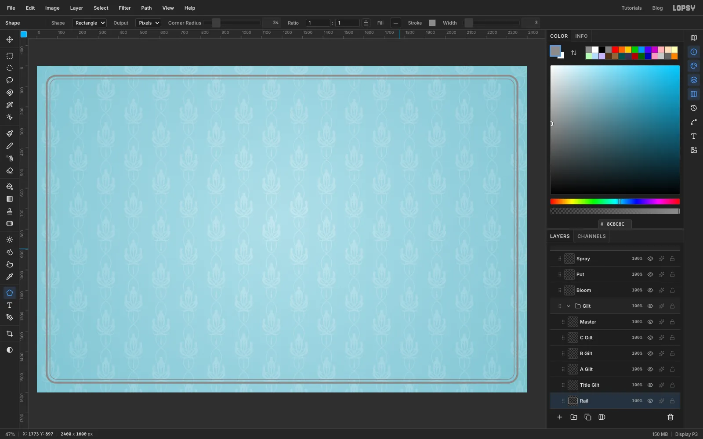

From here until the gilding step, all metal is painted in flat grey `#8C8C8C`. It will look dull for a long time. Trust it.

Click *Rail*. Press [[U]] for the **Shape** tool. In the options bar set **Shape** to **Rectangle**, **Output** to **Pixels** and **Corner Radius** to **46**. Click the **Fill** swatch and choose **Remove fill**. Click **Stroke**, type `#8C8C8C` in the popover's hex field, and set **Width** to **9**. Click in the status bar to close the popover.

Click once in the centre of the canvas (x 1200, y 800), without dragging. The **Shape Size** dialog opens. Enter **2304** × **1504** and click **Create**. Shapes grow from where you click, so it lands centred.

Set **Corner Radius** to **34** and **Width** to **3**, click the same centre again and make it **2272** × **1472**. That's the thin inner line of the moulding.

## Paint a corner scroll

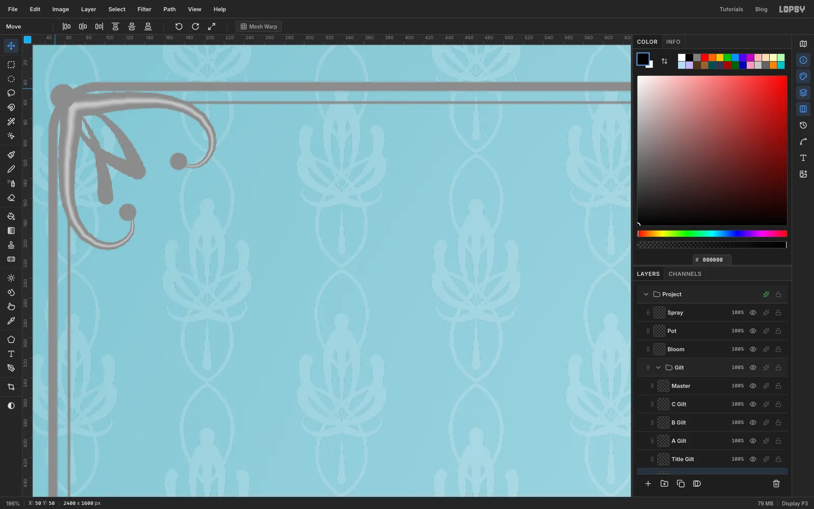

Add a layer called *Corner* directly above *Rail*. Set the foreground to `#8C8C8C` and press [[B]] for the **Brush**. Check that the mirror is off.

In the **Brushes** modal set **Hardness 100**, **Size 24**, **Taper 240**. Start just inside the rail's top left corner, at about x 68, y 68. Draw one stroke to the right, about 210 px long, that starts almost straight and curls down and back on itself at the end like a fern. Then draw a second one from the same point, straight down, curling in towards the first.

Set **Size 16**, **Taper 100** and paint three leaves between the arms, each from its rounded tip back into the corner point.

Next comes a trick that makes the emboss look round rather than flat. Set the foreground to `#C8C8C8`, set **Hardness 0**, **Size 13**, **Taper 240**, and repeat the two big strokes down the middle of what you painted. You're painting a soft ridge line along the spine.

Set the foreground back to `#8C8C8C`, and **Hardness 100**, **Taper 0**. Click a dot at **Size 18** in the eye of each curl, and one at **Size 26** right on the corner point.

## Mirror the corner to the other three

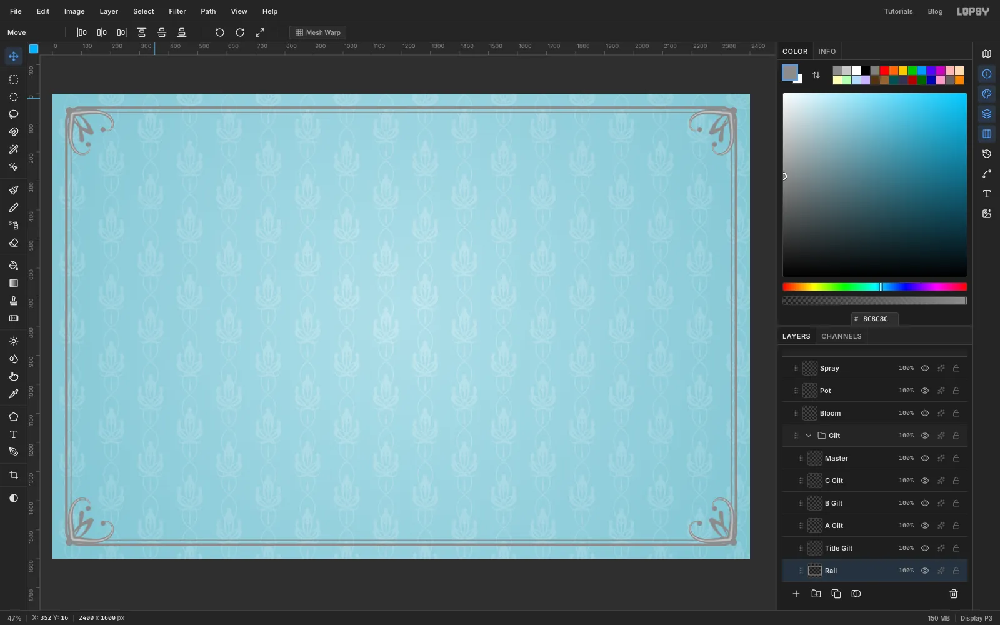

Press [[M]] and draw a marquee around the scroll, a little bigger than it, then press [[Cmd+C]] and [[Cmd+D]].

Press [[Cmd+V]]. A paste lands exactly where it was copied from, with its pixels selected and the **Move** tool active. Click **Flip Horizontal** in the options bar, press [[Cmd+D]], then click in the status bar so the options bar lets go of the keyboard. Drag anywhere on the canvas to slide the copy into the top right corner. With no selection, a drag moves the whole active layer, so you don't need to grab the scroll itself. The copy can be dragged straight across, because the rail is symmetrical.

Paste again and use **Flip Vertical** for the bottom left. Paste once more and use both flips for the bottom right, dragging it diagonally across the board.

The new layers stack above *Corner*. With the top one active, choose **Layer → Merge Down** four times, until everything has merged into *Rail*.

## Draw the middle phone's frame

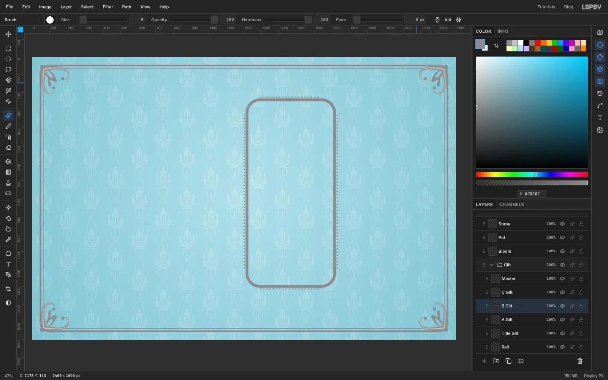

Click *B Gilt*. The three phone screens will be **480 × 1040** px, with their centres at:

- Phone A: x 905, y 835
- Phone B: x 1465, y 770
- Phone C: x 2030, y 855

They sit at slightly different heights because a perfectly level row of miniatures looks like a shop display.

Press [[U]] for the **Shape** tool. Keep **Rectangle**, no fill and a `#8C8C8C` stroke, and set **Corner Radius** to **74** and **Width** to **16**. Click at x 1465, y 770 and make it **496** × **1056**.

Now the row of pearls just outside it. Press [[B]], and in the **Brushes** modal set **Hardness 100**, **Size 9**, **Taper 0** and **Spacing 200**. With Spacing that wide, a stroke prints separate dots. Click just outside the left of the frame, about a pearl's width clear of it and well short of the top corner. Hold [[Shift]] and click at the same distance out, well short of the bottom corner. A [[Shift]]-click draws a straight line from the last point. Do the same down the right side, then along the top and bottom, stopping short of the corners each time. The corners will be covered by scrolls later.

Set **Spacing** back to **1** before you forget.

## Paint the shell crest

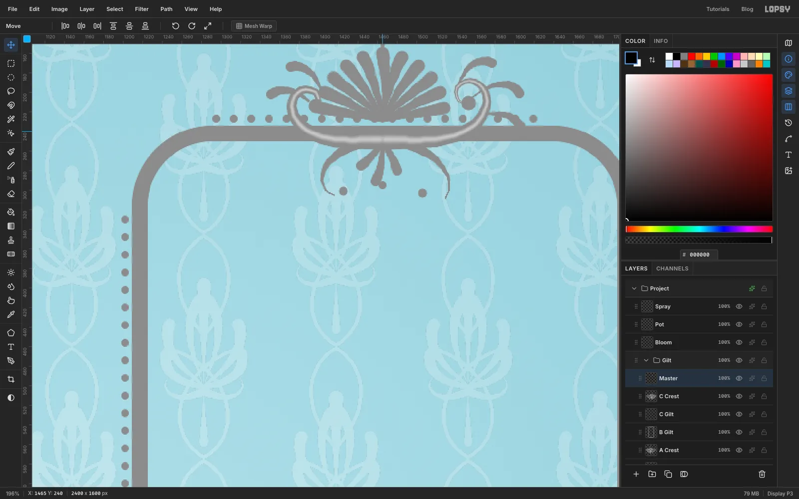

The crest is the piece that makes the board look rococo, and it's worth some care. Click *Master*. Everything here is centred on the top of the middle phone's frame, at about x 1465, y 200.

1. **The shell.** Set **Hardness 100**, **Size 14**, **Taper 90**. Pick a hinge point at about y 229. Paint eleven ribs, each starting on an imaginary half-circle about 75 px above and around the hinge and running in to the hinge. Go from the far left round to the far right. Each stroke starts round and fat on the rim and thins to nothing at the hinge, so the ribs make a scalloped edge on their own.
2. **The big scrolls.** Set **Size 22**, **Taper 220**. Start just under the hinge and draw a long C to the right, about 190 px, running nearly flat under the shell and then curling up and back on itself. Do the same to the left, but shorter, about 155 px. The uneven pair matters: rococo avoids exact symmetry.
3. **The lower scrolls.** Set **Size 14**, **Taper 90**. From about the same start, draw a shorter curl down and out on each side. These hang into the screen.
4. **The leaves.** Set **Size 11**, **Taper 60**. Add three small curved leaves off the right scroll and two off the left, each from its rounded tip back to the scroll. Add three short drops hanging from the middle, and one flame-shaped leaf on top of the shell.
5. **The ridge.** Set the foreground to `#C8C8C8`, **Hardness 0**, **Size 12**, **Taper 220**, and repeat the two big scrolls down their middles. Set the foreground back to `#8C8C8C` and **Hardness 100**.
6. **The dots.** Set **Taper 0**. Click a **Size 16** dot in the eye of each big scroll, **Size 10** in each lower one, and **Size 9** under the middle drop.

Don't try to match mine exactly. Yours will have its own wobble, and that's in the spirit of the thing.

## Paste the crest onto the other frames and the title

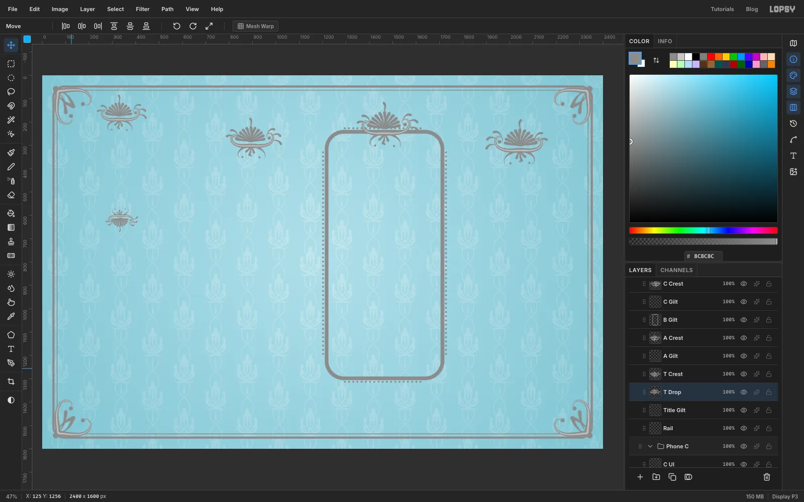

Press [[M]], draw a marquee around the crest, and press [[Cmd+C]] then [[Cmd+D]].

Every paste selects itself and switches to the **Move** tool, so you can transform it straight away. A corner handle scales it, and holding [[Cmd]] keeps the proportions. Finish each one with [[Cmd+D]] and then drag it into place.

- **Phone C.** Click *C Gilt* and paste. Click **Flip Horizontal**, so the long scroll points the other way from the middle phone's. Press [[Cmd+D]] and drag it so it sits above the top of phone C's frame, centred on x 2030 with its centre at about y 285. Name the layer *C Crest*.
- **Phone A.** Click *A Gilt* and paste. [[Cmd]]-drag a corner handle in until it's about **90%** of its size. Press [[Cmd+D]] and drag it above the top of phone A's frame, centred on x 905 at about y 270. Name the layer *A Crest*.
- **Title top.** Click *Title Gilt* and paste. Scale it to about **80%**, press [[Cmd+D]] and drag it to x 340, y 160. Name it *T Crest*.
- **Title bottom.** Click *Title Gilt* and paste. Click **Flip Vertical**, scale it to about **52%**, press [[Cmd+D]] and drag it to x 340, y 620. Name it *T Drop*.

Keep *Master* as it is. You'll copy from it twice more.

## Finish all three frames

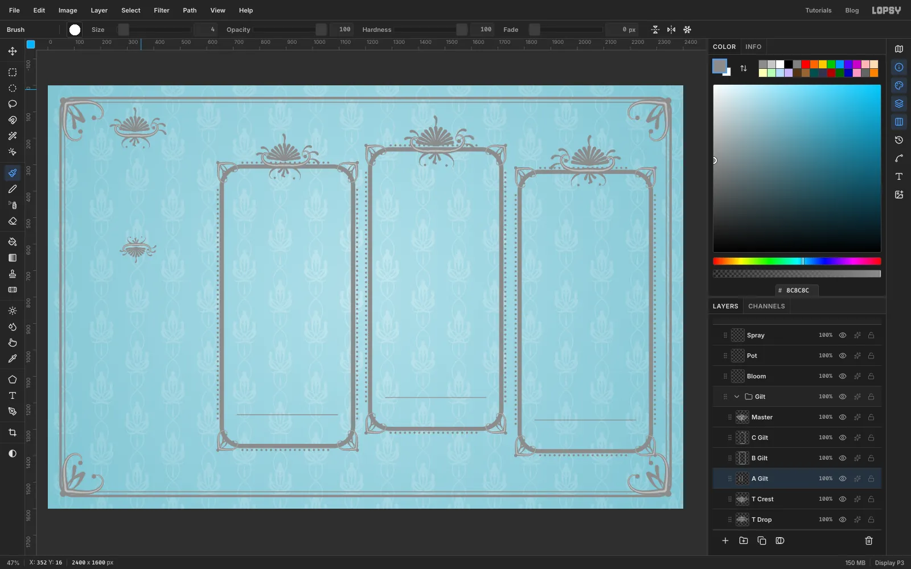

**Small corners.** Click *B Gilt* and add a layer *Small Corner*. Paint a miniature of the rail's corner scroll over the frame's top left corner, starting just outside the ring, in `#8C8C8C`:

- the two arms at **Hardness 100**, **Size 13**, **Taper 125**, each about 105 px long
- the leaves at **Size 8**, **Taper 50**
- the ridge in `#C8C8C8`, at **Hardness 0**, **Size 7**, **Taper 125**
- the dots in `#8C8C8C`, at **Hardness 100**, **Taper 0**, **Size 9** in the curls and **Size 13** on the corner

Marquee it, copy, deselect, and paste three flipped copies into the other corners, exactly as you did with the rail. **Merge Down** four times to fold them all into *B Gilt*. Because the frame is symmetrical, each flip only needs a drag straight across, straight down, or diagonally for the last one.

**The other two frames.** Click *A Gilt* and repeat the frame ring and pearl rows for phone A's centre, set **Spacing** back to **1**, then paste the small corner four times (flipping as before), dragging each to a corner of the new frame, and Merge Down four times. Do the same on *C Gilt* for phone C. The small corner is still on the clipboard. Each pasted corner lands at phone B's corner first, so you're dragging it across to the new phone.

**Fold in the crests.** Click *C Crest* and **Merge Down** so it joins *C Gilt*. Do the same with *A Crest* into *A Gilt*.

**Tab bar lines.** Each screen will have a thin rule 930 px below its top edge, and it belongs with the metal. The tops of the screens are at y 315 (A), y 250 (B) and y 335 (C). On each phone's Gilt layer, with **Size 4**, **Hardness 100**, **Taper 0** and **Spacing 1**, click 190 px left of the centre line at that height, then [[Shift]]-click 190 px right of it.

## Lay out the steeping screen

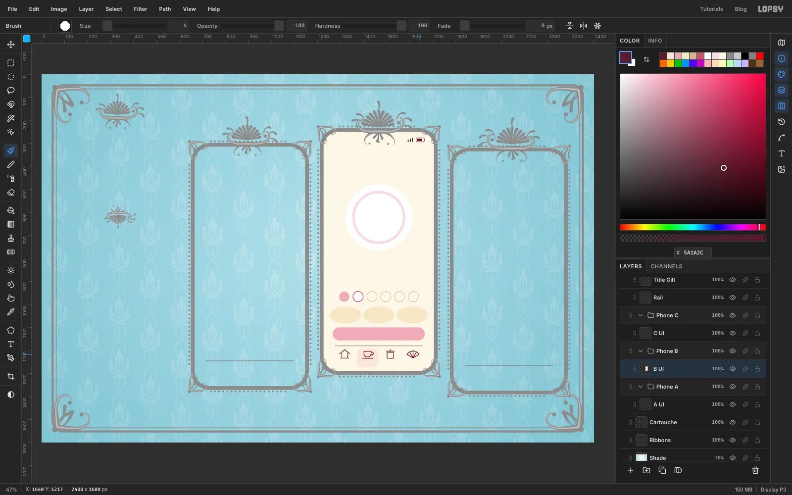

Time for the app. All three screens use the same system: flat shapes on one layer, then text above them.

In the phone sections from here on, "y 372" means 372 px below the top of that screen, and "in from the left" means from the screen's left edge. Phone B's screen has its top at document y 250 and its left edge at x 1225, so y 372 is document y 622. Everything sits on the phone's centre line, x 1465, unless it says otherwise.

Click *B UI* and press [[U]] for the **Shape** tool. Each shape below is a click at the position given, with the size typed into the dialog. Rectangles use the **Corner Radius** shown. For circles and ovals, set **Shape** to **Ellipse**. Remember to remove the fill or stroke you aren't using.

- **Screen:** rectangle `#FCF6E8`, 480 × 1040, radius 66, at the phone's centre
- **Dial face:** white ellipse, 290 × 290, at y 372 on the centre line
- **Dial track:** ellipse with no fill and a `#F3DCE2` stroke, Width 11, 220 × 220, in the same place
- **Infusion circles:** six 44 × 44 ellipses at y 716, 60 px apart, starting 90 px in from the screen's left edge. The first is filled `#E6ADBB`. The second is white with a `#C8546E` stroke, Width 3. The other four have no fill and a `#CDB98E` stroke, Width 2.
- **Stat ovals:** three `#F4E7C9` ellipses, 136 × 74, at y 796, centred 95, 240 and 385 px in from the left edge
- **Button:** rectangle `#E6ADBB`, 400 × 56, radius 28, at y 878

**Status bar.** With the **Brush** at **Size 5**, **Hardness 100**, **Taper 0** and foreground `#5A1A2C`, make three little signal bars with [[Shift]]-click lines, starting 368 px in from the left, 9 px apart, standing on y 42 and 6, 10 and 14 px tall. Then add a battery to their right with the **Shape** tool, in `#5A1A2C`: a 36 × 17 rectangle, radius 5, stroke only at Width 2, and a 22 × 10 filled rectangle, radius 2, inside it.

**Tab bar.** At y 982, make a 92 × 82 rectangle in `#F7E6DA`, radius 24, centred 191 px from the left edge. That's the active tab's highlight, behind the second icon. Then, with the **Brush** at **Size 4** in `#5A1A2C`, draw four small line icons centred at y 966, at 92, 191, 290 and 389 px in from the left:

- **Pavilion:** a roof like a shallow upturned V, 44 px wide with its peak 18 px above the eaves, two posts 26 px apart and 20 px tall, and a ground line 36 px wide
- **Cup:** a U-shaped bowl 32 px wide and 24 px tall with a line across the top, a small handle on the right, and a saucer line 44 px wide below
- **Caddy:** a box 28 × 26 px, a lid line 34 px wide above it, and a 5 px knob on top
- **Fan:** five 30 px ribs spreading from one point across about 120°, with a curved line through their tips

Later you'll repeat this tab bar on the other two screens, with the highlight moved. Small differences between phones won't show.

## Cut the elapsed arc

The timer shows how much of the steep has gone by. The easy way to draw a precise arc is to draw a whole ring and cut a wedge out of it.

Add a layer *B Arc* above *B UI*. With the **Shape** tool, make an ellipse with no fill and a `#C8546E` stroke, **Width 11**, 220 × 220, in the same place as the track.

Press [[L]] for the **Lasso**. Start in the centre of the dial and drag straight out past the ring at about five o'clock. Then go clockwise, well outside the ring, past six and nine, and all the way round to twelve. Come straight back to the centre and release. Press [[Delete]], then [[Cmd+D]]. The pink is left from twelve o'clock round to five, a little under half the circle, which matches 35 seconds of an 80 second steep.

## Trace the cup out of its photo

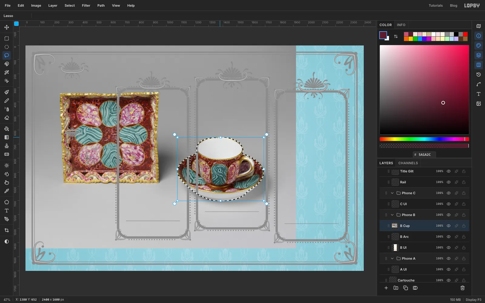

With *B Arc* active, drag the cup photo from your computer onto the canvas. It arrives as a new layer at the top left of the canvas with its pixels selected. Press [[Cmd+D]] and rename the layer *B Cup*.

The photo lands under the *Gilt* group, so the frames run across it. Click the eye on the *Gilt* row to hide them while you trace, and click it again when you're done.

Press [[L]] and trace carefully around the cup and saucer in one long drag, ignoring the tray. Stay just inside the edge, and leave out the shadow under the saucer. It's fine to include the handle's hole here, because the dark gap is small and reads as part of the handle.

Choose **Select → Inverse** and press [[Delete]], then press [[Cmd+D]].

## Fit the cup into the dial

Press [[M]] and draw a marquee just around the cup. Press [[V]] for the **Move** tool, and [[Cmd]]-drag a corner handle inwards until the cup is about **176 px** wide. It's a big reduction, and the handles show you the new box as you go. Press [[Cmd+D]], then drag the cup into the middle of the dial.

Having a real object in the middle of a timer is what makes this screen. It tells you what you're waiting for.

## Bead the dial with Radial Symmetry

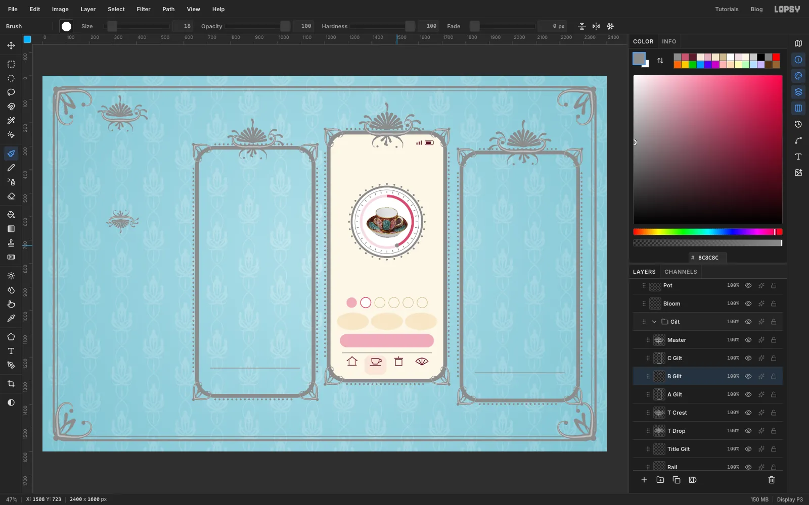

Click *B Gilt*. With the **Shape** tool, make two ellipses at the dial's centre, with no fill and a `#8C8C8C` stroke: 300 × 300 at **Width 8**, and 272 × 272 at **Width 2**.

Set the foreground to `#8C8C8C`. Press [[B]] and set **Size 9**, **Hardness 100**, **Taper 0**. Click **Radial Symmetry** in the options bar and set **Segments** to **32**. Then [[Cmd]]-click the centre of the dial, which moves the centre of symmetry there without painting. A small marker shows where the centre is, and it isn't paint. Click once straight above the centre, just outside the outer ring. All 32 pearls appear at once.

Now set **Size 4** and draw one tiny tick straight above the centre, just inside the thin ring. You get 32 ticks.

Click **Radial Symmetry** again to turn it off. It hijacks every [[Cmd]]-click until you do. Set **Size 18** and click once at the end of the pink arc, at about five o'clock, for the knob.

## Set the steeping screen's type

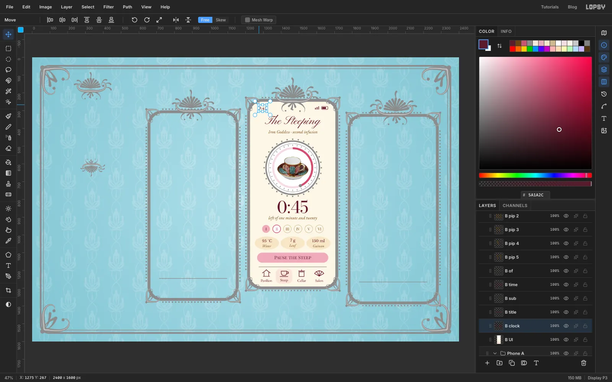

**A note on setting text.** Clicking with the **Text** tool inside or just beside an existing line edits that line instead of starting a new one. So on every screen, **work from the bottom up**. Each new click is then above what's already there, and it can't hit it.

Each line goes like this:

1. Click the screen's UI layer (*B UI* here), so the new text doesn't restyle the last one.
2. Press [[T]], and set the font, **Size** and colour in the options bar. Set the style menu next to the weight to **Normal**, or **Italic** if the line says italic, because it stays as you left it.
3. Click roughly where the line goes, type, and press [[Tab]] to finish.
4. Press [[V]] for the **Move** tool and use the arrow keys to place it. [[Shift]]+arrow moves 10 px at a time. Text layers name themselves after their words, so you can tell them apart.

The y values below give the middle of each line. They're there to save you measuring, and your eye gets the last word.

Everything on this screen is centred on the phone's centre line unless it says otherwise. From the bottom up:

- Tab labels in EB Garamond 21 `#5A1A2C`, at y 1006, under each icon: *Pavilion*, *Steep*, *Cellar*, *Salon*
- *Pause the Steep*, Playfair Display SC 25 `#5A1A2C`, y 876
- Oval labels in EB Garamond italic 21 `#6B4514`, y 811: *Water*, *Leaf*, *Gaiwan*
- Oval values in Libre Baskerville 21 `#5A1A2C`, y 782: *95 °C*, *7 g*, *150 ml*
- *I II III IV V VI* as six separate layers in Playfair Display SC 21, y 716, centred in their circles. *I* is `#5A1A2C`, *II* is `#C8546E`, and the rest are `#6B4514`. Click near the middle of each circle, or you'll hit the numeral beside it.
- *left of one minute and twenty*, EB Garamond italic 25 `#6B4514`, y 656
- *0:45*, Bodoni Moda 92 `#5A1A2C`, y 590. Timers need lining figures, and Playfair's old-style numbers make the zero look like a small o.
- *Iron Goddess · second infusion*, EB Garamond italic 25 `#6B4514`, y 172
- *The Steeping*, Pinyon Script 66 `#5A1A2C`, y 112
- *9:41*, EB Garamond 27 `#5A1A2C`, y 36, with its left edge 50 px in from the screen's left edge

> **Tip:** The · in the subtitle is easiest to paste from your clipboard. Copy it from this page, and paste with [[Cmd+V]] while typing.

## Cut the tea house into an oval

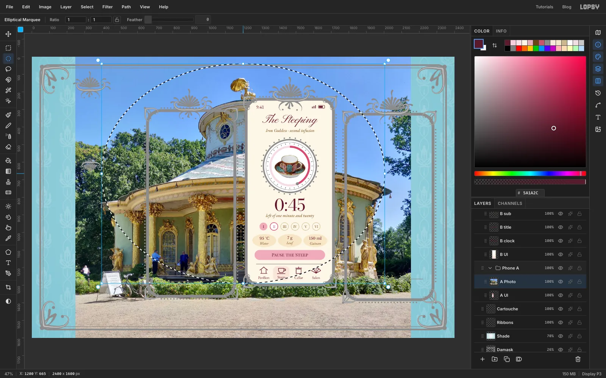

Now the home screen. Phone A's screen has its top at document y 315 and its left edge at x 665, and its centre line is x 905. As before, a y here is measured from the top of the screen. Click *A UI* and build its shapes with the **Shape** tool first:

- **Screen:** rectangle `#E6ADBB`, 480 × 1040, radius 66, in the middle of the frame (document x 905, y 835)
- **Card:** rectangle `#FCF6E8`, 424 × 306, radius 34, at y 668 on the centre line
- **Note pills:** three `#FADFE6` rectangles, 112 × 42, radius 21, at y 712, centred 112, 240 and 368 px in from the left edge
- **Button:** rectangle `#5A1A2C`, 400 × 62, radius 31, at y 876

Add the status bar, and the tab bar with the same four icons and its highlight in `#F6CFDB` behind the first icon. Then drag the tea house photo onto the canvas, press [[Cmd+D]] and rename the layer *A Photo*. It's slightly taller than the document, so Lopsy shrinks it to fit and centres it.

Pick the **Elliptical Marquee** in the toolbox. With nothing selected, click once for its exact-corners dialog, enter **From** 396, 40 and **To** 2004, 1290, and click **Select**. Those are document pixels. The oval takes in the whole building and trims off the foreground, so the people at the door become tiny details.

## Tone the medallion and place it

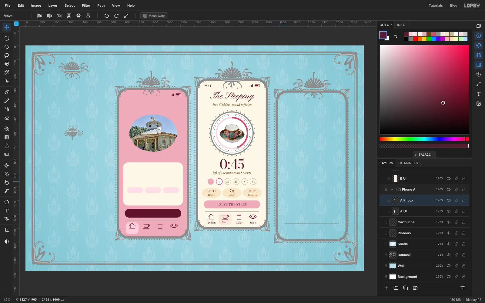

Choose **Select → Inverse**, press [[Delete]] and press [[Cmd+D]].

A daylight snapshot is much too modern for a porcelain painting. Choose **Filter → Hue/Saturation…**, set **Saturation** to **−38** and **Lightness** to **5**, and click **Apply**. Don't press Enter inside a filter's value box, because that applies the filter straight away. Press [[Tab]] to move on instead.

Press [[M]], marquee the oval, press [[V]] and [[Cmd]]-drag a corner until it's **340 px** wide. Press [[Cmd+D]] and drag it so its middle is at y 306 on the phone's centre line (document y 621). Reducing a photo this much softens it a little, so choose **Filter → Unsharp Mask…** with **Radius 1** and **Amount 0.5**.

## Finish the home screen

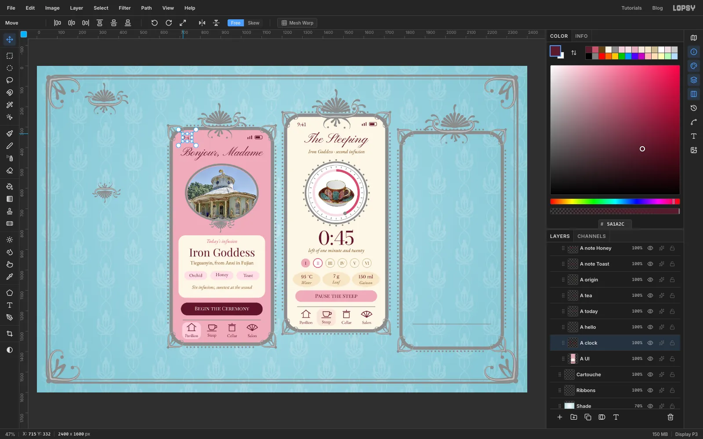

Click *A Gilt*. With the **Shape** tool, make an ellipse with no fill and a `#8C8C8C` stroke, **Width 9**, 352 × 276, at y 306 on the centre line, around the photo.

Click *Master*, marquee the crest and press [[Cmd+C]], then [[Cmd+D]]. Click *A Gilt*, paste, click **Flip Vertical**, [[Cmd]]-drag it down to about **46%**, press [[Cmd+D]] and drag it to sit under the medallion at about y 456. **Merge Down** to fold it into *A Gilt*.

Now the text on *A UI*, from the bottom up, all centred unless it says otherwise:

- Tab labels as before, y 1006
- *Begin the Ceremony*, Playfair Display SC 25 `#FCF6E8`, y 873
- *Six infusions, sweetest at the second*, EB Garamond italic 23 `#6B4514`, y 772
- *Orchid*, *Honey*, *Toast*, EB Garamond 23 `#5A1A2C`, y 710, centred in their pills
- *Tieguanyin, from Anxi in Fujian*, EB Garamond 25 `#6B4514`, y 652
- *Iron Goddess*, Playfair Display 54 `#5A1A2C`, y 598
- *Today's infusion*, EB Garamond italic 25 `#C8546E`, y 546
- *Bonjour, Madame*, Pinyon Script 60 `#5A1A2C`, y 112
- *9:41*, as before

## Build the cellar screen

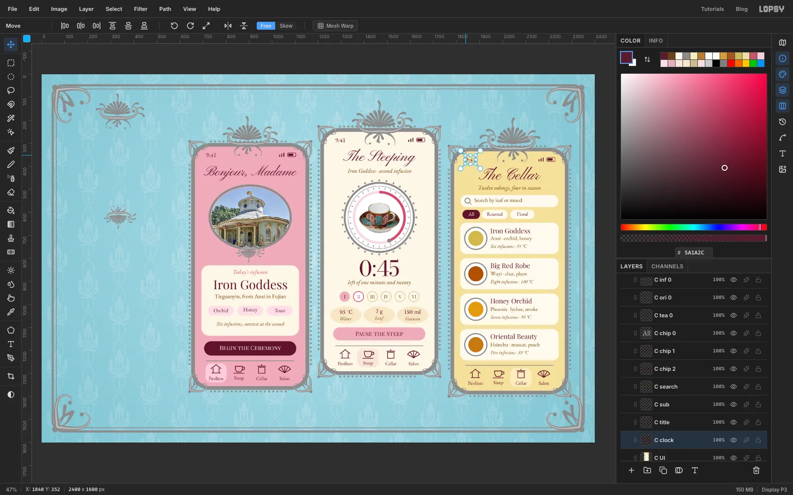

Phone C's screen has its top at document y 335 and its left edge at x 1790, and its centre line is x 2030. Click *C UI* and make the shapes:

- **Screen:** rectangle `#F1E0A2`, 480 × 1040, radius 66, in the middle of the frame (document x 2030, y 855)
- **Search field:** rectangle `#FFFBEF`, 424 × 52, radius 26, at y 216
- **Chips:** three rectangles, 40 tall, radius 20, at y 274. *All* is `#5A1A2C`, 76 wide, centred 74 px in. *Roasted* is `#FFFBEF`, 112 wide, centred 176 px in. *Floral* is `#FFFBEF`, 104 wide, centred 296 px in.
- **Four cards:** rectangles `#FFFBEF`, 428 × 136, radius 28, at y 378, 532, 686 and 840
- **Bowls:** on each card, 94 px in from the left edge, a 92 × 92 white ellipse, then a 66 × 66 ellipse of tea on top: `#CDB95C`, `#A5561F`, `#D79C38` and `#BC7C2E`

Add the status bar and the tab bar, with the highlight in `#FBEDC2` behind the third icon.

Click *C Gilt*. With the **Shape** tool, put a `#8C8C8C` ring, 96 × 96, **Width 5**, no fill, around each bowl. Add a 22 × 22 ring at **Width 4** in the search field, 58 px in, and a short [[Shift]]-click line off its lower right with the **Brush** at **Size 4** in `#8C8C8C`. That's the magnifying glass.

Then the text on *C UI*, from the bottom up. The three lines in each card are left-aligned, 158 px in from the screen's left edge. The rest are centred unless noted:

- Tab labels as before
- Card by card, bottom card first, with *n* as the card's y: the third line in EB Garamond italic 21 `#6B4514` at *n*+36, the second in EB Garamond 23 `#6B4514` at *n*+2, the name in Playfair Display 29 `#5A1A2C` at *n*−34
  - *Oriental Beauty*, *Hsinchu · muscat, peach*, *Five infusions · 85 °C*
  - *Honey Orchid*, *Phoenix · lychee, smoke*, *Seven infusions · 95 °C*
  - *Big Red Robe*, *Wuyi · char, plum*, *Eight infusions · 100 °C*
  - *Iron Goddess*, *Anxi · orchid, honey*, *Six infusions · 95 °C*
- Chip labels in EB Garamond 22, y 272: *All* in `#FCF6E8`, *Roasted* and *Floral* in `#5A1A2C`
- *Search by leaf or mood*, EB Garamond 24 `#6B4514`, y 214, starting 88 px in
- *Twelve oolongs, four in season*, EB Garamond italic 25 `#6B4514`, y 160
- *The Cellar*, Pinyon Script 70 `#5A1A2C`, y 98
- *9:41*, as before

## Set the title in its cartouche

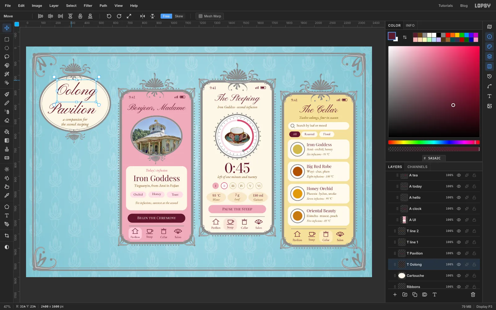

A *cartouche* is an ornamental frame around an inscription. All positions from here on are document pixels again. Click *Cartouche* and, with the **Shape** tool, make a `#FCF6E8` ellipse, 480 × 380, at x 340, y 395.

Click *T Drop*. Make two ellipses in the same place with no fill and a `#8C8C8C` stroke: 490 × 390 at **Width 10**, and 462 × 362 at **Width 2**.

Click *Cartouche* again for each line of text, bottom up, in `#5A1A2C` for the title and `#6B4514` for the rest:

- *the second steeping*, EB Garamond italic 28, y 541, centred on x 340
- *a companion for*, the same, y 507
- *Pavilion*, Pinyon Script 110, y 421, centred on about x 318
- *Oolong*, Pinyon Script 110, y 311, centred on about x 354

Staggering the two words sideways gives the tail of the *g* somewhere to go. Stacked straight, it runs into the *l* of *Pavilion*. Check that the descenders sit well clear of the tagline and that nothing touches the thin inner ring.

## Trace the teapot, including the handle hole

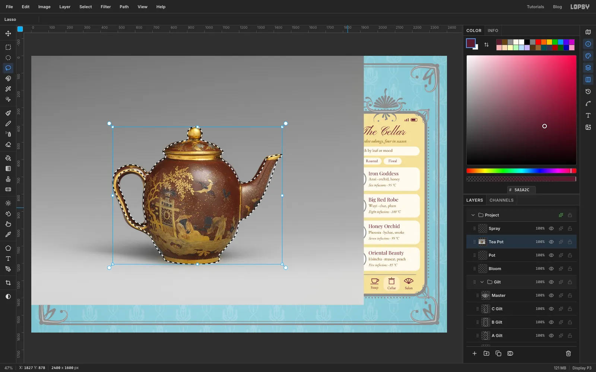

Click *Pot*, drag the teapot photo onto the canvas and press [[Cmd+D]]. Rename the layer *Tea Pot*.

Press [[L]] and trace around the outside of the whole pot in one drag, including knob, spout and handle. Follow the foot closely, and leave out the soft shadow on the table.

Now hold [[Alt]] and trace inside the handle's hole. Alt takes that area out of the selection, so the wall will show through the handle.

Choose **Select → Shrink…** and enter **3**. Pulling the selection in by a few pixels removes the pale fringe that any hand trace leaves behind. Choose **Select → Inverse**, press [[Delete]] and press [[Cmd+D]].

Press [[M]], marquee the pot, press [[V]], then [[Cmd]]-drag a corner until it's **440 px** wide, press [[Cmd+D]], and drag it to about x 345, y 924.

## Hang the pot on a wall bracket

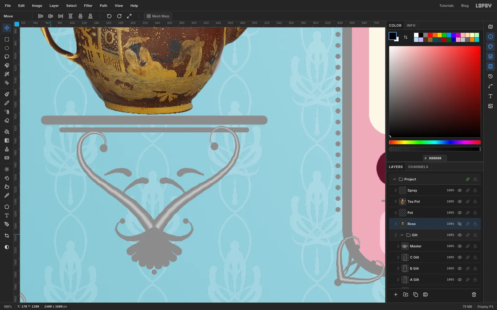

Rococo porcelain was often shown on a gilt bracket fixed to the wall.

Click *T Drop*. With the **Shape** tool, make two filled `#8C8C8C` rectangles for the shelf and the rail below it: 372 × 15, radius 7, at x 340, y 1112, and 312 × 8, radius 4, at x 340, y 1128.

Press [[B]], with the foreground at `#8C8C8C`:

1. Set **Hardness 100**, **Size 23**, **Taper 300**. Start at about x 342, y 1293 and draw up and to the right, in a long curve that swings out and then curls back on itself just under the shelf, about 285 px long. Do the same to the left, a little shorter. Together they make a heart.
2. Set **Size 14**, **Taper 90**. Add a small hooked curl each side at the bottom, then eight shell ribs fanning downwards from the same point, each from the rim up to the point.
3. Set **Size 11**, **Taper 60**, and add two small leaves inside each arm.
4. Set the foreground to `#C8C8C8`, **Hardness 0**, **Size 13**, **Taper 300**, and repeat the two big scrolls down their middles. Then back to `#8C8C8C`, **Hardness 100**, **Taper 0**.
5. Click dots at **Size 14** at the end of each big scroll, **Size 10** at the end of each hook, **Size 20** where the scrolls meet, and **Size 10** under the shell.

For the plaque, click *Cartouche* and make a `#FCF6E8` rectangle, 376 × 56, radius 28, at x 445, y 1468. Click *T Drop* and make a stroke-only `#8C8C8C` rectangle around it, 388 × 68, radius 34, **Width 5**.

## Cut out the roses with the Magic Wand

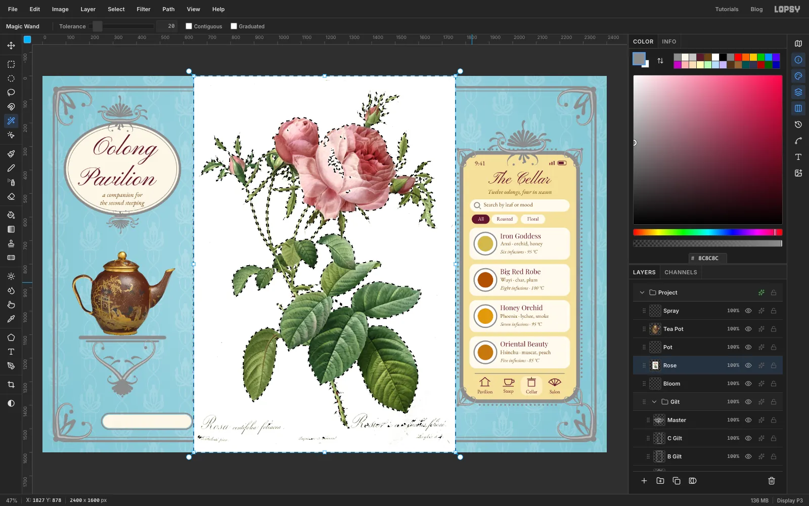

Click *Bloom*, drag the rose print onto the canvas and press [[Cmd+D]]. Rename the layer *Rose*. It's taller than the document, so it lands centred and shrunk to fit.

Press [[W]] for the **Magic Wand**. Set **Tolerance** to **20** and untick **Contiguous**, so it also takes the white between the stems. Click in the paper near a corner. Then click in the status bar to take focus off the options bar. Choose **Select → Grow…** with **2** to eat the pale fringe. Press [[Delete]], then [[Cmd+D]].

Press [[M]], marquee the printed caption along the bottom of the plate, and press [[Delete]] and [[Cmd+D]].

The wand also punches holes wherever a petal's highlight is nearly white. Click the empty *Bloom* layer below, set the foreground to `#F3D3D8`, and fill an elliptical marquee behind each of the two big roses, a little smaller than the flower, with **Edit → Fill**. Press [[Cmd+D]]. Click *Rose* and choose **Layer → Merge Down**, then rename the result *Rose*. Now the holes show pale pink instead of the wall.

## Place the roses

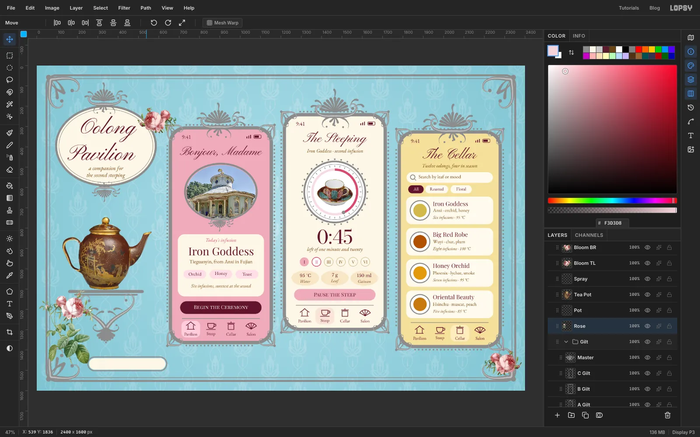

Two loose flowers break the frames and tie the two sides of the board together.

With *Rose* active, press [[L]] and loop around the two big blooms and their buds, then press [[Cmd+C]] and [[Cmd+D]]. Click *Spray* and paste:

- [[Cmd]]-drag a corner down to about **24%**, press [[Cmd+D]] and drag the copy onto the lower right corner of the rail, overlapping the scroll. Rename it *Bloom BR*.
- Click *Spray*, paste again, click **Flip Horizontal**, scale to about **25%**, press [[Cmd+D]] and drag it to where the oval nearly meets the first phone, overlapping the oval's edge. Rename it *Bloom TL*. Flipping means it isn't obviously the same flower twice.

Click *Rose*. Dark leaves would outweigh the phones, so choose **Filter → Hue/Saturation…** with **Saturation −12** and **Lightness 8**. Press [[M]] and marquee the whole plant. Press [[V]], [[Cmd]]-drag a corner until it's about **270 px** wide, press [[Cmd+D]], and drag it to the lower left corner of the board, beside the bracket, with its leaves clear of the plaque's text.

## Add the captions

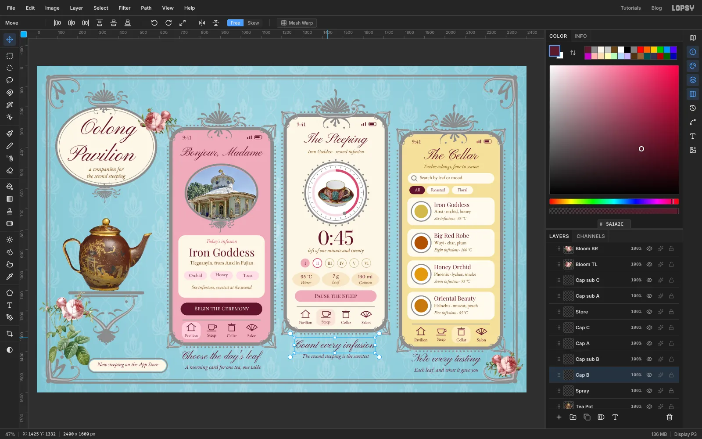

Click *Spray* before each new line, so the text goes on top. Use `#5A1A2C` for all of it, and don't repeat words from the screens above. Captions should add something. Bottom lines first:

- Under phone A, centred on x 911: *Choose the day's leaf* in Pinyon Script 54 at y 1424, and *A morning card for one tea, one table* in EB Garamond italic 27 at y 1478
- Under phone B, centred on x 1465: *Count every infusion* at y 1370, and *The second steeping is the sweetest* at y 1424
- Under phone C, centred on x 2006: *Note every tasting* at y 1438, and *Each leaf, and what it gave you* at y 1492
- On the plaque, centred on x 445: *Now steeping on the App Store* in EB Garamond italic 27 at y 1465

## Collect the metal

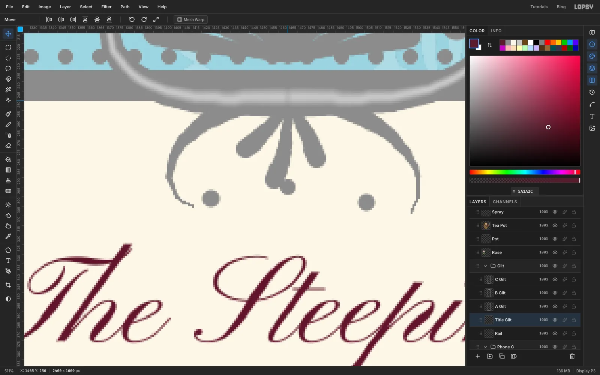

Nearly there. Look closely at your metal: it's flat, dull grey with a slightly lighter line down each big scroll. Next, tidy it into five layers.

- **The master crest.** Click *Master*, marquee the crest and copy, then press [[Cmd+D]]. Click *B Gilt*, paste (it lands in place), press [[Cmd+D]], and **Merge Down**. Then click *Master* and delete it.
- **The title pieces.** Click *T Crest* and **Merge Down** twice, so *T Crest* and *T Drop* both fold into *Title Gilt*. Rename the result *Title Gilt*.

You should now have *Rail*, *Title Gilt*, *A Gilt*, *B Gilt* and *C Gilt* inside the *Gilt* group.

## Emboss every piece of metal

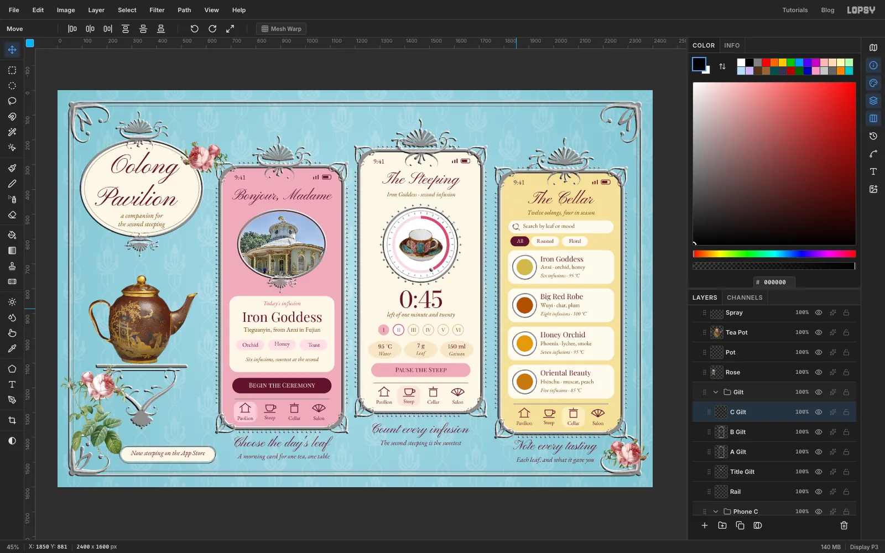

Do these three steps on each of the five layers in turn. Filter dialogs reset every time, so check the values on each one.

1. Click the layer and choose **Filter → Emboss…**. Keep **Type** on **Emboss** and **Angle** at **135**, set **Strength** to **45**, and click **Apply**. Emboss turns the flat grey into a mid-grey with light and dark edges, and the soft ridge lines from earlier become a raised spine.
2. Hold [[Cmd]] and click the layer's thumbnail to load its shape as a selection.
3. Choose **Filter → Gaussian Blur…** with **Radius 2** and click **Apply**, then press [[Cmd+D]].

Blurring inside a selection softens the hard edge of the relief but keeps the outline crisp. Without this step, the bevels look like two hard slices of colour. With it, they look like cast metal.

## Turn the grey to gold

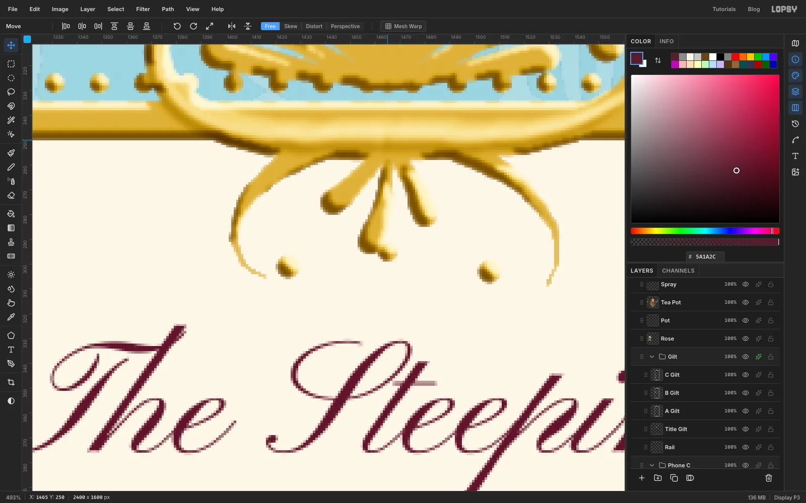

Click the sparkle button on the *Gilt* group's row to open its adjustments, click **Add Adjustment** and choose **Gradient Map**. A gradient map replaces each shade of grey with a colour from a gradient, and because it sits on the group, it colours all five layers at once.

Click the left stop and type `#55360C` in the **Hex** field. Click the right stop and type `#FFF8D6`. Then click on the gradient bar itself to add three more stops. Each click adds a stop and selects it, ready for its hex:

- at about 28%, `#96701F`
- at about 50%, `#CFA63F`
- at about 70%, `#F0D67E`

Close the drawer. Everything you've painted over the last two hours turns to gold in one go, which is one of the better moments in this tutorial. Dark stops are kept a warm brown rather than black, because near-black lines make gold look like cheap clip art.

## Add the shadows

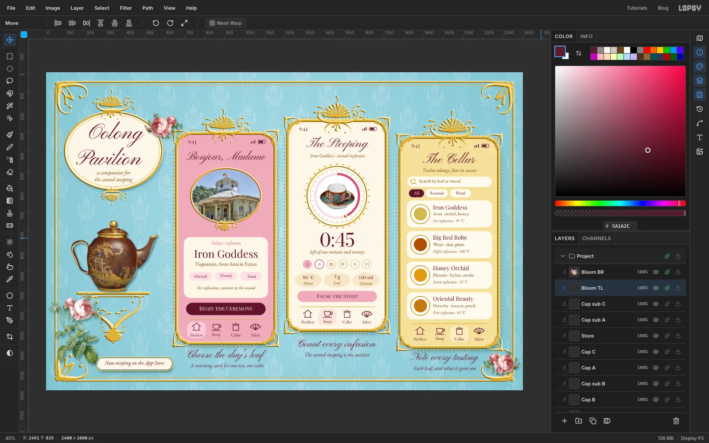

Open each layer's effects with its sparkle button, tick **Drop Shadow**, and click its name to show its controls. Click the colour swatch, which opens your system colour picker, and enter `#123F44`. A dark version of the wall colour looks like real shadow on a blue wall. Grey or black would look like a smudge. Use these values for **Offset X**, **Offset Y**, **Blur** and **Opacity**:

- *Cartouche*: 8, 14, 26, 45
- *A UI*, *B UI*, *C UI*: 12, 22, 40, 55
- *Tea Pot*: 6, 8, 12, 45
- *Rose*: 6, 10, 14, 40
- *Bloom BR*, *Bloom TL*: 4, 7, 10, 40

## Scale and hang the phones

The phones are too close together, and frames that are perfectly straight look like a template. So you'll shrink each one slightly and let the outer two hang a touch crooked.

Each phone is two pieces now: its screen group and its metal layer. Lopsy can transform them as one.

1. Press [[V]] for the **Move** tool and press [[Cmd+D]], so there's no selection.
2. Click the *Phone A* group's name, then hold [[Cmd]] and click the name *A Gilt*. Click the names, not the thumbnails, since [[Cmd]]-clicking a thumbnail loads a selection instead. The handles frame both together.
3. [[Cmd]]-drag the bottom right corner handle in by about 6%, which is about 32 px across. That corner moves while the top left stays pinned.
4. Drag from inside the box to slide the phone back to where it was, about 16 px right and 38 px down.
5. Drag the round rotation handle just outside a corner, to tilt the phone very slightly anticlockwise, about 1.5°. The tip of the crest should swing about 16 px to the left. Don't hold [[Cmd]] here, because it snaps to 15°.

Do the same with *Phone B* and *B Gilt*, but don't rotate it. Then do it with *Phone C* and *C Gilt*, rotating about 1.5° clockwise. Live text stays live through all of this, so you can still fix a typo later.

Press [[Cmd+D]] when you're done.

## Tie the ribbons

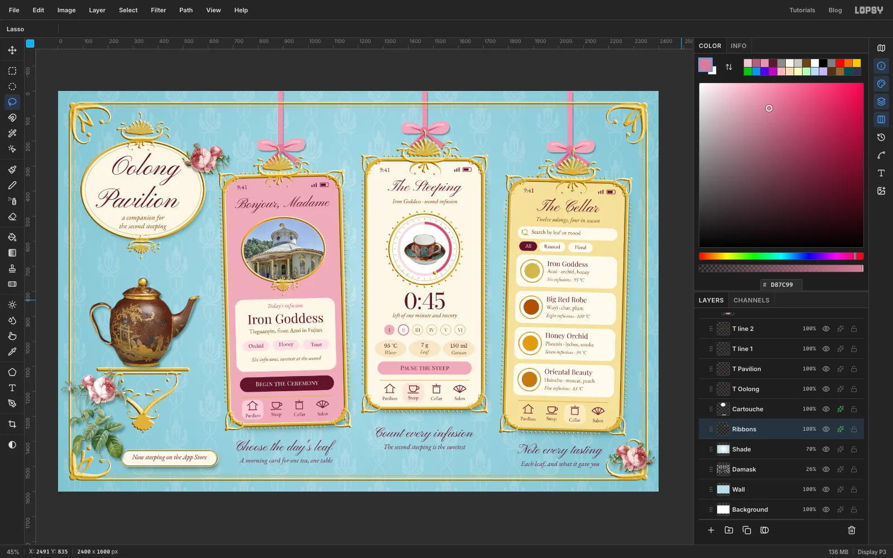

Click *Ribbons*. It sits under everything else, so ribbons pass behind the rail and crests. Now that the phones have settled, you can see where the ribbons need to go. The tilt moves each crest about 16 px sideways, so phone A's ribbon sits at about x 889 and phone C's at about x 2046. Phone B's stays at x 1465.

**Bands.** Set the foreground to `#E795AE` and the **Brush** to **Size 20**, **Hardness 100**, **Taper 0**. Click at the very top of the canvas and [[Shift]]-click down to the tip of each crest's flame. That's at about y 227 on phone A, y 159 on phone B and y 234 on phone C.

**Bows.** Each bow is centred where its band ends, right on the tip of the crest. Press [[L]] and draw each bow's parts freehand, using **Edit → Fill** on each selection and [[Cmd+D]] between them:

- two short tails, about 75 px long, slanting out and down from the centre, in `#DE86A1`. They tuck behind the crest.
- two rounded loops, about 95 px wide and 45 px tall, one each side, in `#E8A9BA`

**Folds.** With the **Brush** at **Size 10**, **Hardness 30**, **Taper 56** and `#B95C7E`, draw a line from the centre out along each loop and down each tail. With **Size 12**, **Hardness 20**, **Taper 60** and `#F1C6D2`, draw a short highlight along the top of each loop, from its outer end in towards the centre.

**Knot.** Last, so it covers the ends of the folds, lasso a small square about 30 px across in the centre and fill it with `#D87C99`.

Reset the **Brush** to **Taper 0**, and add a **Drop Shadow** to *Ribbons*: `#123F44`, 3, 5, 6, 45.

## Grade the whole board

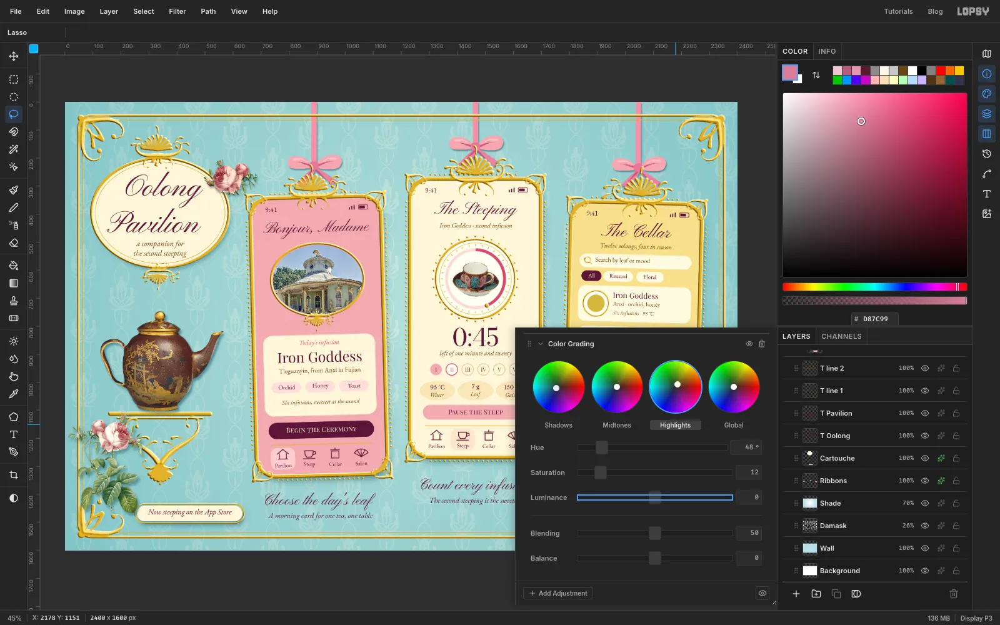

The photos, the flat UI and the gold still come from three different worlds. A gentle overall grade pulls them together. Choose **Layer → Adjustment Layer…**, and click **Got it** if the note appears. This opens the adjustments for the document's root group.

Click **Add Adjustment** and choose **Color Grading**. Each wheel tints a tonal range, and you can drag on the wheels or use the sliders below them:

- Click the **Shadows** label under the first wheel. Set **Hue** to **215** and **Saturation** to **10**, which cools the shadows slightly.
- Click the **Highlights** label under the third wheel. Set **Hue** to **48** and **Saturation** to **12**, which warms the highlights to the colour of old porcelain.

Click **Add Adjustment** again, choose **Vignette** and set it to **20**.

Close the drawer and press [[Cmd+D]]. Check every line of text at 100% one last time, then choose **File → Save Project** and **File → Quick Export PNG**.
